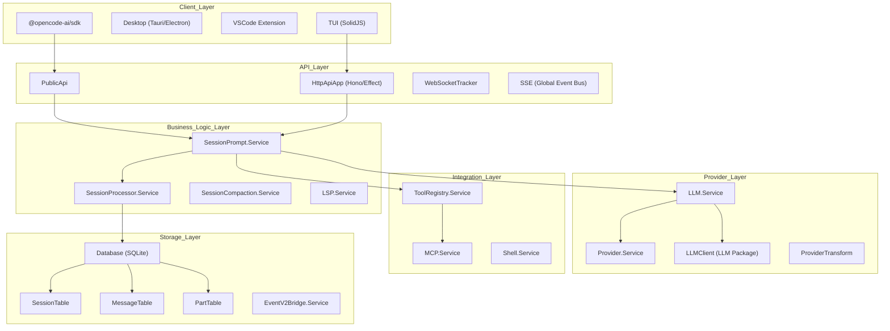
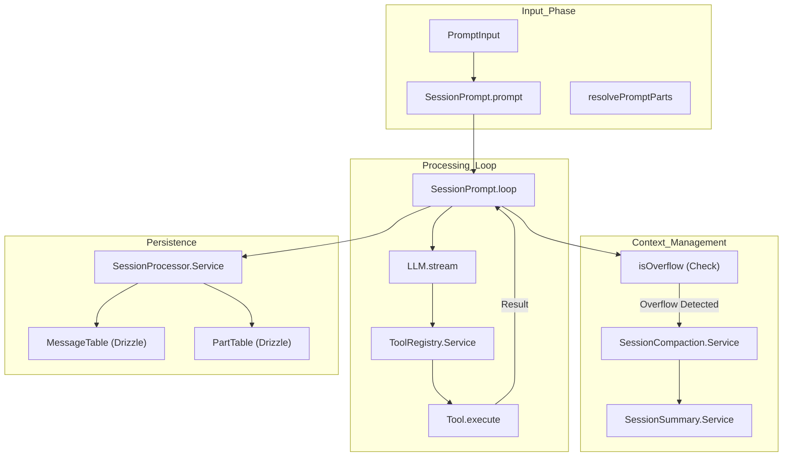
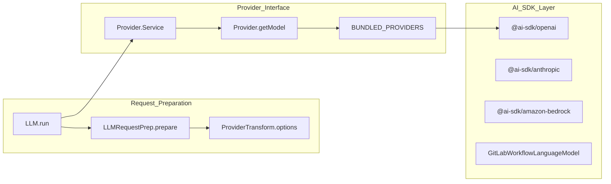

<!-- source: DeepWiki mcp.deepwiki.com · repo sst/opencode · page 1.2 Architecture Overview · fetched 2026-10-27 -->

# Architecture Overview

Relevant source files

The following files were used as context for generating this wiki page:

- [packages/opencode/src/acp/agent.ts](packages/opencode/src/acp/agent.ts)
- [packages/opencode/src/agent/agent.ts](packages/opencode/src/agent/agent.ts)
- [packages/opencode/src/config/config.ts](packages/opencode/src/config/config.ts)
- [packages/opencode/src/server/server.ts](packages/opencode/src/server/server.ts)
- [packages/opencode/src/session/compaction.ts](packages/opencode/src/session/compaction.ts)
- [packages/opencode/src/session/llm.ts](packages/opencode/src/session/llm.ts)
- [packages/opencode/src/session/llm/ai-sdk.ts](packages/opencode/src/session/llm/ai-sdk.ts)
- [packages/opencode/src/session/message-v2.ts](packages/opencode/src/session/message-v2.ts)
- [packages/opencode/src/session/processor.ts](packages/opencode/src/session/processor.ts)
- [packages/opencode/src/session/prompt.ts](packages/opencode/src/session/prompt.ts)
- [packages/opencode/src/session/session.ts](packages/opencode/src/session/session.ts)
- [packages/opencode/src/session/summary.ts](packages/opencode/src/session/summary.ts)
- [packages/opencode/src/tool/registry.ts](packages/opencode/src/tool/registry.ts)
- [packages/opencode/test/agent/agent.test.ts](packages/opencode/test/agent/agent.test.ts)
- [packages/opencode/test/config/config.test.ts](packages/opencode/test/config/config.test.ts)
- [packages/opencode/test/session/compaction.test.ts](packages/opencode/test/session/compaction.test.ts)
- [packages/opencode/test/session/llm.test.ts](packages/opencode/test/session/llm.test.ts)
- [packages/opencode/test/session/messages-pagination.test.ts](packages/opencode/test/session/messages-pagination.test.ts)
- [packages/opencode/test/session/processor-effect.test.ts](packages/opencode/test/session/processor-effect.test.ts)
- [packages/opencode/test/session/prompt.test.ts](packages/opencode/test/session/prompt.test.ts)
- [packages/opencode/test/session/snapshot-tool-race.test.ts](packages/opencode/test/session/snapshot-tool-race.test.ts)
- [packages/opencode/test/tool/registry.test.ts](packages/opencode/test/tool/registry.test.ts)
- [packages/plugin/src/tool.ts](packages/plugin/src/tool.ts)
- [packages/sdk/js/src/v2/gen/sdk.gen.ts](packages/sdk/js/src/v2/gen/sdk.gen.ts)
- [packages/sdk/js/src/v2/gen/types.gen.ts](packages/sdk/js/src/v2/gen/types.gen.ts)
- [packages/sdk/openapi.json](packages/sdk/openapi.json)
- [perf/test-suite.md](perf/test-suite.md)

## Purpose and Scope

This document presents the high-level system architecture of OpenCode, describing how its major components interact to deliver AI-powered coding assistance. It covers the session processing pipeline, provider integration, and the client-server communication model.

OpenCode is built on a layered architecture that bridges high-level user intent with low-level system operations (file manipulation, terminal execution, and LSP interactions) using the [Effect](https://effect.website/) ecosystem for robust service management and dependency injection.

---

## System Layering and Request Flow

OpenCode follows a layered architecture where client applications communicate with an HTTP server that orchestrates AI sessions, provider interactions, and tool executions. The system uses an [Effect](https://effect.website/) based backend that supports both a public API and internal instance management.

Title: "High-Level System Architecture"

**Request Flow:**

1.  **Entry Point**: The server is initialized via `listen`, which sets up the `HttpApiApp` routes and middleware [packages/opencode/src/server/server.ts:73-81]().
2.  **API Handling**: Requests are handled by `PublicApi` and `HttpApiApp`, providing endpoints for auth, logs, and session management [packages/opencode/src/server/server.ts:10-13](), [packages/sdk/openapi.json:9-123]().
3.  **Prompt Orchestration**: The `SessionPrompt.Service` handles incoming prompts, resolving them into `MessageV2` structures and managing the agentic loop [packages/opencode/src/session/prompt.ts:102-109]().
4.  **LLM Execution**: The `LLM.Service` manages streaming interactions. It prepares requests via `LLMRequestPrep` and uses `LLMClient` for routing to providers [packages/opencode/src/session/llm.ts:75-83](), [packages/opencode/src/session/llm.ts:106-113]().
5.  **Eventing**: System-wide state changes (e.g., `EventMessageUpdated`, `EventMessagePartDelta`) are broadcast via the `EventV2Bridge.Service` [packages/opencode/src/session/llm.ts:81-81](), [packages/sdk/js/src/v2/gen/types.gen.ts:7-51]().

Sources: [packages/opencode/src/server/server.ts:73-138](), [packages/opencode/src/session/prompt.ts:102-151](), [packages/opencode/src/session/llm.ts:75-113](), [packages/sdk/openapi.json:1-123](), [packages/sdk/js/src/v2/gen/types.gen.ts:7-97]()

---

## Session Processing Pipeline

The session pipeline transforms user prompts into assistant actions through an agentic loop (`SessionPrompt.loop`), managing context overflow via compaction and ensuring persistence through a specialized processor.

Title: "Session Processing Pipeline"

**Key Components:**

| Component | Responsibility | Reference |
|-----------|---------------|-----------|
| `SessionPrompt` | Main interface for prompt execution, cancellation, and loop orchestration. | [packages/opencode/src/session/prompt.ts:102-109]() |
| `MessageV2` | Utility for hydrating and converting session messages into provider-compatible `ModelMessage` formats. | [packages/opencode/src/session/message-v2.ts:98-135]() |
| `SessionCompaction` | Handles context pruning, token estimation, and summary generation when token limits are exceeded. | [packages/opencode/src/session/compaction.ts:130-150](), [packages/opencode/src/session/compaction.ts:180-186]() |
| `LLM.Service` | Abstraction layer that prepares `LLMRequest` and handles provider-specific streaming, including specialized GitLab Workflow support. | [packages/opencode/src/session/llm.ts:54-56](), [packages/opencode/src/session/llm.ts:119-127]() |

Sources: [packages/opencode/src/session/prompt.ts:102-160](), [packages/opencode/src/session/message-v2.ts:98-205](), [packages/opencode/src/session/compaction.ts:130-206](), [packages/opencode/src/session/llm.ts:54-150]()

---

## Provider and Model Abstraction

OpenCode integrates with various LLM providers by leveraging a custom transformation layer (`ProviderTransform`) and model metadata resolution via the `Provider.Service`.

Title: "LLM Provider Integration Architecture"

**Model Resolution:**
The `Provider.Service` instantiates language models using `BUNDLED_PROVIDERS` (e.g., `@ai-sdk/openai`, `@ai-sdk/anthropic`) [packages/opencode/src/provider/provider.ts:107-134](). `LLMRequestPrep` normalization ensures compatibility across different APIs before they reach provider SDKs [packages/opencode/src/session/llm.ts:106-113]().

**Integration Details:**
- **ProviderTransform**: Normalizes messages and handles provider-specific quirks, such as sanitizing surrogates [packages/opencode/src/provider/transform.ts:25-27]() and managing output token limits [packages/opencode/src/provider/transform.ts:18-18]().
- **GitLab Workflow**: Specialized integration where `toolExecutor` is wired to OpenCode's tool system to allow GitLab Duo to execute local tools [packages/opencode/src/session/llm.ts:119-147]().
- **Structured Output**: Support for enforcing JSON schemas via `STRUCTURED_OUTPUT_SYSTEM_PROMPT` and `OutputFormatJsonSchema` [packages/opencode/src/session/prompt.ts:74-82](), [packages/sdk/js/src/v2/gen/types.gen.ts:231-235]().

Sources: [packages/opencode/src/provider/provider.ts:107-160](), [packages/opencode/src/provider/transform.ts:1-195](), [packages/opencode/src/session/llm.ts:95-160](), [packages/opencode/src/session/prompt.ts:74-82](), [packages/sdk/js/src/v2/gen/types.gen.ts:231-235]()

---

## Data Flow and Persistence

OpenCode uses a SQLite database with [Drizzle ORM](https://orm.drizzle.team/) for persistent storage and an event-based system for real-time updates.

- **Schema**: Data is organized into `SessionTable`, `MessageTable`, and `PartTable` [packages/opencode/src/session/message-v2.ts:30-30]().
- **Hydration**: The `hydrate` function in `MessageV2` reconstructs full message objects with their constituent parts from the database using Drizzle queries [packages/opencode/src/session/message-v2.ts:98-123]().
- **Real-time Events**: The system emits a wide variety of events (e.g., `EventSessionNextStepStarted`, `EventMessagePartDelta`) which are auto-generated in the SDK [packages/sdk/js/src/v2/gen/types.gen.ts:7-53]().
- **Auth and Credentials**: Supports multiple auth types including OAuth, API keys, and Well-Known tokens [packages/sdk/js/src/v2/gen/types.gen.ts:109-132]().

Sources: [packages/opencode/src/session/message-v2.ts:30-123](), [packages/sdk/js/src/v2/gen/types.gen.ts:7-132](), [packages/sdk/openapi.json:1-123]()

---

