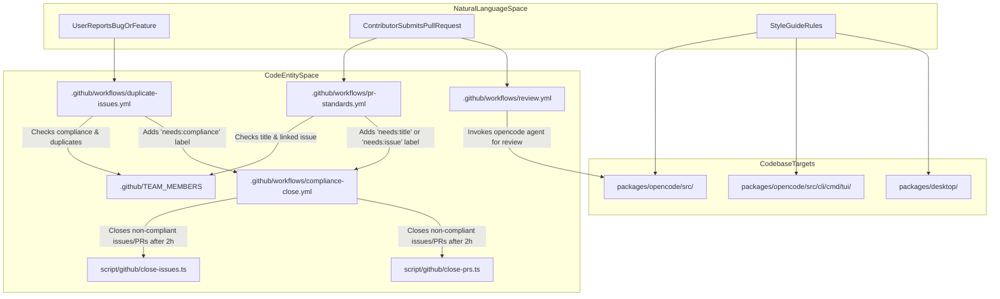
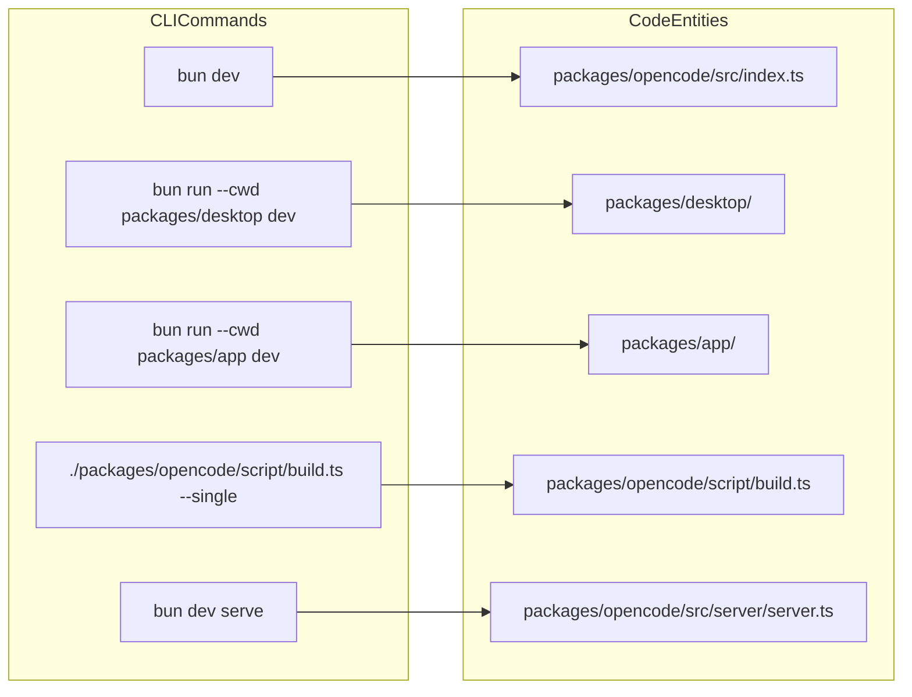

<!-- source: DeepWiki mcp.deepwiki.com · repo sst/opencode · page 10.2 License and Contributing · fetched 2026-10-27 -->

# License and Contributing

<details>
<summary>Relevant source files</summary>

The following files were used as context for generating this wiki page:

- [.github/ISSUE_TEMPLATE/config.yml](.github/ISSUE_TEMPLATE/config.yml)
- [.github/workflows/close-prs.yml](.github/workflows/close-prs.yml)
- [.github/workflows/compliance-close.yml](.github/workflows/compliance-close.yml)
- [.github/workflows/docs-update.yml](.github/workflows/docs-update.yml)
- [.github/workflows/duplicate-issues.yml](.github/workflows/duplicate-issues.yml)
- [.github/workflows/notify-discord.yml](.github/workflows/notify-discord.yml)
- [.github/workflows/pr-management.yml](.github/workflows/pr-management.yml)
- [.github/workflows/pr-standards.yml](.github/workflows/pr-standards.yml)
- [.github/workflows/review.yml](.github/workflows/review.yml)
- [.github/workflows/triage.yml](.github/workflows/triage.yml)
- [README.md](README.md)
- [packages/opencode/src/util/queue.ts](packages/opencode/src/util/queue.ts)
- [packages/web/src/assets/web/web-homepage-active-session.png](packages/web/src/assets/web/web-homepage-active-session.png)
- [packages/web/src/assets/web/web-homepage-new-session.png](packages/web/src/assets/web/web-homepage-new-session.png)
- [packages/web/src/assets/web/web-homepage-see-servers.png](packages/web/src/assets/web/web-homepage-see-servers.png)
- [packages/web/src/components/Lander.astro](packages/web/src/components/Lander.astro)
- [packages/web/src/content/docs/index.mdx](packages/web/src/content/docs/index.mdx)
- [packages/web/src/content/docs/models.mdx](packages/web/src/content/docs/models.mdx)
- [packages/web/src/content/docs/skills.mdx](packages/web/src/content/docs/skills.mdx)
- [packages/web/src/content/docs/troubleshooting.mdx](packages/web/src/content/docs/troubleshooting.mdx)
- [packages/web/src/content/docs/web.mdx](packages/web/src/content/docs/web.mdx)
- [packages/web/src/content/docs/windows-wsl.mdx](packages/web/src/content/docs/windows-wsl.mdx)
- [script/github/close-issues.ts](script/github/close-issues.ts)
- [script/github/close-prs.ts](script/github/close-prs.ts)

</details>


This page documents the licensing terms for OpenCode and provides technical guidelines for contributions. It covers the MIT license, repository standards, development workflows, technical style guides, and the architectural principles that govern the codebase.

---

## License Terms

OpenCode is released under the **MIT License**, a permissive open-source license.

### Copyright Notice
```text
Copyright (c) 2025 opencode
```

The project maintains an architectural philosophy of being provider-agnostic and encourages community involvement in its development. The license applies to the core agent logic, the TUI, and the supporting package ecosystem.

Sources: [README.md:1-122]()

---

## Contributing Guidelines

OpenCode maintains strict standards for contributions to ensure code quality and consistency across the monorepo.

### Types of Accepted Changes
As defined in the project's contribution guide [README.md:121](), the following changes are prioritized:
- Bug fixes and performance improvements.
- Additional Language Server Protocol (LSP) integrations or Formatters.
- Support for new AI providers via the [models.dev](https://github.com/anomalyco/models.dev) repository.
- Documentation improvements.
- Fixes for environment-specific quirks.

**Note:** Any UI or core product feature must undergo a design review with the core team before implementation.

### Issue-First Policy
**All PRs must reference an existing issue**. Before opening a PR, contributors should open an issue describing the bug or feature to allow maintainers to triage the request. PRs that ignore these guardrails are likely to be closed. Automated workflows enforce these policies by checking for linked issues and compliance with templates.

The `pr-standards` workflow [.github/workflows/pr-standards.yml:1-5]() checks for linked issues. If a PR does not link to an issue, it adds a `needs:issue` label and comments on the PR [.github/workflows/pr-standards.yml:139-148](). The `duplicate-issues` workflow [.github/workflows/duplicate-issues.yml:1-6]() checks newly opened issues for duplicates and compliance with issue templates.

### Branching and Commits
- **Default Branch:** The default branch is `dev`.
- **Branch Names:** Use short names (max three words) separated by hyphens. Do not use prefixes like `feat/`.
- **Conventional Commits:** Use the format `type(scope): summary`. Valid types include `feat`, `fix`, `docs`, `chore`, `refactor`, and `test`. The `pr-standards` workflow [.github/workflows/pr-standards.yml:86-106]() validates PR titles against this conventional commit format.

Sources: [README.md:121](), [.github/workflows/pr-standards.yml:1-154](), [.github/workflows/duplicate-issues.yml:1-141]()

---

## Technical Style Guide

Contributors must follow the specific coding patterns defined in the project's agent-oriented style guide to ensure the AI agent can effectively reason about the code.

### General Principles
- **Inlining:** Reduce total variable count by inlining values used only once.
- **Functional Patterns:** Prefer functional array methods (`flatMap`, `filter`, `map`) over `for` loops.
- **Bun APIs:** Use native Bun APIs like `Bun.file()` where possible.
- **Control Flow:** Avoid `else` statements; prefer early returns to reduce nesting.
- **Destructuring:** Avoid unnecessary destructuring; use dot notation to preserve context.
- **Imports:** Never use star imports (`import *`) or aliased imports.
- **Effect TS:** In Effect generators, bind services to named variables before calling methods; do not use nested service yields.

### Database Schema (Drizzle)
When defining schemas, use `snake_case` for field names so column names do not need to be redefined as strings.
- **Good:** `created_at: integer().notNull()`
- **Bad:** `createdAt: integer("created_at").notNull()`

### Module Organization
Follow the existing self-export pattern at the top of configuration files (e.g., `export * as ConfigAgent from "./agent"`) when adding new modules.

---

## Development Environment

### Setup and Tooling
The project requires **Bun 1.3+**.

```bash
# Install dependencies
bun install

# Start development server (runs packages/opencode)
bun dev

# Run against a specific directory
bun dev <directory>
```

### Package Responsibilities
The monorepo is organized into specialized packages:
- `packages/opencode`: Core business logic and server entrypoint.
- `packages/opencode/src/cli/cmd/tui/`: TUI implementation using SolidJS and `opentui`.
- `packages/app`: Shared web UI components, written in SolidJS.
- `packages/desktop`: Native desktop app built with Electron (wraps `packages/app`).
- `packages/plugin`: Source for `@opencode-ai/plugin`.
- `packages/web`: Astro-based documentation site [packages/web/src/content/docs/index.mdx:1-14]().

### Debugging Workflows
The most reliable way to debug is running with `--inspect` and attaching via a URL.
- **Debug Server:** `bun run --inspect=ws://localhost:6499/ --cwd packages/opencode ./src/index.ts serve --port 4096`.
- **Attach TUI:** `opencode attach http://localhost:4096`.

Sources: [packages/web/src/content/docs/index.mdx:34-129]()

---

## Contribution Workflow and Automation

The following diagrams map the contribution lifecycle to the specific code entities and processes that govern them.

### Workflow Automation Mapping
This diagram bridges the natural language contribution process to the specific code entities that manage them, including automated review policies and validation rules.



Sources: [.github/workflows/review.yml:1-83](), [.github/workflows/duplicate-issues.yml:1-141](), [.github/workflows/pr-standards.yml:1-154](), [.github/workflows/compliance-close.yml:1-133](), [script/github/close-issues.ts:1-115](), [script/github/close-prs.ts:1-186]()

---

### Dev Command to Package Mapping
This diagram associates developer commands with the underlying code entry points and packages.



---

## Pull Request Standards

PRs are expected to adhere to the following technical standards:

### Testing and Type Checking
- **No Mocks:** Avoid mocks; test actual implementation logic.
- **Run Locally:** Tests and type checking must be run from package directories (e.g., `packages/opencode`), never from the root.
- **Command:** Use `bun typecheck` within the package directory.

### SDK Regeneration
If changes are made to the API or Server `HttpApi` (e.g., in `packages/opencode/src/server/server.ts`), you must regenerate the SDK:
- Run `./script/generate.ts` to update the SDK and related files.
- Run `bun run generate` from `packages/client` for `HttpApi` changes.
- Do not edit `src/generated` or `src/generated-effect` directly.

### Automated Maintenance
OpenCode uses scripts and GitHub Actions to manage repository health and keep documentation synchronized.
- **Issue Closing:** The `script/github/close-issues.ts` script automatically closes issues after 60 days of inactivity, unless the author is exempt (e.g., team member or bot) [script/github/close-issues.ts:3-5]().
- **PR Closing:** The `script/github/close-prs.ts` script automatically closes PRs older than a specified age (default 1 month) with fewer than a threshold of positive reactions (default 2) [script/github/close-prs.ts:6-7](). Exemptions apply for team members [script/github/close-prs.ts:29-38]().
- **Documentation Updates:** The `docs-update` workflow [.github/workflows/docs-update.yml:1-6]() runs periodically to identify and document new features based on recent commits.

Sources: [script/github/close-issues.ts:1-115](), [script/github/close-prs.ts:1-186](), [.github/workflows/docs-update.yml:1-72]()

---

