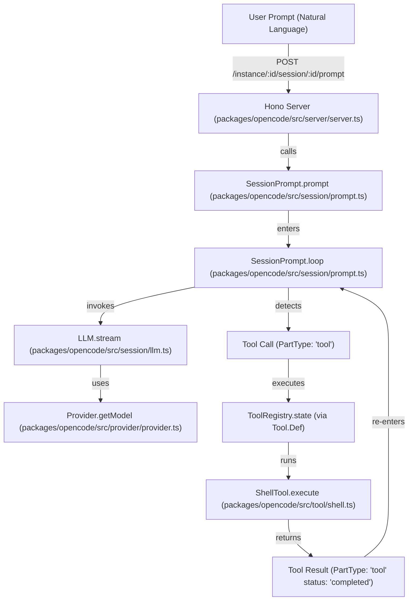
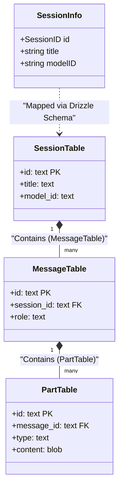

<!-- source: DeepWiki mcp.deepwiki.com · repo sst/opencode · page 11 Glossary · fetched 2026-10-27 -->

# Glossary

Relevant source files

The following files were used as context for generating this wiki page:

- [packages/opencode/src/acp/agent.ts](packages/opencode/src/acp/agent.ts)
- [packages/opencode/src/agent/agent.ts](packages/opencode/src/agent/agent.ts)
- [packages/opencode/src/config/config.ts](packages/opencode/src/config/config.ts)
- [packages/opencode/src/plugin/azure.ts](packages/opencode/src/plugin/azure.ts)
- [packages/opencode/src/provider/provider.ts](packages/opencode/src/provider/provider.ts)
- [packages/opencode/src/provider/transform.ts](packages/opencode/src/provider/transform.ts)
- [packages/opencode/src/server/server.ts](packages/opencode/src/server/server.ts)
- [packages/opencode/src/session/compaction.ts](packages/opencode/src/session/compaction.ts)
- [packages/opencode/src/session/llm.ts](packages/opencode/src/session/llm.ts)
- [packages/opencode/src/session/llm/ai-sdk.ts](packages/opencode/src/session/llm/ai-sdk.ts)
- [packages/opencode/src/session/message-v2.ts](packages/opencode/src/session/message-v2.ts)
- [packages/opencode/src/session/processor.ts](packages/opencode/src/session/processor.ts)
- [packages/opencode/src/session/prompt.ts](packages/opencode/src/session/prompt.ts)
- [packages/opencode/src/session/session.ts](packages/opencode/src/session/session.ts)
- [packages/opencode/src/session/summary.ts](packages/opencode/src/session/summary.ts)
- [packages/opencode/src/tool/registry.ts](packages/opencode/src/tool/registry.ts)
- [packages/opencode/test/agent/agent.test.ts](packages/opencode/test/agent/agent.test.ts)
- [packages/opencode/test/config/config.test.ts](packages/opencode/test/config/config.test.ts)
- [packages/opencode/test/plugin/azure.test.ts](packages/opencode/test/plugin/azure.test.ts)
- [packages/opencode/test/provider/amazon-bedrock.test.ts](packages/opencode/test/provider/amazon-bedrock.test.ts)
- [packages/opencode/test/provider/gitlab-duo.test.ts](packages/opencode/test/provider/gitlab-duo.test.ts)
- [packages/opencode/test/provider/provider.test.ts](packages/opencode/test/provider/provider.test.ts)
- [packages/opencode/test/provider/transform.test.ts](packages/opencode/test/provider/transform.test.ts)
- [packages/opencode/test/session/compaction.test.ts](packages/opencode/test/session/compaction.test.ts)
- [packages/opencode/test/session/llm.test.ts](packages/opencode/test/session/llm.test.ts)
- [packages/opencode/test/session/messages-pagination.test.ts](packages/opencode/test/session/messages-pagination.test.ts)
- [packages/opencode/test/session/processor-effect.test.ts](packages/opencode/test/session/processor-effect.test.ts)
- [packages/opencode/test/session/prompt.test.ts](packages/opencode/test/session/prompt.test.ts)
- [packages/opencode/test/session/snapshot-tool-race.test.ts](packages/opencode/test/session/snapshot-tool-race.test.ts)
- [packages/opencode/test/tool/registry.test.ts](packages/opencode/test/tool/registry.test.ts)
- [packages/plugin/src/tool.ts](packages/plugin/src/tool.ts)
- [packages/sdk/js/src/v2/gen/sdk.gen.ts](packages/sdk/js/src/v2/gen/sdk.gen.ts)
- [packages/sdk/js/src/v2/gen/types.gen.ts](packages/sdk/js/src/v2/gen/types.gen.ts)
- [packages/sdk/openapi.json](packages/sdk/openapi.json)
- [packages/web/src/content/docs/ecosystem.mdx](packages/web/src/content/docs/ecosystem.mdx)
- [packages/web/src/content/docs/providers.mdx](packages/web/src/content/docs/providers.mdx)
- [packages/web/src/content/docs/zh-cn/providers.mdx](packages/web/src/content/docs/zh-cn/providers.mdx)
- [packages/web/src/content/docs/zh-tw/providers.mdx](packages/web/src/content/docs/zh-tw/providers.mdx)
- [patches/@ai-sdk%2Famazon-bedrock@4.0.166.patch](patches/@ai-sdk%2Famazon-bedrock@4.0.166.patch)
- [patches/@ai-sdk%2Fanthropic@3.0.111.patch](patches/@ai-sdk%2Fanthropic@3.0.111.patch)
- [perf/test-suite.md](perf/test-suite.md)

## Purpose and Scope
This wiki page serves as the official glossary for the OpenCode codebase. It defines core domain concepts, architectural terms, jargon, abbreviations, and codebase-specific constructs, linking natural language descriptions to their underlying programmatic implementations and file paths.

---

## Core Domain Concepts

### Session
The primary unit of interaction and state. A session represents a conversational thread between a user and an agent. Sessions are hierarchical, allowing for "child sessions" (forks) that inherit context from a parent.
*   **Implementation**: `Session.Info` defines the schema [packages/sdk/js/src/v2/gen/types.gen.ts:170-221]().
*   **Storage**: Persisted in the `SessionTable` using Drizzle ORM [packages/opencode/src/session/message-v2.ts:30-30]().
*   **Lifecycle**: Managed via `Session.Service` which provides methods like `create`, `get`, and `update` [packages/opencode/src/session/session.ts:180-213]().

### MessageV2 & Part
OpenCode uses a granular message model where a `MessageV2` is composed of multiple `Part` objects. This allows a single assistant response to contain text, tool calls, and reasoning simultaneously.
*   **MessageV2**: The container for a turn in the conversation [packages/sdk/js/src/v2/gen/types.gen.ts:239-262]() (UserMessage) and [packages/sdk/js/src/v2/gen/types.gen.ts:300-323]() (AssistantMessage).
*   **Part**: The atomic unit of content. Types include `TextPart` [packages/opencode/src/session/message-v2.ts:97-111](), `ToolPart` [packages/opencode/src/session/message-v2.ts:294-305](), `ReasoningPart` [packages/opencode/src/session/message-v2.ts:113-123](), and `FilePart` [packages/opencode/src/session/message-v2.ts:160-168]().

### Provider & Model
A **Provider** is an abstraction layer over AI services (OpenAI, Anthropic, etc.). A **Model** is a specific LLM instance.
*   **Provider Logic**: Handled in `packages/opencode/src/provider/provider.ts`.
*   **Model Resolution**: The `Provider.getModel` function resolves a `ModelID` to a concrete `LanguageModelV3` instance [packages/opencode/src/provider/provider.ts:246-270]().
*   **Registry**: `BUNDLED_PROVIDERS` maps internal IDs to AI SDK factory functions [packages/opencode/src/provider/provider.ts:113-140]().

### Agent
A high-level persona or configuration that defines behavior, tool access, and system instructions.
*   **Implementation**: Defined in `Agent.Info` [packages/opencode/src/agent/agent.ts:27-51]().
*   **Built-in Agents**: Includes `build`, `plan`, `general`, and `compaction` [packages/opencode/src/agent/agent.ts:107-189]().

### Tool & ToolRegistry
**Tools** are executable functions (e.g., `bash`, `read`, `write`). The **ToolRegistry** manages their lifecycle and availability.
*   **Registry**: Discovers tools from plugins and the core system [packages/opencode/src/tool/registry.ts:106-132]().
*   **Execution**: Handled via `ToolRegistry.tools` which filters available tools based on the active model and agent [packages/opencode/src/tool/registry.ts:77-77]().

---

## Architectural Systems

### Bus & BusEvent
A global event-driven architecture for cross-package communication using the `Bus.Service`.
*   **Definition**: `BusEvent.define` creates typed events [packages/opencode/src/bus/bus-event.ts:1-10]().
*   **Usage**: Used for broadcasting session updates like `session.updated` or `part.delta` [packages/opencode/src/bus/index.ts:16-16]().

### Compaction & Snapshot
**Compaction** prunes old messages to fit context windows. It involves generating a **Summary** using a specific template to maintain state [packages/opencode/src/session/compaction.ts:42-77](). A **Snapshot** captures the project state (files/content) at a point in time [packages/sdk/js/src/v2/gen/types.gen.ts:152-157]().

### Worktree & Workspace
**Worktree** provides a sandboxed git environment for safe code execution [packages/opencode/src/tool/registry.ts:151-152](). **Workspace** refers to the logical project grouping, often isolated in the control plane [packages/sdk/openapi.json:139-144]().

### SyncEvent
An event-sourcing mechanism used to synchronize session state across different clients or instances via a unified log [packages/sdk/js/src/v2/gen/types.gen.ts:7-97]().

### ProviderTransform
A pipeline that normalizes messages (e.g., scrubbing tool IDs for Anthropic, handling empty content blocks) and manages provider-specific constraints [packages/opencode/src/provider/transform.ts:63-203]().

### Core V2 Domain Layer
The updated architecture (`packages/core`) moving towards Effect-native services and strict domain modeling.
*   **Catalog**: Central registry for provider and model discovery [packages/opencode/src/tool/registry.ts:57-57]().
*   **AccountV2**: Management of user credentials and identities [packages/opencode/src/config/config.ts:181-181]().
*   **SessionExecution / SessionRunner**: Orchestrates the actual running of a session prompt loop [packages/opencode/src/session/prompt.ts:135-135]().

### Code Entity Mapping: Prompt to Execution
This diagram bridges the gap between a Natural Language prompt and the code entities processing it.

Diagram: Request Processing Pipeline

Sources: [packages/opencode/src/session/prompt.ts:102-109](), [packages/opencode/src/session/llm.ts:37-37](), [packages/opencode/src/tool/registry.ts:106-132](), [packages/opencode/src/provider/provider.ts:246-270]().

---

## Jargon & Abbreviations

| Term | Definition | Code Pointer |
| :--- | :--- | :--- |
| **SST** | Serverless Stack; used for console infrastructure and deployment. | [packages/console/core/package.json:26-26]() |
| **Drizzle** | TypeScript ORM for SQLite (local) and Postgres (console). | [packages/opencode/src/session/message-v2.ts:24-24]() |
| **Effect** | Functional programming library used for dependency injection and error handling. | [packages/opencode/src/session/prompt.ts:45-45]() |
| **PTY** | Pseudo-terminal for interactive shell tools. | [packages/sdk/js/src/v2/gen/types.gen.ts:63-66]() |
| **Zen / Go** | OpenCode's managed LLM services (Zen: Pay-as-you-go, Go: Monthly). | [packages/opencode/src/tool/registry.ts:60-62]() |
| **MCP** | Model Context Protocol for external tool/data integration. | [packages/opencode/src/session/prompt.ts:21-21]() |
| **ACP** | Agent Client Protocol for editor/IDE integrations (e.g., Zed). | [packages/opencode/src/acp/agent.ts:1-10]() |
| **Frecency** | Frequency + Recency ranking for autocomplete in UI. | [packages/opencode/src/cli/cmd/tui/app.tsx:49-49]() |
| **Extmark** | Terminal markers for UI manipulation in the TUI. | [packages/opencode/src/cli/cmd/tui/component/prompt/autocomplete.tsx:189-195]() |
| **Stash** | Temporary storage for uncommitted prompt parts. | [packages/opencode/src/cli/cmd/tui/component/prompt/stash.ts:1-10]() |
| **Concealment** | Hiding long or redundant tool outputs in the TUI. | [packages/opencode/src/cli/cmd/tui/routes/session/index.tsx:159-159]() |
| **Adaptor** | Interface for IDE-specific control plane operations. | [packages/opencode/src/cli/cmd/tui/context/editor.ts:1-10]() |
| **Control Plane** | The management layer for workspaces, instances, and projects. | [packages/sdk/openapi.json:215-219]() |
| **LLMRequest** | Schema-first definition of an LLM generation request. | [packages/llm/src/schema.ts:1-10]() |
| **LLMClient** | Core client for interacting with raw LLM providers. | [packages/opencode/src/session/llm.ts:12-12]() |
| **FOD** | Fixed-Output Derivation in Nix, used for node_modules hashes. | [nix/hashes.json:1-8]() |
| **lildax** | The binary name for the new V2 CLI. | [packages/cli/package.json:36]() |
| **Location** | Represents a filesystem or remote resource location. | [packages/core/src/location.ts:1-10]() |
| **CodeMode** | Tool interpreter and script executor for code transformations. | [packages/opencode/src/tool/registry.ts:118-119]() |
| **HttpRecorder** | Cassette-based system for deterministic LLM and HTTP testing. | [packages/opencode/package.json:35-35]() |
| **EffectDrizzleSqlite** | Utility package for integrating Drizzle SQLite with Effect. | [packages/opencode/package.json:120-121]() |
| **Integration** | Service for managing OAuth, API keys, and environment-based auth. | [packages/sdk/js/src/v2/gen/types.gen.ts:9-9]() |
| **CacheHint** | Provider-specific optimization hints (e.g., Anthropic prompt caching). | [packages/opencode/test/provider/transform.test.ts:48-55]() |

### Code Entity Mapping: Data Persistence
This diagram shows how high-level session data maps to the database schema and code structures.

Diagram: Data Persistence Mapping

Sources: [packages/sdk/js/src/v2/gen/types.gen.ts:170-221](), [packages/opencode/src/session/message-v2.ts:30-30](), [packages/opencode/src/session/message-v2.ts:80-85]().

---

## System Abbreviations

*   **LSP**: Language Server Protocol for code intelligence [packages/opencode/src/tool/registry.ts:29-29]().
*   **SSE**: Server-Sent Events for streaming LLM responses and bus events [packages/opencode/src/provider/provider.ts:37-83]().
*   **VCS**: Version Control System (Git) used for worktrees and snapshots [packages/opencode/src/session/prompt.ts:3-3]().
*   **IDE**: Integrated Development Environment; detected to provide context [packages/opencode/src/cli/cmd/tui/context/editor.ts:15-16]().
*   **TUI**: Terminal User Interface built with SolidJS [packages/opencode/src/cli/package.json:107-107]().
*   **SDK**: Software Development Kit for programmatic access to the OpenCode API [packages/sdk/js/package.json:3-4]().
*   **PTY**: Pseudo-terminal used by the `Shell` service for executing commands [packages/sdk/js/src/v2/gen/types.gen.ts:63-66]()