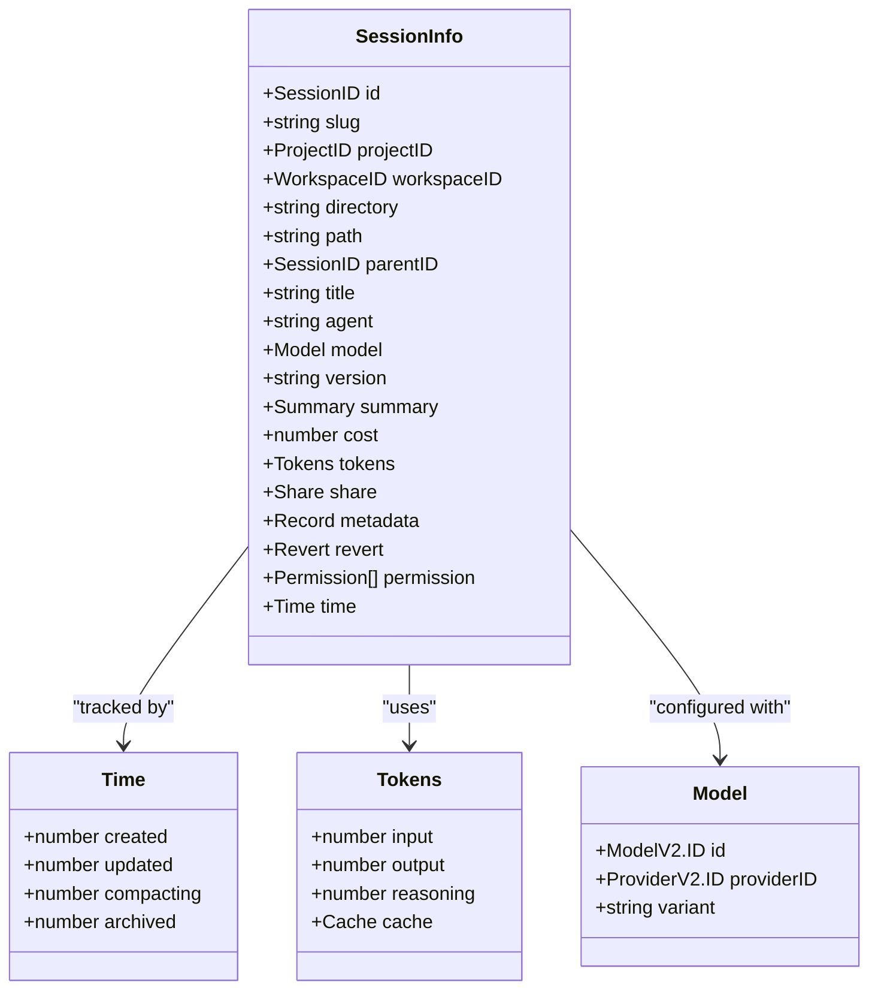
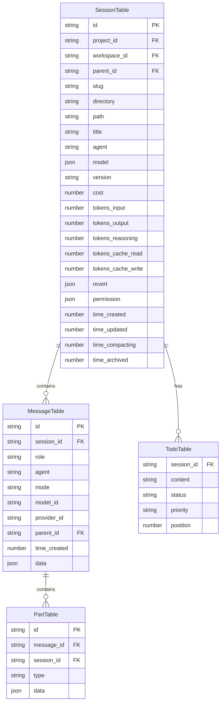
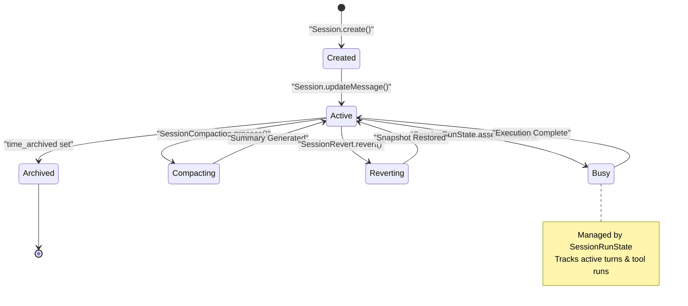
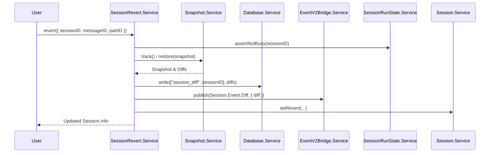
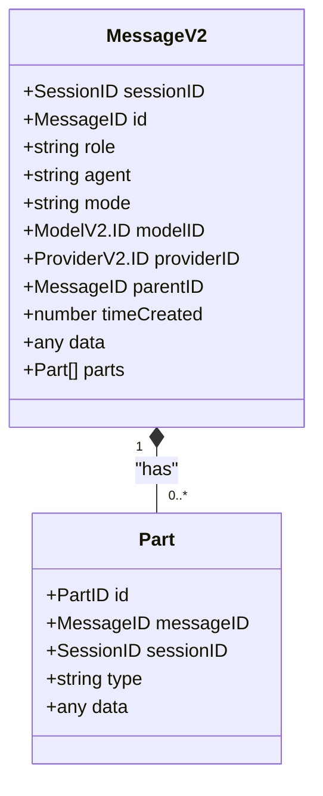
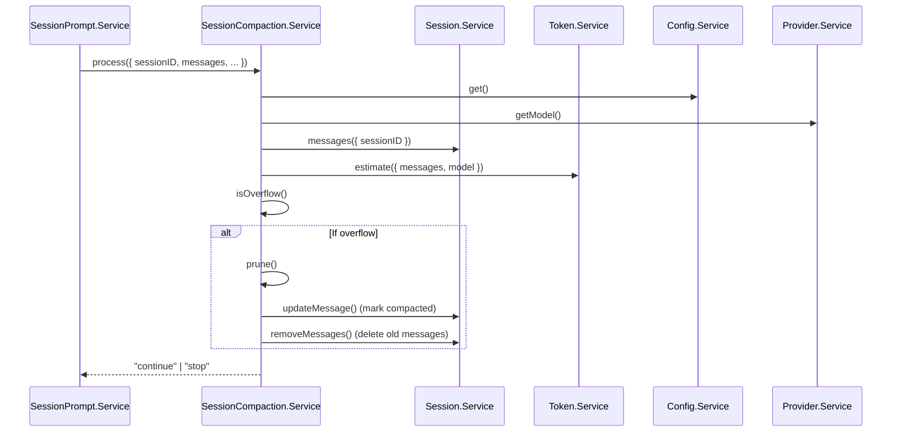
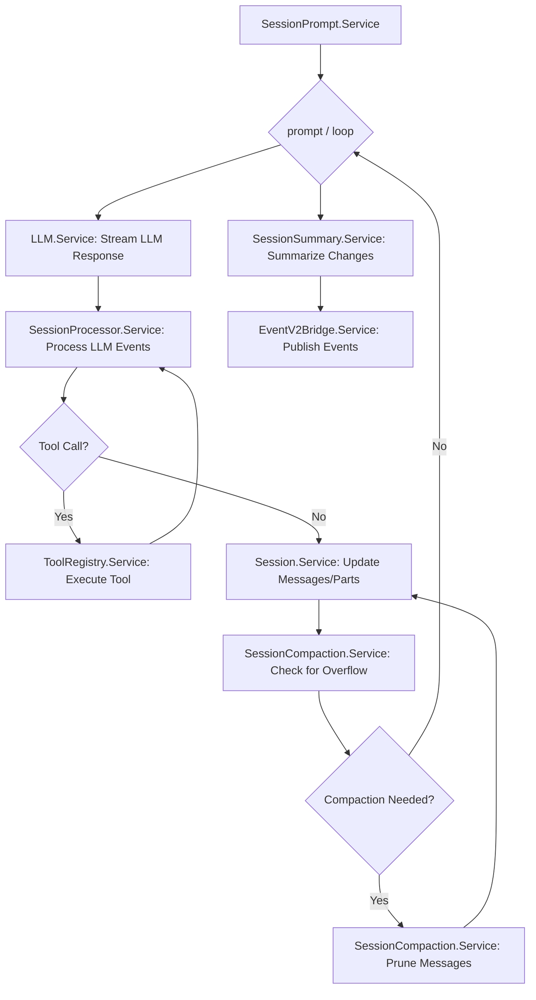

<!-- source: DeepWiki mcp.deepwiki.com · repo sst/opencode · page 2.1 Session Management · fetched 2026-10-27 -->

# Session Management

Relevant source files

The following files were used as context for generating this wiki page:

- [packages/core/src/global.ts](packages/core/src/global.ts)
- [packages/opencode/src/session/compaction.ts](packages/opencode/src/session/compaction.ts)
- [packages/opencode/src/session/instruction.ts](packages/opencode/src/session/instruction.ts)
- [packages/opencode/src/session/llm.ts](packages/opencode/src/session/llm.ts)
- [packages/opencode/src/session/llm/ai-sdk.ts](packages/opencode/src/session/llm/ai-sdk.ts)
- [packages/opencode/src/session/message-v2.ts](packages/opencode/src/session/message-v2.ts)
- [packages/opencode/src/session/processor.ts](packages/opencode/src/session/processor.ts)
- [packages/opencode/src/session/prompt.ts](packages/opencode/src/session/prompt.ts)
- [packages/opencode/src/session/revert.ts](packages/opencode/src/session/revert.ts)
- [packages/opencode/src/session/run-state.ts](packages/opencode/src/session/run-state.ts)
- [packages/opencode/src/session/session.ts](packages/opencode/src/session/session.ts)
- [packages/opencode/src/session/status.ts](packages/opencode/src/session/status.ts)
- [packages/opencode/src/session/summary.ts](packages/opencode/src/session/summary.ts)
- [packages/opencode/src/session/todo.ts](packages/opencode/src/session/todo.ts)
- [packages/opencode/src/storage/storage.ts](packages/opencode/src/storage/storage.ts)
- [packages/opencode/src/tool/registry.ts](packages/opencode/src/tool/registry.ts)
- [packages/opencode/src/tool/todo.ts](packages/opencode/src/tool/todo.ts)
- [packages/opencode/test/mcp/auth.test.ts](packages/opencode/test/mcp/auth.test.ts)
- [packages/opencode/test/plugin/auth-override.test.ts](packages/opencode/test/plugin/auth-override.test.ts)
- [packages/opencode/test/server/global-session-list.test.ts](packages/opencode/test/server/global-session-list.test.ts)
- [packages/opencode/test/server/session-actions.test.ts](packages/opencode/test/server/session-actions.test.ts)
- [packages/opencode/test/server/session-list.test.ts](packages/opencode/test/server/session-list.test.ts)
- [packages/opencode/test/server/session-messages.test.ts](packages/opencode/test/server/session-messages.test.ts)
- [packages/opencode/test/session/compaction.test.ts](packages/opencode/test/session/compaction.test.ts)
- [packages/opencode/test/session/instruction.test.ts](packages/opencode/test/session/instruction.test.ts)
- [packages/opencode/test/session/llm.test.ts](packages/opencode/test/session/llm.test.ts)
- [packages/opencode/test/session/messages-pagination.test.ts](packages/opencode/test/session/messages-pagination.test.ts)
- [packages/opencode/test/session/processor-effect.test.ts](packages/opencode/test/session/processor-effect.test.ts)
- [packages/opencode/test/session/prompt.test.ts](packages/opencode/test/session/prompt.test.ts)
- [packages/opencode/test/session/revert-compact.test.ts](packages/opencode/test/session/revert-compact.test.ts)
- [packages/opencode/test/session/schema-decoding.test.ts](packages/opencode/test/session/schema-decoding.test.ts)
- [packages/opencode/test/session/session.test.ts](packages/opencode/test/session/session.test.ts)
- [packages/opencode/test/session/snapshot-tool-race.test.ts](packages/opencode/test/session/snapshot-tool-race.test.ts)
- [packages/opencode/test/storage/storage.test.ts](packages/opencode/test/storage/storage.test.ts)
- [packages/opencode/test/tool/registry.test.ts](packages/opencode/test/tool/registry.test.ts)
- [packages/plugin/src/tool.ts](packages/plugin/src/tool.ts)

## Purpose and Scope

This document covers the session management system in OpenCode, detailing the session lifecycle, CRUD operations, parent/child and forking hierarchies, the revert/undo mechanism, and database persistence using Drizzle ORM and SQLite. Sessions represent individual conversations between users and AI agents, maintaining state across message exchanges and supporting background state tracking via Effect services.

---

## Core Concepts and Entity Model

### Session Entity (`Session.Info`)

A **session** represents a conversation instance between a user and an AI agent. Each session is defined structurally by the `Session.Info` Effect Schema and mapped from database rows using conversion utilities [packages/opencode/src/session/session.ts:59-118]().

**Sources:** [packages/opencode/src/session/session.ts:59-118](), [packages/opencode/test/session/schema-decoding.test.ts:33-108]()

### Database Schema and Drizzle Mapping

Sessions, messages, and parts are stored in SQLite using Drizzle ORM (`SessionTable`, `PartTable`, `TodoTable`) [packages/opencode/src/session/session.ts:29-30](). The `fromRow` function converts flat database rows into structured `Session.Info` objects, while `toRow` flattens them for database writes [packages/opencode/src/session/session.ts:59-159]().

**Sources:** [packages/opencode/src/session/session.ts:29-159](), [packages/opencode/src/session/todo.ts:7]()

---

## Session Lifecycle and States

The lifecycle of a session is orchestrated by several collaborating Effect services: `SessionStatus`, `SessionRunState`, and `SessionRevert`.

### State Services
- **`SessionStatus.Service`**: Tracks runtime status (e.g., `{ type: "idle" }` or execution states) per session ID within instance state, broadcasting updates via `EventV2Bridge` [packages/opencode/src/session/status.ts:13-51]().
- **`SessionRunState.Service`**: Enforces concurrency control, asserting that a session is not busy before initiating prompts or reverts [packages/opencode/src/session/revert.ts:39]().

**Sources:** [packages/opencode/src/session/status.ts:13-51](), [packages/opencode/src/session/revert.ts:38-42]()

---

## CRUD Operations and Hierarchy

### Session Service Interface (`Session.Service`)

The `Session.Service` provides complete CRUD operations and queries over session data:
- **`create(input)`**: Initializes a new session row, generating a unique `SessionID` and slug, and emitting `Session.Event.Created` [packages/opencode/test/session/session.test.ts:48-74]().
- **`list(query)`**: Retrieves sessions filtered by project, directory, or path [packages/opencode/test/server/session-list.test.ts:61-113]().
- **`remove(id)`**: Deletes session records and associated state.
- **`setTitle` / `setArchived`**: Updates session metadata and timestamps [packages/opencode/src/session/session.test.ts:97-98]().
- **`updateMessage`**: Updates or inserts a message and its parts into the database [packages/opencode/src/session/session.ts:300-320]().
- **`updatePart`**: Updates or inserts a part into the database [packages/opencode/src/session/session.ts:322-342]().
- **`messages`**: Retrieves all messages for a given session, hydrating them with their associated parts [packages/opencode/src/session/session.ts:400-419]().

### Hierarchy and Forking

Sessions support hierarchical relationships and branching:
- **Parent-Child**: Sub-tasks or spawned agent actions reference a `parentID` [packages/opencode/src/session/session.ts:85]().
- **Forking**: Branching an existing conversation creates a child session whose title is managed via `getForkedTitle`, appending or incrementing a `(fork #N)` suffix [packages/opencode/src/session/session.ts:161-169]().

**Sources:** [packages/opencode/src/session/session.ts:79-169](), [packages/opencode/test/session/session.test.ts:48-74](), [packages/opencode/test/server/session-list.test.ts:61-113](), [packages/opencode/src/session/session.ts:300-342](), [packages/opencode/src/session/session.ts:400-419]()

---

## Revert and Undo Mechanism (`SessionRevert`)

The `SessionRevert` service enables users to roll back conversation state and file modifications to a previous message or part [packages/opencode/src/session/revert.ts:20-89]().

### Key Functions
- **`revert(input)`**: Ensures the session is not busy, calculates message ranges, restores filesystem snapshots via `Snapshot.Service`, computes summary diffs, and updates session revert metadata [packages/opencode/src/session/revert.ts:38-89]().
- **`unrevert(input)`**: Restores pre-revert filesystem states and clears the session revert flag [packages/opencode/src/session/revert.ts:91-99]().
- **`cleanup(session)`**: Purges invalidated messages and parts from storage following a confirmed revert [packages/opencode/src/session/revert.ts:101-124]().

**Sources:** [packages/opencode/src/session/revert.ts:20-126](), [packages/opencode/test/session/revert-compact.test.ts:110-214]()

---

## Supporting Systems

### Message and Part Structure (`MessageV2`)

The `MessageV2` module defines the structure for messages and their constituent parts, handling conversion between internal representations and AI SDK formats. It also provides utilities for database hydration and cursor-based pagination [packages/opencode/src/session/message-v2.ts:1-123]().

**Sources:** [packages/opencode/src/session/message-v2.ts:1-123]()

### Instruction Resolution (`Instruction.Service`)
The instruction subsystem discovers project instructions (such as `AGENTS.md`, `CLAUDE.md`, or configured remote/local paths) and tracks message claims to prevent redundant prompt injections [packages/opencode/src/session/instruction.ts:34-169]().

### Todo Management (`Todo.Service`)
Manages task lists associated with a session inside transactions on `TodoTable`, broadcasting `Event.Updated` events upon modification [packages/opencode/src/session/todo.ts:16-68]().

### Session Compaction (`SessionCompaction.Service`)
The `SessionCompaction` service manages the context window by pruning older messages and generating summaries to keep the conversation within the LLM's token limits. It determines when compaction is needed (`isOverflow`) and performs the pruning (`prune`) [packages/opencode/src/session/compaction.ts:166-184]().

**Sources:** [packages/opencode/src/session/instruction.ts:34-169](), [packages/opencode/src/session/todo.ts:16-68](), [packages/opencode/src/session/compaction.ts:166-184]()

### Session Summary (`SessionSummary.Service`)
The `SessionSummary` service is responsible for generating and managing summaries of session activity, particularly changes to the filesystem. It computes diffs between snapshots taken during a session turn and stores them with the user message [packages/opencode/src/session/summary.ts:67-142]().

**Sources:** [packages/opencode/src/session/summary.ts:67-142]()

### Session Prompt (`SessionPrompt.Service`)
The `SessionPrompt` service is the central orchestrator for agent interactions. It handles the main `loop` for processing prompts, managing tool calls, and integrating with various other services like `LLM.Service`, `SessionProcessor.Service`, and `ToolRegistry.Service` [packages/opencode/src/session/prompt.ts:102-105]().

**Sources:** [packages/opencode/src/session/prompt.ts:102-105](), [packages/opencode/src/session/prompt.ts:113-143]()

### Session Processor (`SessionProcessor.Service`)
The `SessionProcessor` service acts as an intermediary between the LLM stream and the session state. It processes events from the LLM, updates tool calls, handles errors, and determines if compaction or a stop is needed [packages/opencode/src/session/processor.ts:56-58]().

**Sources:** [packages/opencode/src/session/processor.ts:56-58](), [packages/opencode/src/session/processor.ts:98-184]()

### LLM Service (`LLM.Service`)
The `LLM.Service` provides the core interface for interacting with Language Models. It prepares requests, streams responses, and integrates with various AI SDK providers, handling tool execution for workflow models [packages/opencode/src/session/llm.ts:54-56]().

**Sources:** [packages/opencode/src/session/llm.ts:54-56](), [packages/opencode/src/session/llm.ts:85-146]()

### Tool Registry (`ToolRegistry.Service`)
The `ToolRegistry` service manages the collection of available tools that agents can use. It registers built-in and custom tools, provides their definitions (including JSON schemas for parameters), and handles their execution [packages/opencode/src/tool/registry.ts:77-87]().

**Sources:** [packages/opencode/src/tool/registry.ts:77-87](), [packages/opencode/src/tool/registry.ts:121-161]()

---

