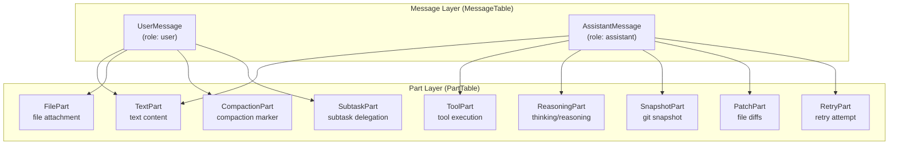
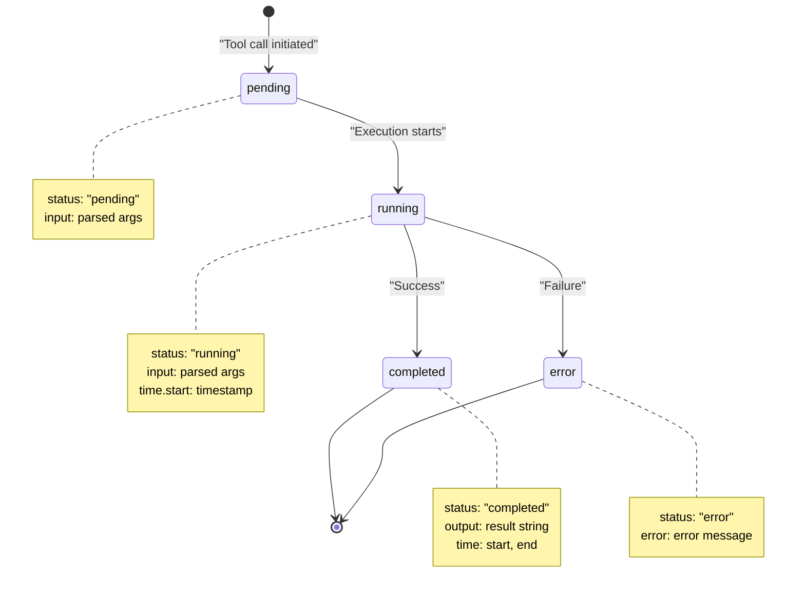
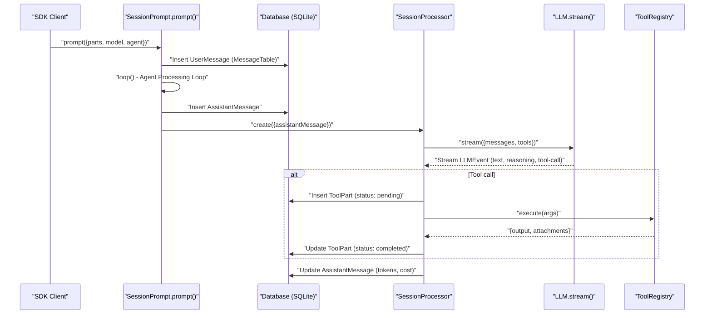
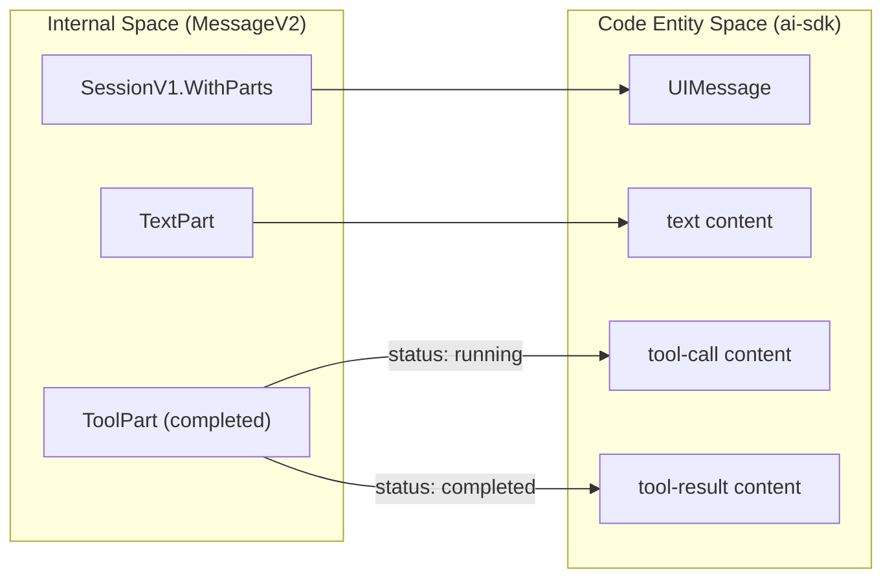

<!-- source: DeepWiki mcp.deepwiki.com · repo sst/opencode · page 2.2 Message and Part Structure · fetched 2026-10-27 -->

# Message and Part Structure

Relevant source files

The following files were used as context for generating this wiki page:

- [packages/opencode/src/provider/error.ts](packages/opencode/src/provider/error.ts)
- [packages/opencode/src/session/compaction.ts](packages/opencode/src/session/compaction.ts)
- [packages/opencode/src/session/llm.ts](packages/opencode/src/session/llm.ts)
- [packages/opencode/src/session/llm/ai-sdk.ts](packages/opencode/src/session/llm/ai-sdk.ts)
- [packages/opencode/src/session/message-v2.ts](packages/opencode/src/session/message-v2.ts)
- [packages/opencode/src/session/processor.ts](packages/opencode/src/session/processor.ts)
- [packages/opencode/src/session/prompt.ts](packages/opencode/src/session/prompt.ts)
- [packages/opencode/src/session/retry.ts](packages/opencode/src/session/retry.ts)
- [packages/opencode/src/session/session.ts](packages/opencode/src/session/session.ts)
- [packages/opencode/src/session/summary.ts](packages/opencode/src/session/summary.ts)
- [packages/opencode/src/tool/registry.ts](packages/opencode/src/tool/registry.ts)
- [packages/opencode/test/provider/error.test.ts](packages/opencode/test/provider/error.test.ts)
- [packages/opencode/test/session/compaction.test.ts](packages/opencode/test/session/compaction.test.ts)
- [packages/opencode/test/session/llm.test.ts](packages/opencode/test/session/llm.test.ts)
- [packages/opencode/test/session/message-v2.test.ts](packages/opencode/test/session/message-v2.test.ts)
- [packages/opencode/test/session/messages-pagination.test.ts](packages/opencode/test/session/messages-pagination.test.ts)
- [packages/opencode/test/session/processor-effect.test.ts](packages/opencode/test/session/processor-effect.test.ts)
- [packages/opencode/test/session/prompt.test.ts](packages/opencode/test/session/prompt.test.ts)
- [packages/opencode/test/session/retry.test.ts](packages/opencode/test/session/retry.test.ts)
- [packages/opencode/test/session/snapshot-tool-race.test.ts](packages/opencode/test/session/snapshot-tool-race.test.ts)
- [packages/opencode/test/tool/registry.test.ts](packages/opencode/test/tool/registry.test.ts)
- [packages/plugin/src/tool.ts](packages/plugin/src/tool.ts)

This document describes the data model for messages and their constituent parts in OpenCode's conversation system. Messages represent turns in a conversation between users and AI assistants, while parts represent the individual components within each message (text, tool calls, files, reasoning, etc.).

For information about how messages are processed and transformed into AI provider API calls, see [Prompt Processing Pipeline](2.3). For details on message storage and retrieval, see [Session Management](2.1).

## Overview

OpenCode's conversation system is built around two core data structures:

- **Messages**: Top-level conversation turns with either `user` or `assistant` role.
- **Parts**: Individual content pieces within a message (text, tool calls, files, etc.).

All message and part types are defined using Effect schemas and are persisted to SQLite tables using Drizzle ORM [packages/opencode/src/session/message-v2.ts:30]().

Title: Message and Part Hierarchy

Sources: [packages/opencode/src/session/message-v2.ts:30](), [packages/opencode/src/session/message-v2.ts:80-93](), [packages/opencode/src/session/prompt.ts:63-64]()

## Message Types

### UserMessage

Represents a message from the user. Contains metadata about the request including model selection, agent mode, and tool definitions.

| Field | Type | Description |
|-------|------|-------------|
| `id` | `MessageID` | Ascending ULID identifier [packages/opencode/src/session/schema.ts:6]() |
| `sessionID` | `SessionID` | Parent session identifier |
| `role` | `"user"` | Fixed role value |
| `time.created` | `number` | Unix timestamp in milliseconds |
| `agent` | `string` | Agent name to use (e.g., `"build"`, `"plan"`) |
| `model.providerID` | `ProviderID` | AI provider identifier |
| `model.modelID` | `ModelID` | Model identifier within provider |

Sources: [packages/opencode/src/session/message-v2.ts:15-17](), [packages/opencode/src/session/message-v2.ts:80-85](), [packages/opencode/src/session/prompt.ts:148-150]()

### AssistantMessage

Represents a response from the AI assistant. Tracks execution metadata including tokens, cost, errors, and completion status.

| Field | Type | Description |
|-------|------|-------------|
| `id` | `MessageID` | Ascending ULID identifier |
| `sessionID` | `SessionID` | Parent session identifier |
| `role` | `"assistant"` | Fixed role value |
| `parentID` | `MessageID` | ID of the user message being responded to |
| `time.created` | `number` | Unix timestamp when message started |
| `modelID` | `ModelID` | Model used for this response |
| `providerID` | `ProviderID` | Provider used for this response |
| `cost` | `number` | Total cost in USD |
| `tokens.input` | `number` | Input tokens consumed |
| `tokens.output` | `number` | Output tokens generated |
| `tokens.reasoning` | `number` | Reasoning tokens generated |
| `finish` | `string?` | Finish reason from AI provider |
| `error` | `NamedError?` | Error if message failed |

Sources: [packages/opencode/src/session/message-v2.ts:7-17](), [packages/opencode/src/session/processor.ts:33-48]()

## Part Types

Parts are discriminated unions. Each part includes common fields `id`, `sessionID`, and `messageID` [packages/opencode/src/session/message-v2.ts:87-93]().

### TextPart
Plain text content. Can be marked as `synthetic` (auto-generated) or `ignored` (filtered from AI context) [packages/opencode/test/session/message-v2.test.ts:209-247]().
Sources: [packages/opencode/src/session/message-v2.ts:58-61](), [packages/opencode/src/session/prompt.ts:64]()

### ReasoningPart
Reasoning output from models with extended thinking, such as OpenAI o1 or Anthropic Claude 3.7 Sonnet. The system maps `reasoning-delta` events to these parts during streaming [packages/opencode/src/session/processor.ts:74](), [packages/opencode/test/session/llm.test.ts:197-200]().
Sources: [packages/opencode/src/session/processor.ts:74](), [packages/opencode/src/session/llm.ts:196-199]()

### ToolPart
Tool execution with state machine tracking. Includes the `state` field which transitions from `pending` to `running` and finally `completed` or `error` [packages/opencode/src/session/processor.ts:160-205]().

Title: ToolPart State Machine

Sources: [packages/opencode/src/session/processor.ts:160-205](), [packages/opencode/src/session/prompt.ts:96-100]()

### CompactionPart
Marker indicating that context compaction occurred at this point to manage context window limits. These parts trigger specific summarization logic in the `SessionCompaction` service [packages/opencode/src/session/compaction.ts:102-103]().
Sources: [packages/opencode/src/session/compaction.ts:67-68](), [packages/opencode/src/session/compaction.ts:87-95]()

## Message and Part Lifecycle

Title: Message and Part Creation Data Flow

Sources: [packages/opencode/src/session/prompt.ts:105-108](), [packages/opencode/src/session/processor.ts:98-114](), [packages/opencode/src/session/llm.ts:54-56]()

## Database Storage

Messages and parts are persisted in SQLite using tables defined in `packages/opencode/src/session/message-v2.ts`.

### MessageTable
Stores the top-level message metadata. The `data` column contains the JSON-serialized message info [packages/opencode/src/session/message-v2.ts:80-85]().
Sources: [packages/opencode/src/session/message-v2.ts:30](), [packages/opencode/src/session/message-v2.ts:98-123]()

### PartTable
Stores individual parts. The `data` column contains the JSON-serialized part object [packages/opencode/src/session/message-v2.ts:87-93]().
Sources: [packages/opencode/src/session/message-v2.ts:30](), [packages/opencode/src/session/message-v2.ts:103-116]()

## Message Transformation for Providers

Before sending messages to AI providers, OpenCode transforms its internal message/part structure into the format expected by the AI SDK via `MessageV2.toModelMessagesEffect` [packages/opencode/src/session/message-v2.ts:131-135]().

Title: Provider Message Transformation

**Transformation Logic:**
- **Media Workarounds**: For providers that don't support specific media types (like PDFs) in tool results, `toModelMessagesEffect` extracts the media and injects it as a separate user message turn using the `SYNTHETIC_ATTACHMENT_PROMPT` [packages/opencode/src/session/message-v2.ts:46-47](), [packages/opencode/src/session/message-v2.ts:138-159]().
- **Output Truncation**: Tool outputs can be truncated during this phase to stay within model limits, appending a truncation notice to the text [packages/opencode/src/session/message-v2.ts:49-53]().
- **Role Mapping**: Internal parts are mapped to `UIMessage` roles (user, assistant, tool) to satisfy the AI SDK's requirements [packages/opencode/src/session/message-v2.ts:195-250]().

Sources: [packages/opencode/src/session/message-v2.ts:131-250]()

---

