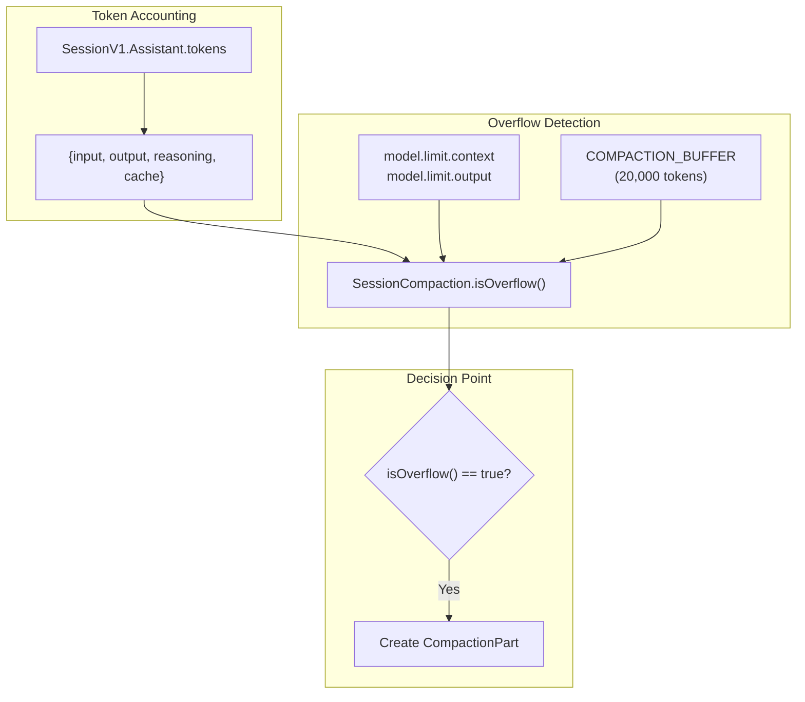
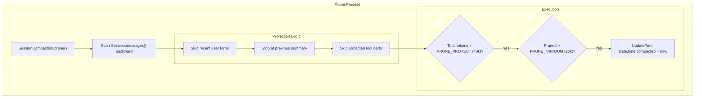

<!-- source: DeepWiki mcp.deepwiki.com · repo sst/opencode · page 2.4 Context Management and Compaction · fetched 2026-10-27 -->

# Context Management and Compaction

Relevant source files

The following files were used as context for generating this wiki page:

- [CONTEXT.md](CONTEXT.md)
- [packages/core/src/session.ts](packages/core/src/session.ts)
- [packages/core/src/session/compaction.ts](packages/core/src/session/compaction.ts)
- [packages/core/src/session/event.ts](packages/core/src/session/event.ts)
- [packages/core/src/session/execution.ts](packages/core/src/session/execution.ts)
- [packages/core/src/session/execution/local.ts](packages/core/src/session/execution/local.ts)
- [packages/core/src/session/message-updater.ts](packages/core/src/session/message-updater.ts)
- [packages/core/src/session/projector.ts](packages/core/src/session/projector.ts)
- [packages/core/src/session/run-coordinator.ts](packages/core/src/session/run-coordinator.ts)
- [packages/core/src/session/runner/llm.ts](packages/core/src/session/runner/llm.ts)
- [packages/core/src/v1/config/config.ts](packages/core/src/v1/config/config.ts)
- [packages/core/test/session-compaction.test.ts](packages/core/test/session-compaction.test.ts)
- [packages/core/test/session-create.test.ts](packages/core/test/session-create.test.ts)
- [packages/core/test/session-projector.test.ts](packages/core/test/session-projector.test.ts)
- [packages/core/test/session-prompt.test.ts](packages/core/test/session-prompt.test.ts)
- [packages/core/test/session-run-coordinator.test.ts](packages/core/test/session-run-coordinator.test.ts)
- [packages/core/test/session-runner-recorded.test.ts](packages/core/test/session-runner-recorded.test.ts)
- [packages/core/test/session-runner.test.ts](packages/core/test/session-runner.test.ts)
- [packages/core/test/session-todo.test.ts](packages/core/test/session-todo.test.ts)
- [packages/opencode/src/agent/prompt/compaction.txt](packages/opencode/src/agent/prompt/compaction.txt)
- [packages/opencode/src/session/compaction.ts](packages/opencode/src/session/compaction.ts)
- [packages/opencode/src/session/llm.ts](packages/opencode/src/session/llm.ts)
- [packages/opencode/src/session/llm/ai-sdk.ts](packages/opencode/src/session/llm/ai-sdk.ts)
- [packages/opencode/src/session/message-v2.ts](packages/opencode/src/session/message-v2.ts)
- [packages/opencode/src/session/processor.ts](packages/opencode/src/session/processor.ts)
- [packages/opencode/src/session/prompt.ts](packages/opencode/src/session/prompt.ts)
- [packages/opencode/src/session/session.ts](packages/opencode/src/session/session.ts)
- [packages/opencode/src/session/summary.ts](packages/opencode/src/session/summary.ts)
- [packages/opencode/src/tool/registry.ts](packages/opencode/src/tool/registry.ts)
- [packages/opencode/test/session/compaction.test.ts](packages/opencode/test/session/compaction.test.ts)
- [packages/opencode/test/session/llm.test.ts](packages/opencode/test/session/llm.test.ts)
- [packages/opencode/test/session/messages-pagination.test.ts](packages/opencode/test/session/messages-pagination.test.ts)
- [packages/opencode/test/session/processor-effect.test.ts](packages/opencode/test/session/processor-effect.test.ts)
- [packages/opencode/test/session/prompt.test.ts](packages/opencode/test/session/prompt.test.ts)
- [packages/opencode/test/session/snapshot-tool-race.test.ts](packages/opencode/test/session/snapshot-tool-race.test.ts)
- [packages/opencode/test/tool/registry.test.ts](packages/opencode/test/tool/registry.test.ts)
- [packages/plugin/src/tool.ts](packages/plugin/src/tool.ts)
- [specs/v2/schema-changelog.md](specs/v2/schema-changelog.md)
- [specs/v2/session.md](specs/v2/session.md)
- [specs/v2/todo.md](specs/v2/todo.md)

This document describes OpenCode's context window management system, including overflow detection, automatic compaction, and tool output pruning strategies. When conversations exceed a model's context limits, OpenCode automatically summarizes the conversation history to continue processing without losing critical information.

For information about the overall prompt processing pipeline, see [2.3 Prompt Processing Pipeline](). For details on how sessions store messages, see [2.1 Session Management]() and [2.2 Message and Part Structure]().

---

## Purpose and Scope

Context management ensures that AI agent conversations remain within model token limits while preserving important information. This system:

- Monitors token usage across conversation history using the `tokens` structure in the session data model [packages/opencode/src/session/session.ts:182-190]().
- Detects when conversations approach context window limits via `isOverflow` logic [packages/opencode/src/session/compaction.ts:166-169]().
- Automatically compacts sessions by generating summaries using a specialized agent loop [packages/opencode/src/session/compaction.ts:178-185]().
- Prunes old tool outputs in `SessionCompaction.prune` to reclaim context space while preserving execution history [packages/opencode/src/session/compaction.ts:170]().
- Replays user messages after compaction to maintain conversation flow [packages/opencode/src/session/prompt.ts:104]().

Sources: [packages/opencode/src/session/session.ts:182-190](), [packages/opencode/src/session/compaction.ts:166-185](), [packages/opencode/src/session/prompt.ts:104]()

---

## Context Window Architecture

The system tracks token usage at multiple levels to determine when the context window is nearing capacity.

Title: Token Accounting and Overflow Detection

Sources: [packages/opencode/src/session/compaction.ts:166-169](), [packages/opencode/src/session/session.ts:182-190]()

### Usable Context Calculation

The usable context for each model accounts for:

1.  **Total context window**: Defined by `model.limit.context` [packages/opencode/test/session/compaction.test.ts:71]().
2.  **Reserved output tokens**: Calculated via `ProviderTransform.OUTPUT_TOKEN_MAX` [packages/opencode/src/session/llm.ts:33]() or model-specific limits.
3.  **Safety buffer**: A buffer is dynamically computed to detect context threshold breaches before hard limits are reached.

The `isOverflow` function checks if the current token count exceeds the usable limit [packages/opencode/src/session/compaction.ts:166-169]().

Sources: [packages/opencode/test/session/compaction.test.ts:71](), [packages/opencode/src/session/llm.ts:33](), [packages/opencode/src/session/compaction.ts:166-169]()

---

## Overflow Detection and Triggering

Overflow detection occurs in the session processing loop when an assistant message completes or fails due to context constraints.

### Detection Logic

1.  **Check for finished message**: The `SessionProcessor` monitors completion status and token usage of assistant messages [packages/opencode/src/session/processor.ts:32-48]().
2.  **Calculate overflow**: Calls `SessionCompaction.isOverflow()` with token usage and model limits [packages/opencode/src/session/compaction.ts:166-169]().
3.  **Create compaction marker**: Inserts a `compaction` part into a message to queue summarization [packages/opencode/test/session/compaction.test.ts:174-194]().

### Configuration Control

Automatic compaction can be handled or intercepted depending on user configuration and session workflow states [packages/opencode/src/session/compaction.ts:171-184]().

Sources: [packages/opencode/src/session/processor.ts:32-48](), [packages/opencode/src/session/compaction.ts:166-184](), [packages/opencode/test/session/compaction.test.ts:174-194]()

---

## Compaction Process

The compaction process generates a high-level summary of the conversation to replace detailed history.

Title: Compaction Workflow Implementation

```mermaid
flowchart TB
    subgraph "Compaction Flow"
        Start["CompactionPart detected in SessionPrompt.loop"]
        GetAgent["Agent.Service.get()"]
        
        subgraph "Message Selection"
            FilterOverflow{"overflow flag?"}
            FindReplay["Find last user message to replay"]
            StripMedia["Strip media from messages"]
            UseAll["Use history up to current point"]
        end
        
        subgraph "LLM Summary"
            BuildPrompt["buildPrompt() template"]
            StreamSummary["LLM.Service.stream() for summary"]
            UpdateMsg["Mark assistant message summary=true"]
        end
        
        subgraph "Recovery"
            CheckResult{"Success?"}
            Complete["Create replay user message"]
            Error["Set ContextOverflowError"]
        end
    end
    
    Start --> GetAgent
    GetAgent --> FilterOverflow
    FilterOverflow -->|"Yes"| FindReplay
    FilterOverflow -->|"No"| UseAll
    FindReplay --> StripMedia
    StripMedia --> BuildPrompt
    UseAll --> BuildPrompt
    BuildPrompt --> StreamSummary
    StreamSummary --> UpdateMsg
    UpdateMsg --> CheckResult
    CheckResult -->|"Yes"| Complete
    CheckResult -->|"No"| Error
```

Sources: [packages/opencode/src/session/compaction.ts:23](), [packages/opencode/src/session/compaction.ts:178-185](), [packages/opencode/src/session/message-v2.ts:131-159]()

### Summary Generation

The compaction system uses `buildPrompt` from the core session compaction module to generate a prompt instructing the model to summarize session history [packages/opencode/src/session/compaction.ts:23](). The resulting summary is stored in an assistant message with the `summary` flag set.

### Media Stripping

When overflow occurs, the system strips media attachments during the summary generation call via `MessageV2.toModelMessagesEffect` [packages/opencode/src/session/message-v2.ts:131-159]() [packages/opencode/src/session/message-v2.ts:131-159]().

Sources: [packages/opencode/src/session/compaction.ts:23](), [packages/opencode/src/session/message-v2.ts:131-159]()

---

## Tool Output Pruning

Pruning removes detailed outputs of older tool calls while retaining execution metadata to reclaim context space.

Title: Tool Output Pruning Strategy

Sources: [packages/opencode/src/session/compaction.ts:28-32](), [packages/opencode/src/session/compaction.ts:170]()

### Pruning Algorithm

1.  **Backward Scan**: Iterates through messages from newest to oldest.
2.  **Turn Protection**: Uses `preserveRecentBudget` to protect recent context tokens [packages/opencode/src/session/compaction.ts:32-33]() [packages/opencode/src/session/compaction.ts:115-119]().
3.  **Token Thresholds**: Evaluates against `PRUNE_PROTECT` (40,000 tokens) and `PRUNE_MINIMUM` (20,000 tokens) [packages/opencode/src/session/compaction.ts:28-29]().
4.  **Exclusions**: Certain protected tools like `skill` are never pruned [packages/opencode/src/session/compaction.ts:31]().

Sources: [packages/opencode/src/session/compaction.ts:28-33](), [packages/opencode/src/session/compaction.ts:115-119](), [packages/opencode/src/session/compaction.ts:170]()

---

## Message Replay and Recovery

After compaction, the system replays the latest state or prompt so the agent can resume processing using the newly generated summary as context.

-   **Overflow Scenario**: Clones the active user interaction to restart the turn with cleaned context.
-   **Continuation**: Handles post-compaction hooks to ensure smooth agent operation without context exhaustion.

Sources: [packages/opencode/src/session/prompt.ts:104](), [packages/opencode/src/session/compaction.ts:178-185]()

---

## Error Handling and Limitations

If compaction fails due to context limits, the session enters an unrecoverable state.

-   **Unrecoverable Overflow**: Triggered when conversation length exceeds what even the compaction agent can process.
-   **Error Reporting**: Surfaces as a `ContextOverflowError` stopping execution safely [packages/opencode/src/session/message-v2.ts:10]().

Sources: [packages/opencode/src/session/message-v2.ts:10](), [packages/opencode/src/session/compaction.ts:178-185]()

---

