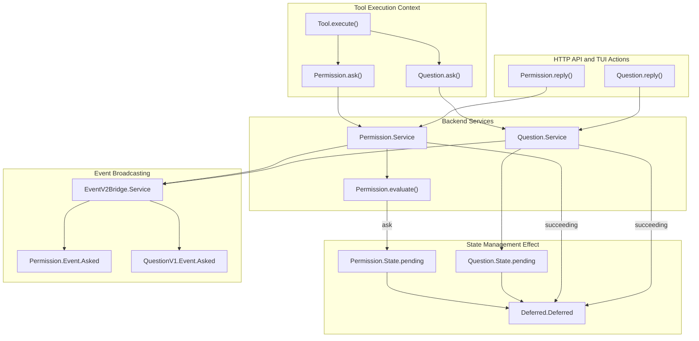
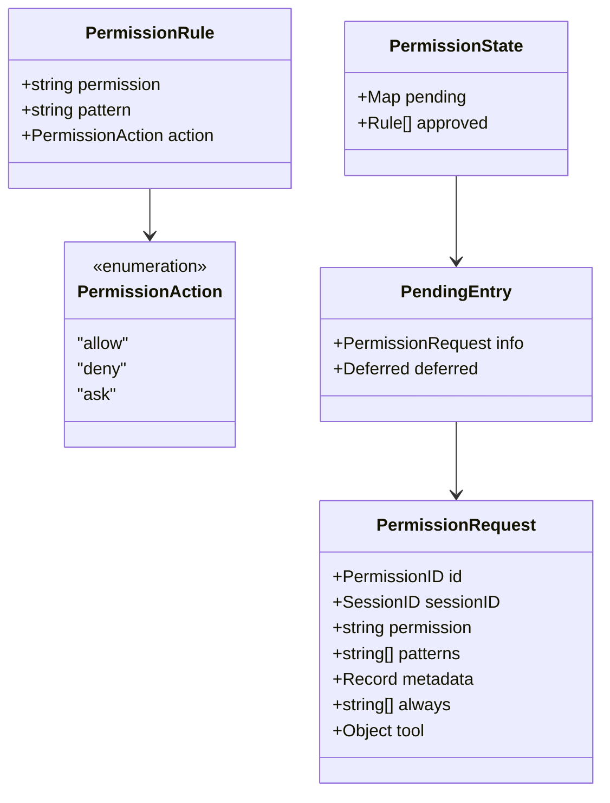
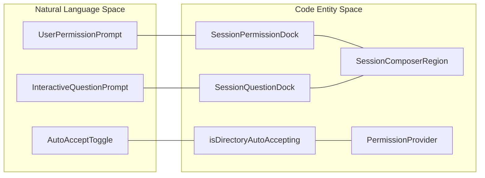

<!-- source: DeepWiki mcp.deepwiki.com · repo sst/opencode · page 2.5 Permission and Question System · fetched 2026-10-27 -->

# Permission and Question System

<details>
<summary>Relevant source files</summary>

The following files were used as context for generating this wiki page:

- [packages/core/src/git.ts](packages/core/src/git.ts)
- [packages/core/src/observability.ts](packages/core/src/observability.ts)
- [packages/core/src/project.ts](packages/core/src/project.ts)
- [packages/core/test/git.test.ts](packages/core/test/git.test.ts)
- [packages/core/test/project.test.ts](packages/core/test/project.test.ts)
- [packages/opencode/src/acp/content.ts](packages/opencode/src/acp/content.ts)
- [packages/opencode/src/acp/permission.ts](packages/opencode/src/acp/permission.ts)
- [packages/opencode/src/background/job.ts](packages/opencode/src/background/job.ts)
- [packages/opencode/src/cli/cmd/models.ts](packages/opencode/src/cli/cmd/models.ts)
- [packages/opencode/src/cli/effect-cmd.ts](packages/opencode/src/cli/effect-cmd.ts)
- [packages/opencode/src/id/id.ts](packages/opencode/src/id/id.ts)
- [packages/opencode/src/permission/evaluate.ts](packages/opencode/src/permission/evaluate.ts)
- [packages/opencode/src/permission/index.ts](packages/opencode/src/permission/index.ts)
- [packages/opencode/src/project/project.ts](packages/opencode/src/project/project.ts)
- [packages/opencode/src/question/index.ts](packages/opencode/src/question/index.ts)
- [packages/opencode/src/tool/question.ts](packages/opencode/src/tool/question.ts)
- [packages/opencode/src/tool/truncate.ts](packages/opencode/src/tool/truncate.ts)
- [packages/opencode/src/worktree/index.ts](packages/opencode/src/worktree/index.ts)
- [packages/opencode/test/acp/content.test.ts](packages/opencode/test/acp/content.test.ts)
- [packages/opencode/test/acp/permission.test.ts](packages/opencode/test/acp/permission.test.ts)
- [packages/opencode/test/acp/session.test.ts](packages/opencode/test/acp/session.test.ts)
- [packages/opencode/test/background/job.test.ts](packages/opencode/test/background/job.test.ts)
- [packages/opencode/test/cli/effect-cmd-instance-als.test.ts](packages/opencode/test/cli/effect-cmd-instance-als.test.ts)
- [packages/opencode/test/effect/instance-state.test.ts](packages/opencode/test/effect/instance-state.test.ts)
- [packages/opencode/test/fixture/fixture.test.ts](packages/opencode/test/fixture/fixture.test.ts)
- [packages/opencode/test/fixture/fixture.ts](packages/opencode/test/fixture/fixture.ts)
- [packages/opencode/test/permission/next.test.ts](packages/opencode/test/permission/next.test.ts)
- [packages/opencode/test/project/migrate-global.test.ts](packages/opencode/test/project/migrate-global.test.ts)
- [packages/opencode/test/project/project.test.ts](packages/opencode/test/project/project.test.ts)
- [packages/opencode/test/project/worktree-remove.test.ts](packages/opencode/test/project/worktree-remove.test.ts)
- [packages/opencode/test/project/worktree.test.ts](packages/opencode/test/project/worktree.test.ts)
- [packages/opencode/test/question/question.test.ts](packages/opencode/test/question/question.test.ts)
- [packages/opencode/test/server/httpapi-mcp.test.ts](packages/opencode/test/server/httpapi-mcp.test.ts)
- [packages/opencode/test/server/httpapi-provider.test.ts](packages/opencode/test/server/httpapi-provider.test.ts)
- [packages/opencode/test/tool/truncation.test.ts](packages/opencode/test/tool/truncation.test.ts)
- [packages/tui/src/context/project.tsx](packages/tui/src/context/project.tsx)

</details>


## Purpose and Scope

The Permission and Question systems control agent tool execution and enable interactive user input during task execution. Both implement an asynchronous request/reply pattern where execution pauses until the user responds.

**Permission System:** Controls which tools agents can execute via an `allow`, `ask`, or `deny` model [packages/opencode/src/permission/index.ts:28-38](). When a tool call evaluates to `ask`, `Permission.Service.ask()` creates a request and awaits user approval [packages/opencode/src/permission/index.ts:67-107](). Permissions are configured per-tool with glob pattern matching, and precedence flows from agent-level to user configuration [packages/opencode/src/permission/index.ts:28-38]().

**Question System:** Enables agents to request structured user input via the `question` tool. It presents multiple-choice options with optional custom text input, supports single/multi-select modes, and returns user selections as formatted output to the LLM [packages/opencode/src/question/index.ts:48-60]().

Both systems coordinate between tool execution (via `Effect`), promise-based state management (`Deferred`), and event broadcasting via the `EventV2Bridge` [packages/opencode/src/permission/index.ts:45-46](), [packages/opencode/src/question/index.ts:67]().

Sources: [packages/opencode/src/permission/index.ts:1-107](), [packages/opencode/src/question/index.ts:1-157]()

## Architecture Overview

Both systems implement an asynchronous request/reply pattern using the `Effect` library's `Deferred` primitive. Tool execution calls `Permission.Service.ask()` or `Question.Service.ask()`, which creates a `Deferred` value in `state.pending` and publishes events. Execution pauses until HTTP API routes or TUI actions invoke `reply()`, resolving or failing the `Deferred` value.

### Request/Reply Flow Architecture

Title: Interactive Request and Reply Data Flow


**Key Code Entities:**

| System | Service Class | State Interface | Request Method | Reply Method |
|--------|---------------|-----------------|----------------|--------------|
| **Permission** | `Permission.Service` [packages/opencode/src/permission/index.ts:40]() | `Permission.State` [packages/opencode/src/permission/index.ts:23-26]() | `ask` [packages/opencode/src/permission/index.ts:67]() | `reply` [packages/opencode/src/permission/index.ts:109]() |
| **Question** | `Question.Service` [packages/opencode/src/question/index.ts:62]() | `Question.State` [packages/opencode/src/question/index.ts:42-44]() | `ask` [packages/opencode/src/question/index.ts:87]() | `reply` [packages/opencode/src/question/index.ts:114]() |

Sources: [packages/opencode/src/permission/index.ts:23-109](), [packages/opencode/src/question/index.ts:42-132]()

## Permission System

The Permission System controls tool execution authorization via `Permission.evaluate()`, which matches tool requests against configured rulesets [packages/opencode/src/permission/index.ts:28-38](). It returns a `PermissionV1.Rule` containing an action of `allow`, `ask`, or `deny`.

### Permission Data Structures

The system uses `Effect.Schema` for validation and typed errors, and `Deferred` for managing the lifecycle of pending requests.

Title: Permission System Class Relationships


**Schemas and Types:**

| Type | Location | Purpose |
|------|----------|---------|
| `PermissionV1.Rule` | [packages/opencode/src/permission/index.ts:28]() | Object mapping a permission/pattern to an action |
| `PermissionV1.Request` | [packages/opencode/src/permission/index.ts:87-95]() | Runtime request with metadata and tool context |
| `PermissionV1.ReplyInput` | [packages/opencode/src/permission/index.ts:109]() | User response input containing `requestID` and `reply` (`once`, `always`, or `reject`) |

Sources: [packages/opencode/src/permission/index.ts:18-26](), [packages/opencode/src/permission/index.ts:87-109]()

### Permission Evaluation Flow

`Permission.evaluate()` matches tool requests against rulesets. It iterates through rules, testing patterns using wildcard matching [packages/opencode/src/permission/index.ts:28-38](). Precedence is determined by insertion order; the **last matching rule wins** [packages/opencode/test/permission/next.test.ts:131-133]().

**Evaluation Logic:**
1.  **Input:** Takes a permission name, a pattern string, and multiple rulesets (e.g., agent-specific and user-approved) [packages/opencode/src/permission/index.ts:28]().
2.  **Matching:** Compares the request against rules. If multiple patterns are requested in a tool call, all must be evaluated [packages/opencode/src/permission/index.ts:72-83]().
3.  **Action Resolution:**
    *   If any pattern matches a `deny` rule, a `DeniedError` is returned [packages/opencode/src/permission/index.ts:75-79]().
    *   If a pattern matches `allow`, it continues to the next pattern [packages/opencode/src/permission/index.ts:80]().
    *   If no rule matches `allow` or `deny`, the system sets `needsAsk = true` [packages/opencode/src/permission/index.ts:81]().

Sources: [packages/opencode/src/permission/index.ts:28-85](), [packages/opencode/test/permission/next.test.ts:131-133]()

### Configuration Integration

Permissions are loaded from user configuration via `fromConfig`. The system supports expanding environment variables like `$HOME` or `~` in patterns during configuration parsing [packages/opencode/src/permission/index.ts:178-184]().

Sources: [packages/opencode/src/permission/index.ts:178-198]()

## Question System

The Question System enables agents to request structured user input via the `question` tool. It uses a similar `Deferred` pattern to block tool execution until input is received.

### Question Data Structures

The `Question` namespace defines schemas for requests containing multiple `Question.Info` objects.

**Type Definitions:**

| Type | Location | Definition |
|------|----------|------------|
| `Question.Option` | [packages/opencode/src/question/index.ts:9-10]() | Display text and explanation for a choice |
| `Question.Info` | [packages/opencode/src/question/index.ts:11-12]() | A single question's header, options, and configuration |
| `Question.Request` | [packages/opencode/src/question/index.ts:17-18]() | The full request sent to the UI, including `SessionID` |
| `Question.Answer` | [packages/opencode/src/question/index.ts:19-20]() | An array of strings representing selected labels |

Sources: [packages/opencode/src/question/index.ts:9-25]()

### Question Request/Reply Sequence

`Question.Service.ask()` creates a pending request and blocks until a reply or rejection occurs.

**Sequence Implementation:**
1.  **Ask:** Generates a `QuestionID.ascending()`, creates a `Deferred<ReadonlyArray<Answer>, RejectedError>`, and stores the `PendingEntry` in the instance state [packages/opencode/src/question/index.ts:93-103]().
2.  **Event:** Publishes `QuestionV1.Event.Asked` via the `EventV2Bridge` [packages/opencode/src/question/index.ts:104]().
3.  **Reply:** `Question.Service.reply()` resolves the `Deferred` with the user's answers and publishes `QuestionV1.Event.Replied` [packages/opencode/src/question/index.ts:114-132]().
4.  **Reject:** `Question.Service.reject()` fails the `Deferred` with a `Question.RejectedError` [packages/opencode/src/question/index.ts:134-148]().

Sources: [packages/opencode/src/question/index.ts:87-148]()

## UI Implementation and Code Mapping

The user interface for permissions and questions is handled within the `SessionComposerRegion`. It uses SolidJS components to render interactive docks when a request is active.

### Natural Language Space to Code Entity Space Mapping

Title: Natural Language Space to Code Entity Space Mapping


*   **`SessionComposerRegion`**: The primary container that switches between `SessionQuestionDock` and `SessionPermissionDock` based on the controller state [packages/app/src/pages/session/composer/session-composer-region.tsx:39-60]().
*   **`SessionPermissionDock`**: Renders the specific tool request and provides action buttons (`once`, `always`, `reject`) [packages/app/src/pages/session/composer/session-composer-region.tsx:50-57]().
*   **`PermissionProvider`**: A SolidJS context that manages client-side permission state, including auto-accept settings and server SDK synchronization [packages/app/src/context/permission.tsx:55-185]().

Sources: [packages/app/src/pages/session/composer/session-composer-region.tsx:11-60](), [packages/app/src/context/permission.tsx:55-185]()

## State Management and Persistence

State is managed using `InstanceState`, which provides project-scoped reactive state containers [packages/opencode/src/permission/index.ts:46-47](), [packages/opencode/src/question/index.ts:68-69]().

### Finalization
Both services use `Effect.addFinalizer` to ensure that if the service or project instance is disposed, all pending requests are failed with a `RejectedError` to prevent hanging fibers [packages/opencode/src/permission/index.ts:54-61](), [packages/opencode/src/question/index.ts:74-81]().

Sources: [packages/opencode/src/permission/index.ts:54-61](), [packages/opencode/src/question/index.ts:74-81]()

## Error Types

The system uses typed errors to communicate rejection reasons back to the agent.

| Error Class | Source | Message / Purpose |
|-------------|--------|-------------------|
| `PermissionV1.RejectedError` | [packages/opencode/src/permission/index.ts:20]() | User manually clicked "Reject" on a specific tool call. |
| `PermissionV1.DeniedError` | [packages/opencode/src/permission/index.ts:76]() | A configured rule prevents the action. |
| `PermissionV1.CorrectedError` | [packages/opencode/src/permission/index.ts:20]() | User rejected with specific feedback for the agent. |
| `Question.RejectedError` | [packages/opencode/src/question/index.ts:27-31]() | User dismissed the question prompt. |

Sources: [packages/opencode/src/permission/index.ts:20-76](), [packages/opencode/src/question/index.ts:27-31]()

## Testing Patterns

Testing interactive systems involves mocking the event bridge and manually triggering replies to resolve the blocked fibers.

**Permission Test Example:**
[packages/opencode/test/permission/next.test.ts:59-63]()
```typescript
const ask = (input: Parameters<Permission.Interface["ask"]>[0]) =>
  Effect.gen(function* () {
    const permission = yield* Permission.Service
    return yield* permission.ask(input)
  })
```

**Question Test Example:**
[packages/opencode/test/question/question.test.ts:122-151]()
```typescript
it.instance(
  "reply - resolves the pending ask with answers",
  () =>
    Effect.gen(function* () {
      const question = yield* Question.Service
      const fiber = yield* question.ask({ ... }).pipe(Effect.forkScoped)
      const pending = yield* waitForPending(1)
      yield* question.reply({
        requestID: pending[0].id,
        answers: [["Option 1"]],
      })
      expect(yield* Fiber.join(fiber)).toEqual([["Option 1"]])
    })
)
```

Sources: [packages/opencode/test/permission/next.test.ts:59-63](), [packages/opencode/test/question/question.test.ts:122-151]()

---

