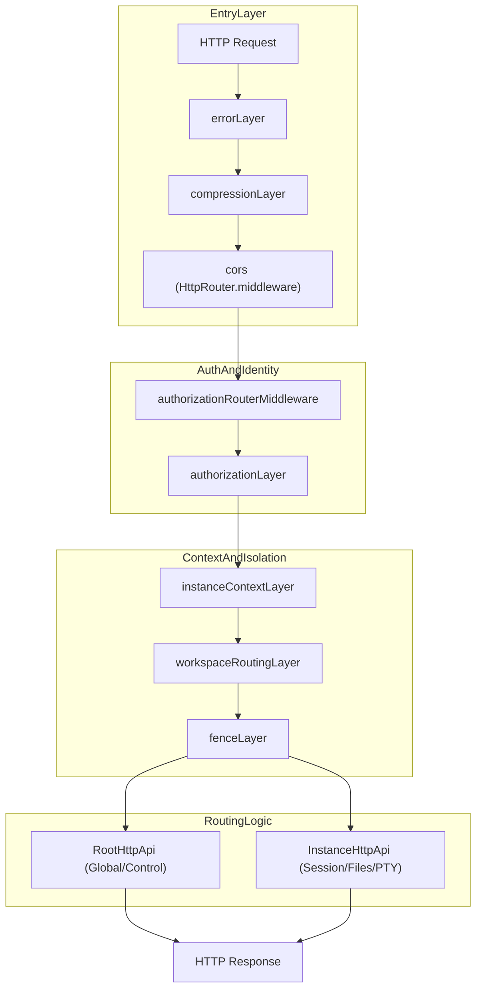
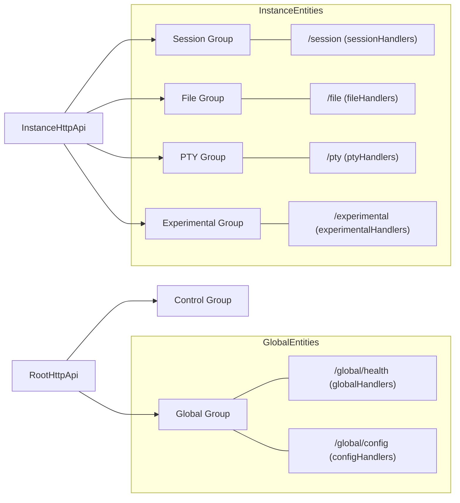

<!-- source: DeepWiki mcp.deepwiki.com · repo sst/opencode · page 2.6 HTTP Server and API · fetched 2026-10-27 -->

# HTTP Server and API

Relevant source files

The following files were used as context for generating this wiki page:

- [packages/opencode/specs/openapi-translation-cleanup.md](packages/opencode/specs/openapi-translation-cleanup.md)
- [packages/opencode/src/cli/bootstrap.ts](packages/opencode/src/cli/bootstrap.ts)
- [packages/opencode/src/effect/config-service.ts](packages/opencode/src/effect/config-service.ts)
- [packages/opencode/src/project/instance-store.ts](packages/opencode/src/project/instance-store.ts)
- [packages/opencode/src/server/routes/instance/httpapi/api.ts](packages/opencode/src/server/routes/instance/httpapi/api.ts)
- [packages/opencode/src/server/routes/instance/httpapi/errors.ts](packages/opencode/src/server/routes/instance/httpapi/errors.ts)
- [packages/opencode/src/server/routes/instance/httpapi/groups/global.ts](packages/opencode/src/server/routes/instance/httpapi/groups/global.ts)
- [packages/opencode/src/server/routes/instance/httpapi/groups/pty.ts](packages/opencode/src/server/routes/instance/httpapi/groups/pty.ts)
- [packages/opencode/src/server/routes/instance/httpapi/groups/query.ts](packages/opencode/src/server/routes/instance/httpapi/groups/query.ts)
- [packages/opencode/src/server/routes/instance/httpapi/groups/session.ts](packages/opencode/src/server/routes/instance/httpapi/groups/session.ts)
- [packages/opencode/src/server/routes/instance/httpapi/handlers/global.ts](packages/opencode/src/server/routes/instance/httpapi/handlers/global.ts)
- [packages/opencode/src/server/routes/instance/httpapi/handlers/provider.ts](packages/opencode/src/server/routes/instance/httpapi/handlers/provider.ts)
- [packages/opencode/src/server/routes/instance/httpapi/handlers/pty.ts](packages/opencode/src/server/routes/instance/httpapi/handlers/pty.ts)
- [packages/opencode/src/server/routes/instance/httpapi/handlers/session-errors.ts](packages/opencode/src/server/routes/instance/httpapi/handlers/session-errors.ts)
- [packages/opencode/src/server/routes/instance/httpapi/handlers/session.ts](packages/opencode/src/server/routes/instance/httpapi/handlers/session.ts)
- [packages/opencode/src/server/routes/instance/httpapi/lifecycle.ts](packages/opencode/src/server/routes/instance/httpapi/lifecycle.ts)
- [packages/opencode/src/server/routes/instance/httpapi/middleware/authorization.ts](packages/opencode/src/server/routes/instance/httpapi/middleware/authorization.ts)
- [packages/opencode/src/server/routes/instance/httpapi/middleware/instance-context.ts](packages/opencode/src/server/routes/instance/httpapi/middleware/instance-context.ts)
- [packages/opencode/src/server/routes/instance/httpapi/middleware/schema-error.ts](packages/opencode/src/server/routes/instance/httpapi/middleware/schema-error.ts)
- [packages/opencode/src/server/routes/instance/httpapi/public.ts](packages/opencode/src/server/routes/instance/httpapi/public.ts)
- [packages/opencode/src/server/routes/instance/httpapi/server.ts](packages/opencode/src/server/routes/instance/httpapi/server.ts)
- [packages/opencode/src/server/shared/public-ui.ts](packages/opencode/src/server/shared/public-ui.ts)
- [packages/opencode/src/server/shared/ui.ts](packages/opencode/src/server/shared/ui.ts)
- [packages/opencode/test/cli/tui/editor-context-zed.test.ts](packages/opencode/test/cli/tui/editor-context-zed.test.ts)
- [packages/opencode/test/cli/tui/editor-context.test.tsx](packages/opencode/test/cli/tui/editor-context.test.tsx)
- [packages/opencode/test/project/instance-bootstrap.test.ts](packages/opencode/test/project/instance-bootstrap.test.ts)
- [packages/opencode/test/server/global-bus.ts](packages/opencode/test/server/global-bus.ts)
- [packages/opencode/test/server/httpapi-authorization.test.ts](packages/opencode/test/server/httpapi-authorization.test.ts)
- [packages/opencode/test/server/httpapi-config.test.ts](packages/opencode/test/server/httpapi-config.test.ts)
- [packages/opencode/test/server/httpapi-control-plane.test.ts](packages/opencode/test/server/httpapi-control-plane.test.ts)
- [packages/opencode/test/server/httpapi-exercise/index.ts](packages/opencode/test/server/httpapi-exercise/index.ts)
- [packages/opencode/test/server/httpapi-experimental.test.ts](packages/opencode/test/server/httpapi-experimental.test.ts)
- [packages/opencode/test/server/httpapi-global.test.ts](packages/opencode/test/server/httpapi-global.test.ts)
- [packages/opencode/test/server/httpapi-instance.test.ts](packages/opencode/test/server/httpapi-instance.test.ts)
- [packages/opencode/test/server/httpapi-listen.test.ts](packages/opencode/test/server/httpapi-listen.test.ts)
- [packages/opencode/test/server/httpapi-pty.test.ts](packages/opencode/test/server/httpapi-pty.test.ts)
- [packages/opencode/test/server/httpapi-public-openapi.test.ts](packages/opencode/test/server/httpapi-public-openapi.test.ts)
- [packages/opencode/test/server/httpapi-query-schema-drift.test.ts](packages/opencode/test/server/httpapi-query-schema-drift.test.ts)
- [packages/opencode/test/server/httpapi-schema-error-body.test.ts](packages/opencode/test/server/httpapi-schema-error-body.test.ts)
- [packages/opencode/test/server/httpapi-session.test.ts](packages/opencode/test/server/httpapi-session.test.ts)
- [packages/opencode/test/server/httpapi-sync.test.ts](packages/opencode/test/server/httpapi-sync.test.ts)
- [packages/opencode/test/server/httpapi-ui.test.ts](packages/opencode/test/server/httpapi-ui.test.ts)
- [packages/protocol/src/groups/session.ts](packages/protocol/src/groups/session.ts)
- [packages/server/src/handlers/session.ts](packages/server/src/handlers/session.ts)
- [packages/tui/src/clipboard.ts](packages/tui/src/clipboard.ts)
- [packages/tui/src/context/editor.ts](packages/tui/src/context/editor.ts)
- [packages/tui/src/context/kv.tsx](packages/tui/src/context/kv.tsx)
- [packages/tui/src/context/theme.tsx](packages/tui/src/context/theme.tsx)

The HTTP Server and API subsystem provides the primary interface for clients to interact with OpenCode. The system is built on a type-safe, functional architecture using Effect-based `HttpApi`. It exposes REST endpoints for session management, configuration, file operations, and real-time event streaming via Server-Sent Events (SSE).

**Related documentation:** For session lifecycle and management logic, see [Session Management](2.1). For event architecture and SSE streaming patterns, see [Event Bus Architecture](2.8). For SDK client implementation, see [JavaScript/TypeScript SDK](7.1).

## Purpose and Scope

The HTTP Server subsystem handles incoming TCP/HTTP connections, authenticates clients, executes middleware for request scoping and workspace isolation, routes requests through Effect-defined handlers (`HttpApiBuilder`), and streams real-time updates via Server-Sent Events or WebSockets. It serves both the local CLI/TUI clients and external integrations (such as the VS Code extension or web dashboard).

**Sources:** [packages/opencode/src/server/routes/instance/httpapi/server.ts:1-137]()

## Server Architecture and Middleware Stack

The server is implemented using `@effect/platform` and `effect/unstable/http`, providing an asynchronous foundation [packages/opencode/src/server/routes/instance/httpapi/server.ts:3-3](). It uses Effect Layers to inject dependencies such as the filesystem, database, and domain-specific services into handlers [packages/opencode/src/server/routes/instance/httpapi/server.ts:7-50]().

Requests pass through a structured middleware stack before reaching route handlers (`HttpApiApp.routes`).

Title: Request Processing Pipeline

**Sources:** [packages/opencode/src/server/routes/instance/httpapi/server.ts:109-137](), [packages/opencode/src/server/routes/instance/httpapi/middleware/authorization.ts:101-132]()

| Middleware / Layer | Code Symbol | Purpose |
|--------------------|-------------|---------|
| `errorLayer` | `errorLayer` | Standardizes error responses and handles defects by mapping them to 500s or 400s [packages/opencode/src/server/routes/instance/httpapi/middleware/error.ts:7-43]() |
| `authorizationLayer` | `authorizationLayer` | Validates Basic Auth and API tokens for HttpApi [packages/opencode/src/server/routes/instance/httpapi/middleware/authorization.ts:118-132]() |
| `instanceContextLayer` | `instanceContextLayer` | Resolves the project directory and instance context [packages/opencode/src/server/routes/instance/httpapi/server.ts:109-109]() |
| `workspaceRoutingLayer` | `workspaceRoutingLayer` | Handles workspace isolation and multi-tenant routing [packages/opencode/src/server/routes/instance/httpapi/server.ts:110-110]() |
| `fenceLayer` | `fenceLayer` | Enforces security boundaries and synchronization flags [packages/opencode/src/server/routes/instance/httpapi/middleware/fence.ts]() |

**Sources:** [packages/opencode/src/server/routes/instance/httpapi/server.ts:109-117](), [packages/opencode/src/server/routes/instance/httpapi/middleware/error.ts:7-43](), [packages/opencode/src/server/routes/instance/httpapi/middleware/authorization.ts:118-132]()

## Route Organization

Routes are partitioned into Global, Control Plane, and Instance contexts using `InstanceHttpApi` and `RootHttpApi` definitions [packages/opencode/src/server/routes/instance/httpapi/api.ts:1-75]().

Title: API Route Mapping to Handlers

**Sources:** [packages/opencode/src/server/routes/instance/httpapi/server.ts:82-108](), [packages/opencode/src/server/routes/instance/httpapi/api.ts:1-75]()

### Global and Control Routes
Global routes operate system-wide and do not require a specific project context.
- `/global/health`: Returns server health status [packages/opencode/test/server/httpapi-exercise/index.ts:62-67]().
- `/global/config`: CRUD for global user preferences and installation settings handled via `configHandlers` [packages/opencode/src/server/routes/instance/httpapi/server.ts:85-85]().
- `/global/dispose`: Disposes the server instance cleanly [packages/opencode/test/server/httpapi-exercise/index.ts:108-117]().

### Instance Routes
These routes are scoped to a specific project directory or workspace using `instanceContextLayer` [packages/opencode/src/server/routes/instance/httpapi/server.ts:109-109]().
- `/session`: Handlers for creating and interacting with AI agent sessions via `sessionHandlers` [packages/opencode/src/server/routes/instance/httpapi/server.ts:99-99]().
- `/file`: Provides file searching, reading, and status checks via `fileHandlers` [packages/opencode/src/server/routes/instance/httpapi/server.ts:89-89]().
- `/pty`: Management of interactive terminal sessions and WebSocket upgrades via `ptyHandlers` and `ptyConnectHandlers` [packages/opencode/src/server/routes/instance/httpapi/server.ts:97-97]().
- `/experimental`: Features in development, including worktree and control plane helpers via `experimentalHandlers` [packages/opencode/src/server/routes/instance/httpapi/server.ts:88-88]().

**Sources:** [packages/opencode/src/server/routes/instance/httpapi/server.ts:82-108](), [packages/opencode/test/server/httpapi-exercise/index.ts:62-117]()

## Effect HttpApi Implementation

The server uses `Effect Schema` for request and response DTOs, providing automatic validation and OpenAPI documentation generation [packages/opencode/src/server/routes/instance/httpapi/server.ts:2-2]().

- **Type Safety**: All endpoints are defined using `HttpApiBuilder` and associated schemas to ensure compile-time and runtime safety [packages/opencode/src/server/routes/instance/httpapi/server.ts:2-2]().
- **Dependency Injection**: Services like `Session.Service`, `Config`, and `SessionPrompt.Service` are provided to the handler layer via Effect environment contexts [packages/opencode/src/server/routes/instance/httpapi/server.ts:7-50]().
- **OpenAPI Generation**: The `/doc` endpoint serves a dynamically generated OpenAPI specification derived from `PublicApi` and `InstanceHttpApi` [packages/opencode/src/server/routes/instance/httpapi/public.ts:2-3](), [packages/opencode/test/server/httpapi-instance.test.ts:59-74]().

**Sources:** [packages/opencode/src/server/routes/instance/httpapi/server.ts:2-50](), [packages/opencode/src/server/routes/instance/httpapi/public.ts:1-4](), [packages/opencode/test/server/httpapi-instance.test.ts:59-74]()

## Real-time Communication

### Server-Sent Events (SSE)
Real-time updates are delivered via SSE. The server uses `EventV2Bridge.Service` to pipe internal bus events to the HTTP stream [packages/opencode/src/server/routes/instance/httpapi/handlers/session.ts:61-61](). These streams carry serialized `V2Event` objects covering session creation, updates, streaming text/reasoning deltas, and permission requests [packages/opencode/test/server/httpapi-public-openapi.test.ts:104-117]().

### PTY WebSockets
Interactive terminals require bidirectional communication. The server handles this by:
1. Generating a short-lived ticket via `PtyTicket` [packages/opencode/src/server/routes/instance/httpapi/server.ts:63-63]().
2. Upgrading the connection via specialized WebSocket handlers authenticated with `ptyConnectAuthorizationLayer` [packages/opencode/src/server/routes/instance/httpapi/server.ts:79-79](), [packages/opencode/src/server/routes/instance/httpapi/middleware/authorization.ts:134-150]().

**Sources:** [packages/opencode/src/server/routes/instance/httpapi/server.ts:63-79](), [packages/opencode/src/server/routes/instance/httpapi/middleware/authorization.ts:134-150](), [packages/opencode/test/server/httpapi-public-openapi.test.ts:104-117]()

## Workspace Isolation and Security

Isolation is enforced through headers and middleware routing:
- **Instance Selection**: The `instanceContextLayer` identifies the project root from headers (such as `x-opencode-directory`) and selects the appropriate instance state [packages/opencode/src/server/routes/instance/httpapi/server.ts:109-109](), [packages/opencode/test/server/httpapi-instance.test.ts:56-56]().
- **Workspace Routing**: The `workspaceRoutingLayer` ensures requests route to the correct sandbox or control plane workspace [packages/opencode/src/server/routes/instance/httpapi/server.ts:110-110]().
- **CORS**: Configurable CORS policies restrict access based on allowed origins using `isAllowedCorsOrigin` and `HttpMiddleware.cors` [packages/opencode/src/server/routes/instance/httpapi/server.ts:70-128]().

**Sources:** [packages/opencode/src/server/routes/instance/httpapi/server.ts:70-128](), [packages/opencode/test/server/httpapi-instance.test.ts:56-56]()

## Web UI Serving

The server includes logic to serve the OpenCode Web UI as a fallback for non-API routes:
- **Embedded UI**: Serves pre-built assets from the local filesystem or proxies to the hosted app via `serveUIEffect` [packages/opencode/src/server/shared/ui.ts:20-20]().
- **Authorization Bypass**: Public UI paths bypass `authorizationRouterMiddleware` to allow static file assets to load without basic auth prompts [packages/opencode/src/server/routes/instance/httpapi/middleware/authorization.ts:101-116]().

**Sources:** [packages/opencode/src/server/routes/instance/httpapi/server.ts:71-136](), [packages/opencode/src/server/routes/instance/httpapi/middleware/authorization.ts:101-116](), [packages/opencode/src/server/shared/ui.ts:20-20]()

---

