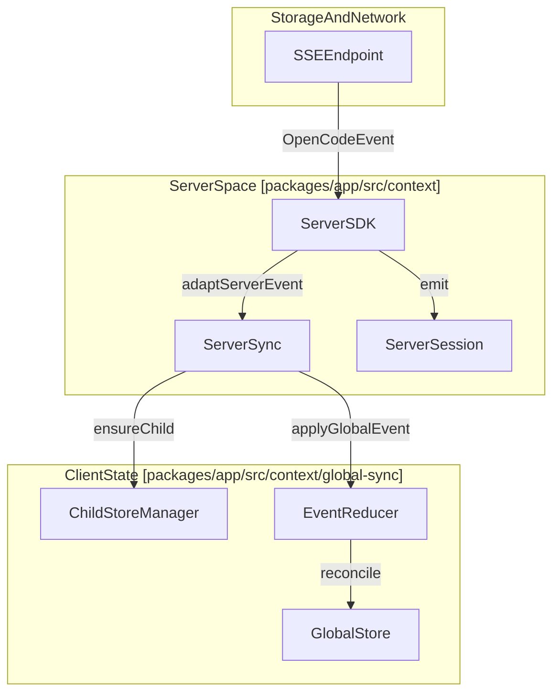
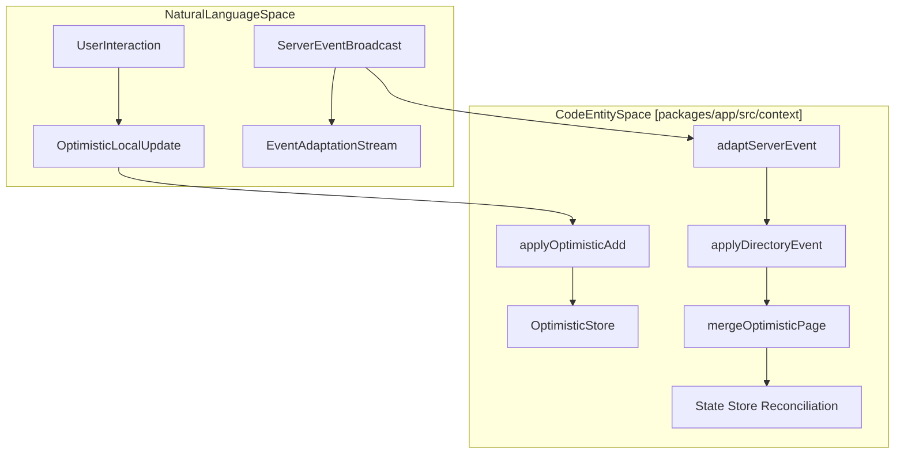

<!-- source: DeepWiki mcp.deepwiki.com · repo sst/opencode · page 2.8 Event Bus and Sync Architecture · fetched 2026-10-27 -->

# Event Bus and Sync Architecture

Relevant source files

The following files were used as context for generating this wiki page:

- [packages/app/e2e/regression/session-list-path-loading.spec.ts](packages/app/e2e/regression/session-list-path-loading.spec.ts)
- [packages/app/src/components/prompt-input/slash-popover.tsx](packages/app/src/components/prompt-input/slash-popover.tsx)
- [packages/app/src/context/directory-sync.ts](packages/app/src/context/directory-sync.ts)
- [packages/app/src/context/global-sync/bootstrap.test.ts](packages/app/src/context/global-sync/bootstrap.test.ts)
- [packages/app/src/context/global-sync/bootstrap.ts](packages/app/src/context/global-sync/bootstrap.ts)
- [packages/app/src/context/global-sync/child-store.test.ts](packages/app/src/context/global-sync/child-store.test.ts)
- [packages/app/src/context/global-sync/child-store.ts](packages/app/src/context/global-sync/child-store.ts)
- [packages/app/src/context/global-sync/event-reducer.test.ts](packages/app/src/context/global-sync/event-reducer.test.ts)
- [packages/app/src/context/global-sync/event-reducer.ts](packages/app/src/context/global-sync/event-reducer.ts)
- [packages/app/src/context/global-sync/session-cache.test.ts](packages/app/src/context/global-sync/session-cache.test.ts)
- [packages/app/src/context/global-sync/session-cache.ts](packages/app/src/context/global-sync/session-cache.ts)
- [packages/app/src/context/global-sync/types.ts](packages/app/src/context/global-sync/types.ts)
- [packages/app/src/context/server-sync.tsx](packages/app/src/context/server-sync.tsx)
- [packages/app/src/context/sync.tsx](packages/app/src/context/sync.tsx)
- [packages/app/src/pages/session/use-session-hash-scroll.ts](packages/app/src/pages/session/use-session-hash-scroll.ts)
- [packages/app/src/utils/refcount.test.ts](packages/app/src/utils/refcount.test.ts)
- [packages/app/src/utils/refcount.ts](packages/app/src/utils/refcount.ts)
- [packages/app/vite.js](packages/app/vite.js)
- [packages/opencode/src/cli/bootstrap.ts](packages/opencode/src/cli/bootstrap.ts)
- [packages/opencode/src/server/routes/instance/httpapi/api.ts](packages/opencode/src/server/routes/instance/httpapi/api.ts)
- [packages/opencode/src/server/routes/instance/httpapi/groups/global.ts](packages/opencode/src/server/routes/instance/httpapi/groups/global.ts)
- [packages/opencode/src/server/routes/instance/httpapi/handlers/global.ts](packages/opencode/src/server/routes/instance/httpapi/handlers/global.ts)
- [packages/opencode/src/server/routes/instance/httpapi/lifecycle.ts](packages/opencode/src/server/routes/instance/httpapi/lifecycle.ts)
- [packages/opencode/src/server/routes/instance/httpapi/middleware/schema-error.ts](packages/opencode/src/server/routes/instance/httpapi/middleware/schema-error.ts)
- [packages/opencode/src/server/routes/instance/httpapi/server.ts](packages/opencode/src/server/routes/instance/httpapi/server.ts)
- [packages/opencode/src/server/shared/public-ui.ts](packages/opencode/src/server/shared/public-ui.ts)
- [packages/opencode/src/server/shared/ui.ts](packages/opencode/src/server/shared/ui.ts)
- [packages/opencode/test/project/instance-bootstrap.test.ts](packages/opencode/test/project/instance-bootstrap.test.ts)
- [packages/opencode/test/server/global-bus.ts](packages/opencode/test/server/global-bus.ts)
- [packages/opencode/test/server/httpapi-config.test.ts](packages/opencode/test/server/httpapi-config.test.ts)
- [packages/opencode/test/server/httpapi-control-plane.test.ts](packages/opencode/test/server/httpapi-control-plane.test.ts)
- [packages/opencode/test/server/httpapi-experimental.test.ts](packages/opencode/test/server/httpapi-experimental.test.ts)
- [packages/opencode/test/server/httpapi-global.test.ts](packages/opencode/test/server/httpapi-global.test.ts)
- [packages/opencode/test/server/httpapi-instance.test.ts](packages/opencode/test/server/httpapi-instance.test.ts)
- [packages/opencode/test/server/httpapi-listen.test.ts](packages/opencode/test/server/httpapi-listen.test.ts)
- [packages/opencode/test/server/httpapi-schema-error-body.test.ts](packages/opencode/test/server/httpapi-schema-error-body.test.ts)
- [packages/opencode/test/server/httpapi-sync.test.ts](packages/opencode/test/server/httpapi-sync.test.ts)
- [packages/opencode/test/server/httpapi-ui.test.ts](packages/opencode/test/server/httpapi-ui.test.ts)

This document details OpenCode's event-driven architecture, global event subscription patterns, state management via hierarchical stores, and the synchronization system supporting session replayability across multiple client devices and interfaces.

---

## System Overview

OpenCode utilizes a unified event architecture to synchronize state between the backend services and multiple client interfaces (TUI, Desktop, VS Code). The system is designed to handle high-frequency streaming data (like LLM tokens) while maintaining a durable history of session mutations.

### Architecture Diagram: Event Flow and Synchronization

**Sources:** [packages/app/src/context/server-sdk.tsx:28-57](), [packages/app/src/context/server-sync.tsx:29-31](), [packages/app/src/context/global-sync/child-store.ts:152-183](), [packages/app/src/context/server-session.ts:165-214]()

---

## Global Event Bus and SSE

The communication backbone relies on Server-Sent Events (SSE) via the `/api/event` or `/global/event` endpoints. The `ServerSDK` adapts these raw events into a structured format for the frontend.

### Event Adaptation and Coalescing
To prevent UI performance degradation during high-frequency updates (e.g., LLM streaming), OpenCode implements event coalescing.

- **`adaptServerEvent`**: Converts V2 protocol events (like permission requests) into legacy formats for backward compatibility with existing UI components [packages/app/src/context/server-sdk.tsx:28-57]().
- **`coalesceServerEvents`**: Merges sequential delta events. For example, multiple text delta events are combined into a single update if they belong to the same message and part [packages/app/src/context/server-sdk.tsx:79-139]().
- **`currentDelta`**: A helper that identifies streamable event types like text, reasoning, and tool input deltas for coalescing [packages/app/src/context/server-sdk.tsx:141-149]().

### Key Event Types
| Event Type | Source | Description |
| :--- | :--- | :--- |
| `message.updated` | Server | Broadcast when a message's metadata or full content changes [packages/app/src/context/global-sync/event-reducer.ts:25](). |
| `message.part.delta` | LLM Stream | Incremental text/tool input updates [packages/app/src/context/server-sdk.tsx:110-137](). |
| `session.status` | Agent Loop | Updates the session state (e.g., busy, idle) [packages/app/src/context/global-sync/event-reducer.ts:24](). |
| `project.updated` | Control Plane | Notifies clients of changes to project worktrees or sandboxes [packages/app/src/context/global-sync/event-reducer.ts:48-64](). |
| `todo.updated` | Agent | Updates the list of tasks within a session [packages/app/src/context/global-sync/event-reducer.ts:23](). |

**Sources:** [packages/app/src/context/server-sdk.tsx:79-139](), [packages/app/src/context/global-sync/event-reducer.ts:21-35]()

---

## Sync Architecture and Client Stores

OpenCode uses a hierarchical store approach to manage synchronization across different project directories while maintaining performance through eviction policies.

### Child Store Management
The `createChildStoreManager` function maintains independent states for each directory workspace. It uses a pinning mechanism to keep active directories in memory while evicting idle ones to save resources [packages/app/src/context/global-sync/child-store.ts:23-50]().

- **Eviction**: Directories are disposed of if they exceed `MAX_DIR_STORES` (default 30) or remain idle longer than `DIR_IDLE_TTL_MS` [packages/app/src/context/global-sync/child-store.ts:135-150]().
- **Pinning**: `pinForOwner` allows UI components to prevent a directory from being evicted while it is actively viewed [packages/app/src/context/global-sync/child-store.ts:83-101]().
- **Persistence**: Each child store uses persisted storage for VCS info, project metadata, and icons, ensuring quick re-hydration after eviction [packages/app/src/context/global-sync/child-store.ts:156-182]().

### Optimistic Updates
The `useSync` and directory sync context manage optimistic UI state [packages/app/src/context/sync.tsx:113-118](). When a user sends a message, it is immediately added to the store via `applyOptimisticAdd` before the server confirms it [packages/app/src/context/sync.tsx:93-102](). Once the server event arrives, `mergeOptimisticPage` reconciles the local state with the authoritative server data [packages/app/src/context/sync.tsx:63-91]().

**Sources:** [packages/app/src/context/global-sync/child-store.ts:23-183](), [packages/app/src/context/sync.tsx:63-118](), [packages/app/src/context/global-sync/child-store.test.ts:75-108]()

---

## Session Replay and Reducers

The `ServerSession` class is responsible for the lifecycle of a specific conversation, including loading history and applying real-time mutations.

### Diagram: Natural Language to Code Entity Space (Sync & Event Reduction)

**Sources:** [packages/app/src/context/sync.tsx:63-102](), [packages/app/src/context/global-sync/event-reducer.ts:109-144](), [packages/app/src/context/server-sdk.tsx:28-57]()

### Data Flow: Message Loading and Replay
1.  **Bootstrap**: `bootstrapGlobal` fetches initial config, providers, and projects [packages/app/src/context/global-sync/bootstrap.ts:143-173]().
2.  **History Load**: Session managers fetch pages of messages using a cursor-based API [packages/app/src/context/server-sync.tsx:153-166]().
3.  **Real-time Projection**: As new events arrive via SSE, `applyDirectoryEvent` updates the state stores [packages/app/src/context/global-sync/event-reducer.ts:109-144]().
4.  **Cache Trimming**: To prevent memory leaks, `trimSessions` removes old sessions from the store based on limits [packages/app/src/context/global-sync/event-reducer.ts:125-144]().
5.  **Hash Scrolling**: `useSessionHashScroll` manages UI positioning by reacting to session history loads and navigating to specific message anchors [packages/app/src/pages/session/use-session-hash-scroll.ts:6-24]().

**Sources:** [packages/app/src/context/global-sync/event-reducer.ts:109-144](), [packages/app/src/context/global-sync/bootstrap.ts:143-173](), [packages/app/src/pages/session/use-session-hash-scroll.ts:6-24]()

---

## Implementation Reference

### Entity Mapping

| System Component | Code Entity | File |
| :--- | :--- | :--- |
| **Global Sync Manager** | `createChildStoreManager` | [packages/app/src/context/global-sync/child-store.ts:23]() |
| **Event Reducer** | `applyDirectoryEvent` | [packages/app/src/context/global-sync/event-reducer.ts:109]() |
| **SSE Adapter** | `adaptServerEvent` | [packages/app/src/context/server-sdk.tsx:28]() |
| **Session State** | `createServerSession` | [packages/app/src/context/server-session.ts:1]() |
| **Optimistic Sync** | `mergeOptimisticPage` | [packages/app/src/context/sync.tsx:63]() |
| **Directory Bootstrap** | `bootstrapGlobal` | [packages/app/src/context/global-sync/bootstrap.ts:143]() |

### Event Sequence: User Message to UI Update
1.  **User Input**: User submits a prompt in the TUI or Desktop client.
2.  **Optimistic Add**: `applyOptimisticAdd` updates the local Solid store immediately [packages/app/src/context/sync.tsx:93]().
3.  **Server Processing**: The backend generates a `session.created` or `message.updated` event.
4.  **SSE Reception**: `ServerSDK` receives the event and runs coalescing functions [packages/app/src/context/server-sdk.tsx:79]().
5.  **Reconciliation**: `applyDirectoryEvent` in `event-reducer.ts` updates the session list and triggers cleanup if limits are exceeded [packages/app/src/context/global-sync/event-reducer.ts:131-144]().
6.  **UI Refresh**: Solid.js reactive signals trigger a re-render. If a specific message was targeted, `useSessionHashScroll` scrolls the view [packages/app/src/pages/session/use-session-hash-scroll.ts:133-139]().

**Sources:** [packages/app/src/context/sync.tsx:93-102](), [packages/app/src/context/server-sdk.tsx:79-139](), [packages/app/src/context/global-sync/event-reducer.ts:109-144](), [packages/app/src/pages/session/use-session-hash-scroll.ts:133-139]()

---

