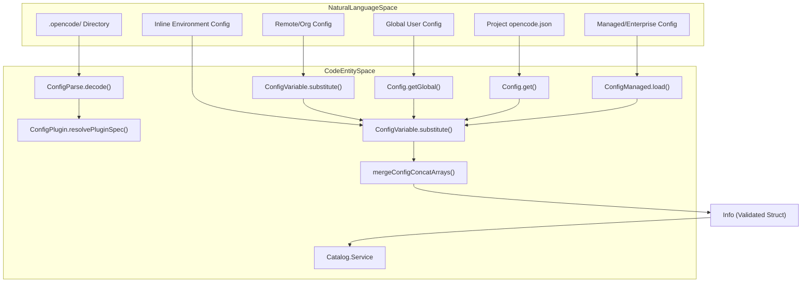
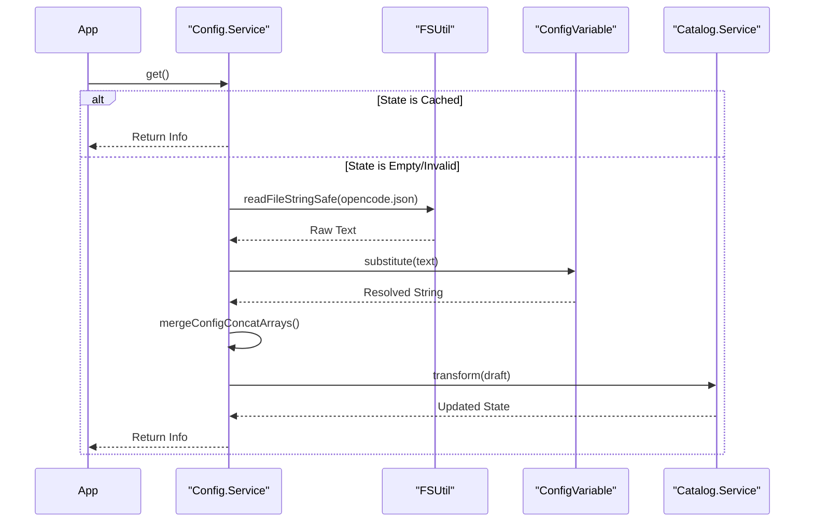

<!-- source: DeepWiki mcp.deepwiki.com · repo sst/opencode · page 3.1 Configuration Loading and Merging · fetched 2026-10-27 -->

# Configuration Loading and Merging

Relevant source files

The following files were used as context for generating this wiki page:

- [packages/core/src/catalog.ts](packages/core/src/catalog.ts)
- [packages/core/src/config.ts](packages/core/src/config.ts)
- [packages/core/src/config/mcp.ts](packages/core/src/config/mcp.ts)
- [packages/core/src/config/plugin/agent.ts](packages/core/src/config/plugin/agent.ts)
- [packages/core/src/config/plugin/provider.ts](packages/core/src/config/plugin/provider.ts)
- [packages/core/src/model.ts](packages/core/src/model.ts)
- [packages/core/src/plugin/models-dev.ts](packages/core/src/plugin/models-dev.ts)
- [packages/core/src/session/runner/model.ts](packages/core/src/session/runner/model.ts)
- [packages/core/src/v1/config/mcp.ts](packages/core/src/v1/config/mcp.ts)
- [packages/core/src/v1/config/migrate.ts](packages/core/src/v1/config/migrate.ts)
- [packages/core/test/catalog.test.ts](packages/core/test/catalog.test.ts)
- [packages/core/test/config/agent.test.ts](packages/core/test/config/agent.test.ts)
- [packages/core/test/config/config.test.ts](packages/core/test/config/config.test.ts)
- [packages/core/test/config/plugin.test.ts](packages/core/test/config/plugin.test.ts)
- [packages/core/test/config/provider.test.ts](packages/core/test/config/provider.test.ts)
- [packages/core/test/session-runner-model.test.ts](packages/core/test/session-runner-model.test.ts)
- [packages/opencode/src/acp/agent.ts](packages/opencode/src/acp/agent.ts)
- [packages/opencode/src/agent/agent.ts](packages/opencode/src/agent/agent.ts)
- [packages/opencode/src/config/agent.ts](packages/opencode/src/config/agent.ts)
- [packages/opencode/src/config/command.ts](packages/opencode/src/config/command.ts)
- [packages/opencode/src/config/config.ts](packages/opencode/src/config/config.ts)
- [packages/opencode/src/config/entry-name.ts](packages/opencode/src/config/entry-name.ts)
- [packages/opencode/src/config/managed.ts](packages/opencode/src/config/managed.ts)
- [packages/opencode/src/config/parse.ts](packages/opencode/src/config/parse.ts)
- [packages/opencode/src/config/paths.ts](packages/opencode/src/config/paths.ts)
- [packages/opencode/src/config/variable.ts](packages/opencode/src/config/variable.ts)
- [packages/opencode/src/server/server.ts](packages/opencode/src/server/server.ts)
- [packages/opencode/test/agent/agent.test.ts](packages/opencode/test/agent/agent.test.ts)
- [packages/opencode/test/agent/plugin-agent-regression.test.ts](packages/opencode/test/agent/plugin-agent-regression.test.ts)
- [packages/opencode/test/config/config.test.ts](packages/opencode/test/config/config.test.ts)
- [packages/opencode/test/config/entry-name.test.ts](packages/opencode/test/config/entry-name.test.ts)
- [packages/opencode/test/fixture/agent-plugin.constants.ts](packages/opencode/test/fixture/agent-plugin.constants.ts)
- [packages/opencode/test/fixture/agent-plugin.ts](packages/opencode/test/fixture/agent-plugin.ts)
- [packages/opencode/test/plugin/trigger.test.ts](packages/opencode/test/plugin/trigger.test.ts)
- [packages/opencode/test/plugin/workspace-adapter.test.ts](packages/opencode/test/plugin/workspace-adapter.test.ts)
- [packages/sdk/js/src/v2/gen/sdk.gen.ts](packages/sdk/js/src/v2/gen/sdk.gen.ts)
- [packages/sdk/js/src/v2/gen/types.gen.ts](packages/sdk/js/src/v2/gen/types.gen.ts)
- [packages/sdk/openapi.json](packages/sdk/openapi.json)
- [perf/test-suite.md](perf/test-suite.md)
- [specs/v2/config.md](specs/v2/config.md)

This page documents the technical implementation of OpenCode's multi-layered configuration system. It covers the layered precedence hierarchy, the merge strategies for complex data types, variable substitution, and the lifecycle of loading configuration from local, global, and remote sources.

---

## Overview

OpenCode utilizes a hierarchical configuration model where settings are aggregated from multiple sources, ranging from remote organizational defaults to local project-specific overrides. The system is built using the `Effect` framework and leverages `Schema` for strict validation and normalization of configuration data [packages/opencode/src/config/config.ts:175-184]().

The primary entry point for configuration is the `Service` class within `packages/opencode/src/config/config.ts`, which manages loading, caching, and invalidation of the unified configuration state [packages/opencode/src/config/config.ts:124-135](). In the V2 architecture, this is complemented by the `Catalog.Service`, which handles provider, integration, and model discovery [packages/core/src/catalog.ts:62-70]().

Sources: [packages/opencode/src/config/config.ts:124-135](), [packages/opencode/src/config/config.ts:175-184](), [packages/core/src/catalog.ts:62-70]()

---

## Configuration Source Hierarchy

The configuration is loaded in a specific sequence where each subsequent layer overrides or extends the previous ones.

### Data Flow and Code Entities

The following diagram maps logical configuration layers from natural language inputs to the internal functions and classes responsible for processing them.

Sources: [packages/opencode/src/config/config.ts:46-52](), [packages/opencode/src/config/config.ts:72-100](), [packages/opencode/src/config/config.ts:124-136](), [packages/opencode/src/config/config.ts:181-182](), [packages/core/src/catalog.ts:62-70]()

### Precedence Order (Low to High)

The merging process follows a strict hierarchy. If a key exists in multiple layers, the higher-precedence layer takes precedence:

1.  **Remote Config**: Fetched from well-known remote URLs associated with providers [packages/opencode/test/config/config.test.ts:60-78]().
2.  **Global Config**: User-wide settings stored in the global config directory (e.g., `~/.config/opencode/opencode.json`) [packages/opencode/src/config/config.ts:140-148]().
3.  **Project Config**: An `opencode.json` or `opencode.jsonc` file located in the project root [packages/opencode/test/config/config.test.ts:154-156]().
4.  **Local .opencode**: Directory-based configuration found within the project's `.opencode/` folder.
5.  **Inline Content**: Configuration passed via environment variables, processed through `Env.Service` [packages/opencode/src/config/config.ts:182-182]().
6.  **Managed Config**: Enterprise settings loaded via `ConfigManaged`, which overrides local user settings [packages/opencode/src/config/config.ts:31-31]().
7.  **Instance State**: Dynamic configuration specific to the active runtime instance or workspace [packages/opencode/src/effect/instance-state.ts:1-15]() (implied by [packages/opencode/src/config/config.ts:20-20]()).
8.  **Console State**: Real-time state and organizational overrides synced from the OpenCode Console [packages/opencode/src/config/config.ts:122-123]().

Sources: [packages/opencode/src/config/config.ts:31-31](), [packages/opencode/src/config/config.ts:122-123](), [packages/opencode/src/config/config.ts:140-148](), [packages/opencode/src/config/config.ts:182-182](), [packages/opencode/test/config/config.test.ts:60-78](), [packages/opencode/test/config/config.test.ts:154-156]()

---

## Merge Strategies

OpenCode implements a hybrid merge strategy to balance simple value overrides with additive configuration for arrays.

### Array Concatenation
Unlike standard deep merging which replaces arrays entirely, the `mergeConfigConcatArrays` function identifies specific fields that should be additive. Specifically, the `instructions` field is merged by combining values from both target and source objects, followed by deduplication via a `Set` [packages/opencode/src/config/config.ts:46-52]().

### Object Deep Merge
For all standard configuration fields (such as `providers` or `agents`), the system uses `mergeDeep` from `remeda` (wrapped via `mergeConfig`). This recursively merges objects where properties in higher-precedence layers overwrite those in lower layers [packages/opencode/src/config/config.ts:42-44]().

### V2 Catalog Merging
In the V2 architecture, `Catalog.Service` handles the merging of `ProviderV2` and `ModelV2` definitions. It ensures model-specific settings (such as request headers, custom API base URLs, and parameters) correctly inherit or override provider-level defaults [packages/core/src/catalog.ts:78-97]().

Sources: [packages/opencode/src/config/config.ts:42-52](), [packages/core/src/catalog.ts:78-97]()

---

## Configuration Schema and Normalization

The configuration system uses strict types and performs automated normalization to ensure consistency across CLI, TUI, and desktop clients.

### Normalization Logic
During loading, configuration payloads undergo several automated cleanups:
*   **Legacy Key Migration**: Deprecated top-level keys like `theme`, `keybinds`, and `tui` are removed from server configurations via `normalizeLoadedConfig` [packages/opencode/src/config/config.ts:54-63]().
*   **Plugin Resolution**: Relative paths for plugins are resolved to absolute paths relative to the configuration file that declared them using `ConfigPlugin.resolvePluginSpec` [packages/opencode/src/config/config.ts:102-110]().
*   **JSONC Patching**: The system supports editing and patching `.jsonc` files while preserving comments using `jsonc-parser` [packages/opencode/src/config/config.ts:13-13](), [packages/opencode/src/config/config.ts:150-162]().
*   **V1 to V2 Migration**: The `ConfigMigrateV1.migrate` utility transforms legacy V1 configuration shapes into V2 schemas [packages/core/src/v1/config/migrate.ts:1-15](), [packages/core/test/config/config.test.ts:79-88]().

### Schema Definition Mapping

| Code Entity | Configuration Key | Description |
| :--- | :--- | :--- |
| `ConfigV1.Info` | Root (V1) | Primary V1 configuration structure [packages/opencode/src/config/config.ts:25-25]() |
| `Config.Info` | Root (V2) | Primary V2 configuration structure [packages/core/test/config/config.test.ts:83-83]() |
| `ConfigAgent` | `agents` | Custom agent definitions including prompts, models, and steps [packages/opencode/src/config/config.ts:29-29]() |
| `ConfigPluginV1.Spec` | `plugin` | Definitions for external plugins and entrypoints [packages/opencode/src/config/config.ts:28-28](), [packages/opencode/src/config/config.ts:102-110]() |
| `ConfigPermissionV1` | `permission` | Granular rules for tool execution and directory access [packages/opencode/src/config/config.ts:27-27]() |

Sources: [packages/opencode/src/config/config.ts:13-13](), [packages/opencode/src/config/config.ts:25-29](), [packages/opencode/src/config/config.ts:54-63](), [packages/opencode/src/config/config.ts:102-110](), [packages/opencode/src/config/config.ts:150-162](), [packages/core/src/v1/config/migrate.ts:1-15](), [packages/core/test/config/config.test.ts:79-88]()

---

## Implementation Details

### The Config Service Lifecycle
`Config.Service` is managed as an `Effect.Layer`. It maintains cached state in memory and provides cache invalidation through the `invalidate` method [packages/opencode/src/config/config.ts:124-135]().

Sources: [packages/opencode/src/config/config.ts:46-52](), [packages/opencode/src/config/config.ts:72-100](), [packages/opencode/src/config/config.ts:124-135](), [packages/core/src/catalog.ts:105-170]()

### Variable Substitution
Prior to parsing, configuration strings pass through variable substitution. This allows referencing environment variables and virtual paths within config files via `ConfigVariable.substitute` [packages/opencode/src/config/config.ts:73-79]().

Sources: [packages/opencode/src/config/config.ts:73-79]()

---

