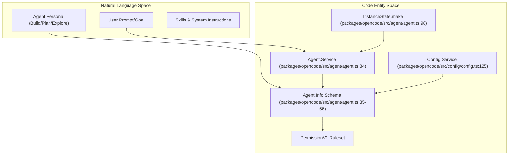
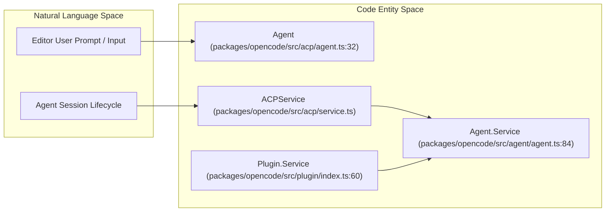

<!-- source: DeepWiki mcp.deepwiki.com · repo sst/opencode · page 3.2 Agent System · fetched 2026-10-27 -->

# Agent System

<details>
<summary>Relevant source files</summary>

The following files were used as context for generating this wiki page:

- [packages/opencode/src/acp/agent.ts](packages/opencode/src/acp/agent.ts)
- [packages/opencode/src/agent/agent.ts](packages/opencode/src/agent/agent.ts)
- [packages/opencode/src/cli/cmd/acp.ts](packages/opencode/src/cli/cmd/acp.ts)
- [packages/opencode/src/cli/cmd/agent.ts](packages/opencode/src/cli/cmd/agent.ts)
- [packages/opencode/src/cli/cmd/providers.ts](packages/opencode/src/cli/cmd/providers.ts)
- [packages/opencode/src/cli/cmd/serve.ts](packages/opencode/src/cli/cmd/serve.ts)
- [packages/opencode/src/cli/cmd/web.ts](packages/opencode/src/cli/cmd/web.ts)
- [packages/opencode/src/cli/network.ts](packages/opencode/src/cli/network.ts)
- [packages/opencode/src/config/agent.ts](packages/opencode/src/config/agent.ts)
- [packages/opencode/src/config/command.ts](packages/opencode/src/config/command.ts)
- [packages/opencode/src/config/config.ts](packages/opencode/src/config/config.ts)
- [packages/opencode/src/config/entry-name.ts](packages/opencode/src/config/entry-name.ts)
- [packages/opencode/src/config/managed.ts](packages/opencode/src/config/managed.ts)
- [packages/opencode/src/config/parse.ts](packages/opencode/src/config/parse.ts)
- [packages/opencode/src/config/paths.ts](packages/opencode/src/config/paths.ts)
- [packages/opencode/src/config/variable.ts](packages/opencode/src/config/variable.ts)
- [packages/opencode/src/server/mdns.ts](packages/opencode/src/server/mdns.ts)
- [packages/opencode/src/server/server.ts](packages/opencode/src/server/server.ts)
- [packages/opencode/test/agent/agent.test.ts](packages/opencode/test/agent/agent.test.ts)
- [packages/opencode/test/agent/plugin-agent-regression.test.ts](packages/opencode/test/agent/plugin-agent-regression.test.ts)
- [packages/opencode/test/config/config.test.ts](packages/opencode/test/config/config.test.ts)
- [packages/opencode/test/config/entry-name.test.ts](packages/opencode/test/config/entry-name.test.ts)
- [packages/opencode/test/fixture/agent-plugin.constants.ts](packages/opencode/test/fixture/agent-plugin.constants.ts)
- [packages/opencode/test/fixture/agent-plugin.ts](packages/opencode/test/fixture/agent-plugin.ts)
- [packages/opencode/test/plugin/trigger.test.ts](packages/opencode/test/plugin/trigger.test.ts)
- [packages/opencode/test/plugin/workspace-adapter.test.ts](packages/opencode/test/plugin/workspace-adapter.test.ts)
- [packages/opencode/test/tool/websearch.test.ts](packages/opencode/test/tool/websearch.test.ts)
- [packages/sdk/js/src/v2/gen/sdk.gen.ts](packages/sdk/js/src/v2/gen/sdk.gen.ts)
- [packages/sdk/js/src/v2/gen/types.gen.ts](packages/sdk/js/src/v2/gen/types.gen.ts)
- [packages/sdk/openapi.json](packages/sdk/openapi.json)
- [packages/web/src/content/docs/agents.mdx](packages/web/src/content/docs/agents.mdx)
- [packages/web/src/content/docs/cli.mdx](packages/web/src/content/docs/cli.mdx)
- [packages/web/src/content/docs/permissions.mdx](packages/web/src/content/docs/permissions.mdx)
- [packages/web/src/content/docs/server.mdx](packages/web/src/content/docs/server.mdx)
- [packages/web/src/content/docs/tools.mdx](packages/web/src/content/docs/tools.mdx)
- [perf/test-suite.md](perf/test-suite.md)

</details>


## Purpose and Scope

The Agent System defines AI agent behaviors, permissions, and capabilities within OpenCode. Each agent represents a specific mode of operation with its own set of tool permissions, system prompts, model configurations, and behavioral parameters. This document covers agent types, native agent definitions, custom agent configuration, system prompt resolution, permission inheritance, and integration across the Effect service layer and the Agent Client Protocol (ACP).

Sources: [packages/opencode/src/agent/agent.ts:35-100]()

---

## Overview

The Agent System provides a mechanism to create distinct AI agent personas, each tailored for specific development and analysis tasks. OpenCode includes several native agents that users interact with directly or via subagent delegation:

- `build` — Default primary agent for development work with full tool access [packages/opencode/src/agent/agent.ts:141-155]().
- `plan` — Primary agent restricted for analysis and planning; denies most edits [packages/opencode/src/agent/agent.ts:156-181]().
- `general` — Subagent for researching complex questions and multi-step tasks [packages/opencode/src/agent/agent.ts:182-198]().
- `explore` — Specialized subagent for fast, read-only codebase exploration [packages/opencode/src/agent/agent.ts:199-222]().

Agents are configured through the `Info` schema defined in [packages/opencode/src/agent/agent.ts:35-56]() and are managed via the `Agent.Service` in the Effect-based architecture [packages/opencode/src/agent/agent.ts:84-100]().

### Agent Architecture

The following diagram bridges natural language concepts to the internal code entities that manage agents and permissions.



**Diagram: Agent System Architecture**

Sources: [packages/opencode/src/agent/agent.ts:35-100](), [packages/opencode/src/config/config.ts:125-136]()

---

## Agent Types and Modes

Agents are categorized by their `mode` field, which determines how they appear in the TUI/UI and how they are invoked [packages/opencode/src/agent/agent.ts:38]().

| Mode | Description | Visibility |
|------|-------------|------------|
| `primary` | Main assistants for direct conversation and execution. | Visible in TUI/UI selection (e.g. Tab key). |
| `subagent` | Specialized assistants for delegated tasks. | Triggered via tools or `@` mentions. |
| `all` | Hybrid availability across contexts. | Visible in both selection and delegation menus. |

### Subagent Delegation
Subagents are invoked primarily through `@` mentions or primary agent delegation. When a primary agent needs specialized help, it can trigger a subagent. The `explore` agent, for example, is specialized for codebase navigation and explicitly denies edit tools [packages/opencode/src/agent/agent.ts:199-222]().

Sources: [packages/opencode/src/agent/agent.ts:35-56](), [packages/opencode/src/agent/agent.ts:199-222]()

---

## Built-in Agents

OpenCode defines several native agents with specific permission sets and system behaviors [packages/opencode/src/agent/agent.ts:140-254]().

### Primary Agents
- **build**: The default developer agent. It allows `question` and `plan_enter` permissions by default [packages/opencode/src/agent/agent.ts:141-155]().
- **plan**: Restricted mode. It denies all `edit` tools globally but allows editing specifically within `.opencode/plans/*.md` or the system data directory [packages/opencode/src/agent/agent.ts:156-181]().

### Subagents
- **general**: Parallel task executor. It denies `todowrite` to prevent background subagents from cluttering the user's TODO list [packages/opencode/src/agent/agent.ts:182-198]().
- **explore**: Specialized for reading and searching. It denies edit and write tools while allowing read/glob/grep operations [packages/opencode/src/agent/agent.ts:199-222]().
- **scout**: Specialized for external library research and dependency repository inspection [packages/web/src/content/docs/agents.mdx:87-93]().

### Hidden System Agents
These agents perform automated background operations and are not selectable in the user interface:
- **compaction**: Summarizes long conversation contexts into a compact state [packages/web/src/content/docs/agents.mdx:95-100]().
- **title**: Generates short, descriptive session titles [packages/web/src/content/docs/agents.mdx:103-108]().
- **summary**: Creates session activity summaries [packages/web/src/content/docs/agents.mdx:111-116]().

Sources: [packages/opencode/src/agent/agent.ts:140-254](), [packages/web/src/content/docs/agents.mdx:87-116]()

---

## Agent Configuration and Customization

Users can customize native agents or define new ones via configuration files (`opencode.json` or Markdown files in `agents/`) [packages/web/src/content/docs/agents.mdx:142-216]().

### Configuration Schema
The `Info` schema in `packages/opencode/src/agent/agent.ts` defines the structure for agent properties [packages/opencode/src/agent/agent.ts:35-56]():
- `name`: Unique identifier string [packages/opencode/src/agent/agent.ts:36]().
- `description`: Purpose statement used by primary agents for delegation [packages/opencode/src/agent/agent.ts:37]().
- `mode`: `'subagent' | 'primary' | 'all'` [packages/opencode/src/agent/agent.ts:38]().
- `model`: Optional provider and model identifier struct (`providerID`, `modelID`) [packages/opencode/src/agent/agent.ts:45-50]().
- `prompt`: Custom system prompt string or file reference [packages/opencode/src/agent/agent.ts:52]().
- `permission`: A `PermissionV1.Ruleset` defining tool permissions [packages/opencode/src/agent/agent.ts:44]().
- `steps`: Maximum number of agentic execution loops [packages/opencode/src/agent/agent.ts:54]().
- `temperature` / `topP`: Optional LLM sampling parameters [packages/opencode/src/agent/agent.ts:41-42]().

### Creating Custom Agents via CLI

The OpenCode CLI provides an interactive command to create new agents: `opencode agent create` [packages/web/src/content/docs/cli.mdx:69-71](). This command guides the user through defining a custom system prompt and permission configuration.

```bash
opencode agent create
```

Key flags for non-interactive creation include:
- `--path`: Directory to write the agent file (defaults to global or `.opencode/agent`) [packages/web/src/content/docs/cli.mdx:77]().
- `--description`: What the agent should do [packages/web/src/content/docs/cli.mdx:80]().
- `--mode`: Agent mode (`all`, `primary`, or `subagent`) [packages/web/src/content/docs/cli.mdx:81]().
- `--permissions` or `--tools`: Comma-separated list of permissions to allow (e.g., `bash`, `read`, `edit`). Anything omitted is denied [packages/web/src/content/docs/cli.mdx:82]().
- `--model`: Model to use, in `provider/model` format [packages/web/src/content/docs/cli.mdx:83]().

Sources: [packages/opencode/src/agent/agent.ts:35-181](), [packages/web/src/content/docs/agents.mdx:142-216](), [packages/web/src/content/docs/cli.mdx:69-84]()

### Permission Resolution
An agent's effective permission set is computed through layered merging:
1. **Hardcoded Defaults**: Base safety rules (e.g., `*.env` files set to `ask`) [packages/opencode/src/agent/agent.ts:119-136]().
2. **Native Agent Defaults**: Agent-specific restrictions (e.g., `plan` denies edits) [packages/opencode/src/agent/agent.ts:160-181]().
3. **User Configuration**: Overrides specified in `opencode.json` under the `permission` key [packages/opencode/src/agent/agent.ts:138]().

Sources: [packages/opencode/src/agent/agent.ts:35-181](), [packages/web/src/content/docs/agents.mdx:142-216]()

---

## API, ACP, and Protocol Integration

The Agent System integrates with external editors and SDKs via the Agent Client Protocol (ACP) and the Hono-backed HTTP server API [packages/opencode/src/acp/agent.ts:32-86]().

### ACP Implementation and Protocol Flow

The following diagram bridges natural language editor interactions to the internal code classes implementing the protocol and agent services.



**Diagram: Agent Integration and Protocol Flow**

Sources: [packages/opencode/src/acp/agent.ts:32-86](), [packages/opencode/src/agent/agent.ts:84-100](), [packages/opencode/src/plugin/index.ts:60-86]()

---

