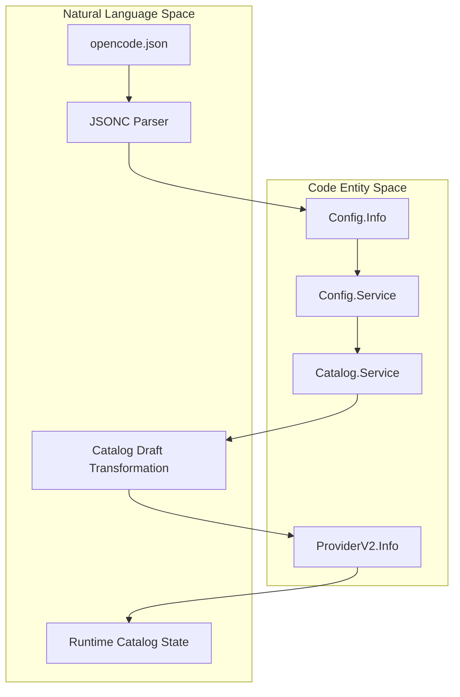
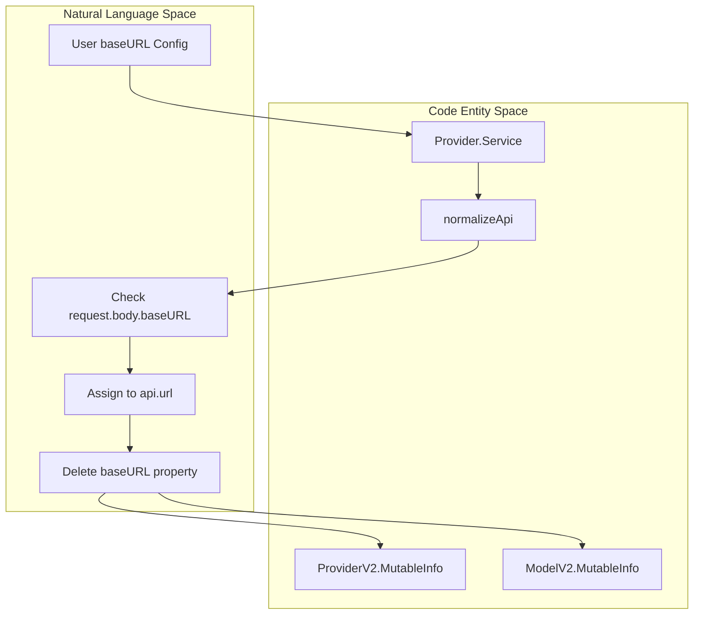

<!-- source: DeepWiki mcp.deepwiki.com · repo sst/opencode · page 3.3 Provider and Model Configuration · fetched 2026-10-27 -->

# Provider and Model Configuration

<details>
<summary>Relevant source files</summary>

The following files were used as context for generating this wiki page:

- [packages/core/src/v1/config/provider.ts](packages/core/src/v1/config/provider.ts)
- [packages/opencode/src/command/template/initialize.txt](packages/opencode/src/command/template/initialize.txt)
- [packages/opencode/src/config/tui.ts](packages/opencode/src/config/tui.ts)
- [packages/opencode/src/plugin/azure.ts](packages/opencode/src/plugin/azure.ts)
- [packages/opencode/src/provider/provider.ts](packages/opencode/src/provider/provider.ts)
- [packages/opencode/src/provider/transform.ts](packages/opencode/src/provider/transform.ts)
- [packages/opencode/test/config/tui.test.ts](packages/opencode/test/config/tui.test.ts)
- [packages/opencode/test/plugin/azure.test.ts](packages/opencode/test/plugin/azure.test.ts)
- [packages/opencode/test/provider/amazon-bedrock.test.ts](packages/opencode/test/provider/amazon-bedrock.test.ts)
- [packages/opencode/test/provider/gitlab-duo.test.ts](packages/opencode/test/provider/gitlab-duo.test.ts)
- [packages/opencode/test/provider/header-timeout.test.ts](packages/opencode/test/provider/header-timeout.test.ts)
- [packages/opencode/test/provider/provider.test.ts](packages/opencode/test/provider/provider.test.ts)
- [packages/opencode/test/provider/transform.test.ts](packages/opencode/test/provider/transform.test.ts)
- [packages/sdk/js/src/gen/sdk.gen.ts](packages/sdk/js/src/gen/sdk.gen.ts)
- [packages/sdk/js/src/gen/types.gen.ts](packages/sdk/js/src/gen/types.gen.ts)
- [packages/web/src/content/docs/config.mdx](packages/web/src/content/docs/config.mdx)
- [packages/web/src/content/docs/ecosystem.mdx](packages/web/src/content/docs/ecosystem.mdx)
- [packages/web/src/content/docs/keybinds.mdx](packages/web/src/content/docs/keybinds.mdx)
- [packages/web/src/content/docs/providers.mdx](packages/web/src/content/docs/providers.mdx)
- [packages/web/src/content/docs/rules.mdx](packages/web/src/content/docs/rules.mdx)
- [packages/web/src/content/docs/tui.mdx](packages/web/src/content/docs/tui.mdx)
- [packages/web/src/content/docs/zh-cn/providers.mdx](packages/web/src/content/docs/zh-cn/providers.mdx)
- [packages/web/src/content/docs/zh-tw/providers.mdx](packages/web/src/content/docs/zh-tw/providers.mdx)
- [patches/@ai-sdk%2Famazon-bedrock@4.0.166.patch](patches/@ai-sdk%2Famazon-bedrock@4.0.166.patch)
- [patches/@ai-sdk%2Fanthropic@3.0.111.patch](patches/@ai-sdk%2Fanthropic@3.0.111.patch)

</details>


This page documents how to configure AI providers, specify models, set runtime options (such as `baseURL`, region, and custom endpoints), and manage default model selection in OpenCode. OpenCode integrates the Vercel AI SDK and the `Models.dev` registry to support over 75 LLM providers alongside local models [packages/web/src/content/docs/providers.mdx:9]().

---

## 1. Configuration Structure and Data Flow

Provider configuration is defined in the `providers` section of `opencode.json` (or `opencode.jsonc`) and validated via the `Config.Info` schema [packages/core/src/v1/config/provider.ts:10-11](). The configuration schema captures provider settings, API types, request overrides, and model definitions, which are subsequently loaded and transformed by the v2 `Catalog` service.

### Configuration Processing Pipeline


**Sources:** [packages/opencode/src/provider/provider.ts:5](), [packages/opencode/src/provider/provider.ts:13](), [packages/opencode/src/provider/provider.ts:29]()

### Basic Provider Configuration

Users can customize provider endpoints, override request headers, or supply custom base URLs using `opencode.json`:

```json title="opencode.json"
{
  "$schema": "https://opencode.ai/config.json",
  "provider": {
    "anthropic": {
      "options": {
        "baseURL": "https://api.anthropic.com/v1"
      }
    }
  }
}
```
**Sources:** [packages/web/src/content/docs/providers.mdx:36-47]()

---

## 2. Catalog Service and Model Resolution

The v2 core architecture manages provider catalogs and model availability through `Provider.Service` [packages/opencode/src/provider/provider.ts:65](). The service loads providers from various sources including environment variables, configuration files, and plugins, then filters them based on `enabled_providers`, `disabled_providers`, and model-specific `whitelist`/`blacklist` settings [packages/opencode/src/provider/provider.ts:1430-1434]().

### `Provider.Service.list()`

The `list()` method aggregates all available providers and their models, applying configuration overrides and filtering. It also handles authentication and sets default options like `store: false` and `promptCacheKey` for certain providers [packages/opencode/src/provider/provider.ts:1430-1434]().

```mermaid
graph TD
    subgraph "Provider Loading and Filtering"
        A[Start] --> B{Load Providers from Env, Config, Plugins};
        B --> C{Apply `enabled_providers` filter};
        C --> D{Apply `disabled_providers` filter};
        D --> E{Apply `whitelist` and `blacklist` for models};
        E --> F{Set default options (e.g., `store`, `promptCacheKey`)};
        F --> G[Return filtered list of providers and models];
    end
```
**Sources:** [packages/opencode/src/provider/provider.ts:77](), [packages/opencode/src/provider/provider.ts:1430-1434](), [packages/opencode/test/provider/provider.test.ts:143-178]()

### `Provider.Service.getModel()` and `Provider.Service.getLanguage()`

These methods retrieve a specific model and its associated language model instance from the AI SDK. They apply transformations and options before returning the `LanguageModelV3` instance [packages/opencode/src/provider/provider.ts:108-111]().

```mermaid
graph TD
    subgraph "Model Retrieval and Language Model Instantiation"
        A[Call `Provider.use.getModel(providerID, modelID)`] --> B{Retrieve ModelV2.Info from Catalog};
        B --> C{Apply `ProviderTransform.options`};
        C --> D{Call `Provider.use.getLanguage(model)`};
        D --> E{Load AI SDK for provider (e.g., `@ai-sdk/openai`)};
        E --> F{Instantiate `LanguageModelV3`};
        F --> G[Return LanguageModelV3 instance];
    end
```
**Sources:** [packages/opencode/src/provider/provider.ts:108-111](), [packages/opencode/src/provider/provider.ts:113-140](), [packages/opencode/src/provider/provider.ts:1700-1704]()

### `baseURL` Normalization

When a user specifies a `baseURL` within provider options or model request bodies, the `Provider.Service` automatically normalizes it into the underlying `api.url` structure consumed by the LLM routing layer [packages/opencode/src/provider/provider.ts:1700-1704]().


**Sources:** [packages/opencode/src/provider/provider.ts:1700-1704]()

---

## 3. Provider Options and Transformations

The `ProviderTransform` module handles various transformations and option settings before requests are sent to the AI SDK.

### `ProviderTransform.options()`

This function sets provider-specific options, including `promptCacheKey` for caching, `store: false` for stateless reasoning, and `include` parameters for encrypted reasoning content [packages/opencode/src/provider/transform.ts:49]().

- **`promptCacheKey`**: Automatically set to the `sessionID` for OpenAI and xAI providers by default, enabling caching of prompts. Can be explicitly enabled/disabled via `providerOptions.setCacheKey` [packages/opencode/src/provider/transform.ts:1922]().
- **`store: false`**: Ensures stateless multi-turn reasoning for OpenAI and xAI providers [packages/opencode/src/provider/transform.ts:1922]().
- **`include: ["reasoning.encrypted_content"]`**: Requests encrypted reasoning state for stateless multi-turn reasoning [packages/opencode/src/provider/transform.ts:23]().

### `ProviderTransform.normalizeMessages()`

This function sanitizes messages before sending them to the LLM, handling surrogate characters and filtering empty content for specific providers like Anthropic [packages/opencode/src/provider/transform.ts:101]().

- **Surrogate Character Sanitization**: Replaces invalid Unicode surrogate pairs with `\uFFFD` to prevent API errors [packages/opencode/src/provider/transform.ts:25-26]().
- **Anthropic-specific Filtering**: Removes messages with empty string content or empty text/reasoning parts, as Anthropic APIs reject them [packages/opencode/src/provider/transform.ts:170-195]().

```mermaid
graph TD
    subgraph "Message and Option Transformation"
        A[Raw LLM Request] --> B{ProviderTransform.options()};
        B --> C{Set `promptCacheKey`, `store`, `include`};
        C --> D{ProviderTransform.normalizeMessages()};
        D --> E{Sanitize surrogate characters};
        E --> F{Filter empty content (e.g., for Anthropic)};
        F --> G[Transformed LLM Request];
    end
```
**Sources:** [packages/opencode/src/provider/transform.ts:23](), [packages/opencode/src/provider/transform.ts:25-26](), [packages/opencode/src/provider/transform.ts:49](), [packages/opencode/src/provider/transform.ts:101](), [packages/opencode/src/provider/transform.ts:170-195](), [packages/opencode/test/provider/transform.test.ts:48-217]()

---

## 4. Authentication and Credential Storage

API keys and tokens added via the `/connect` command are stored persistently in `~/.local/share/opencode/auth.json` [packages/web/src/content/docs/providers.mdx:18-21]().

### Authentication Plugins

OpenCode uses modular authentication plugins to support diverse authorization mechanisms:
* **Microsoft Entra ID (Azure CLI)**: The Azure auth plugin (`AzureAuthPlugin`) inspects local Azure CLI availability (`az`), fetches tokens for cognitive services scopes (`https://cognitiveservices.azure.com/.default` or `https://ai.azure.com/.default`), and manages token refresh buffers [packages/opencode/src/plugin/azure.ts:8-43]().
* **GitLab Duo**: Authenticates using a bearer token, which can be provided via `GITLAB_DUO_TOKEN` environment variable or `gitlab-duo` provider options in `opencode.json` [packages/opencode/test/provider/gitlab-duo.test.ts:11-12]().

**Sources:** [packages/web/src/content/docs/providers.mdx:18-21](), [packages/opencode/src/plugin/azure.ts:8-43](), [packages/opencode/test/provider/gitlab-duo.test.ts:11-12]()

---

## 5. OpenCode Zen and OpenCode Go

OpenCode provides curated managed inference services:
* **OpenCode Zen**: A pay-as-you-go service with models tested and verified by the OpenCode team [packages/web/src/content/docs/providers.mdx:87-90]().
* **OpenCode Go**: A low-cost monthly subscription plan providing reliable access to popular open coding models [packages/web/src/content/docs/providers.mdx:123-126]().

Both services operate as standard providers authenticated via API keys obtained through `opencode.ai/zen` [packages/web/src/content/docs/providers.mdx:96-102]().

**Sources:** [packages/web/src/content/docs/providers.mdx:87-152]()

---

## 6. Model Filtering, Whitelists, and Blacklists

Users can restrict model visibility in the `/models` picker using `whitelist` and `blacklist` options in `opencode.json`:
- **Blacklist**: Removes specified model IDs from the picker [packages/web/src/content/docs/providers.mdx:53-64]().
- **Whitelist**: Hides all models except those explicitly listed [packages/web/src/content/docs/providers.mdx:68-77]().

```json title="opencode.json"
{
  "$schema": "https://opencode.ai/config.json",
  "provider": {
    "anthropic": {
      "whitelist": ["claude-sonnet-4-20250514"],
      "blacklist": []
    }
  }
}
```
**Sources:** [packages/web/src/content/docs/providers.mdx:53-83](), [packages/opencode/test/provider/provider.test.ts:156-178]()

---

## 7. Custom Providers and Models

OpenCode allows defining custom providers and models directly in `opencode.json`. This includes specifying the npm package for the AI SDK, API endpoint, and individual model configurations.

```json title="opencode.json"
{
  "provider": {
    "custom-provider": {
      "name": "Custom Provider",
      "npm": "@ai-sdk/openai-compatible",
      "api": "https://api.custom.com/v1",
      "models": {
        "active-model": {
          "name": "Active Model"
        },
        "alpha-model": {
          "name": "Alpha Model",
          "status": "alpha"
        }
      },
      "options": {
        "apiKey": "custom-key"
      }
    }
  }
}
```
**Sources:** [packages/opencode/test/provider/provider.test.ts:90-110]()

- **`npm`**: Specifies the AI SDK package to use for the provider (e.g., `@ai-sdk/openai-compatible`) [packages/opencode/test/provider/provider.test.ts:94]().
- **`api`**: Defines the base URL for the provider's API [packages/opencode/test/provider/provider.test.ts:95]().
- **`models`**: Allows defining custom models, including their `name` and `status` (e.g., `alpha`) [packages/opencode/test/provider/provider.test.ts:96-103]().
- **`options`**: Provider-specific options, such as `apiKey` [packages/opencode/test/provider/provider.test.ts:104-106]().

Custom models with `status: "alpha"` are only loaded if `enableExperimentalModels` is set to `true` in the runtime flags [packages/opencode/test/provider/provider.test.ts:88]().

**Sources:** [packages/opencode/test/provider/provider.test.ts:88](), [packages/opencode/test/provider/provider.test.ts:90-110](), [packages/opencode/test/provider/provider.test.ts:198]()

---

## 8. Amazon Bedrock Configuration

Amazon Bedrock requires specific authentication and region configurations.

- **Authentication**: Can be configured via environment variables (`AWS_ACCESS_KEY_ID`, `AWS_SECRET_ACCESS_KEY`, `AWS_PROFILE`, `AWS_BEARER_TOKEN_BEDROCK`) or in `opencode.json` [packages/web/src/content/docs/providers.mdx:208-247]().
- **Region**: The `region` option in `opencode.json` takes precedence over the `AWS_REGION` environment variable [packages/opencode/test/provider/amazon-bedrock.test.ts:70-81]().
- **VPC Endpoints**: Custom `endpoint` URLs can be specified for VPC endpoints [packages/web/src/content/docs/providers.mdx:261-279]().
- **Bedrock Mantle**: Specific models like `openai.gpt-5.5` use the `@ai-sdk/amazon-bedrock/mantle` SDK and may route to different API paths (e.g., OpenAI base path for Responses API) [packages/opencode/test/provider/amazon-bedrock.test.ts:109-145]().

**Sources:** [packages/web/src/content/docs/providers.mdx:193-279](), [packages/opencode/test/provider/amazon-bedrock.test.ts:70-81](), [packages/opencode/test/provider/amazon-bedrock.test.ts:109-145]()

---

