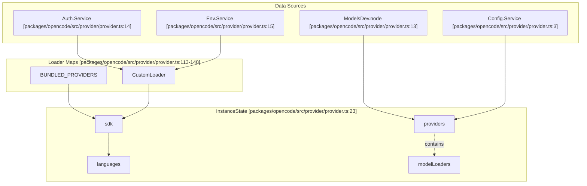
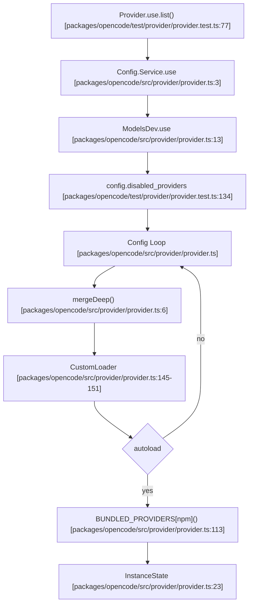

<!-- source: DeepWiki mcp.deepwiki.com · repo sst/opencode · page 4.1 Provider Architecture · fetched 2026-10-27 -->

# Provider Architecture

Relevant source files

The following files were used as context for generating this wiki page:

- [packages/opencode/src/plugin/azure.ts](packages/opencode/src/plugin/azure.ts)
- [packages/opencode/src/provider/provider.ts](packages/opencode/src/provider/provider.ts)
- [packages/opencode/src/provider/transform.ts](packages/opencode/src/provider/transform.ts)
- [packages/opencode/test/plugin/azure.test.ts](packages/opencode/test/plugin/azure.test.ts)
- [packages/opencode/test/provider/amazon-bedrock.test.ts](packages/opencode/test/provider/amazon-bedrock.test.ts)
- [packages/opencode/test/provider/gitlab-duo.test.ts](packages/opencode/test/provider/gitlab-duo.test.ts)
- [packages/opencode/test/provider/provider.test.ts](packages/opencode/test/provider/provider.test.ts)
- [packages/opencode/test/provider/transform.test.ts](packages/opencode/test/provider/transform.test.ts)
- [packages/web/src/content/docs/ecosystem.mdx](packages/web/src/content/docs/ecosystem.mdx)
- [packages/web/src/content/docs/providers.mdx](packages/web/src/content/docs/providers.mdx)
- [packages/web/src/content/docs/zh-cn/providers.mdx](packages/web/src/content/docs/zh-cn/providers.mdx)
- [packages/web/src/content/docs/zh-tw/providers.mdx](packages/web/src/content/docs/zh-tw/providers.mdx)
- [patches/@ai-sdk%2Famazon-bedrock@4.0.166.patch](patches/@ai-sdk%2Famazon-bedrock@4.0.166.patch)
- [patches/@ai-sdk%2Fanthropic@3.0.111.patch](patches/@ai-sdk%2Fanthropic@3.0.111.patch)

This document describes the architecture of OpenCode's AI provider integration system, which enables connections to 75+ AI model providers. It covers provider loading, model resolution, the `Provider.getModel()` function, and SDK integration.

## Purpose and Scope

The provider architecture is responsible for:
- Discovering and loading AI providers from multiple sources (bundled, custom, and dynamic) via `Provider.node` [packages/opencode/src/provider/provider.ts:1]().
- Managing the **Models.dev** catalog of models via `ModelsDev.Service` [packages/opencode/src/provider/provider.ts:13]().
- Handling provider-specific initialization, options, and SDK instantiation using `BUNDLED_PROVIDERS` [packages/opencode/src/provider/provider.ts:113-140]().
- Integrating with the authentication system (`Auth.Service`) to resolve API keys and OAuth tokens [packages/opencode/src/provider/provider.ts:14]().
- Providing a unified `LanguageModelV3` interface to the session prompt loop [packages/opencode/src/provider/provider.ts:12]().

This system acts as an abstraction layer between OpenCode's core session management and the underlying AI SDK providers.

Sources: [packages/opencode/src/provider/provider.ts:1-23]()

---

## Core Architecture Components

The provider system is centered around the `Provider` namespace and service definition in `packages/opencode/src/provider/provider.ts`. It maintains memoized state per project instance via `InstanceState`.

Title: Provider State and Data Flow

Sources: [packages/opencode/src/provider/provider.ts:3-23](), [packages/opencode/src/provider/provider.ts:113-140]()

### Provider Metadata and Schema

The system uses core data structures to represent the AI landscape:
1. `Provider.Info`: Represents a configured provider instance, source (`env`, `config`, `api`, or `custom`), auth details, and models.
2. `ModelV2.ID` and `ProviderV2.ID`: Strong types for identifiers used in catalog and session logic [packages/opencode/src/provider/provider.ts:29-30]().
3. `ProviderAuth.Methods`: Defines authentication methods (OAuth or API Key) and associated prompts [packages/opencode/src/plugin/azure.ts:48-53]().

Sources: [packages/opencode/src/provider/provider.ts:29-30](), [packages/opencode/src/plugin/azure.ts:48-53]()

---

## Provider Loading and Model Resolution

Provider discovery follows a multi-stage process, merging global model data from `ModelsDev` with local user configuration and environment variables.

Title: Provider Loading and Resolution Flow

Sources: [packages/opencode/src/provider/provider.ts:3-140](), [packages/opencode/test/provider/provider.test.ts:77-134]()

### The getModel() Function

The `Provider.use.getModel()` function is the primary entry point for obtaining an executable model instance. It handles lazy initialization of SDKs and applies options.

1. **Lookup**: Finds the provider and model definition in the memoized state [packages/opencode/src/provider/provider.ts:29-30]().
2. **Caching**: Checks state using a hash of `modelID` and `options` to reuse `LanguageModelV3` instances [packages/opencode/src/provider/provider.ts:12]().
3. **SDK Creation**: Uses `BUNDLED_PROVIDERS` to import factory functions (e.g., `createAnthropic`, `createOpenAI`) [packages/opencode/src/provider/provider.ts:113-140]().
4. **Transformation**: Wraps the resulting model with `ProviderTransform` logic for message normalization and quirk handling [packages/opencode/src/provider/transform.ts:101-166]().

Sources: [packages/opencode/src/provider/provider.ts:12](), [packages/opencode/src/provider/provider.ts:29-140](), [packages/opencode/src/provider/transform.ts:101-166]()

---

## Three-Tier SDK Integration

OpenCode supports three methods for loading provider SDKs to balance performance and extensibility:

| Tier | Description | Key Modules / Examples |
| :--- | :--- | :--- |
| **Tier 1: Bundled Providers** | Directly imported packages included in dependencies | `BUNDLED_PROVIDERS`, `@ai-sdk/anthropic`, `@ai-sdk/openai`, `@ai-sdk/amazon-bedrock` [packages/opencode/src/provider/provider.ts:113-140]() |
| **Tier 2: Custom Loaders & Hooks** | Provider-specific quirks, credential chains, and token resolution | `auth.loader`, Amazon Bedrock region/bearer handling [packages/opencode/test/provider/amazon-bedrock.test.ts:70-145]() |
| **Tier 3: Dynamic Import** | External npm packages specified via model metadata | `model.api.npm` dynamic resolution [packages/opencode/src/provider/transform.ts:42-98]() |

Sources: [packages/opencode/src/provider/provider.ts:113-140](), [packages/opencode/src/provider/transform.ts:42-98](), [packages/opencode/test/provider/amazon-bedrock.test.ts:70-145]()

---

## LLM Streaming and Transformation

The resolved provider is consumed to execute streams via `LLM.stream`.

1. **Option Merging**: Combines base provider options, model-specific options, and agent configuration.
2. **Transformation Pipeline**: `ProviderTransform.options` and `normalizeMessages` prepare requests:
   - **Sanitizing Surrogates**: Stripping invalid Unicode surrogates [packages/opencode/src/provider/transform.ts:25-27]().
   - **Filtering Empty Content**: Removing empty strings or reasoning parts rejected by providers like Anthropic [packages/opencode/src/provider/transform.ts:168-195]().
   - **Modality Mapping**: Mapping MIME types to supported modalities [packages/opencode/src/provider/transform.ts:10-16]().
3. **Caching and Reasoning**: Configures prompt caching keys (`promptCacheKey`) and reasoning modes (`include: ["reasoning.encrypted_content"]`) [packages/opencode/src/provider/transform.ts:23](), [packages/opencode/test/provider/transform.test.ts:45-52]().

Sources: [packages/opencode/src/provider/transform.ts:10-195](), [packages/opencode/test/provider/transform.test.ts:45-52]()

---

