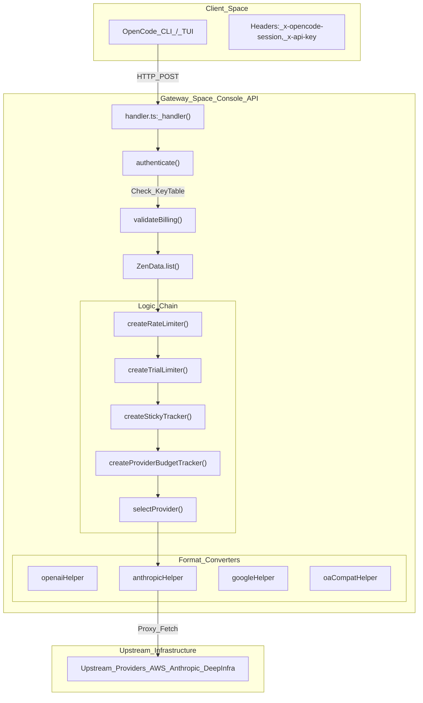
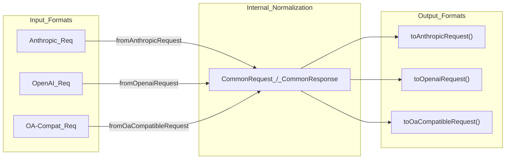

<!-- source: DeepWiki mcp.deepwiki.com · repo sst/opencode · page 4.5 OpenCode Zen and Go Services · fetched 2026-10-27 -->

# OpenCode Zen and Go Services

Relevant source files

The following files were used as context for generating this wiki page:

- [packages/web/src/content/docs/ar/go.mdx](packages/web/src/content/docs/ar/go.mdx)
- [packages/web/src/content/docs/ar/zen.mdx](packages/web/src/content/docs/ar/zen.mdx)
- [packages/web/src/content/docs/bs/go.mdx](packages/web/src/content/docs/bs/go.mdx)
- [packages/web/src/content/docs/bs/zen.mdx](packages/web/src/content/docs/bs/zen.mdx)
- [packages/web/src/content/docs/da/go.mdx](packages/web/src/content/docs/da/go.mdx)
- [packages/web/src/content/docs/da/zen.mdx](packages/web/src/content/docs/da/zen.mdx)
- [packages/web/src/content/docs/de/go.mdx](packages/web/src/content/docs/de/go.mdx)
- [packages/web/src/content/docs/de/zen.mdx](packages/web/src/content/docs/de/zen.mdx)
- [packages/web/src/content/docs/es/go.mdx](packages/web/src/content/docs/es/go.mdx)
- [packages/web/src/content/docs/es/zen.mdx](packages/web/src/content/docs/es/zen.mdx)
- [packages/web/src/content/docs/fr/go.mdx](packages/web/src/content/docs/fr/go.mdx)
- [packages/web/src/content/docs/fr/zen.mdx](packages/web/src/content/docs/fr/zen.mdx)
- [packages/web/src/content/docs/go.mdx](packages/web/src/content/docs/go.mdx)
- [packages/web/src/content/docs/it/go.mdx](packages/web/src/content/docs/it/go.mdx)
- [packages/web/src/content/docs/it/zen.mdx](packages/web/src/content/docs/it/zen.mdx)
- [packages/web/src/content/docs/ja/go.mdx](packages/web/src/content/docs/ja/go.mdx)
- [packages/web/src/content/docs/ko/go.mdx](packages/web/src/content/docs/ko/go.mdx)
- [packages/web/src/content/docs/nb/go.mdx](packages/web/src/content/docs/nb/go.mdx)
- [packages/web/src/content/docs/nb/zen.mdx](packages/web/src/content/docs/nb/zen.mdx)
- [packages/web/src/content/docs/pl/go.mdx](packages/web/src/content/docs/pl/go.mdx)
- [packages/web/src/content/docs/pl/zen.mdx](packages/web/src/content/docs/pl/zen.mdx)
- [packages/web/src/content/docs/pt-br/go.mdx](packages/web/src/content/docs/pt-br/go.mdx)
- [packages/web/src/content/docs/pt-br/zen.mdx](packages/web/src/content/docs/pt-br/zen.mdx)
- [packages/web/src/content/docs/ru/go.mdx](packages/web/src/content/docs/ru/go.mdx)
- [packages/web/src/content/docs/ru/zen.mdx](packages/web/src/content/docs/ru/zen.mdx)
- [packages/web/src/content/docs/th/go.mdx](packages/web/src/content/docs/th/go.mdx)
- [packages/web/src/content/docs/tr/go.mdx](packages/web/src/content/docs/tr/go.mdx)
- [packages/web/src/content/docs/tr/zen.mdx](packages/web/src/content/docs/tr/zen.mdx)
- [packages/web/src/content/docs/zen.mdx](packages/web/src/content/docs/zen.mdx)
- [packages/web/src/content/docs/zh-cn/go.mdx](packages/web/src/content/docs/zh-cn/go.mdx)
- [packages/web/src/content/docs/zh-cn/zen.mdx](packages/web/src/content/docs/zh-cn/zen.mdx)
- [packages/web/src/content/docs/zh-tw/go.mdx](packages/web/src/content/docs/zh-tw/go.mdx)
- [packages/web/src/content/docs/zh-tw/zen.mdx](packages/web/src/content/docs/zh-tw/zen.mdx)

This document describes OpenCode's managed AI gateway services: **Zen** and **Go**. These are optional, first-party provider services that offer tested, benchmarked models with simplified billing, unified API access, and multilingual documentation support across the OpenCode web platform [packages/web/src/content/docs/zen.mdx:10-15](), [packages/web/src/content/docs/go.mdx:10-17]().

---

## Service Overview

OpenCode provides two managed gateway services that function as standard providers within the OpenCode ecosystem:

- **OpenCode Zen**: A pay-as-you-go service offering curated, tested models from OpenAI, Anthropic, Google, and other providers. Models are selected based on performance benchmarks for coding agent tasks [packages/web/src/content/docs/zen.mdx:10-44]().
- **OpenCode Go**: A low-cost subscription (**$10/month**) providing reliable access to popular open coding models (e.g., Grok 4.6, GLM-5.3, Kimi K3, DeepSeek V4) with specific usage limits and stable global access [packages/web/src/content/docs/go.mdx:10-17]().

Both services are managed through the OpenCode Console and integrate with OpenCode's configuration system like any external provider [packages/web/src/content/docs/zen.mdx:46-51](). Additionally, the documentation for both Zen and Go is fully translated into numerous languages (including Chinese, Korean, Italian, Arabic, Polish, Russian, Norwegian, Portuguese, and Spanish) within the `packages/web/src/content/docs/` localization tree.

Sources: [packages/web/src/content/docs/zen.mdx:10-51](), [packages/web/src/content/docs/go.mdx:10-17]()

---

## Service Architecture

The gateway logic is implemented in the console application as a series of handlers that proxy requests to upstream providers while enforcing billing, rate limits, and model-specific transformations.

### Request Flow and Data Processing

The `handler` function in `packages/console/app/src/routes/zen/util/handler.ts` manages the entire lifecycle of a request to both Zen and Go endpoints.

*Zen/Go Request Flow*

The gateway performs several critical steps:
1. **Authentication**: Validates the API key against the `KeyTable` and `WorkspaceTable` [packages/console/app/src/routes/zen/util/handler.ts:106-130]().
2. **Model Validation**: Ensures the requested model exists in the curated `ZenData` list [packages/console/app/src/routes/zen/util/handler.ts:122-123]().
3. **Billing Check**: Verifies the workspace has sufficient credits (Zen) or an active subscription (Go) via `validateBilling` [packages/console/app/src/routes/zen/util/handler.ts:153]().
4. **Trial Handling**: For anonymous or new users, `createTrialLimiter` checks usage against IP-based limits to allow limited free testing [packages/console/app/src/routes/zen/util/handler.ts:124-129]().
5. **Sticky Sessions**: `createStickyTracker` attempts to pin a session to a specific upstream provider to maintain consistency [packages/console/app/src/routes/zen/util/handler.ts:151-152]().
6. **Provider Selection**: `selectProvider` chooses the best upstream target based on priority, weights, and failure history [packages/console/app/src/routes/zen/util/handler.ts:162-170]().

Sources: [packages/console/app/src/routes/zen/util/handler.ts:106-170](), [packages/console/app/src/routes/zen/util/trialLimiter.ts:6-28]()

---

## OpenCode Zen

### Curated Model Catalog and Endpoints
Zen provides access to tested models through unified endpoints that mimic original provider formats.

| Model Category | Model ID Format | Endpoint | AI SDK Package |
| :--- | :--- | :--- | :--- |
| **OpenAI** | `gpt-5.x`, `gpt-6-astra` | `https://opencode.ai/zen/v1/responses` | `@ai-sdk/openai` [packages/web/src/content/docs/zen.mdx:63-83]() |
| **Anthropic** | `claude-opus-x`, `claude-sonnet-x` | `https://opencode.ai/zen/v1/messages` | `@ai-sdk/anthropic` [packages/web/src/content/docs/zen.mdx:84-94]() |
| **Google** | `gemini-3.x-flash` | `https://opencode.ai/zen/v1/models/{model}` | `@ai-sdk/google` [packages/web/src/content/docs/zh-cn/zen.mdx:86-91]() |

Sources: [packages/web/src/content/docs/zen.mdx:61-94](), [packages/console/app/src/routes/zen/util/handler.ts:37-40]()

### Implementation Details: Provider Helpers
Each upstream provider has a dedicated helper to handle protocol quirks:
- **Anthropic**: Handles AWS Bedrock ARN vs. native Anthropic ID routing, context window beta headers, and binary stream decoding for Bedrock [packages/console/app/src/routes/zen/util/provider/anthropic.ts:19-58]().
- **OpenAI**: Maps OpenAI "Responses" API format to the common internal representation and handles image part conversion [packages/console/app/src/routes/zen/util/provider/openai.ts:16-62](), [packages/console/app/src/routes/zen/util/provider/openai.ts:64-87]().
- **Google**: Constructs specific SSE endpoints for Gemini `streamGenerateContent` [packages/console/app/src/routes/zen/util/provider/google.ts:29-32]().
- **OpenAI-Compatible**: Adds session affinity headers and ensures usage data is included in streams via `stream_options` [packages/console/app/src/routes/zen/util/provider/openai-compatible.ts:26-38]().

Sources: [packages/console/app/src/routes/zen/util/provider/anthropic.ts:19-58](), [packages/console/app/src/routes/zen/util/provider/openai-compatible.ts:26-38](), [packages/console/app/src/routes/zen/util/provider/openai.ts:16-87]()

---

## OpenCode Go

### Subscription and Client Compatibility
OpenCode Go provides high-volume access to open-source models for a flat **$10/month** subscription fee, designed for international users and stable global access [packages/web/src/content/docs/go.mdx:10-17](). 

The service recognizes native session headers (`x-opencode-session`) from validated coding agents and clients to optimize routing and prompt caching [packages/web/src/content/docs/go.mdx:100-107](). Validated clients include OpenCode, Hermes, Claude Code, Codex, ZCode, Pi, jcode, and Kilo Code CLI [packages/web/src/content/docs/go.mdx:110-121](). Certain clients (such as DeepSeek Harness and GitHub Copilot Chat) require specific tracking adjustments due to incomplete session header forwarding [packages/web/src/content/docs/go.mdx:123-131]().

Sources: [packages/web/src/content/docs/go.mdx:10-17](), [packages/web/src/content/docs/go.mdx:100-131]()

---

## Implementation Detail: Format Normalization

The gateway uses a "Common" format system to translate between different LLM providers, ensuring internal billing and logging logic functions uniformly regardless of the upstream vendor.

*Code Entity Mapping: Provider Converters*

- `createBodyConverter`: Orchestrates transformation between `ZenData.Format` types [packages/console/app/src/routes/zen/util/provider/provider.ts:182-195]().
- `createUsageParser`: Extracts token usage from provider-specific chunks during streaming [packages/console/app/src/routes/zen/util/provider/provider.ts:47-50]().
- `normalizeUsage`: Standardizes usage into a unified `UsageInfo` object containing input, output, and cache tokens [packages/console/app/src/routes/zen/util/provider/provider.ts:27-34]().

Sources: [packages/console/app/src/routes/zen/util/provider/provider.ts:27-228](), [packages/console/app/src/routes/zen/util/provider/openai-compatible.ts:61-80]()

---

## Configuration and Connectivity

### TUI Connection Flow
Users connect to these managed services via the CLI/TUI:
1. Run `/connect` in the TUI [packages/web/src/content/docs/zen.mdx:50](), [packages/web/src/content/docs/go.mdx:52]().
2. Select `OpenCode Zen` or `OpenCode Go` [packages/web/src/content/docs/zen.mdx:50](), [packages/web/src/content/docs/go.mdx:52]().
3. Paste the API key obtained from the **OpenCode Console** [packages/web/src/content/docs/zen.mdx:48-50](), [packages/web/src/content/docs/go.mdx:50-53]().
4. Run `/models` to inspect the available curated or subscription-backed model list [packages/web/src/content/docs/zen.mdx:51](), [packages/web/src/content/docs/go.mdx:54]().

Sources: [packages/web/src/content/docs/zen.mdx:44-55](), [packages/web/src/content/docs/go.mdx:46-54]()

---

