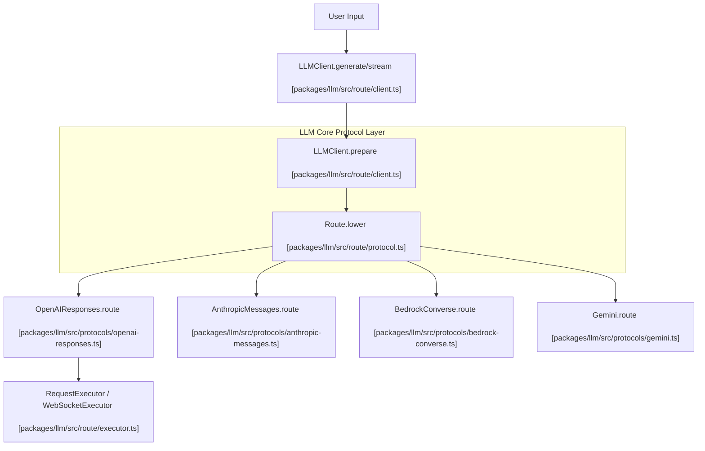
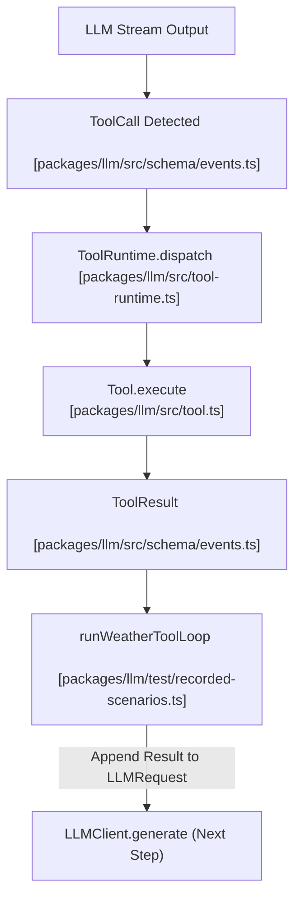

<!-- source: DeepWiki mcp.deepwiki.com · repo sst/opencode · page 4.6 LLM Core Package · fetched 2026-10-27 -->

# LLM Core Package

Relevant source files

The following files were used as context for generating this wiki page:

- [packages/llm/example/tutorial.ts](packages/llm/example/tutorial.ts)
- [packages/llm/src/protocols/anthropic-messages.ts](packages/llm/src/protocols/anthropic-messages.ts)
- [packages/llm/src/protocols/bedrock-converse.ts](packages/llm/src/protocols/bedrock-converse.ts)
- [packages/llm/src/protocols/gemini.ts](packages/llm/src/protocols/gemini.ts)
- [packages/llm/src/protocols/openai-chat.ts](packages/llm/src/protocols/openai-chat.ts)
- [packages/llm/src/protocols/openai-responses.ts](packages/llm/src/protocols/openai-responses.ts)
- [packages/llm/src/protocols/shared.ts](packages/llm/src/protocols/shared.ts)
- [packages/llm/src/schema/errors.ts](packages/llm/src/schema/errors.ts)
- [packages/llm/src/schema/events.ts](packages/llm/src/schema/events.ts)
- [packages/llm/src/tool-runtime.ts](packages/llm/src/tool-runtime.ts)
- [packages/llm/test/adapter.test.ts](packages/llm/test/adapter.test.ts)
- [packages/llm/test/fixtures/recordings/anthropic-messages/anthropic-opus-4-7-image-tool-result.json](packages/llm/test/fixtures/recordings/anthropic-messages/anthropic-opus-4-7-image-tool-result.json)
- [packages/llm/test/llm.test.ts](packages/llm/test/llm.test.ts)
- [packages/llm/test/provider/anthropic-messages.test.ts](packages/llm/test/provider/anthropic-messages.test.ts)
- [packages/llm/test/provider/bedrock-converse.test.ts](packages/llm/test/provider/bedrock-converse.test.ts)
- [packages/llm/test/provider/gemini.test.ts](packages/llm/test/provider/gemini.test.ts)
- [packages/llm/test/provider/golden.recorded.test.ts](packages/llm/test/provider/golden.recorded.test.ts)
- [packages/llm/test/provider/openai-chat.test.ts](packages/llm/test/provider/openai-chat.test.ts)
- [packages/llm/test/provider/openai-responses.test.ts](packages/llm/test/provider/openai-responses.test.ts)
- [packages/llm/test/recorded-golden.ts](packages/llm/test/recorded-golden.ts)
- [packages/llm/test/recorded-scenarios.ts](packages/llm/test/recorded-scenarios.ts)
- [packages/llm/test/schema.test.ts](packages/llm/test/schema.test.ts)
- [packages/llm/test/tool-runtime.test.ts](packages/llm/test/tool-runtime.test.ts)
- [packages/opencode/src/session/llm/native-request.ts](packages/opencode/src/session/llm/native-request.ts)

The LLM Core package (`packages/llm`) provides a unified, schema-first abstraction layer for interacting with Large Language Models. It is built using the **Effect** ecosystem, utilizing **Effect Schema** for strict data validation and **Effect Stream** for real-time response handling.

While the higher-level `Provider` service in `packages/opencode` manages model discovery and session-level orchestration, the LLM Core package focuses on the low-level execution of requests, protocol-specific message transformation, and the integration of streaming events via `LLMClient` and various protocol adapters.

## System Architecture

The LLM Core package operates as a protocol-agnostic interface. It defines a universal `LLMRequest` schema that is "lowered" into provider-specific payloads (e.g., OpenAI Responses, Anthropic Messages) by specialized route handlers.

### Data Flow: Natural Language to Code Entity Space

The following diagram illustrates how a request moves from high-level session logic into the core LLM protocol adapters.

**Request Processing Pipeline**

Sources: [packages/llm/src/route/client.ts:45-50](), [packages/llm/src/protocols/openai-responses.ts:28-30](), [packages/llm/src/protocols/anthropic-messages.ts:28-30](), [packages/llm/src/protocols/bedrock-converse.ts:29-30](), [packages/llm/src/protocols/gemini.ts:25-27]()

## Core Schemas and Protocols

### LLMRequest and LLMEvent
The core input to the system is the `LLMRequest`. Unlike the higher-level session messages, this request is strictly typed using Effect Schema to ensure compatibility across providers.

| Entity | Description |
| :--- | :--- |
| `LLMRequest` | Defines the model, system instructions, messages (history), and generation options (temperature, max tokens). [packages/llm/src/schema/index.ts:1-5]() |
| `LLMEvent` | A tagged union representing streaming chunks: `text-delta`, `reasoning-delta`, `tool-call`, `tool-result`, and `finish`. [packages/llm/src/schema/events.ts:78-170]() |
| `Usage` | Standardized token usage tracking (input, output, and cached tokens). Implements logic to derive inclusive totals from non-overlapping provider breakdowns. [packages/llm/src/schema/events.ts:51-74]() |

Sources: [packages/llm/src/schema/events.ts:51-74](), [packages/llm/src/schema/events.ts:78-170]()

### Protocol Adapters
The package includes native support for several major LLM protocols. Each protocol implements a `Route` that defines how to transform (`lower`) the universal `LLMRequest` into a wire-format body.

*   **OpenAI Responses**: Supports the `/responses` endpoint, including advanced reasoning fields (`summary_text`) and WebSocket-based streaming. [packages/llm/src/protocols/openai-responses.ts:35-165]()
*   **Anthropic Messages**: Handles the `/messages` protocol, managing `cache_control` hints (`ephemeral`) and structured tool results that can include base64 image data. [packages/llm/src/protocols/anthropic-messages.ts:35-171]()
*   **Bedrock Converse**: Adapts requests for AWS Bedrock's binary event-stream Converse API, handling `inferenceConfig` and `additionalModelRequestFields`. [packages/llm/src/protocols/bedrock-converse.ts:36-143]()
*   **Gemini**: Implements the Google Gemini protocol, featuring a specialized `GeminiToolSchema` to sanitize JSON schemas for Google's specific dialect. [packages/llm/src/protocols/gemini.ts:32-116]()

Sources: [packages/llm/src/protocols/openai-responses.ts:35-165](), [packages/llm/src/protocols/anthropic-messages.ts:35-171](), [packages/llm/src/protocols/bedrock-converse.ts:36-143](), [packages/llm/src/protocols/gemini.ts:32-116]()

## Tool Execution and Runtime

The LLM Core package includes a `ToolRuntime` that manages the execution of tool calls during the generation process.

**Tool Resolution Logic**

Sources: [packages/llm/src/tool-runtime.ts:1-10](), [packages/llm/test/recorded-scenarios.ts:91-118](), [packages/llm/src/schema/events.ts:152-160]()

### Token and Usage Management
The `ProviderShared` utility provides logic for normalizing token counts across providers with different reporting styles:
*   **Total Tokens**: Derived via `totalTokens` which honors provider totals or falls back to `input + output`. [packages/llm/src/protocols/shared.ts:51-59]()
*   **Token Subtraction**: `subtractTokens` derives non-overlapping breakdowns (e.g., non-cached input) from inclusive totals. [packages/llm/src/protocols/shared.ts:72-76]()
*   **System Update Wrapping**: For providers that do not support chronological system updates, `wrapSystemUpdate` escapes and wraps them in user-role XML tags. [packages/llm/src/protocols/shared.ts:120-122]()

Sources: [packages/llm/src/protocols/shared.ts:51-59](), [packages/llm/src/protocols/shared.ts:72-76](), [packages/llm/src/protocols/shared.ts:120-122]()

## Comparison: LLM Core vs. Provider Service

| Feature | `LLM Core` (packages/llm) | `Provider Service` (packages/opencode) |
| :--- | :--- | :--- |
| **Responsibility** | Protocol-level serialization & execution. | High-level configuration & model selection. |
| **Abstraction** | Protocol Routes (OpenAI, Anthropic). | Provider Drivers (AI SDK, Managed). |
| **State** | Stateless request/response logic. | Stateful model catalog and auth registry. |
| **Transport** | HTTP Fetch, WebSockets, SSE. | Managed API integration. |

Sources: [packages/llm/src/route/client.ts:1-15](), [packages/llm/src/protocols/openai-responses.ts:28-30]()

## Testing and Determinism

The package utilizes an `http-recorder` system to ensure deterministic testing of LLM interactions.

*   **Cassette System**: Stores bit-for-bit replays of provider interactions. [packages/llm/test/recorded-scenarios.ts:27-32]()
*   **Golden Scenarios**: Standardized test cases like `weatherToolLoopRequest` ensure that tool-calling loops work identically across OpenAI, Anthropic, and Bedrock. [packages/llm/test/recorded-scenarios.ts:62-72]()
*   **Protocol Assertions**: Tests in `openai-responses.test.ts` and `anthropic-messages.test.ts` verify that `LLMClient.prepare` generates the exact JSON structure expected by provider APIs. For example, `openai-responses.test.ts` checks the `prepared.body` for correct `model`, `input`, `store`, `stream`, `max_output_tokens`, and `temperature` fields. [packages/llm/test/provider/openai-responses.test.ts:43-59](), [packages/llm/test/provider/anthropic-messages.test.ts:45-58]()

Sources: [packages/llm/test/recorded-scenarios.ts:1-10](), [packages/llm/test/provider/openai-responses.test.ts:1-10]()

---

