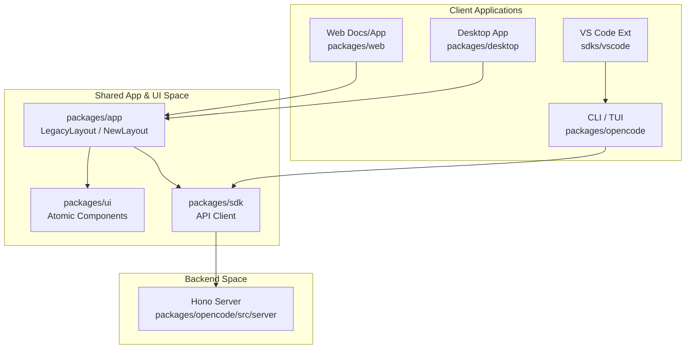
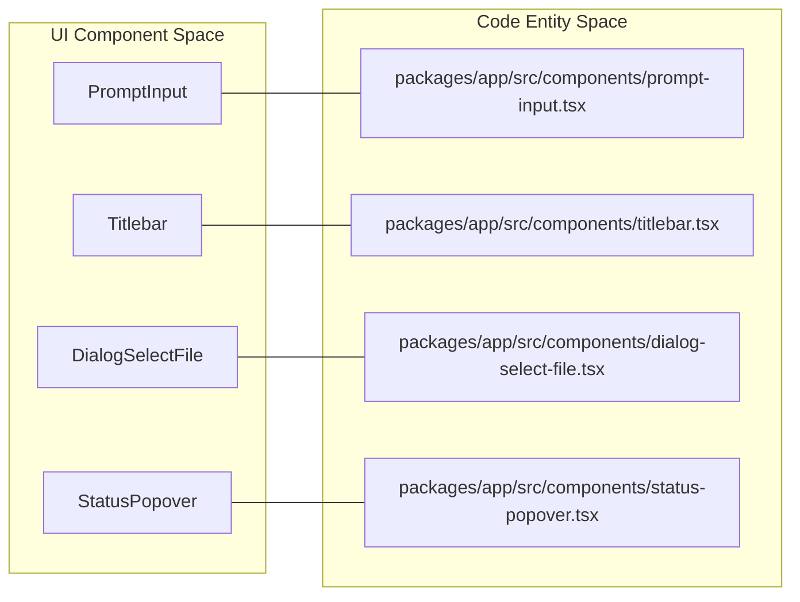

<!-- source: DeepWiki mcp.deepwiki.com · repo sst/opencode · page 6 User Interfaces · fetched 2026-10-27 -->

# User Interfaces

Relevant source files

The following files were used as context for generating this wiki page:

- [packages/app/src/app.tsx](packages/app/src/app.tsx)
- [packages/app/src/components/dialog-edit-project.tsx](packages/app/src/components/dialog-edit-project.tsx)
- [packages/app/src/components/dialog-select-file.tsx](packages/app/src/components/dialog-select-file.tsx)
- [packages/app/src/components/dialog-select-server.tsx](packages/app/src/components/dialog-select-server.tsx)
- [packages/app/src/components/prompt-input.tsx](packages/app/src/components/prompt-input.tsx)
- [packages/app/src/components/session-context-usage.tsx](packages/app/src/components/session-context-usage.tsx)
- [packages/app/src/components/session/session-context-metrics.test.ts](packages/app/src/components/session/session-context-metrics.test.ts)
- [packages/app/src/components/session/session-context-metrics.ts](packages/app/src/components/session/session-context-metrics.ts)
- [packages/app/src/components/session/session-context-tab.tsx](packages/app/src/components/session/session-context-tab.tsx)
- [packages/app/src/components/session/session-header.tsx](packages/app/src/components/session/session-header.tsx)
- [packages/app/src/components/session/session-new-view.tsx](packages/app/src/components/session/session-new-view.tsx)
- [packages/app/src/components/status-popover.tsx](packages/app/src/components/status-popover.tsx)
- [packages/app/src/components/titlebar.tsx](packages/app/src/components/titlebar.tsx)
- [packages/app/src/context/layout.tsx](packages/app/src/context/layout.tsx)
- [packages/app/src/context/notification.tsx](packages/app/src/context/notification.tsx)
- [packages/app/src/context/server.tsx](packages/app/src/context/server.tsx)
- [packages/app/src/pages/home.tsx](packages/app/src/pages/home.tsx)
- [packages/app/src/pages/layout.tsx](packages/app/src/pages/layout.tsx)
- [packages/app/src/pages/session.tsx](packages/app/src/pages/session.tsx)

This document provides a high-level overview of OpenCode's multiple client interfaces. OpenCode is designed with a client-server architecture where various frontend implementations (CLI, TUI, desktop, web, VS Code) communicate with a local or remote backend server.

For technical details on the backend communication, see [HTTP Server and API](#2.6). For the underlying data structures, see [Message and Part Structure](#2.2).

## Architecture Overview

All OpenCode user interfaces interact with the backend via `@opencode-ai/sdk`. The codebase emphasizes code reuse through shared packages like `@opencode-ai/ui` (atomic SolidJS components) and `@opencode-ai/app` (shared logic, layout, and state management).

Title: "Client Interface to Backend Architecture"

Sources: [packages/app/src/pages/layout.tsx:113-128](), [packages/app/src/app.tsx:74-108]()

## Command-Line Interface (CLI)

The CLI is the primary entry point for developers. It provides commands for running agents, managing authentication, and starting the interactive TUI. The `RunCommand` handles non-interactive prompt execution and attaching to existing servers.

For detailed command references, see [Command-Line Interface (CLI)](#6.1).

## Terminal User Interface (TUI)

The TUI is the default interactive mode. It renders SolidJS components in the terminal. The TUI manages complex state including history navigation and session consistency. The standalone `packages/tui` is built on `@opentui/solid`.

For details, see [Terminal User Interface (TUI)](#6.2) and [TUI State Management](#6.3).

## Desktop and Web Interfaces

The Desktop application (built with Tauri and Electron) and the Web interface share the `@opencode-ai/app` logic. They utilize a common layout layer (`LegacyLayout` or `NewLayout`) that manages workspaces, projects, and sidebar states [packages/app/src/app.tsx:61-63]().

- **Layout Management**: The `LegacyLayout` component handles the primary application shell, including `workspaceOrder`, `activeProject`, and `activeWorkspace` [packages/app/src/pages/layout.tsx:91-104]().
- **State Persistence**: Uses `persisted` storage for layout state like `lastProjectSession` [packages/app/src/pages/layout.tsx:95-98]().
- **Navigation**: Integrated with `@solidjs/router` for directory-based routing using base64-encoded paths [packages/app/src/pages/layout.tsx:132-144]().
- **Home Screen**: The `NewHome` page provides an overview of recent sessions and projects using controllers like `createHomeProjectsController` and `createHomeSessionsController` [packages/app/src/pages/home.tsx:11-16]().
- **Server Management**: The `DialogSelectServer` component and `useServerManagementController` allow users to add and health-check remote or local backend instances [packages/app/src/components/dialog-select-server.tsx:178-202]().

For details, see [Desktop Applications](#6.7) and [Shared App Package](#6.12).

Sources: [packages/app/src/pages/layout.tsx:86-180](), [packages/app/src/pages/home.tsx:11-16](), [packages/app/src/context/layout.tsx:168-178](), [packages/app/src/components/dialog-select-server.tsx:178-202]()

## VS Code and IDE Integration

OpenCode integrates into IDEs through terminal integration and protocol-based communication. The `SessionHeader` in the GUI provides quick-launch buttons for various IDEs, detecting the operating system to resolve binary paths [packages/app/src/components/session/session-header.tsx:140-192]().

- **macOS Apps**: Supports VS Code, Cursor, Zed, TextMate, and more [packages/app/src/components/session/session-header.tsx:57-90]().
- **Windows Apps**: Supports VS Code, Cursor, Zed, and PowerShell [packages/app/src/components/session/session-header.tsx:92-108]().
- **Linux Apps**: Supports VS Code, Cursor, Zed, and Sublime Text [packages/app/src/components/session/session-header.tsx:110-120]().

For details, see [VS Code Extension](#6.6) and [Agent Client Protocol (ACP)](#7.4).

Sources: [packages/app/src/components/session/session-header.tsx:57-120](), [packages/app/src/components/session/session-header.tsx:140-192]()

## Shared UI Components

OpenCode maintains a unified look and feel across interfaces using the `@opencode-ai/ui` package and shared logic in `@opencode-ai/app`.

- **Session Rendering**: The `SessionPage` manages message timelines (`MessageTimeline`), terminal panels (`TerminalPanel`), and review tabs (`SessionReviewTab`) [packages/app/src/pages/session.tsx:74-92]().
- **Prompt Input**: A robust `PromptInput` component handles history navigation via `navigatePromptHistory`, slash commands, and file attachments [packages/app/src/components/prompt-input.tsx:58-63](), [packages/app/src/components/prompt-input.tsx:117-140]().
- **Command Palette**: Shared dialogs like `DialogSelectFile` allow searching for files, sessions, and commands using `createCommandPaletteModel` [packages/app/src/components/dialog-select-file.tsx:30-44](), [packages/app/src/components/dialog-select-file.tsx:68-70]().
- **Titlebar**: A custom `Titlebar` provides navigation history (back/forward), project status, and update notifications [packages/app/src/components/titlebar.tsx:70-160]().
- **Status Monitoring**: The `StatusPopover` provides real-time feedback on server health, LSP status, and MCP connectivity [packages/app/src/components/status-popover.tsx:21-40]().

Title: "UI Component Space to Code Entity Space"

Sources: [packages/app/src/components/prompt-input.tsx:117-140](), [packages/app/src/components/titlebar.tsx:70-160](), [packages/app/src/components/dialog-select-file.tsx:30-44](), [packages/app/src/components/status-popover.tsx:21-40]()

For details, see [UI Component Library](#6.9) and [Session Rendering Components](#6.10).

---

