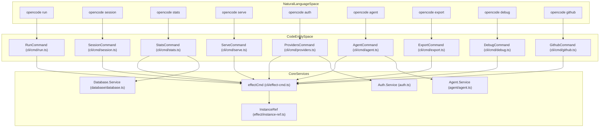
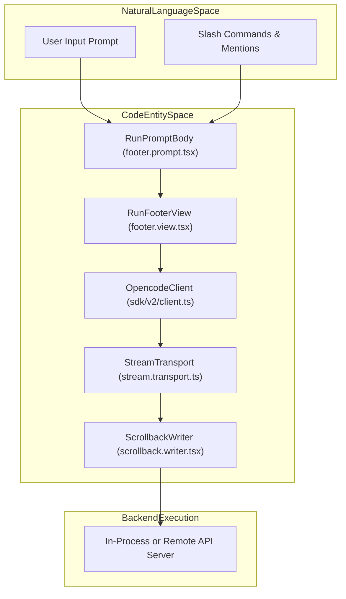

<!-- source: DeepWiki mcp.deepwiki.com · repo sst/opencode · page 6.1 Command-Line Interface (CLI) · fetched 2026-10-27 -->

# Command-Line Interface (CLI)

Relevant source files

The following files were used as context for generating this wiki page:

- [.opencode/opencode.jsonc](.opencode/opencode.jsonc)
- [AGENTS.md](AGENTS.md)
- [CONTRIBUTING.md](CONTRIBUTING.md)
- [github/README.md](github/README.md)
- [github/action.yml](github/action.yml)
- [github/index.ts](github/index.ts)
- [packages/app/AGENTS.md](packages/app/AGENTS.md)
- [packages/console/app/.opencode/agent/css.md](packages/console/app/.opencode/agent/css.md)
- [packages/desktop/README.md](packages/desktop/README.md)
- [packages/opencode/AGENTS.md](packages/opencode/AGENTS.md)
- [packages/opencode/src/cli/cmd/acp.ts](packages/opencode/src/cli/cmd/acp.ts)
- [packages/opencode/src/cli/cmd/agent.ts](packages/opencode/src/cli/cmd/agent.ts)
- [packages/opencode/src/cli/cmd/attach.ts](packages/opencode/src/cli/cmd/attach.ts)
- [packages/opencode/src/cli/cmd/cmd.ts](packages/opencode/src/cli/cmd/cmd.ts)
- [packages/opencode/src/cli/cmd/debug/config.ts](packages/opencode/src/cli/cmd/debug/config.ts)
- [packages/opencode/src/cli/cmd/debug/file.ts](packages/opencode/src/cli/cmd/debug/file.ts)
- [packages/opencode/src/cli/cmd/debug/lsp.ts](packages/opencode/src/cli/cmd/debug/lsp.ts)
- [packages/opencode/src/cli/cmd/debug/redact.ts](packages/opencode/src/cli/cmd/debug/redact.ts)
- [packages/opencode/src/cli/cmd/debug/ripgrep.ts](packages/opencode/src/cli/cmd/debug/ripgrep.ts)
- [packages/opencode/src/cli/cmd/debug/skill.ts](packages/opencode/src/cli/cmd/debug/skill.ts)
- [packages/opencode/src/cli/cmd/debug/snapshot.ts](packages/opencode/src/cli/cmd/debug/snapshot.ts)
- [packages/opencode/src/cli/cmd/export.ts](packages/opencode/src/cli/cmd/export.ts)
- [packages/opencode/src/cli/cmd/github.ts](packages/opencode/src/cli/cmd/github.ts)
- [packages/opencode/src/cli/cmd/providers.ts](packages/opencode/src/cli/cmd/providers.ts)
- [packages/opencode/src/cli/cmd/run.ts](packages/opencode/src/cli/cmd/run.ts)
- [packages/opencode/src/cli/cmd/run/footer.command.tsx](packages/opencode/src/cli/cmd/run/footer.command.tsx)
- [packages/opencode/src/cli/cmd/run/footer.menu.tsx](packages/opencode/src/cli/cmd/run/footer.menu.tsx)
- [packages/opencode/src/cli/cmd/run/footer.permission.tsx](packages/opencode/src/cli/cmd/run/footer.permission.tsx)
- [packages/opencode/src/cli/cmd/run/footer.prompt.tsx](packages/opencode/src/cli/cmd/run/footer.prompt.tsx)
- [packages/opencode/src/cli/cmd/run/footer.question.tsx](packages/opencode/src/cli/cmd/run/footer.question.tsx)
- [packages/opencode/src/cli/cmd/run/footer.subagent.tsx](packages/opencode/src/cli/cmd/run/footer.subagent.tsx)
- [packages/opencode/src/cli/cmd/run/footer.ts](packages/opencode/src/cli/cmd/run/footer.ts)
- [packages/opencode/src/cli/cmd/run/footer.view.tsx](packages/opencode/src/cli/cmd/run/footer.view.tsx)
- [packages/opencode/src/cli/cmd/run/runtime.lifecycle.ts](packages/opencode/src/cli/cmd/run/runtime.lifecycle.ts)
- [packages/opencode/src/cli/cmd/run/runtime.queue.ts](packages/opencode/src/cli/cmd/run/runtime.queue.ts)
- [packages/opencode/src/cli/cmd/run/runtime.stdin.ts](packages/opencode/src/cli/cmd/run/runtime.stdin.ts)
- [packages/opencode/src/cli/cmd/run/runtime.ts](packages/opencode/src/cli/cmd/run/runtime.ts)
- [packages/opencode/src/cli/cmd/run/scrollback.surface.ts](packages/opencode/src/cli/cmd/run/scrollback.surface.ts)
- [packages/opencode/src/cli/cmd/run/scrollback.writer.tsx](packages/opencode/src/cli/cmd/run/scrollback.writer.tsx)
- [packages/opencode/src/cli/cmd/run/session-data.ts](packages/opencode/src/cli/cmd/run/session-data.ts)
- [packages/opencode/src/cli/cmd/run/session-replay.ts](packages/opencode/src/cli/cmd/run/session-replay.ts)
- [packages/opencode/src/cli/cmd/run/splash.ts](packages/opencode/src/cli/cmd/run/splash.ts)
- [packages/opencode/src/cli/cmd/run/stream.transport.ts](packages/opencode/src/cli/cmd/run/stream.transport.ts)
- [packages/opencode/src/cli/cmd/run/subagent-data.ts](packages/opencode/src/cli/cmd/run/subagent-data.ts)
- [packages/opencode/src/cli/cmd/run/theme.ts](packages/opencode/src/cli/cmd/run/theme.ts)
- [packages/opencode/src/cli/cmd/run/types.ts](packages/opencode/src/cli/cmd/run/types.ts)
- [packages/opencode/src/cli/cmd/serve.ts](packages/opencode/src/cli/cmd/serve.ts)
- [packages/opencode/src/cli/cmd/session.ts](packages/opencode/src/cli/cmd/session.ts)
- [packages/opencode/src/cli/cmd/stats.ts](packages/opencode/src/cli/cmd/stats.ts)
- [packages/opencode/src/cli/cmd/web.ts](packages/opencode/src/cli/cmd/web.ts)
- [packages/opencode/src/cli/error.ts](packages/opencode/src/cli/error.ts)
- [packages/opencode/src/cli/logo.ts](packages/opencode/src/cli/logo.ts)
- [packages/opencode/src/cli/network.ts](packages/opencode/src/cli/network.ts)
- [packages/opencode/src/cli/ui.ts](packages/opencode/src/cli/ui.ts)
- [packages/opencode/src/server/mdns.ts](packages/opencode/src/server/mdns.ts)
- [packages/opencode/src/server/routes/instance/httpapi/handlers/file.ts](packages/opencode/src/server/routes/instance/httpapi/handlers/file.ts)
- [packages/opencode/src/util/error.ts](packages/opencode/src/util/error.ts)
- [packages/opencode/test/cli/debug-config.test.ts](packages/opencode/test/cli/debug-config.test.ts)
- [packages/opencode/test/cli/error.test.ts](packages/opencode/test/cli/error.test.ts)
- [packages/opencode/test/cli/github-action.test.ts](packages/opencode/test/cli/github-action.test.ts)
- [packages/opencode/test/cli/help/__snapshots__/help-snapshots.test.ts.snap](packages/opencode/test/cli/help/__snapshots__/help-snapshots.test.ts.snap)
- [packages/opencode/test/cli/help/help-snapshots.test.ts](packages/opencode/test/cli/help/help-snapshots.test.ts)
- [packages/opencode/test/cli/mcp-add.test.ts](packages/opencode/test/cli/mcp-add.test.ts)
- [packages/opencode/test/cli/run/footer.view.test.tsx](packages/opencode/test/cli/run/footer.view.test.tsx)
- [packages/opencode/test/cli/run/run-process.test.ts](packages/opencode/test/cli/run/run-process.test.ts)
- [packages/opencode/test/cli/run/runtime.queue.test.ts](packages/opencode/test/cli/run/runtime.queue.test.ts)
- [packages/opencode/test/cli/run/scrollback.surface.test.ts](packages/opencode/test/cli/run/scrollback.surface.test.ts)
- [packages/opencode/test/cli/run/session-replay.test.ts](packages/opencode/test/cli/run/session-replay.test.ts)
- [packages/opencode/test/cli/run/stream.transport.test.ts](packages/opencode/test/cli/run/stream.transport.test.ts)
- [packages/opencode/test/cli/run/theme.test.ts](packages/opencode/test/cli/run/theme.test.ts)
- [packages/opencode/test/cli/tui/thread.test.ts](packages/opencode/test/cli/tui/thread.test.ts)
- [packages/opencode/test/lib/cli-process.ts](packages/opencode/test/lib/cli-process.ts)
- [packages/opencode/test/lib/snapshot.ts](packages/opencode/test/lib/snapshot.ts)
- [packages/opencode/test/lib/test-provider.ts](packages/opencode/test/lib/test-provider.ts)
- [packages/opencode/test/tool/websearch.test.ts](packages/opencode/test/tool/websearch.test.ts)
- [packages/opencode/test/util/error.test.ts](packages/opencode/test/util/error.test.ts)
- [packages/sdk/js/src/client.ts](packages/sdk/js/src/client.ts)
- [packages/sdk/js/src/error-interceptor.ts](packages/sdk/js/src/error-interceptor.ts)
- [packages/sdk/js/src/v2/client.ts](packages/sdk/js/src/v2/client.ts)
- [packages/server/src/handlers/fs.ts](packages/server/src/handlers/fs.ts)
- [packages/web/src/content/docs/agents.mdx](packages/web/src/content/docs/agents.mdx)
- [packages/web/src/content/docs/cli.mdx](packages/web/src/content/docs/cli.mdx)
- [packages/web/src/content/docs/github.mdx](packages/web/src/content/docs/github.mdx)
- [packages/web/src/content/docs/permissions.mdx](packages/web/src/content/docs/permissions.mdx)
- [packages/web/src/content/docs/server.mdx](packages/web/src/content/docs/server.mdx)
- [packages/web/src/content/docs/tools.mdx](packages/web/src/content/docs/tools.mdx)
- [specs/project.md](specs/project.md)

The OpenCode CLI is the primary entry point for interacting with the AI agent. It provides a comprehensive suite of commands for starting interactive TUI sessions, running non-interactive prompts, managing authentication, tracking statistics, exporting transcripts, and controlling background services.

## CLI Architecture

The CLI is built using `yargs` and is designed around a command-pattern architecture where each subcommand is isolated in its own module [packages/opencode/src/cli/cmd/cmd.ts:1-6](). The CLI uses an Effect-native wrapper called `effectCmd` to bridge the gap between `yargs` and the system's Effect-based runtime [packages/opencode/src/cli/effect-cmd.ts:69-70]().

### Command Execution Lifecycle
When a command is executed, `effectCmd` handles the lifecycle of the `InstanceContext`. It can automatically load a project instance based on the current directory or a provided path, and ensures proper disposal of resources (like LSP servers or file watchers) after the command completes [packages/opencode/src/cli/effect-cmd.ts:84-95]().

### CLI to Code Entity Mapping

The following diagram illustrates how natural language CLI commands map to underlying code entities and backend execution services.

**Sources:** [packages/opencode/src/cli/effect-cmd.ts:69-96](), [packages/opencode/src/cli/cmd/run.ts:126-134](), [packages/opencode/src/cli/cmd/session.ts:44-49](), [packages/opencode/src/cli/cmd/stats.ts:49-81](), [packages/opencode/src/cli/cmd/providers.ts:212-215](), [packages/opencode/src/cli/cmd/agent.ts:33-209](), [packages/opencode/src/cli/cmd/export.ts:1-30](), [packages/opencode/src/cli/cmd/debug/config.ts:1-10](), [packages/opencode/src/cli/cmd/github.ts:38-42]()

---

## Core Command Reference

### `opencode` (Default / TUI)
Running `opencode` without arguments launches the Terminal User Interface (TUI) [packages/web/src/content/docs/cli.mdx:8-11](). The TUI can be started for the current directory or a specific project path [packages/web/src/content/docs/cli.mdx:27-28]().

| Flag | Alias | Description |
| :--- | :--- | :--- |
| `--continue` | `-c` | Continue the last active session [packages/web/src/content/docs/cli.mdx:34]() |
| `--session` | `-s` | Resume a specific session ID [packages/web/src/content/docs/cli.mdx:35]() |
| `--fork` | | Create a new session branched from an existing one [packages/web/src/content/docs/cli.mdx:36]() |
| `--model` | `-m` | Specify the model (e.g., `provider/model`) [packages/web/src/content/docs/cli.mdx:38]()
| `--agent` | | Agent to use [packages/web/src/content/docs/cli.mdx:39]() |
| `--auto` | | Auto-approve permissions that are not explicitly denied [packages/web/src/content/docs/cli.mdx:40]() |
| `--port` | | Port to listen on [packages/web/src/content/docs/cli.mdx:41]() |
| `--hostname` | | Hostname to listen on [packages/web/src/content/docs/cli.mdx:42]() |
| `--mdns` | | Enable mDNS discovery [packages/web/src/content/docs/cli.mdx:43]() |
| `--mdns-domain` | | Custom mDNS domain name [packages/web/src/content/docs/cli.mdx:44]() |
| `--cors` | | Additional browser origin(s) to allow CORS [packages/web/src/content/docs/cli.mdx:45]() |

### `opencode run`
Executes a prompt in non-interactive mode. It handles three primary modes: non-interactive (single prompt), interactive local (`opencode --mini`), and interactive attach (`opencode --mini --attach`) [packages/opencode/src/cli/cmd/run.ts:5-11]().

#### Input Resolution & Formatting
The `run` command resolves input from positional arguments and piped `stdin` [packages/opencode/src/cli/cmd/run.ts:40-50](). It supports attaching files via the `--file` flag (`-f`) [packages/opencode/src/cli/cmd/run.ts:180-185]() and serializes event streams into line-delimited JSON when `--format json` is passed [packages/opencode/test/cli/run/run-process.test.ts:110-142]().

#### Tool Output Rendering
Specialized rendering logic provides visual feedback for tool execution status:
- **Success**: Renders tool-specific icons and titles via `toolInlineInfo` [packages/opencode/src/cli/cmd/run.ts:90-99]().
- **Failure**: Renders an `✗` icon with the failing tool name and description [packages/opencode/src/cli/cmd/run.ts:108-117]().

#### `run` Command Options
The `run` command offers extensive options for controlling session behavior:
| Option | Alias | Description |
| :--- | :--- | :--- |
| `message` | | Message to send (positional argument) [packages/opencode/src/cli/cmd/run.ts:137-142]() |
| `--command` | | The slash command to run, using `message` for arguments [packages/opencode/src/cli/cmd/run.ts:143-146]() |
| `--continue` | `-c` | Continue the last session [packages/opencode/src/cli/cmd/run.ts:147-150]() |
| `--session` | `-s` | Session ID to continue [packages/opencode/src/cli/cmd/run.ts:151-154]() |
| `--fork` | | Fork the session before continuing (requires `--continue` or `--session`) [packages/opencode/src/cli/cmd/run.ts:155-159]() |
| `--share` | | Share the session [packages/opencode/src/cli/cmd/run.ts:160-163]() |
| `--model` | `-m` | Model to use in the format of `provider/model` [packages/opencode/src/cli/cmd/run.ts:164-169]() |
| `--agent` | | Agent to use [packages/opencode/src/cli/cmd/run.ts:170-173]() |
| `--format` | | Output format: `default` (formatted) or `json` (raw JSON events) [packages/opencode/src/cli/cmd/run.ts:174-179]() |
| `--file` | `-f` | File(s) to attach to message [packages/opencode/src/cli/cmd/run.ts:180-185]() |
| `--title` | | Title for the session (uses truncated prompt if no value provided) [packages/opencode/src/cli/cmd/run.ts:186-189]() |
| `--attach` | | Attach to a running opencode server (e.g., `http://localhost:4096`) [packages/opencode/src/cli/cmd/run.ts:190-193]() |
| `--password` | `-p` | Basic auth password (defaults to `OPENCODE_SERVER_PASSWORD`) [packages/opencode/src/cli/cmd/run.ts:194-197]() |
| `--username` | `-u` | Basic auth username (defaults to `OPENCODE_SERVER_USERNAME` or `opencode`) [packages/opencode/src/cli/cmd/run.ts:198-202]() |
| `--dir` | | Directory to run in, path on remote server if attaching [packages/opencode/src/cli/cmd/run.ts:203-206]() |
| `--port` | | Port for the local server (defaults to random port if no value provided) [packages/opencode/src/cli/cmd/run.ts:207-210]() |
| `--variant` | | Model variant (provider-specific reasoning effort, e.g., `high`, `max`, `minimal`) [packages/opencode/src/cli/cmd/run.ts:211-215]() |
| `--thinking` | | Show thinking blocks [packages/opencode/src/cli/cmd/run.ts:216-218]() |

### `opencode serve` & `opencode web`
- **`serve`**: Starts a headless HTTP server exposing the OpenCode API on port 4096 (or a custom port via `--port`) [packages/opencode/src/cli/cmd/serve.ts:6-10]().
- **`web`**: Boots the API server and automatically launches the web interface in the default browser [packages/opencode/src/cli/cmd/web.ts:31-83]().

### `opencode auth`
Managed by `ProvidersCommand`, `opencode auth` handles provider logins and credential management [packages/opencode/src/cli/cmd/providers.ts:212-215](). It supports OAuth browser flows and API key prompts, persisting credentials through `Auth.Service` [packages/web/src/content/docs/cli.mdx:130-148](). The `login` subcommand guides users through configuring API keys for various providers [packages/web/src/content/docs/cli.mdx:140-144]().

### `opencode agent`
Provides command-line utilities to create and list specialized agents [packages/opencode/src/cli/cmd/agent.ts:33-209]().
- **`create`**: Guides the user through defining agent properties such as description, mode (`all`, `primary`, `subagent`), permissions (e.g., `bash`, `read`, `edit`, `lsp`), and the model to use [packages/opencode/src/cli/cmd/agent.ts:33-60](). It can be run non-interactively by providing all necessary flags [packages/opencode/src/cli/cmd/agent.ts:78-78]().
- **`list`**: Lists all available agents [packages/web/src/content/docs/cli.mdx:90-94]().

### `opencode session`
Manages persisted chat sessions via `SessionCommand` [packages/opencode/src/cli/cmd/session.ts:44-49]().
- **`list`**: Lists recent sessions in a formatted table or JSON, utilizing an external pager (`less` or fallback `more`) when running interactively in a TTY [packages/opencode/src/cli/cmd/session.ts:70-116]().
- **`delete <sessionID>`**: Deletes a specific session from the database store [packages/opencode/src/cli/cmd/session.ts:51-68]().

### `opencode stats`
Aggregates and displays token usage, cost summaries, tool execution counts, and per-model consumption metrics over specified time windows (`--days`), filtered by project [packages/opencode/src/cli/cmd/stats.ts:49-81]().

### `opencode export`
Exports session transcripts and message trees for archiving or external consumption [packages/opencode/src/cli/cmd/export.ts:1-25]().

### `opencode debug`
A diagnostic subcommand group containing tooling inspectors for configuration dumps (`debug config`) [packages/opencode/src/cli/cmd/debug/config.ts](), file resolution (`debug file`) [packages/opencode/src/cli/cmd/debug/file.ts](), ripgrep integration (`debug ripgrep`) [packages/opencode/src/cli/cmd/debug/ripgrep.ts](), Language Server Protocol states (`debug lsp`) [packages/opencode/src/cli/cmd/debug/lsp.ts](), skill registries (`debug skill`) [packages/opencode/src/cli/cmd/debug/skill.ts](), and system snapshots (`debug snapshot`) [packages/opencode/src/cli/cmd/debug/snapshot.ts]().

### `opencode github`
Manages the GitHub agent integration [packages/opencode/src/cli/cmd/github.ts:38-42]().
- **`install`**: Installs the GitHub agent, guiding the user through setting up the GitHub app, workflow, and secrets [packages/opencode/src/cli/cmd/github.ts:7-15]().
- **`run`**: Executes the GitHub agent, typically used within GitHub Actions workflows, with options for specifying event payloads and GitHub tokens [packages/opencode/src/cli/cmd/github.ts:17-35]().

**Sources:** [packages/opencode/src/cli/cmd/run.ts:1-218](), [packages/opencode/src/cli/cmd/session.ts:44-116](), [packages/opencode/src/cli/cmd/stats.ts:49-81](), [packages/opencode/src/cli/cmd/export.ts:1-30](), [packages/opencode/src/cli/cmd/providers.ts:95-215](), [packages/opencode/src/cli/cmd/agent.ts:33-209](), [packages/opencode/src/cli/cmd/github.ts:1-42](), [packages/web/src/content/docs/cli.mdx:34-45](), [packages/web/src/content/docs/github.mdx:19-24]()

---

## The `run` Command Footer and Stream Runtime

When executing `opencode run` in interactive mini mode (`--mini`), or when utilizing the TUI session runtime, OpenCode boots a split-footer component-driven interface backed by SolidJS and `@opentui` [packages/opencode/src/cli/cmd/run/footer.view.tsx:1-58]().

### Runtime Architecture & Data Flow

**Sources:** [packages/opencode/src/cli/cmd/run/footer.view.tsx:118-230](), [packages/opencode/src/cli/cmd/run/footer.prompt.tsx:201-224](), [packages/opencode/src/cli/cmd/run/stream.transport.ts:1-40](), [packages/sdk/js/src/v2/client.ts:1-10]()

### Footer Prompt and Menu Routing
The footer view evaluates active UI states (`prompt`, `command`, `skill`, `model`, `variant`, `permission`, `question`) to dynamically swap out interface panels [packages/opencode/src/cli/cmd/run/footer.view.tsx:133-155]().
- **`RunPromptBody`**: Manages textarea state, command autocomplete (`/`), and file/agent/resource mentions via `@` triggers [packages/opencode/src/cli/cmd/run/footer.prompt.tsx:83-100]().
- **Modal Overviews**: Specialized bodies like `RunCommandMenuBody`, `RunModelSelectBody`, `RunPermissionBody`, and `RunQuestionBody` handle interactive confirmations and approvals inside the terminal viewport [packages/opencode/src/cli/cmd/run/footer.view.tsx:15-35]().

**Sources:** [packages/opencode/src/cli/cmd/run/footer.view.tsx:15-35](), [packages/opencode/src/cli/cmd/run/footer.prompt.tsx:83-100]()

---

## Testing the CLI

OpenCode employs a subprocess test harness (`OpencodeCli`) to validate CLI behavior against an in-process mock LLM server (`TestLLMServer`) [packages/opencode/test/lib/cli-process.ts:1-6]().

### Environment Isolation
Integration tests spin up processes with hardened isolation variables to prevent pollution from local user configs [packages/opencode/test/lib/cli-process.ts:62-78]():
- `OPENCODE_TEST_HOME`: Redirects home directory resolution to a temporary directory.
- `OPENCODE_CONFIG_CONTENT`: Injects provider configurations directly via environment strings.
- `OPENCODE_PURE`: Disables external plugin auto-discovery and installations.

**Sources:** [packages/opencode/test/lib/cli-process.ts:1-158](), [packages/opencode/test/cli/run/run-process.test.ts:1-142]()

---

