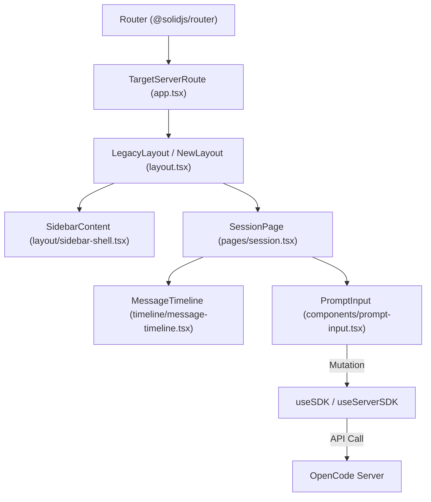
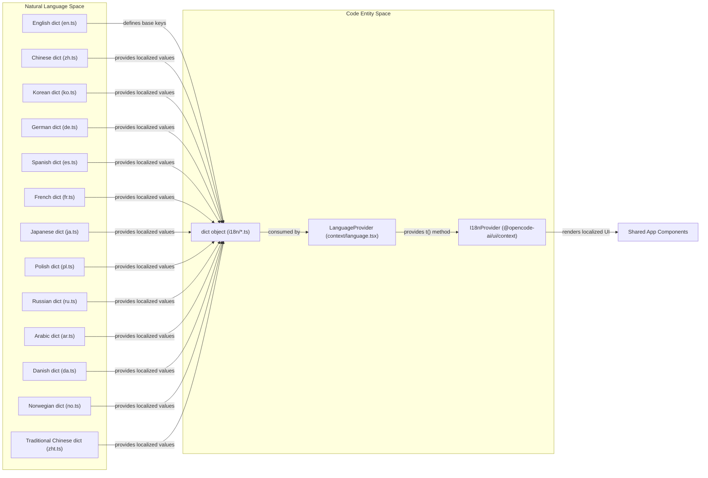

<!-- source: DeepWiki mcp.deepwiki.com · repo sst/opencode · page 6.12 Shared App Package · fetched 2026-10-27 -->

# Shared App Package

Relevant source files

The following files were used as context for generating this wiki page:

- [packages/app/e2e/regression/cross-server-tab-close.spec.ts](packages/app/e2e/regression/cross-server-tab-close.spec.ts)
- [packages/app/e2e/regression/project-picker-recent-search.spec.ts](packages/app/e2e/regression/project-picker-recent-search.spec.ts)
- [packages/app/e2e/regression/remote-session-settings.spec.ts](packages/app/e2e/regression/remote-session-settings.spec.ts)
- [packages/app/e2e/regression/remote-tab-busy.spec.ts](packages/app/e2e/regression/remote-tab-busy.spec.ts)
- [packages/app/e2e/regression/session-rename.spec.ts](packages/app/e2e/regression/session-rename.spec.ts)
- [packages/app/e2e/regression/subagent-child-navigation.spec.ts](packages/app/e2e/regression/subagent-child-navigation.spec.ts)
- [packages/app/e2e/regression/tab-navigate-mousedown.spec.ts](packages/app/e2e/regression/tab-navigate-mousedown.spec.ts)
- [packages/app/e2e/user-story/model-selection-flow.spec.ts](packages/app/e2e/user-story/model-selection-flow.spec.ts)
- [packages/app/src/app.tsx](packages/app/src/app.tsx)
- [packages/app/src/components/command-palette.ts](packages/app/src/components/command-palette.ts)
- [packages/app/src/components/dialog-command-palette-v2.css](packages/app/src/components/dialog-command-palette-v2.css)
- [packages/app/src/components/dialog-command-palette-v2.tsx](packages/app/src/components/dialog-command-palette-v2.tsx)
- [packages/app/src/components/dialog-connect-provider.stories.tsx](packages/app/src/components/dialog-connect-provider.stories.tsx)
- [packages/app/src/components/dialog-connect-provider.tsx](packages/app/src/components/dialog-connect-provider.tsx)
- [packages/app/src/components/dialog-custom-provider.tsx](packages/app/src/components/dialog-custom-provider.tsx)
- [packages/app/src/components/dialog-edit-project.tsx](packages/app/src/components/dialog-edit-project.tsx)
- [packages/app/src/components/dialog-manage-models.tsx](packages/app/src/components/dialog-manage-models.tsx)
- [packages/app/src/components/dialog-select-directory-v2.tsx](packages/app/src/components/dialog-select-directory-v2.tsx)
- [packages/app/src/components/dialog-select-directory.tsx](packages/app/src/components/dialog-select-directory.tsx)
- [packages/app/src/components/dialog-select-file.tsx](packages/app/src/components/dialog-select-file.tsx)
- [packages/app/src/components/dialog-select-mcp.tsx](packages/app/src/components/dialog-select-mcp.tsx)
- [packages/app/src/components/dialog-select-model-unpaid-v2.stories.tsx](packages/app/src/components/dialog-select-model-unpaid-v2.stories.tsx)
- [packages/app/src/components/dialog-select-model-unpaid-v2.tsx](packages/app/src/components/dialog-select-model-unpaid-v2.tsx)
- [packages/app/src/components/dialog-select-model-unpaid.tsx](packages/app/src/components/dialog-select-model-unpaid.tsx)
- [packages/app/src/components/dialog-select-model.tsx](packages/app/src/components/dialog-select-model.tsx)
- [packages/app/src/components/dialog-select-server.tsx](packages/app/src/components/dialog-select-server.tsx)
- [packages/app/src/components/dialog-settings.tsx](packages/app/src/components/dialog-settings.tsx)
- [packages/app/src/components/directory-picker-domain.test.ts](packages/app/src/components/directory-picker-domain.test.ts)
- [packages/app/src/components/directory-picker-domain.ts](packages/app/src/components/directory-picker-domain.ts)
- [packages/app/src/components/model-tooltip.tsx](packages/app/src/components/model-tooltip.tsx)
- [packages/app/src/components/prompt-input.tsx](packages/app/src/components/prompt-input.tsx)
- [packages/app/src/components/prompt-input/submit.test.ts](packages/app/src/components/prompt-input/submit.test.ts)
- [packages/app/src/components/prompt-input/submit.ts](packages/app/src/components/prompt-input/submit.ts)
- [packages/app/src/components/prompt-project-selector.tsx](packages/app/src/components/prompt-project-selector.tsx)
- [packages/app/src/components/session-context-usage.tsx](packages/app/src/components/session-context-usage.tsx)
- [packages/app/src/components/session/session-context-metrics.test.ts](packages/app/src/components/session/session-context-metrics.test.ts)
- [packages/app/src/components/session/session-context-metrics.ts](packages/app/src/components/session/session-context-metrics.ts)
- [packages/app/src/components/session/session-context-tab.tsx](packages/app/src/components/session/session-context-tab.tsx)
- [packages/app/src/components/session/session-header.tsx](packages/app/src/components/session/session-header.tsx)
- [packages/app/src/components/session/session-new-view.tsx](packages/app/src/components/session/session-new-view.tsx)
- [packages/app/src/components/session/session-sortable-terminal-tab.tsx](packages/app/src/components/session/session-sortable-terminal-tab.tsx)
- [packages/app/src/components/settings-general.tsx](packages/app/src/components/settings-general.tsx)
- [packages/app/src/components/settings-keybinds.tsx](packages/app/src/components/settings-keybinds.tsx)
- [packages/app/src/components/settings-models.tsx](packages/app/src/components/settings-models.tsx)
- [packages/app/src/components/settings-providers.tsx](packages/app/src/components/settings-providers.tsx)
- [packages/app/src/components/settings-v2/dialog-settings-v2.tsx](packages/app/src/components/settings-v2/dialog-settings-v2.tsx)
- [packages/app/src/components/settings-v2/providers.tsx](packages/app/src/components/settings-v2/providers.tsx)
- [packages/app/src/components/status-popover-body.tsx](packages/app/src/components/status-popover-body.tsx)
- [packages/app/src/components/status-popover.tsx](packages/app/src/components/status-popover.tsx)
- [packages/app/src/components/terminal.tsx](packages/app/src/components/terminal.tsx)
- [packages/app/src/components/titlebar-history.test.ts](packages/app/src/components/titlebar-history.test.ts)
- [packages/app/src/components/titlebar-history.ts](packages/app/src/components/titlebar-history.ts)
- [packages/app/src/components/titlebar-tab-gesture.test.ts](packages/app/src/components/titlebar-tab-gesture.test.ts)
- [packages/app/src/components/titlebar-tab-gesture.ts](packages/app/src/components/titlebar-tab-gesture.ts)
- [packages/app/src/components/titlebar-tab-nav.css](packages/app/src/components/titlebar-tab-nav.css)
- [packages/app/src/components/titlebar-tab-nav.tsx](packages/app/src/components/titlebar-tab-nav.tsx)
- [packages/app/src/components/titlebar-tab-popover.css](packages/app/src/components/titlebar-tab-popover.css)
- [packages/app/src/components/titlebar-tab-popover.tsx](packages/app/src/components/titlebar-tab-popover.tsx)
- [packages/app/src/components/titlebar-tab-strip.tsx](packages/app/src/components/titlebar-tab-strip.tsx)
- [packages/app/src/components/titlebar.tsx](packages/app/src/components/titlebar.tsx)
- [packages/app/src/context/command.test.ts](packages/app/src/context/command.test.ts)
- [packages/app/src/context/command.tsx](packages/app/src/context/command.tsx)
- [packages/app/src/context/file.tsx](packages/app/src/context/file.tsx)
- [packages/app/src/context/global-sync/home-session-index.test.ts](packages/app/src/context/global-sync/home-session-index.test.ts)
- [packages/app/src/context/global-sync/home-session-index.ts](packages/app/src/context/global-sync/home-session-index.ts)
- [packages/app/src/context/layout-scroll.test.ts](packages/app/src/context/layout-scroll.test.ts)
- [packages/app/src/context/layout-scroll.ts](packages/app/src/context/layout-scroll.ts)
- [packages/app/src/context/layout.tsx](packages/app/src/context/layout.tsx)
- [packages/app/src/context/local.tsx](packages/app/src/context/local.tsx)
- [packages/app/src/context/notification.tsx](packages/app/src/context/notification.tsx)
- [packages/app/src/context/permission-auto-respond.test.ts](packages/app/src/context/permission-auto-respond.test.ts)
- [packages/app/src/context/permission-auto-respond.ts](packages/app/src/context/permission-auto-respond.ts)
- [packages/app/src/context/permission.tsx](packages/app/src/context/permission.tsx)
- [packages/app/src/context/prompt.tsx](packages/app/src/context/prompt.tsx)
- [packages/app/src/context/server.tsx](packages/app/src/context/server.tsx)
- [packages/app/src/context/settings.tsx](packages/app/src/context/settings.tsx)
- [packages/app/src/context/terminal.tsx](packages/app/src/context/terminal.tsx)
- [packages/app/src/i18n/ar.ts](packages/app/src/i18n/ar.ts)
- [packages/app/src/i18n/da.ts](packages/app/src/i18n/da.ts)
- [packages/app/src/i18n/de.ts](packages/app/src/i18n/de.ts)
- [packages/app/src/i18n/en.ts](packages/app/src/i18n/en.ts)
- [packages/app/src/i18n/es.ts](packages/app/src/i18n/es.ts)
- [packages/app/src/i18n/fr.ts](packages/app/src/i18n/fr.ts)
- [packages/app/src/i18n/ja.ts](packages/app/src/i18n/ja.ts)
- [packages/app/src/i18n/ko.ts](packages/app/src/i18n/ko.ts)
- [packages/app/src/i18n/no.ts](packages/app/src/i18n/no.ts)
- [packages/app/src/i18n/pl.ts](packages/app/src/i18n/pl.ts)
- [packages/app/src/i18n/ru.ts](packages/app/src/i18n/ru.ts)
- [packages/app/src/i18n/zh.ts](packages/app/src/i18n/zh.ts)
- [packages/app/src/i18n/zht.ts](packages/app/src/i18n/zht.ts)
- [packages/app/src/index.css](packages/app/src/index.css)
- [packages/app/src/pages/directory-layout.tsx](packages/app/src/pages/directory-layout.tsx)
- [packages/app/src/pages/home.tsx](packages/app/src/pages/home.tsx)
- [packages/app/src/pages/home/home-sessions-controller.tsx](packages/app/src/pages/home/home-sessions-controller.tsx)
- [packages/app/src/pages/layout.tsx](packages/app/src/pages/layout.tsx)
- [packages/app/src/pages/layout/deep-links.ts](packages/app/src/pages/layout/deep-links.ts)
- [packages/app/src/pages/layout/helpers.test.ts](packages/app/src/pages/layout/helpers.test.ts)
- [packages/app/src/pages/layout/helpers.ts](packages/app/src/pages/layout/helpers.ts)
- [packages/app/src/pages/layout/sidebar-items.tsx](packages/app/src/pages/layout/sidebar-items.tsx)
- [packages/app/src/pages/layout/sidebar-project.tsx](packages/app/src/pages/layout/sidebar-project.tsx)
- [packages/app/src/pages/layout/sidebar-workspace.tsx](packages/app/src/pages/layout/sidebar-workspace.tsx)
- [packages/app/src/pages/session.tsx](packages/app/src/pages/session.tsx)
- [packages/app/src/pages/session/composer/session-revert-dock.stories.tsx](packages/app/src/pages/session/composer/session-revert-dock.stories.tsx)
- [packages/app/src/pages/session/composer/session-revert-dock.tsx](packages/app/src/pages/session/composer/session-revert-dock.tsx)
- [packages/app/src/pages/session/session-archive.ts](packages/app/src/pages/session/session-archive.ts)
- [packages/app/src/pages/session/session-model-helpers.test.ts](packages/app/src/pages/session/session-model-helpers.test.ts)
- [packages/app/src/pages/session/session-model-helpers.ts](packages/app/src/pages/session/session-model-helpers.ts)
- [packages/app/src/pages/session/terminal-panel.tsx](packages/app/src/pages/session/terminal-panel.tsx)
- [packages/app/src/pages/session/usage-exceeded-dialogs.tsx](packages/app/src/pages/session/usage-exceeded-dialogs.tsx)
- [packages/app/src/utils/agent.ts](packages/app/src/utils/agent.ts)
- [packages/app/src/utils/search-keydown.ts](packages/app/src/utils/search-keydown.ts)
- [packages/app/src/utils/session-route.test.ts](packages/app/src/utils/session-route.test.ts)
- [packages/app/src/utils/session-route.ts](packages/app/src/utils/session-route.ts)
- [packages/session-ui/src/components/timeline-playground.stories.tsx](packages/session-ui/src/components/timeline-playground.stories.tsx)
- [packages/storybook/.storybook/main.ts](packages/storybook/.storybook/main.ts)
- [packages/storybook/.storybook/mocks/app/context/language.ts](packages/storybook/.storybook/mocks/app/context/language.ts)
- [packages/storybook/.storybook/mocks/app/context/permission.ts](packages/storybook/.storybook/mocks/app/context/permission.ts)
- [packages/storybook/.storybook/mocks/app/context/sdk.ts](packages/storybook/.storybook/mocks/app/context/sdk.ts)
- [packages/storybook/.storybook/mocks/app/context/server-sdk.ts](packages/storybook/.storybook/mocks/app/context/server-sdk.ts)
- [packages/storybook/.storybook/mocks/app/context/server-sync.ts](packages/storybook/.storybook/mocks/app/context/server-sync.ts)
- [packages/storybook/.storybook/mocks/app/context/sync.ts](packages/storybook/.storybook/mocks/app/context/sync.ts)
- [packages/storybook/.storybook/mocks/app/hooks/use-providers.ts](packages/storybook/.storybook/mocks/app/hooks/use-providers.ts)
- [packages/storybook/.storybook/mocks/solid-router.tsx](packages/storybook/.storybook/mocks/solid-router.tsx)
- [packages/storybook/.storybook/preview.tsx](packages/storybook/.storybook/preview.tsx)
- [packages/ui/src/components/checkbox.tsx](packages/ui/src/components/checkbox.tsx)
- [packages/ui/src/components/dialog.css](packages/ui/src/components/dialog.css)
- [packages/ui/src/components/dialog.tsx](packages/ui/src/components/dialog.tsx)
- [packages/ui/src/components/icon.stories.tsx](packages/ui/src/components/icon.stories.tsx)
- [packages/ui/src/components/icon.tsx](packages/ui/src/components/icon.tsx)
- [packages/ui/src/components/list.css](packages/ui/src/components/list.css)
- [packages/ui/src/components/list.tsx](packages/ui/src/components/list.tsx)
- [packages/ui/src/components/scroll-view.css](packages/ui/src/components/scroll-view.css)
- [packages/ui/src/components/scroll-view.test.ts](packages/ui/src/components/scroll-view.test.ts)
- [packages/ui/src/components/scroll-view.tsx](packages/ui/src/components/scroll-view.tsx)
- [packages/ui/src/components/switch.tsx](packages/ui/src/components/switch.tsx)
- [packages/ui/src/context/dialog.tsx](packages/ui/src/context/dialog.tsx)
- [packages/ui/src/hooks/use-filtered-list.tsx](packages/ui/src/hooks/use-filtered-list.tsx)
- [packages/ui/src/i18n/ar.ts](packages/ui/src/i18n/ar.ts)
- [packages/ui/src/i18n/br.ts](packages/ui/src/i18n/br.ts)
- [packages/ui/src/i18n/da.ts](packages/ui/src/i18n/da.ts)
- [packages/ui/src/i18n/de.ts](packages/ui/src/i18n/de.ts)
- [packages/ui/src/i18n/en.ts](packages/ui/src/i18n/en.ts)
- [packages/ui/src/i18n/es.ts](packages/ui/src/i18n/es.ts)
- [packages/ui/src/i18n/fr.ts](packages/ui/src/i18n/fr.ts)
- [packages/ui/src/i18n/ja.ts](packages/ui/src/i18n/ja.ts)
- [packages/ui/src/i18n/ko.ts](packages/ui/src/i18n/ko.ts)
- [packages/ui/src/i18n/no.ts](packages/ui/src/i18n/no.ts)
- [packages/ui/src/i18n/pl.ts](packages/ui/src/i18n/pl.ts)
- [packages/ui/src/i18n/ru.ts](packages/ui/src/i18n/ru.ts)
- [packages/ui/src/i18n/zh.ts](packages/ui/src/i18n/zh.ts)
- [packages/ui/src/i18n/zht.ts](packages/ui/src/i18n/zht.ts)
- [packages/ui/src/styles/index.css](packages/ui/src/styles/index.css)
- [packages/ui/src/v2/components/icon.tsx](packages/ui/src/v2/components/icon.tsx)

## Purpose and Scope

The **Shared App Package** (`@opencode-ai/app`) serves as the core application layer for OpenCode's desktop and web clients [packages/app/src/app.tsx:1-67](). Built with **SolidJS**, it delivers the primary user interface, reactive state management contexts, and sophisticated UI logic for session handling, file management, terminal integration via WebAssembly (`ghostty-web`), settings dialogs, and titlebar/tabs management [packages/app/src/app.tsx:3-67](), [packages/app/src/components/terminal.tsx:7-38]().

A core feature of this package is its comprehensive internationalization (i18n) framework, providing localized user interfaces for 18+ languages including English, Chinese (Simplified/Traditional), Arabic, German, Spanish, French, Japanese, Korean, Polish, Russian, and Danish [packages/app/src/i18n/en.ts:3-22]().

Sources: [packages/app/src/app.tsx:1-67](), [packages/app/src/components/terminal.tsx:7-38](), [packages/app/src/i18n/en.ts:1-20]()

---

## Architecture and Data Flow

The application organizes state through a hierarchical dependency injection tree of SolidJS contexts wrapping routing logic and views.

### Provider Hierarchy
The application establishes context providers to manage app-wide state such as themes, languages, settings, server synchronization, and sessions.

1.  **Foundation**: `ThemeProvider`, `LanguageProvider`, and `I18nProvider` handle visual styling, locale settings, and translation dictionaries [packages/app/src/app.tsx:3-9]().
2.  **Infrastructure**: `SettingsProvider`, `PermissionProvider`, `ServerSDKProvider`, and `SDKProvider` manage core configuration, permissions, and API bindings [packages/app/src/app.tsx:44-58]().
3.  **UI State**: `CommandProvider`, `LayoutProvider`, and `ModelsProvider` control command registration, layout dimensions, and model states [packages/app/src/app.tsx:41-50]().
4.  **Session-Specific**: `TerminalProvider`, `FileProvider`, `PromptProvider`, and `CommentsProvider` manage active terminal sessions, open files, prompt inputs, and review comments [packages/app/src/pages/session.tsx:44-60]().

Sources: [packages/app/src/app.tsx:3-60](), [packages/app/src/pages/session.tsx:44-60]()

### Component Architecture and Routing
Client navigation uses `@solidjs/router` to render specialized routes such as the home dashboard, draft sessions, and active session review views [packages/app/src/app.tsx:12-20](), [packages/app/src/pages/home.tsx:11-16](), [packages/app/src/pages/layout.tsx:86-110]().

**App Routing and Data Flow**

Sources: [packages/app/src/app.tsx:74-135](), [packages/app/src/pages/session.tsx:60-75](), [packages/app/src/pages/layout.tsx:86-110]()

---

## Core Systems

### Prompt and Input Management
The `PromptInput` component handles multi-part message construction, text composition, file attachments, image previews, and prompt history navigation [packages/app/src/components/prompt-input.tsx:17-27]().

- **State Management**: Uses `PromptProvider` to manage the draft message state and active context items [packages/app/src/components/prompt-input.tsx:122]().
- **History**: Implements `createPromptInputHistory` for traversing previous prompt inputs using keyboard shortcuts [packages/app/src/components/prompt-input.tsx:58-68]().
- **Attachments**: Manages file and image attachments via `createPromptAttachments` and `pickAttachmentFiles` [packages/app/src/components/prompt-input.tsx:55-56]().
- **Submissions**: Processes prompt submission via `createPromptSubmit` and handles follow-up drafts [packages/app/src/components/prompt-input.tsx:66-75]().

Sources: [packages/app/src/components/prompt-input.tsx:17-122](), [packages/app/src/pages/session.tsx:66-68]()

### Layout, Workspace, and Titlebar Management
The `LayoutProvider` and `LegacyLayout` / `NewLayout` components manage spatial organization, sidebar persistence, workspace ordering, and window chrome [packages/app/src/context/layout.tsx:159-161](), [packages/app/src/pages/layout.tsx:88-100]().

- **Persistence**: Layout states such as sidebar width, expanded project lists, and workspace sorting are persisted using `persisted` storage utilities [packages/app/src/pages/layout.tsx:88-100]().
- **Drag and Drop**: Workspace and project reordering relies on `@thisbeyond/solid-dnd` sensors and primitives [packages/app/src/pages/layout.tsx:33-34]().
- **Titlebar Integration**: The `Titlebar` component provides platform-specific window controls (such as macOS traffic lights and Windows caption buttons) alongside navigation history stacks (`history.stack`) and app update triggers [packages/app/src/components/titlebar.tsx:64-98]().

Sources: [packages/app/src/context/layout.tsx:159-180](), [packages/app/src/pages/layout.tsx:33-100](), [packages/app/src/components/titlebar.tsx:64-171]()

### Terminal Integration
Terminal integration within the shared app package relies on WebAssembly via `ghostty-web` and custom PTY context providers [packages/app/src/context/terminal.tsx](), [packages/app/src/components/terminal.tsx:7-38]().

- **Ghostty Loader**: `loadGhostty` asynchronously initializes the WebAssembly-based terminal module [packages/app/src/components/terminal.tsx:35-44]().
- **Terminal UI Bindings**: `useTerminalUiBindings` wires up copy/paste clipboard events, focus tracking, and link click handlers [packages/app/src/components/terminal.tsx:86-143]().
- **Buffer Serialization**: Active terminal states, viewports, scroll positions, and serializable buffers are preserved across component remounts and cleanups using `SerializeAddon` and `persistTerminal` [packages/app/src/components/terminal.tsx:9-10](), [packages/app/src/components/terminal.tsx:145-170]().

Sources: [packages/app/src/context/terminal.tsx](), [packages/app/src/components/terminal.tsx:7-170]()

### File Management and External App Launching
The application interacts with local files and external editors via system integrations and header controls [packages/app/src/components/session/session-header.tsx:27]().

- **External Application Launching**: `SessionHeader` detects the operating system via `detectOS` and maps projects to external development environments (such as Visual Studio Code, Cursor, Zed, TextMate, iTerm2, Ghostty, and Finder) using `fileManagerApp` [packages/app/src/components/session/session-header.tsx:37-180]().
- **File Selection**: Component views utilize file context providers (`FileProvider`) and path helpers (`createPathHelpers`) to resolve and preview file selections [packages/app/src/context/file.tsx](), [packages/app/src/context/layout.tsx:17-103]().

Sources: [packages/app/src/components/session/session-header.tsx:27-180](), [packages/app/src/context/file.tsx](), [packages/app/src/context/layout.tsx:17-103]()

### Settings Dialogs
The settings system offers modular configuration panels for general preferences, themes, keybindings, and providers [packages/app/src/components/settings-general.tsx:85]().

- **General Settings**: `SettingsGeneral` manages shell options retrieved via `serverSdk.client.pty.shells()`, display backends for Linux (`platform.getDisplayBackend`), pinch-zoom configurations, and sound feedback settings [packages/app/src/components/settings-general.tsx:85-207]().
- **Theme and Language**: Integrates with `useTheme` and `useLanguage` to instantly apply visual token overrides and locale updates across active contexts [packages/app/src/components/settings-general.tsx:86-87]().
- **Keybindings**: The `SettingsKeybinds` component allows users to view and customize keyboard shortcuts, registering them with the `CommandProvider` [packages/app/src/components/settings-keybinds.tsx](), [packages/app/src/context/command.tsx]().
- **Providers**: The `SettingsProviders` component enables users to manage and connect to various AI providers, leveraging the `useProviders` hook [packages/app/src/components/settings-providers.tsx]().

Sources: [packages/app/src/components/settings-general.tsx:1-207](), [packages/app/src/components/settings-keybinds.tsx](), [packages/app/src/components/settings-providers.tsx](), [packages/app/src/context/command.tsx]()

---

## Internationalization (i18n)

The shared app package implements a structured translation dictionary supporting 18+ languages with categorized keys for commands, settings, dialogs, and themes [packages/app/src/i18n/en.ts:3-22]().

**Natural Language Space to Code Entity Space Mapping**

Sources: [packages/app/src/i18n/en.ts:1-140](), [packages/app/src/i18n/zh.ts:1-50](), [packages/app/src/i18n/ko.ts](), [packages/app/src/i18n/de.ts](), [packages/app/src/i18n/es.ts](), [packages/app/src/i18n/fr.ts](), [packages/app/src/i18n/ja.ts](), [packages/app/src/i18n/pl.ts](), [packages/app/src/i18n/ru.ts](), [packages/app/src/i18n/ar.ts](), [packages/app/src/i18n/da.ts](), [packages/app/src/i18n/no.ts](), [packages/app/src/i18n/zht.ts]()

**Supported Languages and Dictionary Structure:**
- **English (`en.ts`)**: Defines base translation keys for commands (`command.category.project`), actions (`command.session.new`), and dialog placeholders (`dialog.model.select.title`) [packages/app/src/i18n/en.ts:5-123]().
- **Chinese (`zh.ts`)**: Implements full localization for Simplified Chinese menus, dialogs, and errors [packages/app/src/i18n/zh.ts:6-120]().
- Additional localization modules exist for German (`de.ts`), French (`fr.ts`), Spanish (`es.ts`), Japanese (`ja.ts`), Korean (`ko.ts`), Polish (`pl.ts`), Russian (`ru.ts`), Arabic (`ar.ts`), Danish (`da.ts`), Norwegian (`no.ts`), and Traditional Chinese (`zht.ts`).

Sources: [packages/app/src/i18n/en.ts:1-140](), [packages/app/src/i18n/zh.ts:1-120](), [packages/app/src/i18n/ko.ts](), [packages/app/src/i18n/de.ts](), [packages/app/src/i18n/es.ts](), [packages/app/src/i18n/fr.ts](), [packages/app/src/i18n/ja.ts](), [packages/app/src/i18n/pl.ts](), [packages/app/src/i18n/ru.ts](), [packages/app/src/i18n/ar.ts](), [packages/app/src/i18n/da.ts](), [packages/app/src/i18n/no.ts](), [packages/app/src/i18n/zht.ts]()

---

## Dependencies and Build System

The package is built as a Vite-based SolidJS application leveraging workspace dependencies and robust external libraries.

- **Workspace Packages**: `@opencode-ai/sdk`, `@opencode-ai/ui`, `@opencode-ai/session-ui`, and `@opencode-ai/core` [packages/app/src/app.tsx:3-58]().
- **Key External Libraries**:
    - `@tanstack/solid-query`: Server state management and caching [packages/app/src/pages/session.tsx:4]().
    - `effect`: Functional error handling and schema validation primitives [packages/app/src/app.tsx:22]().
    - `ghostty-web`: Wasm terminal emulator runtime [packages/app/src/components/terminal.tsx:7]().
    - `@solid-primitives/event-listener` & `@solid-primitives/media`: Reactive DOM event and media query observers [packages/app/src/pages/session.tsx:22-23]().
    - `@solidjs/router`: Client-side routing [packages/app/src/app.tsx:12-20]().

Sources: [packages/app/src/app.tsx:12-58](), [packages/app/src/pages/session.tsx:4-22](), [packages/app/src/components/terminal.tsx:7]()

---

