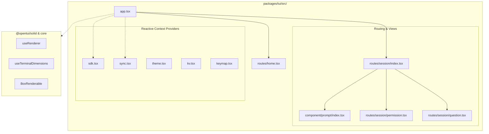
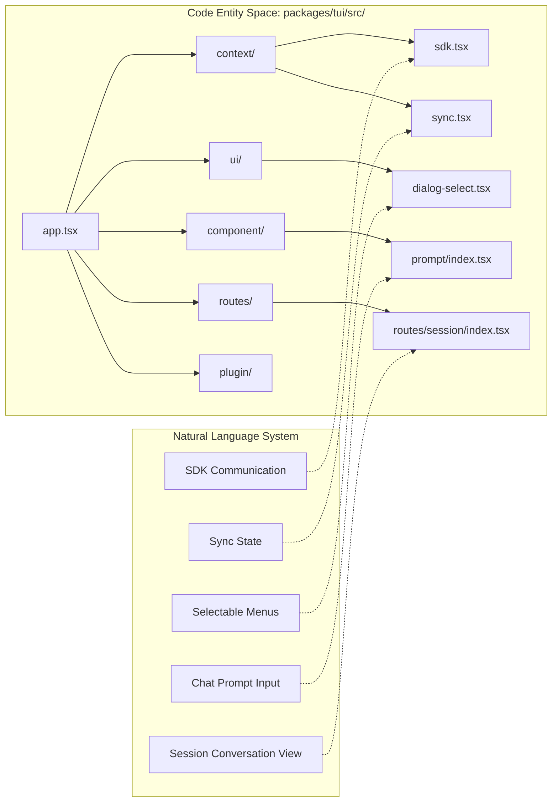

<!-- source: DeepWiki mcp.deepwiki.com · repo sst/opencode · page 6.2 Terminal User Interface (TUI) · fetched 2026-10-27 -->

# Terminal User Interface (TUI)

Relevant source files

The following files were used as context for generating this wiki page:

- [packages/cli/src/commands/handlers/serve.ts](packages/cli/src/commands/handlers/serve.ts)
- [packages/cli/src/tui.ts](packages/cli/src/tui.ts)
- [packages/core/src/util/error.ts](packages/core/src/util/error.ts)
- [packages/opencode/src/cli/cmd/tui.ts](packages/opencode/src/cli/cmd/tui.ts)
- [packages/opencode/src/cli/tui/layer.ts](packages/opencode/src/cli/tui/layer.ts)
- [packages/opencode/src/server/routes/instance/httpapi/middleware/error.ts](packages/opencode/src/server/routes/instance/httpapi/middleware/error.ts)
- [packages/opencode/test/server/httpapi-error-middleware.test.ts](packages/opencode/test/server/httpapi-error-middleware.test.ts)
- [packages/tui/src/app.tsx](packages/tui/src/app.tsx)
- [packages/tui/src/component/dialog-console-org.tsx](packages/tui/src/component/dialog-console-org.tsx)
- [packages/tui/src/component/dialog-move-session.tsx](packages/tui/src/component/dialog-move-session.tsx)
- [packages/tui/src/component/dialog-provider.tsx](packages/tui/src/component/dialog-provider.tsx)
- [packages/tui/src/component/dialog-skill.tsx](packages/tui/src/component/dialog-skill.tsx)
- [packages/tui/src/component/dialog-workspace-list.tsx](packages/tui/src/component/dialog-workspace-list.tsx)
- [packages/tui/src/component/error-component.tsx](packages/tui/src/component/error-component.tsx)
- [packages/tui/src/component/prompt/index.tsx](packages/tui/src/component/prompt/index.tsx)
- [packages/tui/src/component/startup-loading.tsx](packages/tui/src/component/startup-loading.tsx)
- [packages/tui/src/context/exit.tsx](packages/tui/src/context/exit.tsx)
- [packages/tui/src/feature-plugins/home/tips-view.tsx](packages/tui/src/feature-plugins/home/tips-view.tsx)
- [packages/tui/src/feature-plugins/system/diff-viewer.tsx](packages/tui/src/feature-plugins/system/diff-viewer.tsx)
- [packages/tui/src/feature-plugins/system/plugins.tsx](packages/tui/src/feature-plugins/system/plugins.tsx)
- [packages/tui/src/plugin/adapters.tsx](packages/tui/src/plugin/adapters.tsx)
- [packages/tui/src/routes/session/index.tsx](packages/tui/src/routes/session/index.tsx)
- [packages/tui/src/ui/dialog-prompt.tsx](packages/tui/src/ui/dialog-prompt.tsx)
- [packages/tui/src/util/error.ts](packages/tui/src/util/error.ts)
- [packages/tui/src/util/renderer.ts](packages/tui/src/util/renderer.ts)
- [packages/tui/test/app-lifecycle.test.tsx](packages/tui/test/app-lifecycle.test.tsx)
- [packages/tui/test/cli/tui/__snapshots__/inline-tool-wrap-snapshot.test.tsx.snap](packages/tui/test/cli/tui/__snapshots__/inline-tool-wrap-snapshot.test.tsx.snap)
- [packages/tui/test/cli/tui/diff-viewer-file-tree.test.tsx](packages/tui/test/cli/tui/diff-viewer-file-tree.test.tsx)
- [packages/tui/test/cli/tui/diff-viewer.test.tsx](packages/tui/test/cli/tui/diff-viewer.test.tsx)
- [packages/tui/test/cli/tui/inline-tool-wrap-snapshot.test.tsx](packages/tui/test/cli/tui/inline-tool-wrap-snapshot.test.tsx)

## Purpose and Scope
The Terminal User Interface (TUI) is OpenCode's interactive terminal application designed for running AI agent coding sessions. It provides real-time streaming conversations, session management, project navigation, tool call tracing, diff inspections, and rich keyboard navigation. This document details the standalone `packages/tui` package architecture, its integration with the `@opentui` framework and SolidJS, routing, component hierarchy, prompt processing, and the plugin runtime.

Sources: `[packages/tui/src/app.tsx:1-155]`, `[packages/web/src/content/docs/tui.mdx:1-40]`

---

## Architecture and OpenTUI Integration
The TUI is built on the `@opentui` framework, which provides terminal rendering primitives (`BoxRenderable`, `TextareaRenderable`, `ScrollBoxRenderable`), event handling (keyboard, mouse, paste), flexbox layouts, and dirty rectangle optimization (`[packages/tui/src/routes/session/index.tsx:27-43]`, `[packages/tui/src/component/prompt/index.tsx:1-10]`). It uses SolidJS for reactive state management and coordinates with the OpenCode backend server via SDK client bindings (`[packages/tui/src/app.tsx:1-85]`).

*Diagram 1: TUI Component and Context Architecture bridging Natural Language Space to Code Entity Space.*

Sources: `[packages/tui/src/app.tsx:1-85]`, `[packages/tui/src/routes/session/index.tsx:1-86]`, `[packages/tui/src/component/prompt/index.tsx:1-60]`

---

## Standalone `packages/tui` Package Structure
The standalone TUI is encapsulated within `packages/tui/src/`, structured into discrete subdirectories for context providers, UI primitives, feature plugins, dialogs, and route views (`[packages/tui/src/app.tsx:1-155]`).

*Diagram 2: Bridge from Natural Language Concepts to Code Entity Space in `packages/tui`.*

Sources: `[packages/tui/src/app.tsx:1-155]`, `[packages/tui/src/ui/dialog-select.tsx:1-80]`, `[packages/tui/src/component/prompt/index.tsx:1-65]`

---

## Session Rendering and Tool Execution
The `Session` component (`[packages/tui/src/routes/session/index.tsx:177-200]`) manages conversation turns, user messages, assistant responses, and inline tool executions.
- **`InlineToolRow`**: Renders tool execution steps (e.g., file reads, greps, bash commands) with indicators for pending, complete, or failed states (`[packages/tui/test/cli/tui/inline-tool-wrap-snapshot.test.tsx:89-102]`). The `alwaysSeparate` WeakSet is used to ensure certain `BoxRenderable` elements, like shell output or user messages, maintain visual separation from subsequent inline tool rows (`[packages/tui/src/routes/session/index.tsx:94-95]`, `[packages/tui/test/cli/tui/inline-tool-wrap-snapshot.test.tsx:58-59]`).
- **Interactive Prompts**: Handled via `PermissionPrompt` (`[packages/tui/src/routes/session/permission.tsx]()`) and `QuestionPrompt` (`[packages/tui/src/routes/session/question.tsx]()`) for capturing user approval or clarification.

Sources: `[packages/tui/src/routes/session/index.tsx:1-200]`, `[packages/tui/test/cli/tui/inline-tool-wrap-snapshot.test.tsx:1-125]`

---

## Prompt Component and Autocomplete
The `Prompt` component (`[packages/tui/src/component/prompt/index.tsx:143-175]`) provides a multiline input area supporting file referencing (`@`), command completion (`/`), history navigation (`usePromptHistory`), and stash management (`usePromptStash`).
- **Editor Integration**: Users can spawn an external editor (configured via `$EDITOR`) using `ctrl+x e` or `/editor` (`[packages/web/src/content/docs/tui.mdx:111-120]`).
- **Textarea Management**: Powered by `TextareaRenderable` from `@opentui/core` (`[packages/tui/src/component/prompt/index.tsx:1-10]`).

Sources: `[packages/tui/src/component/prompt/index.tsx:1-175]`, `[packages/web/src/content/docs/tui.mdx:30-120]`

---

## Dialogs and Command System
The TUI features a flexible dialog stack managed by `useDialog()` (`[packages/tui/src/ui/dialog.tsx]()`).
- **`DialogSelect`**: A generic searchable list component used for model selection (`[packages/tui/src/component/dialog-model.tsx]()`), provider configuration (`[packages/tui/src/component/dialog-provider.tsx:1-170]`), and the command palette, leveraging `fuzzysort` for rapid filtering (`[packages/tui/src/ui/dialog-select.tsx:154-173]`).
- **`DialogPrompt`**: A modal input dialog used for text entry tasks like renaming sessions or setting custom parameters (`[packages/tui/src/ui/dialog-prompt.tsx:20-116]`).

Sources: `[packages/tui/src/ui/dialog-select.tsx:1-173]`, `[packages/tui/src/ui/dialog-prompt.tsx:1-128]`, `[packages/tui/src/component/dialog-provider.tsx:1-170]`

---

## Plugin System & Feature Plugins
The TUI exposes a plugin runtime (`[packages/tui/src/app.tsx:69-75]`) that allows registering custom routes, bindings, and views like the built-in `DiffViewer` feature plugin (`[packages/tui/src/feature-plugins/system/diff-viewer.tsx:91-146]`).
- **`DiffViewer`**: Renders git diffs, branch comparisons, or last-turn changes with split/unified views and file tree navigation (`[packages/tui/src/feature-plugins/system/diff-viewer.tsx:91-146]`).

Sources: `[packages/tui/src/app.tsx:69-80]`, `[packages/tui/src/feature-plugins/system/diff-viewer.tsx:1-146]`

---

