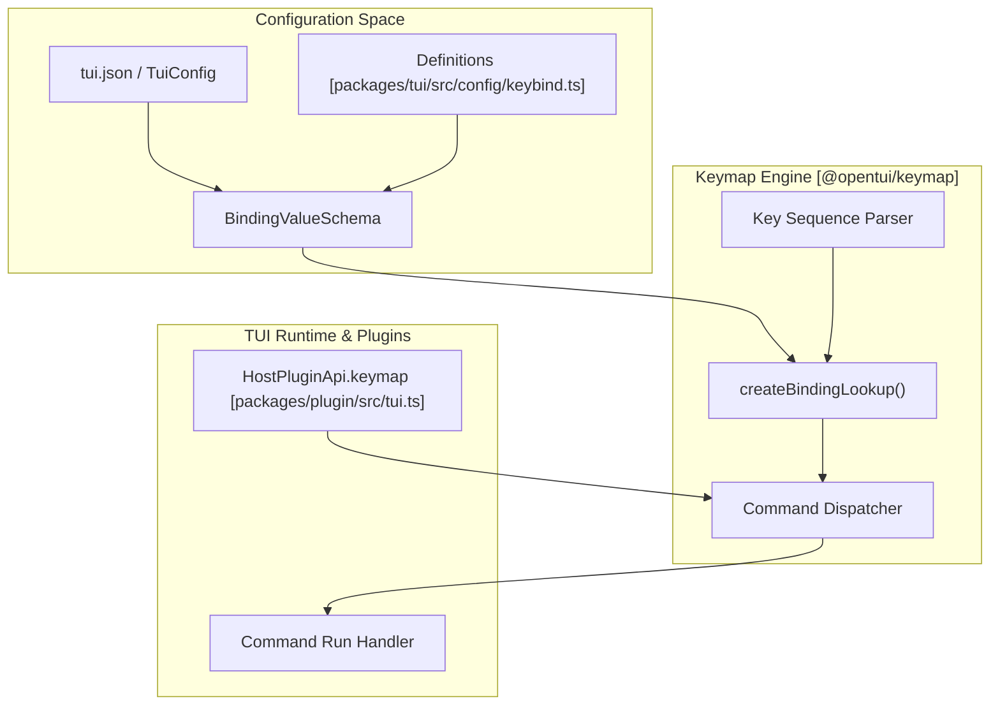
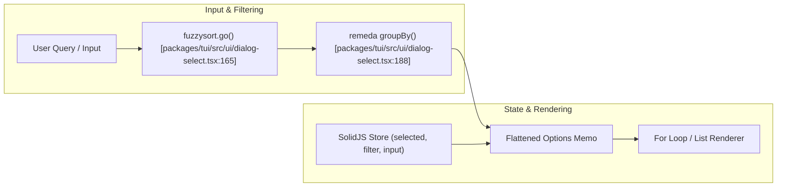
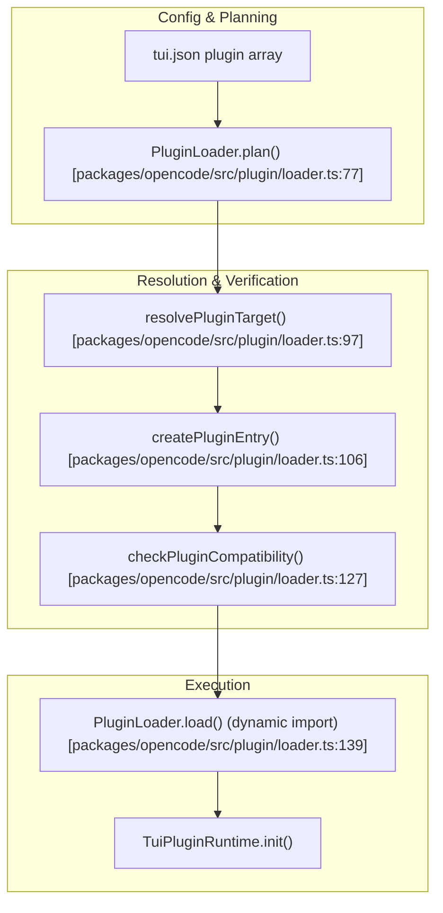

<!-- source: DeepWiki mcp.deepwiki.com · repo sst/opencode · page 6.4 TUI Commands and Dialogs · fetched 2026-10-27 -->

# TUI Commands and Dialogs

Relevant source files

The following files were used as context for generating this wiki page:

- [.opencode/plugins/tui-smoke.tsx](.opencode/plugins/tui-smoke.tsx)
- [packages/opencode/specs/tui-plugins.md](packages/opencode/specs/tui-plugins.md)
- [packages/opencode/src/cli/cmd/plug.ts](packages/opencode/src/cli/cmd/plug.ts)
- [packages/opencode/src/plugin/install.ts](packages/opencode/src/plugin/install.ts)
- [packages/opencode/src/plugin/loader.ts](packages/opencode/src/plugin/loader.ts)
- [packages/opencode/src/plugin/shared.ts](packages/opencode/src/plugin/shared.ts)
- [packages/opencode/test/cli/tui/plugin-add.test.ts](packages/opencode/test/cli/tui/plugin-add.test.ts)
- [packages/opencode/test/cli/tui/plugin-install.test.ts](packages/opencode/test/cli/tui/plugin-install.test.ts)
- [packages/opencode/test/cli/tui/plugin-loader-entrypoint.test.ts](packages/opencode/test/cli/tui/plugin-loader-entrypoint.test.ts)
- [packages/opencode/test/cli/tui/plugin-loader-pure.test.ts](packages/opencode/test/cli/tui/plugin-loader-pure.test.ts)
- [packages/opencode/test/cli/tui/plugin-loader.test.ts](packages/opencode/test/cli/tui/plugin-loader.test.ts)
- [packages/opencode/test/cli/tui/plugin-toggle.test.ts](packages/opencode/test/cli/tui/plugin-toggle.test.ts)
- [packages/opencode/test/fixture/tui-plugin.ts](packages/opencode/test/fixture/tui-plugin.ts)
- [packages/opencode/test/fixture/tui-runtime.ts](packages/opencode/test/fixture/tui-runtime.ts)
- [packages/opencode/test/plugin/install.test.ts](packages/opencode/test/plugin/install.test.ts)
- [packages/opencode/test/plugin/loader-shared.test.ts](packages/opencode/test/plugin/loader-shared.test.ts)
- [packages/plugin/src/tui.ts](packages/plugin/src/tui.ts)
- [packages/tui/src/component/dialog-console-org.tsx](packages/tui/src/component/dialog-console-org.tsx)
- [packages/tui/src/component/dialog-move-session.tsx](packages/tui/src/component/dialog-move-session.tsx)
- [packages/tui/src/component/dialog-provider.tsx](packages/tui/src/component/dialog-provider.tsx)
- [packages/tui/src/component/dialog-skill.tsx](packages/tui/src/component/dialog-skill.tsx)
- [packages/tui/src/component/dialog-workspace-list.tsx](packages/tui/src/component/dialog-workspace-list.tsx)
- [packages/tui/src/component/error-component.tsx](packages/tui/src/component/error-component.tsx)
- [packages/tui/src/component/prompt/index.tsx](packages/tui/src/component/prompt/index.tsx)
- [packages/tui/src/component/startup-loading.tsx](packages/tui/src/component/startup-loading.tsx)
- [packages/tui/src/feature-plugins/system/diff-viewer.tsx](packages/tui/src/feature-plugins/system/diff-viewer.tsx)
- [packages/tui/src/feature-plugins/system/plugins.tsx](packages/tui/src/feature-plugins/system/plugins.tsx)
- [packages/tui/src/plugin/adapters.tsx](packages/tui/src/plugin/adapters.tsx)
- [packages/tui/src/routes/session/index.tsx](packages/tui/src/routes/session/index.tsx)
- [packages/tui/src/ui/dialog-prompt.tsx](packages/tui/src/ui/dialog-prompt.tsx)
- [packages/tui/test/cli/tui/__snapshots__/inline-tool-wrap-snapshot.test.tsx.snap](packages/tui/test/cli/tui/__snapshots__/inline-tool-wrap-snapshot.test.tsx.snap)
- [packages/tui/test/cli/tui/diff-viewer-file-tree.test.tsx](packages/tui/test/cli/tui/diff-viewer-file-tree.test.tsx)
- [packages/tui/test/cli/tui/diff-viewer.test.tsx](packages/tui/test/cli/tui/diff-viewer.test.tsx)
- [packages/tui/test/cli/tui/inline-tool-wrap-snapshot.test.tsx](packages/tui/test/cli/tui/inline-tool-wrap-snapshot.test.tsx)

This page documents the Terminal User Interface (TUI) command system, keyboard shortcuts, command palette, modal dialog components, and the TUI plugin loading architecture within OpenCode's standalone TUI package (`packages/tui`) and plugin runtime (`packages/opencode/src/plugin/loader.ts`).

---

## 1. TUI Command and Keybinding System

The TUI relies on `@opentui/keymap` and `@opentui/core` to manage keyboard interactions, command binding lookups, and leader-key sequences.

### Keybinding Definitions and Configuration

Keybindings are configured centrally via schema-validated definitions and user configurations in `tui.json` [packages/opencode/specs/tui-plugins.md:15-44](). The keymap engine supports complex stroke objects, sequence bindings, and leader keys (defaulting to `ctrl+x`) [packages/tui/src/config/keybind.ts:8-42]().

**Natural Language to Code Entity Space: Keybinding & Command Mapping**

| Concept | Code Entity | Role |
| :--- | :--- | :--- |
| **Binding Value Schema** | `BindingValueSchema` | Effect schema validating string shortcuts, stroke objects, or arrays of keybinds. [packages/tui/src/config/keybind.ts:28-34]() |
| **Keybind Definitions** | `Definitions` | Catalog of default keybind strings and descriptions for actions like `session_new`, `command_list`, etc. [packages/tui/src/config/keybind.ts:45-134]() |
| **Plugin API Commands** | `TuiCommand` / `TuiCommandApi` | Legacy and modern registration structs for commands exposed by extensions. [packages/plugin/src/tui.ts:91-120]() |
| **Binding Lookup** | `createBindingLookup` | Compiles key binding configurations into an active lookup map. [packages/plugin/src/tui.ts:46-51]() |

Sources: [packages/tui/src/config/keybind.ts:1-134](), [packages/plugin/src/tui.ts:46-120]()

---

## 2. Command Palette and Selection Dialogs

The TUI command palette and item selection menus are powered by the `DialogSelect` component [packages/tui/src/ui/dialog-select.tsx:80](). It handles fuzzy searching, keyboard/mouse navigation, categorized groupings, and action triggers.

### Implementation of `DialogSelect`

`DialogSelect` accepts generic option lists, renders categorized headers, and supports live filtering via `fuzzysort` [packages/tui/src/ui/dialog-select.tsx:23-173]().

**Natural Language to Code Entity Space: Selection Dialog Architecture**

| Concept | Code Entity | Role |
| :--- | :--- | :--- |
| **Select Component** | `DialogSelect<T>` | Generic SolidJS component rendering search inputs, option groups, and footer action bars. [packages/tui/src/ui/dialog-select.tsx:80-94]() |
| **Option Structure** | `TuiDialogSelectOption<T>` | Interface for selectable items with titles, values, descriptions, categories, and custom renderers. [packages/plugin/src/tui.ts:161-169]() |
| **Component Reference** | `DialogSelectRef<T>` | Imperative handle exposing filter state, filtered options, and programmatic navigation (`moveTo`). [packages/tui/src/ui/dialog-select.tsx:74-78]() |

Sources: [packages/tui/src/ui/dialog-select.tsx:23-209](), [packages/plugin/src/tui.ts:161-169]()

---

## 3. Dialog Components and Stacks

Modals and dialog overlays in the TUI are orchestrated through a dialog stack context (`TuiDialogStack`) defined in the plugin API [packages/plugin/src/tui.ts:128-135]().

### Dialog Types and Stacks
*   **Alert / Confirm / Prompt Dialogs**: Standardized modal builders for simple notifications (`TuiDialogAlertProps`), confirmations (`TuiDialogConfirmProps`), and text inputs (`TuiDialogPromptProps`) [packages/plugin/src/tui.ts:137-159]().
*   **Dialog Stack Control**: The `TuiDialogStack` interface provides `replace`, `clear`, `setSize`, and depth inspection, allowing multi-layered modal workflows [packages/plugin/src/tui.ts:128-135]().

Sources: [packages/plugin/src/tui.ts:122-182]()

---

## 4. TUI Plugin Loading and Lifecycle

OpenCode supports loading external TUI plugins defined in `tui.json` [packages/opencode/specs/tui-plugins.md:7](). The loading pipeline is managed by `PluginLoader` and initialized via `TuiPluginRuntime`.

### Plugin Loading Pipeline

Plugins undergo a multi-stage resolution process: spec parsing, target path discovery, entrypoint verification for the `tui` export, compatibility checks, and dynamic module import [packages/opencode/src/plugin/loader.ts:86-145]().

**Natural Language to Code Entity Space: Plugin Resolution Pipeline**

| Concept | Code Entity | Role |
| :--- | :--- | :--- |
| **Loader Service** | `PluginLoader` | Namespace encapsulating planning, resolution (`resolve`), and module loading (`load`). [packages/opencode/src/plugin/loader.ts:15-145]() |
| **Plugin Plan** | `PluginLoader.Plan` | Normalized plugin declaration containing spec, options, and deprecation flags. [packages/opencode/src/plugin/loader.ts:17-21]() |
| **Resolved State** | `PluginLoader.Resolved` | Verified plugin record containing source type (`file` or `npm`), disk target, and absolute entrypoint URL. [packages/opencode/src/plugin/loader.ts:24-29]() |
| **Author Shape** | `TuiPluginModule` | Required module format (`default export { id, tui }`). [packages/opencode/specs/tui-plugins.md:74-115]() |

### Key Plugin Loading Rules
*   **Target Exclusivity**: A TUI plugin module must export `tui` and must not export `server` in v1 modules [packages/opencode/specs/tui-plugins.md:11-11]().
*   **Entrypoint Resolution**: For npm packages, the loader checks `exports["./tui"]` in `package.json`. Unlike server plugins, TUI loading never falls back to `package.json` `main` [packages/opencode/specs/tui-plugins.md:121-124]().
*   **Theme-Only Packages**: npm packages without code entrypoints but declaring valid `oc-themes` metadata are loaded as no-op module records for theme synchronization [packages/opencode/specs/tui-plugins.md:126]().

Sources: [packages/opencode/src/plugin/loader.ts:1-177](), [packages/opencode/specs/tui-plugins.md:1-150]()

---

