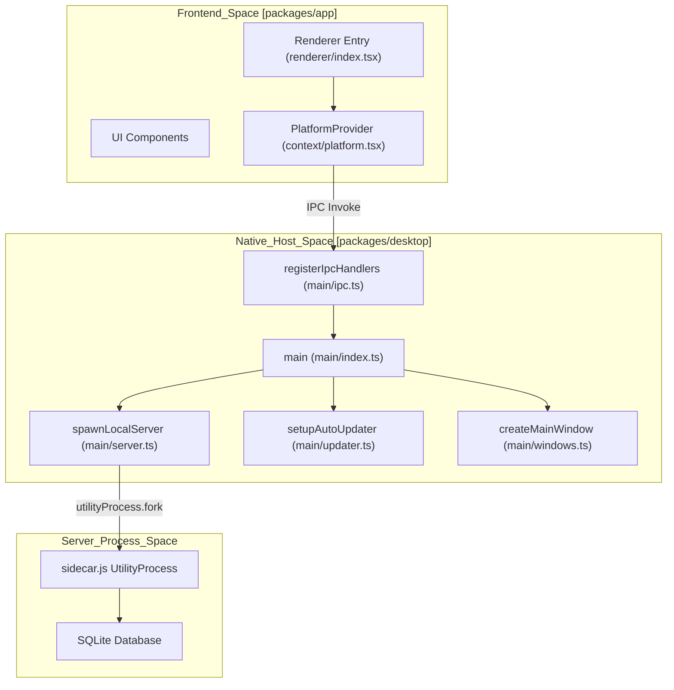
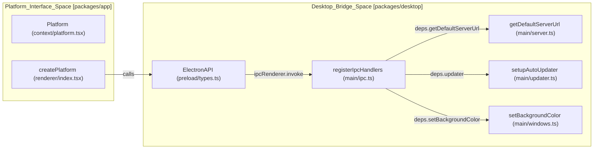

<!-- source: DeepWiki mcp.deepwiki.com · repo sst/opencode · page 6.7 Desktop Applications · fetched 2026-10-27 -->

# Desktop Applications

Relevant source files

The following files were used as context for generating this wiki page:

- [packages/app/src/context/platform.tsx](packages/app/src/context/platform.tsx)
- [packages/app/src/entry.tsx](packages/app/src/entry.tsx)
- [packages/app/src/index.ts](packages/app/src/index.ts)
- [packages/app/src/pages/error.tsx](packages/app/src/pages/error.tsx)
- [packages/app/src/utils/server-health.test.ts](packages/app/src/utils/server-health.test.ts)
- [packages/app/src/utils/server-health.ts](packages/app/src/utils/server-health.ts)
- [packages/app/src/utils/server-protocol.test.ts](packages/app/src/utils/server-protocol.test.ts)
- [packages/app/src/utils/server-protocol.ts](packages/app/src/utils/server-protocol.ts)
- [packages/app/src/utils/server.ts](packages/app/src/utils/server.ts)
- [packages/desktop/electron.vite.config.ts](packages/desktop/electron.vite.config.ts)
- [packages/desktop/src/main/apps.ts](packages/desktop/src/main/apps.ts)
- [packages/desktop/src/main/env.d.ts](packages/desktop/src/main/env.d.ts)
- [packages/desktop/src/main/index.ts](packages/desktop/src/main/index.ts)
- [packages/desktop/src/main/ipc.ts](packages/desktop/src/main/ipc.ts)
- [packages/desktop/src/main/logging.ts](packages/desktop/src/main/logging.ts)
- [packages/desktop/src/main/server.ts](packages/desktop/src/main/server.ts)
- [packages/desktop/src/main/shell-env.test.ts](packages/desktop/src/main/shell-env.test.ts)
- [packages/desktop/src/main/shell-env.ts](packages/desktop/src/main/shell-env.ts)
- [packages/desktop/src/main/sidecar.ts](packages/desktop/src/main/sidecar.ts)
- [packages/desktop/src/main/store-cleanup.test.ts](packages/desktop/src/main/store-cleanup.test.ts)
- [packages/desktop/src/main/store-cleanup.ts](packages/desktop/src/main/store-cleanup.ts)
- [packages/desktop/src/main/store.ts](packages/desktop/src/main/store.ts)
- [packages/desktop/src/main/unresponsive.ts](packages/desktop/src/main/unresponsive.ts)
- [packages/desktop/src/main/updater-controller.ts](packages/desktop/src/main/updater-controller.ts)
- [packages/desktop/src/main/updater.ts](packages/desktop/src/main/updater.ts)
- [packages/desktop/src/main/window-registry.test.ts](packages/desktop/src/main/window-registry.test.ts)
- [packages/desktop/src/main/window-registry.ts](packages/desktop/src/main/window-registry.ts)
- [packages/desktop/src/main/window-state.ts](packages/desktop/src/main/window-state.ts)
- [packages/desktop/src/main/windows.ts](packages/desktop/src/main/windows.ts)
- [packages/desktop/src/preload/index.ts](packages/desktop/src/preload/index.ts)
- [packages/desktop/src/preload/types.ts](packages/desktop/src/preload/types.ts)
- [packages/desktop/src/renderer/index.tsx](packages/desktop/src/renderer/index.tsx)
- [packages/opencode/script/build-node.ts](packages/opencode/script/build-node.ts)
- [packages/opencode/script/generate.ts](packages/opencode/script/generate.ts)
- [packages/opencode/src/cli/cmd/db.ts](packages/opencode/src/cli/cmd/db.ts)
- [packages/opencode/src/index.ts](packages/opencode/src/index.ts)
- [packages/opencode/src/node.ts](packages/opencode/src/node.ts)
- [packages/opencode/test/fixture/db.ts](packages/opencode/test/fixture/db.ts)

OpenCode provides native desktop applications for macOS, Windows, and Linux. These applications wrap the core web-based UI (from the `@opencode-ai/app` package) with native system integrations, enabling features like file system access, native notifications, auto-updates, and deep linking. While the project supports multiple wrappers, the Electron-based implementation in `packages/desktop` provides the most comprehensive native feature set.

## Desktop Application Architecture

The desktop applications bridge a SolidJS frontend with a native backend. The architecture relies on the desktop app managing the lifecycle of the sidecar server, which provides the actual AI agent capabilities and local workspace access via an isolated `utilityProcess`.

### System Components and Data Flow

The following diagram illustrates the relationship between the frontend SolidJS components (`packages/app`), the native Electron host modules (`packages/desktop`), and the underlying sidecar process.

Sources: [packages/app/src/context/platform.tsx:31-124](), [packages/desktop/src/main/index.ts:115-218](), [packages/desktop/src/renderer/index.tsx:113-222](), [packages/desktop/src/main/server.ts:57-84]()

## Desktop State and Server Management

The application follows a strict initialization sequence orchestrated via Effect to ensure the local server and database are ready before the UI becomes interactive.

### Server Connection and Health
The `ServerProvider` manages the active connection to the OpenCode server. In desktop mode, it defaults to a local sidecar.
*   **Initialization**: The app calls `awaitInitialization` via IPC, which triggers the server startup sequence in the main process [packages/desktop/src/preload/types.ts:48-48]().
*   **Startup Logic**: The main process uses `spawnLocalServer` to start the backend inside a node `utilityProcess` and `checkHealth` to verify it is responsive before resolving the initialization promise [packages/desktop/src/main/server.ts:57-62](), [packages/desktop/src/main/ipc.ts:66-66](), [packages/desktop/src/main/server.ts:186-211]().

### Initialization Flow (Electron)
The Electron main process coordinates the startup of the local environment.

| Step | Action | Code Entity |
| :--- | :--- | :--- |
| 1 | Setup Logging & Proxy | `initLogging`, `useEnvProxy` [packages/desktop/src/main/index.ts:149-149](), [packages/desktop/src/main/index.ts:72-79]() |
| 2 | Single Instance Lock | `app.requestSingleInstanceLock` [packages/desktop/src/main/index.ts:198-198]() |
| 3 | Spawn Sidecar | `spawnLocalServer` [packages/desktop/src/main/server.ts:57-62]() |
| 4 | Onboarding Check | `isFirstLaunchOnboardingPending` [packages/desktop/src/main/index.ts:24-24]() |
| 5 | Restore Windows | `restoreMainWindows` [packages/desktop/src/main/windows.ts:157-160]() |

Sources: [packages/desktop/src/main/index.ts:115-218](), [packages/desktop/src/main/windows.ts:157-205](), [packages/desktop/src/main/server.ts:57-84]()

## Platform Abstraction Layer

The `@opencode-ai/app` package consumes a `Platform` interface [packages/app/src/context/platform.tsx:126-134](), which the desktop package implements by bridging Electron IPCs to the SolidJS context.

### Mapping Native Features to Code

This diagram maps the `Platform` interface requirements directly to the specific Electron main process modules, preload bridge, and IPC handlers.

Sources: [packages/app/src/context/platform.tsx:31-124](), [packages/desktop/src/renderer/index.tsx:113-222](), [packages/desktop/src/preload/types.ts:45-115](), [packages/desktop/src/main/ipc.ts:57-160]()

### Key Platform Implementations
*   **Storage Persistence**: Desktop storage uses a custom mechanism backed by `getStore` via `store-get`/`store-set` IPCs, allowing persistent settings across app restarts [packages/desktop/src/main/ipc.ts:114-142](), [packages/desktop/src/renderer/index.tsx:139-164]().
*   **Deep Linking**: Handles `opencode://` protocol URLs via `second-instance` (Windows/Linux) events, which are then emitted to the renderer via `onDeepLink` [packages/desktop/src/main/index.ts:81-86](), [packages/desktop/src/renderer/index.tsx:72-83]().
*   **WSL Integration**: On Windows, the app supports managing WSL sidecar servers via `createWslServersController` [packages/desktop/src/main/index.ts:152-166](). The renderer accesses this through `window.api.wslServers` [packages/desktop/src/renderer/index.tsx:166-166](), [packages/desktop/src/preload/types.ts:25-25]().
*   **File Picking**: The app implements native file and directory pickers using Electron dialogs, returning authorized file paths to the renderer via `open-file-picker`, `open-directory-picker`, and `read-picked-file` [packages/desktop/src/main/ipc.ts:144-160](), [packages/desktop/src/renderer/index.tsx:174-198]().
*   **Draft Store**: The desktop app uses a SQLite-backed draft store (`drafts.sqlite`) managed by `createDesktopDraftStore` in the main process [packages/desktop/src/main/ipc.ts:58-58](), exposed via `draftGet`, `draftSet`, and blob methods [packages/desktop/src/preload/types.ts:67-71]().

Sources: [packages/desktop/src/main/ipc.ts:57-160](), [packages/desktop/src/renderer/index.tsx:113-222](), [packages/desktop/src/preload/types.ts:45-115]()

## Native UI and Window Management

The desktop application manages native window chrome, title bars, and zoom levels.

### Title Bar Customization
The app uses a custom title bar to match the OpenCode aesthetic while maintaining native window controls.
*   **Platform Specifics**: On macOS, it uses `titleBarStyle: "hidden"` with custom traffic light positions [packages/desktop/src/main/windows.ts:186-191](). On Windows, it uses `frame: false` and `titleBarOverlay` to integrate native caption buttons into the web-based title bar [packages/desktop/src/main/windows.ts:192-198]().
*   **Theme Integration**: The `setTitlebar` function updates the native window appearance and overlay colors based on the current app theme [packages/desktop/src/main/windows.ts:114-124]().

### Webview Zoom
*   **Gestures**: Pinch-to-zoom and Ctrl-scroll zoom can be toggled via `setPinchZoomEnabled` and saved to settings [packages/desktop/src/main/windows.ts:131-139]().
*   **Limits**: Zoom factor is strictly constrained between `minZoomLevel` (0.2x) and `maxZoomLevel` (10x) [packages/desktop/src/main/windows.ts:65-66]().

Sources: [packages/desktop/src/main/windows.ts:114-205](), [packages/desktop/src/renderer/index.tsx:123-137]()

## Update System

The Electron application includes a built-in auto-updater system managed by `electron-updater` wrapped inside `setupAutoUpdater`.
*   **Subscription**: The renderer subscribes to updater state changes via `window.api.updater.subscribe` [packages/desktop/src/renderer/index.tsx:63-64](), [packages/desktop/src/preload/types.ts:27-27]().
*   **IPC Handlers**: The main process registers handlers for checking (`updater-check`) and installing (`updater-install`) updates via `UpdaterController` [packages/desktop/src/main/ipc.ts:83-96](), [packages/desktop/src/main/updater.ts:13-61]().
*   **Controller**: The update logic is encapsulated in `setupAutoUpdater`, which coordinates auto-downloads, ready states, and `quitAndInstall` workflows [packages/desktop/src/main/updater.ts:13-61]().

Sources: [packages/desktop/src/main/ipc.ts:83-96](), [packages/desktop/src/renderer/index.tsx:63-65](), [packages/desktop/src/main/updater.ts:13-61](), [packages/desktop/src/preload/types.ts:26-30]()

## Distribution and Build Configuration

The desktop app uses `electron-builder` for distribution across platforms.
*   **Channels**: Supports `dev`, `beta`, and `prod` release channels with mapped application names (`APP_NAMES`) and App IDs (`APP_IDS`) such as `ai.opencode.desktop.prod` [packages/desktop/src/main/index.ts:53-62]().
*   **Proxy Support**: The app explicitly configures environment proxy settings via `http.setGlobalProxyFromEnv()` and appends Chromium switches for loopback bypass [packages/desktop/src/main/index.ts:72-79](), [packages/desktop/src/main/index.ts:191-193]().
*   **Crash Reporting**: Configures Sentry and native crash reporters with JavaScript call stack integrations in document policies [packages/desktop/src/main/index.ts:65-65](), [packages/desktop/src/main/index.ts:150-150](), [packages/desktop/src/renderer/index.tsx:40-60]().

Sources: [packages/desktop/src/main/index.ts:53-79](), [packages/desktop/src/main/windows.ts:88-96](), [packages/desktop/src/renderer/index.tsx:40-60]()

---

