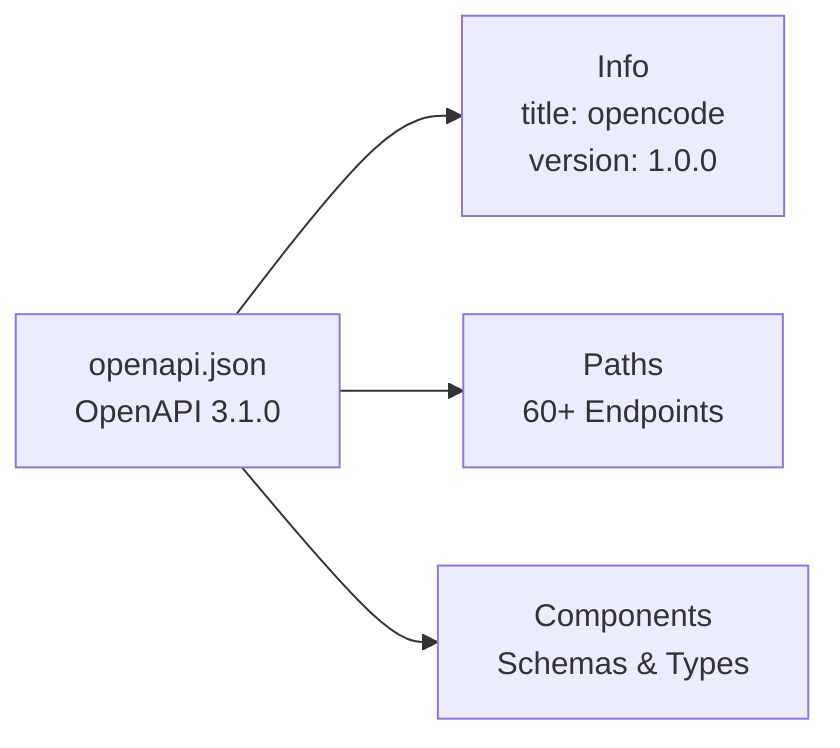
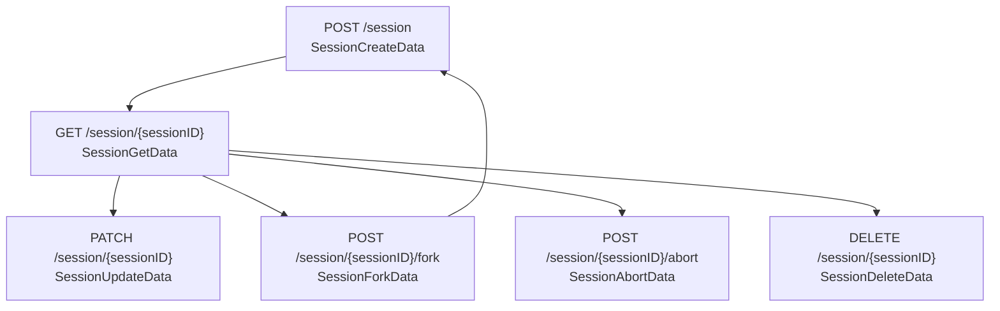
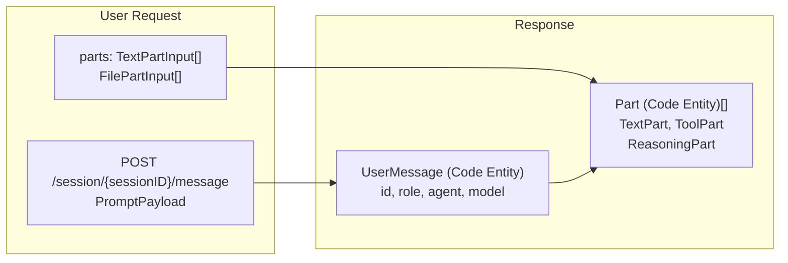
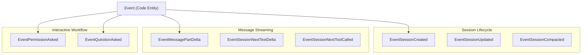
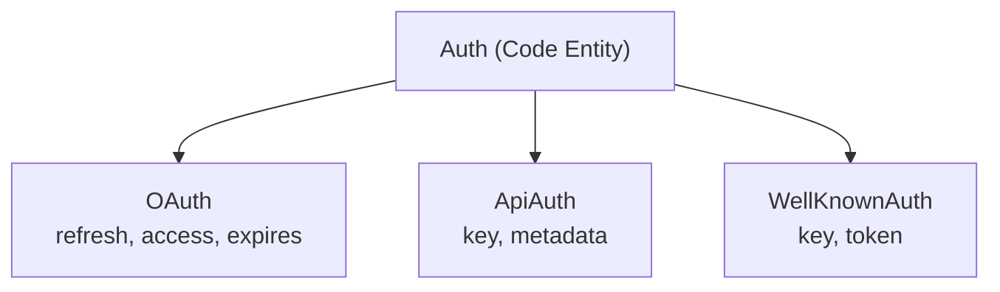
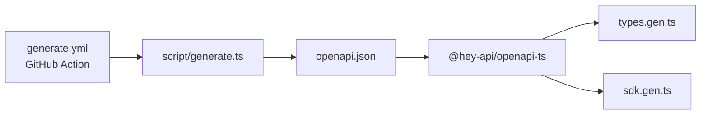

<!-- source: DeepWiki mcp.deepwiki.com · repo sst/opencode · page 7.2 OpenAPI Specification · fetched 2026-10-27 -->

# OpenAPI Specification

<details>
<summary>Relevant source files</summary>

The following files were used as context for generating this wiki page:

- [.github/actions/setup-git-committer/action.yml](.github/actions/setup-git-committer/action.yml)
- [.github/workflows/close-issues.yml](.github/workflows/close-issues.yml)
- [.github/workflows/generate.yml](.github/workflows/generate.yml)
- [packages/opencode/src/acp/agent.ts](packages/opencode/src/acp/agent.ts)
- [packages/opencode/src/agent/agent.ts](packages/opencode/src/agent/agent.ts)
- [packages/opencode/src/config/config.ts](packages/opencode/src/config/config.ts)
- [packages/opencode/src/server/server.ts](packages/opencode/src/server/server.ts)
- [packages/opencode/test/agent/agent.test.ts](packages/opencode/test/agent/agent.test.ts)
- [packages/opencode/test/config/config.test.ts](packages/opencode/test/config/config.test.ts)
- [packages/sdk/js/src/v2/gen/sdk.gen.ts](packages/sdk/js/src/v2/gen/sdk.gen.ts)
- [packages/sdk/js/src/v2/gen/types.gen.ts](packages/sdk/js/src/v2/gen/types.gen.ts)
- [packages/sdk/openapi.json](packages/sdk/openapi.json)
- [perf/test-suite.md](perf/test-suite.md)
- [script/format.ts](script/format.ts)
- [script/generate.ts](script/generate.ts)

</details>


The OpenAPI specification defines the HTTP API contract for the OpenCode server, providing a machine-readable description of all endpoints, request/response schemas, and event types. This specification serves as the single source of truth for API documentation and enables automatic generation of type-safe client SDKs.

For information about the generated JavaScript/TypeScript SDK, see [7.1 JavaScript/TypeScript SDK](). For details on the HTTP server implementation, see [2.6 HTTP Server and API]().

## Specification Structure

The OpenAPI specification is defined in `packages/sdk/openapi.json` [packages/sdk/openapi.json:1-7]() using OpenAPI 3.1.0 format. The specification is generated from the `PublicApi` definition in the backend [packages/opencode/src/server/server.ts:68-69]().

- **API metadata**: Title, description, and version information [packages/sdk/openapi.json:3-7]().
- **Path definitions**: HTTP endpoints with methods, parameters, and responses [packages/sdk/openapi.json:8-43]().
- **Component schemas**: Reusable type definitions for requests, responses, and events [packages/sdk/js/src/v2/gen/types.gen.ts:7-97]().
- **Code samples**: JavaScript examples for each endpoint using the `x-codeSamples` extension [packages/sdk/openapi.json:64-69]().

**Specification Metadata**



Sources: [packages/sdk/openapi.json:1-7](), [packages/opencode/src/server/server.ts:68-69]()

## Endpoint Categories

The API is organized into logical groups. The server implementation mounts these via various route definitions like `HttpApiApp` [packages/opencode/src/server/server.ts:10-13]().

### Global and Control Endpoints

Global endpoints manage the server lifecycle and health, while control endpoints handle authentication and logging [packages/sdk/openapi.json:9-122]().

```
GET  /global/health         - Server health check
PUT  /auth/{providerID}     - Set auth credentials
DELETE /auth/{providerID}   - Remove auth credentials
POST /log                   - Write server logs
```

**Global Health Response Schema**

| Field | Type | Description |
|-------|------|-------------|
| `healthy` | `boolean` | Always `true` when responding [packages/sdk/openapi.json:29-31]() |
| `version` | `string` | OpenCode version string [packages/sdk/openapi.json:5]() |

Sources: [packages/sdk/openapi.json:9-232](), [packages/opencode/src/server/server.ts:10-13]()

### Session Management Endpoints

Sessions are the primary unit of interaction. The SDK provides methods to interact with these endpoints [packages/sdk/js/src/v2/gen/sdk.gen.ts:178-225]().

```
GET /session                      - List sessions
POST /session                     - Create session
GET /session/status               - Get all session statuses
GET /session/{sessionID}          - Get session details
PATCH /session/{sessionID}        - Update session
DELETE /session/{sessionID}       - Delete session
POST /session/{sessionID}/fork    - Fork session
POST /session/{sessionID}/abort   - Abort session
```

**Session Lifecycle Diagram**



Sources: [packages/sdk/js/src/v2/gen/sdk.gen.ts:178-225](), [packages/opencode/src/server/server.ts:10-13]()

### Message and Part Endpoints

Messages contain "Parts" (Text, Tool, Reasoning, etc.). Updates can be streamed or handled via specific part IDs [packages/sdk/js/src/v2/gen/types.gen.ts:15-18]().

```
GET /session/{sessionID}/message                        - List messages
POST /session/{sessionID}/message                       - Send message (streaming)
PATCH /session/{sessionID}/message/{messageID}/part/{partID}  - Update part
DELETE /session/{sessionID}/message/{messageID}/part/{partID} - Delete part
```

**Message Flow Schema**



Sources: [packages/sdk/js/src/v2/gen/sdk.gen.ts:200-207](), [packages/sdk/js/src/v2/gen/types.gen.ts:15-18](), [packages/sdk/js/src/v2/gen/types.gen.ts:239-262]()

## Event Types

The API defines a comprehensive event system for real-time updates via Server-Sent Events (SSE). The unified `Event` type in the SDK covers 90+ specific event types [packages/sdk/js/src/v2/gen/types.gen.ts:7-97]().

**Event Type Hierarchy**



**Key Event Types**

| Event Type | Type Definition | Purpose |
|------------|-----------|---------|
| `message.part.delta` | `EventMessagePartDelta` | Streaming text/field updates [packages/sdk/js/src/v2/gen/types.gen.ts:51]() |
| `permission.asked` | `EventPermissionAsked` | Request user approval for tool execution [packages/sdk/js/src/v2/gen/types.gen.ts:72]() |
| `session.compacted` | `EventSessionCompacted` | Notification that context compaction occurred [packages/sdk/js/src/v2/gen/types.gen.ts:87]() |
| `question.asked` | `EventQuestionAsked` | AI agent asking user a structured question [packages/sdk/js/src/v2/gen/types.gen.ts:84]() |

Sources: [packages/sdk/js/src/v2/gen/types.gen.ts:7-97]()

## Request and Response Schemas

### Authentication Schemas

OpenCode supports three authentication types: OAuth, API keys, and Well-Known tokens [packages/sdk/js/src/v2/gen/types.gen.ts:132](). The `Auth` type is a union of these strategies [packages/sdk/js/src/v2/gen/types.gen.ts:132]().



Sources: [packages/sdk/js/src/v2/gen/types.gen.ts:109-132]()

### Session Data Model

The `Session` schema defines the core state for a coding agent conversation [packages/sdk/js/src/v2/gen/types.gen.ts:170-221]().

| Field | Type | Description |
|-------|------|-------------|
| `id` | `string` | Unique session identifier |
| `projectID` | `string` | ID of the associated project |
| `directory` | `string` | Root directory for the session |
| `summary` | `object` | Diff stats (additions, deletions, files) |
| `tokens` | `object` | Input, output, reasoning, and cache token counts |
| `permission` | `PermissionRuleset` | Active permission rules for tools |

Sources: [packages/sdk/js/src/v2/gen/types.gen.ts:170-221]()

### Part Types

OpenCode uses a polymorphic `Part` structure for message content [packages/sdk/js/src/v2/gen/types.gen.ts:384-400]().

| Part Type | Description | Key Fields |
|-----------|-------------|------------|
| `TextPart` | Standard text content | `text: string` |
| `ReasoningPart` | Chain-of-thought/reasoning | `text: string` |
| `ToolPart` | Tool invocation and results | `callID`, `tool`, `state` |
| `FilePart` | File content or reference | `url`, `filename`, `source` |
| `RetryPart` | Information about a failed and retried step | `attempt`, `error` |

Sources: [packages/sdk/js/src/v2/gen/types.gen.ts:384-400]()

## SDK Generation

The OpenAPI specification is consumed by `@hey-api/openapi-ts` to generate type-safe client code in the `@opencode-ai/sdk` package [packages/sdk/js/src/v2/gen/types.gen.ts:1](). The generation process is automated via a GitHub Actions workflow defined in `.github/workflows/generate.yml` [ .github/workflows/generate.yml:1-52](). This workflow runs on pushes to the `dev` branch, checks out the repository, sets up Bun, configures a Git committer using a GitHub App token [ .github/actions/setup-git-committer/action.yml:1-44](), executes the generation script (`./script/generate.ts`), and commits any changes back to the repository.

**Generation Pipeline**



Sources: [packages/sdk/js/src/v2/gen/types.gen.ts:1](), [packages/sdk/js/src/v2/gen/sdk.gen.ts:1-4](), [ .github/workflows/generate.yml:1-52](), [ .github/actions/setup-git-committer/action.yml:1-44]()

**Generated Client Structure**

The SDK generator produces functions and types organized by resource domain [packages/sdk/js/src/v2/gen/sdk.gen.ts:178-225]():

| Domain | Purpose |
|-------|---------|
| `Experimental` | Control plane, workspace adapters, and move session logic [packages/sdk/js/src/v2/gen/sdk.gen.ts:32-62]() |
| `Session` | Conversation lifecycle, message management, and prompt execution [packages/sdk/js/src/v2/gen/sdk.gen.ts:178-225]() |
| `Pty` | Management of pseudo-terminal shells and connection tokens [packages/sdk/js/src/v2/gen/sdk.gen.ts:154-169]() |
| `Project` | Project discovery, git initialization, and directory management [packages/sdk/js/src/v2/gen/sdk.gen.ts:134-144]() |

Sources: [packages/sdk/js/src/v2/gen/sdk.gen.ts:1-262]()

---

