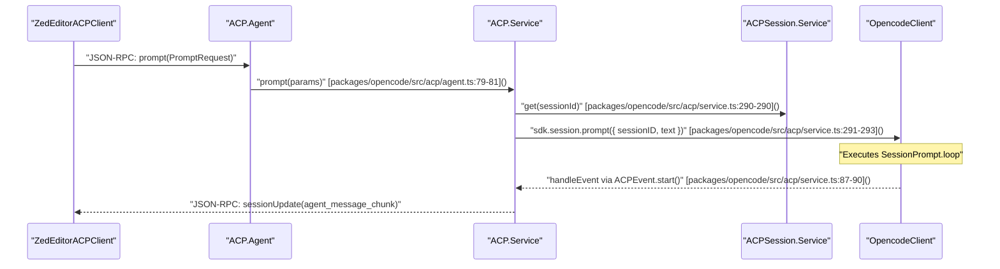
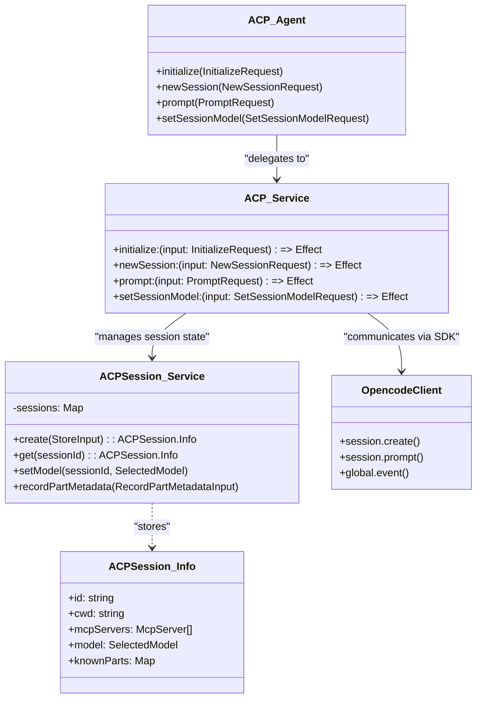

<!-- source: DeepWiki mcp.deepwiki.com · repo sst/opencode · page 7.4 Agent Client Protocol (ACP) · fetched 2026-10-27 -->

# Agent Client Protocol (ACP)

Relevant source files

The following files were used as context for generating this wiki page:

- [packages/opencode/src/acp/agent.ts](packages/opencode/src/acp/agent.ts)
- [packages/opencode/src/acp/config-option.ts](packages/opencode/src/acp/config-option.ts)
- [packages/opencode/src/acp/error.ts](packages/opencode/src/acp/error.ts)
- [packages/opencode/src/acp/event.ts](packages/opencode/src/acp/event.ts)
- [packages/opencode/src/acp/service.ts](packages/opencode/src/acp/service.ts)
- [packages/opencode/src/acp/session.ts](packages/opencode/src/acp/session.ts)
- [packages/opencode/src/acp/tool.ts](packages/opencode/src/acp/tool.ts)
- [packages/opencode/src/agent/agent.ts](packages/opencode/src/agent/agent.ts)
- [packages/opencode/src/config/config.ts](packages/opencode/src/config/config.ts)
- [packages/opencode/src/server/server.ts](packages/opencode/src/server/server.ts)
- [packages/opencode/test/acp/config-option.test.ts](packages/opencode/test/acp/config-option.test.ts)
- [packages/opencode/test/acp/error.test.ts](packages/opencode/test/acp/error.test.ts)
- [packages/opencode/test/acp/event.test.ts](packages/opencode/test/acp/event.test.ts)
- [packages/opencode/test/acp/service-session.test.ts](packages/opencode/test/acp/service-session.test.ts)
- [packages/opencode/test/acp/tool.test.ts](packages/opencode/test/acp/tool.test.ts)
- [packages/opencode/test/agent/agent.test.ts](packages/opencode/test/agent/agent.test.ts)
- [packages/opencode/test/cli/acp/config-options.test.ts](packages/opencode/test/cli/acp/config-options.test.ts)
- [packages/opencode/test/config/config.test.ts](packages/opencode/test/config/config.test.ts)
- [packages/sdk/js/src/v2/gen/sdk.gen.ts](packages/sdk/js/src/v2/gen/sdk.gen.ts)
- [packages/sdk/js/src/v2/gen/types.gen.ts](packages/sdk/js/src/v2/gen/types.gen.ts)
- [packages/sdk/openapi.json](packages/sdk/openapi.json)
- [perf/test-suite.md](perf/test-suite.md)

The Agent Client Protocol (ACP) is a standardized communication layer that allows OpenCode to integrate seamlessly with ACP-compatible editors, such as **Zed**. It enables external IDEs to leverage OpenCode's agentic capabilities, including session management, tool execution, and interactive permissions, through a structured JSON-RPC based protocol.

## Overview

OpenCode implements the ACP server-side logic to expose its internal agent loop and tool registry to external clients. The implementation resides primarily in `packages/opencode/src/acp` and is exposed via the `opencode acp` CLI command.

### Key Components
*   **ACP Agent**: The `Agent` class [packages/opencode/src/acp/agent.ts:32-86]() acts as the primary entry point for ACP requests, delegating to the `ACPService`.
*   **ACP Service**: The `Service` class [packages/opencode/src/acp/service.ts:73-73]() implements the core ACP logic, translating protocol requests like `newSession` or `prompt` into OpenCode SDK actions.
*   **ACP Session Manager**: `ACPSession.Service` [packages/opencode/src/acp/session.ts:93-93]() tracks active sessions, managing state for models, variants, and MCP server configurations [packages/opencode/src/acp/session.ts:24-33]().
*   **Tool Transformation**: The `toToolKind` and `toLocations` functions [packages/opencode/src/acp/tool.ts:38-101]() map OpenCode's internal tool identifiers (e.g., `bash`, `edit`, `grep`) to ACP-standardized tool kinds and file locations.
*   **Event Subscription**: The `Subscription` class [packages/opencode/src/acp/event.ts:39-57]() manages the real-time stream of events from the OpenCode SDK, converting them into ACP-compatible `sessionUpdate` notifications.
*   **Usage Tracking**: `UsageService` [packages/opencode/src/acp/usage.ts:71-71]() calculates token usage, thought tokens, and costs for the session, providing metrics to the editor [packages/opencode/src/acp/usage.ts:90-103]().

Sources: [packages/opencode/src/acp/agent.ts:32-86](), [packages/opencode/src/acp/service.ts:73-73](), [packages/opencode/src/acp/session.ts:93-93](), [packages/opencode/src/acp/tool.ts:38-101](), [packages/opencode/src/acp/event.ts:39-57](), [packages/opencode/src/acp/usage.ts:71-71]()

## Implementation Architecture

The ACP integration bridges high-level protocol requests with OpenCode's internal provider and tool systems using the Effect framework for dependency management and error handling.

### Data Flow: Natural Language to Code Entity Space

The following diagram illustrates how an ACP request from an editor like Zed is processed through the OpenCode stack, mapping protocol calls to specific SDK and session entities.

**ACP Request Processing Pipeline**

Sources: [packages/opencode/src/acp/agent.ts:79-81](), [packages/opencode/src/acp/service.ts:69-70](), [packages/opencode/src/acp/service.ts:87-90](), [packages/opencode/src/acp/service.ts:290-293](), [packages/opencode/src/acp/event.ts:33-37](), [packages/opencode/src/acp/session.ts:114-118]()

### Session Lifecycle and Capability Negotiation

When an ACP client connects, it performs an initialization handshake where OpenCode describes its available models and tools.

1.  **Initialize**: The client sends an `InitializeRequest`. OpenCode responds with its `agentCapabilities`, including support for `loadSession`, `fork`, `resume`, and `mcpCapabilities` [packages/opencode/src/acp/service.ts:112-136]().
2.  **Authentication**: ACP supports a `terminal-auth` flow where the editor can trigger `opencode auth login` via a specific meta command [packages/opencode/src/acp/service.ts:102-110]().
3.  **Session Creation**: `ACP.Service.newSession` [packages/opencode/src/acp/service.ts:163-163]() calls `sdk.session.create` [packages/opencode/src/acp/service.ts:172-174]() to initialize the internal OpenCode session.
4.  **Model Selection**: ACP allows clients to set the session model via `SetSessionModelRequest` [packages/opencode/src/acp/agent.ts:75-77](), which is handled by `ACPSession.Service.setModel` [packages/opencode/src/acp/session.ts:141-143]().

**Entity Mapping: ACP to OpenCode**

Sources: [packages/opencode/src/acp/agent.ts:32-86](), [packages/opencode/src/acp/service.ts:55-71](), [packages/opencode/src/acp/service.ts:102-110](), [packages/opencode/src/acp/service.ts:112-136](), [packages/opencode/src/acp/service.ts:163-163](), [packages/opencode/src/acp/service.ts:172-174](), [packages/opencode/src/acp/session.ts:24-33](), [packages/opencode/src/acp/session.ts:62-91](), [packages/opencode/src/acp/session.ts:141-143]()

## Tool Integration and Mapping

OpenCode tools are transformed into ACP tool calls to ensure compatibility with editor UI features like diff views and file links.

*   **Tool Kinds**: The `toToolKind` function [packages/opencode/src/acp/tool.ts:38-71]() maps internal tools like `bash` to `execute`, `edit`/`write`/`apply_patch` to `edit`, and `grep`/`glob` to `search`.
*   **Location Resolution**: `toLocations` [packages/opencode/src/acp/tool.ts:73-101]() extracts file paths from tool inputs (e.g., `filePath` in `read` or `edit` tools) so the editor can provide "jump to file" functionality.
*   **Content Formatting**: `completedToolContent` [packages/opencode/src/acp/tool.ts:103-122]() prepares the output for the editor, including generating `diff` blocks for file edits and attaching images.

Sources: [packages/opencode/src/acp/tool.ts:38-122](), [packages/opencode/test/acp/tool.test.ts:16-51]()

## Content Conversion

OpenCode and ACP use different structures for message content. The `packages/opencode/src/acp/content.ts` module handles these transformations.

| ACP Content Block | OpenCode Part Type | Transformation Logic |
| :--- | :--- | :--- |
| `text` | `text` | Maps text content; handles audience annotations (`assistant` only becomes `synthetic`, `user` only becomes `ignored`) [packages/opencode/test/acp/content.test.ts:7-29](). |
| `image` | `file` | Converts base64 data and mime-type into a data URL file part [packages/opencode/test/acp/content.test.ts:31-47](). |
| `resource_link` | `file` | Maps URIs (including `zed://` and `file://`) to file parts with associated filenames [packages/opencode/test/acp/content.test.ts:67-100](). |
| `resource` | `text` or `file` | Converts resources with text into sourced text parts or blobs into data URL file parts [packages/opencode/test/acp/content.test.ts:102-167](). |

Sources: [packages/opencode/src/acp/content.ts:1-236](), [packages/opencode/test/acp/content.test.ts:1-235]()

## Interactive Permissions and Events

OpenCode uses a reactive event system to communicate state changes and permission requests back to the ACP client.

*   **Event Handling**: `Subscription.handle` [packages/opencode/src/acp/event.ts:93-106]() processes incoming events such as `session.status` (for idle detection), `permission.asked`, and `message.part.updated`.
*   **Permission Requests**: The `ACPPermission.Handler` [packages/opencode/src/acp/event.ts:56-56]() manages interactive approvals. When a tool requires permission, it uses the connection's `requestPermission` method to wait for user input from the editor.
*   **Replay System**: `replayMessage` [packages/opencode/src/acp/event.ts:108-120]() allows a newly loaded session to populate the editor's history by re-sending previous message parts as chunks.

Sources: [packages/opencode/src/acp/event.ts:56-120](), [packages/opencode/src/acp/service.ts:87-90]()

## Error Handling

OpenCode maps internal domain errors to ACP-compliant JSON-RPC error codes.

| OpenCode Error | ACP JSON-RPC Code | Description |
| :--- | :--- | :--- |
| `SessionNotFoundError` | `-32602` (Invalid Params) | Session ID does not exist [packages/opencode/src/acp/error.ts:65-66](). |
| `AuthRequiredError` | `-32000` (Custom) | Provider authentication is required [packages/opencode/src/acp/error.ts:78-79](). |
| `UnknownAuthMethodError` | `-32602` (Invalid Params) | The requested authentication method is not supported [packages/opencode/src/acp/error.ts:80-81](). |
| `ServiceFailureError` | `-32603` (Internal Error) | Generic internal failure with safe messaging [packages/opencode/src/acp/error.ts:84-91](). |

Sources: [packages/opencode/src/acp/error.ts:63-93](), [packages/opencode/test/acp/error.test.ts:5-67]()

---

