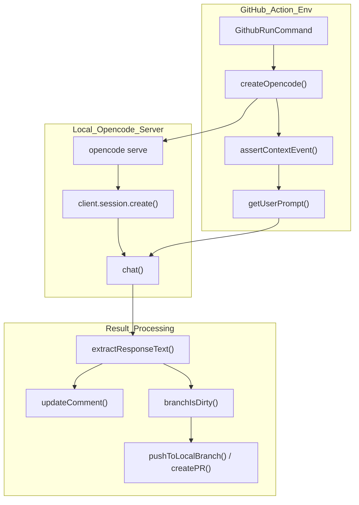
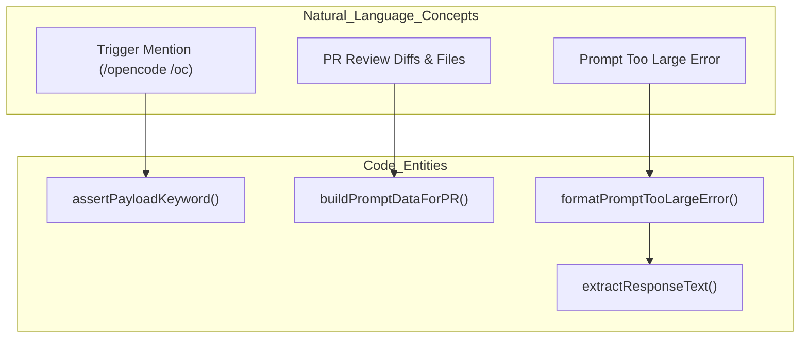

<!-- source: DeepWiki mcp.deepwiki.com · repo sst/opencode · page 7.5 GitHub Action Integration · fetched 2026-10-27 -->

# GitHub Action Integration

<details>
<summary>Relevant source files</summary>

The following files were used as context for generating this wiki page:

- [.github/ISSUE_TEMPLATE/config.yml](.github/ISSUE_TEMPLATE/config.yml)
- [.github/TEAM_MEMBERS](.github/TEAM_MEMBERS)
- [.github/pull_request_template.md](.github/pull_request_template.md)
- [.github/workflows/close-prs.yml](.github/workflows/close-prs.yml)
- [.github/workflows/compliance-close.yml](.github/workflows/compliance-close.yml)
- [.github/workflows/docs-update.yml](.github/workflows/docs-update.yml)
- [.github/workflows/duplicate-issues.yml](.github/workflows/duplicate-issues.yml)
- [.github/workflows/notify-discord.yml](.github/workflows/notify-discord.yml)
- [.github/workflows/pr-management.yml](.github/workflows/pr-management.yml)
- [.github/workflows/pr-standards.yml](.github/workflows/pr-standards.yml)
- [.github/workflows/review.yml](.github/workflows/review.yml)
- [.github/workflows/triage.yml](.github/workflows/triage.yml)
- [.opencode/agent/duplicate-pr.md](.opencode/agent/duplicate-pr.md)
- [.opencode/agent/triage.md](.opencode/agent/triage.md)
- [.opencode/command/commit.md](.opencode/command/commit.md)
- [.opencode/command/issues.md](.opencode/command/issues.md)
- [.opencode/command/spellcheck.md](.opencode/command/spellcheck.md)
- [.opencode/opencode.jsonc](.opencode/opencode.jsonc)
- [.opencode/tool/github-pr-search.ts](.opencode/tool/github-pr-search.ts)
- [.opencode/tool/github-triage.ts](.opencode/tool/github-triage.ts)
- [.oxlintrc.json](.oxlintrc.json)
- [AGENTS.md](AGENTS.md)
- [CONTRIBUTING.md](CONTRIBUTING.md)
- [github/README.md](github/README.md)
- [github/action.yml](github/action.yml)
- [github/index.ts](github/index.ts)
- [packages/app/AGENTS.md](packages/app/AGENTS.md)
- [packages/console/app/.opencode/agent/css.md](packages/console/app/.opencode/agent/css.md)
- [packages/console/app/src/routes/download/[channel]/[platform].ts](packages/console/app/src/routes/download/[channel]/[platform].ts)
- [packages/desktop/README.md](packages/desktop/README.md)
- [packages/opencode/AGENTS.md](packages/opencode/AGENTS.md)
- [packages/opencode/src/cli/cmd/attach.ts](packages/opencode/src/cli/cmd/attach.ts)
- [packages/opencode/src/cli/cmd/cmd.ts](packages/opencode/src/cli/cmd/cmd.ts)
- [packages/opencode/src/cli/cmd/github.ts](packages/opencode/src/cli/cmd/github.ts)
- [packages/opencode/src/cli/cmd/run.ts](packages/opencode/src/cli/cmd/run.ts)
- [packages/opencode/src/cli/cmd/run/runtime.stdin.ts](packages/opencode/src/cli/cmd/run/runtime.stdin.ts)
- [packages/opencode/src/session/prompt/anthropic.txt](packages/opencode/src/session/prompt/anthropic.txt)
- [packages/opencode/src/session/prompt/beast.txt](packages/opencode/src/session/prompt/beast.txt)
- [packages/opencode/src/session/prompt/copilot-gpt-5.txt](packages/opencode/src/session/prompt/copilot-gpt-5.txt)
- [packages/opencode/src/session/prompt/trinity.txt](packages/opencode/src/session/prompt/trinity.txt)
- [packages/opencode/src/util/queue.ts](packages/opencode/src/util/queue.ts)
- [packages/opencode/test/cli/github-action.test.ts](packages/opencode/test/cli/github-action.test.ts)
- [packages/opencode/test/cli/help/__snapshots__/help-snapshots.test.ts.snap](packages/opencode/test/cli/help/__snapshots__/help-snapshots.test.ts.snap)
- [packages/opencode/test/cli/help/help-snapshots.test.ts](packages/opencode/test/cli/help/help-snapshots.test.ts)
- [packages/opencode/test/cli/mcp-add.test.ts](packages/opencode/test/cli/mcp-add.test.ts)
- [packages/opencode/test/cli/run/run-process.test.ts](packages/opencode/test/cli/run/run-process.test.ts)
- [packages/opencode/test/cli/tui/thread.test.ts](packages/opencode/test/cli/tui/thread.test.ts)
- [packages/opencode/test/lib/cli-process.ts](packages/opencode/test/lib/cli-process.ts)
- [packages/opencode/test/lib/snapshot.ts](packages/opencode/test/lib/snapshot.ts)
- [packages/opencode/test/lib/test-provider.ts](packages/opencode/test/lib/test-provider.ts)
- [packages/web/src/content/docs/github.mdx](packages/web/src/content/docs/github.mdx)
- [packages/web/src/content/docs/skills.mdx](packages/web/src/content/docs/skills.mdx)
- [script/github/close-issues.ts](script/github/close-issues.ts)
- [script/github/close-prs.ts](script/github/close-prs.ts)
- [specs/project.md](specs/project.md)

</details>


The OpenCode GitHub Action integrates the AI coding agent directly into GitHub CI/CD workflows, allowing for automated issue triaging, bug fixing, pull request reviews, and comment-driven code modification. By mentioning `/opencode` or `/oc` in issue comments or pull request reviews, users trigger an action runner that boots a local OpenCode server and executes tasks within the repository workspace [packages/web/src/content/docs/github.mdx:6-14]().

## Installation and Setup

OpenCode can be installed interactively via the CLI or configured manually using workflow templates [packages/web/src/content/docs/github.mdx:18-32]().

### CLI Installation Flow
The `GithubInstallCommand` defined in [packages/opencode/src/cli/cmd/github.ts:7-15]() handles the automated setup process (`opencode github install`), guiding users through app installation, workflow creation, and secret storage [packages/web/src/content/docs/github.mdx:20-27]().

### Manual Configuration
Users can also configure the workflow manually by adding `.github/workflows/opencode.yml` [packages/web/src/content/docs/github.mdx:38-42](). Below is an example manual configuration:

```yaml
name: opencode
on:
  issue_comment:
    types: [created]
  pull_request_review_comment:
    types: [created]

jobs:
  opencode:
    if: |
      contains(github.event.comment.body, '/oc') ||
      contains(github.event.comment.body, '/opencode')
    runs-on: ubuntu-latest
    permissions:
      id-token: write
    steps:
      - name: Checkout repository
        uses: actions/checkout@v6
      - name: Run OpenCode
        uses: anomalyco/opencode/github@latest
        env:
          ANTHROPIC_API_KEY: ${{ secrets.ANTHROPIC_API_KEY }}
        with:
          model: anthropic/claude-sonnet-4-20250514
```
Sources: [packages/web/src/content/docs/github.mdx:42-74]()

## Action Interface (`action.yml`)

The action interface is defined in `github/action.yml` using a composite action structure that checks out/caches the CLI, installs via `install`, and invokes `opencode github run` [github/action.yml:41-79]().

| Input | Description | Default |
| :--- | :--- | :--- |
| `model` | Provider and model string (e.g., `anthropic/claude-sonnet-4-20250514`). Required. | N/A |
| `agent` | Primary agent to use (falls back to config or `build`). | N/A |
| `share` | Whether to generate a public share link for the session. | `true` (public repos) |
| `prompt` | Custom instructions to override default behavior. | N/A |
| `use_github_token` | Use `GITHUB_TOKEN` directly instead of OpenCode App token exchange. | `false` |
| `mentions` | Comma-separated list of trigger phrases (case-insensitive). | `/opencode,/oc` |
| `variant` | Model variant for provider-specific reasoning effort (e.g. `high`, `max`). | N/A |
| `oidc_base_url` | Base URL for OIDC token exchange API. | `https://api.opencode.ai` |

Sources: [github/action.yml:7-40](), [packages/web/src/content/docs/github.mdx:83-90]()

## Execution Architecture and Data Flow

The runtime orchestrator for the GitHub Action is located at [github/index.ts:1-242](). It sets up a local server process, interacts with Octokit, executes model chats, and commits changes back to the repository.

### Execution Pipeline

1.  **Server Bootstrapping**: `createOpencode()` spawns a local OpenCode server via `opencode serve` on port `4096` and returns a configured `createOpencodeClient` instance [github/index.ts:231-242]().
2.  **Context Validation**: `assertContextEvent()` checks the webhook event type (`issue_comment` or `pull_request_review_comment`) and `assertPayloadKeyword()` verifies the trigger mention [github/index.ts:128-129]().
3.  **Prompt Resolution**: `getUserPrompt()` fetches issue/PR data and formats user instructions and attached files [github/index.ts:138]().
4.  **Agent Chat Session**: `chat()` communicates with the local server session to process the prompt and execute tools [github/index.ts:170]().
5.  **Response Extraction**: `extractResponseText()` parses `MessageV2` parts to pull valid text output, ignoring reasoning or tool execution noise [packages/opencode/src/cli/cmd/github.ts:5](), [packages/opencode/test/cli/run/run-process.test.ts:26-46]().
6.  **PR / Branch Management**: Depending on whether the event targets an issue or PR (local vs. fork), the script stages changes, commits, pushes, and creates pull requests [github/index.ts:164-210]().

### Diagram: GitHub Action Execution Pipeline


Sources: [github/index.ts:128-242](), [packages/opencode/src/cli/cmd/github.ts:5]()

### Diagram: Natural Language Space to Code Entity Space


Sources: [github/index.ts:129](), [github/index.ts:169](), [packages/opencode/src/cli/cmd/github.ts:5](), [packages/opencode/test/cli/run/run-process.test.ts:145-163]()

## Supported Events and Triage Automation

OpenCode responds to a variety of GitHub webhook events:

| Event Type | Trigger | Use Case |
| :--- | :--- | :--- |
| `issue_comment` | Comment on issue/PR with `/opencode` or `/oc` | Triaging, answering questions, fixing bugs, creating PRs |
| `pull_request_review_comment` | Review comment on code lines | Direct, line-specific code adjustments and error handling |
| `issues` | Issue opened or edited | Automated intake and processing |
| `pull_request` | PR opened, synchronized, or reopened | Automated PR reviews |
| `schedule` | Cron-based schedule | Routine codebase health checks and audits |
| `workflow_dispatch` | Manual trigger from GitHub Actions UI | On-demand workflow execution |

Sources: [packages/web/src/content/docs/github.mdx:114-126]()

## Security, Permissions, and Error Handling

1.  **OIDC Authentication**: By default, the action exchanges a GitHub OIDC token for an installation token via `https://api.opencode.ai` [packages/web/src/content/docs/github.mdx:89](). Alternatively, callers can set `use_github_token: true` to use a native `GITHUB_TOKEN` [packages/web/src/content/docs/github.mdx:90-108]().
2.  **Permission Restrictions**: Tool capabilities can be fine-tuned via the `OPENCODE_PERMISSION` environment variable (e.g., denying shell access with `{"bash": "deny"}`) [.github/workflows/review.yml:50](). The `github-triage` tool, for example, is explicitly enabled in the `.opencode/agent/triage.md` agent configuration [packages/opencode/AGENTS.md:6-8]().
3.  **Prompt Size Validation**: When prompts or attachments exceed model context limits, `formatPromptTooLargeError` calculates original file sizes from base64 representations and outputs structured error messages for debugging [packages/opencode/test/cli/run/run-process.test.ts:145-163]().

Sources: [packages/web/src/content/docs/github.mdx:89-110](), [.github/workflows/review.yml:50](), [packages/opencode/AGENTS.md:6-8](), [packages/opencode/test/cli/run/run-process.test.ts:145-163]()

---

