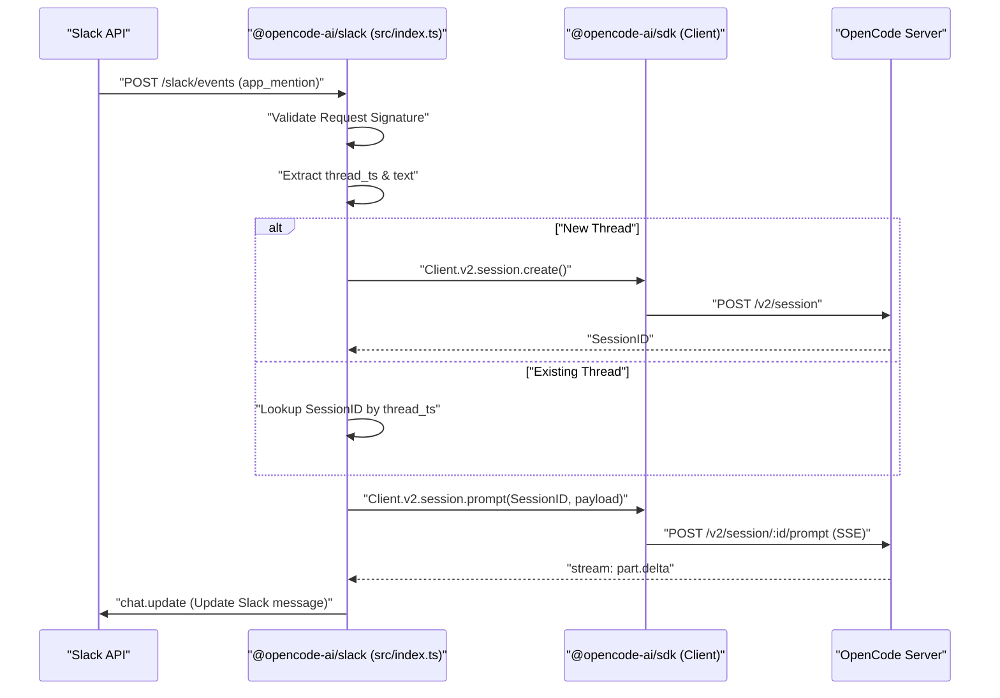
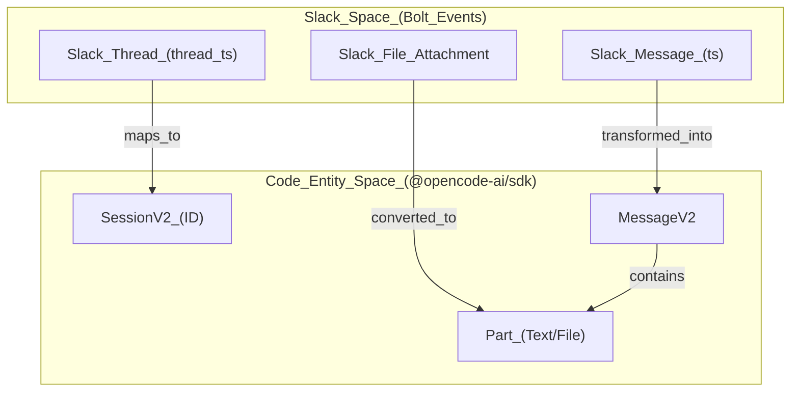
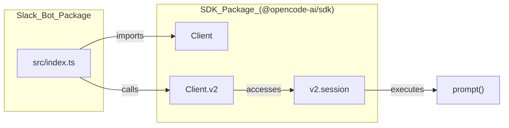

<!-- source: DeepWiki mcp.deepwiki.com · repo sst/opencode · page 7.6 Slack Integration · fetched 2026-10-27 -->

# Slack Integration

Relevant source files

The following files were used as context for generating this wiki page:

- [bun.lock](bun.lock)
- [packages/console/app/package.json](packages/console/app/package.json)
- [packages/console/core/package.json](packages/console/core/package.json)
- [packages/console/function/package.json](packages/console/function/package.json)
- [packages/console/mail/package.json](packages/console/mail/package.json)
- [packages/desktop/package.json](packages/desktop/package.json)
- [packages/enterprise/package.json](packages/enterprise/package.json)
- [packages/function/package.json](packages/function/package.json)
- [packages/opencode/package.json](packages/opencode/package.json)
- [packages/plugin/package.json](packages/plugin/package.json)
- [packages/sdk/js/package.json](packages/sdk/js/package.json)
- [packages/slack/package.json](packages/slack/package.json)
- [packages/ui/package.json](packages/ui/package.json)
- [packages/web/package.json](packages/web/package.json)

The `@opencode-ai/slack` package provides a Slack bot integration that allows users to interact with OpenCode directly from their Slack workspace. It transforms Slack messages into OpenCode sessions, maintaining context through Slack threads and utilizing the OpenCode SDK to process requests.

## Overview

The Slack integration acts as a bridge between the Slack Events API and the OpenCode session management system. It enables teams to trigger AI coding tasks, ask questions, or initiate refactors without leaving their communication platform. The implementation leverages the `@slack/bolt` framework to handle the Slack protocol and the `@opencode-ai/sdk` to communicate with OpenCode.

### Key Capabilities
- **Threaded Sessions**: Each Slack thread is mapped to a unique OpenCode session, ensuring conversation continuity.
- **Message Transformation**: Converts Slack's rich text and attachments into OpenCode `MessageV2` and `Part` structures.
- **Interactive Responses**: Streams AI responses back to Slack as they are generated using the Slack `chat.update` API.

Sources: [packages/slack/package.json:1-19]()

## Package Architecture

The integration is built as a standalone package within the monorepo [packages/slack/package.json:1-4](). It is designed to run as a persistent service (bot) that listens for incoming Slack events via a Bun-driven entry point.

### Dependency Structure
The package relies on the core SDK for communication with the OpenCode server and the Bolt framework for Slack event routing.

| Dependency | Purpose |
|:---|:---|
| `@opencode-ai/sdk` | Client for creating and managing sessions [packages/sdk/js/package.json:3-36]() |
| `@slack/bolt` | Framework for Slack apps, handling OAuth and events [packages/slack/package.json:1-19]() |
| `effect` | Functional programming library used for error handling and concurrency [packages/slack/package.json:1-19]() |

Sources: [packages/slack/package.json:1-19](), [bun.lock:7-14](), [packages/sdk/js/package.json:3-36]()

## Data Flow: Slack to OpenCode

When a user mentions the bot or replies in a thread, the integration follows a specific pipeline to synchronize the Slack state with an OpenCode session.

### Session Mapping
The integration uses Slack's `thread_ts` (thread timestamp) as a key to look up or create an OpenCode `Session`. If a message is a top-level post, a new session is initialized. If it is a reply, the integration retrieves the existing `sessionId` associated with that thread.

### Event Processing Pipeline
The following diagram illustrates how a Slack event is transformed into an OpenCode session interaction using the SDK.

**Slack Event Transformation**

Sources: [packages/slack/package.json:1-19](), [packages/sdk/js/package.json:12-21]()

## OAuth Scopes and Setup

To function correctly, the Slack application requires specific OAuth scopes to read messages and post responses. These are configured in the Slack App Dashboard.

### Required Scopes
The bot must be configured with the following permissions:

- `app_mentions:read`: To detect when the bot is called directly.
- `chat:write`: To send messages and updates back to the channel.
- `files:read`: To process code snippets or files uploaded to Slack.
- `channels:history`: To retrieve context from public channels when joined.

### Environment Configuration
The integration requires the following environment variables for the `@slack/bolt` `App` initialization:
- `SLACK_SIGNING_SECRET`: Used to verify that requests originate from Slack.
- `SLACK_BOT_TOKEN`: The `xoxb` token used to authenticate API calls to Slack.
- `OPENCODE_API_URL`: The endpoint for the OpenCode server (defaults to `https://api.opencode.ai`).

Sources: [packages/slack/package.json:1-19]()

## Implementation Details

The core logic resides in the event handlers that bridge the Slack Web Client and the OpenCode `SessionPrompt.loop`.

### Message Parsing
Slack messages are parsed into `MessageV2` parts. The integration handles:
1. **Text**: Standard Slack markdown is converted to standard Markdown.
2. **Mentions**: Bot mentions are stripped to prevent the AI from seeing its own name as part of the command.
3. **Files**: Slack file URLs are resolved, and the content is attached as `file` parts to the OpenCode message.

### Interaction Logic
The bot uses a "Post and Update" strategy for streaming. When the OpenCode server sends SSE (Server-Sent Events) deltas, the Slack bot:
1. Posts an initial "Thinking..." message using `chat.postMessage`.
2. Buffers deltas from the OpenCode `part.delta` events received via the `@opencode-ai/sdk`.
3. Periodically updates the Slack message using `chat.update` to simulate a streaming effect.

**Entity Mapping: Slack to Code**

**SDK Integration Flow**

Sources: [packages/slack/package.json:1-19](), [packages/sdk/js/package.json:16-20](), [packages/sdk/js/src/client.ts:1-15]()

---

