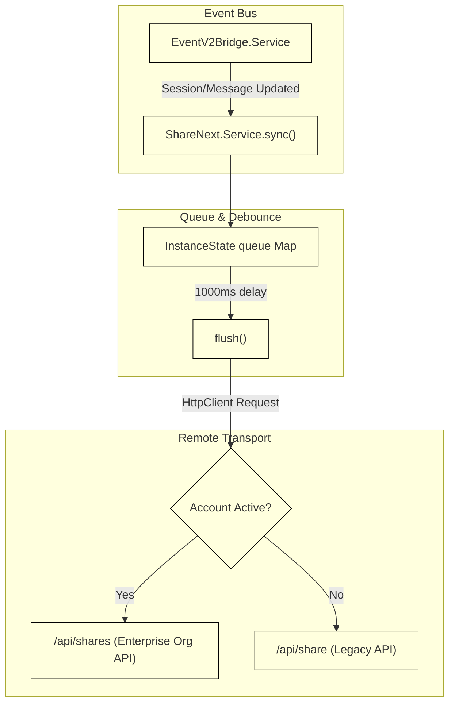
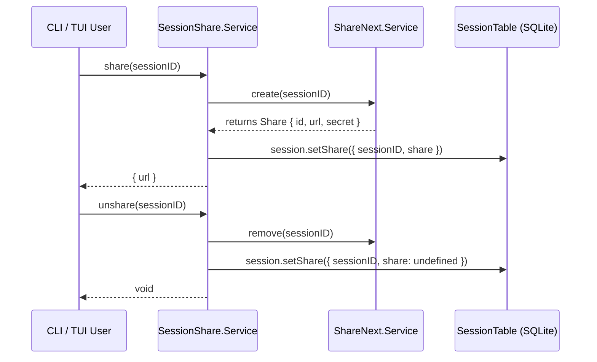
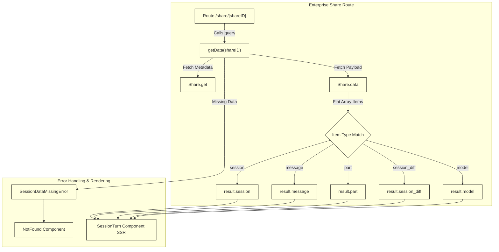
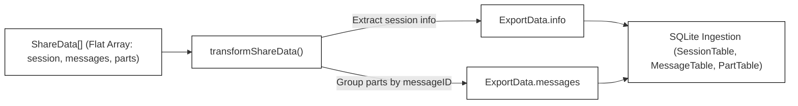

<!-- source: DeepWiki mcp.deepwiki.com · repo sst/opencode · page 7.7 Sharing and Enterprise Share Viewer · fetched 2026-10-27 -->

# Sharing and Enterprise Share Viewer

<details>
<summary>Relevant source files</summary>

The following files were used as context for generating this wiki page:

- [packages/core/src/plugin/provider/opencode.ts](packages/core/src/plugin/provider/opencode.ts)
- [packages/core/src/provider.ts](packages/core/src/provider.ts)
- [packages/core/test/plugin/provider-opencode.test.ts](packages/core/test/plugin/provider-opencode.test.ts)
- [packages/enterprise/src/routes/share/[shareID].tsx](packages/enterprise/src/routes/share/[shareID].tsx)
- [packages/opencode/src/account/account.ts](packages/opencode/src/account/account.ts)
- [packages/opencode/src/account/repo.ts](packages/opencode/src/account/repo.ts)
- [packages/opencode/src/account/schema.ts](packages/opencode/src/account/schema.ts)
- [packages/opencode/src/account/url.ts](packages/opencode/src/account/url.ts)
- [packages/opencode/src/cli/cmd/import.ts](packages/opencode/src/cli/cmd/import.ts)
- [packages/opencode/src/share/session.ts](packages/opencode/src/share/session.ts)
- [packages/opencode/src/share/share-next.ts](packages/opencode/src/share/share-next.ts)
- [packages/opencode/test/account/repo.test.ts](packages/opencode/test/account/repo.test.ts)
- [packages/opencode/test/account/service.test.ts](packages/opencode/test/account/service.test.ts)
- [packages/opencode/test/cli/import.test.ts](packages/opencode/test/cli/import.test.ts)
- [packages/opencode/test/share/share-next.test.ts](packages/opencode/test/share/share-next.test.ts)
- [packages/opencode/tsconfig.json](packages/opencode/tsconfig.json)

</details>


## Purpose and Scope

This page documents OpenCode's session sharing subsystem (`ShareNext`), session lifecycle hooks (`SessionShare`), the enterprise share viewer route, and mechanisms for importing shared sessions or deploying self-hosted share targets. OpenCode allows users to publish active coding sessions to remote share endpoints (such as `opncd.ai` or self-hosted enterprise control planes), synchronize real-time edits, and render snapshots via dedicated server-side rendered (SSR) web routes.

---

## 1. Session Sharing Architecture and `ShareNext` Service

The core sharing logic is implemented in the `ShareNext` service (`packages/opencode/src/share/share-next.ts`), which interfaces with remote share APIs. Depending on whether an authenticated enterprise account with an active organization is present, `ShareNext` selects either the legacy share API (`/api/share`) or the enterprise organization share API (`/api/shares`) [packages/opencode/test/share/share-next.test.ts:85-136]().

### Service Structure and State Management

`ShareNext` maintains an instance-scoped queue and shared cache inside `InstanceState` [packages/opencode/src/share/share-next.ts:45-49](). When session updates occur, events emitted via `EventV2Bridge` [packages/opencode/src/share/share-next.ts:116] trigger incremental updates (`sync`) which are debounced and flushed to the share server [packages/opencode/src/share/share-next.ts:124-146]().


*Sources: [packages/opencode/src/share/share-next.ts:112-199](), [packages/opencode/test/share/share-next.test.ts:85-136]()*

The request builder dynamically injects authentication tokens and organization headers (`x-org-id`) when an account is logged in:
* `req.api.create`: `/api/share` or `/api/shares` [packages/opencode/src/share/share-next.ts:85-95]()
* `req.api.sync(shareID)`: `/api/share/:id/sync` or `/api/shares/:id/sync` [packages/opencode/src/share/share-next.ts:88]()
* `req.api.remove(shareID)`: `/api/share/:id` or `/api/shares/:id` [packages/opencode/src/share/share-next.ts:89]()
* `req.api.data(shareID)`: `/api/share/:id/data` or `/api/shares/:id/data` [packages/opencode/src/share/share-next.ts:90]()

*Sources: [packages/opencode/src/share/share-next.ts:25-96](), [packages/opencode/test/share/share-next.test.ts:85-136]()*

---

## 2. Session Share Lifecycle Hooks

The wrapper service `SessionShare` (`packages/opencode/src/share/session.ts`) coordinates session creation, manual sharing, unsharing, and automatic sharing rules based on user configuration and runtime flags [packages/opencode/src/share/session.ts:9-49]().


*Sources: [packages/opencode/src/share/session.ts:26-37](), [packages/opencode/src/share/share-next.ts:77-78]()*

*Sources: [packages/opencode/src/share/session.ts:9-57](), [packages/opencode/src/share/share-next.ts:73-79]()*

---

## 3. Enterprise Share Viewer Route

The enterprise share viewer is housed in the `@opencode-ai/enterprise` package at `packages/enterprise/src/routes/share/[shareID].tsx`. It handles server-side rendering (SSR) of shared sessions, data ingestion from the backend share storage, metadata generation for social cards, and worker pool integration for code diff rendering.

### Data Flow and Server Queries

When a client requests a share URL, the SolidStart `query` function `getData` fetches the share metadata and its associated flat array of session components, messages, parts, diffs, and models [packages/opencode/src/share/share-next.ts:20-72](), [packages/enterprise/src/routes/share/[shareID].tsx:58-122]().


*Sources: [packages/enterprise/src/routes/share/[shareID].tsx:58-122]()*

### Caching and Security Headers
The viewer sets explicit HTTP response headers on the request event to ensure efficient edge caching while allowing stale content revalidation:
```typescript
getRequestEvent()?.response.headers.set(
  "Cache-Control",
  "public, max-age=30, s-maxage=300, stale-while-revalidate=86400",
)
```
Additionally, pages inject a `<Meta name="robots" content="noindex, nofollow" />` tag to control crawler indexing on private or unlisted session shares [packages/enterprise/src/routes/share/[shareID].tsx:124-155]().

*Sources: [packages/enterprise/src/routes/share/[shareID].tsx:124-155]()*

---

## 4. Session Import, Export, and URL Handling

OpenCode allows users to import previously shared or exported sessions directly into their local project instances using the `import` CLI command (`packages/opencode/src/cli/cmd/import.ts`) [packages/opencode/src/cli/cmd/import.ts:94-108]().

### URL Parsing and Data Transformation

When importing from a share URL (e.g., `https://opncd.ai/share/abc123`), the CLI parses the slug, verifies whether authentication headers should be attached (if the share URL matches the authenticated account origin), and fetches the flat share data structure [packages/opencode/src/cli/cmd/import.ts:28-39, 117-157]().

The helper `transformShareData` reconstructs the hierarchical nesting required by local storage from the flat server response:


*Sources: [packages/opencode/src/cli/cmd/import.ts:60-90, 154-192]()*

*Sources: [packages/opencode/src/cli/cmd/import.ts:1-230]()*

---

## 5. Self-Hosted Share Deployments

Enterprise deployments can self-host the share backend and viewer frontend by configuring the enterprise URL in the project or global configuration file [packages/opencode/test/share/share-next.test.ts:85-101]().

### Configuration Example
```json
{
  "enterprise": {
    "url": "https://control.example.com"
  }
}
```

When `enterprise.url` is specified, `ShareNext` redirects all share creation, synchronization, removal, and data retrieval requests to the self-hosted domain instead of the default public cloud endpoints (`https://opncd.ai`) [packages/opencode/src/share/share-next.ts:32-36, 117-122](), [packages/opencode/test/share/share-next.test.ts:85-101]().

*Sources: [packages/opencode/src/share/share-next.ts:112-146](), [packages/opencode/test/share/share-next.test.ts:85-101]()*.

---

