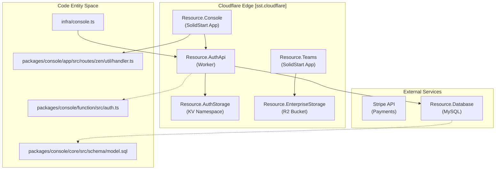
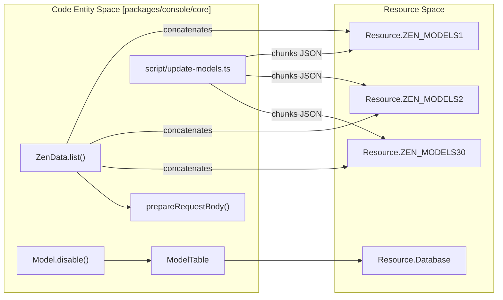

<!-- source: DeepWiki mcp.deepwiki.com · repo sst/opencode · page 8.1 Console Architecture · fetched 2026-10-27 -->

# Console Architecture

Relevant source files

The following files were used as context for generating this wiki page:

- [packages/console/app/public/social-share-black.png](packages/console/app/public/social-share-black.png)
- [packages/console/app/src/asset/lander/desktop-app-icon.png](packages/console/app/src/asset/lander/desktop-app-icon.png)
- [packages/console/app/src/asset/lander/opencode-desktop-icon.png](packages/console/app/src/asset/lander/opencode-desktop-icon.png)
- [packages/console/app/src/component/footer.tsx](packages/console/app/src/component/footer.tsx)
- [packages/console/app/src/component/header.tsx](packages/console/app/src/component/header.tsx)
- [packages/console/app/src/component/spotlight.css](packages/console/app/src/component/spotlight.css)
- [packages/console/app/src/component/spotlight.tsx](packages/console/app/src/component/spotlight.tsx)
- [packages/console/app/src/config.ts](packages/console/app/src/config.ts)
- [packages/console/app/src/i18n/ar.ts](packages/console/app/src/i18n/ar.ts)
- [packages/console/app/src/i18n/br.ts](packages/console/app/src/i18n/br.ts)
- [packages/console/app/src/i18n/da.ts](packages/console/app/src/i18n/da.ts)
- [packages/console/app/src/i18n/de.ts](packages/console/app/src/i18n/de.ts)
- [packages/console/app/src/i18n/es.ts](packages/console/app/src/i18n/es.ts)
- [packages/console/app/src/i18n/fr.ts](packages/console/app/src/i18n/fr.ts)
- [packages/console/app/src/i18n/it.ts](packages/console/app/src/i18n/it.ts)
- [packages/console/app/src/i18n/ja.ts](packages/console/app/src/i18n/ja.ts)
- [packages/console/app/src/i18n/ko.ts](packages/console/app/src/i18n/ko.ts)
- [packages/console/app/src/i18n/no.ts](packages/console/app/src/i18n/no.ts)
- [packages/console/app/src/i18n/pl.ts](packages/console/app/src/i18n/pl.ts)
- [packages/console/app/src/i18n/ru.ts](packages/console/app/src/i18n/ru.ts)
- [packages/console/app/src/i18n/th.ts](packages/console/app/src/i18n/th.ts)
- [packages/console/app/src/i18n/tr.ts](packages/console/app/src/i18n/tr.ts)
- [packages/console/app/src/i18n/zh.ts](packages/console/app/src/i18n/zh.ts)
- [packages/console/app/src/i18n/zht.ts](packages/console/app/src/i18n/zht.ts)
- [packages/console/app/src/lib/changelog.ts](packages/console/app/src/lib/changelog.ts)
- [packages/console/app/src/routes/auth/authorize.ts](packages/console/app/src/routes/auth/authorize.ts)
- [packages/console/app/src/routes/black.css](packages/console/app/src/routes/black.css)
- [packages/console/app/src/routes/black.tsx](packages/console/app/src/routes/black.tsx)
- [packages/console/app/src/routes/black/common.tsx](packages/console/app/src/routes/black/common.tsx)
- [packages/console/app/src/routes/black/index.tsx](packages/console/app/src/routes/black/index.tsx)
- [packages/console/app/src/routes/brand/index.css](packages/console/app/src/routes/brand/index.css)
- [packages/console/app/src/routes/changelog.json.ts](packages/console/app/src/routes/changelog.json.ts)
- [packages/console/app/src/routes/changelog/index.css](packages/console/app/src/routes/changelog/index.css)
- [packages/console/app/src/routes/changelog/index.tsx](packages/console/app/src/routes/changelog/index.tsx)
- [packages/console/app/src/routes/download/index.css](packages/console/app/src/routes/download/index.css)
- [packages/console/app/src/routes/download/index.tsx](packages/console/app/src/routes/download/index.tsx)
- [packages/console/app/src/routes/download/types.ts](packages/console/app/src/routes/download/types.ts)
- [packages/console/app/src/routes/enterprise/index.css](packages/console/app/src/routes/enterprise/index.css)
- [packages/console/app/src/routes/feishu.ts](packages/console/app/src/routes/feishu.ts)
- [packages/console/app/src/routes/index.css](packages/console/app/src/routes/index.css)
- [packages/console/app/src/routes/index.tsx](packages/console/app/src/routes/index.tsx)
- [packages/console/app/src/routes/temp.tsx](packages/console/app/src/routes/temp.tsx)
- [packages/console/app/src/routes/zen/index.css](packages/console/app/src/routes/zen/index.css)
- [packages/console/app/src/routes/zen/index.tsx](packages/console/app/src/routes/zen/index.tsx)
- [packages/console/app/src/routes/zen/util/redis.ts](packages/console/app/src/routes/zen/util/redis.ts)
- [packages/ui/src/assets/images/social-share-black.png](packages/ui/src/assets/images/social-share-black.png)
- [packages/web/config.mjs](packages/web/config.mjs)

## Purpose and Scope

The OpenCode Console is a multi-tier platform providing team management, billing, administrative functionality, and public-facing marketing resources. It is architected as a serverless-first system deployed primarily on Cloudflare Workers and Pages using the SST (Serverless Stack) framework. This architecture separates the presentation layer (SolidStart) from the business logic (Core) and the serverless execution layer (Functions).

---

## Three-Tier Architecture

The console is organized into three distinct layers to ensure separation of concerns and maintainability.

### 1. Presentation Layer (`packages/console/app` and `packages/enterprise`)
SST uses `sst.cloudflare.SolidStart` to deploy the user interfaces.
- **Console App**: The primary user interface for the console platform, linked as `Resource.Console` [sst-env.d.ts:37-40]().
- **Enterprise/Teams UI**: A specialized interface for team management, deployed via the `Teams` resource [sst-env.d.ts:140-143]().
- **Framework**: SolidStart with Nitro engine.
- **Routes**: Implements complex client-side logic for landing pages [packages/console/app/src/routes/index.tsx:1-50]() and multi-platform download detection [packages/console/app/src/routes/download/index.tsx:1-40]().

### 2. Application Layer (`packages/console/function` and `packages/console/app/src/routes/zen/util`)
Hono-based serverless functions and SolidStart server routes that serve as the API gateway and backend handlers.
- **Auth API**: A Cloudflare Worker (`AuthApi`) handling authentication flows, linked to `AuthStorage` (KV) and various OAuth secrets [infra/console.ts:63-68]().
- **Zen Gateway**: A high-performance proxy handler for AI requests that manages authentication, rate limiting, and provider selection [packages/console/app/src/routes/zen/util/handler.ts:66-155]().
- **Monitoring**: Webhook handlers for Honeycomb alerts located in `packages/console/app/src/routes/honeycomb/webhook.ts` [infra/monitoring.ts:7-29]().

### 3. Core Logic Layer (`packages/console/core`)
The shared business logic and data access layer used by both the UI and the serverless functions.
- **Database Access**: Type-safe database interactions via the `Database` linkable, which connects to PlanetScale (MySQL) [infra/console.ts:11-44]().
- **Resource Linking**: Core logic utilizes the `@opencode-ai/console-resource` package to access linked SST resources including Secrets and Linkables [packages/console/core/src/model.ts:8]().
- **Billing Engine**: Handles complex cost calculations and monthly bounds for subscriptions [packages/console/app/src/routes/zen/util/handler.ts:4-12]().

Sources:
- [sst-env.d.ts:37-40]()
- [infra/console.ts:11-68]()
- [packages/console/core/src/model.ts:8]()

---

## Console Routes, Marketing, Download, and Changelog

The console application handles public marketing pages, platform downloads, and release tracking through specialized SolidStart routes and utility modules.

- **Index/Landing Route**: Defined in `packages/console/app/src/routes/index.tsx`, serving the primary public-facing landing page with feature overviews, FAQs, and calls to action.
- **Download Route**: Implemented in `packages/console/app/src/routes/download/index.tsx`, providing automated platform detection and download links for macOS, Windows, and Linux.
- **Changelog Routing and Parser**: Release history is powered by the changelog route in `packages/console/app/src/routes/changelog/index.tsx` backed by data loading utilities in `packages/console/app/src/lib/changelog.ts` and structured JSON serialization in `packages/console/app/src/routes/changelog.json.ts`.

Sources:
- [packages/console/app/src/routes/index.tsx:1-50]()
- [packages/console/app/src/routes/download/index.tsx:1-40]()
- [packages/console/app/src/routes/changelog/index.tsx:1-30]()
- [packages/console/app/src/lib/changelog.ts:1-25]()

---

## Internationalization (i18n) System

To support a global user base across 18+ languages, the console presentation layer includes a robust dictionary-based internationalization system located under `packages/console/app/src/i18n/`.

- **Base Dictionary**: English translation is defined in `packages/console/app/src/i18n/en.ts` establishing the canonical key structure (`Dict`).
- **Localized Dictionaries**: Regional translations extend the base dictionary, such as Traditional Chinese (`packages/console/app/src/i18n/zht.ts`), Simplified Chinese (`packages/console/app/src/i18n/zh.ts`), Arabic (`packages/console/app/src/i18n/ar.ts`), Turkish (`packages/console/app/src/i18n/tr.ts`), Korean (`packages/console/app/src/i18n/ko.ts`), German (`packages/console/app/src/i18n/de.ts`), Norwegian (`packages/console/app/src/i18n/no.ts`), Polish (`packages/console/app/src/i18n/pl.ts`), French (`packages/console/app/src/i18n/fr.ts`), Russian (`packages/console/app/src/i18n/ru.ts`), Brazilian Portuguese (`packages/console/app/src/i18n/br.ts`), and Danish (`packages/console/app/src/i18n/da.ts`).
- **Dictionary Merging**: Each language module spreads the base dictionary (`...en`) and overrides specific navigation, error, and marketing strings.

Sources:
- [packages/console/app/src/i18n/zht.ts:1-20]()
- [packages/console/app/src/i18n/zh.ts:1-20]()
- [packages/console/app/src/i18n/ar.ts:1-20]()
- [packages/console/app/src/i18n/tr.ts:1-20]()
- [packages/console/app/src/i18n/ko.ts:1-20]()
- [packages/console/app/src/i18n/de.ts:1-20]()
- [packages/console/app/src/i18n/no.ts:1-20]()
- [packages/console/app/src/i18n/pl.ts:1-20]()
- [packages/console/app/src/i18n/fr.ts:1-20]()
- [packages/console/app/src/i18n/ru.ts:1-20]()
- [packages/console/app/src/i18n/br.ts:1-20]()
- [packages/console/app/src/i18n/da.ts:1-20]()

---

## Deployment Model and Infrastructure

The infrastructure is defined using SST Ion, targeting Cloudflare's edge network and PlanetScale for persistent storage. Deployment is orchestrated via GitHub Actions [ .github/workflows/deploy.yml:1-49]().

### Resource Mapping Diagram
This diagram bridges the high-level infrastructure components to their specific code entities and Cloudflare resources.

Sources:
- [infra/console.ts:11-68]()
- [sst-env.d.ts:26-36, 53-60, 65, 140-143]()
- [.github/workflows/deploy.yml:36-48]()
- [packages/console/app/src/routes/zen/util/handler.ts:66-75]()

---

## AI Model Management (Zen & Go)

The Console manages the configuration for OpenCode's managed model tiers: "Zen" (curated/pay-as-you-go) and "Go" ($10/month open models).

### Data Flow: Model Secret Strategy
Because Cloudflare Workers have limits on environment variable sizes, the model configuration JSON is split across 30 secrets (`ZEN_MODELS1` to `ZEN_MODELS30`) [infra/console.ts:187-218]().

**Implementation Details:**
- **Reconstruction**: `ZenData.list` concatenates the 30 secret strings from `Resource.ZEN_MODELS1` through `Resource.ZEN_MODELS30` to form a complete JSON object before parsing [packages/console/core/src/model.ts:78-111]().
- **Request Processing**: The `prepareRequestBody` function efficiently streams and modifies incoming AI requests to inject provider-specific model identifiers and usage tracking [packages/console/app/src/routes/zen/util/requestBody.ts:4-60]().
- **Schema Validation**: The `ModelsSchema` defines the structure for `zenModels`, `liteModels`, and `providers`, including cost metrics and provider priority [packages/console/core/src/model.ts:14-72]().
- **Update Workflow**: The `update-models.ts` script allows developers to edit the model configuration in `vim`, validates it via `ZenData.validate`, and re-chunks it into the 30 SST secrets [packages/console/core/script/update-models.ts:9-43]().
- **Administrative Control**: The `Model` namespace provides functions like `enable` and `disable` to toggle specific models within a workspace, persisting state to `ModelTable` [packages/console/core/src/model.ts:181-205]().

Sources:
- [infra/console.ts:187-218]()
- [packages/console/core/src/model.ts:10-205]()
- [sst-env.d.ts:182-277]()
- [packages/console/core/script/update-models.ts:9-43]()
- [packages/console/app/src/routes/zen/util/requestBody.ts:4-60]()

---

## Billing and Subscription Architecture

Billing is integrated via Stripe, utilizing infrastructure-defined products and SST Linkables to expose IDs to the application layer.

| Component | Responsibility | Code Reference |
|-----------|----------------|----------------|
| **Stripe Product** | Definition of `ZenLite` (OpenCode Go) and `ZenBlack` (OpenCode Black) | [infra/console.ts:106, 164]() |
| **Pricing Linkables** | Exposing `ZEN_LITE_PRICE` and `ZEN_BLACK_PRICE` properties (Product ID, Price ID, Coupons) | [infra/console.ts:151-162, 178-185]() |
| **Webhook Endpoint** | Listens for events like `customer.subscription.updated` and `invoice.payment.succeeded` | [infra/console.ts:74-104]() |
| **Cost Calculation** | Logic to convert cents to micro-cents for granular AI usage billing | [packages/console/app/src/routes/zen/util/handler.ts:5-8]() |

Sources:
- [infra/console.ts:74-185]()
- [sst-env.d.ts:123-134, 160-181]()
- [packages/console/app/src/routes/zen/util/handler.ts:5-8]()

---

## Monitoring and Observability

The console architecture includes an integrated monitoring stack using Honeycomb to track model performance and error rates across different tiers.

- **Query Specification**: The system defines specific Honeycomb queries for HTTP errors (`modelHttpErrorsQuery`) and Low Tokens Per Second (`modelLowTpsQuery`) [infra/monitoring.ts:41-86, 132-158]().
- **Alerting**: Triggers like `IncreasedModelHttpErrorsGo` and `LowModelTpsZen` monitor the health of the "Go" and "Zen" products, sending alerts to a Discord webhook [infra/monitoring.ts:160-238, 7-29]().
- **Data Attributes**: Metrics are broken down by `model`, `provider`, and `isGoTier` to provide granular visibility [infra/monitoring.ts:46, 71, 103]().
- **Logging**: A specialized `logger.metric` records session and request metadata for every Zen API call [packages/console/app/src/routes/zen/util/handler.ts:107-113]().

Sources:
- [infra/monitoring.ts:7-238]()
- [packages/console/app/src/routes/zen/util/handler.ts:107-113]()

---

