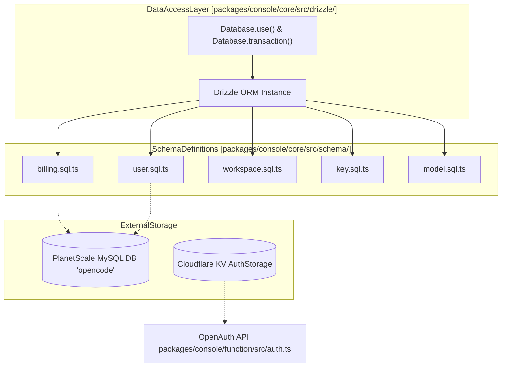
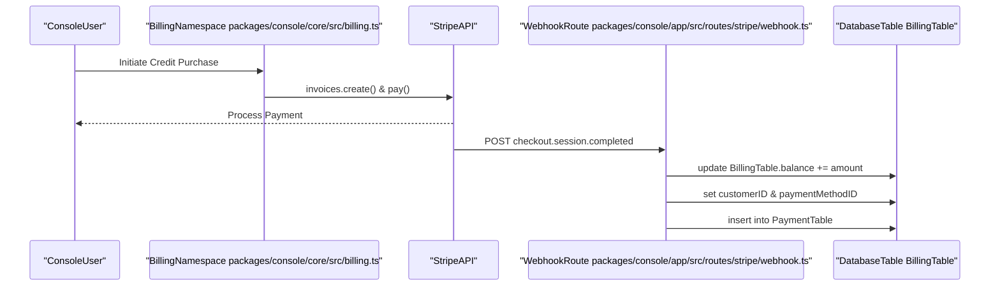

<!-- source: DeepWiki mcp.deepwiki.com · repo sst/opencode · page 8.3 Database and Billing Services · fetched 2026-10-27 -->

# Database and Billing Services

Relevant source files

The following files were used as context for generating this wiki page:

- [infra/console.ts](infra/console.ts)
- [packages/console/app/src/routes/stripe/webhook.ts](packages/console/app/src/routes/stripe/webhook.ts)
- [packages/console/app/src/routes/workspace-picker.tsx](packages/console/app/src/routes/workspace-picker.tsx)
- [packages/console/app/src/routes/workspace/[id]/billing/black-section.module.css](packages/console/app/src/routes/workspace/[id]/billing/black-section.module.css)
- [packages/console/app/src/routes/workspace/[id]/billing/black-section.tsx](packages/console/app/src/routes/workspace/[id]/billing/black-section.tsx)
- [packages/console/app/src/routes/workspace/[id]/billing/black-waitlist-section.module.css](packages/console/app/src/routes/workspace/[id]/billing/black-waitlist-section.module.css)
- [packages/console/app/src/routes/workspace/[id]/billing/index.tsx](packages/console/app/src/routes/workspace/[id]/billing/index.tsx)
- [packages/console/app/src/routes/workspace/[id]/billing/payment-section.module.css](packages/console/app/src/routes/workspace/[id]/billing/payment-section.module.css)
- [packages/console/app/src/routes/workspace/common.tsx](packages/console/app/src/routes/workspace/common.tsx)
- [packages/console/core/script/black-cancel-waitlist.ts](packages/console/core/script/black-cancel-waitlist.ts)
- [packages/console/core/script/black-transfer.ts](packages/console/core/script/black-transfer.ts)
- [packages/console/core/script/credit-workspace.ts](packages/console/core/script/credit-workspace.ts)
- [packages/console/core/script/lookup-user.ts](packages/console/core/script/lookup-user.ts)
- [packages/console/core/script/promote-models.ts](packages/console/core/script/promote-models.ts)
- [packages/console/core/script/pull-models.ts](packages/console/core/script/pull-models.ts)
- [packages/console/core/script/update-models.ts](packages/console/core/script/update-models.ts)
- [packages/console/core/src/billing.ts](packages/console/core/src/billing.ts)
- [packages/console/core/src/black.ts](packages/console/core/src/black.ts)
- [packages/console/core/src/lite.ts](packages/console/core/src/lite.ts)
- [packages/console/core/src/model.ts](packages/console/core/src/model.ts)
- [packages/console/core/src/provider.ts](packages/console/core/src/provider.ts)
- [packages/console/core/src/schema/billing.sql.ts](packages/console/core/src/schema/billing.sql.ts)
- [packages/console/core/sst-env.d.ts](packages/console/core/sst-env.d.ts)
- [packages/console/function/sst-env.d.ts](packages/console/function/sst-env.d.ts)
- [packages/console/resource/sst-env.d.ts](packages/console/resource/sst-env.d.ts)
- [packages/enterprise/sst-env.d.ts](packages/enterprise/sst-env.d.ts)
- [packages/function/sst-env.d.ts](packages/function/sst-env.d.ts)
- [sst-env.d.ts](sst-env.d.ts)

## Purpose and Scope

This document details the database architecture, schema definitions, and business logic services within the `@opencode-ai/console-core` package. This package provides the data persistence layer for the OpenCode Console, managing workspace isolation, user authentication via OpenAuth, and complex billing workflows integrated with Stripe.

The console services utilize **Drizzle ORM** for type-safe database operations, specifically targeting MySQL (via PlanetScale) for production and supporting local development workflows.

Sources: `[packages/console/core/src/billing.ts:1-13]()`, `[packages/console/core/src/drizzle/index.js:1-3]()`, `[infra/console.ts:11-34]()`

---

## Database Architecture and Drizzle ORM

OpenCode uses a centralized MySQL database managed through Drizzle ORM. The architecture emphasizes workspace isolation and auditability for billing and usage.

### Database Connection and Driver

The system uses the `Database` utility, which provides a transaction-aware wrapper around the Drizzle instance. It utilizes `mysql-core` for schema definitions and `Database.use()` for executing queries within a managed context. In production, the database is hosted on PlanetScale, with connection details linked via SST `[infra/console.ts:36-44]()`.

### Code-to-Entity Mapping: Data Access

This diagram maps the natural language concept of "Data Access" to specific code entities and files, bridging natural language space to code entity space.

Sources: `[packages/console/core/src/billing.ts:2-3]()`, `[infra/console.ts:11-34]()`, `[infra/console.ts:62-68]()`, `[packages/console/core/src/schema/billing.sql.ts:1-12]()`

---

## Core Schema Definitions

The schema is partitioned into functional modules, with a heavy focus on multi-tenancy via `workspaceColumns`.

### 1. Billing and Usage
The billing system tracks balances in **micro-cents** (1/100,000,000 of a dollar) to prevent rounding errors during high-volume token usage calculations `[packages/console/core/src/billing.ts:138]()`.

| Table | Entity Name | Purpose |
|-------|-------------|---------|
| `BillingTable` | `billing` | Stores workspace balance, Stripe customer IDs, auto-reload settings, and subscription metadata. `[packages/console/core/src/schema/billing.sql.ts:17-57]()` |
| `UsageTable` | `usage` | Detailed logs of LLM token consumption including input, output, reasoning, and cache tokens. `[packages/console/core/src/schema/billing.sql.ts:113-134]()` |
| `PaymentTable` | `payment` | History of credits granted, Stripe payments, and invoice/payment IDs. `[packages/console/core/src/schema/billing.sql.ts:89-111]()` |
| `SubscriptionTable` | `subscription` | Tracks "Black" plan usage (rolling and fixed) for individual users. `[packages/console/core/src/schema/billing.sql.ts:59-71]()` |
| `LiteTable` | `lite` | Tracks "Lite" (Go) plan weekly/monthly usage. `[packages/console/core/src/schema/billing.sql.ts:73-87]()` |
| `CouponTable` | `coupon` | Stores redeemed coupon codes and their types. `[packages/console/core/src/schema/billing.sql.ts:146-154]()` |

Sources: `[packages/console/core/src/schema/billing.sql.ts:17-154]()`, `[packages/console/core/src/billing.ts:138]()`

### 2. Identity and Model Configuration
Identity is managed through a link between an account and a `workspaceID`. Additionally, workspaces can selectively disable specific AI models.

| Table | Entity Name | Purpose |
|-------|-------------|---------|
| `WorkspaceTable` | `workspace` | The primary tenant container. `[packages/console/core/script/lookup-user.ts:12]()` |
| `UserTable` | `user` | Links an account to a workspace with a specific role. `[packages/console/core/script/lookup-user.ts:3]()` |
| `KeyTable` | `key` | Stores API keys for accessing Zen/Go services. `[packages/console/core/script/lookup-user.ts:13]()` |
| `ModelTable` | `model` | Tracks disabled models for a specific workspace. `[packages/console/core/script/lookup-user.ts:17]()` |
| `AuthTable` | `auth` | Stores authentication records for users. `[packages/console/core/script/lookup-user.ts:3]()` |

Sources: `[packages/console/core/script/lookup-user.ts:3-17]()`, `[packages/console/core/src/model.ts:4-5]()`

---

## Service Logic: Billing and Stripe

The `Billing` namespace handles the intersection of database state and Stripe's external API.

### Credit Reload and Checkout Flow
OpenCode implements an "auto-reload" system where credits are automatically purchased when a workspace balance falls below a threshold (default $5) `[packages/console/core/src/billing.ts:27-28]()`.

### Code-to-Entity Mapping: Billing Flow

This diagram associates system behaviors with specific functions in the `Billing` namespace and the Stripe webhook route, bridging high-level billing events to code paths.

Sources: `[packages/console/core/src/billing.ts:75-121]()`, `[packages/console/app/src/routes/stripe/webhook.ts:46-107]()`

**Key Functions:**
- `Billing.reload()`: Finalizes a Stripe invoice and pays it using the saved `paymentMethodID`. It calculates the `amountInCents` based on `reloadAmount` (default $20) `[packages/console/core/src/billing.ts:75-121]()`.
- `Billing.calculateFeeInCents()`: Calculates the processing fee to pass on Stripe's 4.4% + $0.30 cost `[packages/console/core/src/billing.ts:68-73]()`.
- `Billing.grantCredit()`: Atomically updates balance and inserts a record into `PaymentTable` with `enrichment.type: "credit"` `[packages/console/core/src/billing.ts:137-156]()`.
- `Billing.redeemCoupon()`: Handles promotional codes like `GO1MONTH50` or `BUILDATHON` `[packages/console/core/src/billing.ts:178-206]()`.
- `Billing.subtractLiteUsage()`: Decrements usage for Lite (Go) plans, ensuring usage doesn't go below zero `[packages/console/core/src/billing.ts:158-176]()`.

**Webhook Handling:**
The `POST` handler in `packages/console/app/src/routes/stripe/webhook.ts` processes Stripe events:
- `checkout.session.completed`: Updates `BillingTable.balance` and creates a `PaymentTable` record `[packages/console/app/src/routes/stripe/webhook.ts:46-107]()`.
- `customer.subscription.created`: Handles "Lite" (Go) plan subscriptions, creating records in `LiteTable` `[packages/console/app/src/routes/stripe/webhook.ts:108-163]()`.
- `customer.updated`: Monitors for changes in default payment methods to sync `paymentMethodID` in `BillingTable` `[packages/console/app/src/routes/stripe/webhook.ts:23-45]()`.

Sources: `[packages/console/core/src/billing.ts:68-222]()`, `[packages/console/app/src/routes/stripe/webhook.ts:14-163]()`

---

## Managed Services: Zen and Go

OpenCode provides managed model access through "Zen" (pay-as-you-go) and "Go" (subscription) services.

### Zen Model Configuration
The `ZenData` namespace manages the curation of models available through OpenCode's managed proxy. These models are defined in a split JSON structure across multiple SST secrets (`ZEN_MODELS1` to `ZEN_MODELS30`) `[packages/console/core/src/model.ts:78-109]()`.

- **Model Normalization**: The `ZenData.list()` function parses these secrets, normalizes provider priorities and weights, and identifies trial providers `[packages/console/core/src/model.ts:111-177]()`.
- **Pricing**: Pricing is defined via Zod schemas, tracking input/output costs and cache-specific costs (e.g., `cacheRead`, `cacheWrite5m`) `[packages/console/core/src/model.ts:14-20]()`.

### Subscription Plans
OpenCode uses Stripe products to manage subscription tiers:
- **OpenCode Go (Lite)**: $10/month `[infra/console.ts:142-150]()`.
- **OpenCode Black**: Tiers at $20, $100, and $200 `[infra/console.ts:175-185]()`.

Sources: `[packages/console/core/src/model.ts:10-178]()`, `[infra/console.ts:106-185]()`

---

## User and Workspace Management

The `User` and `Workspace` namespaces provide operations for managing tenants and members.

- **Model Control**: Admins can use `Model.disable()` and `Model.enable()` to control which Zen models are available within their workspace `[packages/console/core/src/model.ts:181-204]()`.
- **Actor Context**: Business logic is typically wrapped in `Actor.provide` to ensure operations are performed within the correct workspace context `[packages/console/app/src/routes/stripe/webhook.ts:59-106]()`.

Sources: `[packages/console/core/src/model.ts:180-204]()`, `[packages/console/app/src/routes/stripe/webhook.ts:59-106]()`

---

