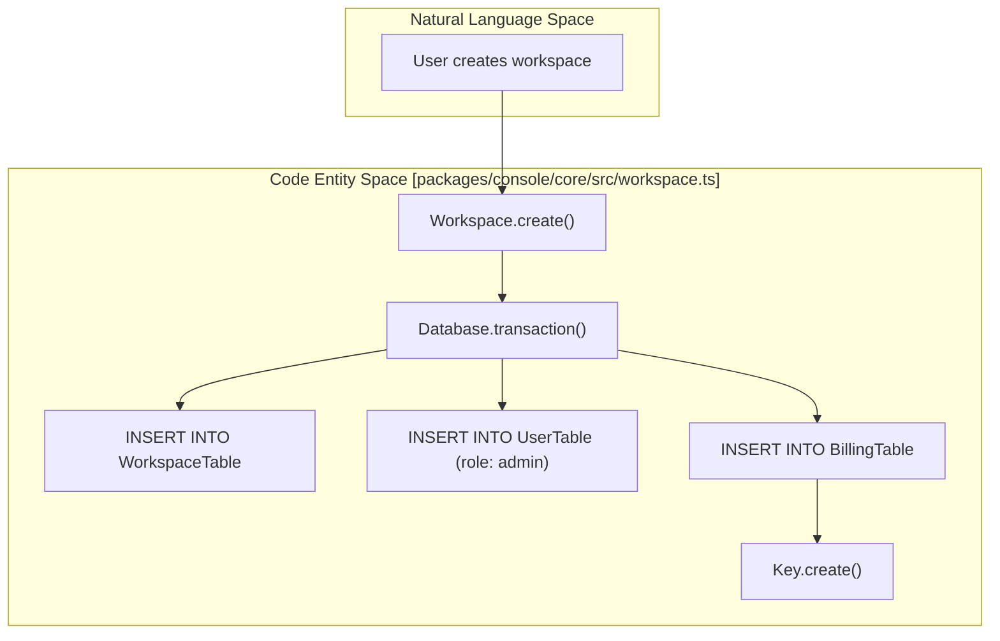
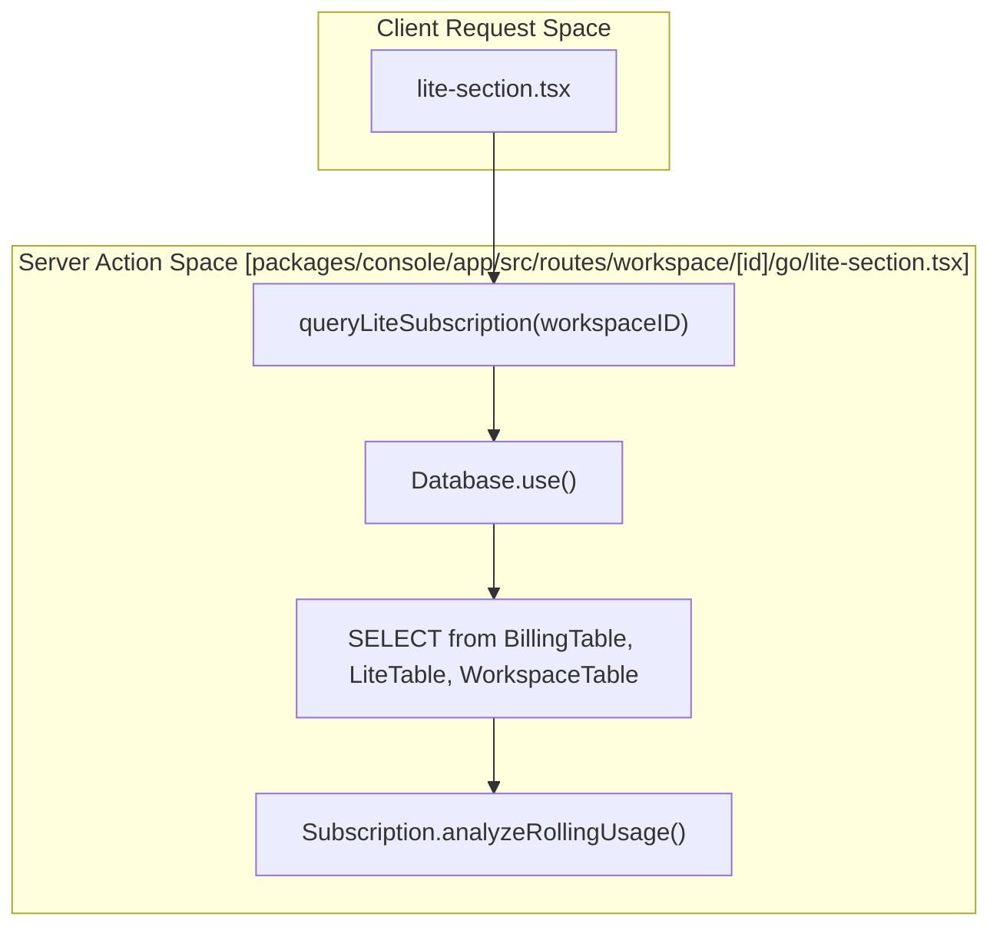
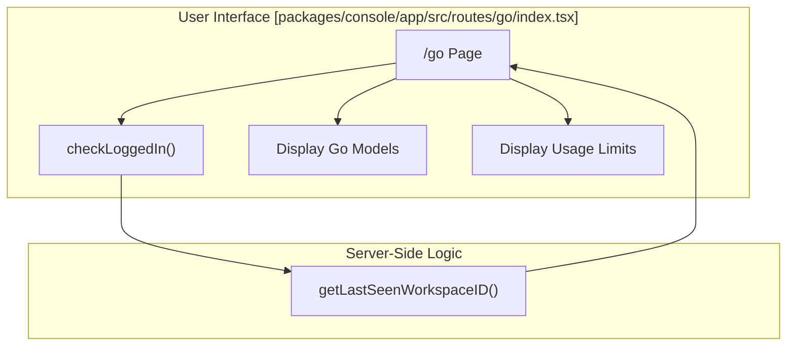
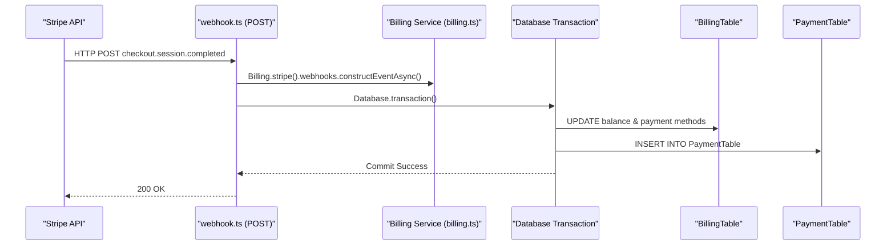
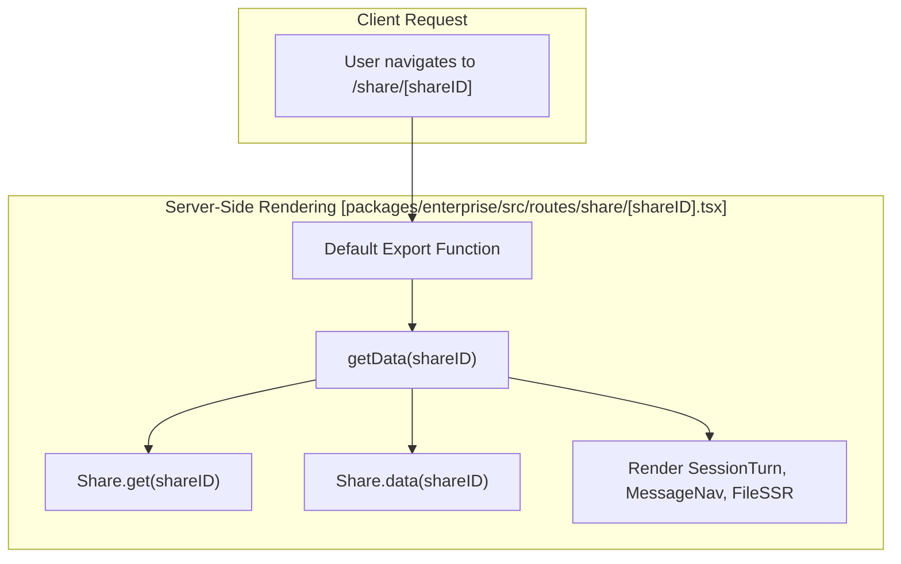
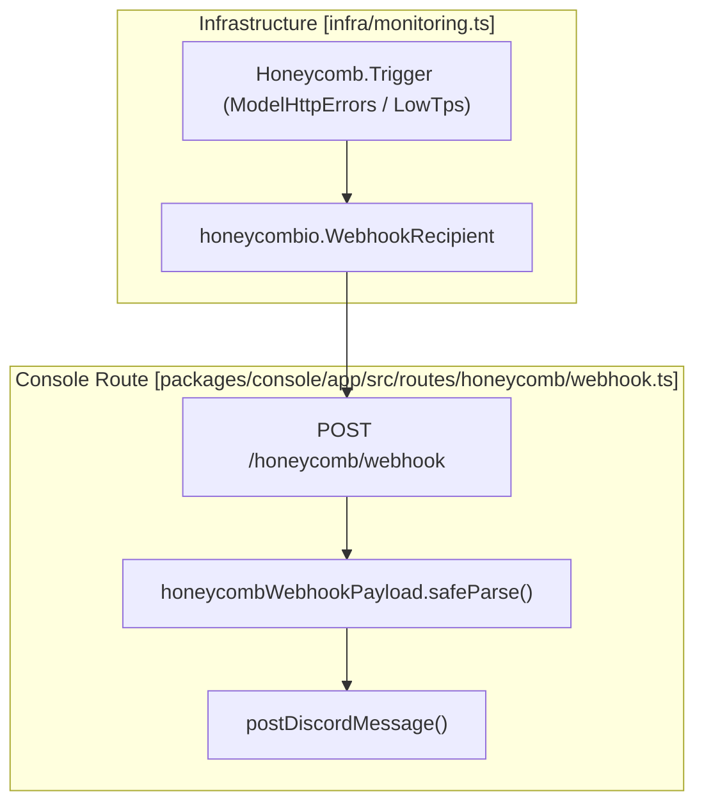

<!-- source: DeepWiki mcp.deepwiki.com · repo sst/opencode · page 8.4 Enterprise Features · fetched 2026-10-27 -->

# Enterprise Features

Relevant source files

The following files were used as context for generating this wiki page:

- [packages/console/app/src/i18n/en.ts](packages/console/app/src/i18n/en.ts)
- [packages/console/app/src/routes/go/index.css](packages/console/app/src/routes/go/index.css)
- [packages/console/app/src/routes/go/index.tsx](packages/console/app/src/routes/go/index.tsx)
- [packages/console/app/src/routes/workspace/[id]/go/lite-section.tsx](packages/console/app/src/routes/workspace/[id]/go/lite-section.tsx)
- [packages/enterprise/src/routes/share/[shareID].tsx](packages/enterprise/src/routes/share/[shareID].tsx)

## Purpose and Scope

This document details the enterprise-grade capabilities of the OpenCode platform, focusing on multi-tenant team workspaces, role-based access control (RBAC), the Lite/Go workspace tier, billing infrastructure with Stripe webhooks, Bring Your Own Key (BYOK) managed configurations, and session sharing. These features are implemented primarily across `packages/enterprise`, `packages/console/core`, `packages/console/app`, and `infra/`.

---

## 1. Workspace and Team Management

OpenCode utilizes a multi-tenant workspace architecture where users belong to one or more isolated workspaces. Workspaces enforce resource boundaries, regional routing, and billing limits.

### Workspace Data Model
The database schema defines workspace relationships through the following primary entities:
- **`WorkspaceTable`**: The root configuration for a team or organization, storing regional availability (`region`), training allowances (`allow_training`), and block status (`packages/console/core/src/schema/workspace.sql.ts:4-19`) [packages/console/core/src/schema/workspace.sql.ts:4-19]().
- **`UserTable`**: Links user accounts to workspaces, assigning administrative or member roles (`packages/console/core/src/schema/user.sql.ts`) [packages/console/core/src/workspace.ts:37-43]().
- **`BillingTable`**: Maintains financial state, customer identifiers, payment methods, and balance thresholds (`packages/console/core/src/schema/billing.sql.ts:17-58`) [packages/console/core/src/schema/billing.sql.ts:17-58]().

### Workspace Creation Lifecycle
The `Workspace.create` function initializes a new workspace within a database transaction, setting up the root workspace entry, linking the creator as an `admin` user via `UserTable`, and creating a default billing record (`packages/console/core/src/workspace.ts:17-59`) [packages/console/core/src/workspace.ts:17-59]().

**Sources:** [packages/console/core/src/schema/workspace.sql.ts:4-19](), [packages/console/core/src/workspace.ts:17-59]()

---

## 2. Role-Based Access Control (RBAC)

Workspace access is governed by the `Actor` authorization system. Privileged actions such as updating regional settings (`Workspace.update`) or unblocking workspaces require explicit admin validation (`Actor.assertAdmin()`) [packages/console/core/src/workspace.ts:61-81]().

| Role | Capabilities & Constraints | Code Reference |
|------|----------------------------|----------------|
| **Admin** | Manage billing settings, configure reload triggers, update region policy, invite members, modify workspace name. | [packages/console/core/src/workspace.ts:61-81]() |
| **Member** | Access workspace AI inference models, execute coding sessions within allowed usage thresholds. | [packages/console/core/src/schema/user.sql.ts]() |

**Sources:** [packages/console/core/src/workspace.ts:61-81](), [packages/console/core/src/schema/user.sql.ts]()

---

## 3. Lite/Go Workspace Sections and Usage Tracking

The Lite (or "Go") workspace tier provides structured usage limits across rolling, weekly, and monthly evaluation windows.

### Lite Subscription Query Engine
The `queryLiteSubscription` function calculates current usage against configured thresholds by joining `BillingTable`, `LiteTable`, and `WorkspaceTable` [packages/console/app/src/routes/workspace/[id]/go/lite-section.tsx:34-116](). It normalizes usage through analysis helpers in `Subscription` [packages/console/app/src/routes/workspace/[id]/go/lite-section.tsx:72-88]().

**Sources:** [packages/console/app/src/routes/workspace/[id]/go/lite-section.tsx:34-116]()

### Go Landing Page
The `/go` route in the console application (`packages/console/app/src/routes/go/index.tsx`) [packages/console/app/src/routes/go/index.tsx:63-394]() serves as the landing page for the Go service. It displays information about available models, usage limits, and provides a call to action for users to subscribe. The page dynamically checks if a user is logged in and has an active workspace via `checkLoggedIn()` [packages/console/app/src/routes/go/index.tsx:22-25]().

The `models` array [packages/console/app/src/routes/go/index.tsx:27-61]() lists various LLM models available through the Go service, along with their training data usage and retention policies.

**Sources:** [packages/console/app/src/routes/go/index.tsx:22-25](), [packages/console/app/src/routes/go/index.tsx:27-61](), [packages/console/app/src/routes/go/index.tsx:63-394]()

---

## 4. Billing, Stripe Integration, and Coupons

Billing operations are handled by the `Billing` namespace interacting with Stripe APIs and the MySQL database layer.

### Stripe Webhook Pipeline
Stripe webhook events (such as checkout completion, subscription creation, and customer updates) are processed at `packages/console/app/src/routes/stripe/webhook.ts` [packages/console/app/src/routes/stripe/webhook.ts:14-153](). These webhooks update balances, record payment intents in `PaymentTable`, and provision subscription IDs in `BillingTable`.

### Automatic Reload and Credits
- **Automatic Reload (`Billing.reload`)**: Automatically bills the default payment method when balances fall below threshold triggers, generating Stripe invoices and processing items for `opencode credits` and `processing fee` [packages/console/core/src/billing.ts:75-135]().
- **Coupon Redemption (`Billing.redeemCoupon`)**: Validates and redeems promotional coupons (e.g., `BUILDATHON`), applying promotional dollar amounts to workspace balances [packages/console/core/src/billing.ts:178-202]().

**Sources:** [packages/console/core/src/billing.ts:75-135](), [packages/console/app/src/routes/stripe/webhook.ts:14-153](), [packages/console/core/src/schema/billing.sql.ts:17-58]()

---

## 5. Managed Configurations and BYOK

Enterprise workspaces support two configuration models for LLM inference:
1. **Managed Service (Zen/Go)**: Curated high-performance or open models routed via the console gateway with token bucket limits and workspace-level usage accounting.
2. **Bring Your Own Key (BYOK)**: Workspace members supply direct API keys for third-party providers (Anthropic, OpenAI, etc.), bypassing console metering while utilizing core agentic loops.

**Sources:** [packages/console/core/src/schema/billing.sql.ts:114-136](), [packages/console/core/src/billing.ts:35-43]()

---

## 6. Session Sharing Service

The `packages/enterprise` package implements secure session sharing, allowing users to publish session snapshots via unique URLs.

### Share Lifecycle
- **`Share.create`**: Generates a share ID and secret key, slicing the trailing 8 characters of the `sessionID` [packages/enterprise/src/core/share.ts:117-128]().
- **`Share.sync`**: Merges new session components (`session`, `message`, `part`, `session_diff`) into an existing snapshot using deduplication algorithms [packages/enterprise/src/core/share.ts:156-168]().
- **Storage Backend**: Snapshots are persisted to Cloudflare R2 storage using the generic `Storage` wrapper configured via environment bindings [infra/enterprise.ts:4-17]().

### Enterprise Share Viewer
The `packages/enterprise/src/routes/share/[shareID].tsx` [packages/enterprise/src/routes/share/[shareID].tsx:58-122]() route handles the display of shared sessions. It fetches session data using `Share.get` and `Share.data` and renders the session turns, messages, and file diffs. The viewer includes error handling for missing session data (`SessionDataMissingError`) [packages/enterprise/src/routes/share/[shareID].tsx:35-56]().

**Sources:** [packages/enterprise/src/core/share.ts:18-40](), [packages/enterprise/src/core/share.ts:117-168](), [infra/enterprise.ts:4-17](), [packages/enterprise/src/routes/share/[shareID].tsx:35-56](), [packages/enterprise/src/routes/share/[shareID].tsx:58-122]()

---

## 7. Infrastructure, Monitoring, and Deployment

Enterprise services are deployed as cloud applications using SST and Cloudflare Workers.

### Monitoring and Alerting
System observability is managed via Honeycomb triggers and webhooks defined in `infra/monitoring.ts` [infra/monitoring.ts:1-224]() and processed by the webhook router at `packages/console/app/src/routes/honeycomb/webhook.ts` [packages/console/app/src/routes/honeycomb/webhook.ts:77-105](). These monitor model HTTP error rates and low token-per-second (TPS) anomalies, forwarding alerts to incident channels.

**Sources:** [infra/monitoring.ts:1-224](), [packages/console/app/src/routes/honeycomb/webhook.ts:77-105](), [sst.config.ts:30-53]()

---

