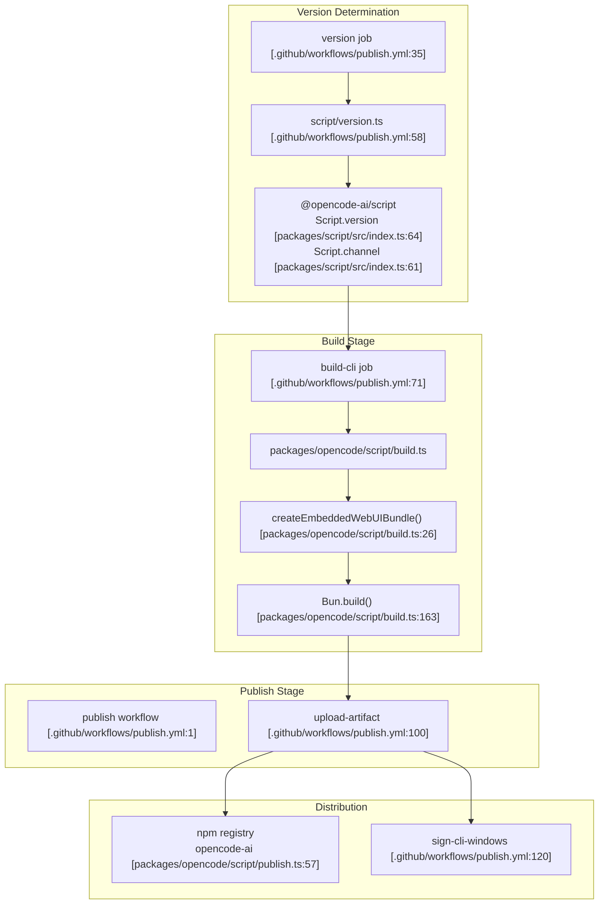
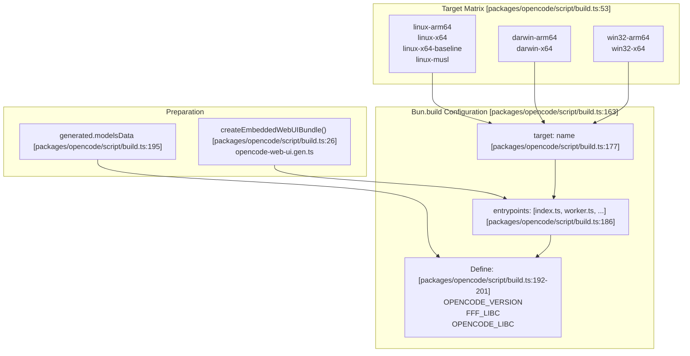

<!-- source: DeepWiki mcp.deepwiki.com · repo sst/opencode · page 9 Infrastructure and Deployment · fetched 2026-10-27 -->

# Infrastructure and Deployment

Relevant source files

The following files were used as context for generating this wiki page:

- [.github/workflows/publish.yml](.github/workflows/publish.yml)
- [.gitignore](.gitignore)
- [.opencode/command/changelog.md](.opencode/command/changelog.md)
- [packages/desktop/scripts/finalize-latest-json.ts](packages/desktop/scripts/finalize-latest-json.ts)
- [packages/docs/openapi.json](packages/docs/openapi.json)
- [packages/opencode/script/build.ts](packages/opencode/script/build.ts)
- [packages/opencode/script/publish.ts](packages/opencode/script/publish.ts)
- [packages/opencode/src/cli/cmd/generate.ts](packages/opencode/src/cli/cmd/generate.ts)
- [packages/plugin/script/publish.ts](packages/plugin/script/publish.ts)
- [packages/script/package.json](packages/script/package.json)
- [packages/script/src/index.ts](packages/script/src/index.ts)
- [packages/sdk/js/script/build.ts](packages/sdk/js/script/build.ts)
- [packages/sdk/js/script/publish.ts](packages/sdk/js/script/publish.ts)
- [packages/sdk/js/src/v2/gen/client/types.gen.ts](packages/sdk/js/src/v2/gen/client/types.gen.ts)
- [packages/sdk/js/tsconfig.json](packages/sdk/js/tsconfig.json)
- [script/changelog.ts](script/changelog.ts)
- [script/publish.ts](script/publish.ts)
- [script/raw-changelog.ts](script/raw-changelog.ts)
- [script/version.ts](script/version.ts)

This document provides an overview of OpenCode's build system, release pipeline, and deployment infrastructure. It covers how the monorepo is structured for builds, how releases are versioned and published across multiple distribution channels, and how artifacts are created for different platforms.

For details on package interdependencies and workspace configuration, see [Build System and Monorepo](#9.1). For comprehensive information about the release automation workflow, see [Release Pipeline](#9.2). For platform-specific binary compilation details, see [Nix Packaging and Platform Builds](#9.4). For cloud infrastructure deployment, see [Cloud Infrastructure (SST)](#9.5).

## Build and Release Architecture

The OpenCode infrastructure is built around a multi-stage pipeline that transforms TypeScript source into platform-specific binaries and distributes them through multiple channels. The system uses Bun for compilation, GitHub Actions for CI/CD orchestration, and automated publishing to npm, Docker, GitHub Releases, AUR, and Homebrew.

**Infrastructure to Code Mapping**

Sources: [.github/workflows/publish.yml:1-110](), [packages/opencode/script/build.ts:26-233](), [packages/script/src/index.ts:60-76]()

## Version and Channel Management

The release process relies on environment variables and the `Script` utility to determine the target version and distribution channel. The `publish.yml` workflow orchestrates these variables across different build steps.

| Component | Usage in Code | Description |
|-----------|---------------|-------------|
| `OPENCODE_VERSION` | `Script.version [packages/script/src/index.ts:64]` | The semantic version being built. |
| `OPENCODE_CHANNEL` | `Script.channel [packages/script/src/index.ts:61]` | The distribution channel (e.g., `latest`, `beta`, `dev`). |
| `OPENCODE_BUMP` | `inputs.bump [.github/workflows/publish.yml:61]` | Trigger for major, minor, or patch increments. |

**Channel Determination:**
The channel is derived from the `OPENCODE_CHANNEL` environment variable or the current git branch name [packages/script/src/index.ts:26-31](). Pushes to the `beta` branch trigger builds with the `--sourcemaps` flag and target the `opencode-beta` repository [.github/workflows/publish.yml:64-92]().

For details on version computation, changelog generation, and beta automation, see [Release Pipeline](#9.2).

Sources: [.github/workflows/publish.yml:1-64](), [packages/script/src/index.ts:20-48]()

## Build Targets and Platforms

The CLI build system in `packages/opencode/script/build.ts` compiles native binaries using `Bun.build` with the `compile` option [packages/opencode/script/build.ts:172-181](). The `allTargets` array defines platform, architecture, and ABI combinations [packages/opencode/script/build.ts:53-114]().

**Build Process Logic**

**Target Matrix (Selection):**

| Platform | Arch | ABI | AVX2 | Target Name |
|----------|------|-----|------|--------------|
| linux | arm64 | glibc | yes | `opencode-linux-arm64` [packages/opencode/script/build.ts:60-62]() |
| linux | x64 | glibc | no | `opencode-linux-x64-baseline` [packages/opencode/script/build.ts:68-71]() |
| linux | x64 | musl | yes | `opencode-linux-x64-musl` [packages/opencode/script/build.ts:78-81]() |
| darwin | arm64 | - | yes | `opencode-darwin-arm64` [packages/opencode/script/build.ts:89-91]() |
| win32 | x64 | - | yes | `opencode-windows-x64` [packages/opencode/script/build.ts:107-109]() |

For comprehensive cross-compilation and platform-specific packaging details, see [Nix Packaging and Platform Builds](#9.4).

Sources: [packages/opencode/script/build.ts:26-114](), [packages/opencode/script/build.ts:163-202]()

## CI/CD Pipeline Structure

The release process is orchestrated through GitHub Actions, primarily the `publish.yml` workflow.

**Key Jobs:**

| Job | Runner | Purpose |
|-----|--------|---------|
| `version` | blacksmith-4vcpu-ubuntu-2404 | Runs `./script/version.ts` to compute the next release version [.github/workflows/publish.yml:35-58](). |
| `build-cli` | blacksmith-4vcpu-ubuntu-2404 | Executes `packages/opencode/script/build.ts` to compile binaries [.github/workflows/publish.yml:71-93](). |
| `sign-cli-windows` | blacksmith-4vcpu-windows-2025 | Uses Azure Trusted Signing to sign `.exe` binaries [.github/workflows/publish.yml:120-174](). |

For full workflow details, see [Release Pipeline](#9.2).

Sources: [.github/workflows/publish.yml:1-174]()

## Distribution Channels

OpenCode publishes artifacts to multiple distribution channels, including npm (`opencode-ai`), Docker/GHCR (`ghcr.io/anomalyco/opencode`), Homebrew formulas, AUR packages (`opencode-bin`), VSCode marketplace extensions, and GitHub Releases.

The `packages/opencode/script/publish.ts` script handles the publishing of the `opencode-ai` npm package, which acts as a wrapper for platform-specific binaries [packages/opencode/script/publish.ts:54-73](). It also manages Docker image builds and pushes to GHCR [packages/opencode/script/publish.ts:81-84](), and updates Homebrew formulas and AUR PKGBUILDs with new versions and SHA sums [packages/opencode/script/publish.ts:98-180]().

For implementation details on package publishing, install scripts, and upgrade commands, see [Distribution Channels](#9.3).

Sources: [packages/opencode/script/publish.ts:34-188]()

## Child Pages

- [Build System and Monorepo](#9.1) — Explain Bun workspace setup, Turborepo configuration, container images, and shared tooling scripts.
- [Release Pipeline](#9.2) — Detail the CI/CD workflow: version computation, changelog generation, build orchestration, beta merge automation, and publishing.
- [Distribution Channels](#9.3) — Document publishing to npm, Docker/GHCR, Homebrew, AUR, VSCode marketplace, and GitHub Releases, plus the install script and upgrade command.
- [Nix Packaging and Platform Builds](#9.4) — Detail Nix flake structure, hash management, node_modules canonicalization, desktop packaging, and cross-platform/ABI build variants.
- [Cloud Infrastructure (SST)](#9.5) — Document the infra/ SST configuration: console, stats, enterprise, monitoring stacks, stages, and deploy workflow.
- [Development Workflow and Testing](#9.6) — Guide developers on local setup, test suites (unit, e2e Playwright, snapshot), the http-recorder cassette system for deterministic LLM tests, formatting/generate scripts, repo automation agents in .opencode/, and contribution workflows.
- [Effect Migration Specs](#9.7) — Summarize packages/opencode/specs/effect and specs/v2 design documents guiding the Effect refactor and v2 architecture migration.

---

