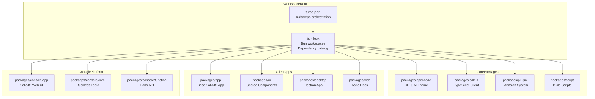
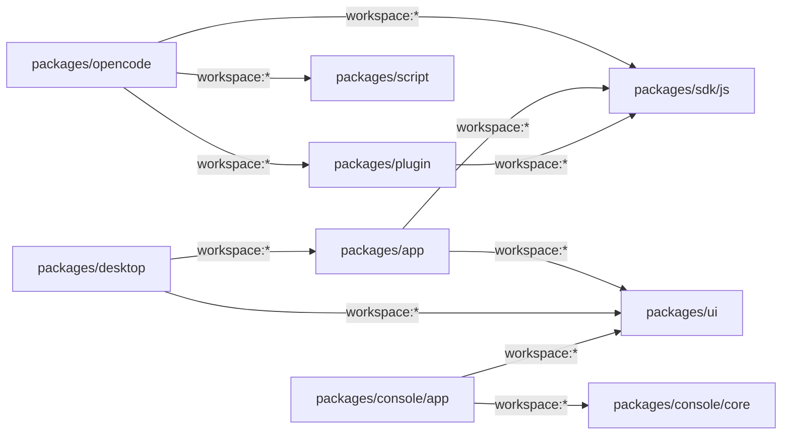
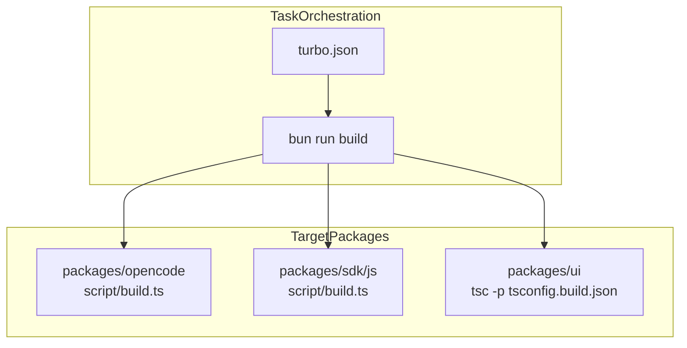
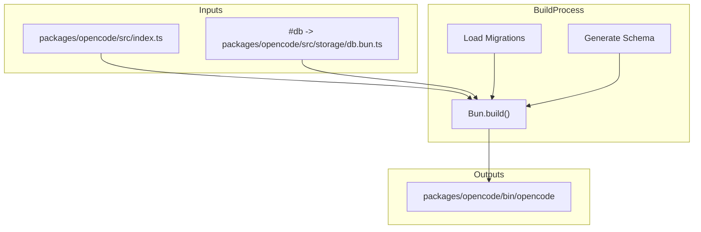
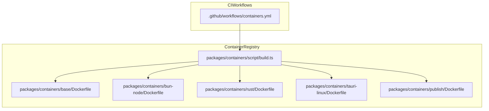

<!-- source: DeepWiki mcp.deepwiki.com · repo sst/opencode · page 9.1 Build System and Monorepo · fetched 2026-10-27 -->

# Build System and Monorepo

Relevant source files

The following files were used as context for generating this wiki page:

- [.github/workflows/containers.yml](.github/workflows/containers.yml)
- [.github/workflows/test.yml](.github/workflows/test.yml)
- [bun.lock](bun.lock)
- [install](install)
- [package.json](package.json)
- [packages/app/playwright.config.ts](packages/app/playwright.config.ts)
- [packages/console/app/package.json](packages/console/app/package.json)
- [packages/console/core/package.json](packages/console/core/package.json)
- [packages/console/function/package.json](packages/console/function/package.json)
- [packages/console/mail/package.json](packages/console/mail/package.json)
- [packages/containers/README.md](packages/containers/README.md)
- [packages/containers/base/Dockerfile](packages/containers/base/Dockerfile)
- [packages/containers/bun-node/Dockerfile](packages/containers/bun-node/Dockerfile)
- [packages/containers/publish/Dockerfile](packages/containers/publish/Dockerfile)
- [packages/containers/rust/Dockerfile](packages/containers/rust/Dockerfile)
- [packages/containers/script/build.ts](packages/containers/script/build.ts)
- [packages/containers/tauri-linux/Dockerfile](packages/containers/tauri-linux/Dockerfile)
- [packages/containers/tsconfig.json](packages/containers/tsconfig.json)
- [packages/desktop/package.json](packages/desktop/package.json)
- [packages/enterprise/package.json](packages/enterprise/package.json)
- [packages/function/package.json](packages/function/package.json)
- [packages/function/src/api.ts](packages/function/src/api.ts)
- [packages/function/src/github.ts](packages/function/src/github.ts)
- [packages/function/test/github.test.ts](packages/function/test/github.test.ts)
- [packages/opencode/bin/opencode](packages/opencode/bin/opencode)
- [packages/opencode/package.json](packages/opencode/package.json)
- [packages/opencode/script/postinstall.mjs](packages/opencode/script/postinstall.mjs)
- [packages/opencode/src/cli/cmd/debug/agent.handler.ts](packages/opencode/src/cli/cmd/debug/agent.handler.ts)
- [packages/opencode/src/cli/cmd/github.handler.ts](packages/opencode/src/cli/cmd/github.handler.ts)
- [packages/opencode/src/cli/cmd/github.shared.ts](packages/opencode/src/cli/cmd/github.shared.ts)
- [packages/plugin/package.json](packages/plugin/package.json)
- [packages/sdk/js/package.json](packages/sdk/js/package.json)
- [packages/slack/package.json](packages/slack/package.json)
- [packages/ui/package.json](packages/ui/package.json)
- [packages/web/package.json](packages/web/package.json)
- [script/upgrade-opentui.ts](script/upgrade-opentui.ts)
- [turbo.json](turbo.json)

This document describes OpenCode's monorepo structure, build system configuration, Turborepo task orchestration, container image pipelines, and shared tooling scripts used to compile and package across multiple target platforms.

---

## Monorepo Organization

OpenCode uses a Bun-based monorepo with workspaces defined in the root configuration [bun.lock:4-210](). The repository is structured into distinct package categories:

**Sources:** [bun.lock:4-210](), [packages/opencode/package.json:88-95](), [packages/app/package.json:40-44]()

---

## Bun Workspaces and Dependency Catalog

The monorepo uses **Bun** as its primary package manager. The root configuration manages workspaces and a centralized dependency versioning system.

### Workspace Configuration

Workspaces are organized into distinct paths:

| Workspace Path | Package Type | Example Packages |
|----------------|--------------|------------------|
| `packages/*` | Core libraries and apps | `opencode`, `app`, `ui`, `desktop`, `web`, `core`, `llm` |
| `packages/console/*` | Console platform components | `console-app`, `console-core`, `console-function` |
| `packages/sdk/js` | SDK packages | `@opencode-ai/sdk` |
| `packages/containers/*` | Container packaging | Base, bun-node, rust, tauri-linux |

**Sources:** [bun.lock:4-210]()

### Dependency Catalog System

OpenCode uses Bun's **catalog** feature to centralize dependency versions. Individual packages reference these using the `catalog:` protocol to ensure version consistency across the monorepo:

- [packages/opencode/package.json:120-121](): `"drizzle-orm": "catalog:"`, `"effect": "catalog:"`
- [packages/sdk/js/package.json:27-31](): `"typescript": "catalog:"`, `"@types/node": "catalog:"`
- [packages/app/package.json:74](): `"solid-js": "catalog:"`
- [packages/console/function/package.json:26](): `"ai": "catalog:"`
- [packages/plugin/package.json:26](): `"effect": "catalog:"`

**Sources:** [bun.lock:13-28](), [packages/opencode/package.json:120-121](), [packages/app/package.json:34-78](), [packages/plugin/package.json:26-27]()

---

## Workspace Dependencies

Packages within the monorepo reference each other using the `workspace:*` protocol, creating a directed acyclic graph (DAG) of dependencies.

**Sources:** [packages/opencode/package.json:89-93](), [packages/app/package.json:40-44](), [packages/desktop/package.json:39-40](), [packages/console/app/package.json:19-22]()

---

## Build Orchestration and Turborepo Configuration

The monorepo uses **Turborepo** (`turbo`) for task caching, dependency graph resolution, and parallel execution [bun.lock:27](). Tasks such as `build`, `typecheck`, and `test` are defined across individual workspace `package.json` files and coordinated centrally.

**Sources:** [bun.lock:27](), [packages/opencode/package.json:14](), [packages/sdk/js/package.json:10](), [packages/ui/package.json:59]()

### CLI Build System

The `opencode` CLI package uses **Bun's compile feature** to produce standalone native binaries. The build is triggered via the `build` script in [packages/opencode/package.json:14](). 

**Key Build Features:**
- **Conditional Imports:** Uses Bun's `imports` field to switch between `bun` and `node` implementations for the database (`#db`) [packages/opencode/package.json:24-30]().
- **Binary Packaging:** The primary binary is defined in the `bin` field [packages/opencode/package.json:18-20]().

**Sources:** [packages/opencode/package.json:8-30]()

---

## Container Images

OpenCode maintains a dedicated set of container configurations under `packages/containers/` for deployment, CI pipelines, and cross-platform builds.

**Container Image Variants:**
- `packages/containers/base/Dockerfile`: Provides the core runtime environment.
- `packages/containers/bun-node/Dockerfile`: Combines Bun and Node.js runtimes [packages/containers/bun-node/Dockerfile]().
- `packages/containers/rust/Dockerfile`: Includes Rust toolchains for native module compilation [packages/containers/rust/Dockerfile]().
- `packages/containers/tauri-linux/Dockerfile`: Configured for Tauri and desktop environment builds on Linux [packages/containers/tauri-linux/Dockerfile]().
- `packages/containers/publish/Dockerfile`: Optimized image for final publishing and distribution [packages/containers/publish/Dockerfile]().
- Orchestrated via `packages/containers/script/build.ts` and GitHub Actions workflow [.github/workflows/containers.yml]().

**Sources:** [.github/workflows/containers.yml](), [packages/containers/base/Dockerfile](), [packages/containers/bun-node/Dockerfile](), [packages/containers/script/build.ts](), [packages/containers/rust/Dockerfile](), [packages/containers/tauri-linux/Dockerfile](), [packages/containers/publish/Dockerfile]()

---

## Shared Tooling Scripts

Shared scripts and automation utilities are located across package-level directories and root scripts. They handle post-install setup, schema generations, httpapi coverage checks, and performance benchmarks.

- **Postinstall Hooks:** [packages/opencode/script/postinstall.mjs]() manages workspace linking and initial environment preparation after dependency installation.
- **API Exercise & Validation:** Scripts such as `test:httpapi` run `script/httpapi-exercise.ts` with coverage, auth, and effect modes [packages/opencode/package.json:11]().
- **Benchmark & Profiling:** `bench:test` and `profile:test` handle test suite performance diagnostics [packages/opencode/package.json:12-13]().

**Sources:** [packages/opencode/package.json:8-17](), [packages/opencode/script/postinstall.mjs]()

---

## SDK and Plugin Build Systems

### SDK Generation

The `@opencode-ai/sdk` package generates its client using `@hey-api/openapi-ts` [packages/sdk/js/package.json:26](). It uses a custom build script [packages/sdk/js/package.json:10]().

**Exports:** [packages/sdk/js/package.json:12-21]()
- `.`: `./src/index.ts`
- `./client`: `./src/client.ts`
- `./v2/client`: `./src/v2/client.ts`
- `./v2/gen/client`: `./src/v2/gen/client/index.ts`
- `./v2/types`: `./src/v2/gen/types.gen.ts`

**Sources:** [packages/sdk/js/package.json:1-36]()

### Plugin System

The `@opencode-ai/plugin` package provides the interface for external tools, supporting Zod-based tools and Effect-based V2 plugins [packages/plugin/package.json:15-18]().

**Sources:** [packages/plugin/package.json:1-54]()

---

## Application and Console Builds

### Desktop (Electron)

The `packages/desktop` package uses **Electron** (version 42.3.3) to wrap the SolidJS `app` [packages/desktop/package.json:51](). It uses `electron-vite` for compilation [packages/desktop/package.json:15-18]() and `electron-builder` for packaging [packages/desktop/package.json:19-22](), including a `native:build` target for native bindings [packages/desktop/package.json:23]().

**Sources:** [packages/desktop/package.json:1-76]()

### UI Component Library

The `@opencode-ai/ui` package contains shared components and styles. It uses a specialized build script to generate Tailwind configurations and V2 component overrides [packages/ui/package.json:59-64]().

**Sources:** [packages/ui/package.json:58-65]()

### Console Platform

The console platform is divided into:
1. **App:** A SolidJS Start application using Nitro and Vite [packages/console/app/package.json:27-35]().
2. **Core:** Business logic and Drizzle ORM setup [packages/console/core/package.json:13-19](). It manages model updates and environment promotions [packages/console/core/package.json:32-36]().
3. **Function:** API handlers for Cloudflare Workers [packages/console/function/package.json:2-29]().

**Sources:** [packages/console/app/package.json:1-48](), [packages/console/core/package.json:1-52](), [packages/console/function/package.json:1-29]()

---

## CI/CD and Release Pipeline

The release process is automated via GitHub Actions:
- **Testing:** Scripts like `test` and `test:httpapi` run `bun test` and exercise API coverage [packages/opencode/package.json:10-11]().
- **Typechecking:** Uses `tsgo --noEmit` across workspace packages [packages/opencode/package.json:9](), [packages/plugin/package.json:8](), [packages/console/app/package.json:7]().
- **Infrastructure:** Uses **SST** for managing cloud resources and deployment stages (dev/production) [bun.lock:26](), [packages/console/core/package.json:26-31]().

**Sources:** [packages/opencode/package.json:8-17](), [packages/console/core/package.json:25-41](), [bun.lock:26-27]()

---

