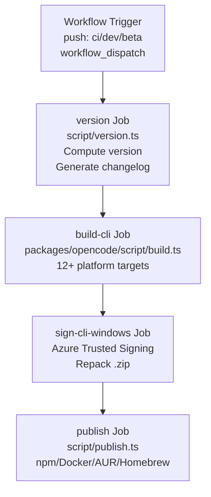
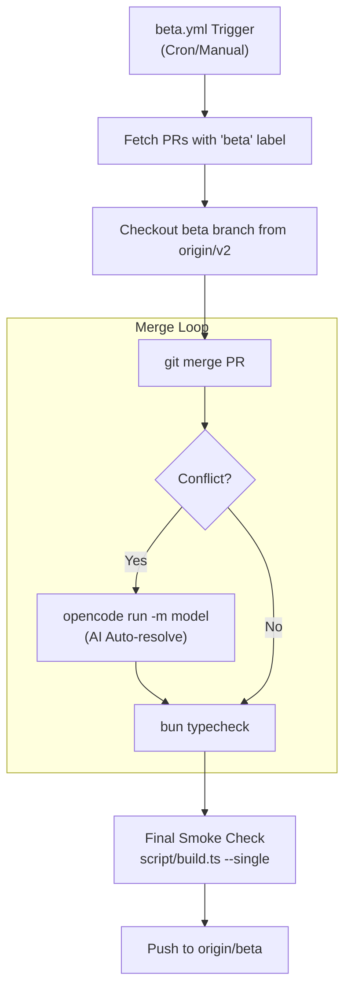

<!-- source: DeepWiki mcp.deepwiki.com · repo sst/opencode · page 9.2 Release Pipeline · fetched 2026-10-27 -->

# Release Pipeline

Relevant source files

The following files were used as context for generating this wiki page:

- [.github/workflows/nix-hashes.yml](.github/workflows/nix-hashes.yml)
- [.github/workflows/publish.yml](.github/workflows/publish.yml)
- [.gitignore](.gitignore)
- [.opencode/command/changelog.md](.opencode/command/changelog.md)
- [flake.lock](flake.lock)
- [flake.nix](flake.nix)
- [nix/desktop.nix](nix/desktop.nix)
- [nix/hashes.json](nix/hashes.json)
- [nix/node_modules.nix](nix/node_modules.nix)
- [nix/opencode.nix](nix/opencode.nix)
- [packages/desktop/scripts/finalize-latest-json.ts](packages/desktop/scripts/finalize-latest-json.ts)
- [packages/docs/openapi.json](packages/docs/openapi.json)
- [packages/opencode/script/build.ts](packages/opencode/script/build.ts)
- [packages/opencode/script/publish.ts](packages/opencode/script/publish.ts)
- [packages/opencode/src/cli/cmd/generate.ts](packages/opencode/src/cli/cmd/generate.ts)
- [packages/plugin/script/publish.ts](packages/plugin/script/publish.ts)
- [packages/script/package.json](packages/script/package.json)
- [packages/script/src/index.ts](packages/script/src/index.ts)
- [packages/sdk/js/script/build.ts](packages/sdk/js/script/build.ts)
- [packages/sdk/js/script/publish.ts](packages/sdk/js/script/publish.ts)
- [packages/sdk/js/src/v2/gen/client/types.gen.ts](packages/sdk/js/src/v2/gen/client/types.gen.ts)
- [packages/sdk/js/tsconfig.json](packages/sdk/js/tsconfig.json)
- [script/beta.ts](script/beta.ts)
- [script/changelog.ts](script/changelog.ts)
- [script/publish.ts](script/publish.ts)
- [script/raw-changelog.ts](script/raw-changelog.ts)
- [script/version.ts](script/version.ts)

## Purpose and Scope

The release pipeline automates version computation, changelog generation, multi-platform builds, and publishing to distribution channels including npm, Docker, Homebrew, and AUR. This pipeline is orchestrated via GitHub Actions and leverages internal scripts to manage the complex task of distributing a native-binary-backed application across multiple architectures and package managers.

For information about the build system itself, see [9.1 Build System and Monorepo](). For details on individual distribution channels, see [9.3 Distribution Channels]().

Sources: [.github/workflows/publish.yml:1-34](), [script/version.ts:1-36]()

---

## Workflow Architecture

The primary release workflow is defined in `.github/workflows/publish.yml` and consists of sequential jobs that coordinate the build and distribution of the CLI and SDKs.

### Job Dependency Graph

**Sources:** [.github/workflows/publish.yml:1-124]()

### Trigger Configuration

The workflow responds to pushes on specific branches and manual dispatches:

| Trigger Type | Branches / Inputs | Behavior |
|--------------|-------------------|----------|
| Push | `ci`, `dev`, `beta`, `fix/npm-native-binary-install`, `snapshot-*` | Automatic preview/channel build [.github/workflows/publish.yml:4-11](). |
| Workflow Dispatch | `bump` (major/minor/patch) | Manual semantic version bump [.github/workflows/publish.yml:13-21](). |
| Workflow Dispatch | `version` (string) | Manual version override [.github/workflows/publish.yml:22-25](). |

**Sources:** [.github/workflows/publish.yml:4-27]()

---

## Version Computation

Version logic is handled by `script/version.ts` and the `Script` utility class in `packages/script/src/index.ts` [packages/script/src/index.ts:60-76](). It determines the version string based on environment variables and the current git context.

### Version Strategy

1. **Override**: If the `OPENCODE_VERSION` environment variable is set, it is used directly [.github/workflows/publish.yml:62](), [packages/script/src/index.ts:35]().
2. **Bump**: If `OPENCODE_BUMP` is provided (major/minor/patch), the script increments the version based on the latest version from the npm registry [packages/script/src/index.ts:37-47]().
3. **Preview/Snapshot**: If the channel is not `latest`, it generates a `0.0.0-channel-timestamp` version string [packages/script/src/index.ts:36]().
4. **Branch Detection**: The workflow detects if it is running on the `beta` branch to adjust the target repository to `anomalyco/opencode-beta` [.github/workflows/publish.yml:64]().

**Sources:** [.github/workflows/publish.yml:56-70](), [packages/script/src/index.ts:26-48]()

---

## Build Orchestration

### CLI Build (`packages/opencode/script/build.ts`)

The CLI build process generates standalone binaries for 12 distinct targets (combinations of Linux, Darwin, Windows, and architectures like x64 and arm64) using `Bun.build` with the `compile` flag [packages/opencode/script/build.ts:53-114](), [packages/opencode/script/build.ts:168-199]().

- **Target Matrix**: Targets include `linux-arm64`, `linux-x64` (with baseline and musl variants), `darwin-arm64`, `darwin-x64`, and `win32` variants [packages/opencode/script/build.ts:53-114]().
- **Embedded Web UI**: Builds the `packages/app` project and embeds its static assets directly into the binary using Bun's `with { type: "file" }` import syntax [packages/opencode/script/build.ts:27-51](), [packages/opencode/script/build.ts:187-188]().
- **Smoke Testing**: If building for the current host platform, the script runs a smoke test by executing `opencode --version` to verify the resulting binary [packages/opencode/script/build.ts:202-212]().
- **Binary Definitions**: Version, channel, and Tree-sitter worker paths are injected via the `define` property [packages/opencode/script/build.ts:189-198]().

**Sources:** [packages/opencode/script/build.ts:1-230]()

### Windows Code Signing

Windows binaries undergo a specialized signing process using Azure Trusted Signing [.github/workflows/publish.yml:120-210]().
1. **Artifact Download**: Downloads unsigned Windows binaries from the `build-cli` job [.github/workflows/publish.yml:136-139]().
2. **Azure Sign**: Executes `azure/artifact-signing-action` for `arm64`, `x64`, and `x64-baseline` executables [.github/workflows/publish.yml:155-173]().
3. **Verification**: Uses PowerShell to ensure the signature status of the executables is valid [.github/workflows/publish.yml:175-189]().
4. **Repack**: Re-archives the signed `.exe` files into target deployment directories [.github/workflows/publish.yml:109-111]().

**Sources:** [.github/workflows/publish.yml:120-210]()

---

## Nix Reproducibility

To maintain reproducible builds via Nix, the pipeline includes a specific workflow for updating fixed-output derivation (FOD) hashes.

### Nix Hash Workflow (`.github/workflows/nix-hashes.yml`)

This workflow computes the `node_modules` hash for four target systems (`x86_64-linux`, `aarch64-linux`, `x86_64-darwin`, `aarch64-darwin`) using native runners [.github/workflows/nix-hashes.yml:27-40]().

1. **Hash Computation**: Runs `nix build ".#packages.${SYSTEM}.node_modules_updater"` to trigger a hash mismatch and extract the correct `sha256` hash [.github/workflows/nix-hashes.yml:62-65]().
2. **Storage**: The resulting hashes are written to `nix/hashes.json` [nix/hashes.json:1-8]().
3. **Consumption**: `nix/node_modules.nix` reads these hashes to validate the `node_modules` derivation [nix/node_modules.nix:6-10]().

**Sources:** [.github/workflows/nix-hashes.yml:1-162](), [nix/hashes.json:1-8](), [nix/node_modules.nix:1-85]()

---

## Publishing and Distribution

The final publishing sequence is coordinated by `script/publish.ts` and `packages/opencode/script/publish.ts`, which trigger package-specific publish scripts and synchronize versions across the monorepo.

### Distribution Tasks

| Channel | Implementation |
|---------|----------------|
| **npm (CLI)** | `packages/opencode/script/publish.ts` publishes the `opencode-ai` wrapper and its platform-specific optional dependencies [packages/opencode/script/publish.ts:54-79](). |
| **npm (SDK/Plugin)** | `packages/sdk/js/script/publish.ts` and `packages/plugin/script/publish.ts` handle their respective publishing logic [script/publish.ts:42-45](). |
| **Docker** | Builds multi-arch images (`linux/amd64`, `linux/arm64`) and pushes to `ghcr.io/anomalyco/opencode` [packages/opencode/script/publish.ts:81-88](). |
| **AUR** | Generates a `PKGBUILD` for `opencode-bin`, calculates SHA256 sums, and pushes to the Arch User Repository [packages/opencode/script/publish.ts:98-144](). |
| **Homebrew** | Generates a Ruby formula for `Opencode < Formula` and pushes it to the tap [packages/opencode/script/publish.ts:147-192](). |
| **GitHub** | Finalizes the release by setting `draft: false` via `gh release edit` [script/publish.ts:69](). |

**Sources:** [script/publish.ts:1-70](), [packages/opencode/script/publish.ts:1-192]()

### Changelog Generation

Changelogs are generated using the `opencode run --command changelog` logic.
1. The script `script/changelog.ts` clears `UPCOMING_CHANGELOG.md` [script/changelog.ts:48]().
2. It spawns an `opencode` process to generate the content based on the diff between the last release and `HEAD` [script/changelog.ts:51-60]().
3. The generated notes are used for the GitHub Release description.

**Sources:** [script/changelog.ts:1-76]()

---

## Beta Branch Synchronization

The `beta` branch is maintained by an automated sync process defined in `script/beta.ts` that merges open PRs labeled `beta` into a fresh branch derived from `v2` [script/beta.ts:220-225]().

### Beta Sync Pipeline

The `script/beta.ts` script automates this process, utilizing `opencode` itself to resolve merge conflicts [script/beta.ts:171-175](). It ensures that the resulting beta branch passes `bun typecheck` [script/beta.ts:77-82]() and a binary build smoke test [script/beta.ts:89-94]() before pushing.

**Sources:** [script/beta.ts:1-243]()

---

