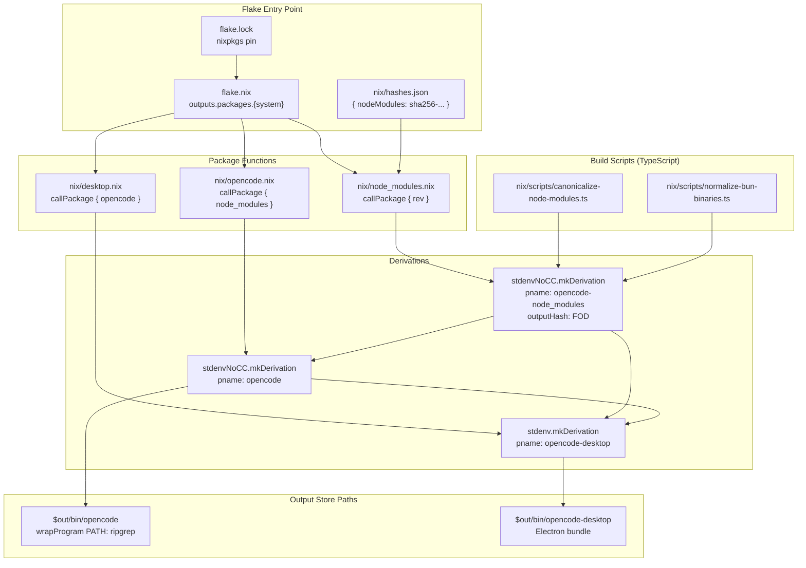
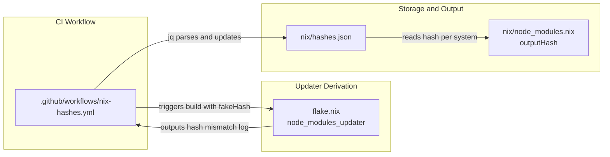

<!-- source: DeepWiki mcp.deepwiki.com · repo sst/opencode · page 9.4 Nix Packaging and Platform Builds · fetched 2026-10-27 -->

# Nix Packaging and Platform Builds

Relevant source files

The following files were used as context for generating this wiki page:

- [.github/workflows/nix-hashes.yml](.github/workflows/nix-hashes.yml)
- [flake.lock](flake.lock)
- [flake.nix](flake.nix)
- [nix/desktop.nix](nix/desktop.nix)
- [nix/hashes.json](nix/hashes.json)
- [nix/node_modules.nix](nix/node_modules.nix)
- [nix/opencode.nix](nix/opencode.nix)
- [script/beta.ts](script/beta.ts)

This document details the Nix-based packaging system for OpenCode, which provides reproducible builds for the CLI and desktop applications across Linux and macOS. The system uses Nix flakes for dependency pinning, Fixed-Output Derivations (FOD) for `node_modules` caching, custom TypeScript scripts for Bun-specific linking and canonicalization, and platform-specific ABI build variants.

## System Architecture

The Nix packaging system is centered around `flake.nix`, which defines the entry point for all derivations [flake.nix:1-73](). It orchestrates the build by calling package functions (`opencode.nix`, `desktop.nix`, `node_modules.nix`) and passing dependencies between them [flake.nix:33-72]().

**System Architecture: Nix Derivations and Build Flow**

**Sources:** [flake.nix:33-72](), [nix/opencode.nix:16-102](), [nix/hashes.json:1-8](), [nix/desktop.nix:18-143]()

## Flake Structure

The `flake.nix` file defines the supported systems, developer shells, overlays, and output packages for the monorepo [flake.nix:1-73]().

| Component | Description | Location |
|-----------|-------------|----------|
| `inputs.nixpkgs` | `github:NixOS/nixpkgs/nixpkgs-unstable` | [flake.nix:4-6]() |
| `systems` | `["aarch64-linux", "x86_64-linux", "aarch64-darwin", "x86_64-darwin"]` | [flake.nix:11-16]() |
| `outputs.packages` | `default` (CLI), `opencode`, `opencode-desktop`, `node_modules_updater` | [flake.nix:51-71]() |
| `outputs.devShells` | `packages = [ bun, nodejs_20, pkg-config, openssl, git ]` | [flake.nix:21-31]() |
| `outputs.overlays` | Provides `opencode` and `opencode-desktop` for external consumption | [flake.nix:33-49]() |

The `rev` variable captures the current git revision (or `"dirty"`) to embed versioning information into the builds [flake.nix:18-18]().

**Sources:** [flake.nix:1-73](), [flake.lock:1-27]()

## Node Modules Fixed-Output Derivation and Hash Management

OpenCode uses Bun as its package manager [nix/node_modules.nix:44](). To ensure reproducible builds in Nix, `node_modules` are built as a Fixed-Output Derivation (FOD) using `outputHashAlgo = "sha256"` and `outputHashMode = "recursive"` [nix/node_modules.nix:75-76](). This requires pre-calculated hashes for each supported architecture, stored in `nix/hashes.json` [nix/hashes.json:1-8]().

**Hash Computation and Update Pipeline**

**Sources:** [nix/hashes.json:1-8](), [flake.nix:67-70](), [.github/workflows/nix-hashes.yml:1-162]()

### Automation and Hash Management

The repository includes a GitHub Action workflow `.github/workflows/nix-hashes.yml` to automate the updating of `nix/hashes.json`. This is necessary because native installs on different OS/CPU combinations do not produce byte-identical `node_modules` [.github/workflows/nix-hashes.yml:25-26]().

*   **Trigger**: Runs on manual dispatch or pushes to `dev`/`beta` branches modifying dependency files [.github/workflows/nix-hashes.yml:7-18]().
*   **Computation**: The `compute-hash` job runs on a matrix of native runners (Linux x86/ARM, macOS Intel/Silicon) [.github/workflows/nix-hashes.yml:30-40](). It attempts to build `packages.${SYSTEM}.node_modules_updater`, which overrides the hash with `pkgs.lib.fakeHash` [flake.nix:67-69](), forcing a hash mismatch error that reveals the correct `sha256` hash [.github/workflows/nix-hashes.yml:60-63]().
*   **Commit**: The `update-hashes` job collects artifacts and uses `jq` to update `nix/hashes.json`, committing changes back to the repository [.github/workflows/nix-hashes.yml:120-158]().

**Sources:** [.github/workflows/nix-hashes.yml:1-162](), [nix/hashes.json:1-8]()

### Canonicalization and Normalization

Because Bun's default installation structure can include internal symlinks that cause issues inside Nix's read-only store, two TypeScript scripts are executed during the `node_modules` build phase [nix/node_modules.nix:61-62]():

1.  **`canonicalize-node-modules.ts`**: Rebuilds a clean symlink tree to ensure cross-platform consistency.
2.  **`normalize-bun-binaries.ts`**: Normalizes binary scripts in `.bin` directories.

The `node_modules.nix` derivation restricts the input source tree using `lib.fileset` to include only necessary files such as `bun.lock`, `package.json`, `packages/`, `patches/`, `install/`, and team metadata [nix/node_modules.nix:25-37]().

**Sources:** [nix/node_modules.nix:48-64]()

## CLI Package Build

The `nix/opencode.nix` derivation builds the main CLI tool [nix/opencode.nix:16-102](). It consumes the `node_modules` derivation and performs a single-binary build using Bun [nix/opencode.nix:14,56]().

### Build Phases

*   **Configure Phase**: Copies pre-built `node_modules` into the workspace and patches shebangs for all nested node modules [nix/opencode.nix:40-42](). Relaxes Bun version checks to warnings [nix/opencode.nix:31-35]().
*   **Build Phase**: Changes directory to `packages/opencode`, executes `bun --bun ./script/build.ts --single --skip-install`, and generates the JSON schema via `bun --bun ./script/schema.ts schema.json` [nix/opencode.nix:52-60]().
*   **Install Phase**: Installs the compiled binary to `$out/bin/opencode` and the schema to `$out/share/opencode/schema.json` [nix/opencode.nix:62-66]().
*   **Wrapper**: Uses `makeBinaryWrapper` to prefix `PATH` with `ripgrep` (and `sysctl` on Darwin for Rosetta detection) [nix/opencode.nix:68-77]().
*   **Shell Completions**: Generates Bash and Zsh completions using `installShellCompletion` [nix/opencode.nix:82-87]().

**Sources:** [nix/opencode.nix:16-102]()

## Desktop Package Build

The `nix/desktop.nix` derivation builds the Electron-based desktop application [nix/desktop.nix:18-143](). It inherits `version`, `src`, `node_modules`, and `patches` from the `opencode` derivation [nix/desktop.nix:20-25]().

### Build and Packaging

*   **Electron Integration**: Uses `electron_41` and sets `ELECTRON_SKIP_BINARY_DOWNLOAD = "1"` to bypass runtime binary downloads [nix/desktop.nix:7,56-58]().
*   **Linux Specifics**: Uses `autoPatchelfHook` for shared library resolution and `copyDesktopItems` with `makeDesktopItem` for desktop entry generation [nix/desktop.nix:33-36,46-54](). Supports Wayland ozone platform hints via wrapper flags [nix/desktop.nix:124-128]().
*   **Darwin Specifics**: Uses `darwin.autoSignDarwinBinariesHook` to ad-hoc sign the macOS `.app` bundle [nix/desktop.nix:37-40]().
*   **Build & Bundle**: Executes `bun run build` followed by `npx electron-builder --dir` pointing to the local Electron distribution [nix/desktop.nix:87-97]().

**Sources:** [nix/desktop.nix:1-143]()

## Cross-Platform and ABI Build Variants

OpenCode's Nix packaging supports cross-compilation and multi-architecture builds across four distinct Nix system identifiers: `x86_64-linux`, `aarch64-linux`, `x86_64-darwin`, and `aarch64-darwin` [nix/node_modules.nix:79-84]().

*   **Platform Mapping**: The `node_modules.nix` derivation inspects `stdenvNoCC.hostPlatform` to map Nix system architectures to Bun target flags (`bunCpu` and `bunOs`) [nix/node_modules.nix:17-20]():
    *   `aarch64` maps to `arm64`; others map to `x64` [nix/node_modules.nix:18]().
    *   `linux` maps to `linux`; others map to `darwin` [nix/node_modules.nix:19]().
*   **Bun Installation Flags**: `bun install` is invoked with explicit target constraints (`--cpu` and `--os`) and filter flags to ensure dependencies are fetched matching the target host platform rather than the build machine [nix/node_modules.nix:50-60]().
*   **ABI Compatibility and Patchelf**: On Linux desktop builds, `autoPatchelfHook` automatically inspects ELF binaries and links against Nix store libraries, while ignoring missing optional musl/glibc references (`autoPatchelfIgnoreMissingDeps`) [nix/desktop.nix:34,134-136]().

**Sources:** [nix/node_modules.nix:1-85](), [nix/desktop.nix:30-44,134-136]()

---

