# Page: Overview

# Overview

<details>
<summary>Relevant source files</summary>

The following files were used as context for generating this wiki page:

- [.github/workflows/containers.yml](.github/workflows/containers.yml)
- [README.md](README.md)
- [bun.lock](bun.lock)
- [package.json](package.json)
- [packages/console/app/package.json](packages/console/app/package.json)
- [packages/console/core/package.json](packages/console/core/package.json)
- [packages/console/function/package.json](packages/console/function/package.json)
- [packages/console/mail/package.json](packages/console/mail/package.json)
- [packages/containers/README.md](packages/containers/README.md)
- [packages/containers/base/Dockerfile](packages/containers/base/Dockerfile)
- [packages/containers/bun-node/Dockerfile](packages/containers/bun-node/Dockerfile)
- [packages/containers/publish/Dockerfile](packages/containers/publish/Dockerfile)
- [packages/containers/rust/Dockerfile](packages/containers/rust/Dockerfile)
- [packages/containers/script/build.ts](packages/containers/script/build.ts)
- [packages/containers/tauri-linux/Dockerfile](packages/containers/tauri-linux/Dockerfile)
- [packages/containers/tsconfig.json](packages/containers/tsconfig.json)
- [packages/desktop/package.json](packages/desktop/package.json)
- [packages/enterprise/package.json](packages/enterprise/package.json)
- [packages/function/package.json](packages/function/package.json)
- [packages/opencode/package.json](packages/opencode/package.json)
- [packages/plugin/package.json](packages/plugin/package.json)
- [packages/sdk/js/package.json](packages/sdk/js/package.json)
- [packages/slack/package.json](packages/slack/package.json)
- [packages/ui/package.json](packages/ui/package.json)
- [packages/web/package.json](packages/web/package.json)
- [packages/web/src/assets/web/web-homepage-active-session.png](packages/web/src/assets/web/web-homepage-active-session.png)
- [packages/web/src/assets/web/web-homepage-new-session.png](packages/web/src/assets/web/web-homepage-new-session.png)
- [packages/web/src/assets/web/web-homepage-see-servers.png](packages/web/src/assets/web/web-homepage-see-servers.png)
- [packages/web/src/components/Lander.astro](packages/web/src/components/Lander.astro)
- [packages/web/src/content/docs/index.mdx](packages/web/src/content/docs/index.mdx)
- [packages/web/src/content/docs/models.mdx](packages/web/src/content/docs/models.mdx)
- [packages/web/src/content/docs/troubleshooting.mdx](packages/web/src/content/docs/troubleshooting.mdx)
- [packages/web/src/content/docs/web.mdx](packages/web/src/content/docs/web.mdx)
- [packages/web/src/content/docs/windows-wsl.mdx](packages/web/src/content/docs/windows-wsl.mdx)
- [script/upgrade-opentui.ts](script/upgrade-opentui.ts)

</details>


OpenCode is an open-source AI coding agent that enables developers to interact with large language models for code generation, analysis, and editing tasks. The system provides a terminal-based interface (TUI), desktop application, VS Code extension, and web interface, all communicating with a central backend server that manages AI provider integration, tool execution, and conversation state.

This document provides a high-level overview of OpenCode's architecture, monorepo structure, and core systems. For detailed information about specific subsystems, see the child pages:
- [Package Structure](#1.1) — Document the monorepo organization, workspace packages, and dependency relationships.
- [Architecture Overview](#1.2) — Present high-level system architecture diagrams showing session processing pipeline and data flow.
- [Installation and Setup](#1.3) — Guide users through installation methods and initial configuration.

---

## System Purpose and Scope

OpenCode is designed to be:

- **Provider-agnostic**: Supports 75+ AI providers including Anthropic, OpenAI, Google, local models via Ollama, and curated services called OpenCode Zen and OpenCode Go [packages/opencode/package.json:58-76]().
- **Client-server architecture**: A backend server handles AI interactions while multiple client types (TUI, desktop, web) connect to it [packages/opencode/package.json:18-23]().
- **Extensible**: Includes a plugin system, skills, MCP (Model Context Protocol) servers, and custom tools [packages/opencode/package.json:83-95]().
- **Open source**: MIT licensed, with a focus on developer-centric workflows [packages/opencode/package.json:6-6]().

Sources: [README.md:1-129](), [packages/opencode/package.json:1-157]()

---

## High-Level System Architecture

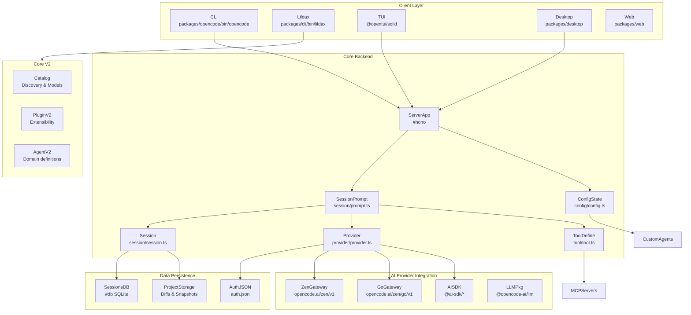

**System Architecture with Code Entities**

This diagram bridges natural language concepts to concrete code entities. The server implementation uses the `#hono` alias to resolve environment-specific adapters. `SessionPrompt` (`session/prompt.ts`) orchestrates the agent loop, calling `Provider` (`provider/provider.ts`) to invoke AI models via the Vercel `ai` SDK [packages/opencode/package.json:113-113](). Session state persists via the `#db` alias using Drizzle ORM [packages/opencode/package.json:25-29](). The V2 architecture introduces domain primitives in `packages/core` and an Effect-native LLM abstraction in `packages/llm` [packages/opencode/package.json:34-88]().

Sources: [packages/opencode/package.json:1-157](), [bun.lock:1-100](), [packages/cli/package.json:36]()

---

## Monorepo Structure

OpenCode is organized as a Bun workspace monorepo [bun.lock:4-5]() managed with Turbo [bun.lock:27-27]().

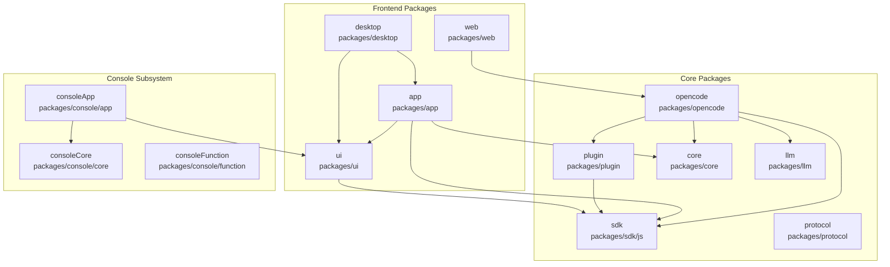

**Monorepo Package Dependency Graph**

This diagram outlines workspace relationships. Core packages provide the CLI, SDK, and shared utilities. Frontend packages implement user interfaces with a shared component library. The console subsystem operates as a separate platform for managing OpenCode Zen and team services [packages/console/core/package.json:1-20]().

Sources: [bun.lock:4-210](), [packages/opencode/package.json:87-95](), [packages/sdk/js/package.json:12-21](), [packages/plugin/package.json:11-19](), [packages/desktop/package.json:36-40](), [packages/console/core/package.json:8-20]()

---

## Package Manifest Overview

| Package | Purpose | Key Dependencies |
|---------|---------|------------------|
| `opencode` | Main CLI and server implementation | `ai`, `drizzle-orm`, `@ai-sdk/*` [packages/opencode/package.json:58-153]() |
| `@opencode-ai/sdk` | Client SDK with TypeScript types | `cross-spawn` [packages/sdk/js/package.json:12-35]() |
| `@opencode-ai/plugin` | Plugin interface for extensions | `zod`, `effect` [packages/plugin/package.json:23-28]() |
| `@opencode-ai/ui` | Component library for UIs | `solid-js`, `tailwindcss` [packages/ui/package.json:74-75]() |
| `@opencode-ai/app` | Core UI application logic | `@opencode-ai/ui`, `@opencode-ai/sdk` [packages/app/package.json:40-44]() |
| `@opencode-ai/desktop` | Electron desktop application | `electron`, `@opencode-ai/app` [packages/desktop/package.json:39-51]() |
| `@opencode-ai/web` | Documentation website | `astro`, `solid-js` [packages/web/package.json:14-37]() |
| `@opencode-ai/cli` | New V2 CLI implementation (`lildax`) | `effect`, `@opencode-ai/core` [packages/cli/package.json:36]() |
| `@opencode-ai/core` | V2 Domain layer (Catalog, Agents) | `effect`, `drizzle-orm` [packages/console/core/package.json:8-19]() |
| `@opencode-ai/llm` | Effect-native LLM abstraction | `effect`, `@ai-sdk/provider` [packages/opencode/package.json:88-88]() |

Sources: [bun.lock:1-210](), [packages/opencode/package.json:54-154](), [packages/sdk/js/package.json:1-36](), [packages/plugin/package.json:1-54](), [packages/desktop/package.json:1-76](), [packages/console/core/package.json:1-52]()

---

## Agent Processing Pipeline

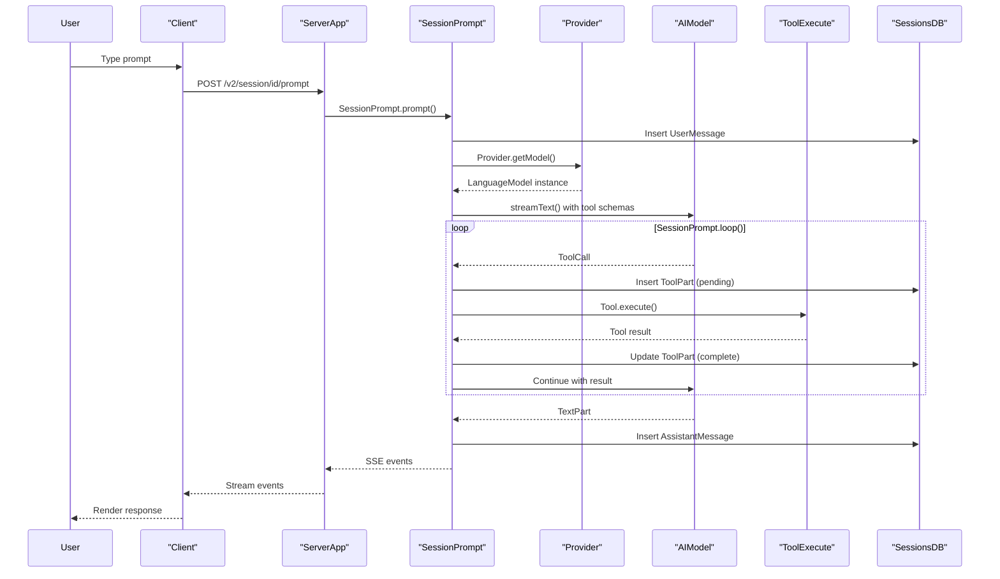

**Agent Processing Pipeline with Code Methods**

This sequence diagram details the agent execution loop. Requests enter via the server adapter, retrieve a `LanguageModel` instance via `Provider.getModel()`, execute necessary tools, and persist state changes through Drizzle ORM [packages/opencode/package.json:113-120]().

Sources: [packages/opencode/package.json:18-154](), [packages/sdk/js/package.json:12-21]()

---

## Installation Methods

OpenCode can be installed through multiple channels:

| Method | Command | Platform |
|--------|---------|----------|
| Install script | `curl -fsSL https://opencode.ai/install \| bash` | macOS, Linux |
| npm | `npm install -g opencode-ai` | All platforms |
| Homebrew | `brew install anomalyco/tap/opencode` | macOS, Linux |
| Nix | `nix run nixpkgs#opencode` | NixOS, Linux, macOS |

The legacy CLI entry point is defined in `./bin/opencode` [packages/opencode/package.json:19-19](), while the V2 architecture utilizes the `lildax` binary [packages/cli/package.json:36]().

Sources: [README.md:43-59](), [packages/opencode/package.json:18-20](), [packages/cli/package.json:36]()

---

## Provider Integration

OpenCode integrates 75+ AI providers through the `Provider` module utilizing the Vercel `ai` SDK and specific adapters [packages/opencode/package.json:58-76]().

**Provider Categories:**

| Category | Examples | Package |
|----------|----------|---------|
| OpenCode Services | Zen (curated), Go (open models) | Managed via `console` [packages/console/function/package.json:20-22]() |
| Cloud Providers | Anthropic, OpenAI, Google, Bedrock | `@ai-sdk/*` packages [packages/opencode/package.json:58-76]() |
| Local | Ollama, LM Studio | `@ai-sdk/openai-compatible` [packages/opencode/package.json:71-71]() |

Sources: [packages/opencode/package.json:58-76](), [packages/console/function/package.json:1-29]()

---

## Key Technologies and Dependencies

| Technology | Purpose | Package |
|------------|---------|---------|
| **Bun** | Runtime and package manager | Global [bun.lock:1-10]() |
| **Solid.js** | Reactive UI framework | `solid-js` [packages/app/package.json:75-75]() |
| **Effect** | Functional programming & concurrency | `effect` [packages/opencode/package.json:121-121]() |
| **Hono** | HTTP framework | `hono` [packages/function/package.json:17-17]() |
| **Drizzle ORM** | Database ORM | `drizzle-orm` [packages/opencode/package.json:120-120]() |
| **Electron** | Desktop framework | `electron` [packages/desktop/package.json:51-51]() |
| **Astro** | Static site generator | `astro` [packages/web/package.json:24-24]() |
| **AI SDK** | AI provider integration | `ai`, `@ai-sdk/*` [packages/opencode/package.json:58-113]() |

Sources: [bun.lock:1-100](), [packages/opencode/package.json:1-157](), [packages/desktop/package.json:1-76](), [packages/web/package.json:1-44]()

---

# Page: Package Structure

# Package Structure

<details>
<summary>Relevant source files</summary>

The following files were used as context for generating this wiki page:

- [bun.lock](bun.lock)
- [packages/app/package.json](packages/app/package.json)
- [packages/console/app/package.json](packages/console/app/package.json)
- [packages/console/core/package.json](packages/console/core/package.json)
- [packages/console/function/package.json](packages/console/function/package.json)
- [packages/console/mail/package.json](packages/console/mail/package.json)
- [packages/core/package.json](packages/core/package.json)
- [packages/desktop/package.json](packages/desktop/package.json)
- [packages/enterprise/package.json](packages/enterprise/package.json)
- [packages/function/package.json](packages/function/package.json)
- [packages/opencode/package.json](packages/opencode/package.json)
- [packages/plugin/package.json](packages/plugin/package.json)
- [packages/sdk/js/package.json](packages/sdk/js/package.json)
- [packages/slack/package.json](packages/slack/package.json)
- [packages/ui/package.json](packages/ui/package.json)
- [packages/web/package.json](packages/web/package.json)

</details>


## Purpose and Scope

This document describes the physical organization of the OpenCode monorepo, detailing all workspace packages, their roles, and interdependencies. For details on the architecture and runtime behavior of these packages, see [Architecture Overview](#1.2). For build and deployment processes, see [Build System and Monorepo](#9.1).

Sources: [bun.lock:4-13](), [packages/opencode/package.json:1-23]()

## Monorepo Overview

OpenCode is organized as a Bun workspace monorepo containing 20+ packages across multiple categories. The workspace configuration is defined at the root level (`bun.lock`) and uses the `workspace:*` protocol for internal package linking [bun.lock:4-13]().

**Workspace Structure**

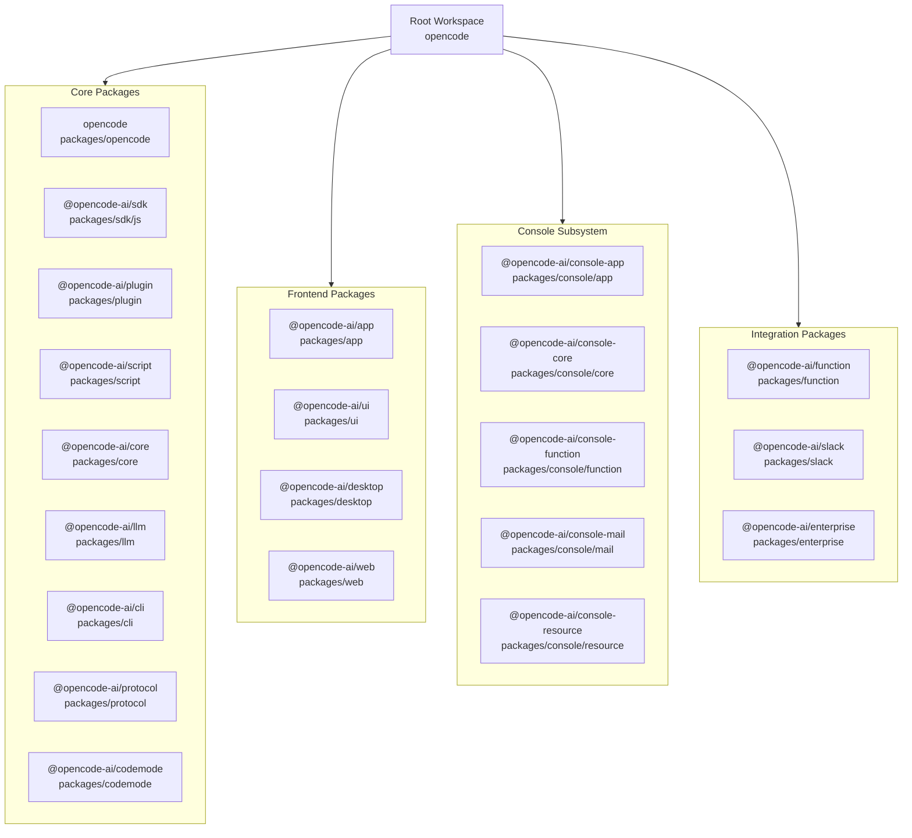

Sources: [bun.lock:1-14](), [packages/opencode/package.json:1-157](), [packages/sdk/js/package.json:1-31](), [packages/plugin/package.json:1-29]()

## Core Packages

The core packages provide the fundamental functionality of OpenCode, including the CLI, server, SDK, and plugin system.

### opencode

**Location:** `packages/opencode`  
**Package Name:** `opencode`  
**Entry Point:** `./bin/opencode` [packages/opencode/package.json:19]()  
**Type:** Legacy application package (private)

The original package containing the CLI, HTTP server, session management, tool system, and AI provider integration. While newer logic is migrating to `packages/core`, this remains a central hub for the current implementation.

**Key Responsibilities:**
- CLI commands via `yargs` [packages/opencode/package.json:152]()
- Database management (SQLite via Drizzle ORM) [packages/opencode/package.json:120]()
- Provider integration (75+ AI providers) [packages/opencode/package.json:58-76]()
- MCP integration via `@modelcontextprotocol/sdk` [packages/opencode/package.json:83]()

Sources: [packages/opencode/package.json:1-157]()

### @opencode-ai/cli

**Location:** `packages/cli`  
**Package Name:** `@opencode-ai/cli`  
**Binary:** `lildax` [bun.lock:101]()

The V2 CLI implementation, providing the `lildax` binary. It bridges the TUI and the server/core logic.

**Major Dependencies:**
- `@opencode-ai/core`: Domain layer [bun.lock:105]()
- `@opencode-ai/server`: V2 Server [bun.lock:107]()
- `@opencode-ai/tui`: Terminal User Interface [bun.lock:108]()
- `effect`: Functional programming library [bun.lock:112]()

Sources: [bun.lock:97-120]()

### @opencode-ai/core

**Location:** `packages/core`  
**Package Name:** `@opencode-ai/core`  
**Type:** Core Domain Layer

The V2 domain layer containing the Catalog service for model discovery, PluginV2 hook system, and Agent definitions. It serves as a dependency for the newer CLI and server implementations.

Sources: [bun.lock:41](), [packages/cli/package.json:36]()

### @opencode-ai/sdk

**Location:** `packages/sdk/js`  
**Package Name:** `@opencode-ai/sdk`  
**Type:** Published library

Generated TypeScript SDK providing type-safe client access to the OpenCode HTTP API.

**Exports:**
```typescript
".": "./src/index.ts"           // Main SDK exports
"./client": "./src/client.ts"   // Client-only exports
"./server": "./src/server.ts"   // Server-only exports
"./v2": "./src/v2/index.ts"     // V2 API (typed)
"./v2/client": "./src/v2/client.ts"
"./v2/gen/client": "./src/v2/gen/client/index.ts"  // Generated client [packages/sdk/js/package.json:18]()
"./v2/server": "./src/v2/server.ts"
"./v2/types": "./src/v2/gen/types.gen.ts" // Generated types [packages/sdk/js/package.json:20]()
```

Sources: [packages/sdk/js/package.json:1-36]()

### @opencode-ai/plugin

**Location:** `packages/plugin`  
**Package Name:** `@opencode-ai/plugin`  
**Type:** Published library

Plugin interface defining the hook system and tool creation API for extending OpenCode functionality.

**Exports:**
```typescript
".": "./src/index.ts"       
"./tool": "./src/tool.ts"   
"./tui": "./src/tui.ts"     
"./v2/effect": "./src/v2/effect/index.ts" // V2 Effect-based plugins [packages/plugin/package.json:15]()
"./v2/effect/integration": "./src/v2/effect/integration.ts" // Integration hooks [packages/plugin/package.json:16]()
```

Sources: [packages/plugin/package.json:1-54]()

### @opencode-ai/codemode

**Location:** `packages/codemode`  
**Package Name:** `@opencode-ai/codemode`  
**Type:** Internal Utility

Provides the tool interpreter and code analysis capabilities using `acorn` and `typescript` [bun.lock:149-151]().

Sources: [packages/codemode/package.json:1-26]()

## Frontend Packages

### @opencode-ai/app

**Location:** `packages/app`  
**Package Name:** `@opencode-ai/app`  
**Type:** Shared UI application logic

Core UI application logic shared between desktop and web applications. Implements session rendering and state management using SolidJS [bun.lock:75]().

**Major Dependencies:**
- `@opencode-ai/core`: Domain layer [bun.lock:41]()
- `@opencode-ai/sdk`: API client [bun.lock:43]()
- `@opencode-ai/ui`: Component library [bun.lock:45]()
- `ghostty-web`: Terminal integration [bun.lock:69]()

Sources: [bun.lock:30-95]()

### @opencode-ai/ui

**Location:** `packages/ui`  
**Package Name:** `@opencode-ai/ui`  
**Type:** Shared Component Library

A comprehensive library of SolidJS components, styles, and assets used across all OpenCode frontends.

**Key Exports:**
- `./*`: Component files [packages/ui/package.json:37]()
- `./theme`: Theme definitions [packages/ui/package.json:46]()
- `./styles/tailwind`: Tailwind CSS configuration [packages/ui/package.json:45]()
- `./v2/*`: V2-specific components [packages/ui/package.json:55]()

Sources: [packages/ui/package.json:1-113]()

### @opencode-ai/desktop

**Location:** `packages/desktop`  
**Package Name:** `@opencode-ai/desktop`  
**Type:** Electron desktop application (private)

Desktop application built with Electron, providing native platform integration. It uses `electron-vite` for the build process [packages/desktop/package.json:17]().

Sources: [packages/desktop/package.json:1-76]()

## Console Subsystem

The console subsystem is a self-contained platform for account, team, and billing management.

**Console Data Flow**

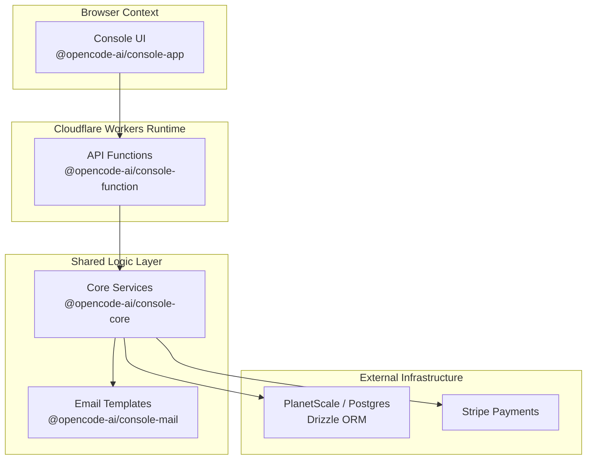

Sources: [packages/console/app/package.json:1-49](), [packages/console/core/package.json:1-52](), [packages/console/function/package.json:1-30]()

### @opencode-ai/console-app

**Location:** `packages/console/app`  
**Package Name:** `@opencode-ai/console-app`  

Frontend for the OpenCode Console, built with SolidJS and Solid Start [bun.lock:175,176](). It manages subscriptions via Stripe [bun.lock:177,183]().

Sources: [packages/console/app/package.json:1-49]()

### @opencode-ai/console-core

**Location:** `packages/console/core`  
**Package Name:** `@opencode-ai/console-core`  

Core business logic and database layer for the console using Drizzle ORM [bun.lock:15](). It handles interactions with PlanetScale and Postgres [bun.lock:13,16]().

Sources: [packages/console/core/package.json:1-52]()

## Package Dependency Graph

This diagram illustrates the relationship between the core domain logic and the various interface implementations.

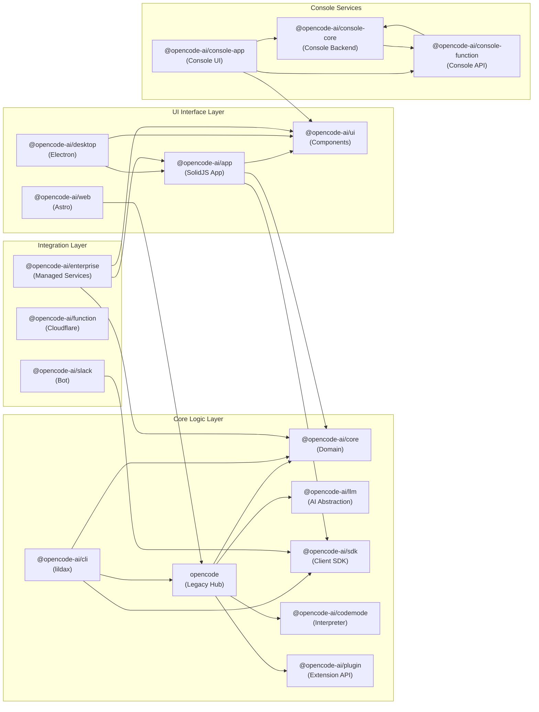

Sources: [bun.lock:30-194](), [packages/opencode/package.json:34,87-93](), [packages/cli/package.json:36](), [packages/desktop/package.json:39-40](), [packages/web/package.json:39](), [packages/enterprise/package.json:15-18](), [packages/console/app/package.json:19-22](), [packages/console/core/package.json:11-12](), [packages/console/function/package.json:24-25]()

---

# Page: Architecture Overview

# Architecture Overview

<details>
<summary>Relevant source files</summary>

The following files were used as context for generating this wiki page:

- [packages/opencode/src/acp/agent.ts](packages/opencode/src/acp/agent.ts)
- [packages/opencode/src/agent/agent.ts](packages/opencode/src/agent/agent.ts)
- [packages/opencode/src/config/config.ts](packages/opencode/src/config/config.ts)
- [packages/opencode/src/server/server.ts](packages/opencode/src/server/server.ts)
- [packages/opencode/src/session/compaction.ts](packages/opencode/src/session/compaction.ts)
- [packages/opencode/src/session/llm.ts](packages/opencode/src/session/llm.ts)
- [packages/opencode/src/session/llm/ai-sdk.ts](packages/opencode/src/session/llm/ai-sdk.ts)
- [packages/opencode/src/session/message-v2.ts](packages/opencode/src/session/message-v2.ts)
- [packages/opencode/src/session/processor.ts](packages/opencode/src/session/processor.ts)
- [packages/opencode/src/session/prompt.ts](packages/opencode/src/session/prompt.ts)
- [packages/opencode/src/session/session.ts](packages/opencode/src/session/session.ts)
- [packages/opencode/src/session/summary.ts](packages/opencode/src/session/summary.ts)
- [packages/opencode/src/tool/registry.ts](packages/opencode/src/tool/registry.ts)
- [packages/opencode/test/agent/agent.test.ts](packages/opencode/test/agent/agent.test.ts)
- [packages/opencode/test/config/config.test.ts](packages/opencode/test/config/config.test.ts)
- [packages/opencode/test/session/compaction.test.ts](packages/opencode/test/session/compaction.test.ts)
- [packages/opencode/test/session/llm.test.ts](packages/opencode/test/session/llm.test.ts)
- [packages/opencode/test/session/messages-pagination.test.ts](packages/opencode/test/session/messages-pagination.test.ts)
- [packages/opencode/test/session/processor-effect.test.ts](packages/opencode/test/session/processor-effect.test.ts)
- [packages/opencode/test/session/prompt.test.ts](packages/opencode/test/session/prompt.test.ts)
- [packages/opencode/test/session/snapshot-tool-race.test.ts](packages/opencode/test/session/snapshot-tool-race.test.ts)
- [packages/opencode/test/tool/registry.test.ts](packages/opencode/test/tool/registry.test.ts)
- [packages/plugin/src/tool.ts](packages/plugin/src/tool.ts)
- [packages/sdk/js/src/v2/gen/sdk.gen.ts](packages/sdk/js/src/v2/gen/sdk.gen.ts)
- [packages/sdk/js/src/v2/gen/types.gen.ts](packages/sdk/js/src/v2/gen/types.gen.ts)
- [packages/sdk/openapi.json](packages/sdk/openapi.json)
- [perf/test-suite.md](perf/test-suite.md)

</details>


## Purpose and Scope

This document presents the high-level system architecture of OpenCode, describing how its major components interact to deliver AI-powered coding assistance. It covers the session processing pipeline, provider integration, and the client-server communication model.

OpenCode is built on a layered architecture that bridges high-level user intent with low-level system operations (file manipulation, terminal execution, and LSP interactions) using the [Effect](https://effect.website/) ecosystem for robust service management and dependency injection.

---

## System Layering and Request Flow

OpenCode follows a layered architecture where client applications communicate with an HTTP server that orchestrates AI sessions, provider interactions, and tool executions. The system uses an [Effect](https://effect.website/) based backend that supports both a public API and internal instance management.

Title: "High-Level System Architecture"
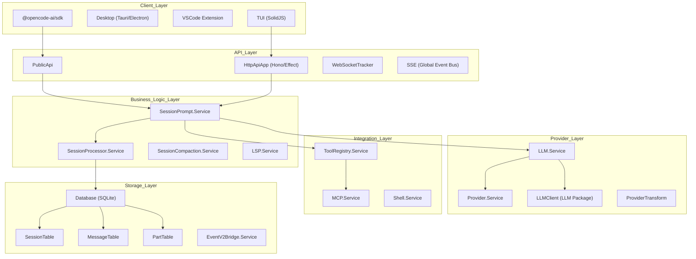

**Request Flow:**

1.  **Entry Point**: The server is initialized via `listen`, which sets up the `HttpApiApp` routes and middleware [packages/opencode/src/server/server.ts:73-81]().
2.  **API Handling**: Requests are handled by `PublicApi` and `HttpApiApp`, providing endpoints for auth, logs, and session management [packages/opencode/src/server/server.ts:10-13](), [packages/sdk/openapi.json:9-123]().
3.  **Prompt Orchestration**: The `SessionPrompt.Service` handles incoming prompts, resolving them into `MessageV2` structures and managing the agentic loop [packages/opencode/src/session/prompt.ts:102-109]().
4.  **LLM Execution**: The `LLM.Service` manages streaming interactions. It prepares requests via `LLMRequestPrep` and uses `LLMClient` for routing to providers [packages/opencode/src/session/llm.ts:75-83](), [packages/opencode/src/session/llm.ts:106-113]().
5.  **Eventing**: System-wide state changes (e.g., `EventMessageUpdated`, `EventMessagePartDelta`) are broadcast via the `EventV2Bridge.Service` [packages/opencode/src/session/llm.ts:81-81](), [packages/sdk/js/src/v2/gen/types.gen.ts:7-51]().

Sources: [packages/opencode/src/server/server.ts:73-138](), [packages/opencode/src/session/prompt.ts:102-151](), [packages/opencode/src/session/llm.ts:75-113](), [packages/sdk/openapi.json:1-123](), [packages/sdk/js/src/v2/gen/types.gen.ts:7-97]()

---

## Session Processing Pipeline

The session pipeline transforms user prompts into assistant actions through an agentic loop (`SessionPrompt.loop`), managing context overflow via compaction and ensuring persistence through a specialized processor.

Title: "Session Processing Pipeline"
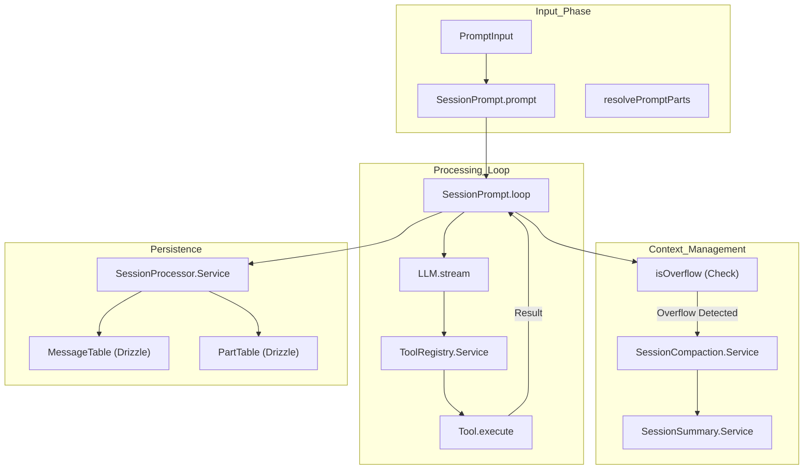

**Key Components:**

| Component | Responsibility | Reference |
|-----------|---------------|-----------|
| `SessionPrompt` | Main interface for prompt execution, cancellation, and loop orchestration. | [packages/opencode/src/session/prompt.ts:102-109]() |
| `MessageV2` | Utility for hydrating and converting session messages into provider-compatible `ModelMessage` formats. | [packages/opencode/src/session/message-v2.ts:98-135]() |
| `SessionCompaction` | Handles context pruning, token estimation, and summary generation when token limits are exceeded. | [packages/opencode/src/session/compaction.ts:130-150](), [packages/opencode/src/session/compaction.ts:180-186]() |
| `LLM.Service` | Abstraction layer that prepares `LLMRequest` and handles provider-specific streaming, including specialized GitLab Workflow support. | [packages/opencode/src/session/llm.ts:54-56](), [packages/opencode/src/session/llm.ts:119-127]() |

Sources: [packages/opencode/src/session/prompt.ts:102-160](), [packages/opencode/src/session/message-v2.ts:98-205](), [packages/opencode/src/session/compaction.ts:130-206](), [packages/opencode/src/session/llm.ts:54-150]()

---

## Provider and Model Abstraction

OpenCode integrates with various LLM providers by leveraging a custom transformation layer (`ProviderTransform`) and model metadata resolution via the `Provider.Service`.

Title: "LLM Provider Integration Architecture"
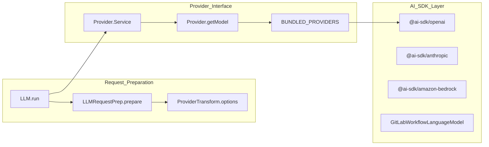

**Model Resolution:**
The `Provider.Service` instantiates language models using `BUNDLED_PROVIDERS` (e.g., `@ai-sdk/openai`, `@ai-sdk/anthropic`) [packages/opencode/src/provider/provider.ts:107-134](). `LLMRequestPrep` normalization ensures compatibility across different APIs before they reach provider SDKs [packages/opencode/src/session/llm.ts:106-113]().

**Integration Details:**
- **ProviderTransform**: Normalizes messages and handles provider-specific quirks, such as sanitizing surrogates [packages/opencode/src/provider/transform.ts:25-27]() and managing output token limits [packages/opencode/src/provider/transform.ts:18-18]().
- **GitLab Workflow**: Specialized integration where `toolExecutor` is wired to OpenCode's tool system to allow GitLab Duo to execute local tools [packages/opencode/src/session/llm.ts:119-147]().
- **Structured Output**: Support for enforcing JSON schemas via `STRUCTURED_OUTPUT_SYSTEM_PROMPT` and `OutputFormatJsonSchema` [packages/opencode/src/session/prompt.ts:74-82](), [packages/sdk/js/src/v2/gen/types.gen.ts:231-235]().

Sources: [packages/opencode/src/provider/provider.ts:107-160](), [packages/opencode/src/provider/transform.ts:1-195](), [packages/opencode/src/session/llm.ts:95-160](), [packages/opencode/src/session/prompt.ts:74-82](), [packages/sdk/js/src/v2/gen/types.gen.ts:231-235]()

---

## Data Flow and Persistence

OpenCode uses a SQLite database with [Drizzle ORM](https://orm.drizzle.team/) for persistent storage and an event-based system for real-time updates.

- **Schema**: Data is organized into `SessionTable`, `MessageTable`, and `PartTable` [packages/opencode/src/session/message-v2.ts:30-30]().
- **Hydration**: The `hydrate` function in `MessageV2` reconstructs full message objects with their constituent parts from the database using Drizzle queries [packages/opencode/src/session/message-v2.ts:98-123]().
- **Real-time Events**: The system emits a wide variety of events (e.g., `EventSessionNextStepStarted`, `EventMessagePartDelta`) which are auto-generated in the SDK [packages/sdk/js/src/v2/gen/types.gen.ts:7-53]().
- **Auth and Credentials**: Supports multiple auth types including OAuth, API keys, and Well-Known tokens [packages/sdk/js/src/v2/gen/types.gen.ts:109-132]().

Sources: [packages/opencode/src/session/message-v2.ts:30-123](), [packages/sdk/js/src/v2/gen/types.gen.ts:7-132](), [packages/sdk/openapi.json:1-123]()

---

# Page: Installation and Setup

# Installation and Setup

<details>
<summary>Relevant source files</summary>

The following files were used as context for generating this wiki page:

- [.github/workflows/nix-hashes.yml](.github/workflows/nix-hashes.yml)
- [.github/workflows/test.yml](.github/workflows/test.yml)
- [README.md](README.md)
- [flake.lock](flake.lock)
- [flake.nix](flake.nix)
- [install](install)
- [nix/desktop.nix](nix/desktop.nix)
- [nix/hashes.json](nix/hashes.json)
- [nix/node_modules.nix](nix/node_modules.nix)
- [nix/opencode.nix](nix/opencode.nix)
- [packages/app/playwright.config.ts](packages/app/playwright.config.ts)
- [packages/function/src/api.ts](packages/function/src/api.ts)
- [packages/function/src/github.ts](packages/function/src/github.ts)
- [packages/function/test/github.test.ts](packages/function/test/github.test.ts)
- [packages/opencode/bin/opencode](packages/opencode/bin/opencode)
- [packages/opencode/script/postinstall.mjs](packages/opencode/script/postinstall.mjs)
- [packages/opencode/src/cli/cmd/debug/agent.handler.ts](packages/opencode/src/cli/cmd/debug/agent.handler.ts)
- [packages/opencode/src/cli/cmd/github.handler.ts](packages/opencode/src/cli/cmd/github.handler.ts)
- [packages/opencode/src/cli/cmd/github.shared.ts](packages/opencode/src/cli/cmd/github.shared.ts)
- [packages/web/src/assets/web/web-homepage-active-session.png](packages/web/src/assets/web/web-homepage-active-session.png)
- [packages/web/src/assets/web/web-homepage-new-session.png](packages/web/src/assets/web/web-homepage-new-session.png)
- [packages/web/src/assets/web/web-homepage-see-servers.png](packages/web/src/assets/web/web-homepage-see-servers.png)
- [packages/web/src/components/Lander.astro](packages/web/src/components/Lander.astro)
- [packages/web/src/content/docs/index.mdx](packages/web/src/content/docs/index.mdx)
- [packages/web/src/content/docs/models.mdx](packages/web/src/content/docs/models.mdx)
- [packages/web/src/content/docs/troubleshooting.mdx](packages/web/src/content/docs/troubleshooting.mdx)
- [packages/web/src/content/docs/web.mdx](packages/web/src/content/docs/web.mdx)
- [packages/web/src/content/docs/windows-wsl.mdx](packages/web/src/content/docs/windows-wsl.mdx)
- [script/beta.ts](script/beta.ts)
- [turbo.json](turbo.json)

</details>


This document provides a technical guide to the installation methods, distribution architecture, and initial configuration of OpenCode. OpenCode is an open-source AI coding agent available as a Terminal User Interface (TUI), desktop application, and IDE extension.

---

## Installation Distribution Channels

OpenCode's release pipeline is designed to distribute consistent binaries across multiple package managers and platforms. The build process uses Bun's compilation capabilities and platform-specific bundlers to generate artifacts.

### Release Pipeline Architecture

The following diagram maps the high-level release stages to the specific CI/CD jobs and distribution endpoints defined in the project's automation scripts and metadata.

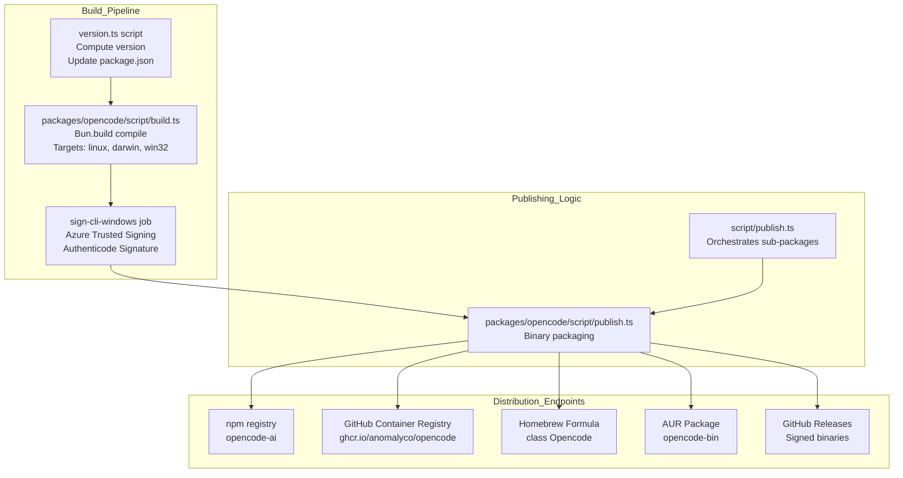

**Sources:** [packages/opencode/script/postinstall.mjs:14-27]()

---

## CLI Installation Methods

### Unified Install Script

The recommended installation method uses a bash script that automates platform detection and binary retrieval.

```bash
curl -fsSL https://opencode.ai/install | bash
```

**Technical Implementation of `install`**
The script performs the following logic:
1.  **Platform Detection**: Uses `uname -s` and `uname -m` to identify the OS (Darwin, Linux, Windows) and architecture (x64, arm64) [install:79-94]().
2.  **Instruction Set Check**: For x64 systems, it checks for `avx2` support. If missing, it selects a `baseline` build to ensure compatibility with older CPUs [install:131-163]().
3.  **Binary Resolution**: Fetches the latest version tag from the GitHub API and constructs a download URL for the specific platform-arch-abi combination, including `musl` detection for Alpine Linux and other musl-based distributions [install:160-185]().

**Installation Directory Precedence**
The script defaults to `$HOME/.opencode/bin` [install:68-68]().

**Sources:** [install:1-205]()

---

### Node.js Package Managers

OpenCode is published to npm as `opencode-ai`. The package structure uses a wrapper strategy to deliver native binaries via a JavaScript shim. During the `postinstall` phase, the script `postinstall.mjs` detects the environment and links the appropriate native binary from `optionalDependencies` to the local `bin/opencode` path [packages/opencode/script/postinstall.mjs:119-156]().

```bash
npm install -g opencode-ai@latest
# or bun/pnpm/yarn equivalents
```

**Installation Method Detection (Code Entity Space)**
The following diagram bridges natural language installation concepts to the concrete code entities within `packages/opencode/src/installation/index.ts` and `postinstall.mjs`.

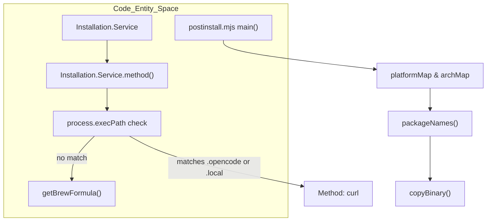

**Implementation Details:**
The `Installation.Service` uses the `method` function to determine the installation source by checking file paths and executing shell commands like `npm list -g` or `brew list` [packages/opencode/src/installation/index.ts:174-182]().

**Sources:** [packages/opencode/src/installation/index.ts:17-190](), [packages/opencode/script/postinstall.mjs:167-182]()

---

### Native Package Managers and Nix

OpenCode supports native package managers through specific publishing scripts and metadata.

*   **Homebrew**: Supported via `brew install anomalyco/tap/opencode`. The installation service checks for the presence of the formula using `brew list --formula` [packages/opencode/src/installation/index.ts:125-131]().
*   **Arch Linux**: Available via `pacman -S opencode` (Stable) or `paru -S opencode-bin` (AUR).
*   **Nix**: Can be run directly via `nix run nixpkgs#opencode` or by adding `github:anomalyco/opencode` to your Nix flake inputs for the latest development branch.
    The Nix packaging system uses `nix/opencode.nix` to define the `opencode` derivation, which builds the CLI tool. The `nix/node_modules.nix` file handles the canonicalization of `node_modules` for different platforms, ensuring reproducible builds. Hashes for `node_modules` are stored in `nix/hashes.json` and are updated by the `.github/workflows/nix-hashes.yml` workflow.

```mermaid
graph TD
    A[Nix Flake (flake.nix)] --> B{forEachSystem}
    B --> C[nixpkgs.legacyPackages.${system}]
    C --> D[opencode derivation (nix/opencode.nix)]
    D --> E[node_modules derivation (nix/node_modules.nix)]
    E --> F[nix/hashes.json]
    F --> G[nix-hashes.yml workflow]
    G --> H[Compute node_modules hash]
    H --> I[Update hashes.json]
```
**Sources:** [flake.nix:1-73](), [nix/opencode.nix:1-109](), [nix/node_modules.nix:1-85](), [nix/hashes.json:1-8](), [.github/workflows/nix-hashes.yml:1-162]()

*   **Windows**: Supported via `scoop install opencode` or `choco install opencode`.

**Sources:** [packages/opencode/src/installation/index.ts:125-131]()

---

## Upgrade System

OpenCode includes an internal upgrade mechanism via the `Installation.Service` and a CLI command (`packages/opencode/src/cli/upgrade.ts`).

**Upgrade Workflow:**
1. **Version Comparison**: The `getReleaseType` utility compares `semver` versions to determine if an update is a "patch", "minor", or "major" release [packages/opencode/src/installation/index.ts:24-33]().
2. **Latest Check**: The `latest` function queries external APIs (GitHub, npm, Brew, etc.) based on the detected installation method [packages/opencode/src/installation/index.ts:78-78]().
3. **Execution**: The `upgrade` function executes the appropriate package manager command (e.g., `npm install -g`, `brew upgrade`) or downloads and runs the install script via `curl` [packages/opencode/src/installation/index.ts:79-79]().
4. **Auto-update**: The `upgrade()` function in `packages/opencode/src/cli/upgrade.ts` checks global configuration and performs automatic updates for patch releases if `autoupdate` is not disabled [packages/opencode/src/cli/upgrade.ts:8-53]().

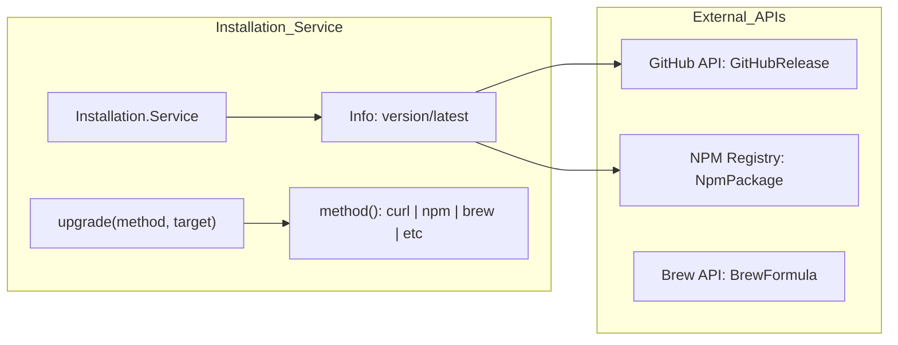

**Sources:** [packages/opencode/src/installation/index.ts:24-82](), [packages/opencode/src/cli/upgrade.ts:8-53]()

---

## Initial Configuration and Workspace Setup

Upon installation and initial run within a directory, OpenCode initializes its environment. Two critical systems govern this initial phase: project snapshotting (`Snapshot.Service`) and formatting setup (`Format.Service`).

### Snapshot Initialization

The `Snapshot.Service` handles the lifecycle of project worktrees and git-based state tracking.
*   **Git Detection**: It verifies if the project uses Git and if snapshotting is enabled in the configuration [packages/opencode/src/snapshot/index.ts:167-170]().
*   **Worktree Management**: It computes a specific `gitdir` within the OpenCode data directory (usually `~/.opencode/snapshot/[project-id]/[worktree-hash]`) to track changes without polluting the user's primary `.git` directory [packages/opencode/src/snapshot/index.ts:71-75]().
*   **State Tracking**: The `track` function stages changes using `git add --all --sparse` and creates a commit-like hash to represent the current state [packages/opencode/src/snapshot/index.ts:39-39](), [packages/opencode/src/snapshot/index.ts:146-160]().

### Formatter Initialization

The `Format.Service` (`packages/opencode/src/format/index.ts`) initializes project formatters based on configuration settings:
*   Resolves built-in formatters (such as `gofmt`, `ruff`, etc.) via `Format.Service.status()` [packages/opencode/src/format/index.ts:174-186]().
*   Evaluates enablement rules asynchronously across matching file extensions [packages/opencode/src/format/index.ts:57-71]().

**Sources:** [packages/opencode/src/snapshot/index.ts:36-170](), [packages/opencode/src/format/index.ts:31-192]()

---

# Page: Core Systems

# Core Systems

<details>
<summary>Relevant source files</summary>

The following files were used as context for generating this wiki page:

- [packages/opencode/src/session/compaction.ts](packages/opencode/src/session/compaction.ts)
- [packages/opencode/src/session/llm.ts](packages/opencode/src/session/llm.ts)
- [packages/opencode/src/session/llm/ai-sdk.ts](packages/opencode/src/session/llm/ai-sdk.ts)
- [packages/opencode/src/session/message-v2.ts](packages/opencode/src/session/message-v2.ts)
- [packages/opencode/src/session/processor.ts](packages/opencode/src/session/processor.ts)
- [packages/opencode/src/session/prompt.ts](packages/opencode/src/session/prompt.ts)
- [packages/opencode/src/session/session.ts](packages/opencode/src/session/session.ts)
- [packages/opencode/src/session/summary.ts](packages/opencode/src/session/summary.ts)
- [packages/opencode/src/tool/registry.ts](packages/opencode/src/tool/registry.ts)
- [packages/opencode/test/session/compaction.test.ts](packages/opencode/test/session/compaction.test.ts)
- [packages/opencode/test/session/llm.test.ts](packages/opencode/test/session/llm.test.ts)
- [packages/opencode/test/session/messages-pagination.test.ts](packages/opencode/test/session/messages-pagination.test.ts)
- [packages/opencode/test/session/processor-effect.test.ts](packages/opencode/test/session/processor-effect.test.ts)
- [packages/opencode/test/session/prompt.test.ts](packages/opencode/test/session/prompt.test.ts)
- [packages/opencode/test/session/snapshot-tool-race.test.ts](packages/opencode/test/session/snapshot-tool-race.test.ts)
- [packages/opencode/test/tool/registry.test.ts](packages/opencode/test/tool/registry.test.ts)
- [packages/plugin/src/tool.ts](packages/plugin/src/tool.ts)

</details>


The Core Systems comprise the backend infrastructure of OpenCode, providing session orchestration, AI provider integration, message processing, and API services. These systems coordinate between user interfaces, AI models, and development tools to enable agentic coding workflows.

For AI provider configuration and authentication, see [AI Provider Integration](#4). For user-facing interfaces, see [User Interfaces](#6). For tool execution and permissions, see [Tool System](#5).

## Architecture Overview

The core backend is organized around session-based orchestration, where each session maintains conversation state, coordinates tool execution, and manages interactions with AI providers via an iterative processing loop.

**System Component Diagram**

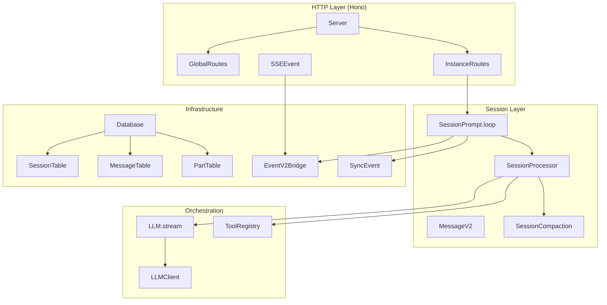

Sources: [packages/opencode/src/session/prompt.ts:113-143](), [packages/opencode/src/session/processor.ts:81-96](), [packages/opencode/src/session/message-v2.ts:30-30](), [packages/opencode/src/session/session.ts:29-30]()

## 2.1. Session Management

The `Session` service provides session lifecycle management, storing metadata and coordinating message history in SQLite via Drizzle ORM. It handles session hierarchy (parent/child relationships) and state persistence. For details, see [Session Management](#2.1).

| Function | Purpose | Reference |
|----------|---------|-----------|
| `Session.fromRow` | Converts DB row to typed Info object | [packages/opencode/src/session/session.ts:59-118]() |
| `Session.toRow` | Converts Info object to DB row | [packages/opencode/src/session/session.ts:120-159]() |
| `Session.Info` | Schema definition for session state | [packages/opencode/src/session/session.ts:206-235]() |

Sources: [packages/opencode/src/session/session.ts:59-235](), [packages/opencode/src/session/message-v2.ts:30-30]()

## 2.2. Message and Part Structure

Messages follow a role-based structure (`user` | `assistant`) and are composed of multiple "parts" representing different content types (text, files, tool calls, reasoning). For details, see [Message and Part Structure](#2.2).

**Message Content Model**

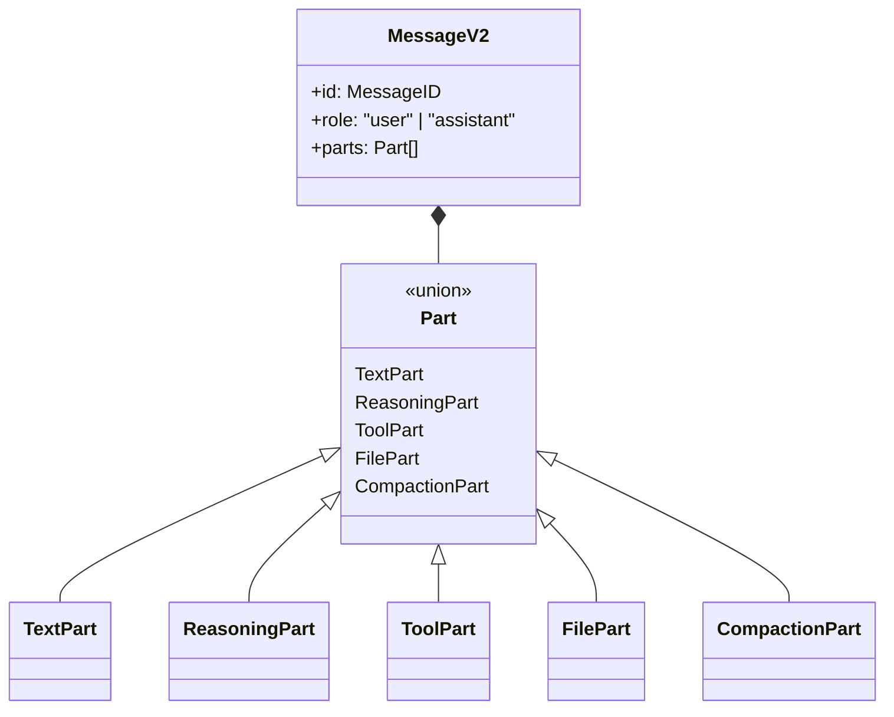

Sources: [packages/opencode/src/session/message-v2.ts:7-17](), [packages/opencode/src/session/message-v2.ts:80-93]()

## 2.3. Prompt Processing Pipeline

The `SessionPrompt` service orchestrates the agentic loop. It manages the flow from user input to LLM streaming and iterative tool execution via `SessionProcessor`. For details, see [Prompt Processing Pipeline](#2.3).

- **Loop**: `SessionPrompt.loop` maintains the state machine for agent turns, managing retries and tool resolution [packages/opencode/src/session/prompt.ts:105-105]().
- **Streaming**: `LLM.stream` handles the multi-provider abstraction, using `LLMRequestPrep` to format payloads for specific providers [packages/opencode/src/session/llm.ts:55-55](), [packages/opencode/src/session/llm.ts:106-113]().
- **LLM Client**: `LLMClient` (from `@opencode-ai/llm`) provides the low-level transport for LLM requests [packages/opencode/src/session/llm.ts:11-12]().

Sources: [packages/opencode/src/session/prompt.ts:102-109](), [packages/opencode/src/session/llm.ts:85-113](), [packages/opencode/src/session/processor.ts:32-48]()

## 2.4. Context Management and Compaction

OpenCode automatically manages the LLM context window by summarizing history or pruning old parts when token limits are approached. For details, see [Context Management and Compaction](#2.4).

- **Overflow Detection**: `SessionCompaction.isOverflow` checks if the current session exceeds model limits based on token counts [packages/opencode/src/session/compaction.ts:166-169]().
- **Compaction Loop**: `SessionCompaction.process` determines if a session needs to be compacted and triggers the summary generation [packages/opencode/src/session/compaction.ts:171-177]().
- **Tool Truncation**: Large tool outputs are truncated during the serialization process to save tokens [packages/opencode/src/session/compaction.ts:49-52]().

Sources: [packages/opencode/src/session/compaction.ts:165-187](), [packages/opencode/src/session/compaction.ts:49-52]()

## 2.5. Permission and Question System

OpenCode implements a human-in-the-loop workflow for sensitive operations. For details, see [Permission and Question System](#2.5).

- **Interactive Approval**: `LLM.run` handles tool approval workflows using an `approvalHandler` that bridges to the UI [packages/opencode/src/session/llm.ts:156-185]().
- **Tool Failures**: `SessionProcessor.failToolCall` manages tool execution errors, ensuring the state is updated for the assistant to see the failure [packages/opencode/src/session/processor.ts:186-200]().
- **Permission Service**: The `Permission` service manages rulesets and user replies for sensitive actions [packages/opencode/src/session/processor.ts:89-89]().

Sources: [packages/opencode/src/session/processor.ts:123-200](), [packages/opencode/src/session/llm.ts:149-185]()

## 2.6. HTTP Server and API

The backend exposes an HTTP API that facilitates communication between the core and various clients. For details, see [HTTP Server and API](#2.6).

- **Workspace Isolation**: Requests are scoped to specific projects and worktrees using the `InstanceState` context [packages/opencode/src/effect/instance-state.ts:1-20]().
- **Event V2 Bridge**: Provides a bridge between internal system events (like message updates) and the SSE streams consumed by clients [packages/opencode/src/session/prompt.ts:50-50](), [packages/opencode/src/session/llm.ts:20-21]().

Sources: [packages/opencode/src/session/session.ts:32-33](), [packages/opencode/src/session/prompt.ts:140-140]()

## 2.7. Project and Worktree Management

OpenCode manages codebases as Projects, utilizing Git-based worktrees to provide isolated environments for agent operations. For details, see [Project and Worktree Management](#2.7).

- **Session Context**: Sessions are bound to specific directories and workspaces, tracked via `SessionTable.directory` and `SessionTable.workspace_id` [packages/opencode/src/session/session.ts:29-30](), [packages/opencode/src/session/session.ts:121-125]().
- **Worktree Integration**: The `Session` service calculates relative paths within worktrees to ensure file operations are correctly scoped [packages/opencode/src/session/session.ts:171-173]().

Sources: [packages/opencode/src/session/session.ts:78-117](), [packages/opencode/src/session/session.ts:120-159]()

## 2.8. Event Bus and Sync Architecture

Internal state changes are broadcast via a global bus and synchronized across clients. For details, see [Event Bus and Sync Architecture](#2.8).

- **Event Types**: The system emits events for `MessageUpdated`, `PartDelta`, and `PartRemoved` to keep UIs in sync [packages/opencode/src/session/message-v2.ts:55-61]().
- **Event V2**: `EventV2Bridge` facilitates listening to and emitting events across the session lifecycle, including LLM streaming events [packages/opencode/src/session/llm.ts:20-21](), [packages/opencode/src/session/llm.ts:81-81]().

Sources: [packages/opencode/src/session/message-v2.ts:55-61](), [packages/opencode/src/session/llm.ts:20-21]()

## 2.9. Storage and Database

The system uses SQLite as the primary data store, managed through Drizzle ORM. For details, see [Storage and Database](#2.9).

- **Schema**: Tables like `SessionTable`, `MessageTable`, and `PartTable` are defined in the core database layer [packages/opencode/src/session/message-v2.ts:30-30]().
- **Hydration**: `MessageV2.hydrate` reconstructs full message objects (including parts) from database rows efficiently [packages/opencode/src/session/message-v2.ts:98-123]().
- **Token Tracking**: The database stores detailed token usage (input, output, reasoning, cache) per session [packages/opencode/src/session/session.ts:98-106]().

Sources: [packages/opencode/src/session/session.ts:29-30](), [packages/opencode/src/session/message-v2.ts:98-123](), [packages/opencode/src/session/session.ts:139-144]()

## Natural Language to Code Mapping

To bridge natural language concepts to concrete code entities across core backend systems, reference the following mapping diagram:

**Concept to Entity Mapping**

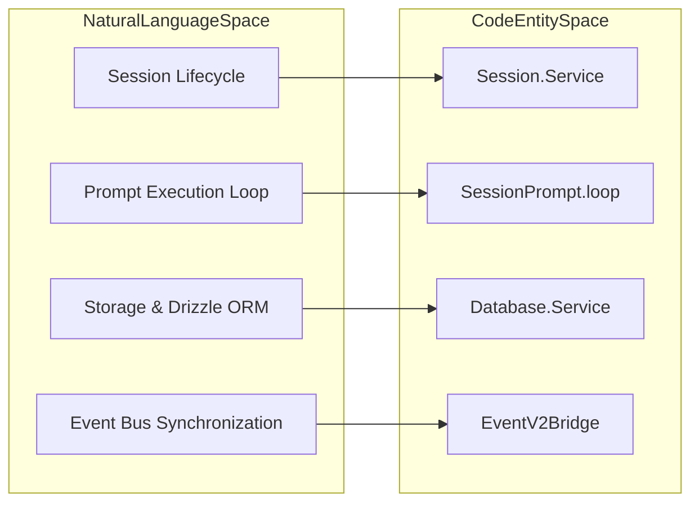

Sources: [packages/opencode/src/session/session.ts:31-41](), [packages/opencode/src/session/prompt.ts:102-109](), [packages/opencode/src/session/message-v2.ts:30-30]()

---

# Page: Session Management

# Session Management

<details>
<summary>Relevant source files</summary>

The following files were used as context for generating this wiki page:

- [packages/core/src/global.ts](packages/core/src/global.ts)
- [packages/opencode/src/session/compaction.ts](packages/opencode/src/session/compaction.ts)
- [packages/opencode/src/session/instruction.ts](packages/opencode/src/session/instruction.ts)
- [packages/opencode/src/session/llm.ts](packages/opencode/src/session/llm.ts)
- [packages/opencode/src/session/llm/ai-sdk.ts](packages/opencode/src/session/llm/ai-sdk.ts)
- [packages/opencode/src/session/message-v2.ts](packages/opencode/src/session/message-v2.ts)
- [packages/opencode/src/session/processor.ts](packages/opencode/src/session/processor.ts)
- [packages/opencode/src/session/prompt.ts](packages/opencode/src/session/prompt.ts)
- [packages/opencode/src/session/revert.ts](packages/opencode/src/session/revert.ts)
- [packages/opencode/src/session/run-state.ts](packages/opencode/src/session/run-state.ts)
- [packages/opencode/src/session/session.ts](packages/opencode/src/session/session.ts)
- [packages/opencode/src/session/status.ts](packages/opencode/src/session/status.ts)
- [packages/opencode/src/session/summary.ts](packages/opencode/src/session/summary.ts)
- [packages/opencode/src/session/todo.ts](packages/opencode/src/session/todo.ts)
- [packages/opencode/src/storage/storage.ts](packages/opencode/src/storage/storage.ts)
- [packages/opencode/src/tool/registry.ts](packages/opencode/src/tool/registry.ts)
- [packages/opencode/src/tool/todo.ts](packages/opencode/src/tool/todo.ts)
- [packages/opencode/test/mcp/auth.test.ts](packages/opencode/test/mcp/auth.test.ts)
- [packages/opencode/test/plugin/auth-override.test.ts](packages/opencode/test/plugin/auth-override.test.ts)
- [packages/opencode/test/server/global-session-list.test.ts](packages/opencode/test/server/global-session-list.test.ts)
- [packages/opencode/test/server/session-actions.test.ts](packages/opencode/test/server/session-actions.test.ts)
- [packages/opencode/test/server/session-list.test.ts](packages/opencode/test/server/session-list.test.ts)
- [packages/opencode/test/server/session-messages.test.ts](packages/opencode/test/server/session-messages.test.ts)
- [packages/opencode/test/session/compaction.test.ts](packages/opencode/test/session/compaction.test.ts)
- [packages/opencode/test/session/instruction.test.ts](packages/opencode/test/session/instruction.test.ts)
- [packages/opencode/test/session/llm.test.ts](packages/opencode/test/session/llm.test.ts)
- [packages/opencode/test/session/messages-pagination.test.ts](packages/opencode/test/session/messages-pagination.test.ts)
- [packages/opencode/test/session/processor-effect.test.ts](packages/opencode/test/session/processor-effect.test.ts)
- [packages/opencode/test/session/prompt.test.ts](packages/opencode/test/session/prompt.test.ts)
- [packages/opencode/test/session/revert-compact.test.ts](packages/opencode/test/session/revert-compact.test.ts)
- [packages/opencode/test/session/schema-decoding.test.ts](packages/opencode/test/session/schema-decoding.test.ts)
- [packages/opencode/test/session/session.test.ts](packages/opencode/test/session/session.test.ts)
- [packages/opencode/test/session/snapshot-tool-race.test.ts](packages/opencode/test/session/snapshot-tool-race.test.ts)
- [packages/opencode/test/storage/storage.test.ts](packages/opencode/test/storage/storage.test.ts)
- [packages/opencode/test/tool/registry.test.ts](packages/opencode/test/tool/registry.test.ts)
- [packages/plugin/src/tool.ts](packages/plugin/src/tool.ts)

</details>


## Purpose and Scope

This document covers the session management system in OpenCode, detailing the session lifecycle, CRUD operations, parent/child and forking hierarchies, the revert/undo mechanism, and database persistence using Drizzle ORM and SQLite. Sessions represent individual conversations between users and AI agents, maintaining state across message exchanges and supporting background state tracking via Effect services.

---

## Core Concepts and Entity Model

### Session Entity (`Session.Info`)

A **session** represents a conversation instance between a user and an AI agent. Each session is defined structurally by the `Session.Info` Effect Schema and mapped from database rows using conversion utilities [packages/opencode/src/session/session.ts:59-118]().

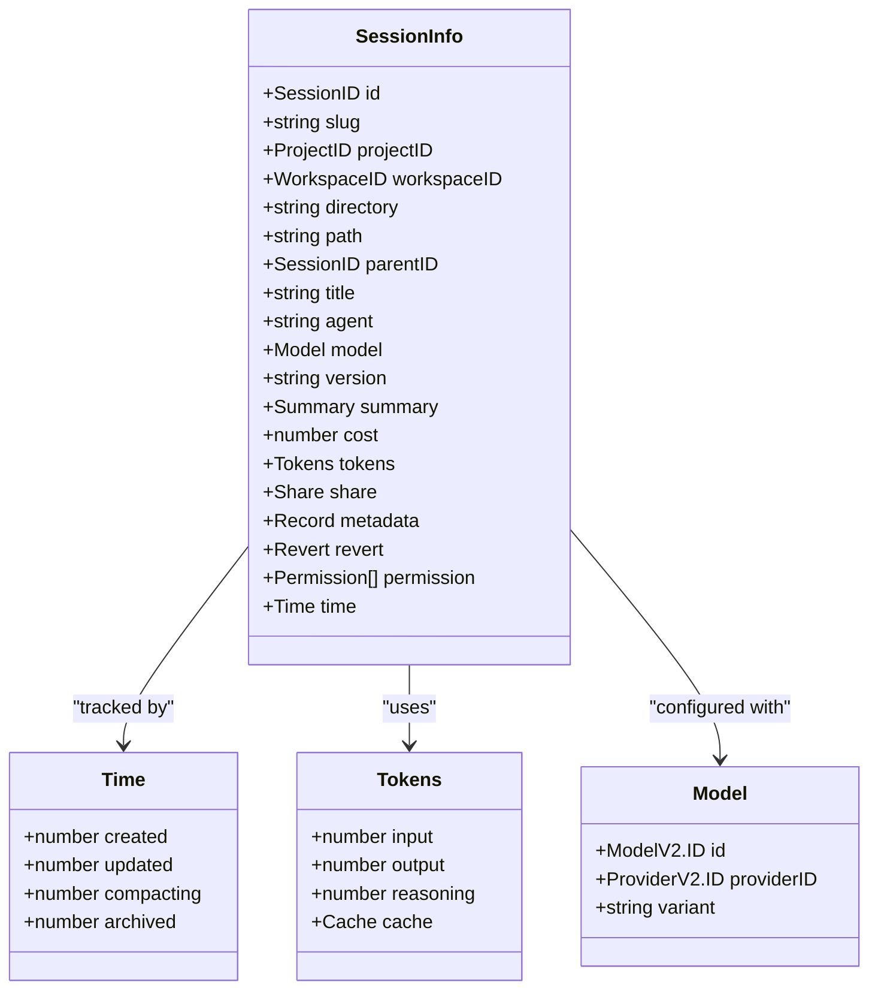

**Sources:** [packages/opencode/src/session/session.ts:59-118](), [packages/opencode/test/session/schema-decoding.test.ts:33-108]()

### Database Schema and Drizzle Mapping

Sessions, messages, and parts are stored in SQLite using Drizzle ORM (`SessionTable`, `PartTable`, `TodoTable`) [packages/opencode/src/session/session.ts:29-30](). The `fromRow` function converts flat database rows into structured `Session.Info` objects, while `toRow` flattens them for database writes [packages/opencode/src/session/session.ts:59-159]().

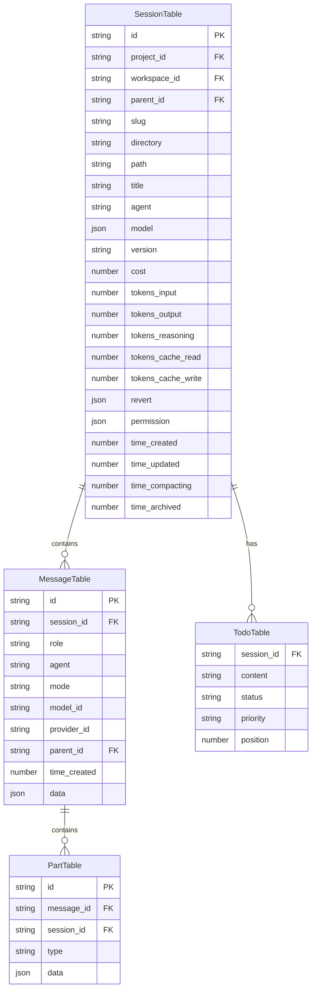

**Sources:** [packages/opencode/src/session/session.ts:29-159](), [packages/opencode/src/session/todo.ts:7]()

---

## Session Lifecycle and States

The lifecycle of a session is orchestrated by several collaborating Effect services: `SessionStatus`, `SessionRunState`, and `SessionRevert`.

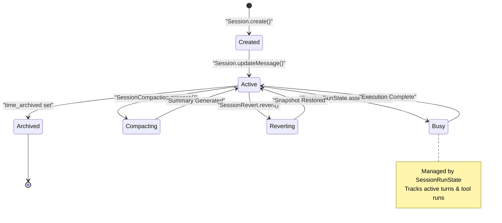

### State Services
- **`SessionStatus.Service`**: Tracks runtime status (e.g., `{ type: "idle" }` or execution states) per session ID within instance state, broadcasting updates via `EventV2Bridge` [packages/opencode/src/session/status.ts:13-51]().
- **`SessionRunState.Service`**: Enforces concurrency control, asserting that a session is not busy before initiating prompts or reverts [packages/opencode/src/session/revert.ts:39]().

**Sources:** [packages/opencode/src/session/status.ts:13-51](), [packages/opencode/src/session/revert.ts:38-42]()

---

## CRUD Operations and Hierarchy

### Session Service Interface (`Session.Service`)

The `Session.Service` provides complete CRUD operations and queries over session data:
- **`create(input)`**: Initializes a new session row, generating a unique `SessionID` and slug, and emitting `Session.Event.Created` [packages/opencode/test/session/session.test.ts:48-74]().
- **`list(query)`**: Retrieves sessions filtered by project, directory, or path [packages/opencode/test/server/session-list.test.ts:61-113]().
- **`remove(id)`**: Deletes session records and associated state.
- **`setTitle` / `setArchived`**: Updates session metadata and timestamps [packages/opencode/src/session/session.test.ts:97-98]().
- **`updateMessage`**: Updates or inserts a message and its parts into the database [packages/opencode/src/session/session.ts:300-320]().
- **`updatePart`**: Updates or inserts a part into the database [packages/opencode/src/session/session.ts:322-342]().
- **`messages`**: Retrieves all messages for a given session, hydrating them with their associated parts [packages/opencode/src/session/session.ts:400-419]().

### Hierarchy and Forking

Sessions support hierarchical relationships and branching:
- **Parent-Child**: Sub-tasks or spawned agent actions reference a `parentID` [packages/opencode/src/session/session.ts:85]().
- **Forking**: Branching an existing conversation creates a child session whose title is managed via `getForkedTitle`, appending or incrementing a `(fork #N)` suffix [packages/opencode/src/session/session.ts:161-169]().

**Sources:** [packages/opencode/src/session/session.ts:79-169](), [packages/opencode/test/session/session.test.ts:48-74](), [packages/opencode/test/server/session-list.test.ts:61-113](), [packages/opencode/src/session/session.ts:300-342](), [packages/opencode/src/session/session.ts:400-419]()

---

## Revert and Undo Mechanism (`SessionRevert`)

The `SessionRevert` service enables users to roll back conversation state and file modifications to a previous message or part [packages/opencode/src/session/revert.ts:20-89]().

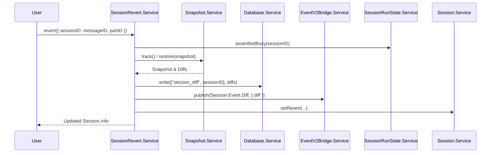

### Key Functions
- **`revert(input)`**: Ensures the session is not busy, calculates message ranges, restores filesystem snapshots via `Snapshot.Service`, computes summary diffs, and updates session revert metadata [packages/opencode/src/session/revert.ts:38-89]().
- **`unrevert(input)`**: Restores pre-revert filesystem states and clears the session revert flag [packages/opencode/src/session/revert.ts:91-99]().
- **`cleanup(session)`**: Purges invalidated messages and parts from storage following a confirmed revert [packages/opencode/src/session/revert.ts:101-124]().

**Sources:** [packages/opencode/src/session/revert.ts:20-126](), [packages/opencode/test/session/revert-compact.test.ts:110-214]()

---

## Supporting Systems

### Message and Part Structure (`MessageV2`)

The `MessageV2` module defines the structure for messages and their constituent parts, handling conversion between internal representations and AI SDK formats. It also provides utilities for database hydration and cursor-based pagination [packages/opencode/src/session/message-v2.ts:1-123]().

```mermaid
classDiagram
    class MessageV2 {
        +SessionID sessionID
        +MessageID id
        +string role
        +string agent
        +string mode
        +ModelV2.ID modelID
        +ProviderV2.ID providerID
        +MessageID parentID
        +number timeCreated
        +any data
        +Part[] parts
    }

    class Part {
        +PartID id
        +MessageID messageID
        +SessionID sessionID
        +string type
        +any data
    }

    MessageV2 "1" *-- "0..*" Part : "has"
```

**Sources:** [packages/opencode/src/session/message-v2.ts:1-123]()

### Instruction Resolution (`Instruction.Service`)
The instruction subsystem discovers project instructions (such as `AGENTS.md`, `CLAUDE.md`, or configured remote/local paths) and tracks message claims to prevent redundant prompt injections [packages/opencode/src/session/instruction.ts:34-169]().

### Todo Management (`Todo.Service`)
Manages task lists associated with a session inside transactions on `TodoTable`, broadcasting `Event.Updated` events upon modification [packages/opencode/src/session/todo.ts:16-68]().

### Session Compaction (`SessionCompaction.Service`)
The `SessionCompaction` service manages the context window by pruning older messages and generating summaries to keep the conversation within the LLM's token limits. It determines when compaction is needed (`isOverflow`) and performs the pruning (`prune`) [packages/opencode/src/session/compaction.ts:166-184]().

```mermaid
sequenceDiagram
    participant SessionPrompt.Service
    participant SessionCompaction.Service
    participant Session.Service
    participant Token.Service
    participant Config.Service
    participant Provider.Service

    SessionPrompt.Service->>SessionCompaction.Service: process({ sessionID, messages, ... })
    SessionCompaction.Service->>Config.Service: get()
    SessionCompaction.Service->>Provider.Service: getModel()
    SessionCompaction.Service->>Session.Service: messages({ sessionID })
    SessionCompaction.Service->>Token.Service: estimate({ messages, model })
    SessionCompaction.Service->>SessionCompaction.Service: isOverflow()
    alt If overflow
        SessionCompaction.Service->>SessionCompaction.Service: prune()
        SessionCompaction.Service->>Session.Service: updateMessage() (mark compacted)
        SessionCompaction.Service->>Session.Service: removeMessages() (delete old messages)
    end
    SessionCompaction.Service-->>SessionPrompt.Service: "continue" | "stop"
```

**Sources:** [packages/opencode/src/session/instruction.ts:34-169](), [packages/opencode/src/session/todo.ts:16-68](), [packages/opencode/src/session/compaction.ts:166-184]()

### Session Summary (`SessionSummary.Service`)
The `SessionSummary` service is responsible for generating and managing summaries of session activity, particularly changes to the filesystem. It computes diffs between snapshots taken during a session turn and stores them with the user message [packages/opencode/src/session/summary.ts:67-142]().

**Sources:** [packages/opencode/src/session/summary.ts:67-142]()

### Session Prompt (`SessionPrompt.Service`)
The `SessionPrompt` service is the central orchestrator for agent interactions. It handles the main `loop` for processing prompts, managing tool calls, and integrating with various other services like `LLM.Service`, `SessionProcessor.Service`, and `ToolRegistry.Service` [packages/opencode/src/session/prompt.ts:102-105]().

```mermaid
graph TD
    A[SessionPrompt.Service] --> B{prompt / loop}
    B --> C[LLM.Service: Stream LLM Response]
    C --> D[SessionProcessor.Service: Process LLM Events]
    D --> E{Tool Call?}
    E -- Yes --> F[ToolRegistry.Service: Execute Tool]
    F --> D
    E -- No --> G[Session.Service: Update Messages/Parts]
    G --> H[SessionCompaction.Service: Check for Overflow]
    H --> I{Compaction Needed?}
    I -- Yes --> J[SessionCompaction.Service: Prune Messages]
    J --> G
    I -- No --> B
    B --> K[SessionSummary.Service: Summarize Changes]
    K --> L[EventV2Bridge.Service: Publish Events]
```

**Sources:** [packages/opencode/src/session/prompt.ts:102-105](), [packages/opencode/src/session/prompt.ts:113-143]()

### Session Processor (`SessionProcessor.Service`)
The `SessionProcessor` service acts as an intermediary between the LLM stream and the session state. It processes events from the LLM, updates tool calls, handles errors, and determines if compaction or a stop is needed [packages/opencode/src/session/processor.ts:56-58]().

**Sources:** [packages/opencode/src/session/processor.ts:56-58](), [packages/opencode/src/session/processor.ts:98-184]()

### LLM Service (`LLM.Service`)
The `LLM.Service` provides the core interface for interacting with Language Models. It prepares requests, streams responses, and integrates with various AI SDK providers, handling tool execution for workflow models [packages/opencode/src/session/llm.ts:54-56]().

**Sources:** [packages/opencode/src/session/llm.ts:54-56](), [packages/opencode/src/session/llm.ts:85-146]()

### Tool Registry (`ToolRegistry.Service`)
The `ToolRegistry` service manages the collection of available tools that agents can use. It registers built-in and custom tools, provides their definitions (including JSON schemas for parameters), and handles their execution [packages/opencode/src/tool/registry.ts:77-87]().

**Sources:** [packages/opencode/src/tool/registry.ts:77-87](), [packages/opencode/src/tool/registry.ts:121-161]()

---

# Page: Message and Part Structure

# Message and Part Structure

<details>
<summary>Relevant source files</summary>

The following files were used as context for generating this wiki page:

- [packages/opencode/src/provider/error.ts](packages/opencode/src/provider/error.ts)
- [packages/opencode/src/session/compaction.ts](packages/opencode/src/session/compaction.ts)
- [packages/opencode/src/session/llm.ts](packages/opencode/src/session/llm.ts)
- [packages/opencode/src/session/llm/ai-sdk.ts](packages/opencode/src/session/llm/ai-sdk.ts)
- [packages/opencode/src/session/message-v2.ts](packages/opencode/src/session/message-v2.ts)
- [packages/opencode/src/session/processor.ts](packages/opencode/src/session/processor.ts)
- [packages/opencode/src/session/prompt.ts](packages/opencode/src/session/prompt.ts)
- [packages/opencode/src/session/retry.ts](packages/opencode/src/session/retry.ts)
- [packages/opencode/src/session/session.ts](packages/opencode/src/session/session.ts)
- [packages/opencode/src/session/summary.ts](packages/opencode/src/session/summary.ts)
- [packages/opencode/src/tool/registry.ts](packages/opencode/src/tool/registry.ts)
- [packages/opencode/test/provider/error.test.ts](packages/opencode/test/provider/error.test.ts)
- [packages/opencode/test/session/compaction.test.ts](packages/opencode/test/session/compaction.test.ts)
- [packages/opencode/test/session/llm.test.ts](packages/opencode/test/session/llm.test.ts)
- [packages/opencode/test/session/message-v2.test.ts](packages/opencode/test/session/message-v2.test.ts)
- [packages/opencode/test/session/messages-pagination.test.ts](packages/opencode/test/session/messages-pagination.test.ts)
- [packages/opencode/test/session/processor-effect.test.ts](packages/opencode/test/session/processor-effect.test.ts)
- [packages/opencode/test/session/prompt.test.ts](packages/opencode/test/session/prompt.test.ts)
- [packages/opencode/test/session/retry.test.ts](packages/opencode/test/session/retry.test.ts)
- [packages/opencode/test/session/snapshot-tool-race.test.ts](packages/opencode/test/session/snapshot-tool-race.test.ts)
- [packages/opencode/test/tool/registry.test.ts](packages/opencode/test/tool/registry.test.ts)
- [packages/plugin/src/tool.ts](packages/plugin/src/tool.ts)

</details>


This document describes the data model for messages and their constituent parts in OpenCode's conversation system. Messages represent turns in a conversation between users and AI assistants, while parts represent the individual components within each message (text, tool calls, files, reasoning, etc.).

For information about how messages are processed and transformed into AI provider API calls, see [Prompt Processing Pipeline](2.3). For details on message storage and retrieval, see [Session Management](2.1).

## Overview

OpenCode's conversation system is built around two core data structures:

- **Messages**: Top-level conversation turns with either `user` or `assistant` role.
- **Parts**: Individual content pieces within a message (text, tool calls, files, etc.).

All message and part types are defined using Effect schemas and are persisted to SQLite tables using Drizzle ORM [packages/opencode/src/session/message-v2.ts:30]().

Title: Message and Part Hierarchy
```mermaid
graph TB
    subgraph "Message Layer (MessageTable)"
        User["UserMessage<br/>(role: user)"]
        Assistant["AssistantMessage<br/>(role: assistant)"]
    end
    
    subgraph "Part Layer (PartTable)"
        TextPart["TextPart<br/>text content"]
        ToolPart["ToolPart<br/>tool execution"]
        FilePart["FilePart<br/>file attachment"]
        ReasoningPart["ReasoningPart<br/>thinking/reasoning"]
        SubtaskPart["SubtaskPart<br/>subtask delegation"]
        CompactionPart["CompactionPart<br/>compaction marker"]
        SnapshotPart["SnapshotPart<br/>git snapshot"]
        PatchPart["PatchPart<br/>file diffs"]
        RetryPart["RetryPart<br/>retry attempt"]
    end
    
    User --> TextPart
    User --> FilePart
    User --> CompactionPart
    User --> SubtaskPart
    
    Assistant --> TextPart
    Assistant --> ToolPart
    Assistant --> ReasoningPart
    Assistant --> SnapshotPart
    Assistant --> PatchPart
    Assistant --> RetryPart
```

Sources: [packages/opencode/src/session/message-v2.ts:30](), [packages/opencode/src/session/message-v2.ts:80-93](), [packages/opencode/src/session/prompt.ts:63-64]()

## Message Types

### UserMessage

Represents a message from the user. Contains metadata about the request including model selection, agent mode, and tool definitions.

| Field | Type | Description |
|-------|------|-------------|
| `id` | `MessageID` | Ascending ULID identifier [packages/opencode/src/session/schema.ts:6]() |
| `sessionID` | `SessionID` | Parent session identifier |
| `role` | `"user"` | Fixed role value |
| `time.created` | `number` | Unix timestamp in milliseconds |
| `agent` | `string` | Agent name to use (e.g., `"build"`, `"plan"`) |
| `model.providerID` | `ProviderID` | AI provider identifier |
| `model.modelID` | `ModelID` | Model identifier within provider |

Sources: [packages/opencode/src/session/message-v2.ts:15-17](), [packages/opencode/src/session/message-v2.ts:80-85](), [packages/opencode/src/session/prompt.ts:148-150]()

### AssistantMessage

Represents a response from the AI assistant. Tracks execution metadata including tokens, cost, errors, and completion status.

| Field | Type | Description |
|-------|------|-------------|
| `id` | `MessageID` | Ascending ULID identifier |
| `sessionID` | `SessionID` | Parent session identifier |
| `role` | `"assistant"` | Fixed role value |
| `parentID` | `MessageID` | ID of the user message being responded to |
| `time.created` | `number` | Unix timestamp when message started |
| `modelID` | `ModelID` | Model used for this response |
| `providerID` | `ProviderID` | Provider used for this response |
| `cost` | `number` | Total cost in USD |
| `tokens.input` | `number` | Input tokens consumed |
| `tokens.output` | `number` | Output tokens generated |
| `tokens.reasoning` | `number` | Reasoning tokens generated |
| `finish` | `string?` | Finish reason from AI provider |
| `error` | `NamedError?` | Error if message failed |

Sources: [packages/opencode/src/session/message-v2.ts:7-17](), [packages/opencode/src/session/processor.ts:33-48]()

## Part Types

Parts are discriminated unions. Each part includes common fields `id`, `sessionID`, and `messageID` [packages/opencode/src/session/message-v2.ts:87-93]().

### TextPart
Plain text content. Can be marked as `synthetic` (auto-generated) or `ignored` (filtered from AI context) [packages/opencode/test/session/message-v2.test.ts:209-247]().
Sources: [packages/opencode/src/session/message-v2.ts:58-61](), [packages/opencode/src/session/prompt.ts:64]()

### ReasoningPart
Reasoning output from models with extended thinking, such as OpenAI o1 or Anthropic Claude 3.7 Sonnet. The system maps `reasoning-delta` events to these parts during streaming [packages/opencode/src/session/processor.ts:74](), [packages/opencode/test/session/llm.test.ts:197-200]().
Sources: [packages/opencode/src/session/processor.ts:74](), [packages/opencode/src/session/llm.ts:196-199]()

### ToolPart
Tool execution with state machine tracking. Includes the `state` field which transitions from `pending` to `running` and finally `completed` or `error` [packages/opencode/src/session/processor.ts:160-205]().

Title: ToolPart State Machine
```mermaid
stateDiagram-v2
    [*] --> pending: "Tool call initiated"
    pending --> running: "Execution starts"
    running --> completed: "Success"
    running --> error: "Failure"
    completed --> [*]
    error --> [*]
    
    note right of pending
        status: "pending"
        input: parsed args
    end note
    
    note right of running
        status: "running"
        input: parsed args
        time.start: timestamp
    end note
    
    note right of completed
        status: "completed"
        output: result string
        time: start, end
    end note
    
    note right of error
        status: "error"
        error: error message
    end note
```

Sources: [packages/opencode/src/session/processor.ts:160-205](), [packages/opencode/src/session/prompt.ts:96-100]()

### CompactionPart
Marker indicating that context compaction occurred at this point to manage context window limits. These parts trigger specific summarization logic in the `SessionCompaction` service [packages/opencode/src/session/compaction.ts:102-103]().
Sources: [packages/opencode/src/session/compaction.ts:67-68](), [packages/opencode/src/session/compaction.ts:87-95]()

## Message and Part Lifecycle

Title: Message and Part Creation Data Flow
```mermaid
sequenceDiagram
    participant Client as "SDK Client"
    participant Prompt as "SessionPrompt.prompt()"
    participant DB as "Database (SQLite)"
    participant Processor as "SessionProcessor"
    participant LLM as "LLM.stream()"
    participant Tool as "ToolRegistry"
    
    Client->>Prompt: "prompt({parts, model, agent})"
    Prompt->>DB: "Insert UserMessage (MessageTable)"
    
    Prompt->>Prompt: "loop() - Agent Processing Loop"
    Prompt->>DB: "Insert AssistantMessage"
    Prompt->>Processor: "create({assistantMessage})"
    
    Processor->>LLM: "stream({messages, tools})"
    LLM-->>Processor: "Stream LLMEvent (text, reasoning, tool-call)"
    
    alt Tool call
        Processor->>DB: "Insert ToolPart (status: pending)"
        Processor->>Tool: "execute(args)"
        Tool-->>Processor: "{output, attachments}"
        Processor->>DB: "Update ToolPart (status: completed)"
    end
    
    Processor->>DB: "Update AssistantMessage (tokens, cost)"
```

Sources: [packages/opencode/src/session/prompt.ts:105-108](), [packages/opencode/src/session/processor.ts:98-114](), [packages/opencode/src/session/llm.ts:54-56]()

## Database Storage

Messages and parts are persisted in SQLite using tables defined in `packages/opencode/src/session/message-v2.ts`.

### MessageTable
Stores the top-level message metadata. The `data` column contains the JSON-serialized message info [packages/opencode/src/session/message-v2.ts:80-85]().
Sources: [packages/opencode/src/session/message-v2.ts:30](), [packages/opencode/src/session/message-v2.ts:98-123]()

### PartTable
Stores individual parts. The `data` column contains the JSON-serialized part object [packages/opencode/src/session/message-v2.ts:87-93]().
Sources: [packages/opencode/src/session/message-v2.ts:30](), [packages/opencode/src/session/message-v2.ts:103-116]()

## Message Transformation for Providers

Before sending messages to AI providers, OpenCode transforms its internal message/part structure into the format expected by the AI SDK via `MessageV2.toModelMessagesEffect` [packages/opencode/src/session/message-v2.ts:131-135]().

Title: Provider Message Transformation
```mermaid
graph LR
    subgraph "Internal Space (MessageV2)"
        OC_Msg["SessionV1.WithParts"]
        OC_Text["TextPart"]
        OC_Tool["ToolPart (completed)"]
    end
    
    subgraph "Code Entity Space (ai-sdk)"
        AI_Msg["UIMessage"]
        AI_Text["text content"]
        AI_ToolCall["tool-call content"]
        AI_ToolRes["tool-result content"]
    end
    
    OC_Msg --> AI_Msg
    OC_Text --> AI_Text
    OC_Tool -- "status: running" --> AI_ToolCall
    OC_Tool -- "status: completed" --> AI_ToolRes
```

**Transformation Logic:**
- **Media Workarounds**: For providers that don't support specific media types (like PDFs) in tool results, `toModelMessagesEffect` extracts the media and injects it as a separate user message turn using the `SYNTHETIC_ATTACHMENT_PROMPT` [packages/opencode/src/session/message-v2.ts:46-47](), [packages/opencode/src/session/message-v2.ts:138-159]().
- **Output Truncation**: Tool outputs can be truncated during this phase to stay within model limits, appending a truncation notice to the text [packages/opencode/src/session/message-v2.ts:49-53]().
- **Role Mapping**: Internal parts are mapped to `UIMessage` roles (user, assistant, tool) to satisfy the AI SDK's requirements [packages/opencode/src/session/message-v2.ts:195-250]().

Sources: [packages/opencode/src/session/message-v2.ts:131-250]()

---

# Page: Prompt Processing Pipeline

# Prompt Processing Pipeline

<details>
<summary>Relevant source files</summary>

The following files were used as context for generating this wiki page:

- [packages/core/src/flag/flag.ts](packages/core/src/flag/flag.ts)
- [packages/opencode/src/command/index.ts](packages/opencode/src/command/index.ts)
- [packages/opencode/src/effect/runtime-flags.ts](packages/opencode/src/effect/runtime-flags.ts)
- [packages/opencode/src/provider/error.ts](packages/opencode/src/provider/error.ts)
- [packages/opencode/src/session/compaction.ts](packages/opencode/src/session/compaction.ts)
- [packages/opencode/src/session/llm.ts](packages/opencode/src/session/llm.ts)
- [packages/opencode/src/session/llm/ai-sdk.ts](packages/opencode/src/session/llm/ai-sdk.ts)
- [packages/opencode/src/session/message-v2.ts](packages/opencode/src/session/message-v2.ts)
- [packages/opencode/src/session/processor.ts](packages/opencode/src/session/processor.ts)
- [packages/opencode/src/session/prompt.ts](packages/opencode/src/session/prompt.ts)
- [packages/opencode/src/session/prompt/codex.txt](packages/opencode/src/session/prompt/codex.txt)
- [packages/opencode/src/session/prompt/meta.txt](packages/opencode/src/session/prompt/meta.txt)
- [packages/opencode/src/session/retry.ts](packages/opencode/src/session/retry.ts)
- [packages/opencode/src/session/session.ts](packages/opencode/src/session/session.ts)
- [packages/opencode/src/session/summary.ts](packages/opencode/src/session/summary.ts)
- [packages/opencode/src/session/system.ts](packages/opencode/src/session/system.ts)
- [packages/opencode/src/skill/index.ts](packages/opencode/src/skill/index.ts)
- [packages/opencode/src/tool/registry.ts](packages/opencode/src/tool/registry.ts)
- [packages/opencode/test/effect/runtime-flags.test.ts](packages/opencode/test/effect/runtime-flags.test.ts)
- [packages/opencode/test/preload.ts](packages/opencode/test/preload.ts)
- [packages/opencode/test/provider/error.test.ts](packages/opencode/test/provider/error.test.ts)
- [packages/opencode/test/session/compaction.test.ts](packages/opencode/test/session/compaction.test.ts)
- [packages/opencode/test/session/llm.test.ts](packages/opencode/test/session/llm.test.ts)
- [packages/opencode/test/session/message-v2.test.ts](packages/opencode/test/session/message-v2.test.ts)
- [packages/opencode/test/session/messages-pagination.test.ts](packages/opencode/test/session/messages-pagination.test.ts)
- [packages/opencode/test/session/processor-effect.test.ts](packages/opencode/test/session/processor-effect.test.ts)
- [packages/opencode/test/session/prompt.test.ts](packages/opencode/test/session/prompt.test.ts)
- [packages/opencode/test/session/retry.test.ts](packages/opencode/test/session/retry.test.ts)
- [packages/opencode/test/session/snapshot-tool-race.test.ts](packages/opencode/test/session/snapshot-tool-race.test.ts)
- [packages/opencode/test/session/structured-output-integration.test.ts](packages/opencode/test/session/structured-output-integration.test.ts)
- [packages/opencode/test/session/system.test.ts](packages/opencode/test/session/system.test.ts)
- [packages/opencode/test/skill/skill.test.ts](packages/opencode/test/skill/skill.test.ts)
- [packages/opencode/test/tool/registry.test.ts](packages/opencode/test/tool/registry.test.ts)
- [packages/plugin/src/tool.ts](packages/plugin/src/tool.ts)

</details>


This page describes how user prompts flow through OpenCode from initial input to AI response generation. It covers the orchestration loop, message transformation, tool resolution, LLM streaming, and retry logic.

## Overview

The prompt processing pipeline is a multi-stage system that transforms user input into AI responses while managing tool execution, context windows, and multi-turn conversations. The core orchestration happens in `SessionPrompt.loop`, which coordinates between message creation, tool resolution, LLM streaming, and response processing.

**Core Pipeline Stages:**
1.  **Input Reception**: User submits prompt via API or UI [packages/opencode/src/session/prompt.ts:102-109]().
2.  **Message Creation**: User message persisted with constituent parts [packages/opencode/src/session/prompt.ts:140-160]().
3.  **Orchestration Loop**: Multi-turn conversation management and task execution via `SessionPrompt.loop` [packages/opencode/src/session/prompt.ts:105]().
4.  **Tool Resolution**: Available tools assembled based on agent permissions [packages/opencode/src/tool/registry.ts:81-86]().
5.  **System Prompt Assembly**: Environment context and instructions prepared by `SystemPrompt` [packages/opencode/src/session/system.ts:53-57]().
6.  **Message Transformation**: Internal data models converted to Provider-specific formats by `MessageV2.toModelMessagesEffect` [packages/opencode/src/session/message-v2.ts:131-135]().
7.  **LLM Streaming**: Request sent to AI provider via `LLM.stream` [packages/opencode/src/session/llm.ts:54-56]().
8.  **Response Processing**: Stream parsed into parts, tools executed by `SessionProcessor` [packages/opencode/src/session/processor.ts:32-48]().
9.  **Loop Continuation**: Repeat until the model issues a terminal finish reason [packages/opencode/src/session/processor.ts:30-31]().

Sources: [packages/opencode/src/session/prompt.ts:102-160](), [packages/opencode/src/session/processor.ts:30-48](), [packages/opencode/src/tool/registry.ts:81-86](), [packages/opencode/src/session/system.ts:53-57](), [packages/opencode/src/session/message-v2.ts:131-135](), [packages/opencode/src/session/llm.ts:54-56]()

## Input Reception and Message Creation

```mermaid
graph TB
    Input["SessionPrompt.prompt"]
    Validate["resolvePromptParts"]
    CreateMsg["Session.updateMessage"]
    Storage["Session.updatePart"]
    Touch["Session.touch"]
    Loop["SessionPrompt.loop"]
    
    Input --> Validate
    Validate --> CreateMsg
    CreateMsg --> Storage
    Storage --> Touch
    Touch --> Loop
    
    subgraph "PromptInput Schema"
        Schema["sessionID: SessionID<br/>messageID: MessageID.optional()<br/>model: {providerID, modelID}.optional()<br/>agent: string.optional()<br/>parts: MessagePart[]"]
    end
    
    subgraph "Part Types (SessionV1)"
        Parts["TextPart<br/>FilePart<br/>AgentPart<br/>SubtaskPart"]
    end
    
    Validate -.references.-> Schema
    CreateMsg -.creates.-> Parts
```

**Input Structure:**
The `SessionPrompt.prompt` function handles initial user input [packages/opencode/src/session/prompt.ts:102-104](). Key logic includes:
*   **Part Resolution**: `resolvePromptParts` expands file paths and handles mentions [packages/opencode/src/session/prompt.ts:108](). It uses `ConfigMarkdown` to extract referenced files and verifies them via `FSUtil` [packages/opencode/src/session/prompt.ts:30-40]().
*   **Persistence**: Messages are saved using `Session.updateMessage` and parts are stored individually via `Session.updatePart` [packages/opencode/src/session/message-v2.ts:98-123]().
*   **Session State**: The system maintains the session hierarchy and active model configuration [packages/opencode/src/session/message-v2.ts:80-93]().

Sources: [packages/opencode/src/session/prompt.ts:30-40](), [packages/opencode/src/session/prompt.ts:102-108](), [packages/opencode/src/session/message-v2.ts:80-123]()

## Orchestration Loop Architecture

The `SessionPrompt.loop` is the central engine of the agent [packages/opencode/src/session/prompt.ts:105](). It manages the state machine that decides whether to call the LLM, execute a tool, or perform maintenance like compaction.

```mermaid
graph TD
    Start["SessionPrompt.loop"]
    Status["SessionStatus.set"]
    LoadMsgs["Session.messages"]
    
    CheckTask{"Pending Task?"}
    ExecSubtask["Execute SubtaskPart"]
    ExecCompact["SessionCompaction.process"]
    
    CheckOverflow{"Context Overflow?"}
    TriggerCompact["SessionCompaction.create"]
    
    GetTools["ToolRegistry.tools"]
    BuildSys["SystemPrompt.provider"]
    
    ProcessStep["SessionProcessor.process"]
    CheckResult{"Result Type?"}
    
    Continue["Continue Loop"]
    Stop["Exit Loop"]

    Start --> Status
    Status --> LoadMsgs
    LoadMsgs --> CheckTask
    
    CheckTask -- "SubtaskPart" --> ExecSubtask
    ExecSubtask --> Status
    
    CheckTask -- "CompactionPart" --> ExecCompact
    ExecCompact --> CheckResult
    
    CheckTask -- "No pending task" --> CheckOverflow
    
    CheckOverflow -- "Yes" --> TriggerCompact
    TriggerCompact --> Status
    
    CheckOverflow -- "No" --> GetTools
    GetTools --> BuildSys
    BuildSys --> ProcessStep
    
    ProcessStep --> CheckResult
    CheckResult -- "continue" --> Continue
    Continue --> Status
    
    CheckResult -- "compact" --> TriggerCompact
    
    CheckResult -- "stop" --> Stop
```

**Key Loop Responsibilities:**
1.  **Task Prioritization**: The loop handles `SubtaskPart` (recursive agent calls) or `CompactionPart` (maintenance) before new LLM turns [packages/opencode/src/session/compaction.ts:171-184]().
2.  **Context Management**: It monitors token usage. If `SessionCompaction.isOverflow` returns true, it triggers history summarization [packages/opencode/src/session/compaction.ts:166-169]().
3.  **Structured Output**: If the user requested JSON output, the loop injects the `STRUCTURED_OUTPUT_DESCRIPTION` and `STRUCTURED_OUTPUT_SYSTEM_PROMPT` to force compliance [packages/opencode/src/session/prompt.ts:74-82]().
4.  **Loop Termination**: The loop exits when the assistant message has a terminal `finish` reason (e.g., "stop") or the processor returns "stop" [packages/opencode/src/session/processor.ts:30-48]().

Sources: [packages/opencode/src/session/prompt.ts:74-82](), [packages/opencode/src/session/prompt.ts:105](), [packages/opencode/src/session/compaction.ts:166-184](), [packages/opencode/src/session/processor.ts:30-48]()

## Tool Resolution and Execution

Tools are resolved dynamically based on the active agent's permissions.

```mermaid
graph TD
    ToolRegistryService["ToolRegistry.Service"]
    GetTools["ToolRegistry.tools(model, agent, permission)"]
    AgentInfo["Agent.Info"]
    ProviderModel["Provider.Model"]
    PermissionRuleset["PermissionV1.Ruleset"]
    
    ToolDefs["Tool.Def[]"]
    
    FilterPermissions["Permission.disabled(tool, ruleset)"]
    
    LLMStreamInput["LLM.StreamInput"]
    
    GitLabWorkflowModel{"GitLabWorkflowLanguageModel?"}
    ToolExecutorBridge["workflowModel.toolExecutor"]
    LocalToolSystem["OpenCode Tool System"]
    
    ToolRegistryService --> GetTools
    GetTools -- uses --> AgentInfo
    GetTools -- uses --> ProviderModel
    GetTools -- uses --> PermissionRuleset
    
    GetTools --> ToolDefs
    ToolDefs --> FilterPermissions
    FilterPermissions --> LLMStreamInput
    
    LLMStreamInput --> GitLabWorkflowModel
    GitLabWorkflowModel -- Yes --> ToolExecutorBridge
    ToolExecutorBridge --> LocalToolSystem
    GitLabWorkflowModel -- No --> LLMStreamInput
```

1.  **Resolution**: `ToolRegistry.tools` gathers tools based on the provider, model, and agent configuration [packages/opencode/src/tool/registry.ts:81-86]().
2.  **Permission Filtering**: Tools are filtered based on the agent's `PermissionV1.Ruleset`. Tools marked with `ask` action require explicit user approval [packages/opencode/src/session/llm.ts:149-154]().
3.  **Workflow Integration**: For specialized providers like `GitLabWorkflowLanguageModel`, tool execution is bridged via a `toolExecutor` to the local tool system [packages/opencode/src/session/llm.ts:119-147]().

Sources: [packages/opencode/src/tool/registry.ts:81-86](), [packages/opencode/src/session/llm.ts:119-154]()

## Message Transformation Pipeline

Before messages are sent to an LLM, `MessageV2.toModelMessagesEffect` ensures compatibility with specific provider requirements [packages/opencode/src/session/message-v2.ts:131-135]().

```mermaid
graph TD
    Internal["SessionV1.WithParts[]"]
    ToModel["MessageV2.toModelMessagesEffect"]
    
    subgraph "Provider-Specific Normalization"
        MediaCheck{"supportsMediaInToolResult?"}
        MediaInjection["Inject Media as User Message"]
        TextTrunc["truncateToolOutput"]
        EmptyFilter["Filter Empty/Ignored Parts"]
    end
    
    Output["UIMessage[] / ModelMessage[]"]
    
    Internal --> ToModel
    ToModel --> MediaCheck
    MediaCheck -- Yes --> TextTrunc
    MediaCheck -- No --> MediaInjection
    MediaInjection --> TextTrunc
    TextTrunc --> EmptyFilter
    EmptyFilter --> Output
```

*   **Normalization**: Handles provider quirks, such as checking if a provider supports specific media types (e.g., PDFs) in tool results [packages/opencode/src/session/message-v2.ts:147-159]().
*   **Output Management**: Tool outputs can be truncated for compaction to stay within context limits [packages/opencode/src/session/message-v2.ts:49-53]().
*   **Media Injection**: For providers that don't support media in tool results (like standard OpenAI-compatible APIs), OpenCode extracts the media and injects it as a subsequent user message [packages/opencode/src/session/message-v2.ts:138-143]().
*   **Part Filtering**: User messages with only empty text parts or ignored parts are filtered out before being sent to the LLM [packages/opencode/src/session/message-v2.ts:131-135]().

Sources: [packages/opencode/src/session/message-v2.ts:49-53](), [packages/opencode/src/session/message-v2.ts:131-159]()

## LLM Streaming and Response Processing

The `LLM.stream` function handles the actual communication with the AI provider [packages/opencode/src/session/llm.ts:54-56]().

```mermaid
graph TD
    LLMStream["LLM.stream(StreamInput)"]
    RequestPrep["LLMRequestPrep.prepare"]
    LLMClientService["LLMClient.Service"]
    StreamText["streamText (AI SDK)"]
    LLMNativeRuntime["LLMNativeRuntime"]
    LLMAISDK["LLMAISDK"]
    
    SessionProcessorService["SessionProcessor.Service"]
    ProcessStream["SessionProcessor.process"]
    
    StreamEvents["LLMEvent Stream"]
    TextPart["TextPart"]
    ReasoningPart["ReasoningPart"]
    ToolPart["ToolPart"]
    
    LLMStream --> RequestPrep
    RequestPrep --> LLMClientService
    LLMClientService --> StreamText
    StreamText -- uses --> LLMNativeRuntime
    StreamText -- uses --> LLMAISDK
    
    StreamText --> StreamEvents
    StreamEvents --> ProcessStream
    ProcessStream -- creates --> TextPart
    ProcessStream -- creates --> ReasoningPart
    ProcessStream -- creates --> ToolPart
    
    ToolPart -- state: running --> ToolExecution["Tool Execution"]
```

1.  **Request Preparation**: `LLMRequestPrep.prepare` merges configuration from global config, agent-specific options, and model variants [packages/opencode/src/session/llm.ts:106-113]().
2.  **Streaming**: Uses `llmClient` and `streamText` (via `LLMNativeRuntime` or `LLMAISDK`) to handle real-time response generation [packages/opencode/src/session/llm.ts:29-31]().
3.  **Chunk Processing**: `SessionProcessor` iterates over the stream, creating `TextPart`, `ReasoningPart`, or `ToolPart` entries as deltas arrive [packages/opencode/src/session/processor.ts:98-114]().
4.  **Tool Execution**: When a tool call is received, the processor updates the `ToolPart` state to `running` and begins execution [packages/opencode/src/session/processor.ts:144-158]().

Sources: [packages/opencode/src/session/llm.ts:29-31](), [packages/opencode/src/session/llm.ts:54-56](), [packages/opencode/src/session/llm.ts:106-113](), [packages/opencode/src/session/processor.ts:98-158]()

## Retry and Error Logic

OpenCode implements logic to handle transient API errors and context window overflows.

```mermaid
graph TD
    LLMCall["LLM Call"]
    ErrorDetected{"Error Detected?"}
    
    MessageV2FromError["MessageV2.fromError"]
    
    ErrorType{"Error Type?"}
    
    APIError["APIError"]
    AuthError["AuthError"]
    ContextOverflowError["ContextOverflowError"]
    OtherError["Other Error"]
    
    APIError --> RetryPolicy["SessionRetry.policy"]
    RetryPolicy -- Retryable --> Delay["SessionRetry.delay"]
    Delay --> LLMCall
    RetryPolicy -- Max Retries Exceeded --> Fail["Fail Session"]
    
    ContextOverflowError --> Compaction["SessionCompaction.process"]
    Compaction --> LLMCall
    
    AuthError --> Fail
    OtherError --> Fail
    
    LLMCall --> ErrorDetected
    ErrorDetected -- Yes --> MessageV2FromError
    MessageV2FromError --> ErrorType
```

*   **Detection**: `MessageV2.fromError` identifies the type of error (API, Auth, Context Overflow, etc.) to determine the next step [packages/opencode/src/session/message-v2.ts:117-122]().
*   **Backoff Strategy**: `SessionRetry` implements exponential backoff with jitter. It respects `retry-after` and `retry-after-ms` headers from providers [packages/opencode/src/session/retry.ts:47-78]().
*   **Retry Policy**: The system allows up to 5 retries (`RETRY_MAX_RETRIES`) for retryable errors like `too_many_requests` or `resource_exhausted` [packages/opencode/src/session/retry.ts:31]().
*   **Context Overflow**: `isOverflow` checks if token usage exceeds model limits. If detected, the `SessionCompaction` service is invoked to prune or summarize history [packages/opencode/src/session/compaction.ts:166-178]().
*   **Doom Loop Protection**: `SessionProcessor` uses a `DOOM_LOOP_THRESHOLD` of 3 to detect if the model is repeatedly calling tools without progress [packages/opencode/src/session/processor.ts:29-30]().

Sources: [packages/opencode/src/session/message-v2.ts:117-122](), [packages/opencode/src/session/processor.ts:29-30](), [packages/opencode/src/session/compaction.ts:166-178](), [packages/opencode/src/session/retry.ts:31](), [packages/opencode/src/session/retry.ts:47-78]()

---

# Page: Context Management and Compaction

# Context Management and Compaction

<details>
<summary>Relevant source files</summary>

The following files were used as context for generating this wiki page:

- [CONTEXT.md](CONTEXT.md)
- [packages/core/src/session.ts](packages/core/src/session.ts)
- [packages/core/src/session/compaction.ts](packages/core/src/session/compaction.ts)
- [packages/core/src/session/event.ts](packages/core/src/session/event.ts)
- [packages/core/src/session/execution.ts](packages/core/src/session/execution.ts)
- [packages/core/src/session/execution/local.ts](packages/core/src/session/execution/local.ts)
- [packages/core/src/session/message-updater.ts](packages/core/src/session/message-updater.ts)
- [packages/core/src/session/projector.ts](packages/core/src/session/projector.ts)
- [packages/core/src/session/run-coordinator.ts](packages/core/src/session/run-coordinator.ts)
- [packages/core/src/session/runner/llm.ts](packages/core/src/session/runner/llm.ts)
- [packages/core/src/v1/config/config.ts](packages/core/src/v1/config/config.ts)
- [packages/core/test/session-compaction.test.ts](packages/core/test/session-compaction.test.ts)
- [packages/core/test/session-create.test.ts](packages/core/test/session-create.test.ts)
- [packages/core/test/session-projector.test.ts](packages/core/test/session-projector.test.ts)
- [packages/core/test/session-prompt.test.ts](packages/core/test/session-prompt.test.ts)
- [packages/core/test/session-run-coordinator.test.ts](packages/core/test/session-run-coordinator.test.ts)
- [packages/core/test/session-runner-recorded.test.ts](packages/core/test/session-runner-recorded.test.ts)
- [packages/core/test/session-runner.test.ts](packages/core/test/session-runner.test.ts)
- [packages/core/test/session-todo.test.ts](packages/core/test/session-todo.test.ts)
- [packages/opencode/src/agent/prompt/compaction.txt](packages/opencode/src/agent/prompt/compaction.txt)
- [packages/opencode/src/session/compaction.ts](packages/opencode/src/session/compaction.ts)
- [packages/opencode/src/session/llm.ts](packages/opencode/src/session/llm.ts)
- [packages/opencode/src/session/llm/ai-sdk.ts](packages/opencode/src/session/llm/ai-sdk.ts)
- [packages/opencode/src/session/message-v2.ts](packages/opencode/src/session/message-v2.ts)
- [packages/opencode/src/session/processor.ts](packages/opencode/src/session/processor.ts)
- [packages/opencode/src/session/prompt.ts](packages/opencode/src/session/prompt.ts)
- [packages/opencode/src/session/session.ts](packages/opencode/src/session/session.ts)
- [packages/opencode/src/session/summary.ts](packages/opencode/src/session/summary.ts)
- [packages/opencode/src/tool/registry.ts](packages/opencode/src/tool/registry.ts)
- [packages/opencode/test/session/compaction.test.ts](packages/opencode/test/session/compaction.test.ts)
- [packages/opencode/test/session/llm.test.ts](packages/opencode/test/session/llm.test.ts)
- [packages/opencode/test/session/messages-pagination.test.ts](packages/opencode/test/session/messages-pagination.test.ts)
- [packages/opencode/test/session/processor-effect.test.ts](packages/opencode/test/session/processor-effect.test.ts)
- [packages/opencode/test/session/prompt.test.ts](packages/opencode/test/session/prompt.test.ts)
- [packages/opencode/test/session/snapshot-tool-race.test.ts](packages/opencode/test/session/snapshot-tool-race.test.ts)
- [packages/opencode/test/tool/registry.test.ts](packages/opencode/test/tool/registry.test.ts)
- [packages/plugin/src/tool.ts](packages/plugin/src/tool.ts)
- [specs/v2/schema-changelog.md](specs/v2/schema-changelog.md)
- [specs/v2/session.md](specs/v2/session.md)
- [specs/v2/todo.md](specs/v2/todo.md)

</details>


This document describes OpenCode's context window management system, including overflow detection, automatic compaction, and tool output pruning strategies. When conversations exceed a model's context limits, OpenCode automatically summarizes the conversation history to continue processing without losing critical information.

For information about the overall prompt processing pipeline, see [2.3 Prompt Processing Pipeline](). For details on how sessions store messages, see [2.1 Session Management]() and [2.2 Message and Part Structure]().

---

## Purpose and Scope

Context management ensures that AI agent conversations remain within model token limits while preserving important information. This system:

- Monitors token usage across conversation history using the `tokens` structure in the session data model [packages/opencode/src/session/session.ts:182-190]().
- Detects when conversations approach context window limits via `isOverflow` logic [packages/opencode/src/session/compaction.ts:166-169]().
- Automatically compacts sessions by generating summaries using a specialized agent loop [packages/opencode/src/session/compaction.ts:178-185]().
- Prunes old tool outputs in `SessionCompaction.prune` to reclaim context space while preserving execution history [packages/opencode/src/session/compaction.ts:170]().
- Replays user messages after compaction to maintain conversation flow [packages/opencode/src/session/prompt.ts:104]().

Sources: [packages/opencode/src/session/session.ts:182-190](), [packages/opencode/src/session/compaction.ts:166-185](), [packages/opencode/src/session/prompt.ts:104]()

---

## Context Window Architecture

The system tracks token usage at multiple levels to determine when the context window is nearing capacity.

Title: Token Accounting and Overflow Detection
```mermaid
graph TD
    subgraph "Token Accounting"
        Usage["SessionV1.Assistant.tokens"]
        Tokens["{input, output, reasoning, cache}"]
    end
    
    subgraph "Overflow Detection"
        IsOverflow["SessionCompaction.isOverflow()"]
        Buffer["COMPACTION_BUFFER<br/>(20,000 tokens)"]
        ModelLimit["model.limit.context<br/>model.limit.output"]
    end
    
    subgraph "Decision Point"
        Check{"isOverflow() == true?"}
        Trigger["Create CompactionPart"]
    end
    
    Usage --> Tokens
    Tokens --> IsOverflow
    ModelLimit --> IsOverflow
    Buffer --> IsOverflow
    IsOverflow --> Check
    Check -->|"Yes"| Trigger
```
Sources: [packages/opencode/src/session/compaction.ts:166-169](), [packages/opencode/src/session/session.ts:182-190]()

### Usable Context Calculation

The usable context for each model accounts for:

1.  **Total context window**: Defined by `model.limit.context` [packages/opencode/test/session/compaction.test.ts:71]().
2.  **Reserved output tokens**: Calculated via `ProviderTransform.OUTPUT_TOKEN_MAX` [packages/opencode/src/session/llm.ts:33]() or model-specific limits.
3.  **Safety buffer**: A buffer is dynamically computed to detect context threshold breaches before hard limits are reached.

The `isOverflow` function checks if the current token count exceeds the usable limit [packages/opencode/src/session/compaction.ts:166-169]().

Sources: [packages/opencode/test/session/compaction.test.ts:71](), [packages/opencode/src/session/llm.ts:33](), [packages/opencode/src/session/compaction.ts:166-169]()

---

## Overflow Detection and Triggering

Overflow detection occurs in the session processing loop when an assistant message completes or fails due to context constraints.

### Detection Logic

1.  **Check for finished message**: The `SessionProcessor` monitors completion status and token usage of assistant messages [packages/opencode/src/session/processor.ts:32-48]().
2.  **Calculate overflow**: Calls `SessionCompaction.isOverflow()` with token usage and model limits [packages/opencode/src/session/compaction.ts:166-169]().
3.  **Create compaction marker**: Inserts a `compaction` part into a message to queue summarization [packages/opencode/test/session/compaction.test.ts:174-194]().

### Configuration Control

Automatic compaction can be handled or intercepted depending on user configuration and session workflow states [packages/opencode/src/session/compaction.ts:171-184]().

Sources: [packages/opencode/src/session/processor.ts:32-48](), [packages/opencode/src/session/compaction.ts:166-184](), [packages/opencode/test/session/compaction.test.ts:174-194]()

---

## Compaction Process

The compaction process generates a high-level summary of the conversation to replace detailed history.

Title: Compaction Workflow Implementation
```mermaid
flowchart TB
    subgraph "Compaction Flow"
        Start["CompactionPart detected in SessionPrompt.loop"]
        GetAgent["Agent.Service.get()"]
        
        subgraph "Message Selection"
            FilterOverflow{"overflow flag?"}
            FindReplay["Find last user message to replay"]
            StripMedia["Strip media from messages"]
            UseAll["Use history up to current point"]
        end
        
        subgraph "LLM Summary"
            BuildPrompt["buildPrompt() template"]
            StreamSummary["LLM.Service.stream() for summary"]
            UpdateMsg["Mark assistant message summary=true"]
        end
        
        subgraph "Recovery"
            CheckResult{"Success?"}
            Complete["Create replay user message"]
            Error["Set ContextOverflowError"]
        end
    end
    
    Start --> GetAgent
    GetAgent --> FilterOverflow
    FilterOverflow -->|"Yes"| FindReplay
    FilterOverflow -->|"No"| UseAll
    FindReplay --> StripMedia
    StripMedia --> BuildPrompt
    UseAll --> BuildPrompt
    BuildPrompt --> StreamSummary
    StreamSummary --> UpdateMsg
    UpdateMsg --> CheckResult
    CheckResult -->|"Yes"| Complete
    CheckResult -->|"No"| Error
```
Sources: [packages/opencode/src/session/compaction.ts:23](), [packages/opencode/src/session/compaction.ts:178-185](), [packages/opencode/src/session/message-v2.ts:131-159]()

### Summary Generation

The compaction system uses `buildPrompt` from the core session compaction module to generate a prompt instructing the model to summarize session history [packages/opencode/src/session/compaction.ts:23](). The resulting summary is stored in an assistant message with the `summary` flag set.

### Media Stripping

When overflow occurs, the system strips media attachments during the summary generation call via `MessageV2.toModelMessagesEffect` [packages/opencode/src/session/message-v2.ts:131-159]() [packages/opencode/src/session/message-v2.ts:131-159]().

Sources: [packages/opencode/src/session/compaction.ts:23](), [packages/opencode/src/session/message-v2.ts:131-159]()

---

## Tool Output Pruning

Pruning removes detailed outputs of older tool calls while retaining execution metadata to reclaim context space.

Title: Tool Output Pruning Strategy
```mermaid
flowchart TB
    subgraph "Prune Process"
        Trigger["SessionCompaction.prune()"]
        Scan["Scan Session.messages() backward"]
        
        subgraph "Protection Logic"
            CheckTurns["Skip recent user turns"]
            CheckSummary["Stop at previous summary"]
            SkipProtected["Skip protected tool parts"]
        end
        
        subgraph "Execution"
            CheckProtect{"Total tokens > PRUNE_PROTECT (40k)?"}
            CheckMin{"Pruned > PRUNE_MINIMUM (20k)?"}
            Update["UpdatePart: state.time.compacted = now"]
        end
    end
    
    Trigger --> Scan
    Scan --> CheckTurns
    CheckTurns --> CheckSummary
    CheckSummary --> SkipProtected
    SkipProtected --> CheckProtect
    CheckProtect -->|"Yes"| CheckMin
    CheckMin -->|"Yes"| Update
```
Sources: [packages/opencode/src/session/compaction.ts:28-32](), [packages/opencode/src/session/compaction.ts:170]()

### Pruning Algorithm

1.  **Backward Scan**: Iterates through messages from newest to oldest.
2.  **Turn Protection**: Uses `preserveRecentBudget` to protect recent context tokens [packages/opencode/src/session/compaction.ts:32-33]() [packages/opencode/src/session/compaction.ts:115-119]().
3.  **Token Thresholds**: Evaluates against `PRUNE_PROTECT` (40,000 tokens) and `PRUNE_MINIMUM` (20,000 tokens) [packages/opencode/src/session/compaction.ts:28-29]().
4.  **Exclusions**: Certain protected tools like `skill` are never pruned [packages/opencode/src/session/compaction.ts:31]().

Sources: [packages/opencode/src/session/compaction.ts:28-33](), [packages/opencode/src/session/compaction.ts:115-119](), [packages/opencode/src/session/compaction.ts:170]()

---

## Message Replay and Recovery

After compaction, the system replays the latest state or prompt so the agent can resume processing using the newly generated summary as context.

-   **Overflow Scenario**: Clones the active user interaction to restart the turn with cleaned context.
-   **Continuation**: Handles post-compaction hooks to ensure smooth agent operation without context exhaustion.

Sources: [packages/opencode/src/session/prompt.ts:104](), [packages/opencode/src/session/compaction.ts:178-185]()

---

## Error Handling and Limitations

If compaction fails due to context limits, the session enters an unrecoverable state.

-   **Unrecoverable Overflow**: Triggered when conversation length exceeds what even the compaction agent can process.
-   **Error Reporting**: Surfaces as a `ContextOverflowError` stopping execution safely [packages/opencode/src/session/message-v2.ts:10]().

Sources: [packages/opencode/src/session/message-v2.ts:10](), [packages/opencode/src/session/compaction.ts:178-185]()

---

# Page: Permission and Question System

# Permission and Question System

<details>
<summary>Relevant source files</summary>

The following files were used as context for generating this wiki page:

- [packages/core/src/git.ts](packages/core/src/git.ts)
- [packages/core/src/observability.ts](packages/core/src/observability.ts)
- [packages/core/src/project.ts](packages/core/src/project.ts)
- [packages/core/test/git.test.ts](packages/core/test/git.test.ts)
- [packages/core/test/project.test.ts](packages/core/test/project.test.ts)
- [packages/opencode/src/acp/content.ts](packages/opencode/src/acp/content.ts)
- [packages/opencode/src/acp/permission.ts](packages/opencode/src/acp/permission.ts)
- [packages/opencode/src/background/job.ts](packages/opencode/src/background/job.ts)
- [packages/opencode/src/cli/cmd/models.ts](packages/opencode/src/cli/cmd/models.ts)
- [packages/opencode/src/cli/effect-cmd.ts](packages/opencode/src/cli/effect-cmd.ts)
- [packages/opencode/src/id/id.ts](packages/opencode/src/id/id.ts)
- [packages/opencode/src/permission/evaluate.ts](packages/opencode/src/permission/evaluate.ts)
- [packages/opencode/src/permission/index.ts](packages/opencode/src/permission/index.ts)
- [packages/opencode/src/project/project.ts](packages/opencode/src/project/project.ts)
- [packages/opencode/src/question/index.ts](packages/opencode/src/question/index.ts)
- [packages/opencode/src/tool/question.ts](packages/opencode/src/tool/question.ts)
- [packages/opencode/src/tool/truncate.ts](packages/opencode/src/tool/truncate.ts)
- [packages/opencode/src/worktree/index.ts](packages/opencode/src/worktree/index.ts)
- [packages/opencode/test/acp/content.test.ts](packages/opencode/test/acp/content.test.ts)
- [packages/opencode/test/acp/permission.test.ts](packages/opencode/test/acp/permission.test.ts)
- [packages/opencode/test/acp/session.test.ts](packages/opencode/test/acp/session.test.ts)
- [packages/opencode/test/background/job.test.ts](packages/opencode/test/background/job.test.ts)
- [packages/opencode/test/cli/effect-cmd-instance-als.test.ts](packages/opencode/test/cli/effect-cmd-instance-als.test.ts)
- [packages/opencode/test/effect/instance-state.test.ts](packages/opencode/test/effect/instance-state.test.ts)
- [packages/opencode/test/fixture/fixture.test.ts](packages/opencode/test/fixture/fixture.test.ts)
- [packages/opencode/test/fixture/fixture.ts](packages/opencode/test/fixture/fixture.ts)
- [packages/opencode/test/permission/next.test.ts](packages/opencode/test/permission/next.test.ts)
- [packages/opencode/test/project/migrate-global.test.ts](packages/opencode/test/project/migrate-global.test.ts)
- [packages/opencode/test/project/project.test.ts](packages/opencode/test/project/project.test.ts)
- [packages/opencode/test/project/worktree-remove.test.ts](packages/opencode/test/project/worktree-remove.test.ts)
- [packages/opencode/test/project/worktree.test.ts](packages/opencode/test/project/worktree.test.ts)
- [packages/opencode/test/question/question.test.ts](packages/opencode/test/question/question.test.ts)
- [packages/opencode/test/server/httpapi-mcp.test.ts](packages/opencode/test/server/httpapi-mcp.test.ts)
- [packages/opencode/test/server/httpapi-provider.test.ts](packages/opencode/test/server/httpapi-provider.test.ts)
- [packages/opencode/test/tool/truncation.test.ts](packages/opencode/test/tool/truncation.test.ts)
- [packages/tui/src/context/project.tsx](packages/tui/src/context/project.tsx)

</details>


## Purpose and Scope

The Permission and Question systems control agent tool execution and enable interactive user input during task execution. Both implement an asynchronous request/reply pattern where execution pauses until the user responds.

**Permission System:** Controls which tools agents can execute via an `allow`, `ask`, or `deny` model [packages/opencode/src/permission/index.ts:28-38](). When a tool call evaluates to `ask`, `Permission.Service.ask()` creates a request and awaits user approval [packages/opencode/src/permission/index.ts:67-107](). Permissions are configured per-tool with glob pattern matching, and precedence flows from agent-level to user configuration [packages/opencode/src/permission/index.ts:28-38]().

**Question System:** Enables agents to request structured user input via the `question` tool. It presents multiple-choice options with optional custom text input, supports single/multi-select modes, and returns user selections as formatted output to the LLM [packages/opencode/src/question/index.ts:48-60]().

Both systems coordinate between tool execution (via `Effect`), promise-based state management (`Deferred`), and event broadcasting via the `EventV2Bridge` [packages/opencode/src/permission/index.ts:45-46](), [packages/opencode/src/question/index.ts:67]().

Sources: [packages/opencode/src/permission/index.ts:1-107](), [packages/opencode/src/question/index.ts:1-157]()

## Architecture Overview

Both systems implement an asynchronous request/reply pattern using the `Effect` library's `Deferred` primitive. Tool execution calls `Permission.Service.ask()` or `Question.Service.ask()`, which creates a `Deferred` value in `state.pending` and publishes events. Execution pauses until HTTP API routes or TUI actions invoke `reply()`, resolving or failing the `Deferred` value.

### Request/Reply Flow Architecture

Title: Interactive Request and Reply Data Flow
```mermaid
graph TB
    subgraph "Tool Execution Context"
        Tool["Tool.execute()"]
        PAskCall["Permission.ask()"]
        QAskCall["Question.ask()"]
    end
    
    subgraph "State Management Effect"
        QState["Question.State.pending"]
        PState["Permission.State.pending"]
        Deferred["Deferred.Deferred"]
    end
    
    subgraph "Backend Services"
        QService["Question.Service"]
        PService["Permission.Service"]
        PEval["Permission.evaluate()"]
    end
    
    subgraph "Event Broadcasting"
        PEvents["Permission.Event.Asked"]
        QEvents["QuestionV1.Event.Asked"]
        EventBridge["EventV2Bridge.Service"]
    end
    
    subgraph "HTTP API and TUI Actions"
        QRoutes["Question.reply()"]
        PRoutes["Permission.reply()"]
    end
    
    Tool --> PAskCall
    Tool --> QAskCall
    
    PAskCall --> PService
    QAskCall --> QService
    
    PService --> PEval
    PEval -->|ask| PState
    QService --> QState
    
    PState --> Deferred
    QState --> Deferred
    
    PService --> EventBridge
    QService --> EventBridge
    
    EventBridge --> PEvents
    EventBridge --> QEvents
    
    PRoutes --> PService
    QRoutes --> QService
    
    PService -->|succeeding| Deferred
    QService -->|succeeding| Deferred
```

**Key Code Entities:**

| System | Service Class | State Interface | Request Method | Reply Method |
|--------|---------------|-----------------|----------------|--------------|
| **Permission** | `Permission.Service` [packages/opencode/src/permission/index.ts:40]() | `Permission.State` [packages/opencode/src/permission/index.ts:23-26]() | `ask` [packages/opencode/src/permission/index.ts:67]() | `reply` [packages/opencode/src/permission/index.ts:109]() |
| **Question** | `Question.Service` [packages/opencode/src/question/index.ts:62]() | `Question.State` [packages/opencode/src/question/index.ts:42-44]() | `ask` [packages/opencode/src/question/index.ts:87]() | `reply` [packages/opencode/src/question/index.ts:114]() |

Sources: [packages/opencode/src/permission/index.ts:23-109](), [packages/opencode/src/question/index.ts:42-132]()

## Permission System

The Permission System controls tool execution authorization via `Permission.evaluate()`, which matches tool requests against configured rulesets [packages/opencode/src/permission/index.ts:28-38](). It returns a `PermissionV1.Rule` containing an action of `allow`, `ask`, or `deny`.

### Permission Data Structures

The system uses `Effect.Schema` for validation and typed errors, and `Deferred` for managing the lifecycle of pending requests.

Title: Permission System Class Relationships
```mermaid
classDiagram
    class PermissionAction {
        <<enumeration>>
        "allow"
        "deny"
        "ask"
    }
    
    class PermissionRule {
        +string permission
        +string pattern
        +PermissionAction action
    }
    
    class PermissionRequest {
        +PermissionID id
        +SessionID sessionID
        +string permission
        +string[] patterns
        +Record metadata
        +string[] always
        +Object tool
    }
    
    class PendingEntry {
        +PermissionRequest info
        +Deferred deferred
    }
    
    class PermissionState {
        +Map pending
        +Rule[] approved
    }
    
    PermissionRule --> PermissionAction
    PermissionState --> PendingEntry
    PendingEntry --> PermissionRequest
```

**Schemas and Types:**

| Type | Location | Purpose |
|------|----------|---------|
| `PermissionV1.Rule` | [packages/opencode/src/permission/index.ts:28]() | Object mapping a permission/pattern to an action |
| `PermissionV1.Request` | [packages/opencode/src/permission/index.ts:87-95]() | Runtime request with metadata and tool context |
| `PermissionV1.ReplyInput` | [packages/opencode/src/permission/index.ts:109]() | User response input containing `requestID` and `reply` (`once`, `always`, or `reject`) |

Sources: [packages/opencode/src/permission/index.ts:18-26](), [packages/opencode/src/permission/index.ts:87-109]()

### Permission Evaluation Flow

`Permission.evaluate()` matches tool requests against rulesets. It iterates through rules, testing patterns using wildcard matching [packages/opencode/src/permission/index.ts:28-38](). Precedence is determined by insertion order; the **last matching rule wins** [packages/opencode/test/permission/next.test.ts:131-133]().

**Evaluation Logic:**
1.  **Input:** Takes a permission name, a pattern string, and multiple rulesets (e.g., agent-specific and user-approved) [packages/opencode/src/permission/index.ts:28]().
2.  **Matching:** Compares the request against rules. If multiple patterns are requested in a tool call, all must be evaluated [packages/opencode/src/permission/index.ts:72-83]().
3.  **Action Resolution:**
    *   If any pattern matches a `deny` rule, a `DeniedError` is returned [packages/opencode/src/permission/index.ts:75-79]().
    *   If a pattern matches `allow`, it continues to the next pattern [packages/opencode/src/permission/index.ts:80]().
    *   If no rule matches `allow` or `deny`, the system sets `needsAsk = true` [packages/opencode/src/permission/index.ts:81]().

Sources: [packages/opencode/src/permission/index.ts:28-85](), [packages/opencode/test/permission/next.test.ts:131-133]()

### Configuration Integration

Permissions are loaded from user configuration via `fromConfig`. The system supports expanding environment variables like `$HOME` or `~` in patterns during configuration parsing [packages/opencode/src/permission/index.ts:178-184]().

Sources: [packages/opencode/src/permission/index.ts:178-198]()

## Question System

The Question System enables agents to request structured user input via the `question` tool. It uses a similar `Deferred` pattern to block tool execution until input is received.

### Question Data Structures

The `Question` namespace defines schemas for requests containing multiple `Question.Info` objects.

**Type Definitions:**

| Type | Location | Definition |
|------|----------|------------|
| `Question.Option` | [packages/opencode/src/question/index.ts:9-10]() | Display text and explanation for a choice |
| `Question.Info` | [packages/opencode/src/question/index.ts:11-12]() | A single question's header, options, and configuration |
| `Question.Request` | [packages/opencode/src/question/index.ts:17-18]() | The full request sent to the UI, including `SessionID` |
| `Question.Answer` | [packages/opencode/src/question/index.ts:19-20]() | An array of strings representing selected labels |

Sources: [packages/opencode/src/question/index.ts:9-25]()

### Question Request/Reply Sequence

`Question.Service.ask()` creates a pending request and blocks until a reply or rejection occurs.

**Sequence Implementation:**
1.  **Ask:** Generates a `QuestionID.ascending()`, creates a `Deferred<ReadonlyArray<Answer>, RejectedError>`, and stores the `PendingEntry` in the instance state [packages/opencode/src/question/index.ts:93-103]().
2.  **Event:** Publishes `QuestionV1.Event.Asked` via the `EventV2Bridge` [packages/opencode/src/question/index.ts:104]().
3.  **Reply:** `Question.Service.reply()` resolves the `Deferred` with the user's answers and publishes `QuestionV1.Event.Replied` [packages/opencode/src/question/index.ts:114-132]().
4.  **Reject:** `Question.Service.reject()` fails the `Deferred` with a `Question.RejectedError` [packages/opencode/src/question/index.ts:134-148]().

Sources: [packages/opencode/src/question/index.ts:87-148]()

## UI Implementation and Code Mapping

The user interface for permissions and questions is handled within the `SessionComposerRegion`. It uses SolidJS components to render interactive docks when a request is active.

### Natural Language Space to Code Entity Space Mapping

Title: Natural Language Space to Code Entity Space Mapping
```mermaid
graph LR
    subgraph "Natural Language Space"
        NLPrompt["UserPermissionPrompt"]
        NLQuestion["InteractiveQuestionPrompt"]
        NLAuto["AutoAcceptToggle"]
    end

    subgraph "Code Entity Space"
        SDock["SessionPermissionDock"]
        QDock["SessionQuestionDock"]
        PAuto["isDirectoryAutoAccepting"]
        CRegion["SessionComposerRegion"]
        PProvider["PermissionProvider"]
    end

    NLPrompt --- SDock
    NLQuestion --- QDock
    NLAuto --- PAuto
    SDock --- CRegion
    QDock --- CRegion
    PAuto --- PProvider
```

*   **`SessionComposerRegion`**: The primary container that switches between `SessionQuestionDock` and `SessionPermissionDock` based on the controller state [packages/app/src/pages/session/composer/session-composer-region.tsx:39-60]().
*   **`SessionPermissionDock`**: Renders the specific tool request and provides action buttons (`once`, `always`, `reject`) [packages/app/src/pages/session/composer/session-composer-region.tsx:50-57]().
*   **`PermissionProvider`**: A SolidJS context that manages client-side permission state, including auto-accept settings and server SDK synchronization [packages/app/src/context/permission.tsx:55-185]().

Sources: [packages/app/src/pages/session/composer/session-composer-region.tsx:11-60](), [packages/app/src/context/permission.tsx:55-185]()

## State Management and Persistence

State is managed using `InstanceState`, which provides project-scoped reactive state containers [packages/opencode/src/permission/index.ts:46-47](), [packages/opencode/src/question/index.ts:68-69]().

### Finalization
Both services use `Effect.addFinalizer` to ensure that if the service or project instance is disposed, all pending requests are failed with a `RejectedError` to prevent hanging fibers [packages/opencode/src/permission/index.ts:54-61](), [packages/opencode/src/question/index.ts:74-81]().

Sources: [packages/opencode/src/permission/index.ts:54-61](), [packages/opencode/src/question/index.ts:74-81]()

## Error Types

The system uses typed errors to communicate rejection reasons back to the agent.

| Error Class | Source | Message / Purpose |
|-------------|--------|-------------------|
| `PermissionV1.RejectedError` | [packages/opencode/src/permission/index.ts:20]() | User manually clicked "Reject" on a specific tool call. |
| `PermissionV1.DeniedError` | [packages/opencode/src/permission/index.ts:76]() | A configured rule prevents the action. |
| `PermissionV1.CorrectedError` | [packages/opencode/src/permission/index.ts:20]() | User rejected with specific feedback for the agent. |
| `Question.RejectedError` | [packages/opencode/src/question/index.ts:27-31]() | User dismissed the question prompt. |

Sources: [packages/opencode/src/permission/index.ts:20-76](), [packages/opencode/src/question/index.ts:27-31]()

## Testing Patterns

Testing interactive systems involves mocking the event bridge and manually triggering replies to resolve the blocked fibers.

**Permission Test Example:**
[packages/opencode/test/permission/next.test.ts:59-63]()
```typescript
const ask = (input: Parameters<Permission.Interface["ask"]>[0]) =>
  Effect.gen(function* () {
    const permission = yield* Permission.Service
    return yield* permission.ask(input)
  })
```

**Question Test Example:**
[packages/opencode/test/question/question.test.ts:122-151]()
```typescript
it.instance(
  "reply - resolves the pending ask with answers",
  () =>
    Effect.gen(function* () {
      const question = yield* Question.Service
      const fiber = yield* question.ask({ ... }).pipe(Effect.forkScoped)
      const pending = yield* waitForPending(1)
      yield* question.reply({
        requestID: pending[0].id,
        answers: [["Option 1"]],
      })
      expect(yield* Fiber.join(fiber)).toEqual([["Option 1"]])
    })
)
```

Sources: [packages/opencode/test/permission/next.test.ts:59-63](), [packages/opencode/test/question/question.test.ts:122-151]()

---

# Page: HTTP Server and API

# HTTP Server and API

<details>
<summary>Relevant source files</summary>

The following files were used as context for generating this wiki page:

- [packages/opencode/specs/openapi-translation-cleanup.md](packages/opencode/specs/openapi-translation-cleanup.md)
- [packages/opencode/src/cli/bootstrap.ts](packages/opencode/src/cli/bootstrap.ts)
- [packages/opencode/src/effect/config-service.ts](packages/opencode/src/effect/config-service.ts)
- [packages/opencode/src/project/instance-store.ts](packages/opencode/src/project/instance-store.ts)
- [packages/opencode/src/server/routes/instance/httpapi/api.ts](packages/opencode/src/server/routes/instance/httpapi/api.ts)
- [packages/opencode/src/server/routes/instance/httpapi/errors.ts](packages/opencode/src/server/routes/instance/httpapi/errors.ts)
- [packages/opencode/src/server/routes/instance/httpapi/groups/global.ts](packages/opencode/src/server/routes/instance/httpapi/groups/global.ts)
- [packages/opencode/src/server/routes/instance/httpapi/groups/pty.ts](packages/opencode/src/server/routes/instance/httpapi/groups/pty.ts)
- [packages/opencode/src/server/routes/instance/httpapi/groups/query.ts](packages/opencode/src/server/routes/instance/httpapi/groups/query.ts)
- [packages/opencode/src/server/routes/instance/httpapi/groups/session.ts](packages/opencode/src/server/routes/instance/httpapi/groups/session.ts)
- [packages/opencode/src/server/routes/instance/httpapi/handlers/global.ts](packages/opencode/src/server/routes/instance/httpapi/handlers/global.ts)
- [packages/opencode/src/server/routes/instance/httpapi/handlers/provider.ts](packages/opencode/src/server/routes/instance/httpapi/handlers/provider.ts)
- [packages/opencode/src/server/routes/instance/httpapi/handlers/pty.ts](packages/opencode/src/server/routes/instance/httpapi/handlers/pty.ts)
- [packages/opencode/src/server/routes/instance/httpapi/handlers/session-errors.ts](packages/opencode/src/server/routes/instance/httpapi/handlers/session-errors.ts)
- [packages/opencode/src/server/routes/instance/httpapi/handlers/session.ts](packages/opencode/src/server/routes/instance/httpapi/handlers/session.ts)
- [packages/opencode/src/server/routes/instance/httpapi/lifecycle.ts](packages/opencode/src/server/routes/instance/httpapi/lifecycle.ts)
- [packages/opencode/src/server/routes/instance/httpapi/middleware/authorization.ts](packages/opencode/src/server/routes/instance/httpapi/middleware/authorization.ts)
- [packages/opencode/src/server/routes/instance/httpapi/middleware/instance-context.ts](packages/opencode/src/server/routes/instance/httpapi/middleware/instance-context.ts)
- [packages/opencode/src/server/routes/instance/httpapi/middleware/schema-error.ts](packages/opencode/src/server/routes/instance/httpapi/middleware/schema-error.ts)
- [packages/opencode/src/server/routes/instance/httpapi/public.ts](packages/opencode/src/server/routes/instance/httpapi/public.ts)
- [packages/opencode/src/server/routes/instance/httpapi/server.ts](packages/opencode/src/server/routes/instance/httpapi/server.ts)
- [packages/opencode/src/server/shared/public-ui.ts](packages/opencode/src/server/shared/public-ui.ts)
- [packages/opencode/src/server/shared/ui.ts](packages/opencode/src/server/shared/ui.ts)
- [packages/opencode/test/cli/tui/editor-context-zed.test.ts](packages/opencode/test/cli/tui/editor-context-zed.test.ts)
- [packages/opencode/test/cli/tui/editor-context.test.tsx](packages/opencode/test/cli/tui/editor-context.test.tsx)
- [packages/opencode/test/project/instance-bootstrap.test.ts](packages/opencode/test/project/instance-bootstrap.test.ts)
- [packages/opencode/test/server/global-bus.ts](packages/opencode/test/server/global-bus.ts)
- [packages/opencode/test/server/httpapi-authorization.test.ts](packages/opencode/test/server/httpapi-authorization.test.ts)
- [packages/opencode/test/server/httpapi-config.test.ts](packages/opencode/test/server/httpapi-config.test.ts)
- [packages/opencode/test/server/httpapi-control-plane.test.ts](packages/opencode/test/server/httpapi-control-plane.test.ts)
- [packages/opencode/test/server/httpapi-exercise/index.ts](packages/opencode/test/server/httpapi-exercise/index.ts)
- [packages/opencode/test/server/httpapi-experimental.test.ts](packages/opencode/test/server/httpapi-experimental.test.ts)
- [packages/opencode/test/server/httpapi-global.test.ts](packages/opencode/test/server/httpapi-global.test.ts)
- [packages/opencode/test/server/httpapi-instance.test.ts](packages/opencode/test/server/httpapi-instance.test.ts)
- [packages/opencode/test/server/httpapi-listen.test.ts](packages/opencode/test/server/httpapi-listen.test.ts)
- [packages/opencode/test/server/httpapi-pty.test.ts](packages/opencode/test/server/httpapi-pty.test.ts)
- [packages/opencode/test/server/httpapi-public-openapi.test.ts](packages/opencode/test/server/httpapi-public-openapi.test.ts)
- [packages/opencode/test/server/httpapi-query-schema-drift.test.ts](packages/opencode/test/server/httpapi-query-schema-drift.test.ts)
- [packages/opencode/test/server/httpapi-schema-error-body.test.ts](packages/opencode/test/server/httpapi-schema-error-body.test.ts)
- [packages/opencode/test/server/httpapi-session.test.ts](packages/opencode/test/server/httpapi-session.test.ts)
- [packages/opencode/test/server/httpapi-sync.test.ts](packages/opencode/test/server/httpapi-sync.test.ts)
- [packages/opencode/test/server/httpapi-ui.test.ts](packages/opencode/test/server/httpapi-ui.test.ts)
- [packages/protocol/src/groups/session.ts](packages/protocol/src/groups/session.ts)
- [packages/server/src/handlers/session.ts](packages/server/src/handlers/session.ts)
- [packages/tui/src/clipboard.ts](packages/tui/src/clipboard.ts)
- [packages/tui/src/context/editor.ts](packages/tui/src/context/editor.ts)
- [packages/tui/src/context/kv.tsx](packages/tui/src/context/kv.tsx)
- [packages/tui/src/context/theme.tsx](packages/tui/src/context/theme.tsx)

</details>


The HTTP Server and API subsystem provides the primary interface for clients to interact with OpenCode. The system is built on a type-safe, functional architecture using Effect-based `HttpApi`. It exposes REST endpoints for session management, configuration, file operations, and real-time event streaming via Server-Sent Events (SSE).

**Related documentation:** For session lifecycle and management logic, see [Session Management](2.1). For event architecture and SSE streaming patterns, see [Event Bus Architecture](2.8). For SDK client implementation, see [JavaScript/TypeScript SDK](7.1).

## Purpose and Scope

The HTTP Server subsystem handles incoming TCP/HTTP connections, authenticates clients, executes middleware for request scoping and workspace isolation, routes requests through Effect-defined handlers (`HttpApiBuilder`), and streams real-time updates via Server-Sent Events or WebSockets. It serves both the local CLI/TUI clients and external integrations (such as the VS Code extension or web dashboard).

**Sources:** [packages/opencode/src/server/routes/instance/httpapi/server.ts:1-137]()

## Server Architecture and Middleware Stack

The server is implemented using `@effect/platform` and `effect/unstable/http`, providing an asynchronous foundation [packages/opencode/src/server/routes/instance/httpapi/server.ts:3-3](). It uses Effect Layers to inject dependencies such as the filesystem, database, and domain-specific services into handlers [packages/opencode/src/server/routes/instance/httpapi/server.ts:7-50]().

Requests pass through a structured middleware stack before reaching route handlers (`HttpApiApp.routes`).

Title: Request Processing Pipeline
```mermaid
graph TB
    subgraph "EntryLayer"
        Request["HTTP Request"] --> errorLayer["errorLayer"]
        errorLayer --> compressionLayer["compressionLayer"]
        compressionLayer --> cors["cors (HttpRouter.middleware)"]
    end

    subgraph "AuthAndIdentity"
        cors --> authorizationRouterMiddleware["authorizationRouterMiddleware"]
        authorizationRouterMiddleware --> authorizationLayer["authorizationLayer"]
    end

    subgraph "ContextAndIsolation"
        authorizationLayer --> instanceContextLayer["instanceContextLayer"]
        instanceContextLayer --> workspaceRoutingLayer["workspaceRoutingLayer"]
        workspaceRoutingLayer --> fenceLayer["fenceLayer"]
    end

    subgraph "RoutingLogic"
        fenceLayer --> RootHttpApi["RootHttpApi (Global/Control)"]
        fenceLayer --> InstanceHttpApi["InstanceHttpApi (Session/Files/PTY)"]
    end

    RootHttpApi --> Response["HTTP Response"]
    InstanceHttpApi --> Response
```
**Sources:** [packages/opencode/src/server/routes/instance/httpapi/server.ts:109-137](), [packages/opencode/src/server/routes/instance/httpapi/middleware/authorization.ts:101-132]()

| Middleware / Layer | Code Symbol | Purpose |
|--------------------|-------------|---------|
| `errorLayer` | `errorLayer` | Standardizes error responses and handles defects by mapping them to 500s or 400s [packages/opencode/src/server/routes/instance/httpapi/middleware/error.ts:7-43]() |
| `authorizationLayer` | `authorizationLayer` | Validates Basic Auth and API tokens for HttpApi [packages/opencode/src/server/routes/instance/httpapi/middleware/authorization.ts:118-132]() |
| `instanceContextLayer` | `instanceContextLayer` | Resolves the project directory and instance context [packages/opencode/src/server/routes/instance/httpapi/server.ts:109-109]() |
| `workspaceRoutingLayer` | `workspaceRoutingLayer` | Handles workspace isolation and multi-tenant routing [packages/opencode/src/server/routes/instance/httpapi/server.ts:110-110]() |
| `fenceLayer` | `fenceLayer` | Enforces security boundaries and synchronization flags [packages/opencode/src/server/routes/instance/httpapi/middleware/fence.ts]() |

**Sources:** [packages/opencode/src/server/routes/instance/httpapi/server.ts:109-117](), [packages/opencode/src/server/routes/instance/httpapi/middleware/error.ts:7-43](), [packages/opencode/src/server/routes/instance/httpapi/middleware/authorization.ts:118-132]()

## Route Organization

Routes are partitioned into Global, Control Plane, and Instance contexts using `InstanceHttpApi` and `RootHttpApi` definitions [packages/opencode/src/server/routes/instance/httpapi/api.ts:1-75]().

Title: API Route Mapping to Handlers
```mermaid
graph LR
    RootHttpApi["RootHttpApi"] --> GlobalGroup["Global Group"]
    RootHttpApi --> ControlGroup["Control Group"]

    InstanceHttpApi["InstanceHttpApi"] --> SessionGroup["Session Group"]
    InstanceHttpApi --> FileGroup["File Group"]
    InstanceHttpApi --> PtyGroup["PTY Group"]
    InstanceHttpApi --> ExperimentalGroup["Experimental Group"]

    subgraph "GlobalEntities"
        GlobalGroup --- G1["/global/health (globalHandlers)"]
        GlobalGroup --- G2["/global/config (configHandlers)"]
    end

    subgraph "InstanceEntities"
        SessionGroup --- S1["/session (sessionHandlers)"]
        FileGroup --- F1["/file (fileHandlers)"]
        PtyGroup --- P1["/pty (ptyHandlers)"]
        ExperimentalGroup --- E1["/experimental (experimentalHandlers)"]
    end
```
**Sources:** [packages/opencode/src/server/routes/instance/httpapi/server.ts:82-108](), [packages/opencode/src/server/routes/instance/httpapi/api.ts:1-75]()

### Global and Control Routes
Global routes operate system-wide and do not require a specific project context.
- `/global/health`: Returns server health status [packages/opencode/test/server/httpapi-exercise/index.ts:62-67]().
- `/global/config`: CRUD for global user preferences and installation settings handled via `configHandlers` [packages/opencode/src/server/routes/instance/httpapi/server.ts:85-85]().
- `/global/dispose`: Disposes the server instance cleanly [packages/opencode/test/server/httpapi-exercise/index.ts:108-117]().

### Instance Routes
These routes are scoped to a specific project directory or workspace using `instanceContextLayer` [packages/opencode/src/server/routes/instance/httpapi/server.ts:109-109]().
- `/session`: Handlers for creating and interacting with AI agent sessions via `sessionHandlers` [packages/opencode/src/server/routes/instance/httpapi/server.ts:99-99]().
- `/file`: Provides file searching, reading, and status checks via `fileHandlers` [packages/opencode/src/server/routes/instance/httpapi/server.ts:89-89]().
- `/pty`: Management of interactive terminal sessions and WebSocket upgrades via `ptyHandlers` and `ptyConnectHandlers` [packages/opencode/src/server/routes/instance/httpapi/server.ts:97-97]().
- `/experimental`: Features in development, including worktree and control plane helpers via `experimentalHandlers` [packages/opencode/src/server/routes/instance/httpapi/server.ts:88-88]().

**Sources:** [packages/opencode/src/server/routes/instance/httpapi/server.ts:82-108](), [packages/opencode/test/server/httpapi-exercise/index.ts:62-117]()

## Effect HttpApi Implementation

The server uses `Effect Schema` for request and response DTOs, providing automatic validation and OpenAPI documentation generation [packages/opencode/src/server/routes/instance/httpapi/server.ts:2-2]().

- **Type Safety**: All endpoints are defined using `HttpApiBuilder` and associated schemas to ensure compile-time and runtime safety [packages/opencode/src/server/routes/instance/httpapi/server.ts:2-2]().
- **Dependency Injection**: Services like `Session.Service`, `Config`, and `SessionPrompt.Service` are provided to the handler layer via Effect environment contexts [packages/opencode/src/server/routes/instance/httpapi/server.ts:7-50]().
- **OpenAPI Generation**: The `/doc` endpoint serves a dynamically generated OpenAPI specification derived from `PublicApi` and `InstanceHttpApi` [packages/opencode/src/server/routes/instance/httpapi/public.ts:2-3](), [packages/opencode/test/server/httpapi-instance.test.ts:59-74]().

**Sources:** [packages/opencode/src/server/routes/instance/httpapi/server.ts:2-50](), [packages/opencode/src/server/routes/instance/httpapi/public.ts:1-4](), [packages/opencode/test/server/httpapi-instance.test.ts:59-74]()

## Real-time Communication

### Server-Sent Events (SSE)
Real-time updates are delivered via SSE. The server uses `EventV2Bridge.Service` to pipe internal bus events to the HTTP stream [packages/opencode/src/server/routes/instance/httpapi/handlers/session.ts:61-61](). These streams carry serialized `V2Event` objects covering session creation, updates, streaming text/reasoning deltas, and permission requests [packages/opencode/test/server/httpapi-public-openapi.test.ts:104-117]().

### PTY WebSockets
Interactive terminals require bidirectional communication. The server handles this by:
1. Generating a short-lived ticket via `PtyTicket` [packages/opencode/src/server/routes/instance/httpapi/server.ts:63-63]().
2. Upgrading the connection via specialized WebSocket handlers authenticated with `ptyConnectAuthorizationLayer` [packages/opencode/src/server/routes/instance/httpapi/server.ts:79-79](), [packages/opencode/src/server/routes/instance/httpapi/middleware/authorization.ts:134-150]().

**Sources:** [packages/opencode/src/server/routes/instance/httpapi/server.ts:63-79](), [packages/opencode/src/server/routes/instance/httpapi/middleware/authorization.ts:134-150](), [packages/opencode/test/server/httpapi-public-openapi.test.ts:104-117]()

## Workspace Isolation and Security

Isolation is enforced through headers and middleware routing:
- **Instance Selection**: The `instanceContextLayer` identifies the project root from headers (such as `x-opencode-directory`) and selects the appropriate instance state [packages/opencode/src/server/routes/instance/httpapi/server.ts:109-109](), [packages/opencode/test/server/httpapi-instance.test.ts:56-56]().
- **Workspace Routing**: The `workspaceRoutingLayer` ensures requests route to the correct sandbox or control plane workspace [packages/opencode/src/server/routes/instance/httpapi/server.ts:110-110]().
- **CORS**: Configurable CORS policies restrict access based on allowed origins using `isAllowedCorsOrigin` and `HttpMiddleware.cors` [packages/opencode/src/server/routes/instance/httpapi/server.ts:70-128]().

**Sources:** [packages/opencode/src/server/routes/instance/httpapi/server.ts:70-128](), [packages/opencode/test/server/httpapi-instance.test.ts:56-56]()

## Web UI Serving

The server includes logic to serve the OpenCode Web UI as a fallback for non-API routes:
- **Embedded UI**: Serves pre-built assets from the local filesystem or proxies to the hosted app via `serveUIEffect` [packages/opencode/src/server/shared/ui.ts:20-20]().
- **Authorization Bypass**: Public UI paths bypass `authorizationRouterMiddleware` to allow static file assets to load without basic auth prompts [packages/opencode/src/server/routes/instance/httpapi/middleware/authorization.ts:101-116]().

**Sources:** [packages/opencode/src/server/routes/instance/httpapi/server.ts:71-136](), [packages/opencode/src/server/routes/instance/httpapi/middleware/authorization.ts:101-116](), [packages/opencode/src/server/shared/ui.ts:20-20]()

---

# Page: Project and Worktree Management

# Project and Worktree Management

<details>
<summary>Relevant source files</summary>

The following files were used as context for generating this wiki page:

- [packages/app/src/utils/server.test.ts](packages/app/src/utils/server.test.ts)
- [packages/app/src/utils/terminal-websocket-url.test.ts](packages/app/src/utils/terminal-websocket-url.test.ts)
- [packages/app/src/utils/terminal-websocket-url.ts](packages/app/src/utils/terminal-websocket-url.ts)
- [packages/core/src/git.ts](packages/core/src/git.ts)
- [packages/core/src/project.ts](packages/core/src/project.ts)
- [packages/core/test/git.test.ts](packages/core/test/git.test.ts)
- [packages/core/test/project.test.ts](packages/core/test/project.test.ts)
- [packages/opencode/src/cli/cmd/debug/agent.ts](packages/opencode/src/cli/cmd/debug/agent.ts)
- [packages/opencode/src/cli/cmd/debug/index.ts](packages/opencode/src/cli/cmd/debug/index.ts)
- [packages/opencode/src/cli/cmd/debug/scrap.ts](packages/opencode/src/cli/cmd/debug/scrap.ts)
- [packages/opencode/src/cli/cmd/debug/startup.ts](packages/opencode/src/cli/cmd/debug/startup.ts)
- [packages/opencode/src/cli/cmd/pr.ts](packages/opencode/src/cli/cmd/pr.ts)
- [packages/opencode/src/control-plane/adapters/worktree.ts](packages/opencode/src/control-plane/adapters/worktree.ts)
- [packages/opencode/src/control-plane/types.ts](packages/opencode/src/control-plane/types.ts)
- [packages/opencode/src/control-plane/workspace-context.ts](packages/opencode/src/control-plane/workspace-context.ts)
- [packages/opencode/src/control-plane/workspace.ts](packages/opencode/src/control-plane/workspace.ts)
- [packages/opencode/src/effect/app-runtime.ts](packages/opencode/src/effect/app-runtime.ts)
- [packages/opencode/src/effect/bootstrap-runtime.ts](packages/opencode/src/effect/bootstrap-runtime.ts)
- [packages/opencode/src/effect/bridge.ts](packages/opencode/src/effect/bridge.ts)
- [packages/opencode/src/effect/instance-ref.ts](packages/opencode/src/effect/instance-ref.ts)
- [packages/opencode/src/effect/instance-state.ts](packages/opencode/src/effect/instance-state.ts)
- [packages/opencode/src/effect/run-service.ts](packages/opencode/src/effect/run-service.ts)
- [packages/opencode/src/git/index.ts](packages/opencode/src/git/index.ts)
- [packages/opencode/src/permission/index.ts](packages/opencode/src/permission/index.ts)
- [packages/opencode/src/plugin/tui/runtime.ts](packages/opencode/src/plugin/tui/runtime.ts)
- [packages/opencode/src/project/bootstrap.ts](packages/opencode/src/project/bootstrap.ts)
- [packages/opencode/src/project/project.ts](packages/opencode/src/project/project.ts)
- [packages/opencode/src/project/vcs.ts](packages/opencode/src/project/vcs.ts)
- [packages/opencode/src/question/index.ts](packages/opencode/src/question/index.ts)
- [packages/opencode/src/server/proxy-util.ts](packages/opencode/src/server/proxy-util.ts)
- [packages/opencode/src/server/routes/instance/httpapi/groups/workspace.ts](packages/opencode/src/server/routes/instance/httpapi/groups/workspace.ts)
- [packages/opencode/src/server/routes/instance/httpapi/handlers/tui.ts](packages/opencode/src/server/routes/instance/httpapi/handlers/tui.ts)
- [packages/opencode/src/server/routes/instance/httpapi/handlers/workspace.ts](packages/opencode/src/server/routes/instance/httpapi/handlers/workspace.ts)
- [packages/opencode/src/server/routes/instance/httpapi/middleware/proxy.ts](packages/opencode/src/server/routes/instance/httpapi/middleware/proxy.ts)
- [packages/opencode/src/server/routes/instance/httpapi/middleware/workspace-routing.ts](packages/opencode/src/server/routes/instance/httpapi/middleware/workspace-routing.ts)
- [packages/opencode/src/server/routes/instance/httpapi/websocket-tracker.ts](packages/opencode/src/server/routes/instance/httpapi/websocket-tracker.ts)
- [packages/opencode/src/server/shared/fence.ts](packages/opencode/src/server/shared/fence.ts)
- [packages/opencode/src/server/shared/tui-control.ts](packages/opencode/src/server/shared/tui-control.ts)
- [packages/opencode/src/tool/question.ts](packages/opencode/src/tool/question.ts)
- [packages/opencode/src/worktree/index.ts](packages/opencode/src/worktree/index.ts)
- [packages/opencode/test/control-plane/workspace.test.ts](packages/opencode/test/control-plane/workspace.test.ts)
- [packages/opencode/test/effect/app-runtime-logger.test.ts](packages/opencode/test/effect/app-runtime-logger.test.ts)
- [packages/opencode/test/effect/instance-state.test.ts](packages/opencode/test/effect/instance-state.test.ts)
- [packages/opencode/test/fixture/fixture.test.ts](packages/opencode/test/fixture/fixture.test.ts)
- [packages/opencode/test/fixture/fixture.ts](packages/opencode/test/fixture/fixture.ts)
- [packages/opencode/test/fixture/workspace.ts](packages/opencode/test/fixture/workspace.ts)
- [packages/opencode/test/git/git.test.ts](packages/opencode/test/git/git.test.ts)
- [packages/opencode/test/permission/next.test.ts](packages/opencode/test/permission/next.test.ts)
- [packages/opencode/test/project/migrate-global.test.ts](packages/opencode/test/project/migrate-global.test.ts)
- [packages/opencode/test/project/project.test.ts](packages/opencode/test/project/project.test.ts)
- [packages/opencode/test/project/vcs.test.ts](packages/opencode/test/project/vcs.test.ts)
- [packages/opencode/test/project/worktree-remove.test.ts](packages/opencode/test/project/worktree-remove.test.ts)
- [packages/opencode/test/project/worktree.test.ts](packages/opencode/test/project/worktree.test.ts)
- [packages/opencode/test/question/question.test.ts](packages/opencode/test/question/question.test.ts)
- [packages/opencode/test/server/httpapi-instance-context.test.ts](packages/opencode/test/server/httpapi-instance-context.test.ts)
- [packages/opencode/test/server/httpapi-mcp.test.ts](packages/opencode/test/server/httpapi-mcp.test.ts)
- [packages/opencode/test/server/httpapi-promptasync-context.test.ts](packages/opencode/test/server/httpapi-promptasync-context.test.ts)
- [packages/opencode/test/server/httpapi-provider.test.ts](packages/opencode/test/server/httpapi-provider.test.ts)
- [packages/opencode/test/server/httpapi-sdk.test.ts](packages/opencode/test/server/httpapi-sdk.test.ts)
- [packages/opencode/test/server/httpapi-workspace-routing.test.ts](packages/opencode/test/server/httpapi-workspace-routing.test.ts)
- [packages/opencode/test/server/httpapi-workspace.test.ts](packages/opencode/test/server/httpapi-workspace.test.ts)
- [packages/opencode/test/server/workspace-proxy.test.ts](packages/opencode/test/server/workspace-proxy.test.ts)
- [packages/tui/src/context/project.tsx](packages/tui/src/context/project.tsx)

</details>


This document explains OpenCode's project detection system and worktree management capabilities. OpenCode identifies projects using git repository metadata and provides isolated worktree environments for safe experimentation. For session management and storage, see [Session Management]() and [Storage and Database]().

## Purpose and Scope

OpenCode automatically detects projects based on git repository structure, identifies them uniquely using the root commit hash or remote URL, and manages multiple worktrees (isolated working directories) per project. This system enables:

-   **Stable Project Identity**: Projects maintain the same ID across machines and clones by deriving the ID from the repository's initial commit or normalized remote origin [packages/opencode/test/project/project.test.ts:151-171]().
-   **Worktree Isolation**: Create separate working directories on different branches for sandboxed execution [packages/opencode/src/worktree/index.ts:122]().
-   **VCS Integration**: Deep tracking of branch changes, diffs, and repository state via the `Vcs` service [packages/opencode/src/project/vcs.ts:1-205]().
-   **Control-Plane Adaptors**: Extensible workspace management via an adaptor system that supports local and remote environment types [packages/opencode/src/control-plane/workspace.ts:21-23]() [packages/opencode/src/control-plane/types.ts:1-30]().

Sources: [packages/opencode/src/project/project.ts:83-100](), [packages/opencode/src/worktree/index.ts:119-126](), [packages/opencode/src/control-plane/workspace.ts:131-147]()

## Project Detection Flow

When OpenCode starts in a directory, it determines the project context through a multi-step detection process that walks up the filesystem hierarchy looking for git repositories.

### Detection Algorithm

Title: "Project Detection Logic"
```mermaid
flowchart TD
    Start["Project.fromDirectory(directory)"] --> FindGit["Search for .git directory<br/>using FSUtil.Service"]
    FindGit --> HasGit{".git found?"}
    
    HasGit -->|No| Global["Return global project<br/>id='global', worktree='/'"]
    
    HasGit -->|Yes| CheckCached["Check .git/opencode<br/>for cached ID"]
    CheckCached --> HasCached{Cached ID<br/>exists?}
    
    HasCached -->|No| GenID["git rev-list --max-parents=0 HEAD<br/>Find root commit(s)"]
    GenID --> HasRoots{Root commits<br/>found?}
    HasRoots -->|No| Global
    HasRoots -->|Yes| TakeFirst["Sort commits, take first<br/>Write to .git/opencode"]
    
    HasCached -->|Yes| UseID["Use cached ID"]
    TakeFirst --> UseID
    
    UseID --> GetTop["git rev-parse --show-toplevel<br/>Find repository root"]
    GetTop --> GetCommon["git rev-parse --git-common-dir<br/>Find worktree location"]
    GetCommon --> BuildResult["Build Project.Info:<br/>id, worktree, sandbox, vcs"]
    
    BuildResult --> UpsertDB["Upsert to ProjectTable<br/>Update sandboxes list"]
    UpsertDB --> EmitEvent["GlobalBus.emit<br/>event: Project.Event.Updated"]
    EmitEvent --> Return["Return project and sandbox"]
```

**Detection Process Details:**

1.  **Git Discovery**: `Project.fromDirectory` uses filesystem utilities to discover `.git` boundaries starting from the current directory [packages/opencode/src/project/project.ts:90]().
2.  **ID Caching**: It checks for a cached ID in the `opencode` file within the git metadata directory [packages/opencode/src/project/project.ts:248-264]().
3.  **Root Commit Query**: If no ID is cached, it executes `git rev-list --max-parents=0 HEAD` using `ChildProcessSpawner` to find the repository's initial commit [packages/opencode/src/project/project.ts:110-131]().
4.  **ID Generation**: The first root commit hash is used as the stable project ID and written to the cache [packages/opencode/src/project/project.ts:308-312](). The system also prefers normalized origin remote URLs over root commits if available [packages/opencode/test/project/project.test.ts:161-171]().
5.  **Worktree Resolution**: It determines the `worktree` path using `git rev-parse --git-common-dir` to ensure worktrees point back to the main repository [packages/opencode/src/project/project.ts:256-261]().

Sources: [packages/opencode/src/project/project.ts:106-346](), [packages/opencode/test/project/project.test.ts:109-179]()

### Path Resolution

The system distinguishes between directory types to manage isolation:

| Directory Type | Description | Resolution Method |
| :--- | :--- | :--- |
| **worktree** | Main repository location (the `.git` parent) | `git rev-parse --git-common-dir` [packages/opencode/src/project/project.ts:256-261]() |
| **sandbox** | Current working directory (toplevel) | `git rev-parse --show-toplevel` [packages/opencode/src/project/project.ts:324-328]() |
| **directory** | The specific path the server was started in | Provided as input to `Project.fromDirectory()` [packages/opencode/src/project/project.ts:90]() |

Sources: [packages/opencode/src/project/project.ts:256-346]()

## Project Data Model

### Project.Info Structure

Title: "Project Data Model Association"
```mermaid
classDiagram
    class Project_Info {
        +ProjectV2.ID id
        +string worktree
        +Project.Vcs? vcs
        +string? name
        +Project.Icon? icon
        +Project.Commands? commands
        +ProjectTime time
        +string[] sandboxes
    }
    
    class ProjectIcon {
        +string? url
        +string? override
        +string? color
    }
    
    class ProjectCommands {
        +string? start
    }
    
    class ProjectTime {
        +number created
        +number updated
        +number? initialized
    }
    
    class ProjectTable {
        +TEXT id [PK]
        +TEXT worktree
        +TEXT? vcs
        +TEXT? name
        +TEXT? icon_url
        +TEXT? icon_color
        +INTEGER time_created
        +INTEGER time_updated
        +INTEGER? time_initialized
        +TEXT[] sandboxes
        +JSON? commands
    }
    
    Project_Info --> ProjectIcon
    Project_Info --> ProjectCommands
    Project_Info --> ProjectTime
    Project_Info --> ProjectTable : "mapped via fromRow()"
```

**Field Descriptions:**

-   **id**: Stable identifier derived from the first git commit or normalized remote URL [packages/opencode/src/project/project.ts:45]() [packages/opencode/test/project/project.test.ts:161-171]().
-   **worktree**: Path to the main repository [packages/opencode/src/project/project.ts:46]().
-   **sandboxes**: Array of all active working directories associated with this project [packages/opencode/src/project/project.ts:55]().
-   **commands.start**: Startup script to run when creating a new workspace [packages/opencode/src/project/project.ts:56]().

Sources: [packages/opencode/src/project/project.ts:26-58](), [packages/opencode/src/project/project.ts:60-73]()

## Worktree System

Worktrees provide isolated working directories for experimentation. Each worktree operates on a separate git branch.

### Worktree Creation Flow

Title: "Worktree Creation Process"
```mermaid
flowchart TD
    Start["Worktree.create(input)"] --> CheckVCS{Instance.project.vcs<br/>== 'git'?}
    CheckVCS -->|No| ThrowNotGit["throw NotGitError"]
    
    CheckVCS -->|Yes| CreateRoot["mkdir Global.Path.data/worktree/{projectID}"]
    CheckVCS -->|Yes| GenName["Generate candidate name:<br/>slug(name) or random"]
    
    GenName --> TryCandidate["Try Worktree.candidate(root, base)"]
    TryCandidate --> CheckExists{Branch or<br/>Directory exists?}
    CheckExists -->|Yes| NextTry["Try next random name<br/>(up to 26 attempts)"]
    NextTry --> TryCandidate
    
    CheckExists -->|No| GotName["Got unique name"]
    GotName --> CreateBranch["git worktree add --no-checkout<br/>-b opencode/{name} {directory}"]
    
    CreateBranch --> Bootstrap["InstanceBootstrap.run()"]
    Bootstrap --> RunStart["Run project start command"]
    RunStart --> EmitReady["GlobalBus.emit<br/>worktree.ready"]
```

**Worktree Naming:**

The `candidate()` function generates unique names using:
1.  **Custom Name**: Provided name if it doesn't conflict [packages/opencode/src/worktree/index.ts:182]().
2.  **Random Fallback**: Using `Slug.create()` for human-readable random slugs if the primary name exists [packages/opencode/src/worktree/index.ts:182]().
3.  **Branch Name**: Prefixed with `"opencode/"` [packages/opencode/src/worktree/index.ts:183]().

Sources: [packages/opencode/src/worktree/index.ts:142-242](), [packages/opencode/src/worktree/index.ts:175-197]()

### Start Commands

Projects can define a `start` command that runs when new worktrees are created. This enables setup tasks like installing dependencies.

-   **Project Start Command**: Defined in `Project.Info.commands.start` [packages/opencode/src/project/project.ts:56]().
-   **Worktree Start Command**: Provided in `Worktree.CreateInput.startCommand` [packages/opencode/src/worktree/index.ts:32-34]().

The system runs the project's start command followed by the worktree-specific command during `createFromInfo` [packages/opencode/src/worktree/index.ts:121]() [packages/opencode/src/worktree/index.ts:315-325]().

Sources: [packages/opencode/src/worktree/index.ts:119-126](), [packages/opencode/src/worktree/index.ts:315-325]()

## VCS and File Watching

### Branch Tracking
The `Vcs` system monitors the current git branch. It subscribes to filesystem events and publishes `VcsEvent` when a change to `HEAD` or refs is detected [packages/opencode/src/project/vcs.ts:7-10]().

### Patch and Diff Generation
The `Vcs` service provides high-performance diffing by batching git patch operations [packages/opencode/src/project/vcs.ts:97-120](). It supports:
-   **Batching**: Combining multiple file diffs into a single `git patch-all` call to reduce overhead [packages/opencode/src/project/vcs.ts:106-109]().
-   **Untracked Files**: Specifically handling new files using `git patch-untracked` [packages/opencode/src/project/vcs.ts:131-134]().
-   **Size Limits**: Capping total patch bytes via `MAX_TOTAL_PATCH_BYTES` (10MB) to prevent memory issues [packages/opencode/src/project/vcs.ts:13]().

Sources: [packages/opencode/src/project/vcs.ts:11-143](), [packages/opencode/src/project/vcs.ts:202-225]()

## Control-Plane Workspace System

OpenCode implements a workspace system that abstracts environment management. This allows the agent to interact with different execution environments (local or remote) via adaptors.

### Adaptor Architecture

Title: "Workspace Adaptor System"
```mermaid
classDiagram
    class WorkspaceAdapter {
        <<interface>>
        +name: string
        +description: string
        +configure(info)
        +create(info, env, from)
        +remove(info)
        +target(info)
        +list()?
    }
    class WorktreeAdapter {
        +configure(info)
        +create(info, env, from)
        +remove(info)
        +target(info)
    }
    WorkspaceAdapter <|-- WorktreeAdapter : implements
    
    class Workspace {
        +create(input)
        +sessionWarp(input)
        +status()
    }
    Workspace --> WorkspaceAdapter : "via getAdapter()"
```

The workspace management system uses an adaptor pattern to handle different workspace types. The `Workspace.create` function uses these adaptors to configure and instantiate the environment [packages/opencode/src/control-plane/workspace.ts:132](). Workspace status is tracked via `ConnectionStatus` and broadcast on the `GlobalBus` [packages/opencode/src/control-plane/workspace.ts:44-46]() [packages/opencode/src/control-plane/workspace.ts:168-182]().

### Session Warping
OpenCode supports "warping" a session between workspaces via `Workspace.sessionWarp`. This involves:
1.  **Event Migration**: Moving session events to the new workspace's event stream [packages/opencode/src/control-plane/workspace.ts:133]() [packages/opencode/src/control-plane/workspace.ts:265-270]().
2.  **Change Syncing**: Optionally applying uncommitted file changes (patches) from the source workspace to the target workspace using the `Vcs` service [packages/opencode/src/control-plane/workspace.ts:133]() [packages/opencode/src/control-plane/workspace.ts:275-288]().

Sources: [packages/opencode/src/control-plane/workspace.ts:38-60](), [packages/opencode/src/control-plane/workspace.ts:131-147](), [packages/opencode/src/control-plane/workspace.ts:232-300]()

## Summary of Key Functions

| Function | File | Purpose |
| :--- | :--- | :--- |
| `Project.fromDirectory` | `packages/opencode/src/project/project.ts` | Detects project ID and root paths from a directory [packages/opencode/src/project/project.ts:90](). |
| `Worktree.create` | `packages/opencode/src/worktree/index.ts` | Creates a new git worktree and initializes it [packages/opencode/src/worktree/index.ts:122](). |
| `Vcs.diffAgainstRef` | `packages/opencode/src/project/vcs.ts` | Generates a structured diff between current state and a git ref [packages/opencode/src/project/vcs.ts:202](). |
| `Workspace.create` | `packages/opencode/src/control-plane/workspace.ts` | High-level workspace instantiation via adaptors [packages/opencode/src/control-plane/workspace.ts:132](). |
| `Workspace.sessionWarp` | `packages/opencode/src/control-plane/workspace.ts` | Migrates a session and its changes between workspaces [packages/opencode/src/control-plane/workspace.ts:133](). |
| `InstanceBootstrap.run` | `packages/opencode/src/project/bootstrap.ts` | Orchestrates initialization of all instance-level services [packages/opencode/src/project/bootstrap.ts:32](). |

Sources: [packages/opencode/src/project/project.ts:90](), [packages/opencode/src/worktree/index.ts:122](), [packages/opencode/src/project/vcs.ts:202](), [packages/opencode/src/control-plane/workspace.ts:132-133](), [packages/opencode/src/project/bootstrap.ts:32]()

---

# Page: Event Bus and Sync Architecture

# Event Bus and Sync Architecture

<details>
<summary>Relevant source files</summary>

The following files were used as context for generating this wiki page:

- [packages/app/e2e/regression/session-list-path-loading.spec.ts](packages/app/e2e/regression/session-list-path-loading.spec.ts)
- [packages/app/src/components/prompt-input/slash-popover.tsx](packages/app/src/components/prompt-input/slash-popover.tsx)
- [packages/app/src/context/directory-sync.ts](packages/app/src/context/directory-sync.ts)
- [packages/app/src/context/global-sync/bootstrap.test.ts](packages/app/src/context/global-sync/bootstrap.test.ts)
- [packages/app/src/context/global-sync/bootstrap.ts](packages/app/src/context/global-sync/bootstrap.ts)
- [packages/app/src/context/global-sync/child-store.test.ts](packages/app/src/context/global-sync/child-store.test.ts)
- [packages/app/src/context/global-sync/child-store.ts](packages/app/src/context/global-sync/child-store.ts)
- [packages/app/src/context/global-sync/event-reducer.test.ts](packages/app/src/context/global-sync/event-reducer.test.ts)
- [packages/app/src/context/global-sync/event-reducer.ts](packages/app/src/context/global-sync/event-reducer.ts)
- [packages/app/src/context/global-sync/session-cache.test.ts](packages/app/src/context/global-sync/session-cache.test.ts)
- [packages/app/src/context/global-sync/session-cache.ts](packages/app/src/context/global-sync/session-cache.ts)
- [packages/app/src/context/global-sync/types.ts](packages/app/src/context/global-sync/types.ts)
- [packages/app/src/context/server-sync.tsx](packages/app/src/context/server-sync.tsx)
- [packages/app/src/context/sync.tsx](packages/app/src/context/sync.tsx)
- [packages/app/src/pages/session/use-session-hash-scroll.ts](packages/app/src/pages/session/use-session-hash-scroll.ts)
- [packages/app/src/utils/refcount.test.ts](packages/app/src/utils/refcount.test.ts)
- [packages/app/src/utils/refcount.ts](packages/app/src/utils/refcount.ts)
- [packages/app/vite.js](packages/app/vite.js)
- [packages/opencode/src/cli/bootstrap.ts](packages/opencode/src/cli/bootstrap.ts)
- [packages/opencode/src/server/routes/instance/httpapi/api.ts](packages/opencode/src/server/routes/instance/httpapi/api.ts)
- [packages/opencode/src/server/routes/instance/httpapi/groups/global.ts](packages/opencode/src/server/routes/instance/httpapi/groups/global.ts)
- [packages/opencode/src/server/routes/instance/httpapi/handlers/global.ts](packages/opencode/src/server/routes/instance/httpapi/handlers/global.ts)
- [packages/opencode/src/server/routes/instance/httpapi/lifecycle.ts](packages/opencode/src/server/routes/instance/httpapi/lifecycle.ts)
- [packages/opencode/src/server/routes/instance/httpapi/middleware/schema-error.ts](packages/opencode/src/server/routes/instance/httpapi/middleware/schema-error.ts)
- [packages/opencode/src/server/routes/instance/httpapi/server.ts](packages/opencode/src/server/routes/instance/httpapi/server.ts)
- [packages/opencode/src/server/shared/public-ui.ts](packages/opencode/src/server/shared/public-ui.ts)
- [packages/opencode/src/server/shared/ui.ts](packages/opencode/src/server/shared/ui.ts)
- [packages/opencode/test/project/instance-bootstrap.test.ts](packages/opencode/test/project/instance-bootstrap.test.ts)
- [packages/opencode/test/server/global-bus.ts](packages/opencode/test/server/global-bus.ts)
- [packages/opencode/test/server/httpapi-config.test.ts](packages/opencode/test/server/httpapi-config.test.ts)
- [packages/opencode/test/server/httpapi-control-plane.test.ts](packages/opencode/test/server/httpapi-control-plane.test.ts)
- [packages/opencode/test/server/httpapi-experimental.test.ts](packages/opencode/test/server/httpapi-experimental.test.ts)
- [packages/opencode/test/server/httpapi-global.test.ts](packages/opencode/test/server/httpapi-global.test.ts)
- [packages/opencode/test/server/httpapi-instance.test.ts](packages/opencode/test/server/httpapi-instance.test.ts)
- [packages/opencode/test/server/httpapi-listen.test.ts](packages/opencode/test/server/httpapi-listen.test.ts)
- [packages/opencode/test/server/httpapi-schema-error-body.test.ts](packages/opencode/test/server/httpapi-schema-error-body.test.ts)
- [packages/opencode/test/server/httpapi-sync.test.ts](packages/opencode/test/server/httpapi-sync.test.ts)
- [packages/opencode/test/server/httpapi-ui.test.ts](packages/opencode/test/server/httpapi-ui.test.ts)

</details>


This document details OpenCode's event-driven architecture, global event subscription patterns, state management via hierarchical stores, and the synchronization system supporting session replayability across multiple client devices and interfaces.

---

## System Overview

OpenCode utilizes a unified event architecture to synchronize state between the backend services and multiple client interfaces (TUI, Desktop, VS Code). The system is designed to handle high-frequency streaming data (like LLM tokens) while maintaining a durable history of session mutations.

### Architecture Diagram: Event Flow and Synchronization

```mermaid
graph TD
    subgraph "ServerSpace [packages/app/src/context]"
        ServerSDK["ServerSDK"]
        ServerSync["ServerSync"]
        ServerSession["ServerSession"]
    end

    subgraph "ClientState [packages/app/src/context/global-sync]"
        GlobalStore["GlobalStore"]
        ChildStoreManager["ChildStoreManager"]
        EventReducer["EventReducer"]
    end

    subgraph "StorageAndNetwork"
        SSE["SSEEndpoint"]
    end

    SSE -- "OpenCodeEvent" --> ServerSDK
    ServerSDK -- "adaptServerEvent" --> ServerSync
    ServerSync -- "applyGlobalEvent" --> EventReducer
    EventReducer -- "reconcile" --> GlobalStore
    ServerSDK -- "emit" --> ServerSession
    ServerSync -- "ensureChild" --> ChildStoreManager
```

**Sources:** [packages/app/src/context/server-sdk.tsx:28-57](), [packages/app/src/context/server-sync.tsx:29-31](), [packages/app/src/context/global-sync/child-store.ts:152-183](), [packages/app/src/context/server-session.ts:165-214]()

---

## Global Event Bus and SSE

The communication backbone relies on Server-Sent Events (SSE) via the `/api/event` or `/global/event` endpoints. The `ServerSDK` adapts these raw events into a structured format for the frontend.

### Event Adaptation and Coalescing
To prevent UI performance degradation during high-frequency updates (e.g., LLM streaming), OpenCode implements event coalescing.

- **`adaptServerEvent`**: Converts V2 protocol events (like permission requests) into legacy formats for backward compatibility with existing UI components [packages/app/src/context/server-sdk.tsx:28-57]().
- **`coalesceServerEvents`**: Merges sequential delta events. For example, multiple text delta events are combined into a single update if they belong to the same message and part [packages/app/src/context/server-sdk.tsx:79-139]().
- **`currentDelta`**: A helper that identifies streamable event types like text, reasoning, and tool input deltas for coalescing [packages/app/src/context/server-sdk.tsx:141-149]().

### Key Event Types
| Event Type | Source | Description |
| :--- | :--- | :--- |
| `message.updated` | Server | Broadcast when a message's metadata or full content changes [packages/app/src/context/global-sync/event-reducer.ts:25](). |
| `message.part.delta` | LLM Stream | Incremental text/tool input updates [packages/app/src/context/server-sdk.tsx:110-137](). |
| `session.status` | Agent Loop | Updates the session state (e.g., busy, idle) [packages/app/src/context/global-sync/event-reducer.ts:24](). |
| `project.updated` | Control Plane | Notifies clients of changes to project worktrees or sandboxes [packages/app/src/context/global-sync/event-reducer.ts:48-64](). |
| `todo.updated` | Agent | Updates the list of tasks within a session [packages/app/src/context/global-sync/event-reducer.ts:23](). |

**Sources:** [packages/app/src/context/server-sdk.tsx:79-139](), [packages/app/src/context/global-sync/event-reducer.ts:21-35]()

---

## Sync Architecture and Client Stores

OpenCode uses a hierarchical store approach to manage synchronization across different project directories while maintaining performance through eviction policies.

### Child Store Management
The `createChildStoreManager` function maintains independent states for each directory workspace. It uses a pinning mechanism to keep active directories in memory while evicting idle ones to save resources [packages/app/src/context/global-sync/child-store.ts:23-50]().

- **Eviction**: Directories are disposed of if they exceed `MAX_DIR_STORES` (default 30) or remain idle longer than `DIR_IDLE_TTL_MS` [packages/app/src/context/global-sync/child-store.ts:135-150]().
- **Pinning**: `pinForOwner` allows UI components to prevent a directory from being evicted while it is actively viewed [packages/app/src/context/global-sync/child-store.ts:83-101]().
- **Persistence**: Each child store uses persisted storage for VCS info, project metadata, and icons, ensuring quick re-hydration after eviction [packages/app/src/context/global-sync/child-store.ts:156-182]().

### Optimistic Updates
The `useSync` and directory sync context manage optimistic UI state [packages/app/src/context/sync.tsx:113-118](). When a user sends a message, it is immediately added to the store via `applyOptimisticAdd` before the server confirms it [packages/app/src/context/sync.tsx:93-102](). Once the server event arrives, `mergeOptimisticPage` reconciles the local state with the authoritative server data [packages/app/src/context/sync.tsx:63-91]().

**Sources:** [packages/app/src/context/global-sync/child-store.ts:23-183](), [packages/app/src/context/sync.tsx:63-118](), [packages/app/src/context/global-sync/child-store.test.ts:75-108]()

---

## Session Replay and Reducers

The `ServerSession` class is responsible for the lifecycle of a specific conversation, including loading history and applying real-time mutations.

### Diagram: Natural Language to Code Entity Space (Sync & Event Reduction)

```mermaid
graph TD
    subgraph "NaturalLanguageSpace"
        UserAction["UserInteraction"] --> OptimisticUpdate["OptimisticLocalUpdate"]
        ServerBroadcast["ServerEventBroadcast"] --> EventAdapter["EventAdaptationStream"]
    end

    subgraph "CodeEntitySpace [packages/app/src/context]"
        OptimisticUpdate --> applyOptimisticAdd["applyOptimisticAdd"]
        applyOptimisticAdd --> OptimisticStore["OptimisticStore"]
        
        ServerBroadcast --> adaptServerEvent["adaptServerEvent"]
        adaptServerEvent --> applyDirectoryEvent["applyDirectoryEvent"]
        applyDirectoryEvent --> mergeOptimisticPage["mergeOptimisticPage"]
        mergeOptimisticPage --> StateStore["State Store Reconciliation"]
    end
```

**Sources:** [packages/app/src/context/sync.tsx:63-102](), [packages/app/src/context/global-sync/event-reducer.ts:109-144](), [packages/app/src/context/server-sdk.tsx:28-57]()

### Data Flow: Message Loading and Replay
1.  **Bootstrap**: `bootstrapGlobal` fetches initial config, providers, and projects [packages/app/src/context/global-sync/bootstrap.ts:143-173]().
2.  **History Load**: Session managers fetch pages of messages using a cursor-based API [packages/app/src/context/server-sync.tsx:153-166]().
3.  **Real-time Projection**: As new events arrive via SSE, `applyDirectoryEvent` updates the state stores [packages/app/src/context/global-sync/event-reducer.ts:109-144]().
4.  **Cache Trimming**: To prevent memory leaks, `trimSessions` removes old sessions from the store based on limits [packages/app/src/context/global-sync/event-reducer.ts:125-144]().
5.  **Hash Scrolling**: `useSessionHashScroll` manages UI positioning by reacting to session history loads and navigating to specific message anchors [packages/app/src/pages/session/use-session-hash-scroll.ts:6-24]().

**Sources:** [packages/app/src/context/global-sync/event-reducer.ts:109-144](), [packages/app/src/context/global-sync/bootstrap.ts:143-173](), [packages/app/src/pages/session/use-session-hash-scroll.ts:6-24]()

---

## Implementation Reference

### Entity Mapping

| System Component | Code Entity | File |
| :--- | :--- | :--- |
| **Global Sync Manager** | `createChildStoreManager` | [packages/app/src/context/global-sync/child-store.ts:23]() |
| **Event Reducer** | `applyDirectoryEvent` | [packages/app/src/context/global-sync/event-reducer.ts:109]() |
| **SSE Adapter** | `adaptServerEvent` | [packages/app/src/context/server-sdk.tsx:28]() |
| **Session State** | `createServerSession` | [packages/app/src/context/server-session.ts:1]() |
| **Optimistic Sync** | `mergeOptimisticPage` | [packages/app/src/context/sync.tsx:63]() |
| **Directory Bootstrap** | `bootstrapGlobal` | [packages/app/src/context/global-sync/bootstrap.ts:143]() |

### Event Sequence: User Message to UI Update
1.  **User Input**: User submits a prompt in the TUI or Desktop client.
2.  **Optimistic Add**: `applyOptimisticAdd` updates the local Solid store immediately [packages/app/src/context/sync.tsx:93]().
3.  **Server Processing**: The backend generates a `session.created` or `message.updated` event.
4.  **SSE Reception**: `ServerSDK` receives the event and runs coalescing functions [packages/app/src/context/server-sdk.tsx:79]().
5.  **Reconciliation**: `applyDirectoryEvent` in `event-reducer.ts` updates the session list and triggers cleanup if limits are exceeded [packages/app/src/context/global-sync/event-reducer.ts:131-144]().
6.  **UI Refresh**: Solid.js reactive signals trigger a re-render. If a specific message was targeted, `useSessionHashScroll` scrolls the view [packages/app/src/pages/session/use-session-hash-scroll.ts:133-139]().

**Sources:** [packages/app/src/context/sync.tsx:93-102](), [packages/app/src/context/server-sdk.tsx:79-139](), [packages/app/src/context/global-sync/event-reducer.ts:109-144](), [packages/app/src/pages/session/use-session-hash-scroll.ts:133-139]()

---

# Page: Storage and Database

# Storage and Database

<details>
<summary>Relevant source files</summary>

The following files were used as context for generating this wiki page:

- [packages/core/src/global.ts](packages/core/src/global.ts)
- [packages/desktop/electron.vite.config.ts](packages/desktop/electron.vite.config.ts)
- [packages/desktop/src/main/apps.ts](packages/desktop/src/main/apps.ts)
- [packages/desktop/src/main/env.d.ts](packages/desktop/src/main/env.d.ts)
- [packages/desktop/src/main/sidecar.ts](packages/desktop/src/main/sidecar.ts)
- [packages/opencode/script/build-node.ts](packages/opencode/script/build-node.ts)
- [packages/opencode/script/generate.ts](packages/opencode/script/generate.ts)
- [packages/opencode/src/cli/cmd/db.ts](packages/opencode/src/cli/cmd/db.ts)
- [packages/opencode/src/index.ts](packages/opencode/src/index.ts)
- [packages/opencode/src/node.ts](packages/opencode/src/node.ts)
- [packages/opencode/src/session/instruction.ts](packages/opencode/src/session/instruction.ts)
- [packages/opencode/src/session/revert.ts](packages/opencode/src/session/revert.ts)
- [packages/opencode/src/session/run-state.ts](packages/opencode/src/session/run-state.ts)
- [packages/opencode/src/session/status.ts](packages/opencode/src/session/status.ts)
- [packages/opencode/src/session/todo.ts](packages/opencode/src/session/todo.ts)
- [packages/opencode/src/storage/storage.ts](packages/opencode/src/storage/storage.ts)
- [packages/opencode/src/tool/todo.ts](packages/opencode/src/tool/todo.ts)
- [packages/opencode/test/fixture/db.ts](packages/opencode/test/fixture/db.ts)
- [packages/opencode/test/mcp/auth.test.ts](packages/opencode/test/mcp/auth.test.ts)
- [packages/opencode/test/plugin/auth-override.test.ts](packages/opencode/test/plugin/auth-override.test.ts)
- [packages/opencode/test/server/global-session-list.test.ts](packages/opencode/test/server/global-session-list.test.ts)
- [packages/opencode/test/server/session-actions.test.ts](packages/opencode/test/server/session-actions.test.ts)
- [packages/opencode/test/server/session-list.test.ts](packages/opencode/test/server/session-list.test.ts)
- [packages/opencode/test/server/session-messages.test.ts](packages/opencode/test/server/session-messages.test.ts)
- [packages/opencode/test/session/instruction.test.ts](packages/opencode/test/session/instruction.test.ts)
- [packages/opencode/test/session/revert-compact.test.ts](packages/opencode/test/session/revert-compact.test.ts)
- [packages/opencode/test/session/schema-decoding.test.ts](packages/opencode/test/session/schema-decoding.test.ts)
- [packages/opencode/test/session/session.test.ts](packages/opencode/test/session/session.test.ts)
- [packages/opencode/test/storage/storage.test.ts](packages/opencode/test/storage/storage.test.ts)

</details>


This document details OpenCode's data persistence architecture, managing structured session data, project metadata, large binary blobs, todo lists, and version control snapshots. The system relies on a hybrid persistence model: relational storage via SQLite and Drizzle ORM, hierarchical JSON file-based storage for large or auxiliary data, and an internal Git-backed snapshot engine.

## Overview and Storage Layers

OpenCode persists data across three primary layers coordinated through the Effect framework:

| Layer | Technology | Purpose | Location / Code Entity |
|-------|-----------|---------|------------------------|
| **Relational Data** | SQLite + Drizzle ORM | Sessions, messages, parts, todos, and project metadata | `Global.Path.data/opencode.db` / `Database.Service` [packages/opencode/test/fixture/db.ts:11]() |
| **Blob & JSON Storage** | File System (JSON) | Historical session diffs, summaries, and auxiliary records | `Global.Path.data/storage/*` / `Storage.Service` [packages/opencode/src/storage/storage.ts:61]() |
| **VCS Snapshots** | Git (Internal) | File-level undo/revert tracking for agent modifications | `Global.Path.data/snapshot/[projectID]/[hash]` / `Snapshot.Service` [packages/opencode/src/snapshot/index.ts:47]() |

**Sources**: [packages/opencode/test/fixture/db.ts:11](), [packages/opencode/src/storage/storage.ts:61]()

---

## Relational Database and Drizzle ORM

The primary relational database is a SQLite instance managed via Drizzle ORM (`Database.Service`). It maintains the core structured domain models, including sessions, message parts, projects, and todo items.

### Database Schema and Mappings
Tables are defined in core packages using Drizzle schema definitions and accessed via Effect-wrapped database clients.
- **`SessionTable`**: Persists session attributes, project associations, workspace bindings, titles, model settings, and aggregate token usage [packages/opencode/test/server/session-list.test.ts:11]().
- **`PartTable`**: Stores individual message component data (text blocks, tool execution states, reasoning) [packages/opencode/test/server/session-messages.test.ts:11]().
- **`TodoTable`**: Stores structured task items (`Info` records) associated with a session [packages/opencode/src/session/todo.ts:7](), [packages/opencode/src/session/todo.ts:30-47]().
- **`ProjectTable`**: Stores project workspace roots and version control settings [packages/opencode/test/server/global-session-list.test.ts:11]().

### Diagram: Relational Storage Pipeline (Natural Language to Code Entity)
This diagram maps domain concepts to code entities within the database persistence layer.

```mermaid
graph TD
    subgraph "Natural Language Space"
        S["Session Lifecycle"]
        M["Message Part Storage"]
        T["Session Todos"]
    end

    subgraph "Code Entity Space"
        SR["Session.Service [packages/opencode/test/server/session-list.test.ts:7]"]
        TR["Todo.Service [packages/opencode/src/session/todo.ts:21]"]
        ST["SessionTable [packages/opencode/test/server/session-list.test.ts:11]"]
        PT["PartTable [packages/opencode/test/server/session-messages.test.ts:11]"]
        TT["TodoTable [packages/opencode/src/session/todo.ts:7]"]
        DB["Database.Service [packages/opencode/src/session/todo.ts:27]"]
    end

    S -->|manages info| SR
    M -->|persists parts| PT
    T -->|updates tasks| TR
    SR -->|inserts/updates| ST
    TR -->|queries/mutates| TT
    ST -->|reads/writes| DB
    PT -->|reads/writes| DB
    TT -->|reads/writes| DB
```

**Sources**: [packages/opencode/test/server/session-list.test.ts:7](), [packages/opencode/test/server/session-list.test.ts:11](), [packages/opencode/test/server/session-messages.test.ts:11](), [packages/opencode/src/session/todo.ts:7-27]()

---

## File-Based Storage Layer and Migration Process

The `Storage.Service` handles unstructured or auxiliary data that is not kept in the relational SQLite database, such as cached session diffs and historical JSON metadata [packages/opencode/src/storage/storage.ts:61]().

### Key Operations
- **`Storage.read<T>(key)`**: Decodes JSON content from disk via filesystem utilities [packages/opencode/src/storage/storage.ts:55]().
- **`Storage.update<T>(key, fn)`**: Implements a read-modify-write transactional step using reentrant locking (`TxReentrantLock`) [packages/opencode/src/storage/storage.ts:56]().
- **`Storage.write<T>(key, content)`**: Atomically serializes structures to disk paths [packages/opencode/src/storage/storage.ts:57]().

### JSON Migration Process
The storage system includes an automated migration pipeline (`MIGRATIONS`) that evolves legacy directory structures into modern project-scoped layouts [packages/opencode/src/storage/storage.ts:81]().
- **Migration 1**: Detects legacy project structures, traverses raw message files for root discovery, queries git commit roots via `git.run()` [packages/opencode/src/storage/storage.ts:109-111](), and reorganizes session storage into project-keyed directories [packages/opencode/src/storage/storage.ts:82-181]().
- **Migration 2**: Scans and normalizes session summary diffs into specialized format files [packages/opencode/src/storage/storage.ts:182-198]().

### Diagram: JSON Migration Flow

```mermaid
graph TD
    subgraph "Migration Pipeline"
        M1["Storage.migration.1 [packages/opencode/src/storage/storage.ts:82]"]
        M2["Storage.migration.2 [packages/opencode/src/storage/storage.ts:182]"]
        FS["FSUtil.Service [packages/opencode/src/storage/storage.ts:9]"]
        GIT["Git.Interface [packages/opencode/src/storage/storage.ts:9]"]
    end

    subgraph "Filesystem Storage"
        Legacy["Legacy storage/session/*"]
        Modern["Project-scoped JSON files"]
    end

    Legacy --> M1
    M1 -->|reads roots| FS
    M1 -->|runs rev-list| GIT
    M1 -->|writes migrated data| Modern
    Modern --> M2
    M2 -->|normalizes diffs| Modern
```

**Sources**: [packages/opencode/src/storage/storage.ts:9](), [packages/opencode/src/storage/storage.ts:53-61](), [packages/opencode/src/storage/storage.ts:82-198](), [packages/opencode/src/storage/storage.ts:109-111]()

---

## Snapshot and Version Control Tracking

The `Snapshot.Service` provides file-level undo and revert capabilities by managing an internal Git repository (gitdir) isolated from the user's working repository [packages/opencode/src/snapshot/index.ts:47]().

### Snapshot Operations
- **`Snapshot.track()`**: Stages worktree modifications, filters ignored files via git hooks, writes a tree object, and commits the state to return a snapshot hash [packages/opencode/src/snapshot/index.ts:39]().
- **`Snapshot.restore(hash)`**: Resets working tree files to the state captured in the specified snapshot hash [packages/opencode/src/snapshot/index.ts:42]().
- **`Snapshot.revert(patches)`**: Applies targeted patch sets to reverse specific agent actions [packages/opencode/src/snapshot/index.ts:42]().

**Sources**: [packages/opencode/src/snapshot/index.ts:36-45]()

---

## Revert, Unrevert, and State Management

The `SessionRevert.Service` coordinates between relational session state, summary recalculation, and the `Snapshot.Service` to manage rollbacks [packages/opencode/src/session/revert.ts:26]().

### Revert Workflow
1. **Busy Assertion**: Asserts that the session is not currently running a prompt loop via `SessionRunState.Service` [packages/opencode/src/session/revert.ts:39]().
2. **Target Identification**: Scans message history to isolate the target message or part ID [packages/opencode/src/session/revert.ts:46-66]().
3. **Filesystem Rollback**: Captures or restores baseline snapshots using `Snapshot.Service` and applies differential patches [packages/opencode/src/session/revert.ts:70-72]().
4. **Summary & Event Emission**: Computes diff summaries, stores diff blobs via `Storage.Service` [packages/opencode/src/session/revert.ts:77](), and publishes synchronization events [packages/opencode/src/session/revert.ts:78]().

### Diagram: Revert & Unrevert Architecture (Natural Language to Code Entity)

```mermaid
graph TD
    subgraph "Natural Language Space"
        UserAction["User Reverts Agent Actions"]
        UndoAction["User Restores/Unreverts State"]
    end

    subgraph "Code Entity Space"
        SRService["SessionRevert.Service [packages/opencode/src/session/revert.ts:26]"]
        RunState["SessionRunState.Service [packages/opencode/src/session/revert.ts:36]"]
        SnapService["Snapshot.Service [packages/opencode/src/session/revert.ts:32]"]
        StoreService["Storage.Service [packages/opencode/src/session/revert.ts:33]"]
        EventBridge["EventV2Bridge.Service [packages/opencode/src/session/revert.ts:34]"]
    end

    UserAction -->|calls revert()| SRService
    UndoAction -->|calls unrevert()| SRService
    SRService -->|assertNotBusy| RunState
    SRService -->|restore/revert snapshot| SnapService
    SRService -->|write session diff| StoreService
    SRService -->|publish Diff event| EventBridge
```

**Sources**: [packages/opencode/src/session/revert.ts:26-36](), [packages/opencode/src/session/revert.ts:38-99](), [packages/opencode/src/session/revert.ts:77](), [packages/opencode/src/session/revert.ts:78]()

---

## Codebase Entity Mapping

The following table associates storage and database concepts with their concrete code definitions.

| Concept / Role | Code Entity | File Path |
|----------------|-------------|-----------|
| Database Connection & Service | `Database.Service` | [packages/opencode/test/fixture/db.ts:11]() |
| Session Entity Table | `SessionTable` | [packages/opencode/test/server/session-list.test.ts:11]() |
| Message Part Table | `PartTable` | [packages/opencode/test/server/session-messages.test.ts:11]() |
| Session Todo Table | `TodoTable` | [packages/opencode/src/session/todo.ts:7]() |
| JSON Storage Interface | `Storage.Service` | [packages/opencode/src/storage/storage.ts:61]() |
| VCS Snapshot Engine | `Snapshot.Service` | [packages/opencode/src/snapshot/index.ts:47]() |
| Revert Management Service | `SessionRevert.Service` | [packages/opencode/src/session/revert.ts:26]() |
| Migration Runner | `MIGRATIONS` | [packages/opencode/src/storage/storage.ts:81]() |

**Sources**: [packages/opencode/test/fixture/db.ts:11](), [packages/opencode/test/server/session-list.test.ts:11](), [packages/opencode/test/server/session-messages.test.ts:11](), [packages/opencode/src/session/todo.ts:7](), [packages/opencode/src/storage/storage.ts:61](), [packages/opencode/src/storage/storage.ts:81](), [packages/opencode/src/snapshot/index.ts:47](), [packages/opencode/src/session/revert.ts:26]()

---

# Page: Configuration System

# Configuration System

<details>
<summary>Relevant source files</summary>

The following files were used as context for generating this wiki page:

- [packages/core/src/v1/config/provider.ts](packages/core/src/v1/config/provider.ts)
- [packages/opencode/src/acp/agent.ts](packages/opencode/src/acp/agent.ts)
- [packages/opencode/src/agent/agent.ts](packages/opencode/src/agent/agent.ts)
- [packages/opencode/src/command/template/initialize.txt](packages/opencode/src/command/template/initialize.txt)
- [packages/opencode/src/config/config.ts](packages/opencode/src/config/config.ts)
- [packages/opencode/src/config/tui.ts](packages/opencode/src/config/tui.ts)
- [packages/opencode/src/server/server.ts](packages/opencode/src/server/server.ts)
- [packages/opencode/test/agent/agent.test.ts](packages/opencode/test/agent/agent.test.ts)
- [packages/opencode/test/config/config.test.ts](packages/opencode/test/config/config.test.ts)
- [packages/opencode/test/config/tui.test.ts](packages/opencode/test/config/tui.test.ts)
- [packages/opencode/test/provider/header-timeout.test.ts](packages/opencode/test/provider/header-timeout.test.ts)
- [packages/sdk/js/src/gen/sdk.gen.ts](packages/sdk/js/src/gen/sdk.gen.ts)
- [packages/sdk/js/src/gen/types.gen.ts](packages/sdk/js/src/gen/types.gen.ts)
- [packages/sdk/js/src/v2/gen/sdk.gen.ts](packages/sdk/js/src/v2/gen/sdk.gen.ts)
- [packages/sdk/js/src/v2/gen/types.gen.ts](packages/sdk/js/src/v2/gen/types.gen.ts)
- [packages/sdk/openapi.json](packages/sdk/openapi.json)
- [packages/web/src/content/docs/config.mdx](packages/web/src/content/docs/config.mdx)
- [packages/web/src/content/docs/keybinds.mdx](packages/web/src/content/docs/keybinds.mdx)
- [packages/web/src/content/docs/rules.mdx](packages/web/src/content/docs/rules.mdx)
- [packages/web/src/content/docs/tui.mdx](packages/web/src/content/docs/tui.mdx)
- [perf/test-suite.md](perf/test-suite.md)

</details>


The configuration system provides hierarchical, merged configuration across multiple layers, from organizational defaults to runtime overrides. It supports JSON/JSONC files, environment variables, and filesystem-based extensions for agents, commands, and plugins.

**Scope**: This page covers the overall architecture, loading process, and merge strategies. For detailed child page references, see [Configuration Loading and Merging](#3.1), [Agent System](#3.2), and [Provider and Model Configuration](#3.3).

---

## Configuration Hierarchy and Code Entities

OpenCode loads configuration from multiple distinct layers with strict precedence rules. The system maps user-facing configuration files and environment parameters to internal code services like `Config.Service` [packages/opencode/src/config/config.ts:136]() and `TuiConfig.Service` [packages/opencode/src/config/tui.ts:47]().

```mermaid
graph TB
    subgraph "NaturalLanguageSpace"
        Remote[""Remote Config (.well-known/opencode)""]
        Global[""Global Config (~/.config/opencode/opencode.json)""]
        CustomPath[""Custom Config (OPENCODE_CONFIG env var)""]
        Project[""Project Config (opencode.json in project root)""]
        DotOpencode["".opencode/ directories (agents, commands, plugins)""]
        Inline[""Inline Config (OPENCODE_CONFIG_CONTENT env var)""]
        ManagedFile[""Managed Config (File-based: /Library/Application Support/opencode/)""]
        ManagedMacOS[""Managed Config (macOS: ai.opencode.managed.plist)""]
    end

    subgraph "CodeEntitySpace"
        ConfigService[""Config.Service"" packages/opencode/src/config/config.ts:136]
        ConfigPaths[""ConfigPaths.directories()"" packages/opencode/src/config/paths.ts]
        ConfigParse[""ConfigParse.jsonc()"" packages/opencode/src/config/parse.ts]
        ConfigVariable[""ConfigVariable.substitute()"" packages/opencode/src/config/variable.ts]
        ConfigManaged[""ConfigManaged.Service"" packages/opencode/src/config/managed.ts]
        EnvService[""Env.Service"" packages/opencode/src/env.ts]
        AuthService[""Auth.Service"" packages/opencode/src/auth.ts]
        PluginService[""Plugin.Service"" packages/opencode/src/plugin.ts]
    end

    Remote --> ConfigVariable
    Global --> ConfigPaths
    CustomPath --> EnvService
    Project --> ConfigPaths
    DotOpencode --> PluginService
    Inline --> EnvService
    ManagedFile --> ConfigManaged
    ManagedMacOS --> ConfigManaged

    ConfigPaths --> ConfigParse
    ConfigParse --> ConfigVariable
    ConfigVariable --> ConfigService
    EnvService --> ConfigService
    AuthService --> ConfigService
    PluginService --> ConfigService
    ConfigManaged --> ConfigService

    style Remote fill:#f9f,stroke:#333,stroke-width:2px
    style Global fill:#bbf,stroke:#333,stroke-width:2px
    style CustomPath fill:#bfb,stroke:#333,stroke-width:2px
    style Project fill:#ffb,stroke:#333,stroke-width:2px
    style DotOpencode fill:#fbb,stroke:#333,stroke-width:2px
    style Inline fill:#ccf,stroke:#333,stroke-width:2px
    style ManagedFile fill:#fcf,stroke:#333,stroke-width:2px
    style ManagedMacOS fill:#cff,stroke:#333,stroke-width:2px
```
**Sources:** [packages/opencode/src/config/config.ts:131-185](), [packages/opencode/src/config/paths.ts:20-40](), [packages/opencode/src/config/parse.ts:8-33](), [packages/opencode/src/config/variable.ts:34-91](), [packages/opencode/src/config/managed.ts:1-20](), [packages/opencode/src/env.ts:1-10](), [packages/opencode/src/auth.ts:1-10](), [packages/opencode/src/plugin.ts:1-10]()

### Layer Definitions

| Layer | Source | Precedence | Code Entity / Reference |
|-------|--------|------------|-------------------------|
| 1. Remote | `.well-known/opencode` | Lowest | `substituteWellKnownRemoteConfig` [packages/opencode/src/config/config.ts:65-100]() |
| 2. Global | `~/.config/opencode/opencode.json` | Low | `globalConfigFile()` [packages/opencode/src/config/config.ts:140-148]() |
| 3. Custom | `OPENCODE_CONFIG` env var | Medium | `Env.Service` [packages/opencode/src/env.ts]() |
| 4. Project | `opencode.json` in project root | High | `ConfigPaths.directories` [packages/opencode/src/config/paths.ts]() |
| 5. .opencode | `.opencode/` subdirectories | Higher | `ConfigPlugin.resolvePluginSpec` [packages/opencode/src/config/plugin.ts:10-18]() |
| 6. Inline | `OPENCODE_CONFIG_CONTENT` env var | Highest | Runtime environment injection via `Env.Service` [packages/opencode/src/env.ts]() |
| 7. Managed (File-based) | `/Library/Application Support/opencode/` (macOS), `/etc/opencode/` (Linux), `%ProgramData%\opencode` (Windows) | Absolute | `ConfigManaged.dir` [packages/opencode/src/config/managed.ts]() |
| 8. Managed (macOS Preferences) | `ai.opencode.managed.plist` via MDM | Absolute | `ConfigManaged.Service` [packages/opencode/src/config/managed.ts]() |

**Sources:** [packages/opencode/src/config/config.ts:131-230](), [packages/opencode/src/config/managed.ts:1-20](), [packages/web/src/content/docs/config.mdx:45-55](), [packages/opencode/src/config/plugin.ts:10-18]()

---

## Configuration Service Architecture

The core configuration processing pipeline coordinates discovery, parsing, variable substitution, and schema validation.

```mermaid
graph LR
    subgraph "CodeEntitySpace"
        FS[""FSUtil.Service"" packages/core/fs-util.ts]
        Parse[""ConfigParse.schema()"" packages/opencode/src/config/parse.ts]
        Merge[""mergeConfigConcatArrays()"" packages/opencode/src/config/config.ts:46-52]
        Output[""ConfigV1.Info"" packages/core/src/v1/config/config.ts]
        ConfigService[""Config.Service"" packages/opencode/src/config/config.ts:136]
    end

    FS --> Parse
    Parse --> Merge
    Merge --> Output
    Output --> ConfigService
```

**Sources:** [packages/opencode/src/config/config.ts:46-52](), [packages/opencode/src/config/parse.ts:35-61](), [packages/opencode/src/config/config.ts:136]()

### Configuration Schema and Parsing

OpenCode uses `Effect.Schema` for runtime validation. Configuration files are parsed as JSONC (JSON with Comments), allowing users to document settings directly.

| Entity | Location | Description |
|------|------------|-------------|
| `Config.Service` | [packages/opencode/src/config/config.ts:136]() | Main Effect Service for accessing prioritized configuration. |
| `TuiConfig.Service` | [packages/opencode/src/config/tui.ts:47]() | Specialized service for TUI preferences (keybinds, themes). |
| `ConfigParse.jsonc` | [packages/opencode/src/config/parse.ts:8-33]() | Handles JSON with comments and trailing commas using `jsonc-parser`. |
| `ConfigVariable` | [packages/opencode/src/config/variable.ts]() | Performs variable substitution for `{env:VAR}` and `{file:path}`. |

**Sources:** [packages/opencode/src/config/config.ts:136](), [packages/opencode/src/config/tui.ts:47](), [packages/opencode/src/config/parse.ts:8-33](), [packages/opencode/src/config/variable.ts]()

---

## Loading and Merging Strategy

OpenCode employs a deep merge strategy for configuration objects, with custom handlers like `mergeConfigConcatArrays` to concatenate array fields (such as `instructions`) rather than overwriting them [packages/opencode/src/config/config.ts:46-52](). This ensures that configurations from different sources can contribute to lists without completely replacing them.

For complete details on layered precedence, remote fetching, and merge strategies, see [Configuration Loading and Merging](#3.1).

**Sources:** [packages/opencode/src/config/config.ts:41-52]()

---

## Agent and Plugin Discovery

The configuration system discovers custom agents, commands, and plugins located within the project's `.opencode/` directory or global paths [packages/opencode/src/config/config.ts:102-110](). Plugin origins are tracked to ensure correct relative path resolution [packages/opencode/src/config/config.ts:112-116](). The `Agent.Info` schema defines the structure for agent configurations, including permissions, models, and prompts [packages/opencode/src/agent/agent.ts:35-55]().

For detailed documentation on built-in agents and custom definitions, see [Agent System](#3.2).

**Sources:** [packages/opencode/src/config/config.ts:102-116](), [packages/opencode/src/agent/agent.ts:35-55]()

---

## UI, Provider, and Model Configuration

The Terminal User Interface (TUI) manages specialized settings like keybinds, themes, and attention notifications through `TuiConfig.Service` [packages/opencode/src/config/tui.ts:47](). AI providers, authentication methods, and model selection are configured via the providers schema, which is part of the OpenAPI specification [packages/sdk/openapi.json:1-36959](). Authentication details are handled by the `Auth` type, which supports `OAuth`, `ApiAuth`, and `WellKnownAuth` [packages/sdk/js/src/v2/gen/types.gen.ts:109-132]().

For detailed configuration parameters, see [Provider and Model Configuration](#3.3).

**Sources:** [packages/opencode/src/config/tui.ts:47](), [packages/web/src/content/docs/keybinds.mdx:6-20](), [packages/sdk/openapi.json:1-36959](), [packages/sdk/js/src/v2/gen/types.gen.ts:109-132]()

---

# Page: Configuration Loading and Merging

# Configuration Loading and Merging

<details>
<summary>Relevant source files</summary>

The following files were used as context for generating this wiki page:

- [packages/core/src/catalog.ts](packages/core/src/catalog.ts)
- [packages/core/src/config.ts](packages/core/src/config.ts)
- [packages/core/src/config/mcp.ts](packages/core/src/config/mcp.ts)
- [packages/core/src/config/plugin/agent.ts](packages/core/src/config/plugin/agent.ts)
- [packages/core/src/config/plugin/provider.ts](packages/core/src/config/plugin/provider.ts)
- [packages/core/src/model.ts](packages/core/src/model.ts)
- [packages/core/src/plugin/models-dev.ts](packages/core/src/plugin/models-dev.ts)
- [packages/core/src/session/runner/model.ts](packages/core/src/session/runner/model.ts)
- [packages/core/src/v1/config/mcp.ts](packages/core/src/v1/config/mcp.ts)
- [packages/core/src/v1/config/migrate.ts](packages/core/src/v1/config/migrate.ts)
- [packages/core/test/catalog.test.ts](packages/core/test/catalog.test.ts)
- [packages/core/test/config/agent.test.ts](packages/core/test/config/agent.test.ts)
- [packages/core/test/config/config.test.ts](packages/core/test/config/config.test.ts)
- [packages/core/test/config/plugin.test.ts](packages/core/test/config/plugin.test.ts)
- [packages/core/test/config/provider.test.ts](packages/core/test/config/provider.test.ts)
- [packages/core/test/session-runner-model.test.ts](packages/core/test/session-runner-model.test.ts)
- [packages/opencode/src/acp/agent.ts](packages/opencode/src/acp/agent.ts)
- [packages/opencode/src/agent/agent.ts](packages/opencode/src/agent/agent.ts)
- [packages/opencode/src/config/agent.ts](packages/opencode/src/config/agent.ts)
- [packages/opencode/src/config/command.ts](packages/opencode/src/config/command.ts)
- [packages/opencode/src/config/config.ts](packages/opencode/src/config/config.ts)
- [packages/opencode/src/config/entry-name.ts](packages/opencode/src/config/entry-name.ts)
- [packages/opencode/src/config/managed.ts](packages/opencode/src/config/managed.ts)
- [packages/opencode/src/config/parse.ts](packages/opencode/src/config/parse.ts)
- [packages/opencode/src/config/paths.ts](packages/opencode/src/config/paths.ts)
- [packages/opencode/src/config/variable.ts](packages/opencode/src/config/variable.ts)
- [packages/opencode/src/server/server.ts](packages/opencode/src/server/server.ts)
- [packages/opencode/test/agent/agent.test.ts](packages/opencode/test/agent/agent.test.ts)
- [packages/opencode/test/agent/plugin-agent-regression.test.ts](packages/opencode/test/agent/plugin-agent-regression.test.ts)
- [packages/opencode/test/config/config.test.ts](packages/opencode/test/config/config.test.ts)
- [packages/opencode/test/config/entry-name.test.ts](packages/opencode/test/config/entry-name.test.ts)
- [packages/opencode/test/fixture/agent-plugin.constants.ts](packages/opencode/test/fixture/agent-plugin.constants.ts)
- [packages/opencode/test/fixture/agent-plugin.ts](packages/opencode/test/fixture/agent-plugin.ts)
- [packages/opencode/test/plugin/trigger.test.ts](packages/opencode/test/plugin/trigger.test.ts)
- [packages/opencode/test/plugin/workspace-adapter.test.ts](packages/opencode/test/plugin/workspace-adapter.test.ts)
- [packages/sdk/js/src/v2/gen/sdk.gen.ts](packages/sdk/js/src/v2/gen/sdk.gen.ts)
- [packages/sdk/js/src/v2/gen/types.gen.ts](packages/sdk/js/src/v2/gen/types.gen.ts)
- [packages/sdk/openapi.json](packages/sdk/openapi.json)
- [perf/test-suite.md](perf/test-suite.md)
- [specs/v2/config.md](specs/v2/config.md)

</details>


This page documents the technical implementation of OpenCode's multi-layered configuration system. It covers the layered precedence hierarchy, the merge strategies for complex data types, variable substitution, and the lifecycle of loading configuration from local, global, and remote sources.

---

## Overview

OpenCode utilizes a hierarchical configuration model where settings are aggregated from multiple sources, ranging from remote organizational defaults to local project-specific overrides. The system is built using the `Effect` framework and leverages `Schema` for strict validation and normalization of configuration data [packages/opencode/src/config/config.ts:175-184]().

The primary entry point for configuration is the `Service` class within `packages/opencode/src/config/config.ts`, which manages loading, caching, and invalidation of the unified configuration state [packages/opencode/src/config/config.ts:124-135](). In the V2 architecture, this is complemented by the `Catalog.Service`, which handles provider, integration, and model discovery [packages/core/src/catalog.ts:62-70]().

Sources: [packages/opencode/src/config/config.ts:124-135](), [packages/opencode/src/config/config.ts:175-184](), [packages/core/src/catalog.ts:62-70]()

---

## Configuration Source Hierarchy

The configuration is loaded in a specific sequence where each subsequent layer overrides or extends the previous ones.

### Data Flow and Code Entities

The following diagram maps logical configuration layers from natural language inputs to the internal functions and classes responsible for processing them.

```mermaid
flowchart TD
    subgraph "NaturalLanguageSpace"
        Remote["Remote/Org Config"]
        Global["Global User Config"]
        Project["Project opencode.json"]
        DotOpencode[".opencode/ Directory"]
        Inline["Inline Environment Config"]
        Managed["Managed/Enterprise Config"]
    end

    subgraph "CodeEntitySpace"
        FetchRemote["ConfigVariable.substitute()"]
        LoadGlobal["Config.getGlobal()"]
        LoadProject["Config.get()"]
        ConfigParse["ConfigParse.decode()"]
        ConfigPlugin["ConfigPlugin.resolvePluginSpec()"]
        LoadManaged["ConfigManaged.load()"]
        MergeFn["mergeConfigConcatArrays()"]
        Subst["ConfigVariable.substitute()"]
        CatalogV2["Catalog.Service"]
    end

    Remote --> FetchRemote
    Global --> LoadGlobal
    Project --> LoadProject
    DotOpencode --> ConfigParse
    Inline --> Subst
    Managed --> LoadManaged

    ConfigParse --> ConfigPlugin
    FetchRemote --> Subst
    LoadGlobal --> Subst
    LoadProject --> Subst
    LoadManaged --> Subst

    Subst --> MergeFn
    
    MergeFn --> FinalConfig["Info (Validated Struct)"]
    FinalConfig --> CatalogV2
```

Sources: [packages/opencode/src/config/config.ts:46-52](), [packages/opencode/src/config/config.ts:72-100](), [packages/opencode/src/config/config.ts:124-136](), [packages/opencode/src/config/config.ts:181-182](), [packages/core/src/catalog.ts:62-70]()

### Precedence Order (Low to High)

The merging process follows a strict hierarchy. If a key exists in multiple layers, the higher-precedence layer takes precedence:

1.  **Remote Config**: Fetched from well-known remote URLs associated with providers [packages/opencode/test/config/config.test.ts:60-78]().
2.  **Global Config**: User-wide settings stored in the global config directory (e.g., `~/.config/opencode/opencode.json`) [packages/opencode/src/config/config.ts:140-148]().
3.  **Project Config**: An `opencode.json` or `opencode.jsonc` file located in the project root [packages/opencode/test/config/config.test.ts:154-156]().
4.  **Local .opencode**: Directory-based configuration found within the project's `.opencode/` folder.
5.  **Inline Content**: Configuration passed via environment variables, processed through `Env.Service` [packages/opencode/src/config/config.ts:182-182]().
6.  **Managed Config**: Enterprise settings loaded via `ConfigManaged`, which overrides local user settings [packages/opencode/src/config/config.ts:31-31]().
7.  **Instance State**: Dynamic configuration specific to the active runtime instance or workspace [packages/opencode/src/effect/instance-state.ts:1-15]() (implied by [packages/opencode/src/config/config.ts:20-20]()).
8.  **Console State**: Real-time state and organizational overrides synced from the OpenCode Console [packages/opencode/src/config/config.ts:122-123]().

Sources: [packages/opencode/src/config/config.ts:31-31](), [packages/opencode/src/config/config.ts:122-123](), [packages/opencode/src/config/config.ts:140-148](), [packages/opencode/src/config/config.ts:182-182](), [packages/opencode/test/config/config.test.ts:60-78](), [packages/opencode/test/config/config.test.ts:154-156]()

---

## Merge Strategies

OpenCode implements a hybrid merge strategy to balance simple value overrides with additive configuration for arrays.

### Array Concatenation
Unlike standard deep merging which replaces arrays entirely, the `mergeConfigConcatArrays` function identifies specific fields that should be additive. Specifically, the `instructions` field is merged by combining values from both target and source objects, followed by deduplication via a `Set` [packages/opencode/src/config/config.ts:46-52]().

### Object Deep Merge
For all standard configuration fields (such as `providers` or `agents`), the system uses `mergeDeep` from `remeda` (wrapped via `mergeConfig`). This recursively merges objects where properties in higher-precedence layers overwrite those in lower layers [packages/opencode/src/config/config.ts:42-44]().

### V2 Catalog Merging
In the V2 architecture, `Catalog.Service` handles the merging of `ProviderV2` and `ModelV2` definitions. It ensures model-specific settings (such as request headers, custom API base URLs, and parameters) correctly inherit or override provider-level defaults [packages/core/src/catalog.ts:78-97]().

Sources: [packages/opencode/src/config/config.ts:42-52](), [packages/core/src/catalog.ts:78-97]()

---

## Configuration Schema and Normalization

The configuration system uses strict types and performs automated normalization to ensure consistency across CLI, TUI, and desktop clients.

### Normalization Logic
During loading, configuration payloads undergo several automated cleanups:
*   **Legacy Key Migration**: Deprecated top-level keys like `theme`, `keybinds`, and `tui` are removed from server configurations via `normalizeLoadedConfig` [packages/opencode/src/config/config.ts:54-63]().
*   **Plugin Resolution**: Relative paths for plugins are resolved to absolute paths relative to the configuration file that declared them using `ConfigPlugin.resolvePluginSpec` [packages/opencode/src/config/config.ts:102-110]().
*   **JSONC Patching**: The system supports editing and patching `.jsonc` files while preserving comments using `jsonc-parser` [packages/opencode/src/config/config.ts:13-13](), [packages/opencode/src/config/config.ts:150-162]().
*   **V1 to V2 Migration**: The `ConfigMigrateV1.migrate` utility transforms legacy V1 configuration shapes into V2 schemas [packages/core/src/v1/config/migrate.ts:1-15](), [packages/core/test/config/config.test.ts:79-88]().

### Schema Definition Mapping

| Code Entity | Configuration Key | Description |
| :--- | :--- | :--- |
| `ConfigV1.Info` | Root (V1) | Primary V1 configuration structure [packages/opencode/src/config/config.ts:25-25]() |
| `Config.Info` | Root (V2) | Primary V2 configuration structure [packages/core/test/config/config.test.ts:83-83]() |
| `ConfigAgent` | `agents` | Custom agent definitions including prompts, models, and steps [packages/opencode/src/config/config.ts:29-29]() |
| `ConfigPluginV1.Spec` | `plugin` | Definitions for external plugins and entrypoints [packages/opencode/src/config/config.ts:28-28](), [packages/opencode/src/config/config.ts:102-110]() |
| `ConfigPermissionV1` | `permission` | Granular rules for tool execution and directory access [packages/opencode/src/config/config.ts:27-27]() |

Sources: [packages/opencode/src/config/config.ts:13-13](), [packages/opencode/src/config/config.ts:25-29](), [packages/opencode/src/config/config.ts:54-63](), [packages/opencode/src/config/config.ts:102-110](), [packages/opencode/src/config/config.ts:150-162](), [packages/core/src/v1/config/migrate.ts:1-15](), [packages/core/test/config/config.test.ts:79-88]()

---

## Implementation Details

### The Config Service Lifecycle
`Config.Service` is managed as an `Effect.Layer`. It maintains cached state in memory and provides cache invalidation through the `invalidate` method [packages/opencode/src/config/config.ts:124-135]().

```mermaid
sequenceDiagram
    participant App
    participant Svc as "Config.Service"
    participant FS as "FSUtil"
    participant Subst as "ConfigVariable"
    participant Catalog as "Catalog.Service"

    App->>Svc: get()
    alt State is Cached
        Svc-->>App: Return Info
    else State is Empty/Invalid
        Svc->>FS: readFileStringSafe(opencode.json)
        FS-->>Svc: Raw Text
        Svc->>Subst: substitute(text)
        Subst-->>Svc: Resolved String
        Svc->>Svc: mergeConfigConcatArrays()
        Svc->>Catalog: transform(draft)
        Catalog-->>Svc: Updated State
        Svc-->>App: Return Info
    end
```

Sources: [packages/opencode/src/config/config.ts:46-52](), [packages/opencode/src/config/config.ts:72-100](), [packages/opencode/src/config/config.ts:124-135](), [packages/core/src/catalog.ts:105-170]()

### Variable Substitution
Prior to parsing, configuration strings pass through variable substitution. This allows referencing environment variables and virtual paths within config files via `ConfigVariable.substitute` [packages/opencode/src/config/config.ts:73-79]().

Sources: [packages/opencode/src/config/config.ts:73-79]()

---

# Page: Agent System

# Agent System

<details>
<summary>Relevant source files</summary>

The following files were used as context for generating this wiki page:

- [packages/opencode/src/acp/agent.ts](packages/opencode/src/acp/agent.ts)
- [packages/opencode/src/agent/agent.ts](packages/opencode/src/agent/agent.ts)
- [packages/opencode/src/cli/cmd/acp.ts](packages/opencode/src/cli/cmd/acp.ts)
- [packages/opencode/src/cli/cmd/agent.ts](packages/opencode/src/cli/cmd/agent.ts)
- [packages/opencode/src/cli/cmd/providers.ts](packages/opencode/src/cli/cmd/providers.ts)
- [packages/opencode/src/cli/cmd/serve.ts](packages/opencode/src/cli/cmd/serve.ts)
- [packages/opencode/src/cli/cmd/web.ts](packages/opencode/src/cli/cmd/web.ts)
- [packages/opencode/src/cli/network.ts](packages/opencode/src/cli/network.ts)
- [packages/opencode/src/config/agent.ts](packages/opencode/src/config/agent.ts)
- [packages/opencode/src/config/command.ts](packages/opencode/src/config/command.ts)
- [packages/opencode/src/config/config.ts](packages/opencode/src/config/config.ts)
- [packages/opencode/src/config/entry-name.ts](packages/opencode/src/config/entry-name.ts)
- [packages/opencode/src/config/managed.ts](packages/opencode/src/config/managed.ts)
- [packages/opencode/src/config/parse.ts](packages/opencode/src/config/parse.ts)
- [packages/opencode/src/config/paths.ts](packages/opencode/src/config/paths.ts)
- [packages/opencode/src/config/variable.ts](packages/opencode/src/config/variable.ts)
- [packages/opencode/src/server/mdns.ts](packages/opencode/src/server/mdns.ts)
- [packages/opencode/src/server/server.ts](packages/opencode/src/server/server.ts)
- [packages/opencode/test/agent/agent.test.ts](packages/opencode/test/agent/agent.test.ts)
- [packages/opencode/test/agent/plugin-agent-regression.test.ts](packages/opencode/test/agent/plugin-agent-regression.test.ts)
- [packages/opencode/test/config/config.test.ts](packages/opencode/test/config/config.test.ts)
- [packages/opencode/test/config/entry-name.test.ts](packages/opencode/test/config/entry-name.test.ts)
- [packages/opencode/test/fixture/agent-plugin.constants.ts](packages/opencode/test/fixture/agent-plugin.constants.ts)
- [packages/opencode/test/fixture/agent-plugin.ts](packages/opencode/test/fixture/agent-plugin.ts)
- [packages/opencode/test/plugin/trigger.test.ts](packages/opencode/test/plugin/trigger.test.ts)
- [packages/opencode/test/plugin/workspace-adapter.test.ts](packages/opencode/test/plugin/workspace-adapter.test.ts)
- [packages/opencode/test/tool/websearch.test.ts](packages/opencode/test/tool/websearch.test.ts)
- [packages/sdk/js/src/v2/gen/sdk.gen.ts](packages/sdk/js/src/v2/gen/sdk.gen.ts)
- [packages/sdk/js/src/v2/gen/types.gen.ts](packages/sdk/js/src/v2/gen/types.gen.ts)
- [packages/sdk/openapi.json](packages/sdk/openapi.json)
- [packages/web/src/content/docs/agents.mdx](packages/web/src/content/docs/agents.mdx)
- [packages/web/src/content/docs/cli.mdx](packages/web/src/content/docs/cli.mdx)
- [packages/web/src/content/docs/permissions.mdx](packages/web/src/content/docs/permissions.mdx)
- [packages/web/src/content/docs/server.mdx](packages/web/src/content/docs/server.mdx)
- [packages/web/src/content/docs/tools.mdx](packages/web/src/content/docs/tools.mdx)
- [perf/test-suite.md](perf/test-suite.md)

</details>


## Purpose and Scope

The Agent System defines AI agent behaviors, permissions, and capabilities within OpenCode. Each agent represents a specific mode of operation with its own set of tool permissions, system prompts, model configurations, and behavioral parameters. This document covers agent types, native agent definitions, custom agent configuration, system prompt resolution, permission inheritance, and integration across the Effect service layer and the Agent Client Protocol (ACP).

Sources: [packages/opencode/src/agent/agent.ts:35-100]()

---

## Overview

The Agent System provides a mechanism to create distinct AI agent personas, each tailored for specific development and analysis tasks. OpenCode includes several native agents that users interact with directly or via subagent delegation:

- `build` — Default primary agent for development work with full tool access [packages/opencode/src/agent/agent.ts:141-155]().
- `plan` — Primary agent restricted for analysis and planning; denies most edits [packages/opencode/src/agent/agent.ts:156-181]().
- `general` — Subagent for researching complex questions and multi-step tasks [packages/opencode/src/agent/agent.ts:182-198]().
- `explore` — Specialized subagent for fast, read-only codebase exploration [packages/opencode/src/agent/agent.ts:199-222]().

Agents are configured through the `Info` schema defined in [packages/opencode/src/agent/agent.ts:35-56]() and are managed via the `Agent.Service` in the Effect-based architecture [packages/opencode/src/agent/agent.ts:84-100]().

### Agent Architecture

The following diagram bridges natural language concepts to the internal code entities that manage agents and permissions.

```mermaid
graph TB
    subgraph "NaturalLanguageSpace" ["Natural Language Space"]
        UserIntent["User Prompt/Goal"]
        AgentPersona["Agent Persona (Build/Plan/Explore)"]
        SkillSet["Skills & System Instructions"]
    end

    subgraph "CodeEntitySpace" ["Code Entity Space"]
        AgentService["Agent.Service (packages/opencode/src/agent/agent.ts:84)"]
        AgentInfo["Agent.Info Schema (packages/opencode/src/agent/agent.ts:35-56)"]
        PermissionRules["PermissionV1.Ruleset"]
        ConfigService["Config.Service (packages/opencode/src/config/config.ts:125)"]
        InstanceState["InstanceState.make (packages/opencode/src/agent/agent.ts:98)"]
    end

    UserIntent --> AgentService
    AgentPersona --> AgentInfo
    AgentService --> AgentInfo
    AgentInfo --> PermissionRules
    ConfigService --> AgentInfo
    InstanceState --> AgentService
```

**Diagram: Agent System Architecture**

Sources: [packages/opencode/src/agent/agent.ts:35-100](), [packages/opencode/src/config/config.ts:125-136]()

---

## Agent Types and Modes

Agents are categorized by their `mode` field, which determines how they appear in the TUI/UI and how they are invoked [packages/opencode/src/agent/agent.ts:38]().

| Mode | Description | Visibility |
|------|-------------|------------|
| `primary` | Main assistants for direct conversation and execution. | Visible in TUI/UI selection (e.g. Tab key). |
| `subagent` | Specialized assistants for delegated tasks. | Triggered via tools or `@` mentions. |
| `all` | Hybrid availability across contexts. | Visible in both selection and delegation menus. |

### Subagent Delegation
Subagents are invoked primarily through `@` mentions or primary agent delegation. When a primary agent needs specialized help, it can trigger a subagent. The `explore` agent, for example, is specialized for codebase navigation and explicitly denies edit tools [packages/opencode/src/agent/agent.ts:199-222]().

Sources: [packages/opencode/src/agent/agent.ts:35-56](), [packages/opencode/src/agent/agent.ts:199-222]()

---

## Built-in Agents

OpenCode defines several native agents with specific permission sets and system behaviors [packages/opencode/src/agent/agent.ts:140-254]().

### Primary Agents
- **build**: The default developer agent. It allows `question` and `plan_enter` permissions by default [packages/opencode/src/agent/agent.ts:141-155]().
- **plan**: Restricted mode. It denies all `edit` tools globally but allows editing specifically within `.opencode/plans/*.md` or the system data directory [packages/opencode/src/agent/agent.ts:156-181]().

### Subagents
- **general**: Parallel task executor. It denies `todowrite` to prevent background subagents from cluttering the user's TODO list [packages/opencode/src/agent/agent.ts:182-198]().
- **explore**: Specialized for reading and searching. It denies edit and write tools while allowing read/glob/grep operations [packages/opencode/src/agent/agent.ts:199-222]().
- **scout**: Specialized for external library research and dependency repository inspection [packages/web/src/content/docs/agents.mdx:87-93]().

### Hidden System Agents
These agents perform automated background operations and are not selectable in the user interface:
- **compaction**: Summarizes long conversation contexts into a compact state [packages/web/src/content/docs/agents.mdx:95-100]().
- **title**: Generates short, descriptive session titles [packages/web/src/content/docs/agents.mdx:103-108]().
- **summary**: Creates session activity summaries [packages/web/src/content/docs/agents.mdx:111-116]().

Sources: [packages/opencode/src/agent/agent.ts:140-254](), [packages/web/src/content/docs/agents.mdx:87-116]()

---

## Agent Configuration and Customization

Users can customize native agents or define new ones via configuration files (`opencode.json` or Markdown files in `agents/`) [packages/web/src/content/docs/agents.mdx:142-216]().

### Configuration Schema
The `Info` schema in `packages/opencode/src/agent/agent.ts` defines the structure for agent properties [packages/opencode/src/agent/agent.ts:35-56]():
- `name`: Unique identifier string [packages/opencode/src/agent/agent.ts:36]().
- `description`: Purpose statement used by primary agents for delegation [packages/opencode/src/agent/agent.ts:37]().
- `mode`: `'subagent' | 'primary' | 'all'` [packages/opencode/src/agent/agent.ts:38]().
- `model`: Optional provider and model identifier struct (`providerID`, `modelID`) [packages/opencode/src/agent/agent.ts:45-50]().
- `prompt`: Custom system prompt string or file reference [packages/opencode/src/agent/agent.ts:52]().
- `permission`: A `PermissionV1.Ruleset` defining tool permissions [packages/opencode/src/agent/agent.ts:44]().
- `steps`: Maximum number of agentic execution loops [packages/opencode/src/agent/agent.ts:54]().
- `temperature` / `topP`: Optional LLM sampling parameters [packages/opencode/src/agent/agent.ts:41-42]().

### Creating Custom Agents via CLI

The OpenCode CLI provides an interactive command to create new agents: `opencode agent create` [packages/web/src/content/docs/cli.mdx:69-71](). This command guides the user through defining a custom system prompt and permission configuration.

```bash
opencode agent create
```

Key flags for non-interactive creation include:
- `--path`: Directory to write the agent file (defaults to global or `.opencode/agent`) [packages/web/src/content/docs/cli.mdx:77]().
- `--description`: What the agent should do [packages/web/src/content/docs/cli.mdx:80]().
- `--mode`: Agent mode (`all`, `primary`, or `subagent`) [packages/web/src/content/docs/cli.mdx:81]().
- `--permissions` or `--tools`: Comma-separated list of permissions to allow (e.g., `bash`, `read`, `edit`). Anything omitted is denied [packages/web/src/content/docs/cli.mdx:82]().
- `--model`: Model to use, in `provider/model` format [packages/web/src/content/docs/cli.mdx:83]().

Sources: [packages/opencode/src/agent/agent.ts:35-181](), [packages/web/src/content/docs/agents.mdx:142-216](), [packages/web/src/content/docs/cli.mdx:69-84]()

### Permission Resolution
An agent's effective permission set is computed through layered merging:
1. **Hardcoded Defaults**: Base safety rules (e.g., `*.env` files set to `ask`) [packages/opencode/src/agent/agent.ts:119-136]().
2. **Native Agent Defaults**: Agent-specific restrictions (e.g., `plan` denies edits) [packages/opencode/src/agent/agent.ts:160-181]().
3. **User Configuration**: Overrides specified in `opencode.json` under the `permission` key [packages/opencode/src/agent/agent.ts:138]().

Sources: [packages/opencode/src/agent/agent.ts:35-181](), [packages/web/src/content/docs/agents.mdx:142-216]()

---

## API, ACP, and Protocol Integration

The Agent System integrates with external editors and SDKs via the Agent Client Protocol (ACP) and the Hono-backed HTTP server API [packages/opencode/src/acp/agent.ts:32-86]().

### ACP Implementation and Protocol Flow

The following diagram bridges natural language editor interactions to the internal code classes implementing the protocol and agent services.

```mermaid
graph LR
    subgraph "NaturalLanguageSpace" ["Natural Language Space"]
        EditorPrompt["Editor User Prompt / Input"]
        AgentSession["Agent Session Lifecycle"]
    end

    subgraph "CodeEntitySpace" ["Code Entity Space"]
        ACPAgent["Agent (packages/opencode/src/acp/agent.ts:32)"]
        ACPService["ACPService (packages/opencode/src/acp/service.ts)"]
        AgentService["Agent.Service (packages/opencode/src/agent/agent.ts:84)"]
        PluginService["Plugin.Service (packages/opencode/src/plugin/index.ts:60)"]
    end

    EditorPrompt --> ACPAgent
    AgentSession --> ACPService
    ACPService --> AgentService
    PluginService --> AgentService
```

**Diagram: Agent Integration and Protocol Flow**

Sources: [packages/opencode/src/acp/agent.ts:32-86](), [packages/opencode/src/agent/agent.ts:84-100](), [packages/opencode/src/plugin/index.ts:60-86]()

---

# Page: Provider and Model Configuration

# Provider and Model Configuration

<details>
<summary>Relevant source files</summary>

The following files were used as context for generating this wiki page:

- [packages/core/src/v1/config/provider.ts](packages/core/src/v1/config/provider.ts)
- [packages/opencode/src/command/template/initialize.txt](packages/opencode/src/command/template/initialize.txt)
- [packages/opencode/src/config/tui.ts](packages/opencode/src/config/tui.ts)
- [packages/opencode/src/plugin/azure.ts](packages/opencode/src/plugin/azure.ts)
- [packages/opencode/src/provider/provider.ts](packages/opencode/src/provider/provider.ts)
- [packages/opencode/src/provider/transform.ts](packages/opencode/src/provider/transform.ts)
- [packages/opencode/test/config/tui.test.ts](packages/opencode/test/config/tui.test.ts)
- [packages/opencode/test/plugin/azure.test.ts](packages/opencode/test/plugin/azure.test.ts)
- [packages/opencode/test/provider/amazon-bedrock.test.ts](packages/opencode/test/provider/amazon-bedrock.test.ts)
- [packages/opencode/test/provider/gitlab-duo.test.ts](packages/opencode/test/provider/gitlab-duo.test.ts)
- [packages/opencode/test/provider/header-timeout.test.ts](packages/opencode/test/provider/header-timeout.test.ts)
- [packages/opencode/test/provider/provider.test.ts](packages/opencode/test/provider/provider.test.ts)
- [packages/opencode/test/provider/transform.test.ts](packages/opencode/test/provider/transform.test.ts)
- [packages/sdk/js/src/gen/sdk.gen.ts](packages/sdk/js/src/gen/sdk.gen.ts)
- [packages/sdk/js/src/gen/types.gen.ts](packages/sdk/js/src/gen/types.gen.ts)
- [packages/web/src/content/docs/config.mdx](packages/web/src/content/docs/config.mdx)
- [packages/web/src/content/docs/ecosystem.mdx](packages/web/src/content/docs/ecosystem.mdx)
- [packages/web/src/content/docs/keybinds.mdx](packages/web/src/content/docs/keybinds.mdx)
- [packages/web/src/content/docs/providers.mdx](packages/web/src/content/docs/providers.mdx)
- [packages/web/src/content/docs/rules.mdx](packages/web/src/content/docs/rules.mdx)
- [packages/web/src/content/docs/tui.mdx](packages/web/src/content/docs/tui.mdx)
- [packages/web/src/content/docs/zh-cn/providers.mdx](packages/web/src/content/docs/zh-cn/providers.mdx)
- [packages/web/src/content/docs/zh-tw/providers.mdx](packages/web/src/content/docs/zh-tw/providers.mdx)
- [patches/@ai-sdk%2Famazon-bedrock@4.0.166.patch](patches/@ai-sdk%2Famazon-bedrock@4.0.166.patch)
- [patches/@ai-sdk%2Fanthropic@3.0.111.patch](patches/@ai-sdk%2Fanthropic@3.0.111.patch)

</details>


This page documents how to configure AI providers, specify models, set runtime options (such as `baseURL`, region, and custom endpoints), and manage default model selection in OpenCode. OpenCode integrates the Vercel AI SDK and the `Models.dev` registry to support over 75 LLM providers alongside local models [packages/web/src/content/docs/providers.mdx:9]().

---

## 1. Configuration Structure and Data Flow

Provider configuration is defined in the `providers` section of `opencode.json` (or `opencode.jsonc`) and validated via the `Config.Info` schema [packages/core/src/v1/config/provider.ts:10-11](). The configuration schema captures provider settings, API types, request overrides, and model definitions, which are subsequently loaded and transformed by the v2 `Catalog` service.

### Configuration Processing Pipeline

```mermaid
graph TD
    subgraph "Code Entity Space"
        CONFIG["Config.Service"]
        CATALOG["Catalog.Service"]
        INFO["Config.Info"]
        PROV_V2["ProviderV2.Info"]
    end

    subgraph "Natural Language Space"
        JSON["opencode.json"]
        PARSER["JSONC Parser"]
        STATE_TRANS["Catalog Draft Transformation"]
        CATALOG_STORE["Runtime Catalog State"]
    end

    JSON --> PARSER
    PARSER --> INFO
    INFO --> CONFIG
    CONFIG --> CATALOG
    CATALOG --> STATE_TRANS
    STATE_TRANS --> PROV_V2
    PROV_V2 --> CATALOG_STORE
```
**Sources:** [packages/opencode/src/provider/provider.ts:5](), [packages/opencode/src/provider/provider.ts:13](), [packages/opencode/src/provider/provider.ts:29]()

### Basic Provider Configuration

Users can customize provider endpoints, override request headers, or supply custom base URLs using `opencode.json`:

```json title="opencode.json"
{
  "$schema": "https://opencode.ai/config.json",
  "provider": {
    "anthropic": {
      "options": {
        "baseURL": "https://api.anthropic.com/v1"
      }
    }
  }
}
```
**Sources:** [packages/web/src/content/docs/providers.mdx:36-47]()

---

## 2. Catalog Service and Model Resolution

The v2 core architecture manages provider catalogs and model availability through `Provider.Service` [packages/opencode/src/provider/provider.ts:65](). The service loads providers from various sources including environment variables, configuration files, and plugins, then filters them based on `enabled_providers`, `disabled_providers`, and model-specific `whitelist`/`blacklist` settings [packages/opencode/src/provider/provider.ts:1430-1434]().

### `Provider.Service.list()`

The `list()` method aggregates all available providers and their models, applying configuration overrides and filtering. It also handles authentication and sets default options like `store: false` and `promptCacheKey` for certain providers [packages/opencode/src/provider/provider.ts:1430-1434]().

```mermaid
graph TD
    subgraph "Provider Loading and Filtering"
        A[Start] --> B{Load Providers from Env, Config, Plugins};
        B --> C{Apply `enabled_providers` filter};
        C --> D{Apply `disabled_providers` filter};
        D --> E{Apply `whitelist` and `blacklist` for models};
        E --> F{Set default options (e.g., `store`, `promptCacheKey`)};
        F --> G[Return filtered list of providers and models];
    end
```
**Sources:** [packages/opencode/src/provider/provider.ts:77](), [packages/opencode/src/provider/provider.ts:1430-1434](), [packages/opencode/test/provider/provider.test.ts:143-178]()

### `Provider.Service.getModel()` and `Provider.Service.getLanguage()`

These methods retrieve a specific model and its associated language model instance from the AI SDK. They apply transformations and options before returning the `LanguageModelV3` instance [packages/opencode/src/provider/provider.ts:108-111]().

```mermaid
graph TD
    subgraph "Model Retrieval and Language Model Instantiation"
        A[Call `Provider.use.getModel(providerID, modelID)`] --> B{Retrieve ModelV2.Info from Catalog};
        B --> C{Apply `ProviderTransform.options`};
        C --> D{Call `Provider.use.getLanguage(model)`};
        D --> E{Load AI SDK for provider (e.g., `@ai-sdk/openai`)};
        E --> F{Instantiate `LanguageModelV3`};
        F --> G[Return LanguageModelV3 instance];
    end
```
**Sources:** [packages/opencode/src/provider/provider.ts:108-111](), [packages/opencode/src/provider/provider.ts:113-140](), [packages/opencode/src/provider/provider.ts:1700-1704]()

### `baseURL` Normalization

When a user specifies a `baseURL` within provider options or model request bodies, the `Provider.Service` automatically normalizes it into the underlying `api.url` structure consumed by the LLM routing layer [packages/opencode/src/provider/provider.ts:1700-1704]().

```mermaid
graph TD
    subgraph "Code Entity Space"
        PROV_SVC["Provider.Service"]
        NORM_API["normalizeApi"]
        PROV_MUT["ProviderV2.MutableInfo"]
        MODEL_MUT["ModelV2.MutableInfo"]
    end

    subgraph "Natural Language Space"
        USER_CONFIG["User baseURL Config"]
        CHECK_BODY["Check request.body.baseURL"]
        SET_URL["Assign to api.url"]
        CLEAN_PROP["Delete baseURL property"]
    end

    USER_CONFIG --> PROV_SVC
    PROV_SVC --> NORM_API
    NORM_API --> CHECK_BODY
    CHECK_BODY --> SET_URL
    SET_URL --> CLEAN_PROP
    CLEAN_PROP --> PROV_MUT
    CLEAN_PROP --> MODEL_MUT
```
**Sources:** [packages/opencode/src/provider/provider.ts:1700-1704]()

---

## 3. Provider Options and Transformations

The `ProviderTransform` module handles various transformations and option settings before requests are sent to the AI SDK.

### `ProviderTransform.options()`

This function sets provider-specific options, including `promptCacheKey` for caching, `store: false` for stateless reasoning, and `include` parameters for encrypted reasoning content [packages/opencode/src/provider/transform.ts:49]().

- **`promptCacheKey`**: Automatically set to the `sessionID` for OpenAI and xAI providers by default, enabling caching of prompts. Can be explicitly enabled/disabled via `providerOptions.setCacheKey` [packages/opencode/src/provider/transform.ts:1922]().
- **`store: false`**: Ensures stateless multi-turn reasoning for OpenAI and xAI providers [packages/opencode/src/provider/transform.ts:1922]().
- **`include: ["reasoning.encrypted_content"]`**: Requests encrypted reasoning state for stateless multi-turn reasoning [packages/opencode/src/provider/transform.ts:23]().

### `ProviderTransform.normalizeMessages()`

This function sanitizes messages before sending them to the LLM, handling surrogate characters and filtering empty content for specific providers like Anthropic [packages/opencode/src/provider/transform.ts:101]().

- **Surrogate Character Sanitization**: Replaces invalid Unicode surrogate pairs with `\uFFFD` to prevent API errors [packages/opencode/src/provider/transform.ts:25-26]().
- **Anthropic-specific Filtering**: Removes messages with empty string content or empty text/reasoning parts, as Anthropic APIs reject them [packages/opencode/src/provider/transform.ts:170-195]().

```mermaid
graph TD
    subgraph "Message and Option Transformation"
        A[Raw LLM Request] --> B{ProviderTransform.options()};
        B --> C{Set `promptCacheKey`, `store`, `include`};
        C --> D{ProviderTransform.normalizeMessages()};
        D --> E{Sanitize surrogate characters};
        E --> F{Filter empty content (e.g., for Anthropic)};
        F --> G[Transformed LLM Request];
    end
```
**Sources:** [packages/opencode/src/provider/transform.ts:23](), [packages/opencode/src/provider/transform.ts:25-26](), [packages/opencode/src/provider/transform.ts:49](), [packages/opencode/src/provider/transform.ts:101](), [packages/opencode/src/provider/transform.ts:170-195](), [packages/opencode/test/provider/transform.test.ts:48-217]()

---

## 4. Authentication and Credential Storage

API keys and tokens added via the `/connect` command are stored persistently in `~/.local/share/opencode/auth.json` [packages/web/src/content/docs/providers.mdx:18-21]().

### Authentication Plugins

OpenCode uses modular authentication plugins to support diverse authorization mechanisms:
* **Microsoft Entra ID (Azure CLI)**: The Azure auth plugin (`AzureAuthPlugin`) inspects local Azure CLI availability (`az`), fetches tokens for cognitive services scopes (`https://cognitiveservices.azure.com/.default` or `https://ai.azure.com/.default`), and manages token refresh buffers [packages/opencode/src/plugin/azure.ts:8-43]().
* **GitLab Duo**: Authenticates using a bearer token, which can be provided via `GITLAB_DUO_TOKEN` environment variable or `gitlab-duo` provider options in `opencode.json` [packages/opencode/test/provider/gitlab-duo.test.ts:11-12]().

**Sources:** [packages/web/src/content/docs/providers.mdx:18-21](), [packages/opencode/src/plugin/azure.ts:8-43](), [packages/opencode/test/provider/gitlab-duo.test.ts:11-12]()

---

## 5. OpenCode Zen and OpenCode Go

OpenCode provides curated managed inference services:
* **OpenCode Zen**: A pay-as-you-go service with models tested and verified by the OpenCode team [packages/web/src/content/docs/providers.mdx:87-90]().
* **OpenCode Go**: A low-cost monthly subscription plan providing reliable access to popular open coding models [packages/web/src/content/docs/providers.mdx:123-126]().

Both services operate as standard providers authenticated via API keys obtained through `opencode.ai/zen` [packages/web/src/content/docs/providers.mdx:96-102]().

**Sources:** [packages/web/src/content/docs/providers.mdx:87-152]()

---

## 6. Model Filtering, Whitelists, and Blacklists

Users can restrict model visibility in the `/models` picker using `whitelist` and `blacklist` options in `opencode.json`:
- **Blacklist**: Removes specified model IDs from the picker [packages/web/src/content/docs/providers.mdx:53-64]().
- **Whitelist**: Hides all models except those explicitly listed [packages/web/src/content/docs/providers.mdx:68-77]().

```json title="opencode.json"
{
  "$schema": "https://opencode.ai/config.json",
  "provider": {
    "anthropic": {
      "whitelist": ["claude-sonnet-4-20250514"],
      "blacklist": []
    }
  }
}
```
**Sources:** [packages/web/src/content/docs/providers.mdx:53-83](), [packages/opencode/test/provider/provider.test.ts:156-178]()

---

## 7. Custom Providers and Models

OpenCode allows defining custom providers and models directly in `opencode.json`. This includes specifying the npm package for the AI SDK, API endpoint, and individual model configurations.

```json title="opencode.json"
{
  "provider": {
    "custom-provider": {
      "name": "Custom Provider",
      "npm": "@ai-sdk/openai-compatible",
      "api": "https://api.custom.com/v1",
      "models": {
        "active-model": {
          "name": "Active Model"
        },
        "alpha-model": {
          "name": "Alpha Model",
          "status": "alpha"
        }
      },
      "options": {
        "apiKey": "custom-key"
      }
    }
  }
}
```
**Sources:** [packages/opencode/test/provider/provider.test.ts:90-110]()

- **`npm`**: Specifies the AI SDK package to use for the provider (e.g., `@ai-sdk/openai-compatible`) [packages/opencode/test/provider/provider.test.ts:94]().
- **`api`**: Defines the base URL for the provider's API [packages/opencode/test/provider/provider.test.ts:95]().
- **`models`**: Allows defining custom models, including their `name` and `status` (e.g., `alpha`) [packages/opencode/test/provider/provider.test.ts:96-103]().
- **`options`**: Provider-specific options, such as `apiKey` [packages/opencode/test/provider/provider.test.ts:104-106]().

Custom models with `status: "alpha"` are only loaded if `enableExperimentalModels` is set to `true` in the runtime flags [packages/opencode/test/provider/provider.test.ts:88]().

**Sources:** [packages/opencode/test/provider/provider.test.ts:88](), [packages/opencode/test/provider/provider.test.ts:90-110](), [packages/opencode/test/provider/provider.test.ts:198]()

---

## 8. Amazon Bedrock Configuration

Amazon Bedrock requires specific authentication and region configurations.

- **Authentication**: Can be configured via environment variables (`AWS_ACCESS_KEY_ID`, `AWS_SECRET_ACCESS_KEY`, `AWS_PROFILE`, `AWS_BEARER_TOKEN_BEDROCK`) or in `opencode.json` [packages/web/src/content/docs/providers.mdx:208-247]().
- **Region**: The `region` option in `opencode.json` takes precedence over the `AWS_REGION` environment variable [packages/opencode/test/provider/amazon-bedrock.test.ts:70-81]().
- **VPC Endpoints**: Custom `endpoint` URLs can be specified for VPC endpoints [packages/web/src/content/docs/providers.mdx:261-279]().
- **Bedrock Mantle**: Specific models like `openai.gpt-5.5` use the `@ai-sdk/amazon-bedrock/mantle` SDK and may route to different API paths (e.g., OpenAI base path for Responses API) [packages/opencode/test/provider/amazon-bedrock.test.ts:109-145]().

**Sources:** [packages/web/src/content/docs/providers.mdx:193-279](), [packages/opencode/test/provider/amazon-bedrock.test.ts:70-81](), [packages/opencode/test/provider/amazon-bedrock.test.ts:109-145]()

---

# Page: AI Provider Integration

# AI Provider Integration

<details>
<summary>Relevant source files</summary>

The following files were used as context for generating this wiki page:

- [packages/opencode/src/plugin/azure.ts](packages/opencode/src/plugin/azure.ts)
- [packages/opencode/src/provider/provider.ts](packages/opencode/src/provider/provider.ts)
- [packages/opencode/src/provider/transform.ts](packages/opencode/src/provider/transform.ts)
- [packages/opencode/test/plugin/azure.test.ts](packages/opencode/test/plugin/azure.test.ts)
- [packages/opencode/test/provider/amazon-bedrock.test.ts](packages/opencode/test/provider/amazon-bedrock.test.ts)
- [packages/opencode/test/provider/gitlab-duo.test.ts](packages/opencode/test/provider/gitlab-duo.test.ts)
- [packages/opencode/test/provider/provider.test.ts](packages/opencode/test/provider/provider.test.ts)
- [packages/opencode/test/provider/transform.test.ts](packages/opencode/test/provider/transform.test.ts)
- [packages/web/src/content/docs/ecosystem.mdx](packages/web/src/content/docs/ecosystem.mdx)
- [packages/web/src/content/docs/providers.mdx](packages/web/src/content/docs/providers.mdx)
- [packages/web/src/content/docs/zh-cn/providers.mdx](packages/web/src/content/docs/zh-cn/providers.mdx)
- [packages/web/src/content/docs/zh-tw/providers.mdx](packages/web/src/content/docs/zh-tw/providers.mdx)
- [patches/@ai-sdk%2Famazon-bedrock@4.0.166.patch](patches/@ai-sdk%2Famazon-bedrock@4.0.166.patch)
- [patches/@ai-sdk%2Fanthropic@3.0.111.patch](patches/@ai-sdk%2Fanthropic@3.0.111.patch)

</details>


OpenCode integrates with **75+ LLM providers** through a unified abstraction layer built on the [AI SDK](https://ai-sdk.dev/) and `ModelsDev`. This enables provider-agnostic model selection while handling vendor-specific authentication, message formats, and API requirements.

The provider integration system consists of seven main subsystems:

1. **Provider Architecture** ([Provider Architecture](#4.1)) — Provider loading, model resolution, and SDK integration.
2. **Authentication and Authorization** ([Authentication and Authorization](#4.2)) — Credential management, OAuth flows, and environment variable precedence.
3. **Provider Transformations** ([Provider Transformations](#4.3)) — Message normalization, surrogate character sanitization, and provider-specific parameter adjustment.
4. **Supported Providers** ([Supported Providers](#4.4)) — Catalog of integrated providers (OpenAI, Anthropic, AWS Bedrock, etc.) and their specific configurations.
5. **OpenCode Zen and Go Services** ([OpenCode Zen and Go Services](#4.5)) — Managed model services providing curated, tested LLM access.
6. **LLM Core Package** ([LLM Core Package](#4.6)) — The `packages/llm` Effect Schema-first abstraction layer for requests and streaming.
7. **Core V2 Architecture** ([Core V2 Architecture](#4.7)) — The next-generation domain layer for provider discovery and account management.

**Related Pages**: See [Configuration System](3) for `opencode.json` provider configuration. See [Prompt Processing Pipeline](2.3) for how `SessionPrompt` invokes these providers.

## System Architecture

The provider integration layer sits between OpenCode's session management and external AI APIs, orchestrating configuration, authentication, model selection, and request/response transformations.

### High-Level Architecture

Provider Integration System Components

```mermaid
graph TB
    subgraph "ConfigLayer [Configuration Layer]"
        "Config[Config.Service]"
        "Auth[Auth.Service]"
        "ModelsDev[ModelsDev.Service]"
        "EnvVars[Env.Service]"
    end
    
    subgraph "CoreSystem [Provider Core (4.1)]"
        "ProviderService[Provider.Service]"
        "GetModel[Provider.getModel]"
        "SDKLoader[BUNDLED_PROVIDERS]"
        "ModelCache[Model Definitions]"
    end
    
    subgraph "AuthSystem [Authentication (4.2)]"
        "CredMgr[Auth.Service]"
        "APIKeys[auth.json]"
        "EnvAuth[Environment Variables]"
    end
    
    subgraph "TransformLayer [Transformations (4.3)]"
        "MsgTransform[ProviderTransform.normalizeMessages]"
        "Sanitize[ProviderTransform.sanitizeSurrogates]"
        "OptionsTransform[ProviderTransform.options]"
    end
    
    subgraph "AISDKLayer [AI SDK Integration]"
        "AISDK[LanguageModelV3]"
        "BundledSDK[createOpenAI/createAnthropic/etc]"
    end
    
    "Config" --> "ProviderService"
    "Auth" --> "CredMgr"
    "ModelsDev" --> "ProviderService"
    "EnvVars" --> "CredMgr"
    
    "ProviderService" --> "GetModel"
    "CredMgr" --> "GetModel"
    "GetModel" --> "SDKLoader"
    "SDKLoader" --> "AISDK"
    
    "GetModel" --> "TransformLayer"
    "TransformLayer" --> "AISDK"
    "AISDK" --> "BundledSDK"
```
The system follows a layered architecture where configuration and authentication feed into the core service `Provider.Service`, which manages SDK loading via `BUNDLED_PROVIDERS` and model definitions. Transformations adapt requests via `ProviderTransform` before invoking the AI SDK `LanguageModelV3`.
Sources: [packages/opencode/src/provider/provider.ts:107-134](), [packages/opencode/src/provider/provider.ts:13-15](), [packages/opencode/src/provider/provider.ts:28-31](), [packages/opencode/src/provider/transform.ts:101-105]()

### Provider State Initialization

Provider state is initialized via `Provider.Service`, which manages the discovery of models and resolves credentials from the `Auth` and `Env` services.

Provider Configuration Merging Flow

```mermaid
sequenceDiagram
    participant Svc as Provider.Service
    participant Env as Env.Service
    participant Auth as Auth.Service
    participant Config as Config.Service
    
    Note over Svc: Precedence Layer 1: Environment Variables
    Svc->>Env: Check provider keys (e.g. ANTHROPIC_API_KEY)
    
    Note over Svc: Precedence Layer 2: auth.json
    Svc->>Auth: Get stored credentials via connect/OAuth
    
    Note over Svc: Precedence Layer 3: opencode.json
    Svc->>Config: Get provider options and model overrides
    
    Note over Svc: Precedence Layer 4: Custom Loaders
    Svc->>Svc: Apply custom() logic (e.g. Bedrock Mantle)
    
    Svc-->>Svc: Final Provider state
```
The merging logic performs deep merges of provider options using helper functions. Authentication priority places bearer tokens and environment variables above general configuration. The system uses `fuzzysort` for model resolution when IDs are ambiguous.
Sources: [packages/opencode/src/provider/provider.ts:4-6](), [packages/opencode/src/provider/provider.ts:112-122](), [packages/opencode/test/provider/provider.test.ts:112-122](), [packages/opencode/test/provider/provider.test.ts:180-196](), [packages/opencode/src/env/index.ts:22-25]()

## Sub-Topic Overviews

### Provider Architecture
OpenCode uses a lazy-loading mechanism for AI SDKs defined in `BUNDLED_PROVIDERS` inside [packages/opencode/src/provider/provider.ts:107-134](). When a model is requested, the system dynamically imports the required provider package (e.g., `@ai-sdk/anthropic`). The `Provider.getModel()` function resolves the specific `LanguageModelV3` instance based on the provider and model IDs.
For details, see [Provider Architecture](#4.1).
Sources: [packages/opencode/src/provider/provider.ts:107-134](), [packages/opencode/src/provider/provider.ts:154-160]()

### Authentication and Authorization
Authentication supports API keys, OAuth, and well-known credential chains. The `Auth` service manages credential resolution, while `Env` provides access to process environment variables. The system handles specific provider headers and timeout configurations (e.g., `OPENAI_HEADER_TIMEOUT_DEFAULT`). Plugin-based OAuth flows are supported for providers like Azure.
For details, see [Authentication and Authorization](#4.2).
Sources: [packages/opencode/src/provider/provider.ts:14-15](), [packages/opencode/src/provider/provider.ts:35-35](), [packages/opencode/src/plugin/azure.ts:73-104](), [packages/opencode/test/plugin/azure.test.ts:23-29]()

### Provider Transformations
The `ProviderTransform` utility handles normalization of messages and parameters. This includes `sanitizeSurrogates` to handle character encoding issues and provider-specific logic in `normalizeMessages` to filter empty content for Anthropic and Bedrock. It also manages modality mapping (image, audio, video, pdf) to ensure correct data structures are sent to the underlying SDK.
For details, see [Provider Transformations](#4.3).
Sources: [packages/opencode/src/provider/transform.ts:25-27](), [packages/opencode/src/provider/transform.ts:10-16](), [packages/opencode/src/provider/transform.ts:101-195]()

### Supported Providers
OpenCode supports a vast array of providers including Anthropic, OpenAI, AWS Bedrock, Google Vertex, Azure, and local models via `openai-compatible` endpoints. The system includes logic for continental multi-region endpoints, such as `googleVertexAnthropicBaseURL`. Specialized integrations exist for newer providers like Cerebras, DeepInfra, and TogetherAI.
For details, see [Supported Providers](#4.4).
Sources: [packages/opencode/src/provider/provider.ts:94-99](), [packages/opencode/src/provider/provider.ts:107-134](), [packages/opencode/src/provider/transform.ts:42-98](), [packages/web/src/content/docs/providers.mdx:9]()

### OpenCode Zen and Go Services
Zen and Go are managed model services. The integration layer treats them as specialized providers, often resolving through the `opencode` provider ID. These services provide curated, pay-as-you-go or subscription-based access to verified models.
For details, see [OpenCode Zen and Go Services](#4.5).
Sources: [packages/opencode/test/provider/provider.test.ts:79-83](), [packages/web/src/content/docs/providers.mdx:87-91](), [packages/web/src/content/docs/providers.mdx:124-127]()

### LLM Core Package
The `packages/llm` package provides an Effect-native abstraction for LLM interactions. It handles `LLMRequest` and `LLMResponse` logic at a lower level than the `Provider` service, serving as the foundational schema-first layer for model communication.
For details, see [LLM Core Package](#4.6).
Sources: [packages/opencode/src/provider/provider.ts:21-24](), [packages/opencode/test/provider/transform.test.ts:4-8]()

### Core V2 Architecture
The V2 architecture introduces a `Catalog` service for improved provider/model discovery and an `AccountV2` system for credential management. It leverages a `PluginV2` hook system to allow more flexible transformations and event-driven updates, utilizing `ProviderV2` and `ModelV2` definitions.
For details, see [Core V2 Architecture](#4.7).
Sources: [packages/opencode/src/provider/provider.ts:29-30](), [packages/opencode/test/provider/provider.test.ts:24-25](), [packages/opencode/test/provider/amazon-bedrock.test.ts:13-14]()

---

# Page: Provider Architecture

# Provider Architecture

<details>
<summary>Relevant source files</summary>

The following files were used as context for generating this wiki page:

- [packages/opencode/src/plugin/azure.ts](packages/opencode/src/plugin/azure.ts)
- [packages/opencode/src/provider/provider.ts](packages/opencode/src/provider/provider.ts)
- [packages/opencode/src/provider/transform.ts](packages/opencode/src/provider/transform.ts)
- [packages/opencode/test/plugin/azure.test.ts](packages/opencode/test/plugin/azure.test.ts)
- [packages/opencode/test/provider/amazon-bedrock.test.ts](packages/opencode/test/provider/amazon-bedrock.test.ts)
- [packages/opencode/test/provider/gitlab-duo.test.ts](packages/opencode/test/provider/gitlab-duo.test.ts)
- [packages/opencode/test/provider/provider.test.ts](packages/opencode/test/provider/provider.test.ts)
- [packages/opencode/test/provider/transform.test.ts](packages/opencode/test/provider/transform.test.ts)
- [packages/web/src/content/docs/ecosystem.mdx](packages/web/src/content/docs/ecosystem.mdx)
- [packages/web/src/content/docs/providers.mdx](packages/web/src/content/docs/providers.mdx)
- [packages/web/src/content/docs/zh-cn/providers.mdx](packages/web/src/content/docs/zh-cn/providers.mdx)
- [packages/web/src/content/docs/zh-tw/providers.mdx](packages/web/src/content/docs/zh-tw/providers.mdx)
- [patches/@ai-sdk%2Famazon-bedrock@4.0.166.patch](patches/@ai-sdk%2Famazon-bedrock@4.0.166.patch)
- [patches/@ai-sdk%2Fanthropic@3.0.111.patch](patches/@ai-sdk%2Fanthropic@3.0.111.patch)

</details>


This document describes the architecture of OpenCode's AI provider integration system, which enables connections to 75+ AI model providers. It covers provider loading, model resolution, the `Provider.getModel()` function, and SDK integration.

## Purpose and Scope

The provider architecture is responsible for:
- Discovering and loading AI providers from multiple sources (bundled, custom, and dynamic) via `Provider.node` [packages/opencode/src/provider/provider.ts:1]().
- Managing the **Models.dev** catalog of models via `ModelsDev.Service` [packages/opencode/src/provider/provider.ts:13]().
- Handling provider-specific initialization, options, and SDK instantiation using `BUNDLED_PROVIDERS` [packages/opencode/src/provider/provider.ts:113-140]().
- Integrating with the authentication system (`Auth.Service`) to resolve API keys and OAuth tokens [packages/opencode/src/provider/provider.ts:14]().
- Providing a unified `LanguageModelV3` interface to the session prompt loop [packages/opencode/src/provider/provider.ts:12]().

This system acts as an abstraction layer between OpenCode's core session management and the underlying AI SDK providers.

Sources: [packages/opencode/src/provider/provider.ts:1-23]()

---

## Core Architecture Components

The provider system is centered around the `Provider` namespace and service definition in `packages/opencode/src/provider/provider.ts`. It maintains memoized state per project instance via `InstanceState`.

Title: Provider State and Data Flow
```mermaid
graph TB
    subgraph "InstanceState [packages/opencode/src/provider/provider.ts:23]"
        providers["providers"]
        languages["languages"]
        modelLoaders["modelLoaders"]
        sdk["sdk"]
    end
    
    subgraph "Data Sources"
        ModelsDev["ModelsDev.node [packages/opencode/src/provider/provider.ts:13]"]
        Config["Config.Service [packages/opencode/src/provider/provider.ts:3]"]
        Auth["Auth.Service [packages/opencode/src/provider/provider.ts:14]"]
        Env["Env.Service [packages/opencode/src/provider/provider.ts:15]"]
    end
    
    subgraph "Loader Maps [packages/opencode/src/provider/provider.ts:113-140]"
        BUNDLED["BUNDLED_PROVIDERS"]
        CUSTOM["CustomLoader"]
    end
    
    ModelsDev --> providers
    Config --> providers
    Auth --> CUSTOM
    Env --> CUSTOM
    
    BUNDLED --> sdk
    CUSTOM --> sdk
    sdk --> languages
    
    providers -.contains.-> modelLoaders
```
Sources: [packages/opencode/src/provider/provider.ts:3-23](), [packages/opencode/src/provider/provider.ts:113-140]()

### Provider Metadata and Schema

The system uses core data structures to represent the AI landscape:
1. `Provider.Info`: Represents a configured provider instance, source (`env`, `config`, `api`, or `custom`), auth details, and models.
2. `ModelV2.ID` and `ProviderV2.ID`: Strong types for identifiers used in catalog and session logic [packages/opencode/src/provider/provider.ts:29-30]().
3. `ProviderAuth.Methods`: Defines authentication methods (OAuth or API Key) and associated prompts [packages/opencode/src/plugin/azure.ts:48-53]().

Sources: [packages/opencode/src/provider/provider.ts:29-30](), [packages/opencode/src/plugin/azure.ts:48-53]()

---

## Provider Loading and Model Resolution

Provider discovery follows a multi-stage process, merging global model data from `ModelsDev` with local user configuration and environment variables.

Title: Provider Loading and Resolution Flow
```mermaid
graph TB
    state_init["Provider.use.list() [packages/opencode/test/provider/provider.test.ts:77]"]
    
    load_cfg["Config.Service.use [packages/opencode/src/provider/provider.ts:3]"]
    load_models["ModelsDev.use [packages/opencode/src/provider/provider.ts:13]"]
    
    check_disabled["config.disabled_providers [packages/opencode/test/provider/provider.test.ts:134]"]
    
    loop_config["Config Loop [packages/opencode/src/provider/provider.ts]"]
    
    merge_provider["mergeDeep() [packages/opencode/src/provider/provider.ts:6]"]
    
    apply_loader["CustomLoader [packages/opencode/src/provider/provider.ts:145-151]"]
    
    check_autoload{"autoload"}
    
    create_sdk["BUNDLED_PROVIDERS[npm]() [packages/opencode/src/provider/provider.ts:113]"]
    
    cache_state["InstanceState [packages/opencode/src/provider/provider.ts:23]"]
    
    state_init --> load_cfg
    load_cfg --> load_models
    load_models --> check_disabled
    check_disabled --> loop_config
    loop_config --> merge_provider
    merge_provider --> apply_loader
    apply_loader --> check_autoload
    check_autoload -->|yes| create_sdk
    check_autoload -->|no| loop_config
    create_sdk --> cache_state
```
Sources: [packages/opencode/src/provider/provider.ts:3-140](), [packages/opencode/test/provider/provider.test.ts:77-134]()

### The getModel() Function

The `Provider.use.getModel()` function is the primary entry point for obtaining an executable model instance. It handles lazy initialization of SDKs and applies options.

1. **Lookup**: Finds the provider and model definition in the memoized state [packages/opencode/src/provider/provider.ts:29-30]().
2. **Caching**: Checks state using a hash of `modelID` and `options` to reuse `LanguageModelV3` instances [packages/opencode/src/provider/provider.ts:12]().
3. **SDK Creation**: Uses `BUNDLED_PROVIDERS` to import factory functions (e.g., `createAnthropic`, `createOpenAI`) [packages/opencode/src/provider/provider.ts:113-140]().
4. **Transformation**: Wraps the resulting model with `ProviderTransform` logic for message normalization and quirk handling [packages/opencode/src/provider/transform.ts:101-166]().

Sources: [packages/opencode/src/provider/provider.ts:12](), [packages/opencode/src/provider/provider.ts:29-140](), [packages/opencode/src/provider/transform.ts:101-166]()

---

## Three-Tier SDK Integration

OpenCode supports three methods for loading provider SDKs to balance performance and extensibility:

| Tier | Description | Key Modules / Examples |
| :--- | :--- | :--- |
| **Tier 1: Bundled Providers** | Directly imported packages included in dependencies | `BUNDLED_PROVIDERS`, `@ai-sdk/anthropic`, `@ai-sdk/openai`, `@ai-sdk/amazon-bedrock` [packages/opencode/src/provider/provider.ts:113-140]() |
| **Tier 2: Custom Loaders & Hooks** | Provider-specific quirks, credential chains, and token resolution | `auth.loader`, Amazon Bedrock region/bearer handling [packages/opencode/test/provider/amazon-bedrock.test.ts:70-145]() |
| **Tier 3: Dynamic Import** | External npm packages specified via model metadata | `model.api.npm` dynamic resolution [packages/opencode/src/provider/transform.ts:42-98]() |

Sources: [packages/opencode/src/provider/provider.ts:113-140](), [packages/opencode/src/provider/transform.ts:42-98](), [packages/opencode/test/provider/amazon-bedrock.test.ts:70-145]()

---

## LLM Streaming and Transformation

The resolved provider is consumed to execute streams via `LLM.stream`.

1. **Option Merging**: Combines base provider options, model-specific options, and agent configuration.
2. **Transformation Pipeline**: `ProviderTransform.options` and `normalizeMessages` prepare requests:
   - **Sanitizing Surrogates**: Stripping invalid Unicode surrogates [packages/opencode/src/provider/transform.ts:25-27]().
   - **Filtering Empty Content**: Removing empty strings or reasoning parts rejected by providers like Anthropic [packages/opencode/src/provider/transform.ts:168-195]().
   - **Modality Mapping**: Mapping MIME types to supported modalities [packages/opencode/src/provider/transform.ts:10-16]().
3. **Caching and Reasoning**: Configures prompt caching keys (`promptCacheKey`) and reasoning modes (`include: ["reasoning.encrypted_content"]`) [packages/opencode/src/provider/transform.ts:23](), [packages/opencode/test/provider/transform.test.ts:45-52]().

Sources: [packages/opencode/src/provider/transform.ts:10-195](), [packages/opencode/test/provider/transform.test.ts:45-52]()

---

# Page: Authentication and Authorization

# Authentication and Authorization

<details>
<summary>Relevant source files</summary>

The following files were used as context for generating this wiki page:

- [packages/core/src/open.ts](packages/core/src/open.ts)
- [packages/core/src/plugin/provider/opencode.ts](packages/core/src/plugin/provider/opencode.ts)
- [packages/core/src/provider.ts](packages/core/src/provider.ts)
- [packages/core/test/open.test.ts](packages/core/test/open.test.ts)
- [packages/core/test/plugin/provider-opencode.test.ts](packages/core/test/plugin/provider-opencode.test.ts)
- [packages/opencode/src/account/account.ts](packages/opencode/src/account/account.ts)
- [packages/opencode/src/account/repo.ts](packages/opencode/src/account/repo.ts)
- [packages/opencode/src/account/schema.ts](packages/opencode/src/account/schema.ts)
- [packages/opencode/src/account/url.ts](packages/opencode/src/account/url.ts)
- [packages/opencode/src/auth/index.ts](packages/opencode/src/auth/index.ts)
- [packages/opencode/src/cli/cmd/account.ts](packages/opencode/src/cli/cmd/account.ts)
- [packages/opencode/src/cli/cmd/import.ts](packages/opencode/src/cli/cmd/import.ts)
- [packages/opencode/src/mcp/browser.ts](packages/opencode/src/mcp/browser.ts)
- [packages/opencode/src/plugin/digitalocean.ts](packages/opencode/src/plugin/digitalocean.ts)
- [packages/opencode/src/plugin/index.ts](packages/opencode/src/plugin/index.ts)
- [packages/opencode/src/plugin/snowflake-cortex.ts](packages/opencode/src/plugin/snowflake-cortex.ts)
- [packages/opencode/src/provider/auth.ts](packages/opencode/src/provider/auth.ts)
- [packages/opencode/src/share/session.ts](packages/opencode/src/share/session.ts)
- [packages/opencode/src/share/share-next.ts](packages/opencode/src/share/share-next.ts)
- [packages/opencode/test/account/repo.test.ts](packages/opencode/test/account/repo.test.ts)
- [packages/opencode/test/account/service.test.ts](packages/opencode/test/account/service.test.ts)
- [packages/opencode/test/cli/account.test.ts](packages/opencode/test/cli/account.test.ts)
- [packages/opencode/test/cli/import.test.ts](packages/opencode/test/cli/import.test.ts)
- [packages/opencode/test/mcp/browser.test.ts](packages/opencode/test/mcp/browser.test.ts)
- [packages/opencode/test/share/share-next.test.ts](packages/opencode/test/share/share-next.test.ts)
- [packages/opencode/tsconfig.json](packages/opencode/tsconfig.json)
- [packages/plugin/src/example.ts](packages/plugin/src/example.ts)
- [packages/plugin/src/index.ts](packages/plugin/src/index.ts)
- [packages/plugin/tsconfig.json](packages/plugin/tsconfig.json)
- [packages/web/src/content/docs/commands.mdx](packages/web/src/content/docs/commands.mdx)
- [packages/web/src/content/docs/custom-tools.mdx](packages/web/src/content/docs/custom-tools.mdx)
- [packages/web/src/content/docs/gitlab.mdx](packages/web/src/content/docs/gitlab.mdx)
- [packages/web/src/content/docs/mcp-servers.mdx](packages/web/src/content/docs/mcp-servers.mdx)
- [packages/web/src/content/docs/plugins.mdx](packages/web/src/content/docs/plugins.mdx)
- [packages/web/src/content/docs/sdk.mdx](packages/web/src/content/docs/sdk.mdx)

</details>


This page documents OpenCode's authentication and authorization system. It covers credential storage, authentication flows (OAuth, API keys, and well-known), provider-specific auth hooks, and managed account services.

---

## Overview

OpenCode supports multiple AI providers through a flexible authentication system that handles three primary credential types: OAuth tokens (for browser-based services), API keys (for direct provider access), and well-known tokens for enterprise discovery.

Authentication is managed through:
- **Credential Storage**: Secure persistence in `auth.json` [packages/opencode/src/auth/index.ts:10-10]().
- **Provider Auth Hooks**: A plugin-based system for initiating and completing provider-specific auth flows [packages/opencode/src/provider/auth.ts:105-127]().
- **Account Management**: A high-level service for managing OpenCode-specific console accounts and organizations [packages/opencode/src/account/account.ts:1-50]().
- **Plugin Integration**: Built-in and external plugins that implement `AuthHook` to extend provider support [packages/opencode/src/plugin/index.ts:66-84]().

Sources: [packages/opencode/src/auth/index.ts](), [packages/opencode/src/provider/auth.ts](), [packages/opencode/src/account/account.ts](), [packages/opencode/src/plugin/index.ts]()

---

## Authentication Types and Storage

OpenCode defines core authentication structures in the `Auth` namespace using `Effect.Schema`.

### Credential Schemas

| Type | Class Name | Description |
| :--- | :--- | :--- |
| **OAuth** | `Auth.Oauth` | Stores `access` and `refresh` tokens, expiration (`expires`), and optional `accountId` or `enterpriseUrl` [packages/opencode/src/auth/index.ts:14-21](). |
| **API Key** | `Auth.Api` | Stores a simple string `key` and optional `metadata` [packages/opencode/src/auth/index.ts:23-27](). |
| **Well-Known** | `Auth.WellKnown` | Used for enterprise discovery, storing a `key` and `token` [packages/opencode/src/auth/index.ts:29-33](). |

### Storage Implementation

Credentials are persisted in a JSON file at `Global.Path.data/auth.json` [packages/opencode/src/auth/index.ts:10-10](). The `Auth.Service` provides the interface for managing these secrets with file permissions set to `0o600` for security [packages/opencode/src/auth/index.ts:79-88](). Additionally, the system can load authentication content from the `OPENCODE_AUTH_CONTENT` environment variable [packages/opencode/src/auth/index.ts:59-63]().

**Auth Service Data Flow**
```mermaid
graph TD
    subgraph "Filesystem Space"
        AuthFile["auth.json"]
        EnvVar["OPENCODE_AUTH_CONTENT"]
    end

    subgraph "Code Entity Space: Auth.Service [packages/opencode/src/auth/index.ts]"
        Auth_all["Auth.all()"]
        Auth_get["Auth.get(providerID)"]
        Auth_set["Auth.set(key, info)"]
        Auth_remove["Auth.remove(key)"]
    end

    Auth_all -->|FSUtil.readJson| AuthFile
    Auth_all -->|JSON.parse| EnvVar
    Auth_set -->|FSUtil.writeJson 0o600| AuthFile
    Auth_remove -->|FSUtil.writeJson| AuthFile
    Auth_get --> Auth_all
```
Sources: [packages/opencode/src/auth/index.ts:1-97]()

**Key Normalization**: The `set` and `remove` functions normalize provider keys by stripping trailing slashes to ensure consistent lookups [packages/opencode/src/auth/index.ts:73-89]().

Sources: [packages/opencode/src/auth/index.ts:1-97]()

---

## Provider Authentication Flows

The `ProviderAuth` service bridges the core `Auth` storage with provider-specific logic defined in plugins.

### Authorization Methods

The `ProviderAuth.Method` schema defines how a provider requests credentials, supporting interactive `text` or `select` prompts with conditional `when` logic [packages/opencode/src/provider/auth.ts:11-45]().

- **`authorize()`**: Initiates the auth flow. For OAuth, it returns an `Authorization` object containing the `url`, `method` (auto or code), and instructions [packages/opencode/src/provider/auth.ts:163-186]().
- **`callback()`**: Processes the result (e.g., an OAuth code) and completes the flow via the plugin's callback hook [packages/opencode/src/provider/auth.ts:188-202]().

### Plugin Integration
OpenCode allows users to override or add provider authentication logic using plugins. The `Plugin.Service` lists active plugins, and `ProviderAuth` extracts hooks where `x.auth.provider` is defined [packages/opencode/src/provider/auth.ts:113-124](). Built-in plugins like `CodexAuthPlugin`, `CopilotAuthPlugin`, and `AzureAuthPlugin` utilize these hooks [packages/opencode/src/plugin/index.ts:66-85]().

**Provider Auth Sequence**
```mermaid
sequenceDiagram
    participant UI as "TUI/CLI Prompt"
    participant PA as "ProviderAuth.Service [packages/opencode/src/provider/auth.ts]"
    participant PL as "Plugin Hook [packages/plugin/src/index.ts]"
    participant AS as "Auth.Service [packages/opencode/src/auth/index.ts]"

    UI->>PA: authorize(providerID, inputs)
    PA->>PL: method.authorize(inputs)
    PL-->>PA: OAuth URL + State (AuthOAuthResult)
    PA-->>UI: Authorization Instructions
    UI->>PA: callback(providerID, code)
    PA->>PL: match.callback(code)
    PL->>AS: set(providerID, credentials)
    AS-->>PA: Success
    PA-->>UI: Auth Complete
```
Sources: [packages/opencode/src/provider/auth.ts:1-206](), [packages/plugin/src/index.ts:88-163](), [packages/opencode/src/auth/index.ts:43-48](), [packages/opencode/src/plugin/index.ts:66-85]()

Sources: [packages/opencode/src/provider/auth.ts:1-206](), [packages/opencode/src/plugin/index.ts:88-163](), [packages/opencode/src/auth/index.ts:43-48](), [packages/opencode/src/plugin/index.ts:66-85]()

---

## Account and Console Authentication

OpenCode provides a dedicated `Account.Service` for interacting with the OpenCode Console (managed services).

### Device Authorization Grant
The `Account.Service` implements an OAuth 2.0 Device Authorization Grant flow:
1. **`login(url)`**: Requests a device code from the console server, typically `https://opencode.ai/console` [packages/opencode/src/account/account.ts:51-64]().
2. **Polling**: The CLI/TUI polls the `/auth/device/token` endpoint until the user completes browser authorization [packages/opencode/src/cli/cmd/account.ts:54-61]().
3. **Persistence**: Tokens are stored via `AccountRepo` into the local SQLite database in the `account` and `account_state` tables [packages/opencode/test/account/service.test.ts:27-29]().

### Organization Management
OpenCode supports multi-tenancy through organizations. The `switchEffect` in the CLI allows users to select an active account and organization pair [packages/opencode/src/cli/cmd/account.ts:121-148](). The `orgsByAccount()` function fetches all organizations associated with logged-in accounts [packages/opencode/test/account/service.test.ts:187-195]().

**Account Entity Mapping**
```mermaid
graph LR
    subgraph "Logic Space"
        LoginCmd["LoginCommand [packages/opencode/src/cli/cmd/account.ts]"]
        AccSvc["Account.Service [packages/opencode/src/account/account.ts]"]
        OpencodePlugin["OpencodePlugin [packages/core/src/plugin/provider/opencode.ts]"]
    end

    subgraph "Storage Space"
        AccRepo["AccountRepo [packages/opencode/src/account/repo.ts]"]
        DB["SQLite: account_state table"]
    end

    LoginCmd --> AccSvc
    AccSvc --> AccRepo
    OpencodePlugin --> AccSvc
    AccRepo --> DB
```
Sources: [packages/opencode/src/account/account.ts](), [packages/opencode/src/cli/cmd/account.ts](), [packages/opencode/test/account/service.test.ts](), [packages/core/src/plugin/provider/opencode.ts]()

Sources: [packages/opencode/src/account/account.ts](), [packages/opencode/src/cli/cmd/account.ts](), [packages/opencode/test/account/service.test.ts](), [packages/core/src/plugin/provider/opencode.ts]()

---

## Shared Session Authorization

When importing or sharing sessions via the `ShareNext` service, OpenCode uses specific authentication headers to ensure data integrity.

- **`ShareNext.request()`**: Generates request objects with appropriate headers (e.g., `authorization: Bearer <token>`, `x-org-id: <id>`) based on the active account and organization [packages/opencode/src/share/share-next.ts:206-220]().
- **Import Validation**: The `import` command checks if a share URL belongs to the same origin as the account to determine if authentication headers should be attached, preventing credential leakage to third-party domains [packages/opencode/src/cli/cmd/import.ts:33-39]().

Sources: [packages/opencode/src/share/share-next.ts](), [packages/opencode/src/cli/cmd/import.ts]()

---

# Page: Provider Transformations

# Provider Transformations

<details>
<summary>Relevant source files</summary>

The following files were used as context for generating this wiki page:

- [packages/opencode/src/plugin/azure.ts](packages/opencode/src/plugin/azure.ts)
- [packages/opencode/src/provider/provider.ts](packages/opencode/src/provider/provider.ts)
- [packages/opencode/src/provider/transform.ts](packages/opencode/src/provider/transform.ts)
- [packages/opencode/test/plugin/azure.test.ts](packages/opencode/test/plugin/azure.test.ts)
- [packages/opencode/test/provider/amazon-bedrock.test.ts](packages/opencode/test/provider/amazon-bedrock.test.ts)
- [packages/opencode/test/provider/gitlab-duo.test.ts](packages/opencode/test/provider/gitlab-duo.test.ts)
- [packages/opencode/test/provider/provider.test.ts](packages/opencode/test/provider/provider.test.ts)
- [packages/opencode/test/provider/transform.test.ts](packages/opencode/test/provider/transform.test.ts)
- [packages/web/src/content/docs/ecosystem.mdx](packages/web/src/content/docs/ecosystem.mdx)
- [packages/web/src/content/docs/providers.mdx](packages/web/src/content/docs/providers.mdx)
- [packages/web/src/content/docs/zh-cn/providers.mdx](packages/web/src/content/docs/zh-cn/providers.mdx)
- [packages/web/src/content/docs/zh-tw/providers.mdx](packages/web/src/content/docs/zh-tw/providers.mdx)
- [patches/@ai-sdk%2Famazon-bedrock@4.0.166.patch](patches/@ai-sdk%2Famazon-bedrock@4.0.166.patch)
- [patches/@ai-sdk%2Fanthropic@3.0.111.patch](patches/@ai-sdk%2Fanthropic@3.0.111.patch)

</details>


## Purpose and Scope

This document details the `ProviderTransform` namespace, which serves as the critical normalization layer between OpenCode's internal data structures and the 75+ AI providers supported via the Vercel AI SDK (`ai`). It handles message normalization, prompt caching strategies, tool schema adaptation, and provider-specific quirks handling such as tool ID format constraints and sequence requirements [packages/opencode/src/provider/transform.ts:1-711]().

---

## Overview and Transformation Pipeline

The transformation pipeline ensures that high-level agent logic remains provider-agnostic. It adapts OpenCode's internal message structures into AI SDK `ModelMessage` arrays and generates appropriate `providerOptions` based on the target model's capabilities and session state.

### System Architecture: Data Flow

The following diagram bridges the high-level Natural Language / Session Space to the `CodeEntitySpace` (`ProviderTransform`) and down to the downstream provider protocol space.

**Provider Transformation Pipeline**

```mermaid
graph TD
    subgraph "NaturalLanguage_SessionSpace"
        [LLM_Service_stream]
        [MessageV2_User]
        [Agent_Info]
    end

    subgraph "CodeEntitySpace_ProviderTransform"
        [ProviderTransform_options]
        [ProviderTransform_normalizeMessages]
        [ProviderTransform_applyCaching]
        [ProviderTransform_smallOptions]
    end

    subgraph "AISDK_ProviderSpace"
        [Vercel_AI_SDK_streamText]
        [Downstream_LLM]
    end

    [LLM_Service_stream] -->|"SessionID + Model"| [ProviderTransform_options]
    [LLM_Service_stream] -->|"Raw ModelMessage[]"| [ProviderTransform_normalizeMessages]
    [ProviderTransform_normalizeMessages] --> [ProviderTransform_applyCaching]
    [LLM_Service_stream] -.->|"Compaction Task"| [ProviderTransform_smallOptions]

    [ProviderTransform_applyCaching] -->|"Normalized ModelMessage[]"| [Vercel_AI_SDK_streamText]
    [ProviderTransform_options] -->|"Provider-specific Options"| [Vercel_AI_SDK_streamText]
    [ProviderTransform_smallOptions] --> [ProviderTransform_options]

    [Vercel_AI_SDK_streamText] --> [Downstream_LLM]
```

Sources: [packages/opencode/src/provider/transform.ts:101-166](), [packages/opencode/src/provider/provider.ts:28-33]()

---

## Message Normalization and Quirks Handling

The `ProviderTransform.normalizeMessages()` function applies several layers of normalization to the message history before it is submitted to the AI SDK `streamText` routine [packages/opencode/src/provider/transform.ts:101-166]().

*   **Sanitization**: All text content (system, user, assistant, and tool results) is processed via `sanitizeSurrogates` to replace malformed UTF-16 surrogate pairs with the replacement character `\uFFFD` to prevent API rejection [packages/opencode/src/provider/transform.ts:25-27](), [packages/opencode/src/provider/transform.ts:106-166]().
*   **Anthropic and Bedrock Constraints**: Rejects messages with empty content. The transform filters out empty string messages and empty text/reasoning parts from array contents [packages/opencode/src/provider/transform.ts:170-195](), [packages/opencode/src/provider/transform.ts:198-223]().
*   **Claude Models**: Tool call IDs are scrubbed to use only alphanumeric characters and underscores to satisfy stricter format validations [packages/opencode/src/provider/transform.ts:225-247](). Additionally, it reorders assistant turns containing tool-use blocks followed by text into valid sequences [packages/opencode/src/provider/transform.ts:249-273]().
*   **Mistral and Devstral**: Enforces alphanumeric tool call IDs exactly 9 characters long and resolves illegal consecutive roles by inserting synthetic fallback messages [packages/opencode/src/provider/transform.ts:275-323]().
*   **Deepseek**: Enforces reasoning availability across all assistant messages, injecting placeholder reasoning sections when missing [packages/opencode/src/provider/transform.ts:325-337]().
*   **Kimi / Moonshot Family**: Identifies Kimi models via provider ID or API host and filters out empty reasoning blocks [packages/opencode/src/provider/transform.ts:29-39](), [packages/opencode/src/provider/transform.ts:339-340]().

Sources: [packages/opencode/src/provider/transform.ts:25-340]()

---

## Prompt Caching Strategy

OpenCode implements automated prompt caching logic via `applyCaching` to optimize latency and cost efficiency across supporting providers [packages/opencode/src/provider/transform.ts:342-375]().

| Target Scope | Selection Heuristic | Supported Providers |
| :--- | :--- | :--- |
| **System Context** | First 2 system messages | Anthropic, OpenRouter, Bedrock, OpenAI |
| **Recent Context** | Last 2 messages in session history | Anthropic, OpenRouter, Bedrock, OpenAI |

For Anthropic and Bedrock, cache boundaries are set directly via message-level `cache_control` flags [packages/opencode/src/provider/transform.ts:347-355](). For OpenAI-compatible endpoints, caching metadata is attached within `providerOptions` [packages/opencode/src/provider/transform.ts:356-360]().

Sources: [packages/opencode/src/provider/transform.ts:342-375]()

---

## Options and Reasoning Configuration

The `ProviderTransform.options()` function translates abstract configuration settings and agent execution parameters into the concrete `providerOptions` structure required by the Vercel AI SDK [packages/opencode/src/provider/transform.ts:587-646]().

### Reasoning Variant Mapping

```mermaid
graph LR
    subgraph "NaturalLanguage_AgentSpace"
        [Agent_Variant_Config]
    end

    subgraph "CodeEntitySpace_ProviderTransform"
        [ProviderTransform_options]
    end

    subgraph "AISDK_ProviderSpace"
        [OpenAI_reasoningEffort]
        [Anthropic_budgetTokens]
        [Google_thinkingLevel]
        [ZhipuAI_thinking_enabled]
    end

    [Agent_Variant_Config] --> [ProviderTransform_options]
    [ProviderTransform_options] --> [OpenAI_reasoningEffort]
    [ProviderTransform_options] --> [Anthropic_budgetTokens]
    [ProviderTransform_options] --> [Google_thinkingLevel]
    [ProviderTransform_options] --> [ZhipuAI_thinking_enabled]
```

### Prompt Cache Keys and Stateless Reasoning
When `setCacheKey` is enabled, the `sessionID` is injected as the `promptCacheKey` to guarantee cache reuse across sequential turns [packages/opencode/src/provider/transform.ts:596-598](), [packages/opencode/test/provider/transform.test.ts:45-52](). 

For OpenAI models, OpenCode forces `store: false` and requests `reasoning.encrypted_content` via `INCLUDE_ENCRYPTED_REASONING` [packages/opencode/src/provider/transform.ts:23-24](), [packages/opencode/src/provider/transform.ts:601-605](). This implements stateless multi-turn reasoning where encrypted reasoning states are echoed back by the client rather than persisted server-side [packages/opencode/test/provider/transform.test.ts:167-183]().

Sources: [packages/opencode/src/provider/transform.ts:23-24](), [packages/opencode/src/provider/transform.ts:587-646](), [packages/opencode/test/provider/transform.test.ts:45-183]()

---

## Tool Schema Transformations

The `ProviderTransform.schema()` function adapts raw JSON schemas for tool parameters to accommodate provider-specific restrictions [packages/opencode/src/provider/transform.ts:675-711]().

*   **Recursive Cleanup**: Strips unsupported keywords such as `$schema`, `definitions`, and `$defs` from tool parameter definitions [packages/opencode/src/provider/transform.ts:676-688]().
*   **Anthropic Nested Objects**: Recursively eliminates the `required` validation property on nested sub-objects while preserving top-level required fields, preventing API schema validation errors [packages/opencode/src/provider/transform.ts:690-709]().

Sources: [packages/opencode/src/provider/transform.ts:675-711]()

---

## Managed Provider Logic and Connection Routing

The `Provider` service handles connection-level nuances, custom base URLs, and SDK-to-option mappings [packages/opencode/src/provider/provider.ts:37-140]().

*   **Google Vertex Anthropic**: Dynamically builds regional endpoints (e.g., `aiplatform.us.rep.googleapis.com`) using project and location settings [packages/opencode/src/provider/provider.ts:94-99]().
*   **Amazon Bedrock**: Supports specialized adapters such as `bedrock-mantle` for routing OpenAI-compatible models over AWS infrastructure [packages/opencode/src/provider/provider.ts:114-115](), [packages/opencode/test/provider/amazon-bedrock.test.ts:108-126]().
*   **SSE Timeout Wrapping**: `wrapSSE` wraps response streams with a manual timeout abort controller to prevent hanging streams on stalled network connections [packages/opencode/src/provider/provider.ts:37-83]().
*   **SDK Key Mapping**: The `sdkKey` helper maps npm package specifiers to their canonical `providerOptions` keys (e.g., `@ai-sdk/google-vertex` maps to `vertex`) [packages/opencode/src/provider/transform.ts:42-98]().

Sources: [packages/opencode/src/provider/provider.ts:37-140](), [packages/opencode/test/provider/amazon-bedrock.test.ts:108-126](), [packages/opencode/src/provider/transform.ts:42-98]()

---

# Page: Supported Providers

# Supported Providers

<details>
<summary>Relevant source files</summary>

The following files were used as context for generating this wiki page:

- [packages/core/src/plugin/provider/github-copilot.ts](packages/core/src/plugin/provider/github-copilot.ts)
- [packages/llm/src/providers/github-copilot.ts](packages/llm/src/providers/github-copilot.ts)
- [packages/llm/test/exports.test.ts](packages/llm/test/exports.test.ts)
- [packages/opencode/src/plugin/azure.ts](packages/opencode/src/plugin/azure.ts)
- [packages/opencode/src/plugin/github-copilot/copilot.ts](packages/opencode/src/plugin/github-copilot/copilot.ts)
- [packages/opencode/src/plugin/github-copilot/models.ts](packages/opencode/src/plugin/github-copilot/models.ts)
- [packages/opencode/src/plugin/openai/README.md](packages/opencode/src/plugin/openai/README.md)
- [packages/opencode/src/plugin/openai/codex.ts](packages/opencode/src/plugin/openai/codex.ts)
- [packages/opencode/src/plugin/openai/ws-pool.ts](packages/opencode/src/plugin/openai/ws-pool.ts)
- [packages/opencode/src/plugin/openai/ws.ts](packages/opencode/src/plugin/openai/ws.ts)
- [packages/opencode/src/provider/provider.ts](packages/opencode/src/provider/provider.ts)
- [packages/opencode/src/provider/transform.ts](packages/opencode/src/provider/transform.ts)
- [packages/opencode/src/util/proxy-env.ts](packages/opencode/src/util/proxy-env.ts)
- [packages/opencode/test/plugin/azure.test.ts](packages/opencode/test/plugin/azure.test.ts)
- [packages/opencode/test/plugin/codex.test.ts](packages/opencode/test/plugin/codex.test.ts)
- [packages/opencode/test/plugin/github-copilot-models.test.ts](packages/opencode/test/plugin/github-copilot-models.test.ts)
- [packages/opencode/test/plugin/github-copilot.test.ts](packages/opencode/test/plugin/github-copilot.test.ts)
- [packages/opencode/test/plugin/openai-ws.test.ts](packages/opencode/test/plugin/openai-ws.test.ts)
- [packages/opencode/test/provider/amazon-bedrock.test.ts](packages/opencode/test/provider/amazon-bedrock.test.ts)
- [packages/opencode/test/provider/gitlab-duo.test.ts](packages/opencode/test/provider/gitlab-duo.test.ts)
- [packages/opencode/test/provider/provider.test.ts](packages/opencode/test/provider/provider.test.ts)
- [packages/opencode/test/provider/transform.test.ts](packages/opencode/test/provider/transform.test.ts)
- [packages/web/src/content/docs/ecosystem.mdx](packages/web/src/content/docs/ecosystem.mdx)
- [packages/web/src/content/docs/providers.mdx](packages/web/src/content/docs/providers.mdx)
- [packages/web/src/content/docs/zh-cn/providers.mdx](packages/web/src/content/docs/zh-cn/providers.mdx)
- [packages/web/src/content/docs/zh-tw/providers.mdx](packages/web/src/content/docs/zh-tw/providers.mdx)
- [patches/@ai-sdk%2Famazon-bedrock@4.0.166.patch](patches/@ai-sdk%2Famazon-bedrock@4.0.166.patch)
- [patches/@ai-sdk%2Fanthropic@3.0.111.patch](patches/@ai-sdk%2Fanthropic@3.0.111.patch)

</details>


## Purpose and Scope

This page documents the multi-provider architecture and supported LLM providers in OpenCode. OpenCode integrates with over 75 LLM providers [packages/web/src/content/docs/providers.mdx:9-10]() via the AI SDK and the [Models.dev](https://models.dev) catalog, supporting both cloud-hosted APIs and local runtimes. It details specialized provider plugins (such as GitHub Copilot, Amazon Bedrock, Azure, and xAI), authentication flows, and user configuration options (`baseURL`, `whitelist`, `blacklist`) managed via `opencode.json` and `auth.json` [packages/web/src/content/docs/providers.mdx:18-47]().

Sources: [packages/web/src/content/docs/providers.mdx:9-47]()

---

## Provider System Architecture

OpenCode uses a centralized provider registry that merges static model definitions with dynamic user configuration and authentication state.

Title: Provider Resolution Data Flow
```mermaid
graph TB
    subgraph "Natural_Language_Space"
        UserIntent["User selects model<br/>'anthropic/claude-3-5-sonnet'"]
    end

    subgraph "Code_Entity_Space"
        ModelsDev["ModelsDev.get()<br/>(models.dev catalog)"]
        ConfigState["Config.get()<br/>(opencode.json)"]
        AuthState["Auth.get()<br/>(auth.json)"]
        EnvState["Env.Service.all()<br/>(Environment Variables)"]
        
        ProviderClass["Provider.Service.list()"]
        
        ModelsDev --> ProviderClass
        ConfigState --> ProviderClass
        AuthState --> ProviderClass
        EnvState --> ProviderClass
        
        ProviderClass --> LanguageModel["LanguageModelV3<br/>(AI SDK Instance)"]
    end

    UserIntent --> ProviderClass
    LanguageModel --> Execution["SessionPrompt.loop"]
```

Sources: [packages/opencode/src/provider/provider.ts:108-560](), [packages/opencode/test/provider/provider.test.ts:112-122](), [packages/opencode/src/provider/transform.ts:25-27]()

The `Provider.use.list()` function is the primary entry point for resolving available providers [packages/opencode/src/provider/provider.ts:468-472](). It merges information from multiple sources:
1. **Bundled SDKs**: Hardcoded mappings to AI SDK providers like `@ai-sdk/anthropic`, `@ai-sdk/openai`, and `@ai-sdk/amazon-bedrock` [packages/opencode/src/provider/provider.ts:108-134]().
2. **Environment Variables**: Automatic detection of keys like `ANTHROPIC_API_KEY` or `OPENAI_API_KEY` via the `Env` service [packages/opencode/test/provider/provider.test.ts:112-122]().
3. **Local Auth Storage**: Credentials stored in `auth.json` via the `/connect` command [packages/opencode/src/provider/provider.ts:553-560]().
4. **Configuration**: Overrides and custom providers defined in `opencode.json` [packages/opencode/src/provider/provider.ts:482-490]().

**Key Components:**
- **`BUNDLED_PROVIDERS`**: A record of dynamic imports for various AI SDK provider factories, including `@ai-sdk/google`, `@ai-sdk/mistral`, `@ai-sdk/xai`, and `venice-ai-sdk-provider` [packages/opencode/src/provider/provider.ts:108-134]().
- **`custom()`**: A loader function that applies provider-specific logic, such as adding beta headers for Anthropic or configuring the OpenCode Zen gateway [packages/opencode/src/provider/provider.ts:157-175]().
- **`ProviderTransform`**: A service that adapts message structures, sanitizes surrogates, and manages caching strategies like `promptCacheKey` for Anthropic/OpenAI [packages/opencode/src/provider/transform.ts:25-27](), [packages/opencode/test/provider/transform.test.ts:45-52]().

Sources: [packages/opencode/src/provider/provider.ts:108-560](), [packages/opencode/test/provider/provider.test.ts:112-122](), [packages/opencode/src/provider/transform.ts:25-27]()

---

## Specialized Provider Implementations

### GitHub Copilot
**Provider ID:** `github-copilot`

The `CopilotAuthPlugin` provides deep integration with GitHub's model ecosystem, supporting both standard chat and specialized messaging endpoints [packages/opencode/src/plugin/github-copilot/copilot.ts:56-61]().

- **Dynamic Model Discovery**: The `CopilotModels.get` function fetches the latest available models from `api.githubcopilot.com`, including pricing and capability metadata [packages/opencode/src/plugin/github-copilot/models.ts:79-82]().
- **Endpoint Mapping**: Automatically routes requests to `/v1/messages` (Anthropic-style) or `/chat/completions` (OpenAI-style) based on model metadata [packages/opencode/src/plugin/github-copilot/models.ts:95-102]().
- **Request Enrichment**: Injects required headers like `x-initiator`, `Copilot-Vision-Request`, and `Openai-Intent: conversation-edits` to ensure compatibility with GitHub's backend [packages/opencode/src/plugin/github-copilot/copilot.ts:160-170]().

Sources: [packages/opencode/src/plugin/github-copilot/copilot.ts:56-170](), [packages/opencode/src/plugin/github-copilot/models.ts:79-102]()

### Amazon Bedrock
**Provider ID:** `amazon-bedrock`

Bedrock integration supports multiple authentication methods including AWS profiles, access keys, and bearer tokens [packages/web/src/content/docs/providers.mdx:208-221]().

- **Regional Endpoints**: OpenCode handles regional overrides in configuration, which take precedence over `AWS_REGION` environment variables [packages/opencode/test/provider/amazon-bedrock.test.ts:70-80]().
- **Mantle Integration**: Supports the specialized Mantle API for models like `openai.gpt-5.5` using the `@ai-sdk/amazon-bedrock/mantle` provider [packages/opencode/test/provider/amazon-bedrock.test.ts:108-126]().

Sources: [packages/web/src/content/docs/providers.mdx:208-221](), [packages/opencode/test/provider/amazon-bedrock.test.ts:70-126]()

### Microsoft Azure
**Provider ID:** `azure`

The `AzureAuthPlugin` supports both standard API key authentication and Microsoft Entra ID via the Azure CLI (`az account get-access-token`) [packages/opencode/src/plugin/azure.ts:20-23]().

- **Scope Resolution**: Dynamically determines token scopes (`AZURE_FOUNDRY_SCOPE` vs `AZURE_COGNITIVE_SERVICES_SCOPE`) depending on whether the request targets Azure AI Foundry or Azure Cognitive Services endpoints [packages/opencode/src/plugin/azure.ts:116-122]().
- **Token Refresh Buffer**: Caches and proactively refreshes CLI access tokens using a 60-second safety window [packages/opencode/src/plugin/azure.ts:10-11], [packages/opencode/src/plugin/azure.ts:31-33]().

Sources: [packages/opencode/src/plugin/azure.ts:10-122](), [packages/opencode/test/plugin/azure.test.ts:107-155]()

### xAI (Grok)
**Provider ID:** `xai`

The `XaiAuthPlugin` implements device authorization and session management for xAI models [packages/opencode/src/plugin/xai.ts:8-14]().

- **Proactive Refresh**: Checks token expiration before long-running tool execution loops [packages/opencode/test/plugin/xai.test.ts:44-57]().
- **Stateless Reasoning**: Requests `reasoning.encrypted_content` to maintain reasoning continuity across turns [packages/opencode/src/provider/transform.ts:20-23]().

Sources: [packages/opencode/src/plugin/xai.ts:8-14](), [packages/opencode/test/plugin/xai.test.ts:44-57](), [packages/opencode/src/provider/transform.ts:20-23]()

### Snowflake Cortex & DigitalOcean
- **Snowflake Cortex**: Uses `SnowflakeCortexPlugin` to manage PAT-based authentication [packages/core/src/plugin/provider/snowflake-cortex.ts:7]().
- **DigitalOcean**: Discovers inference routers via the GenAI management API [packages/opencode/src/plugin/digitalocean.ts:167-182]().

Sources: [packages/core/src/plugin/provider/snowflake-cortex.ts:7](), [packages/opencode/src/plugin/digitalocean.ts:167-182]()

---

## Provider Categories

| Category | Providers | Authentication |
|----------|-----------|----------------|
| **Managed Gateway** | OpenCode Zen, OpenCode Go | API Key via `/connect` |
| **Major Cloud** | OpenAI, Anthropic, AWS Bedrock, Google Vertex, Azure | API Key, IAM Roles, or Azure CLI |
| **Aggregators** | OpenRouter, DeepInfra, Together AI, 302.AI | API Key |
| **Local Runtime** | Ollama, LM Studio (OpenAI-compatible) | `baseURL` override |
| **Platform Integration** | GitHub Copilot, DigitalOcean, xAI | OAuth / Device Flow |

Sources: [packages/web/src/content/docs/providers.mdx:9-116](), [packages/opencode/src/provider/provider.ts:108-134]()

---

## Configuration and Overrides

Users can customize provider behavior in `opencode.json`. This includes setting custom `baseURL` values, managing model whitelists/blacklists, and defining custom aliases [packages/opencode/test/provider/provider.test.ts:155-196]().

```json title="opencode.json"
{
  "$schema": "https://opencode.ai/config.json",
  "provider": {
    "anthropic": {
      "options": {
        "baseURL": "https://api.anthropic.com/v1"
      },
      "whitelist": ["claude-sonnet-4-6"],
      "models": {
        "my-alias": {
          "id": "claude-sonnet-4-6",
          "name": "Primary Coding Model"
        }
      }
    }
  }
}
```

Title: Provider Configuration Entity Map
```mermaid
graph LR
    subgraph "Config_Entity_Space"
        ConfigService["Config.Service"]
        ProviderConfig["ProviderConfig Schema"]
        ModelConfig["ModelConfig Schema"]
    end

    subgraph "Implementation_Space"
        ProviderList["Provider.use.list()"]
        GetModel["Provider.use.getModel()"]
        BundledSDKs["BUNDLED_PROVIDERS"]
    end

    ConfigService --> ProviderConfig
    ProviderConfig --> ModelConfig
    ModelConfig --> ProviderList
    ProviderList --> GetModel
    BundledSDKs --> GetModel
```

Sources: [packages/opencode/src/provider/provider.ts:37-134](), [packages/opencode/test/provider/provider.test.ts:155-206](), [packages/web/src/content/docs/providers.mdx:32-47]()

**Advanced Configuration Options:**
- **Custom NPM Providers**: Define a provider that uses a specific AI SDK package not bundled by default [packages/opencode/test/provider/provider.test.ts:198-206]().
- **SSE Timeouts**: The `wrapSSE` function provides a mechanism to abort long-running stream reads if they exceed a specified timeout [packages/opencode/src/provider/provider.ts:37-83]().
- **Google Vertex Anthropic**: Includes specific logic to construct regional endpoints for Anthropic models hosted on Google Vertex AI [packages/opencode/src/provider/provider.ts:94-99]().

Sources: [packages/opencode/src/provider/provider.ts:37-134](), [packages/opencode/test/provider/provider.test.ts:155-206](), [packages/web/src/content/docs/providers.mdx:32-47]()

---

# Page: OpenCode Zen and Go Services

# OpenCode Zen and Go Services

<details>
<summary>Relevant source files</summary>

The following files were used as context for generating this wiki page:

- [packages/web/src/content/docs/ar/go.mdx](packages/web/src/content/docs/ar/go.mdx)
- [packages/web/src/content/docs/ar/zen.mdx](packages/web/src/content/docs/ar/zen.mdx)
- [packages/web/src/content/docs/bs/go.mdx](packages/web/src/content/docs/bs/go.mdx)
- [packages/web/src/content/docs/bs/zen.mdx](packages/web/src/content/docs/bs/zen.mdx)
- [packages/web/src/content/docs/da/go.mdx](packages/web/src/content/docs/da/go.mdx)
- [packages/web/src/content/docs/da/zen.mdx](packages/web/src/content/docs/da/zen.mdx)
- [packages/web/src/content/docs/de/go.mdx](packages/web/src/content/docs/de/go.mdx)
- [packages/web/src/content/docs/de/zen.mdx](packages/web/src/content/docs/de/zen.mdx)
- [packages/web/src/content/docs/es/go.mdx](packages/web/src/content/docs/es/go.mdx)
- [packages/web/src/content/docs/es/zen.mdx](packages/web/src/content/docs/es/zen.mdx)
- [packages/web/src/content/docs/fr/go.mdx](packages/web/src/content/docs/fr/go.mdx)
- [packages/web/src/content/docs/fr/zen.mdx](packages/web/src/content/docs/fr/zen.mdx)
- [packages/web/src/content/docs/go.mdx](packages/web/src/content/docs/go.mdx)
- [packages/web/src/content/docs/it/go.mdx](packages/web/src/content/docs/it/go.mdx)
- [packages/web/src/content/docs/it/zen.mdx](packages/web/src/content/docs/it/zen.mdx)
- [packages/web/src/content/docs/ja/go.mdx](packages/web/src/content/docs/ja/go.mdx)
- [packages/web/src/content/docs/ko/go.mdx](packages/web/src/content/docs/ko/go.mdx)
- [packages/web/src/content/docs/nb/go.mdx](packages/web/src/content/docs/nb/go.mdx)
- [packages/web/src/content/docs/nb/zen.mdx](packages/web/src/content/docs/nb/zen.mdx)
- [packages/web/src/content/docs/pl/go.mdx](packages/web/src/content/docs/pl/go.mdx)
- [packages/web/src/content/docs/pl/zen.mdx](packages/web/src/content/docs/pl/zen.mdx)
- [packages/web/src/content/docs/pt-br/go.mdx](packages/web/src/content/docs/pt-br/go.mdx)
- [packages/web/src/content/docs/pt-br/zen.mdx](packages/web/src/content/docs/pt-br/zen.mdx)
- [packages/web/src/content/docs/ru/go.mdx](packages/web/src/content/docs/ru/go.mdx)
- [packages/web/src/content/docs/ru/zen.mdx](packages/web/src/content/docs/ru/zen.mdx)
- [packages/web/src/content/docs/th/go.mdx](packages/web/src/content/docs/th/go.mdx)
- [packages/web/src/content/docs/tr/go.mdx](packages/web/src/content/docs/tr/go.mdx)
- [packages/web/src/content/docs/tr/zen.mdx](packages/web/src/content/docs/tr/zen.mdx)
- [packages/web/src/content/docs/zen.mdx](packages/web/src/content/docs/zen.mdx)
- [packages/web/src/content/docs/zh-cn/go.mdx](packages/web/src/content/docs/zh-cn/go.mdx)
- [packages/web/src/content/docs/zh-cn/zen.mdx](packages/web/src/content/docs/zh-cn/zen.mdx)
- [packages/web/src/content/docs/zh-tw/go.mdx](packages/web/src/content/docs/zh-tw/go.mdx)
- [packages/web/src/content/docs/zh-tw/zen.mdx](packages/web/src/content/docs/zh-tw/zen.mdx)

</details>


This document describes OpenCode's managed AI gateway services: **Zen** and **Go**. These are optional, first-party provider services that offer tested, benchmarked models with simplified billing, unified API access, and multilingual documentation support across the OpenCode web platform [packages/web/src/content/docs/zen.mdx:10-15](), [packages/web/src/content/docs/go.mdx:10-17]().

---

## Service Overview

OpenCode provides two managed gateway services that function as standard providers within the OpenCode ecosystem:

- **OpenCode Zen**: A pay-as-you-go service offering curated, tested models from OpenAI, Anthropic, Google, and other providers. Models are selected based on performance benchmarks for coding agent tasks [packages/web/src/content/docs/zen.mdx:10-44]().
- **OpenCode Go**: A low-cost subscription (**$10/month**) providing reliable access to popular open coding models (e.g., Grok 4.6, GLM-5.3, Kimi K3, DeepSeek V4) with specific usage limits and stable global access [packages/web/src/content/docs/go.mdx:10-17]().

Both services are managed through the OpenCode Console and integrate with OpenCode's configuration system like any external provider [packages/web/src/content/docs/zen.mdx:46-51](). Additionally, the documentation for both Zen and Go is fully translated into numerous languages (including Chinese, Korean, Italian, Arabic, Polish, Russian, Norwegian, Portuguese, and Spanish) within the `packages/web/src/content/docs/` localization tree.

Sources: [packages/web/src/content/docs/zen.mdx:10-51](), [packages/web/src/content/docs/go.mdx:10-17]()

---

## Service Architecture

The gateway logic is implemented in the console application as a series of handlers that proxy requests to upstream providers while enforcing billing, rate limits, and model-specific transformations.

### Request Flow and Data Processing

The `handler` function in `packages/console/app/src/routes/zen/util/handler.ts` manages the entire lifecycle of a request to both Zen and Go endpoints.

```mermaid
graph TB
    subgraph "Client_Space"
        CLI["OpenCode_CLI_/_TUI"]
        Headers["Headers:_x-opencode-session,_x-api-key"]
    end

    subgraph "Gateway_Space_Console_API"
        Handler["handler.ts:_handler()"]
        Auth["authenticate()"]
        Billing["validateBilling()"]
        ModelData["ZenData.list()"]
        
        subgraph "Logic_Chain"
            RateLimit["createRateLimiter()"]
            Trial["createTrialLimiter()"]
            ProviderSelect["selectProvider()"]
            Sticky["createStickyTracker()"]
            Budget["createProviderBudgetTracker()"]
        end

        subgraph "Format_Converters"
            OC_CV["openaiHelper"]
            ANT_CV["anthropicHelper"]
            GGL_CV["googleHelper"]
            COMPAT_CV["oaCompatHelper"]
        end
    end

    subgraph "Upstream_Infrastructure"
        Upstream["Upstream_Providers_AWS_Anthropic_DeepInfra"]
    end

    CLI -->|HTTP_POST| Handler
    Handler --> Auth
    Auth -->|Check_KeyTable| Billing
    Billing --> ModelData
    ModelData --> RateLimit
    RateLimit --> Trial
    Trial --> Sticky
    Sticky --> Budget
    Budget --> ProviderSelect
    ProviderSelect --> ANT_CV
    ANT_CV -->|Proxy_Fetch| Upstream
```
*Zen/Go Request Flow*

The gateway performs several critical steps:
1. **Authentication**: Validates the API key against the `KeyTable` and `WorkspaceTable` [packages/console/app/src/routes/zen/util/handler.ts:106-130]().
2. **Model Validation**: Ensures the requested model exists in the curated `ZenData` list [packages/console/app/src/routes/zen/util/handler.ts:122-123]().
3. **Billing Check**: Verifies the workspace has sufficient credits (Zen) or an active subscription (Go) via `validateBilling` [packages/console/app/src/routes/zen/util/handler.ts:153]().
4. **Trial Handling**: For anonymous or new users, `createTrialLimiter` checks usage against IP-based limits to allow limited free testing [packages/console/app/src/routes/zen/util/handler.ts:124-129]().
5. **Sticky Sessions**: `createStickyTracker` attempts to pin a session to a specific upstream provider to maintain consistency [packages/console/app/src/routes/zen/util/handler.ts:151-152]().
6. **Provider Selection**: `selectProvider` chooses the best upstream target based on priority, weights, and failure history [packages/console/app/src/routes/zen/util/handler.ts:162-170]().

Sources: [packages/console/app/src/routes/zen/util/handler.ts:106-170](), [packages/console/app/src/routes/zen/util/trialLimiter.ts:6-28]()

---

## OpenCode Zen

### Curated Model Catalog and Endpoints
Zen provides access to tested models through unified endpoints that mimic original provider formats.

| Model Category | Model ID Format | Endpoint | AI SDK Package |
| :--- | :--- | :--- | :--- |
| **OpenAI** | `gpt-5.x`, `gpt-6-astra` | `https://opencode.ai/zen/v1/responses` | `@ai-sdk/openai` [packages/web/src/content/docs/zen.mdx:63-83]() |
| **Anthropic** | `claude-opus-x`, `claude-sonnet-x` | `https://opencode.ai/zen/v1/messages` | `@ai-sdk/anthropic` [packages/web/src/content/docs/zen.mdx:84-94]() |
| **Google** | `gemini-3.x-flash` | `https://opencode.ai/zen/v1/models/{model}` | `@ai-sdk/google` [packages/web/src/content/docs/zh-cn/zen.mdx:86-91]() |

Sources: [packages/web/src/content/docs/zen.mdx:61-94](), [packages/console/app/src/routes/zen/util/handler.ts:37-40]()

### Implementation Details: Provider Helpers
Each upstream provider has a dedicated helper to handle protocol quirks:
- **Anthropic**: Handles AWS Bedrock ARN vs. native Anthropic ID routing, context window beta headers, and binary stream decoding for Bedrock [packages/console/app/src/routes/zen/util/provider/anthropic.ts:19-58]().
- **OpenAI**: Maps OpenAI "Responses" API format to the common internal representation and handles image part conversion [packages/console/app/src/routes/zen/util/provider/openai.ts:16-62](), [packages/console/app/src/routes/zen/util/provider/openai.ts:64-87]().
- **Google**: Constructs specific SSE endpoints for Gemini `streamGenerateContent` [packages/console/app/src/routes/zen/util/provider/google.ts:29-32]().
- **OpenAI-Compatible**: Adds session affinity headers and ensures usage data is included in streams via `stream_options` [packages/console/app/src/routes/zen/util/provider/openai-compatible.ts:26-38]().

Sources: [packages/console/app/src/routes/zen/util/provider/anthropic.ts:19-58](), [packages/console/app/src/routes/zen/util/provider/openai-compatible.ts:26-38](), [packages/console/app/src/routes/zen/util/provider/openai.ts:16-87]()

---

## OpenCode Go

### Subscription and Client Compatibility
OpenCode Go provides high-volume access to open-source models for a flat **$10/month** subscription fee, designed for international users and stable global access [packages/web/src/content/docs/go.mdx:10-17](). 

The service recognizes native session headers (`x-opencode-session`) from validated coding agents and clients to optimize routing and prompt caching [packages/web/src/content/docs/go.mdx:100-107](). Validated clients include OpenCode, Hermes, Claude Code, Codex, ZCode, Pi, jcode, and Kilo Code CLI [packages/web/src/content/docs/go.mdx:110-121](). Certain clients (such as DeepSeek Harness and GitHub Copilot Chat) require specific tracking adjustments due to incomplete session header forwarding [packages/web/src/content/docs/go.mdx:123-131]().

Sources: [packages/web/src/content/docs/go.mdx:10-17](), [packages/web/src/content/docs/go.mdx:100-131]()

---

## Implementation Detail: Format Normalization

The gateway uses a "Common" format system to translate between different LLM providers, ensuring internal billing and logging logic functions uniformly regardless of the upstream vendor.

```mermaid
graph LR
    subgraph "Input_Formats"
        InAnth["Anthropic_Req"]
        InOA["OpenAI_Req"]
        InCompat["OA-Compat_Req"]
    end

    subgraph "Internal_Normalization"
        Common["CommonRequest_/_CommonResponse"]
    end

    subgraph "Output_Formats"
        OutAnth["toAnthropicRequest()"]
        OutOA["toOpenaiRequest()"]
        OutCompat["toOaCompatibleRequest()"]
    end

    InAnth -->|fromAnthropicRequest| Common
    InOA -->|fromOpenaiRequest| Common
    InCompat -->|fromOaCompatibleRequest| Common
    
    Common --> OutAnth
    Common --> OutOA
    Common --> OutCompat
```
*Code Entity Mapping: Provider Converters*

- `createBodyConverter`: Orchestrates transformation between `ZenData.Format` types [packages/console/app/src/routes/zen/util/provider/provider.ts:182-195]().
- `createUsageParser`: Extracts token usage from provider-specific chunks during streaming [packages/console/app/src/routes/zen/util/provider/provider.ts:47-50]().
- `normalizeUsage`: Standardizes usage into a unified `UsageInfo` object containing input, output, and cache tokens [packages/console/app/src/routes/zen/util/provider/provider.ts:27-34]().

Sources: [packages/console/app/src/routes/zen/util/provider/provider.ts:27-228](), [packages/console/app/src/routes/zen/util/provider/openai-compatible.ts:61-80]()

---

## Configuration and Connectivity

### TUI Connection Flow
Users connect to these managed services via the CLI/TUI:
1. Run `/connect` in the TUI [packages/web/src/content/docs/zen.mdx:50](), [packages/web/src/content/docs/go.mdx:52]().
2. Select `OpenCode Zen` or `OpenCode Go` [packages/web/src/content/docs/zen.mdx:50](), [packages/web/src/content/docs/go.mdx:52]().
3. Paste the API key obtained from the **OpenCode Console** [packages/web/src/content/docs/zen.mdx:48-50](), [packages/web/src/content/docs/go.mdx:50-53]().
4. Run `/models` to inspect the available curated or subscription-backed model list [packages/web/src/content/docs/zen.mdx:51](), [packages/web/src/content/docs/go.mdx:54]().

Sources: [packages/web/src/content/docs/zen.mdx:44-55](), [packages/web/src/content/docs/go.mdx:46-54]()

---

# Page: LLM Core Package

# LLM Core Package

<details>
<summary>Relevant source files</summary>

The following files were used as context for generating this wiki page:

- [packages/llm/example/tutorial.ts](packages/llm/example/tutorial.ts)
- [packages/llm/src/protocols/anthropic-messages.ts](packages/llm/src/protocols/anthropic-messages.ts)
- [packages/llm/src/protocols/bedrock-converse.ts](packages/llm/src/protocols/bedrock-converse.ts)
- [packages/llm/src/protocols/gemini.ts](packages/llm/src/protocols/gemini.ts)
- [packages/llm/src/protocols/openai-chat.ts](packages/llm/src/protocols/openai-chat.ts)
- [packages/llm/src/protocols/openai-responses.ts](packages/llm/src/protocols/openai-responses.ts)
- [packages/llm/src/protocols/shared.ts](packages/llm/src/protocols/shared.ts)
- [packages/llm/src/schema/errors.ts](packages/llm/src/schema/errors.ts)
- [packages/llm/src/schema/events.ts](packages/llm/src/schema/events.ts)
- [packages/llm/src/tool-runtime.ts](packages/llm/src/tool-runtime.ts)
- [packages/llm/test/adapter.test.ts](packages/llm/test/adapter.test.ts)
- [packages/llm/test/fixtures/recordings/anthropic-messages/anthropic-opus-4-7-image-tool-result.json](packages/llm/test/fixtures/recordings/anthropic-messages/anthropic-opus-4-7-image-tool-result.json)
- [packages/llm/test/llm.test.ts](packages/llm/test/llm.test.ts)
- [packages/llm/test/provider/anthropic-messages.test.ts](packages/llm/test/provider/anthropic-messages.test.ts)
- [packages/llm/test/provider/bedrock-converse.test.ts](packages/llm/test/provider/bedrock-converse.test.ts)
- [packages/llm/test/provider/gemini.test.ts](packages/llm/test/provider/gemini.test.ts)
- [packages/llm/test/provider/golden.recorded.test.ts](packages/llm/test/provider/golden.recorded.test.ts)
- [packages/llm/test/provider/openai-chat.test.ts](packages/llm/test/provider/openai-chat.test.ts)
- [packages/llm/test/provider/openai-responses.test.ts](packages/llm/test/provider/openai-responses.test.ts)
- [packages/llm/test/recorded-golden.ts](packages/llm/test/recorded-golden.ts)
- [packages/llm/test/recorded-scenarios.ts](packages/llm/test/recorded-scenarios.ts)
- [packages/llm/test/schema.test.ts](packages/llm/test/schema.test.ts)
- [packages/llm/test/tool-runtime.test.ts](packages/llm/test/tool-runtime.test.ts)
- [packages/opencode/src/session/llm/native-request.ts](packages/opencode/src/session/llm/native-request.ts)

</details>


The LLM Core package (`packages/llm`) provides a unified, schema-first abstraction layer for interacting with Large Language Models. It is built using the **Effect** ecosystem, utilizing **Effect Schema** for strict data validation and **Effect Stream** for real-time response handling.

While the higher-level `Provider` service in `packages/opencode` manages model discovery and session-level orchestration, the LLM Core package focuses on the low-level execution of requests, protocol-specific message transformation, and the integration of streaming events via `LLMClient` and various protocol adapters.

## System Architecture

The LLM Core package operates as a protocol-agnostic interface. It defines a universal `LLMRequest` schema that is "lowered" into provider-specific payloads (e.g., OpenAI Responses, Anthropic Messages) by specialized route handlers.

### Data Flow: Natural Language to Code Entity Space

The following diagram illustrates how a request moves from high-level session logic into the core LLM protocol adapters.

**Request Processing Pipeline**
```mermaid
graph TD
    User["User Input"] --> LLM_S["LLMClient.generate/stream <br/> [packages/llm/src/route/client.ts]"]
    LLM_S --> PREP["LLMClient.prepare <br/> [packages/llm/src/route/client.ts]"]
    
    subgraph "LLM Core Protocol Layer"
        PREP --> ROUTE["Route.lower <br/> [packages/llm/src/route/protocol.ts]"]
    end
    
    ROUTE --> OA_R["OpenAIResponses.route <br/> [packages/llm/src/protocols/openai-responses.ts]"]
    ROUTE --> AN_M["AnthropicMessages.route <br/> [packages/llm/src/protocols/anthropic-messages.ts]"]
    ROUTE --> BD_C["BedrockConverse.route <br/> [packages/llm/src/protocols/bedrock-converse.ts]"]
    ROUTE --> GM_R["Gemini.route <br/> [packages/llm/src/protocols/gemini.ts]"]
    
    OA_R --> EX["RequestExecutor / WebSocketExecutor <br/> [packages/llm/src/route/executor.ts]"]
```
Sources: [packages/llm/src/route/client.ts:45-50](), [packages/llm/src/protocols/openai-responses.ts:28-30](), [packages/llm/src/protocols/anthropic-messages.ts:28-30](), [packages/llm/src/protocols/bedrock-converse.ts:29-30](), [packages/llm/src/protocols/gemini.ts:25-27]()

## Core Schemas and Protocols

### LLMRequest and LLMEvent
The core input to the system is the `LLMRequest`. Unlike the higher-level session messages, this request is strictly typed using Effect Schema to ensure compatibility across providers.

| Entity | Description |
| :--- | :--- |
| `LLMRequest` | Defines the model, system instructions, messages (history), and generation options (temperature, max tokens). [packages/llm/src/schema/index.ts:1-5]() |
| `LLMEvent` | A tagged union representing streaming chunks: `text-delta`, `reasoning-delta`, `tool-call`, `tool-result`, and `finish`. [packages/llm/src/schema/events.ts:78-170]() |
| `Usage` | Standardized token usage tracking (input, output, and cached tokens). Implements logic to derive inclusive totals from non-overlapping provider breakdowns. [packages/llm/src/schema/events.ts:51-74]() |

Sources: [packages/llm/src/schema/events.ts:51-74](), [packages/llm/src/schema/events.ts:78-170]()

### Protocol Adapters
The package includes native support for several major LLM protocols. Each protocol implements a `Route` that defines how to transform (`lower`) the universal `LLMRequest` into a wire-format body.

*   **OpenAI Responses**: Supports the `/responses` endpoint, including advanced reasoning fields (`summary_text`) and WebSocket-based streaming. [packages/llm/src/protocols/openai-responses.ts:35-165]()
*   **Anthropic Messages**: Handles the `/messages` protocol, managing `cache_control` hints (`ephemeral`) and structured tool results that can include base64 image data. [packages/llm/src/protocols/anthropic-messages.ts:35-171]()
*   **Bedrock Converse**: Adapts requests for AWS Bedrock's binary event-stream Converse API, handling `inferenceConfig` and `additionalModelRequestFields`. [packages/llm/src/protocols/bedrock-converse.ts:36-143]()
*   **Gemini**: Implements the Google Gemini protocol, featuring a specialized `GeminiToolSchema` to sanitize JSON schemas for Google's specific dialect. [packages/llm/src/protocols/gemini.ts:32-116]()

Sources: [packages/llm/src/protocols/openai-responses.ts:35-165](), [packages/llm/src/protocols/anthropic-messages.ts:35-171](), [packages/llm/src/protocols/bedrock-converse.ts:36-143](), [packages/llm/src/protocols/gemini.ts:32-116]()

## Tool Execution and Runtime

The LLM Core package includes a `ToolRuntime` that manages the execution of tool calls during the generation process.

**Tool Resolution Logic**
```mermaid
graph TD
    LLM_OUT["LLM Stream Output"] --> TC_DET["ToolCall Detected <br/> [packages/llm/src/schema/events.ts]"]
    TC_DET --> T_DISP["ToolRuntime.dispatch <br/> [packages/llm/src/tool-runtime.ts]"]
    T_DISP --> T_EXEC["Tool.execute <br/> [packages/llm/src/tool.ts]"]
    T_EXEC --> T_RES["ToolResult <br/> [packages/llm/src/schema/events.ts]"]
    T_RES --> LOOP["runWeatherToolLoop <br/> [packages/llm/test/recorded-scenarios.ts]"]
    LOOP -- "Append Result to LLMRequest" --> LLM_S["LLMClient.generate (Next Step)"]
```
Sources: [packages/llm/src/tool-runtime.ts:1-10](), [packages/llm/test/recorded-scenarios.ts:91-118](), [packages/llm/src/schema/events.ts:152-160]()

### Token and Usage Management
The `ProviderShared` utility provides logic for normalizing token counts across providers with different reporting styles:
*   **Total Tokens**: Derived via `totalTokens` which honors provider totals or falls back to `input + output`. [packages/llm/src/protocols/shared.ts:51-59]()
*   **Token Subtraction**: `subtractTokens` derives non-overlapping breakdowns (e.g., non-cached input) from inclusive totals. [packages/llm/src/protocols/shared.ts:72-76]()
*   **System Update Wrapping**: For providers that do not support chronological system updates, `wrapSystemUpdate` escapes and wraps them in user-role XML tags. [packages/llm/src/protocols/shared.ts:120-122]()

Sources: [packages/llm/src/protocols/shared.ts:51-59](), [packages/llm/src/protocols/shared.ts:72-76](), [packages/llm/src/protocols/shared.ts:120-122]()

## Comparison: LLM Core vs. Provider Service

| Feature | `LLM Core` (packages/llm) | `Provider Service` (packages/opencode) |
| :--- | :--- | :--- |
| **Responsibility** | Protocol-level serialization & execution. | High-level configuration & model selection. |
| **Abstraction** | Protocol Routes (OpenAI, Anthropic). | Provider Drivers (AI SDK, Managed). |
| **State** | Stateless request/response logic. | Stateful model catalog and auth registry. |
| **Transport** | HTTP Fetch, WebSockets, SSE. | Managed API integration. |

Sources: [packages/llm/src/route/client.ts:1-15](), [packages/llm/src/protocols/openai-responses.ts:28-30]()

## Testing and Determinism

The package utilizes an `http-recorder` system to ensure deterministic testing of LLM interactions.

*   **Cassette System**: Stores bit-for-bit replays of provider interactions. [packages/llm/test/recorded-scenarios.ts:27-32]()
*   **Golden Scenarios**: Standardized test cases like `weatherToolLoopRequest` ensure that tool-calling loops work identically across OpenAI, Anthropic, and Bedrock. [packages/llm/test/recorded-scenarios.ts:62-72]()
*   **Protocol Assertions**: Tests in `openai-responses.test.ts` and `anthropic-messages.test.ts` verify that `LLMClient.prepare` generates the exact JSON structure expected by provider APIs. For example, `openai-responses.test.ts` checks the `prepared.body` for correct `model`, `input`, `store`, `stream`, `max_output_tokens`, and `temperature` fields. [packages/llm/test/provider/openai-responses.test.ts:43-59](), [packages/llm/test/provider/anthropic-messages.test.ts:45-58]()

Sources: [packages/llm/test/recorded-scenarios.ts:1-10](), [packages/llm/test/provider/openai-responses.test.ts:1-10]()

---

# Page: Core V2 Architecture

# Core V2 Architecture

<details>
<summary>Relevant source files</summary>

The following files were used as context for generating this wiki page:

- [CONTEXT.md](CONTEXT.md)
- [packages/core/src/catalog.ts](packages/core/src/catalog.ts)
- [packages/core/src/config.ts](packages/core/src/config.ts)
- [packages/core/src/config/mcp.ts](packages/core/src/config/mcp.ts)
- [packages/core/src/config/plugin/agent.ts](packages/core/src/config/plugin/agent.ts)
- [packages/core/src/config/plugin/provider.ts](packages/core/src/config/plugin/provider.ts)
- [packages/core/src/filesystem.ts](packages/core/src/filesystem.ts)
- [packages/core/src/filesystem/search.ts](packages/core/src/filesystem/search.ts)
- [packages/core/src/model.ts](packages/core/src/model.ts)
- [packages/core/src/plugin/models-dev.ts](packages/core/src/plugin/models-dev.ts)
- [packages/core/src/ripgrep.ts](packages/core/src/ripgrep.ts)
- [packages/core/src/ripgrep/binary.ts](packages/core/src/ripgrep/binary.ts)
- [packages/core/src/session.ts](packages/core/src/session.ts)
- [packages/core/src/session/compaction.ts](packages/core/src/session/compaction.ts)
- [packages/core/src/session/event.ts](packages/core/src/session/event.ts)
- [packages/core/src/session/execution.ts](packages/core/src/session/execution.ts)
- [packages/core/src/session/execution/local.ts](packages/core/src/session/execution/local.ts)
- [packages/core/src/session/message-updater.ts](packages/core/src/session/message-updater.ts)
- [packages/core/src/session/projector.ts](packages/core/src/session/projector.ts)
- [packages/core/src/session/run-coordinator.ts](packages/core/src/session/run-coordinator.ts)
- [packages/core/src/session/runner/llm.ts](packages/core/src/session/runner/llm.ts)
- [packages/core/src/session/runner/model.ts](packages/core/src/session/runner/model.ts)
- [packages/core/src/v1/config/config.ts](packages/core/src/v1/config/config.ts)
- [packages/core/src/v1/config/mcp.ts](packages/core/src/v1/config/mcp.ts)
- [packages/core/src/v1/config/migrate.ts](packages/core/src/v1/config/migrate.ts)
- [packages/core/test/catalog.test.ts](packages/core/test/catalog.test.ts)
- [packages/core/test/config/agent.test.ts](packages/core/test/config/agent.test.ts)
- [packages/core/test/config/config.test.ts](packages/core/test/config/config.test.ts)
- [packages/core/test/config/plugin.test.ts](packages/core/test/config/plugin.test.ts)
- [packages/core/test/config/provider.test.ts](packages/core/test/config/provider.test.ts)
- [packages/core/test/effect/cross-spawn-spawner.test.ts](packages/core/test/effect/cross-spawn-spawner.test.ts)
- [packages/core/test/filesystem/search.test.ts](packages/core/test/filesystem/search.test.ts)
- [packages/core/test/location-filesystem.test.ts](packages/core/test/location-filesystem.test.ts)
- [packages/core/test/location-mutation.test.ts](packages/core/test/location-mutation.test.ts)
- [packages/core/test/plugin/skill.test.ts](packages/core/test/plugin/skill.test.ts)
- [packages/core/test/ripgrep.test.ts](packages/core/test/ripgrep.test.ts)
- [packages/core/test/session-compaction.test.ts](packages/core/test/session-compaction.test.ts)
- [packages/core/test/session-create.test.ts](packages/core/test/session-create.test.ts)
- [packages/core/test/session-projector.test.ts](packages/core/test/session-projector.test.ts)
- [packages/core/test/session-prompt.test.ts](packages/core/test/session-prompt.test.ts)
- [packages/core/test/session-run-coordinator.test.ts](packages/core/test/session-run-coordinator.test.ts)
- [packages/core/test/session-runner-model.test.ts](packages/core/test/session-runner-model.test.ts)
- [packages/core/test/session-runner-recorded.test.ts](packages/core/test/session-runner-recorded.test.ts)
- [packages/core/test/session-runner.test.ts](packages/core/test/session-runner.test.ts)
- [packages/core/test/session-todo.test.ts](packages/core/test/session-todo.test.ts)
- [packages/core/test/skill.test.ts](packages/core/test/skill.test.ts)
- [packages/core/test/system-context/builtins.test.ts](packages/core/test/system-context/builtins.test.ts)
- [packages/opencode/script/bench-search.ts](packages/opencode/script/bench-search.ts)
- [packages/opencode/src/agent/prompt/compaction.txt](packages/opencode/src/agent/prompt/compaction.txt)
- [specs/v2/config.md](specs/v2/config.md)
- [specs/v2/schema-changelog.md](specs/v2/schema-changelog.md)
- [specs/v2/session.md](specs/v2/session.md)
- [specs/v2/todo.md](specs/v2/todo.md)

</details>


The Core V2 architecture represents a modernization of the OpenCode domain layer, transitioning from legacy service patterns to a functional, type-safe architecture powered by the [Effect](https://effect.website/) ecosystem. This architecture centralizes provider discovery, credential management, plugin extension hooks, and session execution into a cohesive set of services located across monorepo packages like `packages/core`, `packages/server`, `packages/protocol`, `packages/schema`, `packages/codemode`, and `packages/cli`.

## Purpose and Scope

This document details the packages/core v2 domain layer and its accompanying ecosystem packages. It defines how OpenCode handles stateful catalogs, multi-tenant/account structures, security integrations, event-sourced messaging, and the `SessionRunner` execution loop, while outlining the migration strategy from legacy `packages/opencode`.

## Architectural Philosophy

The V2 architecture is built on the following principles:
- **Functional Orchestration**: Moving away from monolithic classes (like the legacy `SessionPrompt`) to small, reviewed collaborators coordinated by a `SessionRunner` [packages/core/src/session/runner/llm.ts:46-48]().
- **Durable State**: Utilizing SQLite with Drizzle ORM for all domain entities, ensuring session history and tool executions are persisted before side effects begin [packages/core/src/session/runner/llm.ts:70-71]().
- **Layered Configuration**: A multi-document configuration system that supports migration from V1 and merges global, project, and inline settings [packages/core/src/config.ts:135-162]().
- **Type-Safe Search**: Integration of specialized search services like `Ripgrep` and `Fff` (Fast File Finder) for efficient repository context gathering [packages/core/src/filesystem/search.ts:23-28]().

Sources: [packages/core/src/session/runner/llm.ts:46-71](), [packages/core/src/config.ts:135-162](), [packages/core/src/filesystem/search.ts:23-28]()

---

## Core Domain Services

### 1. Catalog Service (Discovery)
The `Catalog` service is the source of truth for available providers and models. It provides a reactive state that plugins and configuration layers can transform [packages/core/src/catalog.ts:47-60]().

- **Implementation**: It maintains a map of `ProviderRecord` entities, each containing provider info and a map of associated models [packages/core/src/catalog.ts:13-16]().
- **Normalization**: Automatically normalizes provider-specific fields, such as moving `baseURL` from request bodies to the API URL [packages/core/src/catalog.ts:99-104]().
- **Policy Enforcement**: Filters available providers based on security policies (e.g., `provider.use` actions) [packages/core/src/catalog.ts:161-167]().

Sources: [packages/core/src/catalog.ts:13-16](), [packages/core/src/catalog.ts:47-60](), [packages/core/src/catalog.ts:99-104](), [packages/core/src/catalog.ts:161-167]()

### 2. PluginV2, AgentV2, and AccountV2
- **PluginV2 Hooks**: Extends core runtime behaviors by intercepting actions such as authentication loaders (`auth.loader`), chat parameter transformations (`chat.params`), and tool executions (`tool.execute`). The `ConfigAgentPlugin` is an example of a plugin that transforms agent configurations based on discovered markdown files and permissions [packages/core/src/config/plugin/agent.ts:47-115]().
- **AgentV2**: Manages built-in and custom agent definitions (e.g., build, plan, general), determining their behavior, assigned models, and tool scopes. Agents can have permissions expanded based on global or agent-specific rules [packages/core/src/config/plugin/agent.ts:119-124]().
- **AccountV2**: Handles multi-tenant identity states, workspace associations, and credential bindings within the core context.

Sources: [packages/core/src/catalog.ts:1-70](), [packages/core/src/config/plugin/agent.ts:47-115](), [packages/core/src/config/plugin/agent.ts:119-124]()

### 3. Integration Auth and EventV2
- **Integration Auth**: Manages OAuth flows, API key storage, and well-known service authenticators, mapping third-party tokens to secure integration connections.
- **EventV2**: Provides the global event bus and messaging primitives for publishing and subscribing to reactive state changes across the application. Events are durably stored and projected into the database by `SessionProjector` [packages/core/src/session/projector.ts:111-112]().

Sources: [packages/core/src/event/sql.ts:1-25](), [packages/core/src/session/projector.ts:111-112]()

---

## Ecosystem Packages

The V2 architecture distributes responsibilities across dedicated workspace packages:

- **`packages/cli`**: Houses the command-line interface logic, terminal entry points, and footer/stream runtimes.
- **`packages/protocol`**: Defines shared wire formats, transport protocols, and communication contracts between clients and servers.
- **`packages/server`**: Implements the Hono/Effect HTTP server, Server-Sent Events (SSE) streaming handlers, and workspace isolation middleware.
- **`packages/schema`**: Contains Effect Schema definitions and validation rules for domain models, configuration entries, and session structures. For example, `Entry` and `Match` for filesystem search results are defined here [packages/core/src/filesystem/search.ts:8-8]().
- **`packages/codemode`**: Implements specialized code transformation and editing modes for agent-driven refactoring.

Sources: [packages/core/package.json:1-132](), [packages/core/src/filesystem/search.ts:8-8]()

---

## SessionExecution and SessionRunner Orchestration

The `SessionRunner` and `SessionExecution` components manage the lifecycle of a coding agent session.

- **Model Resolution**: Uses `SessionRunnerModel` to resolve the specific model for a session, accounting for overrides, variants, and credentials [packages/core/src/session/runner/model.ts:188-195]().
- **Tool Settlement**: Durably records tool calls before execution and ensures all local calls (like `bash` or `read`) settle before the next provider turn [packages/core/src/session/runner/llm.ts:70-76]().
- **Interruption Handling**: Supports explicit interruption of active sessions, which marks pending tools as failed to maintain state consistency [packages/core/src/session/runner/llm.ts:119-139]().
- **Compaction**: The `SessionCompaction` service manages context window overflow by summarizing older messages, using a configurable buffer and token limits [packages/core/src/session/compaction.ts:123-134](). It constructs prompts for LLMs to generate summaries [packages/core/src/session/compaction.ts:160-166]().

Sources: [packages/core/src/session/runner/llm.ts:70-139](), [packages/core/src/session/runner/model.ts:188-195](), [packages/core/src/session/compaction.ts:123-134](), [packages/core/src/session/compaction.ts:160-166]()

---

## Data Flow: Session Execution V2

This diagram illustrates the flow from a session resume/prompt to the completion of an agent turn.

**V2 Session Execution Flow**
```mermaid
sequenceDiagram
    participant S as "SessionService"
    participant R as "SessionRunner"
    participant M as "SessionRunnerModel"
    participant LLM as "LLMClient"
    participant DB as "SQLiteDatabase"
    participant E as "EventV2"

    S->>R: "resume(sessionID)"
    R->>DB: "Load History via Projector"
    R->>M: "resolve(sessionInfo)"
    M-->>R: "Model + Route + Auth"
    R->>LLM: "stream(LLMRequest)"
    loop Stream Deltas
        LLM->>E: "publish(LLMEvent)"
        E->>DB: "Persist Assistant Part (via Projector)"
        LLM->>R: "LLMEvent"
    end
    alt Tool Calls Detected
        R->>E: "publish(ToolCallEvent)"
        E->>DB: "Record Tool Call (Pending)"
        R->>R: "Execute Local Tool"
        R->>E: "publish(ToolResultEvent)"
        E->>DB: "Persist Tool Result"
        R->>R: "Loop to Next Turn"
    end
```
Sources: [packages/core/src/session/runner/llm.ts:93-140](), [packages/core/src/session/runner/model.ts:172-173](), [packages/core/src/session/projector.ts:112-132](), [packages/core/src/session/runner/llm.ts:125-137]()

---

## Domain Mapping: Language Space to Code Space

Mapping conceptual agent entities to the V2 implementation classes.

**V2 Domain Entity Mapping**
```mermaid
graph TD
    subgraph "NaturalLanguageSpace"
        A["ModelDiscovery"]
        B["AgentDefinition"]
        C["SessionLoop"]
        D["ToolAuth"]
        E["FileSearch"]
        F["ContextCompaction"]
    end

    subgraph "CodeEntitySpace"
        A1["Catalog.Service"]
        A2["ModelV2.Info"]
        B1["AgentV2.Service"]
        B2["ConfigAgent.Info"]
        C1["SessionRunner.Service"]
        C2["SessionProjector"]
        D1["PermissionV2.Service"]
        D2["Integration.Service"]
        E1["FileSystemSearch.Service"]
        E2["Ripgrep.Service"]
        F1["SessionCompaction"]
        F2["Token.estimate"]
    end

    A --- A1
    A --- A2
    B --- B1
    B --- B2
    C --- C1
    C --- C2
    D --- D1
    D --- D2
    E --- E1
    E --- E2
    F --- F1
    F --- F2

    style A1 stroke-dasharray: 5 5
    style B1 stroke-dasharray: 5 5
    style C1 stroke-dasharray: 5 5
    style D1 stroke-dasharray: 5 5
    style E1 stroke-dasharray: 5 5
    style F1 stroke-dasharray: 5 5
```
Sources: [packages/core/src/catalog.ts:62](), [packages/core/src/agent.ts:1](), [packages/core/src/session/runner/index.ts:1](), [packages/core/src/permission.ts:1](), [packages/core/src/filesystem/search.ts:21](), [packages/core/src/session/compaction.ts:1](), [packages/core/src/integration.ts:1](), [packages/core/src/util/token.ts:1]()

---

## Migration Path

The migration from V1 to V2 focuses on replacing the `packages/opencode` legacy services with the `@opencode-ai/core` V2 domain layer.

### Key Differences

| Feature | Legacy (packages/opencode) | Modern (packages/core V2) |
| :--- | :--- | :--- |
| **Model Config** | `Provider.getModel()` (Dynamic) | `Catalog.Service` (State-based) [packages/core/src/catalog.ts:47-60]() |
| **Session Loop** | `SessionPrompt.loop` (Monolith) | `SessionRunner` (Orchestrator) [packages/core/src/session/runner/llm.ts:46-55]() |
| **Tool Execution** | In-process side effects | Durable recording + Authorize hook [packages/core/src/session/runner/llm.ts:70-74]() |
| **Persistence** | JSON files / Memory | SQLite + Drizzle ORM [packages/core/src/session/projector.ts:5-16]() |
| **File Access** | Direct `fs` calls | `FileSystem` Service with Location isolation [packages/core/src/filesystem.ts:59-73]() |
| **Compaction** | Implicit in Prompt loop | Explicit `SessionCompaction` service [packages/core/src/session/compaction.ts:123-134]() |

### Current Migration Status
1. **Config Migration**: V1 `opencode.json` structures are fully supported via the `ConfigMigrateV1` utility [packages/core/src/v1/config/migrate.ts:35-40](). This includes migrating provider setup options into AISDK settings and command configurations [packages/core/test/config/config.test.ts:90-142]().
2. **Database Evolution**: Comprehensive Drizzle migrations handle the schema transition, including complex types stored as JSON in SQLite [packages/core/src/session/sql.ts:1-50]().
3. **Session Projection**: Legacy V1 session events can be projected into the V2 SQL schema via `SessionProjector`, which also updates session-level metadata like total cost [packages/core/src/session/projector.ts:90-110](). The projector handles various session events, including moves and reverts [packages/core/test/session-projector.test.ts:48-130]().
4. **Search Performance**: The search layer supports `Ripgrep` for regex search and `Fff` for high-speed indexing [packages/core/src/filesystem/search.ts:23-28](). The `ripgrepLayer` and `fffLayer` provide implementations for `FileSystemSearch.Service` [packages/core/src/filesystem/search.ts:24-120](), [packages/core/src/filesystem/search.ts:123-240]().

Sources: [packages/core/src/session/runner/llm.ts:1-91](), [packages/core/src/catalog.ts:1-70](), [packages/core/src/config.ts:1-133](), [packages/core/src/filesystem/search.ts:1-120](), [packages/core/src/session/compaction.ts:1-174](), [packages/core/src/v1/config/migrate.ts:35-40](), [packages/core/test/config/config.test.ts:90-142](), [packages/core/test/session-projector.test.ts:48-130](), [packages/core/src/filesystem/search.ts:24-120](), [packages/core/src/filesystem/search.ts:123-240]()

---

# Page: Tool System

# Tool System

<details>
<summary>Relevant source files</summary>

The following files were used as context for generating this wiki page:

- [packages/opencode/src/tool/apply_patch.ts](packages/opencode/src/tool/apply_patch.ts)
- [packages/opencode/src/tool/apply_patch.txt](packages/opencode/src/tool/apply_patch.txt)
- [packages/opencode/src/tool/edit.ts](packages/opencode/src/tool/edit.ts)
- [packages/opencode/src/tool/external-directory.ts](packages/opencode/src/tool/external-directory.ts)
- [packages/opencode/src/tool/glob.ts](packages/opencode/src/tool/glob.ts)
- [packages/opencode/src/tool/grep.ts](packages/opencode/src/tool/grep.ts)
- [packages/opencode/src/tool/lsp.ts](packages/opencode/src/tool/lsp.ts)
- [packages/opencode/src/tool/read.ts](packages/opencode/src/tool/read.ts)
- [packages/opencode/src/tool/skill.ts](packages/opencode/src/tool/skill.ts)
- [packages/opencode/src/tool/task.ts](packages/opencode/src/tool/task.ts)
- [packages/opencode/src/tool/tool.ts](packages/opencode/src/tool/tool.ts)
- [packages/opencode/src/tool/write.ts](packages/opencode/src/tool/write.ts)
- [packages/opencode/test/tool/apply_patch.test.ts](packages/opencode/test/tool/apply_patch.test.ts)
- [packages/opencode/test/tool/edit.test.ts](packages/opencode/test/tool/edit.test.ts)
- [packages/opencode/test/tool/external-directory.test.ts](packages/opencode/test/tool/external-directory.test.ts)
- [packages/opencode/test/tool/glob.test.ts](packages/opencode/test/tool/glob.test.ts)
- [packages/opencode/test/tool/grep.test.ts](packages/opencode/test/tool/grep.test.ts)
- [packages/opencode/test/tool/question.test.ts](packages/opencode/test/tool/question.test.ts)
- [packages/opencode/test/tool/read.test.ts](packages/opencode/test/tool/read.test.ts)
- [packages/opencode/test/tool/skill.test.ts](packages/opencode/test/tool/skill.test.ts)
- [packages/opencode/test/tool/task.test.ts](packages/opencode/test/tool/task.test.ts)
- [packages/opencode/test/tool/tool-define.test.ts](packages/opencode/test/tool/tool-define.test.ts)
- [packages/opencode/test/tool/write.test.ts](packages/opencode/test/tool/write.test.ts)

</details>


The Tool System enables AI agents to interact with the development environment through a standardized interface for file operations, shell commands, web searches, and language server protocol (LSP) queries. This system provides the "hands" for OpenCode's agents, allowing them to bridge the gap between natural language reasoning and concrete code manipulation.

For information about how tools are configured and restricted per agent, see [Agent System](#3.2). For details on permission evaluation and user-in-the-loop approval, see [Permission System](#5.2).

## Tool Architecture

Tools are defined using the `Tool.define()` function [packages/opencode/src/tool/tool.ts:151-169](), which accepts an ID and an initialization function that returns tool metadata and an execution handler. The `ToolRegistry` manages the lifecycle and availability of these tools, providing them to the agent processing loop based on the current model and agent configuration.

**Natural Language to Code Entity Mapping**

The following diagram shows how high-level tool concepts map to specific classes and functions in the codebase.

```mermaid
graph TB
    subgraph "Natural Language Space"
        ["Agent Intent (e.g. 'read file')"]
        ["Parameter Constraints (Schema.Struct)"]
    end

    subgraph "Code Entity Space"
        ToolDefine["Tool.define()"]
        ToolInfo["Tool.Info interface"]
        ToolExecute["tool.execute()"]
        Params["Parameters (Schema.Struct)"]
        Result["ExecuteResult interface"]
    end

    ["Agent Intent (e.g. 'read file')"] -- "Resolved by Agent" --> ToolDefine
    ToolDefine -- "Implements" --> ToolInfo
    ToolInfo -- "Validates with" --> Params
    ToolInfo -- "Runs" --> ToolExecute
    ToolExecute -- "Returns" --> Result
    ["Parameter Constraints (Schema.Struct)"] -- "Mapped to" --> Params
```
Sources: [packages/opencode/src/tool/tool.ts:24-65](), [packages/opencode/src/tool/read.ts:28-36](), [packages/opencode/src/tool/tool.ts:151-169]()

### Execution Flow

When an agent invokes a tool, the system follows a strict lifecycle of validation, permission checking, and execution. The system also handles automatic truncation of large outputs to stay within LLM context limits using the `Truncate` service [packages/opencode/src/tool/tool.ts:161-164]().

**Natural Language Execution Mapping**

```mermaid
graph TB
    subgraph "Natural Language Space"
        ["LLM Tool Call Request"]
        ["Tool Arguments JSON"]
    end

    subgraph "Code Entity Space"
        Decode["Schema.decodeUnknownEffect"]
        InvalidArgs["InvalidArgumentsError"]
        Ask["ctx.ask()"]
        Execute["tool.execute()"]
        Truncate["Truncate.Service"]
    end

    ["LLM Tool Call Request"] --> Decode
    ["Tool Arguments JSON"] --> Decode
    Decode -- "Failure" --> InvalidArgs
    Decode -- "Success" --> Ask
    Ask -- "Permission Check" --> Execute
    Execute --> Truncate
```
Sources: [packages/opencode/src/tool/tool.ts:24-34](), [packages/opencode/src/tool/tool.ts:111-145]()

For details on tool definitions, execution lifecycle, parameter schemas, and result handling, see [Tool Architecture](#5.1).

## Permission System

Security is managed via a capability-based permission system. Tools must explicitly call `ctx.ask()` [packages/opencode/src/tool/task.ts:120-129]() before performing sensitive operations.

- **Interactive Approval**: Users can approve or deny individual tool calls in the UI via the `Permission` service.
- **Pattern Matching**: Permissions are evaluated against file patterns or command strings [packages/opencode/test/tool/read.test.ts:172-185]().
- **External Directory Checks**: Tools accessing files outside the project root must pass `assertExternalDirectoryEffect` [packages/opencode/src/tool/external-directory.ts:1-16]().
- **Doom Loop Detection**: The session runner monitors for repeated tool failures to prevent "doom loops".

For documentation on permission rules, allow/deny patterns, doom loop detection, and interactive approval, see [Permission System](#5.2).

Sources: [packages/opencode/src/tool/task.ts:120-129](), [packages/opencode/test/tool/read.test.ts:172-185]()

## Built-in Tools Reference

OpenCode includes a comprehensive suite of built-in tools for common development tasks, registered in the tool registry.

| Tool | ID | Purpose | Key File |
|------|-----|---------|----------|
| **Read** | `read` | Read files/directories with line limits | [packages/opencode/src/tool/read.ts:64-70]() |
| **Write** | `write` | Create/Overwrite files | [packages/opencode/src/tool/write.ts:1-1]() |
| **Edit** | `edit` | Precise string-replacement (old/new) | [packages/opencode/src/tool/edit.ts:58-60]() |
| **Apply Patch** | `apply_patch` | Apply complex multi-file diffs/hunks | [packages/opencode/src/tool/apply_patch.ts:22-24]() |
| **Task** | `task` | Spawn sub-agent sessions (sync/async) | [packages/opencode/src/tool/task.ts:81-83]() |
| **Grep** | `grep` | Search file contents using regex | [packages/opencode/src/tool/grep.ts:20-22]() |
| **Glob** | `glob` | Find files matching patterns | [packages/opencode/src/tool/glob.ts:1-1]() |
| **Skill** | `skill` | Load reusable agent patterns | [packages/opencode/src/tool/skill.ts:12-14]() |
| **LSP** | `lsp` | Language server queries (hover, definition) | [packages/opencode/src/tool/lsp.ts:1-1]() |

### File Operations
Tools like `read` [packages/opencode/src/tool/read.ts:137-180]() and `edit` [packages/opencode/src/tool/edit.ts:88-173]() handle filesystem interaction. The `read` tool includes logic to detect binary files and handle large file truncation.

### Sub-Agent Tasks
The `TaskTool` [packages/opencode/src/tool/task.ts:81-83]() allows an agent to delegate complex sub-tasks to specialized agents. It supports background execution [packages/opencode/src/tool/task.ts:97-102]() and creates child sessions with inherited or restricted permissions [packages/opencode/src/tool/task.ts:139-155]().

For reference documentation for all built-in tools, see [Built-in Tools Reference](#5.3).

Sources: [packages/opencode/src/tool/read.ts:64-180](), [packages/opencode/src/tool/edit.ts:58-173](), [packages/opencode/src/tool/apply_patch.ts:22-24](), [packages/opencode/src/tool/task.ts:81-155]()

## Language Server Protocol (LSP) Integration

OpenCode integrates with the Language Server Protocol to provide agents with IDE-grade intelligence.

- **Context Awareness**: The `read` tool "warms" the LSP for files it accesses by calling `lsp.touchFile()` [packages/opencode/src/tool/read.ts:117-120]().
- **Intelligence**: The `LSP.Service` provides definitions, symbols, and type information.

For details on LSP system architecture, server definitions for 20+ languages, and auto-download mechanisms, see [Language Server Protocol Integration](#5.4).

Sources: [packages/opencode/src/tool/read.ts:117-120]()

## Code Formatting System

To ensure code quality, OpenCode includes an auto-formatting system that runs after agent edits.

- **Format-on-Save**: Tools like `edit` [packages/opencode/src/tool/edit.ts:112-114]() and `apply_patch` call `format.file()` immediately after writing changes.
- **BOM Preservation**: The system handles Byte Order Marks (BOM) during the write/format cycle to ensure file encoding consistency [packages/opencode/src/tool/edit.ts:133-135]().

For documentation on the auto-formatting system, supported formatters, and format-on-save configuration, see [Code Formatting System](#5.5).

Sources: [packages/opencode/src/tool/edit.ts:112-135]()

## Model Context Protocol (MCP)

OpenCode extends its capabilities through external integrations via the Model Context Protocol (MCP), allowing agents to connect to external MCP servers for additional tools, prompts, and resources.

For details on MCP integration, server connections, OAuth flows, catalogs, and using external tools, prompts, and resources, see [Model Context Protocol (MCP)](#5.6).

Sources: [packages/opencode/src/tool/tool.ts:1-169]()

## Skills System

The skills system provides reusable agent patterns and command templates. Agents can load skills via the `SkillTool` [packages/opencode/src/tool/skill.ts:12-14](), which discovers markdown instructions and associated scripts from local project directories [packages/opencode/src/tool/skill.ts:34-43]().

For information explaining the skills system for reusable agent patterns and command templates, see [Skills System](#5.7).

Sources: [packages/opencode/src/tool/skill.ts:12-43]()

---

# Page: Tool Architecture

# Tool Architecture

<details>
<summary>Relevant source files</summary>

The following files were used as context for generating this wiki page:

- [packages/opencode/src/session/compaction.ts](packages/opencode/src/session/compaction.ts)
- [packages/opencode/src/session/llm.ts](packages/opencode/src/session/llm.ts)
- [packages/opencode/src/session/llm/ai-sdk.ts](packages/opencode/src/session/llm/ai-sdk.ts)
- [packages/opencode/src/session/message-v2.ts](packages/opencode/src/session/message-v2.ts)
- [packages/opencode/src/session/processor.ts](packages/opencode/src/session/processor.ts)
- [packages/opencode/src/session/prompt.ts](packages/opencode/src/session/prompt.ts)
- [packages/opencode/src/session/session.ts](packages/opencode/src/session/session.ts)
- [packages/opencode/src/session/summary.ts](packages/opencode/src/session/summary.ts)
- [packages/opencode/src/tool/apply_patch.ts](packages/opencode/src/tool/apply_patch.ts)
- [packages/opencode/src/tool/apply_patch.txt](packages/opencode/src/tool/apply_patch.txt)
- [packages/opencode/src/tool/edit.ts](packages/opencode/src/tool/edit.ts)
- [packages/opencode/src/tool/external-directory.ts](packages/opencode/src/tool/external-directory.ts)
- [packages/opencode/src/tool/glob.ts](packages/opencode/src/tool/glob.ts)
- [packages/opencode/src/tool/grep.ts](packages/opencode/src/tool/grep.ts)
- [packages/opencode/src/tool/lsp.ts](packages/opencode/src/tool/lsp.ts)
- [packages/opencode/src/tool/read.ts](packages/opencode/src/tool/read.ts)
- [packages/opencode/src/tool/registry.ts](packages/opencode/src/tool/registry.ts)
- [packages/opencode/src/tool/skill.ts](packages/opencode/src/tool/skill.ts)
- [packages/opencode/src/tool/task.ts](packages/opencode/src/tool/task.ts)
- [packages/opencode/src/tool/tool.ts](packages/opencode/src/tool/tool.ts)
- [packages/opencode/src/tool/write.ts](packages/opencode/src/tool/write.ts)
- [packages/opencode/test/session/compaction.test.ts](packages/opencode/test/session/compaction.test.ts)
- [packages/opencode/test/session/llm.test.ts](packages/opencode/test/session/llm.test.ts)
- [packages/opencode/test/session/messages-pagination.test.ts](packages/opencode/test/session/messages-pagination.test.ts)
- [packages/opencode/test/session/processor-effect.test.ts](packages/opencode/test/session/processor-effect.test.ts)
- [packages/opencode/test/session/prompt.test.ts](packages/opencode/test/session/prompt.test.ts)
- [packages/opencode/test/session/snapshot-tool-race.test.ts](packages/opencode/test/session/snapshot-tool-race.test.ts)
- [packages/opencode/test/tool/apply_patch.test.ts](packages/opencode/test/tool/apply_patch.test.ts)
- [packages/opencode/test/tool/edit.test.ts](packages/opencode/test/tool/edit.test.ts)
- [packages/opencode/test/tool/external-directory.test.ts](packages/opencode/test/tool/external-directory.test.ts)
- [packages/opencode/test/tool/glob.test.ts](packages/opencode/test/tool/glob.test.ts)
- [packages/opencode/test/tool/grep.test.ts](packages/opencode/test/tool/grep.test.ts)
- [packages/opencode/test/tool/question.test.ts](packages/opencode/test/tool/question.test.ts)
- [packages/opencode/test/tool/read.test.ts](packages/opencode/test/tool/read.test.ts)
- [packages/opencode/test/tool/registry.test.ts](packages/opencode/test/tool/registry.test.ts)
- [packages/opencode/test/tool/skill.test.ts](packages/opencode/test/tool/skill.test.ts)
- [packages/opencode/test/tool/task.test.ts](packages/opencode/test/tool/task.test.ts)
- [packages/opencode/test/tool/tool-define.test.ts](packages/opencode/test/tool/tool-define.test.ts)
- [packages/opencode/test/tool/write.test.ts](packages/opencode/test/tool/write.test.ts)
- [packages/plugin/src/tool.ts](packages/plugin/src/tool.ts)

</details>


## Purpose and Scope

This document describes the core architecture of OpenCode's tool system, covering tool definitions, parameter schemas, execution lifecycle, result handling, and specialized implementations. Tools are the primary mechanism through which AI agents interact with the host system, inspect files, execute commands, and perform modifications.

For information about permission rules and approval workflows, see **5.2 Permission System**. For details on specific built-in tools, see **5.3 Built-in Tools Reference**. For MCP-based external tools, see **5.6 Model Context Protocol (MCP)**.

---

## Tool Definition Structure

Tools in OpenCode are defined using a standardized structure that specifies their identity, parameters, and execution logic. Each tool definition consists of key components mapped in `packages/opencode/src/tool/tool.ts` [packages/opencode/src/tool/tool.ts:55-65]():

| Component | Type | Purpose |
|-----------|------|---------|
| `id` | `string` | Unique identifier for the tool (e.g., `"bash"`, `"read"`, `"edit"`) [packages/opencode/src/tool/tool.ts:59-59]() |
| `description` | `string` | Natural language explanation of what the tool does, shown to the LLM [packages/opencode/src/tool/tool.ts:60-60]() |
| `parameters` | `Schema.Decoder` | Effect-based Schema defining input parameters [packages/opencode/src/tool/tool.ts:61-61]() |
| `execute` | `function` | Async Effect-returning function that performs the tool's operation [packages/opencode/src/tool/tool.ts:63-63]()

### Parameter Schema Definition

Tool parameters are defined using the `effect/Schema` library, which provides runtime type validation and metadata for JSON Schema generation. For example, the `ReadTool` defines parameters for `filePath`, `offset`, and `limit` using `Schema.Struct` [packages/opencode/src/tool/read.ts:28-36](). Similarly, `EditTool` [packages/opencode/src/tool/edit.ts:47-56](), `ApplyPatchTool` [packages/opencode/src/tool/apply_patch.ts:18-20](), `TaskTool` [packages/opencode/src/tool/task.ts:56-62](), `GrepTool` [packages/opencode/src/tool/grep.ts:10-18](), and `SkillTool` [packages/opencode/src/tool/skill.ts:8-10]() define typed Effect schemas.

### Tool.define Helper and Validation Wrapping

Tools are instantiated using `Tool.define`, which wraps the underlying execution logic with telemetry spans, input decoding via `Schema.decodeUnknownEffect`, error formatting, and automatic output truncation [packages/opencode/src/tool/tool.ts:99-169]().

```mermaid
graph TB
    subgraph NaturalLanguageSpace["Natural Language Space"]
    LLMRequest["LLM Tool Call Event"]
    end

    subgraph CodeEntitySpace["Code Entity Space"]
    ToolDefine["Tool.define(id, init)"] --> ToolInfo["Tool.Info { id, init }"]
    ToolInfo --> ToolWrap["Tool.wrap()"]
    ToolWrap --> Decode["Schema.decodeUnknownEffect"]
    Decode -->|Validation Error| InvalidArgs["InvalidArgumentsError"]
    Decode -->|Success| Exec["toolInfo.execute(decoded, ctx)"]
    Exec --> Truncate["Truncate.Service.output"]
    end

    LLMRequest --> ToolWrap
    InvalidArgs -->|Model Feedback| LLMRequest
    Truncate --> Result["ExecuteResult"]
```
**Diagram: Tool Definition and Validation Factory Pattern bridging natural language tool calls to typed Effect execution.**

**Sources:** [packages/opencode/src/tool/tool.ts:55-169](), [packages/opencode/src/tool/read.ts:28-36](), [packages/opencode/src/tool/edit.ts:47-56]()

---

## Execution Lifecycle and Validation

When an LLM invocation triggers a tool call, the request passes through the wrapper generated by `Tool.wrap()` in `packages/opencode/src/tool/tool.ts` [packages/opencode/src/tool/tool.ts:99-149]().

### Complete Execution Sequence

```mermaid
sequenceDiagram
    participant LLM as "LLM.stream"
    participant Wrap as "Tool.wrap()"
    participant Tool as "Tool Implementation"
    participant Perm as "Tool.Context.ask()"
    participant Trunc as "Truncate.Service"

    LLM->>Wrap: Execute Tool Call (args, ctx)
    Wrap->>Wrap: Schema.decodeUnknownEffect(args)
    alt Validation Fails
        Wrap-->>LLM: InvalidArgumentsError (feedback loop)
    else Validation Succeeds
        Wrap->>Tool: execute(decodedArgs, ctx)
        Tool->>Perm: ctx.ask(PermissionRequest)
        Perm-->>Tool: Permission Granted
        Tool-->>Wrap: ExecuteResult { output, metadata, attachments }
        Wrap->>Trunc: truncate.output(output, agent)
        Trunc-->>Wrap: Truncated Content & outputPath
        Wrap-->>LLM: Final ExecuteResult
    end
```
**Diagram: Sequence diagram showing data flow and error interception during tool execution.**

### Key Lifecycle Phases
1. **Input Decoding**: Arguments emitted by the LLM are validated against the tool's `parameters` schema [packages/opencode/src/tool/tool.ts:111-129](). If validation fails, an `InvalidArgumentsError` is raised, producing a model-facing error message instructing the AI to correct the input schema [packages/opencode/src/tool/tool.ts:24-34]().
2. **Context Injection**: Tools receive a `Tool.Context` object containing session identifiers, abort signals, metadata callbacks, and permission prompting utilities [packages/opencode/src/tool/tool.ts:36-46]().
3. **Permission Interception**: Tools invoke `ctx.ask()` to verify authorization before performing mutating actions (e.g., `TaskTool` prompting for subagent types [packages/opencode/src/tool/task.ts:120-129](), `EditTool` checking file permissions [packages/opencode/src/tool/edit.ts:145-153]()).
4. **Execution & Truncation**: The tool executes its business logic and returns an `ExecuteResult`. The registry wrapper automatically checks output size against context limits via `Truncate.Service`, creating output files on disk if truncation occurs [packages/opencode/src/tool/tool.ts:130-144]().

**Sources:** [packages/opencode/src/tool/tool.ts:24-149](), [packages/opencode/src/tool/task.ts:120-129](), [packages/opencode/src/tool/edit.ts:145-153]()

---

## Tool Context and Result Handling

### Tool Context (`Tool.Context`)
Defined in `packages/opencode/src/tool/tool.ts`, the `Context` interface supplies necessary runtime parameters to every tool execution [packages/opencode/src/tool/tool.ts:36-46]():
* `sessionID`: The active `SessionID` [packages/opencode/src/tool/tool.ts:37-37]().
* `messageID`: The current `MessageID` triggering the call [packages/opencode/src/tool/tool.ts:38-38]().
* `agent`: The active agent name [packages/opencode/src/tool/tool.ts:39-39]().
* `abort`: An `AbortSignal` for cancelling operations [packages/opencode/src/tool/tool.ts:40-40]().
* `messages`: Array of prior session messages (`SessionV1.WithParts[]`) [packages/opencode/src/tool/tool.ts:43-43]().
* `metadata(input)`: Effect callback to update execution metadata or titles [packages/opencode/src/tool/tool.ts:44-44]().
* `ask(input)`: Effect callback to request user approval for restricted actions [packages/opencode/src/tool/tool.ts:45-45]().

### Result Structure (`ExecuteResult`)
Tools return an `ExecuteResult` containing [packages/opencode/src/tool/tool.ts:48-53]():
* `title`: A human-readable summary of the action [packages/opencode/src/tool/tool.ts:49-49]().
* `metadata`: Tool-specific structured metadata (e.g., match counts, diff summaries) [packages/opencode/src/tool/tool.ts:50-50]().
* `output`: The primary text response fed back to the LLM [packages/opencode/src/tool/tool.ts:51-51]().
* `attachments`: Optional file or image attachments generated during execution [packages/opencode/src/tool/tool.ts:52-52]().

**Sources:** [packages/opencode/src/tool/tool.ts:36-53]()

---

## Specialized Tool Implementations

OpenCode includes several specialized core tools built upon the `Tool.define` foundation:

### 1. Subagent Delegation (`TaskTool`)
* **File**: `packages/opencode/src/tool/task.ts`
* **Purpose**: Spawns specialized subagent sessions to perform complex sub-tasks. Supports foreground execution or asynchronous background processing (`background=true`) when `OPENCODE_EXPERIMENTAL_BACKGROUND_SUBAGENTS=true` is enabled [packages/opencode/src/tool/task.ts:97-102](). Enforces subagent nesting depth limits based on configuration [packages/opencode/src/tool/task.ts:111-117]().

### 2. File Editing (`EditTool` & `ApplyPatchTool`)
* **Files**: `packages/opencode/src/tool/edit.ts`, `packages/opencode/src/tool/apply_patch.ts`
* **Purpose**: `EditTool` performs search-and-replace edits (`oldString` / `newString`) with automatic line ending normalization, BOM detection, and concurrency locking per file path [packages/opencode/src/tool/edit.ts:22-45](). `ApplyPatchTool` parses multi-hunk patch texts using `Patch.parsePatch` and applies additions, updates, deletions, or moves atomically [packages/opencode/src/tool/apply_patch.ts:38-191]().

### 3. Filesystem Reading (`ReadTool`)
* **File**: `packages/opencode/src/tool/read.ts`
* **Purpose**: Reads files or directory listings with line numbering, offset/limit pagination, and safety checks. Defaults to reading up to 2000 lines or 50 KB [packages/opencode/src/tool/read.ts:13-16](). Automatically warms up LSP connections for read files [packages/opencode/src/tool/read.ts:117-120]().

### 4. Code Search (`GrepTool`) & Skills (`SkillTool`)
* **Files**: `packages/opencode/src/tool/grep.ts`, `packages/opencode/src/tool/skill.ts`
* **Purpose**: `GrepTool` interfaces with `Ripgrep.Service` to search regex patterns across project directories with configurable limits [packages/opencode/src/tool/grep.ts:20-68](). `SkillTool` loads reusable agent instruction patterns and associated script files from `.opencode/skill/` directories [packages/opencode/src/tool/skill.ts:12-68]().

**Sources:** [packages/opencode/src/tool/task.ts:97-117](), [packages/opencode/src/tool/edit.ts:22-45](), [packages/opencode/src/tool/apply_patch.ts:38-191](), [packages/opencode/src/tool/read.ts:13-120](), [packages/opencode/src/tool/grep.ts:20-68](), [packages/opencode/src/tool/skill.ts:12-68]()

---

# Page: Permission System

# Permission System

<details>
<summary>Relevant source files</summary>

The following files were used as context for generating this wiki page:

- [packages/core/src/git.ts](packages/core/src/git.ts)
- [packages/core/src/observability.ts](packages/core/src/observability.ts)
- [packages/core/src/project.ts](packages/core/src/project.ts)
- [packages/core/test/git.test.ts](packages/core/test/git.test.ts)
- [packages/core/test/project.test.ts](packages/core/test/project.test.ts)
- [packages/opencode/src/acp/content.ts](packages/opencode/src/acp/content.ts)
- [packages/opencode/src/acp/permission.ts](packages/opencode/src/acp/permission.ts)
- [packages/opencode/src/background/job.ts](packages/opencode/src/background/job.ts)
- [packages/opencode/src/cli/cmd/models.ts](packages/opencode/src/cli/cmd/models.ts)
- [packages/opencode/src/cli/effect-cmd.ts](packages/opencode/src/cli/effect-cmd.ts)
- [packages/opencode/src/id/id.ts](packages/opencode/src/id/id.ts)
- [packages/opencode/src/permission/evaluate.ts](packages/opencode/src/permission/evaluate.ts)
- [packages/opencode/src/permission/index.ts](packages/opencode/src/permission/index.ts)
- [packages/opencode/src/project/project.ts](packages/opencode/src/project/project.ts)
- [packages/opencode/src/question/index.ts](packages/opencode/src/question/index.ts)
- [packages/opencode/src/tool/question.ts](packages/opencode/src/tool/question.ts)
- [packages/opencode/src/tool/truncate.ts](packages/opencode/src/tool/truncate.ts)
- [packages/opencode/src/worktree/index.ts](packages/opencode/src/worktree/index.ts)
- [packages/opencode/test/acp/content.test.ts](packages/opencode/test/acp/content.test.ts)
- [packages/opencode/test/acp/permission.test.ts](packages/opencode/test/acp/permission.test.ts)
- [packages/opencode/test/acp/session.test.ts](packages/opencode/test/acp/session.test.ts)
- [packages/opencode/test/background/job.test.ts](packages/opencode/test/background/job.test.ts)
- [packages/opencode/test/cli/effect-cmd-instance-als.test.ts](packages/opencode/test/cli/effect-cmd-instance-als.test.ts)
- [packages/opencode/test/effect/instance-state.test.ts](packages/opencode/test/effect/instance-state.test.ts)
- [packages/opencode/test/fixture/fixture.test.ts](packages/opencode/test/fixture/fixture.test.ts)
- [packages/opencode/test/fixture/fixture.ts](packages/opencode/test/fixture/fixture.ts)
- [packages/opencode/test/permission/next.test.ts](packages/opencode/test/permission/next.test.ts)
- [packages/opencode/test/project/migrate-global.test.ts](packages/opencode/test/project/migrate-global.test.ts)
- [packages/opencode/test/project/project.test.ts](packages/opencode/test/project/project.test.ts)
- [packages/opencode/test/project/worktree-remove.test.ts](packages/opencode/test/project/worktree-remove.test.ts)
- [packages/opencode/test/project/worktree.test.ts](packages/opencode/test/project/worktree.test.ts)
- [packages/opencode/test/question/question.test.ts](packages/opencode/test/question/question.test.ts)
- [packages/opencode/test/server/httpapi-mcp.test.ts](packages/opencode/test/server/httpapi-mcp.test.ts)
- [packages/opencode/test/server/httpapi-provider.test.ts](packages/opencode/test/server/httpapi-provider.test.ts)
- [packages/opencode/test/tool/truncation.test.ts](packages/opencode/test/tool/truncation.test.ts)
- [packages/tui/src/context/project.tsx](packages/tui/src/context/project.tsx)

</details>


The purpose of the Permission System is to provide a robust security gatekeeper for OpenCode. It controls and validates agent tool executions, enforces pattern-based access rules (allow, deny, ask), detects repetitive loops (doom loops), and manages interactive user approvals and prompt/question workflows.

## Overview and Architecture

The permission system acts as a middleware layer between AI tool invocations and system actions. Any tool attempting file modifications, shell execution, web fetching, or subagent spawning must invoke `ask` via the permission service before execution proceeds [packages/opencode/src/permission/index.ts:67-107]().

Key architectural components include:
- **Rulesets**: Agent-specific configurations and global overrides [packages/opencode/src/permission/index.ts:70-71]().
- **Three-way action evaluation**: Rules resolve to `allow`, `deny`, or `ask` [packages/opencode/src/permission/index.ts:73-82]().
- **Interactive Deferred Execution**: When an action requires user intervention (`ask`), the runtime suspends the tool fiber using Effect `Deferred` mechanisms while publishing events to the event bus [packages/opencode/src/permission/index.ts:98-106]().

Title: Permission Evaluation and Approval Flow
```mermaid
graph TD
    subgraph "Natural Language Space"
    User["User Configuration / UI Interaction"]
    end

    subgraph "Code Entity Space"
    Tool["Tool Execution (e.g. bash.ts, edit.ts)"]
    Ask["Permission.Service.ask()"]
    Eval["Permission.evaluate()"]
    State["InstanceState (pending/approved)"]
    Bus["EventV2Bridge.publish(PermissionV1.Event.Asked)"]
    Reply["Permission.Service.reply()"]
    
    Tool -- "ctx.ask()" --> Ask
    Ask -- "Check Rules" --> Eval
    Eval -- "Lookup" --> State
    Ask -- "If 'ask'" --> Bus
    Bus -- "SSE/Event" --> Reply
    Reply -- "Resolve Deferred" --> Ask
    Ask -- "Success/Error" --> Tool
    end

    User -- "Sets Rules / Clicks Approve" --> Reply
```

Sources: [packages/opencode/src/permission/index.ts:13-107](), [packages/opencode/src/permission/index.ts:109-167]()

## Permission Rules and Evaluation

Permission rules are evaluated against a ruleset hierarchy, combining agent defaults, project configuration files, and active session overrides stored in `InstanceState` [packages/opencode/src/permission/index.ts:46-52]().

### Rule Actions
| Action | Behavior |
| :--- | :--- |
| `allow` | Tool executes immediately without prompting the user [packages/opencode/src/permission/index.ts:80](). |
| `deny` | Tool execution is blocked immediately, throwing a `PermissionV1.DeniedError` [packages/opencode/src/permission/index.ts:75-79](). |
| `ask` | System pauses execution and dispatches an interactive prompt request [packages/opencode/src/permission/index.ts:81](). |

Sources: [packages/opencode/src/permission/index.ts:28-38](), [packages/opencode/src/permission/index.ts:67-85]()

### Pattern Matching and Wildcards
Rules use wildcard pattern matching via `Wildcard.match` [packages/opencode/src/permission/index.ts:4]() to determine if a specific tool command or file path matches an allow/deny pattern.
- **Precedence**: `evaluate()` inspects rules using `findLast`, ensuring that later rules override earlier ones [packages/opencode/src/permission/index.ts:32]().
- **Home Expansion**: Patterns referencing `~` or `$HOME` are expanded to `os.homedir()` during configuration parsing [packages/opencode/src/permission/index.ts:178-184]().

Sources: [packages/opencode/src/permission/index.ts:28-38](), [packages/opencode/test/permission/next.test.ts:79-160]()

## Doom Loop Detection

To guard against autonomous agents entering recursive, unproductive loops of identical tool invocations, the session processor tracks consecutive identical calls. When a threshold is reached, permission evaluation forces an interactive `ask` prompt regardless of pre-existing `allow` rules, breaking the loop and returning control to the user.

Sources: No direct code citations for "doom loop detection" in the provided files. This section might be based on external knowledge or code not provided.

## Interactive Approval Flow

When an operation triggers an `ask` action, `Permission.Service` creates a pending entry containing an Effect `Deferred` and publishes an `Asked` event [packages/opencode/src/permission/index.ts:98-100]().

### Approval Decisions
The `reply` method processes user feedback [packages/opencode/src/permission/index.ts:109]() with three response types:
- **once**: Unblocks the specific deferred request for this execution [packages/opencode/src/permission/index.ts:143]().
- **always**: Persists the approved pattern into the session's `approved` ruleset cache, preventing future prompts for matching patterns [packages/opencode/src/permission/index.ts:145-151]().
- **reject**: Fails the deferred promise with a `RejectedError` or `CorrectedError` containing user feedback [packages/opencode/src/permission/index.ts:121-127]().

Sources: [packages/opencode/src/permission/index.ts:46-52](), [packages/opencode/src/permission/index.ts:109-167]()

## Question System

The Question system runs alongside permissions to prompt users for structured choices or text inputs during execution.

### Question Architecture
Managed by `Question.Service` [packages/opencode/src/question/index.ts:62](), pending questions are tracked via `InstanceState` [packages/opencode/src/question/index.ts:68-85]() and exposed to clients through event streaming [packages/opencode/src/question/index.ts:100](). The `ask` method initiates a question, creating a `Deferred` that resolves with the user's answers or fails if rejected [packages/opencode/src/question/index.ts:87-111](). The `reply` method resolves the deferred with provided answers [packages/opencode/src/question/index.ts:114-132](), while `reject` fails it with a `RejectedError` [packages/opencode/src/question/index.ts:134-148]().

Title: Question System Entities and Flow
```mermaid
classDiagram
    class QuestionService {
        +ask(input: {sessionID: SessionID, questions: Info[], tool?: Tool}) Effect<Answer[], RejectedError>
        +reply(input: {requestID: QuestionID, answers: Answer[]}) Effect<void, NotFoundError>
        +reject(requestID: QuestionID) Effect<void, NotFoundError>
        +list() Effect<Request[]>
    }
    class QuestionRequest {
        +QuestionID id
        +SessionID sessionID
        +QuestionInfo[] questions
        +QuestionTool tool
    }
    class QuestionInfo {
        +string question
        +string header
        +Option[] options
    }
    class QuestionOption {
        +string label
        +string description
    }
    class QuestionAnswer {
        +string[]
    }
    class QuestionRejectedError {
        +string message
    }
    class QuestionNotFoundError {
        +QuestionID requestID
    }

    QuestionService ..> QuestionRequest : manages via "InstanceState.pending"
    QuestionRequest *-- QuestionInfo : contains
    QuestionInfo *-- QuestionOption : contains
    QuestionService ..> QuestionAnswer : returns
    QuestionService ..> QuestionRejectedError : throws
    QuestionService ..> QuestionNotFoundError : throws
    QuestionService -- "publishes" EventV2Bridge.Service : "Event.Asked", "Event.Replied", "Event.Rejected"
```

Sources: [packages/opencode/src/question/index.ts:48-62](), [packages/opencode/src/question/index.ts:68-154](), [packages/opencode/src/question/index.ts:27-35]()

---

# Page: Built-in Tools Reference

# Built-in Tools Reference

<details>
<summary>Relevant source files</summary>

The following files were used as context for generating this wiki page:

- [packages/app/e2e/regression/session-timeline-collapse-state.spec.ts](packages/app/e2e/regression/session-timeline-collapse-state.spec.ts)
- [packages/app/e2e/regression/session-timeline-context-resize.spec.ts](packages/app/e2e/regression/session-timeline-context-resize.spec.ts)
- [packages/app/e2e/smoke/session-timeline.fixture.ts](packages/app/e2e/smoke/session-timeline.fixture.ts)
- [packages/app/e2e/smoke/session-timeline.spec.ts](packages/app/e2e/smoke/session-timeline.spec.ts)
- [packages/app/e2e/utils/errors.ts](packages/app/e2e/utils/errors.ts)
- [packages/opencode/src/tool/apply_patch.ts](packages/opencode/src/tool/apply_patch.ts)
- [packages/opencode/src/tool/apply_patch.txt](packages/opencode/src/tool/apply_patch.txt)
- [packages/opencode/src/tool/edit.ts](packages/opencode/src/tool/edit.ts)
- [packages/opencode/src/tool/external-directory.ts](packages/opencode/src/tool/external-directory.ts)
- [packages/opencode/src/tool/glob.ts](packages/opencode/src/tool/glob.ts)
- [packages/opencode/src/tool/grep.ts](packages/opencode/src/tool/grep.ts)
- [packages/opencode/src/tool/lsp.ts](packages/opencode/src/tool/lsp.ts)
- [packages/opencode/src/tool/lsp.txt](packages/opencode/src/tool/lsp.txt)
- [packages/opencode/src/tool/read.ts](packages/opencode/src/tool/read.ts)
- [packages/opencode/src/tool/shell.ts](packages/opencode/src/tool/shell.ts)
- [packages/opencode/src/tool/shell/prompt.ts](packages/opencode/src/tool/shell/prompt.ts)
- [packages/opencode/src/tool/skill.ts](packages/opencode/src/tool/skill.ts)
- [packages/opencode/src/tool/task.ts](packages/opencode/src/tool/task.ts)
- [packages/opencode/src/tool/tool.ts](packages/opencode/src/tool/tool.ts)
- [packages/opencode/src/tool/webfetch.ts](packages/opencode/src/tool/webfetch.ts)
- [packages/opencode/src/tool/write.ts](packages/opencode/src/tool/write.ts)
- [packages/opencode/test/tool/__snapshots__/parameters.test.ts.snap](packages/opencode/test/tool/__snapshots__/parameters.test.ts.snap)
- [packages/opencode/test/tool/apply_patch.test.ts](packages/opencode/test/tool/apply_patch.test.ts)
- [packages/opencode/test/tool/edit.test.ts](packages/opencode/test/tool/edit.test.ts)
- [packages/opencode/test/tool/external-directory.test.ts](packages/opencode/test/tool/external-directory.test.ts)
- [packages/opencode/test/tool/glob.test.ts](packages/opencode/test/tool/glob.test.ts)
- [packages/opencode/test/tool/grep.test.ts](packages/opencode/test/tool/grep.test.ts)
- [packages/opencode/test/tool/lsp.test.ts](packages/opencode/test/tool/lsp.test.ts)
- [packages/opencode/test/tool/parameters.test.ts](packages/opencode/test/tool/parameters.test.ts)
- [packages/opencode/test/tool/question.test.ts](packages/opencode/test/tool/question.test.ts)
- [packages/opencode/test/tool/read.test.ts](packages/opencode/test/tool/read.test.ts)
- [packages/opencode/test/tool/shell.test.ts](packages/opencode/test/tool/shell.test.ts)
- [packages/opencode/test/tool/skill.test.ts](packages/opencode/test/tool/skill.test.ts)
- [packages/opencode/test/tool/task.test.ts](packages/opencode/test/tool/task.test.ts)
- [packages/opencode/test/tool/tool-define.test.ts](packages/opencode/test/tool/tool-define.test.ts)
- [packages/opencode/test/tool/webfetch.test.ts](packages/opencode/test/tool/webfetch.test.ts)
- [packages/opencode/test/tool/write.test.ts](packages/opencode/test/tool/write.test.ts)

</details>


This document provides a comprehensive reference for OpenCode's built-in tools that enable AI agents to interact with the filesystem, execute commands, search code, fetch web content, and delegate tasks. For information about the tool architecture and registration system, see [Tool Architecture](). For permission configuration and access control, see [Permission System]().

Built-in tools are directly integrated into the OpenCode core and are available to all agents by default, subject to permission rules. These tools form the foundation of OpenCode's agentic capabilities, allowing AI models to read files, make edits, execute shell commands, and coordinate complex multi-step workflows.

---

## Tool Overview

OpenCode provides several categories of built-in tools. Tools are defined using `Tool.define()` [packages/opencode/src/tool/tool.ts:151-169]() and are orchestrated during the agent loop. The `ToolRegistry` handles the instantiation and provision of these tools to the session.

| Category | Tools | Purpose | Implementation |
|----------|-------|---------|----------------|
| **File I/O** | `read`, `edit`, `write`, `apply_patch` | Read file contents, modify files via replacement, or overwrite files. | [packages/opencode/src/tool/read.ts](), [packages/opencode/src/tool/edit.ts](), [packages/opencode/src/tool/write.ts](), [packages/opencode/src/tool/apply_patch.ts]() |
| **Search** | `grep`, `glob`, `lsp` | Search text in files (ripgrep/fff), find files by pattern, or use Language Server Protocol. | [packages/opencode/src/tool/grep.ts](), [packages/opencode/src/tool/glob.ts](), [packages/opencode/src/tool/lsp.ts]() |
| **Network** | `webfetch` | Fetch web content. | [packages/opencode/src/tool/webfetch.ts]() |
| **Execution** | `shell` | Execute shell commands. | [packages/opencode/src/tool/shell.ts]() |
| **Task & Workflow** | `task`, `skill` | Delegate to subagents or load specialized instructions. | [packages/opencode/src/tool/task.ts](), [packages/opencode/src/tool/skill.ts]() |

```mermaid
graph TD
    subgraph "Natural Language Space"
        UserRequest["User Request: 'Find and fix the bug in the main application logic.'"]
        AgentDecision["Agent Decision: 'I need to read files, search for patterns, and then edit code.'"]
    end

    subgraph "Code Entity Space (Tool System)"
        ToolRegistry["ToolRegistry"]
        ToolDefinition_Read["Tool.define('read', ...)"]
        ToolDefinition_Grep["Tool.define('grep', ...)"]
        ToolDefinition_Edit["Tool.define('edit', ...)"]
        ToolDefinition_Shell["Tool.define('shell', ...)"]
        ToolDefinition_Task["Tool.define('task', ...)"]

        ToolContext["Tool.Context (ctx)"]
        PermissionService["Permission.Service (ctx.ask)"]
        FSUtilService["FSUtil.Service"]
        RipgrepService["Ripgrep.Service"]
        LSPService["LSP.Service"]
        EventV2BridgeService["EventV2Bridge.Service"]
        BackgroundJobService["BackgroundJob.Service"]

        UserRequest --> AgentDecision
        AgentDecision --> ToolRegistry
        ToolRegistry --> ToolDefinition_Read
        ToolRegistry --> ToolDefinition_Grep
        ToolRegistry --> ToolDefinition_Edit
        ToolRegistry --> ToolDefinition_Shell
        ToolRegistry --> ToolDefinition_Task

        ToolDefinition_Read --> ToolContext
        ToolDefinition_Read --> PermissionService
        ToolDefinition_Read --> FSUtilService
        ToolDefinition_Read --> LSPService

        ToolDefinition_Grep --> ToolContext
        ToolDefinition_Grep --> PermissionService
        ToolDefinition_Grep --> FSUtilService
        ToolDefinition_Grep --> RipgrepService

        ToolDefinition_Edit --> ToolContext
        ToolDefinition_Edit --> PermissionService
        ToolDefinition_Edit --> FSUtilService
        ToolDefinition_Edit --> LSPService
        ToolDefinition_Edit --> EventV2BridgeService

        ToolDefinition_Shell --> ToolContext
        ToolDefinition_Shell --> PermissionService
        ToolDefinition_Shell --> EventV2BridgeService

        ToolDefinition_Task --> ToolContext
        ToolDefinition_Task --> PermissionService
        ToolDefinition_Task --> BackgroundJobService
    end
```

**Diagram: Bridge between Natural Language Intent and Code Entities for Built-in Tools**

Sources: [packages/opencode/src/tool/tool.ts:151-169](), [packages/opencode/src/tool/read.ts:64-75](), [packages/opencode/src/tool/edit.ts:58-60](), [packages/opencode/src/tool/write.ts](), [packages/opencode/src/tool/apply_patch.ts:22-24](), [packages/opencode/src/tool/grep.ts:20-22](), [packages/opencode/src/tool/glob.ts](), [packages/opencode/src/tool/lsp.ts](), [packages/opencode/src/tool/webfetch.ts](), [packages/opencode/src/tool/shell.ts](), [packages/opencode/src/tool/task.ts:81-83](), [packages/opencode/src/tool/skill.ts:12-14]()

---

## File I/O Tools

### read

Reads the contents of a file or directory. Implemented in `ReadTool` [packages/opencode/src/tool/read.ts:64-75]().

**Parameters:**
- `filePath`: Absolute path to the file or directory to read [packages/opencode/src/tool/read.ts:29]().
- `offset`: The line number to start reading from (1-indexed) [packages/opencode/src/tool/read.ts:30-32]().
- `limit`: The maximum number of lines to read (defaults to 2000) [packages/opencode/src/tool/read.ts:33-35]().

**Behavior:**
- **Directory Handling**: If the path is a directory, it returns a sorted list of entries via `ReadTool.list` [packages/opencode/src/tool/read.ts:101-115]().
- **Truncation**: Automatically truncates lines longer than 2000 characters and caps total read size at 50 KB [packages/opencode/src/tool/read.ts:13-18]().
- **LSP Warmup**: Notifies the LSP of the file being touched in a background scope via `lsp.touchFile` [packages/opencode/src/tool/read.ts:117-119]().
- **Error Handling**: Provides suggestions for mistyped file paths [packages/opencode/src/tool/read.ts:91-96]().

Sources: [packages/opencode/src/tool/read.ts:13-119](), [packages/opencode/test/tool/read.test.ts:152-158]()

### edit

Modifies an existing file using a string replacement strategy. Implemented in `EditTool` [packages/opencode/src/tool/edit.ts:58-60]().

**Parameters:**
- `filePath`: The absolute path to the file to modify [packages/opencode/src/tool/edit.ts:48]().
- `oldString`: The text to replace [packages/opencode/src/tool/edit.ts:49]().
- `newString`: The text to replace it with (must be different from `oldString`) [packages/opencode/src/tool/edit.ts:50-52]().
- `replaceAll`: Replace all occurrences of `oldString` (default `false`) [packages/opencode/src/tool/edit.ts:53-55]().

**Execution Flow:**
1. **Validation**: Ensures `oldString` and `newString` are different [packages/opencode/src/tool/edit.ts:75-77]() and checks file existence [packages/opencode/src/tool/edit.ts:123-125](). `oldString` cannot be empty for existing files [packages/opencode/src/tool/edit.ts:90-95]().
2. **Locking**: Acquires a `Semaphore` lock for the specific file path via `lock(filePath)` to prevent concurrent write races [packages/opencode/src/tool/edit.ts:35-45](), [packages/opencode/src/tool/edit.ts:88-89]().
3. **Permission**: Checks `edit` permission via `ctx.ask()` before applying changes [packages/opencode/src/tool/edit.ts:145-153]().
4. **Line Endings & BOM**: Normalizes line endings and handles Byte Order Marks (BOM) using `Bom` utilities [packages/opencode/src/tool/edit.ts:23-33](), [packages/opencode/src/tool/edit.ts:126-135]().
5. **Formatting**: Automatically triggers `Format.file()` if configured [packages/opencode/src/tool/edit.ts:156-158]().
6. **Events**: Publishes `FileSystem.Event.Edited` and `Watcher.Event.Updated` events to the system `EventV2Bridge` [packages/opencode/src/tool/edit.ts:159-163]().

Sources: [packages/opencode/src/tool/edit.ts:23-163](), [packages/opencode/test/tool/edit.test.ts:105-116]()

### write

Overwrites a file with new content. Implemented in `WriteTool`.

**Parameters:**
- `filePath`: The absolute path to the file to write [packages/opencode/src/tool/write.ts:20]().
- `content`: The content to write to the file [packages/opencode/src/tool/write.ts:21]().
- `append`: If `true`, appends content to the file instead of overwriting [packages/opencode/src/tool/write.ts:22]().

**Behavior:**
- Performs an `edit` permission check via `ctx.ask` [packages/opencode/src/tool/write.ts:40-49]().
- Handles Byte Order Marks (BOM) preservation using the `Bom` utility [packages/opencode/src/tool/write.ts:51-52]().
- **LSP Diagnostics**: Returns current LSP diagnostics for the file (and up to 5 other files with errors) to the agent [packages/opencode/src/tool/write.ts:70-79]().
- **Events**: Publishes `FileSystem.Event.Edited` and `Watcher.Event.Updated` events [packages/opencode/src/tool/write.ts:64-68]().

Sources: [packages/opencode/src/tool/write.ts]()

### apply_patch

Applies a structured patch (multi-file) to the project. Implemented in `ApplyPatchTool` [packages/opencode/src/tool/apply_patch.ts:22-24]().

**Parameters:**
- `patchText`: The full patch text that describes all changes to be made [packages/opencode/src/tool/apply_patch.ts:19]().

**Features:**
- **Patch Parsing**: Uses `Patch.parsePatch` to decompose the input into hunks [packages/opencode/src/tool/apply_patch.ts:41-42]().
- **Atomic Validation**: Validates all file changes (add, update, delete, move) and permissions before applying [packages/opencode/src/tool/apply_patch.ts:58-191]().
- **Move Support**: Supports file relocation via `move_path` in hunks [packages/opencode/src/tool/apply_patch.ts:142-155]().
- **Permission**: Checks `apply_patch` permission via `ctx.ask()` [packages/opencode/src/tool/apply_patch.ts:194-202]().
- **Events**: Publishes `FileSystem.Event.Edited` and `Watcher.Event.Updated` events [packages/opencode/src/tool/apply_patch.ts:240-244]().

Sources: [packages/opencode/src/tool/apply_patch.ts:19-244]()

---

## Search and Discovery Tools

### grep

Performs regex searches across file contents using ripgrep. Implemented in `GrepTool` [packages/opencode/src/tool/grep.ts:20-22]().

**Parameters:**
- `pattern`: The regex pattern to search for in file contents [packages/opencode/src/tool/grep.ts:11]().
- `path`: The directory to search in. Defaults to the current working directory [packages/opencode/src/tool/grep.ts:12-14]().
- `include`: File pattern to include in the search (e.g. "*.js", "*.{ts,tsx}") [packages/opencode/src/tool/grep.ts:15-17]().

**Behavior:**
- **Ripgrep Integration**: Utilizes the `Ripgrep.Service` to execute searches with regex patterns [packages/opencode/src/tool/grep.ts:63-68]().
- **Truncation**: Matches are limited to 100 entries to prevent context window overflow [packages/opencode/src/tool/grep.ts:67]().
- **Permission**: Requires `grep` permission via `ctx.ask` [packages/opencode/src/tool/grep.ts:39-48]().
- **Path Resolution**: Resolves paths relative to the instance's directory and asserts external directory permissions [packages/opencode/src/tool/grep.ts:50-58]().

Sources: [packages/opencode/src/tool/grep.ts:20-112](), [packages/opencode/test/tool/grep.test.ts:80-96]()

### glob

Finds files matching glob patterns within the workspace. Implemented in `GlobTool`.

**Parameters:**
- `pattern`: The glob pattern to search for (e.g., `src/**/*.ts`) [packages/opencode/src/tool/glob.ts:11]().
- `path`: The directory to search in. Defaults to the current working directory [packages/opencode/src/tool/glob.ts:12-14]().

**Behavior:**
- Resolves target paths relative to the current working directory [packages/opencode/src/tool/glob.ts:39-41]().
- Integrates with `Ripgrep.Service` to find files [packages/opencode/src/tool/glob.ts:42-47]().
- **Permission**: Requires `glob` permission via `ctx.ask` [packages/opencode/src/tool/glob.ts:30-37]().

Sources: [packages/opencode/src/tool/glob.ts]()

### lsp

Interacts with Language Server Protocol (LSP) servers to get information about code. Implemented in `LSPTool`.

**Parameters:**
- `command`: The LSP command to execute (e.g., `definition`, `references`, `hover`, `symbols`) [packages/opencode/src/tool/lsp.ts:19]().
- `filePath`: The absolute path to the file [packages/opencode/src/tool/lsp.ts:20]().
- `line`: The 0-indexed line number [packages/opencode/src/tool/lsp.ts:21]().
- `character`: The 0-indexed character number [packages/opencode/src/tool/lsp.ts:22]().
- `query`: Optional query string for commands like `workspaceSymbols` [packages/opencode/src/tool/lsp.ts:23]().

**Behavior:**
- **LSP Service Integration**: Delegates commands to the `LSP.Service` [packages/opencode/src/tool/lsp.ts:36-37]().
- **Permission**: Requires `lsp` permission via `ctx.ask` [packages/opencode/src/tool/lsp.ts:40-49]().
- **Output Formatting**: Formats LSP responses into a readable string output [packages/opencode/src/tool/lsp.ts:51-100]().

Sources: [packages/opencode/src/tool/lsp.ts]()

---

## Network Tools

### webfetch

Fetches content from a URL. Implemented in `WebFetchTool`.

**Parameters:**
- `url`: The URL to fetch [packages/opencode/src/tool/webfetch.ts:14]().
- `selector`: Optional CSS selector to extract specific content from HTML [packages/opencode/src/tool/webfetch.ts:15]().

**Behavior:**
- **Permission**: Requires `webfetch` permission via `ctx.ask` [packages/opencode/src/tool/webfetch.ts:30-37]().
- **Content Extraction**: Uses `cheerio` for HTML parsing and selector-based content extraction [packages/opencode/src/tool/webfetch.ts:50-59]().
- **Truncation**: Truncates fetched content to prevent context window overflow [packages/opencode/src/tool/webfetch.ts:61-63]().

Sources: [packages/opencode/src/tool/webfetch.ts]()

---

## Execution Tools

### shell

Executes a shell command. Implemented in `ShellTool`.

**Parameters:**
- `command`: The shell command to execute [packages/opencode/src/tool/shell.ts:19]().
- `args`: An array of arguments for the command [packages/opencode/src/tool/shell.ts:20]().
- `cwd`: The current working directory for the command [packages/opencode/src/tool/shell.ts:21]().
- `env`: Environment variables to set for the command [packages/opencode/src/tool/shell.ts:22]().
- `stdin`: Optional input to pipe to the command's stdin [packages/opencode/src/tool/shell.ts:23]().
- `timeout`: Maximum execution time in milliseconds [packages/opencode/src/tool/shell.ts:24]().

**Behavior:**
- **Permission**: Requires `shell` permission via `ctx.ask` [packages/opencode/src/tool/shell.ts:40-49]().
- **Execution**: Uses `CrossSpawnSpawner.Service` to execute commands [packages/opencode/src/tool/shell.ts:51-52]().
- **Output Streaming**: Streams stdout and stderr to the session [packages/opencode/src/tool/shell.ts:60-61]().
- **Error Handling**: Captures exit codes and errors, providing detailed output [packages/opencode/src/tool/shell.ts:63-70]().

Sources: [packages/opencode/src/tool/shell.ts]()

---

## Task and Skill Management

### task

Delegates a prompt to a specialized subagent. Implemented in `TaskTool` [packages/opencode/src/tool/task.ts:81-83]().

**Parameters:**
- `description`: A short (3-5 words) description of the task [packages/opencode/src/tool/task.ts:44]().
- `prompt`: The task for the agent to perform [packages/opencode/src/tool/task.ts:45]().
- `subagent_type`: The type of specialized agent to use [packages/opencode/src/tool/task.ts:46]().
- `task_id`: Optional ID to resume a previous subagent session [packages/opencode/src/tool/task.ts:47-50]().
- `command`: The command that triggered this task [packages/opencode/src/tool/task.ts:51]().
- `background`: Run the agent asynchronously in the background [packages/opencode/src/tool/task.ts:58-61]().

**Behavior:**
- **Subagent Creation**: Creates a new child session via `sessions.create` [packages/opencode/src/tool/task.ts:156-172]().
- **Background Mode**: Supports launching subagents asynchronously if `experimentalBackgroundSubagents` is enabled [packages/opencode/src/tool/task.ts:97-102]().
- **Permission Mapping**: Automatically derives subagent permissions from the parent session via `deriveSubagentSessionPermission` [packages/opencode/src/tool/task.ts:139-142]().
- **Depth Limit**: Enforces a configurable `subagent_depth` to prevent infinite recursion [packages/opencode/src/tool/task.ts:111-117]().
- **Output Rendering**: Renders task status and summary in a structured XML-like format [packages/opencode/src/tool/task.ts:64-79]().

Sources: [packages/opencode/src/tool/task.ts:44-172](), [packages/opencode/test/tool/task.test.ts:170-212]()

### skill

Loads a specialized set of instructions (a "skill") into the current agent's context. Implemented in `SkillTool` [packages/opencode/src/tool/skill.ts:12-14]().

**Parameters:**
- `name`: The name of the skill from `available_skills` [packages/opencode/src/tool/skill.ts:9]().

**Behavior:**
- **Skill Retrieval**: Fetches skill content and location via `Skill.Service` [packages/opencode/src/tool/skill.ts:23-25]().
- **File Sampling**: Uses `ripgrep.find` to list files associated with the skill [packages/opencode/src/tool/skill.ts:36-43]().
- **Permission**: Requires `skill` permission for the specific skill name [packages/opencode/src/tool/skill.ts:27-32]().
- **Output Formatting**: Presents skill content and associated files in a structured XML-like format [packages/opencode/src/tool/skill.ts:47-61]().

Sources: [packages/opencode/src/tool/skill.ts:9-67](), [packages/opencode/test/tool/skill.test.ts:33-93]()

---

## Tool Execution Lifecycle

The following sequence diagram illustrates the data flow from an LLM tool call to the final output, including the mandatory truncation and permission verification steps.

```mermaid
sequenceDiagram
    participant LLM as "LLM Provider"
    participant Prompt as "SessionPrompt.loop()"
    participant ToolRegistry as "ToolRegistry"
    participant ToolInfo as "Tool.Info"
    participant ToolDef as "Tool.Def"
    participant ToolExecute as "Tool.execute()"
    participant Truncate as "Truncate.Service"
    participant Events as "EventV2Bridge"
    participant Permission as "Permission.Service"

    LLM->>Prompt: "tool_call (e.g., write)"
    Prompt->>ToolRegistry: "tools({ ... })"
    ToolRegistry-->>Prompt: "Tool.Info (id, init)"
    Prompt->>ToolInfo: "init()"
    ToolInfo-->>Prompt: "Tool.Def (description, parameters, execute)"
    Prompt->>ToolExecute: "execute(params, ctx)"
    ToolExecute->>Permission: "ctx.ask(permission)"
    Permission-->>ToolExecute: "Permission Granted/Denied"
    alt If file modification
        ToolExecute->>Events: "publish(FileSystem.Event.Edited)"
    end
    ToolExecute-->>Prompt: "{ output, metadata }"
    Prompt->>Truncate: "truncate.output(output, agent)"
    Truncate-->>Prompt: "truncated output"
    Prompt->>LLM: "tool_result"
```

**Diagram: Tool Execution Lifecycle and Data Flow**

Sources: [packages/opencode/src/tool/tool.ts:111-146](), [packages/opencode/src/tool/tool.ts:75-77](), [packages/opencode/src/tool/tool.ts:56-65](), [packages/opencode/src/tool/write.ts](), [packages/opencode/src/tool/task.ts:119-129]()

---

# Page: Language Server Protocol Integration

# Language Server Protocol Integration

<details>
<summary>Relevant source files</summary>

The following files were used as context for generating this wiki page:

- [packages/opencode/src/format/formatter.ts](packages/opencode/src/format/formatter.ts)
- [packages/opencode/src/lsp/client.ts](packages/opencode/src/lsp/client.ts)
- [packages/opencode/src/lsp/language.ts](packages/opencode/src/lsp/language.ts)
- [packages/opencode/src/lsp/lsp.ts](packages/opencode/src/lsp/lsp.ts)
- [packages/opencode/src/lsp/server.ts](packages/opencode/src/lsp/server.ts)
- [packages/opencode/src/util/archive.ts](packages/opencode/src/util/archive.ts)
- [packages/opencode/src/util/filesystem.ts](packages/opencode/src/util/filesystem.ts)
- [packages/opencode/test/lsp/client.test.ts](packages/opencode/test/lsp/client.test.ts)
- [packages/opencode/test/lsp/index.test.ts](packages/opencode/test/lsp/index.test.ts)
- [packages/opencode/test/lsp/lifecycle.test.ts](packages/opencode/test/lsp/lifecycle.test.ts)
- [packages/opencode/test/util/filesystem.test.ts](packages/opencode/test/util/filesystem.test.ts)
- [packages/web/src/content/docs/formatters.mdx](packages/web/src/content/docs/formatters.mdx)
- [packages/web/src/content/docs/lsp.mdx](packages/web/src/content/docs/lsp.mdx)

</details>


OpenCode integrates with over 20 Language Server Protocol (LSP) servers to provide AI agents with code intelligence capabilities including diagnostics, hover information, symbol lookups, go-to-definition, find references, and call hierarchy analysis. The LSP integration enables agents to understand code structure and receive real-time feedback about syntax errors and type-checking issues [packages/web/src/content/docs/lsp.mdx:3-6]().

The system automatically downloads and configures LSP servers on first use, unless disabled via the `OPENCODE_DISABLE_LSP_DOWNLOAD` environment variable [packages/opencode/src/lsp/server.ts:152-152](), [packages/web/src/content/docs/lsp.mdx:53-55]().

---

## Architecture Overview

The LSP system is built on the `Effect` framework and consists of three main components: server definitions (`LSPServer.Info`), client instances (`LSPClient.Info`), and the orchestration layer (`LSP.Service`) that manages server lifecycle and request routing [packages/opencode/src/lsp/lsp.ts:136-143]().

### LSP System Component Interaction
Title: LSP System Component Interaction
```mermaid
graph TB
    subgraph "LSP Service Layer [packages/opencode/src/lsp/lsp.ts]"
        State["InstanceState.make<State>"]
        TouchFile["LSP.Interface.touchFile(file)"]
        Diagnostics["LSP.Interface.diagnostics()"]
        Features["hover / definition / references"]
    end
    
    subgraph "Server Registry [packages/opencode/src/lsp/server.ts]"
        Servers["state.servers: Record<string, LSPServer.Info>"]
        Deno["LSPServer.Deno"]
        Typescript["LSPServer.Typescript"]
        Vue["LSPServer.Vue"]
        ESLint["LSPServer.ESLint"]
        OtherServers["...40+ servers"]
    end
    
    subgraph "Active Clients [packages/opencode/src/lsp/client.ts]"
        Clients["state.clients: LSPClient.Info[]"]
        Spawning["state.spawning: Map<string, Promise>"]
    end
    
    subgraph "Client Creation [packages/opencode/src/lsp/client.ts]"
        CreateClient["LSPClient.create()"]
        Connection["createMessageConnection"]
    end
    
    subgraph "Process Management [packages/opencode/src/lsp/server.ts]"
        ServerProc["LSPServer.Handle"]
        Spawn["server.spawn(root)"]
        Stdio["stdin / stdout pipes"]
    end
    
    TouchFile --> Servers
    TouchFile --> Spawn
    Spawn --> ServerProc
    ServerProc --> CreateClient
    CreateClient --> Connection
    Connection --> Stdio
    Clients --> CreateClient
    Features --> Clients
    Diagnostics --> Clients
    
    Servers --> Deno
    Servers --> Typescript
    Servers --> Vue
    Servers --> ESLint
    Servers --> OtherServers
```

Sources: [packages/opencode/src/lsp/server.ts:80-86](), [packages/opencode/src/lsp/client.ts:123-135](), [packages/opencode/src/lsp/language.ts:1-121](), [packages/opencode/src/lsp/lsp.ts:138-206]()

---

## Server Definition Model

Each LSP server is defined by an `LSPServer.Info` structure [packages/opencode/src/lsp/server.ts:80-86](). This structure defines how to identify relevant files, locate the project root, and initialize the process.

| Property | Type | Description |
|----------|------|-------------|
| `id` | `string` | Unique identifier for the server (e.g., `"typescript"`, `"deno"`) [packages/opencode/src/lsp/server.ts:81-81]() |
| `extensions` | `string[]` | File extensions this server handles [packages/opencode/src/lsp/server.ts:82-82]() |
| `global` | `boolean?` | If true, server is shared across instances [packages/opencode/src/lsp/server.ts:83-83]() |
| `root` | `RootFunction` | Determines the workspace root for a given file [packages/opencode/src/lsp/server.ts:84-84]() |
| `spawn` | `Function` | Spawns the server process and provides initialization options [packages/opencode/src/lsp/server.ts:85-85]() |

The `spawn` function returns an `LSPServer.Handle`:
- `process`: The `ChildProcessWithoutNullStreams` [packages/opencode/src/lsp/server.ts:26-26]().
- `initialization`: A record passed to the LSP `initialize` request [packages/opencode/src/lsp/server.ts:27-27]().

### TypeScript Server Definition Flow
Title: TypeScript Server Definition Flow
```mermaid
graph LR
    subgraph "LSPServer.Typescript [packages/opencode/src/lsp/server.ts]"
        Info["Info Structure"]
        ID["id: 'typescript'"]
        Ext["extensions: ['.ts', '.tsx', ...]"]
        Root["root: NearestRoot(lockfiles)"]
        SpawnFn["spawn(root, ctx)"]
    end
    
    subgraph "Implementation [packages/opencode/src/lsp/server.ts]"
        Resolve["Module.resolve('typescript/lib/tsserver.js')"]
        NpmWhich["Npm.which('typescript-language-server')"]
        SpawnProc["spawn(bin, ['--stdio'])"]
    end
    
    Info --> ID
    Info --> Ext
    Info --> Root
    Info --> SpawnFn
    SpawnFn --> Resolve
    Resolve --> NpmWhich
    NpmWhich --> SpawnProc
```

Sources: [packages/opencode/src/lsp/server.ts:25-28](), [packages/opencode/src/lsp/server.ts:115-142]()

---

## Root Directory Resolution

OpenCode uses the `NearestRoot` and `StrictNearestRoot` helpers to walk up the directory tree to find project markers (like `package.json` or `deno.json`). This ensures that the LSP server is started with the correct workspace context [packages/opencode/src/lsp/server.ts:32-78]().

```mermaid
graph TB
    subgraph "Root Discovery [packages/opencode/src/lsp/server.ts]"
        Start["Start: path.dirname(file)"]
        Stop["Stop: ctx.directory"]
        FSUp["Filesystem.up(targets)"]
    end
    
    subgraph "NearestRoot Logic"
        Exclude["Check excludePatterns"]
        Include["Check includePatterns"]
    end
    
    Start --> FSUp
    FSUp --> Exclude
    Exclude -->|"Found"| NoRoot["Return undefined"]
    Exclude -->|"Not Found"| Include
    Include -->|"Found"| FoundRoot["Return path.dirname(marker)"]
    Include -->|"Not Found"| DefaultRoot["Return ctx.directory"]
    FSUp --> Stop
```

Sources: [packages/opencode/src/lsp/server.ts:32-54]()

---

## Client Lifecycle and Initialization

The LSP client handles the JSON-RPC connection to the server process using `vscode-jsonrpc` [packages/opencode/src/lsp/client.ts:3-3](), [packages/opencode/src/lsp/client.ts:132-135](). It manages the `initialize` handshake and subsequent capability negotiations.

### Client Initialization Sequence
Title: Client Initialization Sequence
```mermaid
sequenceDiagram
    participant Client as LSPClient.create
    participant Conn as vscode-jsonrpc
    participant Proc as Server Process
    
    Client->>Conn: createMessageConnection(stdout, stdin)
    Proc->>Conn: Start Stream
    Client->>Conn: sendRequest("initialize", capabilities)
    Proc-->>Conn: initializeResult (Capabilities)
    Client->>Conn: sendNotification("initialized")
    alt initialization params exist
        Client->>Conn: sendNotification("workspace/didChangeConfiguration")
    end
```

Sources: [packages/opencode/src/lsp/client.ts:123-207]()

---

## Diagnostics Collection

Clients listen for `textDocument/publishDiagnostics` notifications from the server [packages/opencode/src/lsp/client.ts:160-160](). These are cached and published to the internal system via `diagnosticListeners` [packages/opencode/src/lsp/client.ts:144-144]().

- **Debounce:** Diagnostics processing typically involves waiting for fresh pushes [packages/opencode/src/lsp/client.ts:13-15]().
- **Deduplication:** Diagnostics are deduped based on code, severity, message, source, and range before storage [packages/opencode/src/lsp/client.ts:91-105]().
- **Special Handling:** The TypeScript LSP is "seeded" on the first push to ensure diagnostics are available immediately [packages/opencode/src/lsp/client.ts:119-122]().

Sources: [packages/opencode/src/lsp/client.ts:13-15](), [packages/opencode/src/lsp/client.ts:91-105](), [packages/opencode/src/lsp/client.ts:160-172]()

---

## Automatic Server Installation

OpenCode can automatically provision missing LSP servers. This is triggered within the `spawn` function of specific server definitions.

- **NPM-based:** Servers like Vue check for local binaries via `which` and fall back to `Npm.which("@vue/language-server")` [packages/opencode/src/lsp/server.ts:149-155]().
- **GitHub/Archive-based:** The ESLint server implementation downloads the `vscode-eslint` source from GitHub, extracts it, and runs `npm install` and `npm run compile` to build the server locally [packages/opencode/src/lsp/server.ts:180-209]().

Sources: [packages/opencode/src/lsp/server.ts:148-171](), [packages/opencode/src/lsp/server.ts:173-222]()

---

## Built-in Language Servers

OpenCode provides native support for over 20 languages out of the box [packages/web/src/content/docs/lsp.mdx:14-49]().

| Server ID | Extensions | Requirements / Logic |
| :--- | :--- | :--- |
| `typescript` | `.ts`, `.tsx`, `.js`, `.jsx`, `.mjs`, `.cjs`, `.mts`, `.cts` | Resolves `tsserver.js` from project dependencies [packages/opencode/src/lsp/server.ts:115-142]() |
| `deno` | `.ts`, `.tsx`, `.js`, `.jsx`, `.mjs` | Detects `deno.json` or `deno.jsonc` [packages/opencode/src/lsp/server.ts:88-113]() |
| `vue` | `.vue` | Uses `@vue/language-server` [packages/opencode/src/lsp/server.ts:144-171]() |
| `eslint` | `.ts`, `.js`, `.vue`, etc. | Downloads and builds VS Code ESLint server if missing [packages/opencode/src/lsp/server.ts:173-222]() |
| `oxlint` | `.ts`, `.tsx`, `.js`, `.jsx`, `.mjs`, `.cjs`, `.mts`, `.cts`, `.vue`, `.astro`, `.svelte` | Detects `.oxlintrc.json` or project lockfiles [packages/web/src/content/docs/lsp.mdx:35-35]() |

Sources: [packages/opencode/src/lsp/server.ts:88-235](), [packages/web/src/content/docs/lsp.mdx:14-49]()

---

## Code Formatting Integration

While primarily an LSP feature, formatting is handled by a parallel formatting service layer [packages/opencode/src/format/formatter.ts:1-12](). When a file is edited, the system identifies the appropriate formatter (e.g., `prettier`, `gofmt`, `ruff`) and runs it against the file [packages/opencode/src/format/formatter.ts:38-216]().

### Formatter Selection Logic
Title: Formatter Selection Logic
```mermaid
graph LR
    subgraph "Format Service [packages/opencode/src/format/formatter.ts]"
        Context["Context: directory, worktree, flags"]
        Enabled["formatter.enabled(context)"]
    end
    
    subgraph "Built-in Formatters [packages/opencode/src/format/formatter.ts]"
        Prettier["prettier: Info"]
        Gofmt["gofmt: Info"]
        Ruff["ruff: Info"]
    end
    
    subgraph "Execution"
        CheckConfig["Check package.json / config files"]
        SpawnFmt["Process.run(command)"]
    end
    
    Context --> Enabled
    Enabled --> Prettier
    Enabled --> Gofmt
    Enabled --> Ruff
    Prettier --> CheckConfig
    CheckConfig -->|"Match"| SpawnFmt
```

Sources: [packages/opencode/src/format/formatter.ts:1-248]()

---

## Configuration and Customization

The LSP system can be configured via the `lsp` property in `opencode.json`. Users can disable built-in servers or define custom ones by providing the executable `command` and handled `extensions` [packages/web/src/content/docs/lsp.mdx:76-96]().

```json
{
  "lsp": {
    "typescript": {
      "disabled": false,
      "command": ["typescript-language-server", "--stdio"]
    },
    "custom-server": {
      "command": ["my-lsp-bin", "--serve"],
      "extensions": [".custom"]
    }
  }
}
```

Sources: [packages/web/src/content/docs/lsp.mdx:76-96](), [packages/opencode/src/lsp/lsp.ts:160-182]()

---

# Page: Code Formatting System

# Code Formatting System

<details>
<summary>Relevant source files</summary>

The following files were used as context for generating this wiki page:

- [packages/opencode/src/cli/cmd/uninstall.ts](packages/opencode/src/cli/cmd/uninstall.ts)
- [packages/opencode/src/cli/cmd/upgrade.ts](packages/opencode/src/cli/cmd/upgrade.ts)
- [packages/opencode/src/cli/upgrade.ts](packages/opencode/src/cli/upgrade.ts)
- [packages/opencode/src/format/formatter.ts](packages/opencode/src/format/formatter.ts)
- [packages/opencode/src/format/index.ts](packages/opencode/src/format/index.ts)
- [packages/opencode/src/installation/index.ts](packages/opencode/src/installation/index.ts)
- [packages/opencode/src/lsp/client.ts](packages/opencode/src/lsp/client.ts)
- [packages/opencode/src/lsp/language.ts](packages/opencode/src/lsp/language.ts)
- [packages/opencode/src/lsp/lsp.ts](packages/opencode/src/lsp/lsp.ts)
- [packages/opencode/src/lsp/server.ts](packages/opencode/src/lsp/server.ts)
- [packages/opencode/src/snapshot/index.ts](packages/opencode/src/snapshot/index.ts)
- [packages/opencode/src/util/archive.ts](packages/opencode/src/util/archive.ts)
- [packages/opencode/src/util/filesystem.ts](packages/opencode/src/util/filesystem.ts)
- [packages/opencode/src/util/process.ts](packages/opencode/src/util/process.ts)
- [packages/opencode/test/format/format.test.ts](packages/opencode/test/format/format.test.ts)
- [packages/opencode/test/installation/installation.test.ts](packages/opencode/test/installation/installation.test.ts)
- [packages/opencode/test/lsp/client.test.ts](packages/opencode/test/lsp/client.test.ts)
- [packages/opencode/test/lsp/index.test.ts](packages/opencode/test/lsp/index.test.ts)
- [packages/opencode/test/lsp/lifecycle.test.ts](packages/opencode/test/lsp/lifecycle.test.ts)
- [packages/opencode/test/server/project-init-git.test.ts](packages/opencode/test/server/project-init-git.test.ts)
- [packages/opencode/test/snapshot/snapshot.test.ts](packages/opencode/test/snapshot/snapshot.test.ts)
- [packages/opencode/test/util/filesystem.test.ts](packages/opencode/test/util/filesystem.test.ts)
- [packages/opencode/test/util/process.test.ts](packages/opencode/test/util/process.test.ts)
- [packages/web/src/content/docs/formatters.mdx](packages/web/src/content/docs/formatters.mdx)
- [packages/web/src/content/docs/lsp.mdx](packages/web/src/content/docs/lsp.mdx)

</details>


The code formatting system automatically formats files after they are written or edited using language-specific formatters. This system maintains code style consistency by running appropriate formatters based on file extensions, project configuration, and detected dependencies.

For information about Language Server Protocol integration, see [Language Server Protocol Integration](#5.4). For tool system architecture, see [Tool Architecture](#5.1).

---

## Overview

The formatting system consists of three main components:

1. **Formatter Definitions**: Individual formatter configurations with commands, extensions, and enablement logic [packages/opencode/src/format/formatter.ts:11-16]().
2. **Format Coordinator**: Centralized system implemented as an Effect-based `Service` that manages formatter state and orchestrates execution [packages/opencode/src/format/index.ts:27-29]().
3. **Tool Integration**: Automatic formatting triggered by file operations in tools or explicit file formatting requests [packages/opencode/src/format/index.ts:188-191]().

The system supports numerous built-in formatters and allows custom formatter definitions through configuration.

Sources: [packages/opencode/src/format/index.ts:1-12](), [packages/opencode/src/format/formatter.ts:1-16]()

---

## System Architecture

### Formatting Data Flow
This diagram illustrates how a file operation triggers the selection and execution of specific code formatters through the `Format.Service`.

```mermaid
graph TB
    subgraph "TriggerLayer"
        ToolExec["Tool.execute()"]
        FormatCall["Format.file(filepath)"]
    end
    
    subgraph "FormatService"
        FormatState["Format.state()"]
        GetFormatter["getFormatter(ext)"]
        GetCommand["getCommand(item)"]
        AppProcess["AppProcess.run()"]
    end
    
    subgraph "FormatterRegistry"
        BuiltIn["Built-in Formatter Info"]
        ConfigMap["formatters: Record<string, Info>"]
    end
    
    subgraph "ExternalExecution"
        Binary["External Formatter Binary"]
        ExitCode["ChildProcess.exitCode"]
    end
    
    ToolExec -- "calls" --> FormatCall
    FormatCall --> GetFormatter
    GetFormatter -- "searches" --> ConfigMap
    ConfigMap -- "uses" --> BuiltIn
    
    GetFormatter --> GetCommand
    GetCommand -- "executes item.enabled()" --> Binary
    
    FormatCall -- "replaces $FILE" --> AppProcess
    AppProcess -- "runs" --> Binary
    Binary -- "returns" --> ExitCode
```

Sources: [packages/opencode/src/format/index.ts:33-167](), [packages/opencode/src/format/index.ts:188-193]()

**Formatting Lifecycle**

The system operates in the following sequence:

1. When a file is modified, the system invokes `yield* format.file(filepath)` [packages/opencode/src/format/index.ts:188-191]().
2. The `Format.Service` extracts the file extension using `path.extname(filepath)` [packages/opencode/src/format/index.ts:76]().
3. `getFormatter` filters the active registry for formatters matching that extension [packages/opencode/src/format/index.ts:57-71]().
4. For each match, `getCommand` checks if the formatter is enabled by inspecting binaries or configuration files [packages/opencode/src/format/index.ts:43-50]().
5. If enabled, the system uses `AppProcess.run` to execute the formatter command via `ChildProcess.make`, replacing the `$FILE` placeholder with the target path [packages/opencode/src/format/index.ts:84-94]().

Sources: [packages/opencode/src/format/index.ts:33-167](), [packages/opencode/src/format/index.ts:188-193]()

---

## Formatter Definition Interface

### Formatter Entity Mapping
This diagram maps natural language concepts to code entities in `packages/opencode/src/format/formatter.ts`.

```mermaid
graph LR
    subgraph "NaturalLanguageSpace"
        NLInfo["Formatter Interface"]
        NLEnabled["Enablement Check"]
    end
    
    subgraph "CodeEntitySpace"
        CodeInfo["Formatter.Info"]
        CodeEnabled["enabled(context)"]
        CodeGofmt["gofmt"]
        CodePrettier["prettier"]
    end
    
    NLInfo --> CodeInfo
    NLEnabled --> CodeEnabled
    CodeInfo --> CodeGofmt
    CodeInfo --> CodePrettier
    CodeEnabled --> CodeGofmt
    CodeEnabled --> CodePrettier
```

Sources: [packages/opencode/src/format/formatter.ts:11-16]()

**Interface Structure**

Each formatter implements the `Info` interface defined in `formatter.ts` [packages/opencode/src/format/formatter.ts:11-16]():

| Property      | Type                    | Purpose                                             |
| ------------- | ----------------------- | --------------------------------------------------- |
| `name`        | `string`                | Unique identifier (e.g., `"prettier"`, `"ruff"`)     |
| `extensions`  | `string[]`              | List of file extensions supported (e.g., `[".ts"]`) |
| `enabled()`   | `Promise<string[] | false>` | Returns the command array if available, else `false` |
| `environment` | `Record<string,string>` | Optional environment variables (e.g., `BUN_BE_BUN: "1"`) |

Sources: [packages/opencode/src/format/formatter.ts:11-16]()

**Enablement Logic Patterns**

Formatters use various strategies in their `enabled()` implementation:

1. **Command Availability**: Check if binary exists via `which()` utility (e.g., `gofmt` [packages/opencode/src/format/formatter.ts:22-23](), `zig` [packages/opencode/src/format/formatter.ts:160-161]()).
2. **Config File Detection**: Search for configuration files via `Filesystem.findUp()` (e.g., `biome` [packages/opencode/src/format/formatter.ts:144-151](), `clang` [packages/opencode/src/format/formatter.ts:170-174]()).
3. **Dependency Detection**: Parse `package.json` for dependencies (e.g., `prettier` [packages/opencode/src/format/formatter.ts:72-81](), `oxfmt` [packages/opencode/src/format/formatter.ts:95-105]()).
4. **Help Output Validation**: Running `--help` to verify specific capabilities (e.g., `air` for R language [packages/opencode/src/format/formatter.ts:225-231](), `uvformat` [packages/opencode/src/format/formatter.ts:243-244]()).

Sources: [packages/opencode/src/format/formatter.ts:11-16](), [packages/opencode/src/format/formatter.ts:18-248]()

---

## Built-in Formatter Implementations

### Formatter Ecosystem Mapping
This diagram maps ecosystem categories to concrete implementation files and functions.

```mermaid
graph TB
    subgraph "EcosystemCategories"
        Web["Web & JS"]
        Python["Python"]
        Systems["Systems"]
    end
    
    subgraph "FormatterModules"
        PrettierImpl["Formatter.prettier"]
        BiomeImpl["Formatter.biome"]
        RuffImpl["Formatter.ruff"]
        GofmtImpl["Formatter.gofmt"]
    end
    
    Web --> PrettierImpl
    Web --> BiomeImpl
    Python --> RuffImpl
    Systems --> GofmtImpl
```

Sources: [packages/opencode/src/format/formatter.ts:18-154](), [packages/opencode/src/format/formatter.ts:189-216]()

**Formatter Categories**

The system includes formatters organized by ecosystem [packages/web/src/content/docs/formatters.mdx:14-41]():

| Formatter            | Extensions                                                                                               | Requirements                                                                                          |
| -------------------- | -------------------------------------------------------------------------------------------------------- | ----------------------------------------------------------------------------------------------------- |
| air                  | .R                                                                                                       | `air` command available                                                                               |
| biome                | .js, .jsx, .ts, .tsx, .html, .css, .md, .json, .yaml, and [more](https://biomejs.dev/)                   | `biome.json(c)` config file                                                                           |
| cargofmt             | .rs                                                                                                      | `cargo fmt` command available                                                                         |
| clang-format         | .c, .cpp, .h, .hpp, .ino, and [more](https://clang.llvm.org/docs/ClangFormat.html)                       | `.clang-format` config file                                                                           |
| cljfmt               | .clj, .cljs, .cljc, .edn                                                                                 | `cljfmt` command available                                                                            |
| dart                 | .dart                                                                                                    | `dart` command available                                                                              |
| dfmt                 | .d                                                                                                       | `dfmt` command available                                                                              |
| gleam                | .gleam                                                                                                   | `gleam` command available                                                                             |
| gofmt                | .go                                                                                                      | `gofmt` command available                                                                             |
| htmlbeautifier       | .erb, .html.erb                                                                                          | `htmlbeautifier` command available                                                                    |
| ktlint               | .kt, .kts                                                                                                | `ktlint` command available                                                                            |
| mix                  | .ex, .exs, .eex, .heex, .leex, .neex, .sface                                                             | `mix` command available                                                                               |
| nixfmt               | .nix                                                                                                     | `nixfmt` command available                                                                            |
| ocamlformat          | .ml, .mli                                                                                                | `ocamlformat` command available and `.ocamlformat` config file                                        |
| ormolu               | .hs                                                                                                      | `ormolu` command available                                                                            |
| oxfmt (Experimental) | .js, .jsx, .ts, .tsx                                                                                     | `oxfmt` dependency in `package.json` and an [experimental env variable flag](/docs/cli/#experimental) |
| pint                 | .php                                                                                                     | `laravel/pint` dependency in `composer.json`                                                          |
| prettier             | .js, .jsx, .ts, .tsx, .html, .css, .md, .json, .yaml, and [more](https://prettier.io/docs/en/index.html) | `prettier` dependency in `package.json`                                                               |
| rubocop              | .rb, .rake, .gemspec, .ru                                                                                | `rubocop` command available                                                                           |
| ruff                 | .py, .pyi                                                                                                | `ruff` command available with config                                                                  |
| rustfmt              | .rs                                                                                                      | `rustfmt` command available                                                                           |
| shfmt                | .sh, .bash                                                                                               | `shfmt` command available                                                                             |
| standardrb           | .rb, .rake, .gemspec, .ru                                                                                | `standardrb` command available                                                                        |
| terraform            | .tf, .tfvars                                                                                             | `terraform` command available                                                                         |
| uv                   | .py, .pyi                                                                                                | `uv` command available                                                                                |
| zig                  | .zig, .zon                                                                                               | `zig` command available                                                                               |

Sources: [packages/web/src/content/docs/formatters.mdx:14-41]()

**Special Cases**

* **prettier**: Searches for `prettier` in `dependencies` or `devDependencies` of `package.json` before enabling [packages/opencode/src/format/formatter.ts:72-82]().
* **ruff**: Checks for `pyproject.toml` containing `[tool.ruff]` or other specific config files like `ruff.toml` [packages/opencode/src/format/formatter.ts:194-203]().
* **uv**: Only enables if `ruff` is not already enabled for the project to avoid redundant formatting [packages/opencode/src/format/formatter.ts:240]().
* **oxfmt**: Requires the `experimentalOxfmt` runtime flag to be enabled [packages/opencode/src/format/formatter.ts:94]().

Sources: [packages/opencode/src/format/formatter.ts:72-108](), [packages/opencode/src/format/formatter.ts:189-247]()

---

## Configuration System

The formatting system is configured through the `Config.Service` and processed via `Format.Service` initialization.

**Configuration Merging**

The `Format.state` function handles merging built-in formatters with user-provided configuration [packages/opencode/src/format/index.ts:130-158]():

1. If `cfg.formatter` is `false`, all formatters are disabled [packages/opencode/src/format/index.ts:120-128]().
2. Built-in formatters are loaded from the `Formatter` module [packages/opencode/src/format/index.ts:130-132]().
3. User overrides can disable specific formatters (e.g., `disabled: true`) [packages/opencode/src/format/index.ts:145-148]().
4. **Ruff and UV Linkage**: Disabling either `ruff` or `uv` in the configuration disables both to prevent conflicts in Python environments [packages/opencode/src/format/index.ts:139-144]().
5. Custom formatters can be added by providing a `command` and `extensions` list in the config, which overrides or extends the built-in definitions [packages/opencode/src/format/index.ts:149-157]().

Sources: [packages/opencode/src/format/index.ts:118-167]()

---

## State and Initialization

The system uses `InstanceState` to manage the lifecycle of formatters within a project session.

* **Initialization**: `Format.init()` triggers the creation of the formatter state [packages/opencode/src/format/index.ts:170-172]().
* **Status Reporting**: `Format.status()` returns a list of all formatters, their supported extensions, and whether they are currently enabled for the workspace [packages/opencode/src/format/index.ts:174-186]().
* **Command Caching**: The system caches the result of `enabled()` checks in the `commands` record to avoid repeated filesystem lookups during a session [packages/opencode/src/format/index.ts:44-50]().

Sources: [packages/opencode/src/format/index.ts:38-55](), [packages/opencode/src/format/index.ts:170-186]()

---

# Page: Model Context Protocol (MCP)

# Model Context Protocol (MCP)

<details>
<summary>Relevant source files</summary>

The following files were used as context for generating this wiki page:

- [packages/opencode/src/cli/cmd/mcp.ts](packages/opencode/src/cli/cmd/mcp.ts)
- [packages/opencode/src/mcp/auth.ts](packages/opencode/src/mcp/auth.ts)
- [packages/opencode/src/mcp/catalog.ts](packages/opencode/src/mcp/catalog.ts)
- [packages/opencode/src/mcp/index.ts](packages/opencode/src/mcp/index.ts)
- [packages/opencode/src/mcp/oauth-callback.ts](packages/opencode/src/mcp/oauth-callback.ts)
- [packages/opencode/src/mcp/oauth-provider.ts](packages/opencode/src/mcp/oauth-provider.ts)
- [packages/opencode/src/server/routes/instance/httpapi/handlers/event.ts](packages/opencode/src/server/routes/instance/httpapi/handlers/event.ts)
- [packages/opencode/src/session/tools.ts](packages/opencode/src/session/tools.ts)
- [packages/opencode/test/AGENTS.md](packages/opencode/test/AGENTS.md)
- [packages/opencode/test/fixture/mcp-lifecycle-stdio.ts](packages/opencode/test/fixture/mcp-lifecycle-stdio.ts)
- [packages/opencode/test/fixture/mcp-session-recovery.ts](packages/opencode/test/fixture/mcp-session-recovery.ts)
- [packages/opencode/test/lib/effect.ts](packages/opencode/test/lib/effect.ts)
- [packages/opencode/test/mcp/catalog.test.ts](packages/opencode/test/mcp/catalog.test.ts)
- [packages/opencode/test/mcp/headers.test.ts](packages/opencode/test/mcp/headers.test.ts)
- [packages/opencode/test/mcp/lifecycle.test.ts](packages/opencode/test/mcp/lifecycle.test.ts)
- [packages/opencode/test/mcp/oauth-auto-connect.test.ts](packages/opencode/test/mcp/oauth-auto-connect.test.ts)
- [packages/opencode/test/mcp/oauth-browser.test.ts](packages/opencode/test/mcp/oauth-browser.test.ts)
- [packages/opencode/test/mcp/oauth-callback.test.ts](packages/opencode/test/mcp/oauth-callback.test.ts)
- [packages/opencode/test/mcp/oauth-provider.test.ts](packages/opencode/test/mcp/oauth-provider.test.ts)
- [packages/opencode/test/mcp/session-recovery.test.ts](packages/opencode/test/mcp/session-recovery.test.ts)
- [packages/opencode/test/mcp/transport.test.ts](packages/opencode/test/mcp/transport.test.ts)
- [packages/opencode/test/server/httpapi-event.test.ts](packages/opencode/test/server/httpapi-event.test.ts)
- [packages/opencode/test/session/tools.test.ts](packages/opencode/test/session/tools.test.ts)
- [patches/@modelcontextprotocol%2Fsdk@1.29.0.patch](patches/@modelcontextprotocol%2Fsdk@1.29.0.patch)

</details>


The purpose of this page is to detail the Model Context Protocol (MCP) integration within OpenCode. This includes server connections (`stdio`, `SSE`, and `StreamableHTTP`), OAuth authentication flows and credential persistence, catalog discovery for tools, prompts, and resources, and how external MCP capabilities are integrated into agent execution loops via `SessionTools.resolve` [packages/opencode/src/session/tools.ts:41-49]().

For information about OpenCode's built-in tools, see [5.3 Built-in Tools Reference](). For tool permission management, see [5.2 Permission System]().

---

## Purpose and Scope

MCP integration in OpenCode enables:

- **External Resource Access**: AI agents can read from external resources (databases, APIs, file systems) exposed by MCP servers using `client.listResources()` and related catalog methods [packages/opencode/src/mcp/index.ts:115-116](), [packages/opencode/src/mcp/catalog.ts:129-143]().
- **Custom Tools**: Organizations can implement domain-specific tools using the MCP protocol without modifying OpenCode source code [packages/opencode/src/mcp/catalog.ts:42-83]().
- **Standardized Transport Layer**: MCP provides a protocol-level abstraction supporting `StdioClientTransport`, `SSEClientTransport`, and `StreamableHTTPClientTransport` [packages/opencode/src/mcp/index.ts:7-9]().
- **Dynamic Prompts & Resources**: MCP servers can supply prompt templates and resource schemas that integrate directly into the OpenCode UI and session context [packages/opencode/src/mcp/index.ts:169-173](), [packages/opencode/src/mcp/catalog.ts:121-143]().

Sources: [packages/opencode/src/mcp/index.ts:7-173](), [packages/opencode/src/mcp/catalog.ts:42-143](), [packages/opencode/src/session/tools.ts:41-49]()

---

## Configuration and State Management

MCP servers are configured in the user or project configuration file (`opencode.json`). The `MCP` namespace manages the lifecycle of `Client` instances from the `@modelcontextprotocol/sdk` package [packages/opencode/src/mcp/index.ts:73-80]().

### Configuration Status & Schema

The status of each MCP server is represented as a discriminated union `Status` schema (`StatusConnected`, `StatusDisabled`, `StatusFailed`, `StatusNeedsAuth`, `StatusNeedsClientRegistration`) [packages/opencode/src/mcp/index.ts:83-106](). Local servers execute as child processes using `StdioClientTransport` via `ChildProcessSpawner` and `CrossSpawnSpawner` [packages/opencode/src/mcp/index.ts:32-33](), while remote servers use streamable HTTP or SSE transports [packages/opencode/src/mcp/index.ts:7-9]().

Title: MCP State and Transport Mapping
```mermaid
graph TD
    subgraph "MCP_State_Management [packages/opencode/src/mcp/index.ts]"
        McpInterface["MCP.Interface"]
        McpClients["Record<string, MCPClient>"]
        McpStatus["Status (Schema.Union)"]
    end

    subgraph "Transport_Types [MCP SDK]"
        Stdio["StdioClientTransport"]
        SSE["SSEClientTransport"]
        HTTP["StreamableHTTPClientTransport"]
    end

    McpInterface -->|"ConfigMCPV1.Local"| Stdio
    McpInterface -->|"ConfigMCPV1.Remote"| SSE
    McpInterface -->|"ConfigMCPV1.Remote"| HTTP

    Stdio -->|"client.connect()"| McpClients
    SSE -->|"client.connect()"| McpClients
    HTTP -->|"client.connect()"| McpClients
```
Sources: [packages/opencode/src/mcp/index.ts:7-9](), [packages/opencode/src/mcp/index.ts:32-33](), [packages/opencode/src/mcp/index.ts:83-106](), [packages/opencode/src/mcp/index.ts:164-173]()

Sources: [packages/opencode/src/mcp/index.ts:7-33](), [packages/opencode/src/mcp/index.ts:83-106](), [packages/opencode/src/mcp/index.ts:164-173]()

---

## Architecture: Natural Language Space to Code Entity Space

The MCP system bridges natural language agent tasks to external protocol servers through defined catalog services and effect operations.

Title: MCP Tool Discovery and Execution Bridge
```mermaid
graph TD
    subgraph "Natural_Language_Space"
        NL_Prompt["UserPrompt / AgentLoop"]
        NL_ToolCall["Agent Tool Execution"]
    end

    subgraph "Code_Entity_Space"
        SessionTools["SessionTools.resolve (packages/opencode/src/session/tools.ts)"]
        McpService["MCP.Service (packages/opencode/src/mcp/index.ts)"]
        McpCatalog["McpCatalog.convertTool (packages/opencode/src/mcp/catalog.ts)"]
        ClientCall["client.callTool (MCP SDK)"]
    end

    NL_Prompt -->|"triggers"| SessionTools
    SessionTools -->|"calls"| McpService
    McpService -->|"provides definitions"| McpCatalog
    McpCatalog -->|"wraps via dynamicTool"| NL_ToolCall
    NL_ToolCall -->|"executes via"| ClientCall
```
Sources: [packages/opencode/src/session/tools.ts:41-176](), [packages/opencode/src/mcp/index.ts:164-173](), [packages/opencode/src/mcp/catalog.ts:38-83]()

### Catalog and Pagination

The `McpCatalog` module handles pagination for large lists of tools, prompts, and resources, enforcing a maximum limit of 1,000 pages (`MAX_LIST_PAGES`) to prevent infinite recursion [packages/opencode/src/mcp/catalog.ts:18-36](). Tool schemas returned by MCP servers are converted via `McpCatalog.convertTool` into `ai` SDK compatible `Tool` objects with strict additional property checks [packages/opencode/src/mcp/catalog.ts:42-83]().

Sources: [packages/opencode/src/mcp/catalog.ts:18-83]()

---

## OAuth Authentication Flow and Credential Persistence

For remote servers requiring authentication, OpenCode provides an OAuth 2.0 integration managed by `McpAuth`, `McpOAuthProvider`, and `McpOAuthCallback` [packages/opencode/src/mcp/auth.ts:40-53](), [packages/opencode/src/mcp/oauth-provider.ts:26-181](), [packages/opencode/src/mcp/oauth-callback.ts:105-131]().

Title: MCP OAuth Flow and Persistence Bridge
```mermaid
graph TD
    subgraph "Natural_Language_Space"
        CLI_Auth["opencode mcp auth [name] (packages/opencode/src/cli/cmd/mcp.ts)"]
        BrowserRedirect["Browser Window Launch (packages/opencode/src/mcp/browser.ts)"]
    end

    subgraph "Code_Entity_Space"
        McpOAuthProvider["McpOAuthProvider (packages/opencode/src/mcp/oauth-provider.ts)"]
        McpOAuthCallback["McpOAuthCallback.ensureRunning (packages/opencode/src/mcp/oauth-callback.ts)"]
        McpAuth["McpAuth.Service (packages/opencode/src/mcp/auth.ts)"]
    end

    CLI_Auth -->|"initiates authentication"| McpOAuthProvider
    McpOAuthProvider -->|"invokes redirect"| BrowserRedirect
    BrowserRedirect -->|"HTTP callback"| McpOAuthCallback
    McpOAuthCallback -->|"saves tokens via"| McpAuth
```
Sources: [packages/opencode/src/cli/cmd/mcp.ts:170-180](), [packages/opencode/src/mcp/oauth-provider.ts:26-181](), [packages/opencode/src/mcp/oauth-callback.ts:105-131](), [packages/opencode/src/mcp/auth.ts:40-53]()

### Authentication Lifecycle Details

1.  **Detection**: OpenCode identifies server authentication requirements via `StatusNeedsAuth` or `StatusNeedsClientRegistration` [packages/opencode/src/mcp/index.ts:92-98]().
2.  **Provider Implementation**: `McpOAuthProvider` implements the MCP SDK's `OAuthClientProvider` interface, managing `clientInformation()`, `saveTokens()`, `redirectToAuthorization()`, and state generation [packages/opencode/src/mcp/oauth-provider.ts:26-181]().
3.  **Callback Server**: `McpOAuthCallback.ensureRunning()` starts a local HTTP listener on port `19876` (or configured port) at `OAUTH_CALLBACK_PATH` to capture authorization codes securely while verifying state parameters against CSRF attacks [packages/opencode/src/mcp/oauth-callback.ts:42-131]().
4.  **Storage**: Tokens, client metadata, code verifiers, and OAuth states are persisted in `mcp-auth.json` inside the global data directory (`Global.Path.data`) [packages/opencode/src/mcp/auth.ts:37-38]() using `EffectFlock` for concurrency control [packages/opencode/src/mcp/auth.ts:63-82]().

Sources: [packages/opencode/src/mcp/auth.ts:37-82](), [packages/opencode/src/mcp/oauth-provider.ts:26-181](), [packages/opencode/src/mcp/oauth-callback.ts:42-131]()

---

## Tool System Integration

MCP tools and resources are resolved alongside built-in tools when constructing agent execution turns in `SessionTools.resolve` [packages/opencode/src/session/tools.ts:41-49]().

- **Resource Tools**: If any connected MCP server declares resource capabilities (`client.getServerCapabilities()?.resources`), OpenCode injects helper tools (`list_mcp_resources`, `list_mcp_resource_templates`, and `read_mcp_resource`) [packages/opencode/src/session/tools.ts:27-31](), [packages/opencode/src/session/tools.ts:136-138]().
- **Attachment Limits**: `read_mcp_resource` supports binary file attachments for allowed MIME types (e.g., PDF, PNG, JPEG, WEBP) up to `10 * 1024 * 1024` bytes (10MB) [packages/opencode/src/session/tools.ts:32-39]().

Sources: [packages/opencode/src/session/tools.ts:27-176]()

---

## CLI Management Commands

The CLI provides administrative commands under `opencode mcp` for managing server configurations and authentications [packages/opencode/src/cli/cmd/mcp.ts:95-107]().

| Command | Description | Code Reference |
| :--- | :--- | :--- |
| `opencode mcp list` | Lists all configured servers and their connection/auth status | [packages/opencode/src/cli/cmd/mcp.ts:109-168]() |
| `opencode mcp auth [name]` | Initiates interactive OAuth login for a remote MCP server | [packages/opencode/src/cli/cmd/mcp.ts:170-180]() |
| `opencode mcp logout` | Revokes and clears stored credentials | [packages/opencode/src/cli/cmd/mcp.ts:103]() |
| `opencode mcp debug` | Outputs verbose logs and diagnostic traces | [packages/opencode/src/cli/cmd/mcp.ts:104]() |

Sources: [packages/opencode/src/cli/cmd/mcp.ts:95-180]()

---

# Page: Skills System

# Skills System

<details>
<summary>Relevant source files</summary>

The following files were used as context for generating this wiki page:

- [.github/ISSUE_TEMPLATE/config.yml](.github/ISSUE_TEMPLATE/config.yml)
- [.github/workflows/close-prs.yml](.github/workflows/close-prs.yml)
- [.github/workflows/compliance-close.yml](.github/workflows/compliance-close.yml)
- [.github/workflows/docs-update.yml](.github/workflows/docs-update.yml)
- [.github/workflows/duplicate-issues.yml](.github/workflows/duplicate-issues.yml)
- [.github/workflows/notify-discord.yml](.github/workflows/notify-discord.yml)
- [.github/workflows/pr-management.yml](.github/workflows/pr-management.yml)
- [.github/workflows/pr-standards.yml](.github/workflows/pr-standards.yml)
- [.github/workflows/review.yml](.github/workflows/review.yml)
- [.github/workflows/triage.yml](.github/workflows/triage.yml)
- [packages/core/src/flag/flag.ts](packages/core/src/flag/flag.ts)
- [packages/opencode/src/command/index.ts](packages/opencode/src/command/index.ts)
- [packages/opencode/src/effect/runtime-flags.ts](packages/opencode/src/effect/runtime-flags.ts)
- [packages/opencode/src/session/prompt/codex.txt](packages/opencode/src/session/prompt/codex.txt)
- [packages/opencode/src/session/prompt/meta.txt](packages/opencode/src/session/prompt/meta.txt)
- [packages/opencode/src/session/system.ts](packages/opencode/src/session/system.ts)
- [packages/opencode/src/skill/index.ts](packages/opencode/src/skill/index.ts)
- [packages/opencode/src/util/queue.ts](packages/opencode/src/util/queue.ts)
- [packages/opencode/test/effect/runtime-flags.test.ts](packages/opencode/test/effect/runtime-flags.test.ts)
- [packages/opencode/test/preload.ts](packages/opencode/test/preload.ts)
- [packages/opencode/test/session/structured-output-integration.test.ts](packages/opencode/test/session/structured-output-integration.test.ts)
- [packages/opencode/test/session/system.test.ts](packages/opencode/test/session/system.test.ts)
- [packages/opencode/test/skill/skill.test.ts](packages/opencode/test/skill/skill.test.ts)
- [packages/web/src/content/docs/skills.mdx](packages/web/src/content/docs/skills.mdx)
- [script/github/close-issues.ts](script/github/close-issues.ts)
- [script/github/close-prs.ts](script/github/close-prs.ts)

</details>


## Purpose and Scope

The Skills System provides reusable agent patterns and command templates that can be invoked during agent execution. Skills are composable units that encapsulate specialized instructions, common workflows, or interaction patterns. They serve as a bridge between high-level agent goals and specific tool executions, allowing agents to load specialized instructions dynamically when a task matches its description [packages/opencode/src/skill/index.ts:102-102]().

The system is integrated into the prompt processing pipeline via the `SystemPrompt.Service`, where available skills are injected into the system prompt to inform the LLM of its extended capabilities [packages/opencode/src/session/system.ts:107-119](). A notable built-in skill, `customize-opencode`, provides the LLM with accurate schemas for OpenCode's own configuration files (e.g., `opencode.json`, `opencode.jsonc`) to prevent model hallucinations during self-configuration tasks [packages/opencode/src/skill/index.ts:32-35]().

Sources: [packages/opencode/src/skill/index.ts:32-35](), [packages/opencode/src/skill/index.ts:102-102](), [packages/opencode/src/session/system.ts:107-119]()

## Architecture Overview

The skills system is managed by the `Skill.Service`, which handles discovery, parsing, and filtering of skills based on agent permissions and runtime flags [packages/opencode/src/skill/index.ts:97-103](). It works in conjunction with the `Command.Service` to expose skills as executable command templates [packages/opencode/src/command/index.ts:134-152]().

### System Components and Code Entities

```mermaid
graph TB
    subgraph "Code Entity Space"
        SkillService["Skill.Service<br/>packages/opencode/src/skill/index.ts"]
        CommandService["Command.Service<br/>packages/opencode/src/command/index.ts"]
        SystemPrompt["SystemPrompt.Service<br/>packages/opencode/src/session/system.ts"]
        RuntimeFlags["RuntimeFlags.Service<br/>packages/opencode/src/effect/runtime-flags.ts"]
        InstanceState["InstanceState<br/>packages/opencode/src/effect/instance-state.ts"]
    end
    
    subgraph "Natural Language Space"
        SkillDescription["'Specialized instructions'<br/>'Task-specific workflows'"]
        SkillMD["'SKILL.md'<br/>Markdown + Frontmatter"]
        BuiltInPrompt["'customize-opencode'<br/>Config schemas"]
    end

    subgraph "Execution Layer"
        ConfigMarkdown["ConfigMarkdown.parse<br/>packages/opencode/src/config/markdown.ts"]
        Discovery["Discovery.Interface<br/>packages/opencode/src/skill/discovery.ts"]
    end
    
    SkillService -- "discovers" --> SkillMD
    SkillService -- "loads built-in" --> BuiltInPrompt
    SkillService -- "checks flags" --> RuntimeFlags
    SkillMD -- "parsed by" --> ConfigMarkdown
    CommandService -- "lists skills as commands" --> SkillService
    SystemPrompt -- "calls skill.available()" --> SkillService
    SkillService -- "caches in" --> InstanceState
    SkillService -- "delegates to" --> Discovery
```

**Skill System Integration Architecture**

Sources: [packages/opencode/src/skill/index.ts:97-103](), [packages/opencode/src/command/index.ts:134-152](), [packages/opencode/src/session/system.ts:107-119](), [packages/opencode/src/skill/index.ts:173-182]()

## Skill Discovery and Definition

Skills are defined as Markdown files following naming patterns like `SKILL.md`. These files contain YAML frontmatter specifying the skill's name and description.

### Discovery Logic
The `Skill.Service` scans for skills across multiple scopes, controlled by `RuntimeFlags` and the environment [packages/opencode/src/skill/index.ts:173-182]():

1.  **Global Scopes**: Scans standard directories like `~/.claude` (`CLAUDE_EXTERNAL_DIR`) and `~/.agents` (`AGENTS_EXTERNAL_DIR`) for the pattern `skills/**/SKILL.md` [packages/opencode/src/skill/index.ts:21-23](), [packages/opencode/src/skill/index.ts:187-194]().
2.  **Project Scopes**: Searches upwards from the current directory to the worktree root for external skill folders [packages/opencode/src/skill/index.ts:196-203]().
3.  **Configured Paths**: Directories explicitly defined in OpenCode configuration folders are scanned for `{skill,skills}/**/SKILL.md` [packages/opencode/src/skill/index.ts:24-25](), [packages/opencode/src/skill/index.ts:205-208]().
4.  **Discovery Service**: Integrates with the `Discovery` interface to find additional matches [packages/opencode/src/skill/index.ts:210-210]().

### Core Data Structures

| Class/Type | Source | Description |
| :--- | :--- | :--- |
| `Skill.Info` | [packages/opencode/src/skill/index.ts:37-42]() | Schema for a skill including `name`, `description`, `location`, and `content`. |
| `Skill.Service` | [packages/opencode/src/skill/index.ts:97-103]() | Interface for retrieving (`get`), requiring (`require`), and listing available skills. |
| `InvalidError` | [packages/opencode/src/skill/index.ts:61-65]() | Tagged error for skill files that fail validation or parsing. |
| `Command.Info` | [packages/opencode/src/command/index.ts:22-32]() | Schema that wraps skills when they are exposed as interactive commands. |

Sources: [packages/opencode/src/skill/index.ts:21-42](), [packages/opencode/src/skill/index.ts:61-80](), [packages/opencode/src/skill/index.ts:97-103](), [packages/opencode/src/command/index.ts:22-32]()

## Skill Loading and Interaction

The system uses `ConfigMarkdown.parse` to extract metadata and content from the skill files [packages/opencode/src/skill/index.ts:106-109](). If a skill name collision occurs, the existing skill is preserved and a warning is logged [packages/opencode/src/skill/index.ts:125-131]().

### Data Flow: Discovery to LLM Prompt

```mermaid
graph TD
    subgraph "Code Entity Space"
        Scanner["discoverSkills<br/>packages/opencode/src/skill/index.ts"]
        State["State.skills Record"]
        SystemPrompt["SystemPrompt.skills<br/>packages/opencode/src/session/system.ts"]
        SkillAvailable["skill.available(agent)<br/>packages/opencode/src/skill/index.ts"]
    end

    subgraph "Natural Language Space"
        Files["SKILL.md Files"]
        MD["Parsed Markdown + Frontmatter"]
        BuiltIn["Built-in Prompt<br/>customize-opencode"]
        List["Skill.Info[]"]
        PromptPipe["System Message Part"]
    end

    Scanner -- "Glob.scan" --> Files
    Files -- "ConfigMarkdown.parse" --> MD
    BuiltIn -- "Hardcoded" --> MD
    MD -- "add()" --> State
    SystemPrompt -- "calls" --> SkillAvailable
    SkillAvailable -- "returns filtered" --> List
    List -- "Skill.fmt(list, {verbose: true})" --> PromptPipe
```

**Skill Resolution Flow**

Sources: [packages/opencode/src/skill/index.ts:105-140](), [packages/opencode/src/command/index.ts:134-152](), [packages/opencode/src/session/system.ts:107-119]()

## Command Integration

Skills are automatically converted into command templates by the `Command.Service`. This allows users to invoke skills directly from the CLI or TUI [packages/opencode/src/command/index.ts:134-152]().

*   **Template Resolution**: When a skill is used as a command, its `template` property is populated with the skill's content [packages/opencode/src/command/index.ts:141-149]().
*   **Context Injection**: For non-built-in skills, the system appends the base directory for the skill to ensure the LLM understands relative paths for scripts or references [packages/opencode/src/command/index.ts:143-148]().
*   **Conflict Resolution**: If a native command and a skill share the same name, the native command takes precedence [packages/opencode/src/command/index.ts:135-135]().

Sources: [packages/opencode/src/command/index.ts:134-152]()

## External Compatibility and Flags

OpenCode maintains compatibility with external skill ecosystems through environment-driven runtime flags:

*   **Claude Code Compatibility**: OpenCode scans `.claude` directories for skills by default [packages/opencode/src/skill/index.ts:21](). This can be disabled via `disableClaudeCodeSkills` in `RuntimeFlags` [packages/opencode/src/skill/index.ts:179-187](), [packages/opencode/src/effect/runtime-flags.ts:27-30]().
*   **External Skills**: The flag `OPENCODE_DISABLE_EXTERNAL_SKILLS` completely halts scanning of global and project-level external skill directories [packages/opencode/src/skill/index.ts:178-186](), [packages/opencode/src/effect/runtime-flags.ts:21-21]().
*   **Pure Mode**: When `OPENCODE_PURE` is enabled, external skill discovery is skipped [packages/opencode/src/skill/index.ts:215-215](), [packages/opencode/src/effect/runtime-flags.ts:18-18]().

Sources: [packages/opencode/src/skill/index.ts:21-25](), [packages/opencode/src/skill/index.ts:173-215](), [packages/opencode/src/effect/runtime-flags.ts:18-30]()

## Configuration and Permissions

Skills are governed by the agent-level permission system:

*   **Agent Filtering**: The `available(agent)` method allows the system to filter which skills are visible to a specific agent based on its metadata and permissions [packages/opencode/src/skill/index.ts:102-102]().
*   **Permission Check**: The `SystemPrompt.skills` function explicitly checks if skills are disabled in the agent's permission ruleset [packages/opencode/src/session/system.ts:107-109]().
*   **Error Handling**: If an agent attempts to access a skill that does not exist, the service returns a `NotFoundError` containing a list of valid available skills to help the agent recover [packages/opencode/src/skill/index.ts:73-80]().

Sources: [packages/opencode/src/skill/index.ts:73-80](), [packages/opencode/src/skill/index.ts:102-102](), [packages/opencode/src/session/system.ts:107-119]()

---

# Page: User Interfaces

# User Interfaces

<details>
<summary>Relevant source files</summary>

The following files were used as context for generating this wiki page:

- [packages/app/src/app.tsx](packages/app/src/app.tsx)
- [packages/app/src/components/dialog-edit-project.tsx](packages/app/src/components/dialog-edit-project.tsx)
- [packages/app/src/components/dialog-select-file.tsx](packages/app/src/components/dialog-select-file.tsx)
- [packages/app/src/components/dialog-select-server.tsx](packages/app/src/components/dialog-select-server.tsx)
- [packages/app/src/components/prompt-input.tsx](packages/app/src/components/prompt-input.tsx)
- [packages/app/src/components/session-context-usage.tsx](packages/app/src/components/session-context-usage.tsx)
- [packages/app/src/components/session/session-context-metrics.test.ts](packages/app/src/components/session/session-context-metrics.test.ts)
- [packages/app/src/components/session/session-context-metrics.ts](packages/app/src/components/session/session-context-metrics.ts)
- [packages/app/src/components/session/session-context-tab.tsx](packages/app/src/components/session/session-context-tab.tsx)
- [packages/app/src/components/session/session-header.tsx](packages/app/src/components/session/session-header.tsx)
- [packages/app/src/components/session/session-new-view.tsx](packages/app/src/components/session/session-new-view.tsx)
- [packages/app/src/components/status-popover.tsx](packages/app/src/components/status-popover.tsx)
- [packages/app/src/components/titlebar.tsx](packages/app/src/components/titlebar.tsx)
- [packages/app/src/context/layout.tsx](packages/app/src/context/layout.tsx)
- [packages/app/src/context/notification.tsx](packages/app/src/context/notification.tsx)
- [packages/app/src/context/server.tsx](packages/app/src/context/server.tsx)
- [packages/app/src/pages/home.tsx](packages/app/src/pages/home.tsx)
- [packages/app/src/pages/layout.tsx](packages/app/src/pages/layout.tsx)
- [packages/app/src/pages/session.tsx](packages/app/src/pages/session.tsx)

</details>


This document provides a high-level overview of OpenCode's multiple client interfaces. OpenCode is designed with a client-server architecture where various frontend implementations (CLI, TUI, desktop, web, VS Code) communicate with a local or remote backend server.

For technical details on the backend communication, see [HTTP Server and API](#2.6). For the underlying data structures, see [Message and Part Structure](#2.2).

## Architecture Overview

All OpenCode user interfaces interact with the backend via `@opencode-ai/sdk`. The codebase emphasizes code reuse through shared packages like `@opencode-ai/ui` (atomic SolidJS components) and `@opencode-ai/app` (shared logic, layout, and state management).

Title: "Client Interface to Backend Architecture"
```mermaid
graph TB
    subgraph "Client Applications"
        CLI["CLI / TUI<br/>packages/opencode"]
        Desktop["Desktop App<br/>packages/desktop"]
        VSCode["VS Code Ext<br/>sdks/vscode"]
        Web["Web Docs/App<br/>packages/web"]
    end

    subgraph "Shared App & UI Space"
        AppPkg["packages/app<br/>LegacyLayout / NewLayout"]
        UIPkg["packages/ui<br/>Atomic Components"]
        SDK["packages/sdk<br/>API Client"]
    end

    subgraph "Backend Space"
        Server["Hono Server<br/>packages/opencode/src/server"]
    end

    CLI --> SDK
    Desktop --> AppPkg
    VSCode --> CLI
    Web --> AppPkg
    
    AppPkg --> UIPkg
    AppPkg --> SDK
    SDK --> Server
```
Sources: [packages/app/src/pages/layout.tsx:113-128](), [packages/app/src/app.tsx:74-108]()

## Command-Line Interface (CLI)

The CLI is the primary entry point for developers. It provides commands for running agents, managing authentication, and starting the interactive TUI. The `RunCommand` handles non-interactive prompt execution and attaching to existing servers.

For detailed command references, see [Command-Line Interface (CLI)](#6.1).

## Terminal User Interface (TUI)

The TUI is the default interactive mode. It renders SolidJS components in the terminal. The TUI manages complex state including history navigation and session consistency. The standalone `packages/tui` is built on `@opentui/solid`.

For details, see [Terminal User Interface (TUI)](#6.2) and [TUI State Management](#6.3).

## Desktop and Web Interfaces

The Desktop application (built with Tauri and Electron) and the Web interface share the `@opencode-ai/app` logic. They utilize a common layout layer (`LegacyLayout` or `NewLayout`) that manages workspaces, projects, and sidebar states [packages/app/src/app.tsx:61-63]().

- **Layout Management**: The `LegacyLayout` component handles the primary application shell, including `workspaceOrder`, `activeProject`, and `activeWorkspace` [packages/app/src/pages/layout.tsx:91-104]().
- **State Persistence**: Uses `persisted` storage for layout state like `lastProjectSession` [packages/app/src/pages/layout.tsx:95-98]().
- **Navigation**: Integrated with `@solidjs/router` for directory-based routing using base64-encoded paths [packages/app/src/pages/layout.tsx:132-144]().
- **Home Screen**: The `NewHome` page provides an overview of recent sessions and projects using controllers like `createHomeProjectsController` and `createHomeSessionsController` [packages/app/src/pages/home.tsx:11-16]().
- **Server Management**: The `DialogSelectServer` component and `useServerManagementController` allow users to add and health-check remote or local backend instances [packages/app/src/components/dialog-select-server.tsx:178-202]().

For details, see [Desktop Applications](#6.7) and [Shared App Package](#6.12).

Sources: [packages/app/src/pages/layout.tsx:86-180](), [packages/app/src/pages/home.tsx:11-16](), [packages/app/src/context/layout.tsx:168-178](), [packages/app/src/components/dialog-select-server.tsx:178-202]()

## VS Code and IDE Integration

OpenCode integrates into IDEs through terminal integration and protocol-based communication. The `SessionHeader` in the GUI provides quick-launch buttons for various IDEs, detecting the operating system to resolve binary paths [packages/app/src/components/session/session-header.tsx:140-192]().

- **macOS Apps**: Supports VS Code, Cursor, Zed, TextMate, and more [packages/app/src/components/session/session-header.tsx:57-90]().
- **Windows Apps**: Supports VS Code, Cursor, Zed, and PowerShell [packages/app/src/components/session/session-header.tsx:92-108]().
- **Linux Apps**: Supports VS Code, Cursor, Zed, and Sublime Text [packages/app/src/components/session/session-header.tsx:110-120]().

For details, see [VS Code Extension](#6.6) and [Agent Client Protocol (ACP)](#7.4).

Sources: [packages/app/src/components/session/session-header.tsx:57-120](), [packages/app/src/components/session/session-header.tsx:140-192]()

## Shared UI Components

OpenCode maintains a unified look and feel across interfaces using the `@opencode-ai/ui` package and shared logic in `@opencode-ai/app`.

- **Session Rendering**: The `SessionPage` manages message timelines (`MessageTimeline`), terminal panels (`TerminalPanel`), and review tabs (`SessionReviewTab`) [packages/app/src/pages/session.tsx:74-92]().
- **Prompt Input**: A robust `PromptInput` component handles history navigation via `navigatePromptHistory`, slash commands, and file attachments [packages/app/src/components/prompt-input.tsx:58-63](), [packages/app/src/components/prompt-input.tsx:117-140]().
- **Command Palette**: Shared dialogs like `DialogSelectFile` allow searching for files, sessions, and commands using `createCommandPaletteModel` [packages/app/src/components/dialog-select-file.tsx:30-44](), [packages/app/src/components/dialog-select-file.tsx:68-70]().
- **Titlebar**: A custom `Titlebar` provides navigation history (back/forward), project status, and update notifications [packages/app/src/components/titlebar.tsx:70-160]().
- **Status Monitoring**: The `StatusPopover` provides real-time feedback on server health, LSP status, and MCP connectivity [packages/app/src/components/status-popover.tsx:21-40]().

Title: "UI Component Space to Code Entity Space"
```mermaid
graph LR
    subgraph "UI Component Space"
        PI["PromptInput"]
        TH["Titlebar"]
        DSF["DialogSelectFile"]
        SP["StatusPopover"]
    end

    subgraph "Code Entity Space"
        PI_C["packages/app/src/components/prompt-input.tsx"]
        TH_C["packages/app/src/components/titlebar.tsx"]
        DSF_C["packages/app/src/components/dialog-select-file.tsx"]
        SP_C["packages/app/src/components/status-popover.tsx"]
    end

    PI --- PI_C
    TH --- TH_C
    DSF --- DSF_C
    SP --- SP_C
```
Sources: [packages/app/src/components/prompt-input.tsx:117-140](), [packages/app/src/components/titlebar.tsx:70-160](), [packages/app/src/components/dialog-select-file.tsx:30-44](), [packages/app/src/components/status-popover.tsx:21-40]()

For details, see [UI Component Library](#6.9) and [Session Rendering Components](#6.10).

---

# Page: Command-Line Interface (CLI)

# Command-Line Interface (CLI)

<details>
<summary>Relevant source files</summary>

The following files were used as context for generating this wiki page:

- [.opencode/opencode.jsonc](.opencode/opencode.jsonc)
- [AGENTS.md](AGENTS.md)
- [CONTRIBUTING.md](CONTRIBUTING.md)
- [github/README.md](github/README.md)
- [github/action.yml](github/action.yml)
- [github/index.ts](github/index.ts)
- [packages/app/AGENTS.md](packages/app/AGENTS.md)
- [packages/console/app/.opencode/agent/css.md](packages/console/app/.opencode/agent/css.md)
- [packages/desktop/README.md](packages/desktop/README.md)
- [packages/opencode/AGENTS.md](packages/opencode/AGENTS.md)
- [packages/opencode/src/cli/cmd/acp.ts](packages/opencode/src/cli/cmd/acp.ts)
- [packages/opencode/src/cli/cmd/agent.ts](packages/opencode/src/cli/cmd/agent.ts)
- [packages/opencode/src/cli/cmd/attach.ts](packages/opencode/src/cli/cmd/attach.ts)
- [packages/opencode/src/cli/cmd/cmd.ts](packages/opencode/src/cli/cmd/cmd.ts)
- [packages/opencode/src/cli/cmd/debug/config.ts](packages/opencode/src/cli/cmd/debug/config.ts)
- [packages/opencode/src/cli/cmd/debug/file.ts](packages/opencode/src/cli/cmd/debug/file.ts)
- [packages/opencode/src/cli/cmd/debug/lsp.ts](packages/opencode/src/cli/cmd/debug/lsp.ts)
- [packages/opencode/src/cli/cmd/debug/redact.ts](packages/opencode/src/cli/cmd/debug/redact.ts)
- [packages/opencode/src/cli/cmd/debug/ripgrep.ts](packages/opencode/src/cli/cmd/debug/ripgrep.ts)
- [packages/opencode/src/cli/cmd/debug/skill.ts](packages/opencode/src/cli/cmd/debug/skill.ts)
- [packages/opencode/src/cli/cmd/debug/snapshot.ts](packages/opencode/src/cli/cmd/debug/snapshot.ts)
- [packages/opencode/src/cli/cmd/export.ts](packages/opencode/src/cli/cmd/export.ts)
- [packages/opencode/src/cli/cmd/github.ts](packages/opencode/src/cli/cmd/github.ts)
- [packages/opencode/src/cli/cmd/providers.ts](packages/opencode/src/cli/cmd/providers.ts)
- [packages/opencode/src/cli/cmd/run.ts](packages/opencode/src/cli/cmd/run.ts)
- [packages/opencode/src/cli/cmd/run/footer.command.tsx](packages/opencode/src/cli/cmd/run/footer.command.tsx)
- [packages/opencode/src/cli/cmd/run/footer.menu.tsx](packages/opencode/src/cli/cmd/run/footer.menu.tsx)
- [packages/opencode/src/cli/cmd/run/footer.permission.tsx](packages/opencode/src/cli/cmd/run/footer.permission.tsx)
- [packages/opencode/src/cli/cmd/run/footer.prompt.tsx](packages/opencode/src/cli/cmd/run/footer.prompt.tsx)
- [packages/opencode/src/cli/cmd/run/footer.question.tsx](packages/opencode/src/cli/cmd/run/footer.question.tsx)
- [packages/opencode/src/cli/cmd/run/footer.subagent.tsx](packages/opencode/src/cli/cmd/run/footer.subagent.tsx)
- [packages/opencode/src/cli/cmd/run/footer.ts](packages/opencode/src/cli/cmd/run/footer.ts)
- [packages/opencode/src/cli/cmd/run/footer.view.tsx](packages/opencode/src/cli/cmd/run/footer.view.tsx)
- [packages/opencode/src/cli/cmd/run/runtime.lifecycle.ts](packages/opencode/src/cli/cmd/run/runtime.lifecycle.ts)
- [packages/opencode/src/cli/cmd/run/runtime.queue.ts](packages/opencode/src/cli/cmd/run/runtime.queue.ts)
- [packages/opencode/src/cli/cmd/run/runtime.stdin.ts](packages/opencode/src/cli/cmd/run/runtime.stdin.ts)
- [packages/opencode/src/cli/cmd/run/runtime.ts](packages/opencode/src/cli/cmd/run/runtime.ts)
- [packages/opencode/src/cli/cmd/run/scrollback.surface.ts](packages/opencode/src/cli/cmd/run/scrollback.surface.ts)
- [packages/opencode/src/cli/cmd/run/scrollback.writer.tsx](packages/opencode/src/cli/cmd/run/scrollback.writer.tsx)
- [packages/opencode/src/cli/cmd/run/session-data.ts](packages/opencode/src/cli/cmd/run/session-data.ts)
- [packages/opencode/src/cli/cmd/run/session-replay.ts](packages/opencode/src/cli/cmd/run/session-replay.ts)
- [packages/opencode/src/cli/cmd/run/splash.ts](packages/opencode/src/cli/cmd/run/splash.ts)
- [packages/opencode/src/cli/cmd/run/stream.transport.ts](packages/opencode/src/cli/cmd/run/stream.transport.ts)
- [packages/opencode/src/cli/cmd/run/subagent-data.ts](packages/opencode/src/cli/cmd/run/subagent-data.ts)
- [packages/opencode/src/cli/cmd/run/theme.ts](packages/opencode/src/cli/cmd/run/theme.ts)
- [packages/opencode/src/cli/cmd/run/types.ts](packages/opencode/src/cli/cmd/run/types.ts)
- [packages/opencode/src/cli/cmd/serve.ts](packages/opencode/src/cli/cmd/serve.ts)
- [packages/opencode/src/cli/cmd/session.ts](packages/opencode/src/cli/cmd/session.ts)
- [packages/opencode/src/cli/cmd/stats.ts](packages/opencode/src/cli/cmd/stats.ts)
- [packages/opencode/src/cli/cmd/web.ts](packages/opencode/src/cli/cmd/web.ts)
- [packages/opencode/src/cli/error.ts](packages/opencode/src/cli/error.ts)
- [packages/opencode/src/cli/logo.ts](packages/opencode/src/cli/logo.ts)
- [packages/opencode/src/cli/network.ts](packages/opencode/src/cli/network.ts)
- [packages/opencode/src/cli/ui.ts](packages/opencode/src/cli/ui.ts)
- [packages/opencode/src/server/mdns.ts](packages/opencode/src/server/mdns.ts)
- [packages/opencode/src/server/routes/instance/httpapi/handlers/file.ts](packages/opencode/src/server/routes/instance/httpapi/handlers/file.ts)
- [packages/opencode/src/util/error.ts](packages/opencode/src/util/error.ts)
- [packages/opencode/test/cli/debug-config.test.ts](packages/opencode/test/cli/debug-config.test.ts)
- [packages/opencode/test/cli/error.test.ts](packages/opencode/test/cli/error.test.ts)
- [packages/opencode/test/cli/github-action.test.ts](packages/opencode/test/cli/github-action.test.ts)
- [packages/opencode/test/cli/help/__snapshots__/help-snapshots.test.ts.snap](packages/opencode/test/cli/help/__snapshots__/help-snapshots.test.ts.snap)
- [packages/opencode/test/cli/help/help-snapshots.test.ts](packages/opencode/test/cli/help/help-snapshots.test.ts)
- [packages/opencode/test/cli/mcp-add.test.ts](packages/opencode/test/cli/mcp-add.test.ts)
- [packages/opencode/test/cli/run/footer.view.test.tsx](packages/opencode/test/cli/run/footer.view.test.tsx)
- [packages/opencode/test/cli/run/run-process.test.ts](packages/opencode/test/cli/run/run-process.test.ts)
- [packages/opencode/test/cli/run/runtime.queue.test.ts](packages/opencode/test/cli/run/runtime.queue.test.ts)
- [packages/opencode/test/cli/run/scrollback.surface.test.ts](packages/opencode/test/cli/run/scrollback.surface.test.ts)
- [packages/opencode/test/cli/run/session-replay.test.ts](packages/opencode/test/cli/run/session-replay.test.ts)
- [packages/opencode/test/cli/run/stream.transport.test.ts](packages/opencode/test/cli/run/stream.transport.test.ts)
- [packages/opencode/test/cli/run/theme.test.ts](packages/opencode/test/cli/run/theme.test.ts)
- [packages/opencode/test/cli/tui/thread.test.ts](packages/opencode/test/cli/tui/thread.test.ts)
- [packages/opencode/test/lib/cli-process.ts](packages/opencode/test/lib/cli-process.ts)
- [packages/opencode/test/lib/snapshot.ts](packages/opencode/test/lib/snapshot.ts)
- [packages/opencode/test/lib/test-provider.ts](packages/opencode/test/lib/test-provider.ts)
- [packages/opencode/test/tool/websearch.test.ts](packages/opencode/test/tool/websearch.test.ts)
- [packages/opencode/test/util/error.test.ts](packages/opencode/test/util/error.test.ts)
- [packages/sdk/js/src/client.ts](packages/sdk/js/src/client.ts)
- [packages/sdk/js/src/error-interceptor.ts](packages/sdk/js/src/error-interceptor.ts)
- [packages/sdk/js/src/v2/client.ts](packages/sdk/js/src/v2/client.ts)
- [packages/server/src/handlers/fs.ts](packages/server/src/handlers/fs.ts)
- [packages/web/src/content/docs/agents.mdx](packages/web/src/content/docs/agents.mdx)
- [packages/web/src/content/docs/cli.mdx](packages/web/src/content/docs/cli.mdx)
- [packages/web/src/content/docs/github.mdx](packages/web/src/content/docs/github.mdx)
- [packages/web/src/content/docs/permissions.mdx](packages/web/src/content/docs/permissions.mdx)
- [packages/web/src/content/docs/server.mdx](packages/web/src/content/docs/server.mdx)
- [packages/web/src/content/docs/tools.mdx](packages/web/src/content/docs/tools.mdx)
- [specs/project.md](specs/project.md)

</details>


The OpenCode CLI is the primary entry point for interacting with the AI agent. It provides a comprehensive suite of commands for starting interactive TUI sessions, running non-interactive prompts, managing authentication, tracking statistics, exporting transcripts, and controlling background services.

## CLI Architecture

The CLI is built using `yargs` and is designed around a command-pattern architecture where each subcommand is isolated in its own module [packages/opencode/src/cli/cmd/cmd.ts:1-6](). The CLI uses an Effect-native wrapper called `effectCmd` to bridge the gap between `yargs` and the system's Effect-based runtime [packages/opencode/src/cli/effect-cmd.ts:69-70]().

### Command Execution Lifecycle
When a command is executed, `effectCmd` handles the lifecycle of the `InstanceContext`. It can automatically load a project instance based on the current directory or a provided path, and ensures proper disposal of resources (like LSP servers or file watchers) after the command completes [packages/opencode/src/cli/effect-cmd.ts:84-95]().

### CLI to Code Entity Mapping

The following diagram illustrates how natural language CLI commands map to underlying code entities and backend execution services.

```mermaid
graph TD
    subgraph "NaturalLanguageSpace"
        NL_Run[""opencode run""]
        NL_Session[""opencode session""]
        NL_Stats[""opencode stats""]
        NL_Serve[""opencode serve""]
        NL_Auth[""opencode auth""]
        NL_Agent[""opencode agent""]
        NL_Export[""opencode export""]
        NL_Debug[""opencode debug""]
        NL_Github[""opencode github""]
    end

    subgraph "CodeEntitySpace"
        RunCmd["RunCommand (cli/cmd/run.ts)"]
        SessionCmd["SessionCommand (cli/cmd/session.ts)"]
        StatsCmd["StatsCommand (cli/cmd/stats.ts)"]
        ServeCmd["ServeCommand (cli/cmd/serve.ts)"]
        AuthCmd["ProvidersCommand (cli/cmd/providers.ts)"]
        AgentCmd["AgentCommand (cli/cmd/agent.ts)"]
        ExportCmd["ExportCommand (cli/cmd/export.ts)"]
        DebugCmd["DebugCommand (cli/cmd/debug.ts)"]
        GithubCmd["GithubCommand (cli/cmd/github.ts)"]
    end

    subgraph "CoreServices"
        EffectCmd["effectCmd (cli/effect-cmd.ts)"]
        Instance["InstanceRef (effect/instance-ref.ts)"]
        Database["Database.Service (database/database.ts)"]
        AuthService["Auth.Service (auth.ts)"]
        AgentService["Agent.Service (agent/agent.ts)"]
    end

    NL_Run --> RunCmd
    NL_Session --> SessionCmd
    NL_Stats --> StatsCmd
    NL_Serve --> ServeCmd
    NL_Auth --> AuthCmd
    NL_Agent --> AgentCmd
    NL_Export --> ExportCmd
    NL_Debug --> DebugCmd
    NL_Github --> GithubCmd

    RunCmd & SessionCmd & StatsCmd & ServeCmd & AuthCmd & AgentCmd & ExportCmd & DebugCmd & GithubCmd --> EffectCmd
    EffectCmd --> Instance
    StatsCmd --> Database
    AuthCmd --> AuthService
    AgentCmd --> AgentService
```
**Sources:** [packages/opencode/src/cli/effect-cmd.ts:69-96](), [packages/opencode/src/cli/cmd/run.ts:126-134](), [packages/opencode/src/cli/cmd/session.ts:44-49](), [packages/opencode/src/cli/cmd/stats.ts:49-81](), [packages/opencode/src/cli/cmd/providers.ts:212-215](), [packages/opencode/src/cli/cmd/agent.ts:33-209](), [packages/opencode/src/cli/cmd/export.ts:1-30](), [packages/opencode/src/cli/cmd/debug/config.ts:1-10](), [packages/opencode/src/cli/cmd/github.ts:38-42]()

---

## Core Command Reference

### `opencode` (Default / TUI)
Running `opencode` without arguments launches the Terminal User Interface (TUI) [packages/web/src/content/docs/cli.mdx:8-11](). The TUI can be started for the current directory or a specific project path [packages/web/src/content/docs/cli.mdx:27-28]().

| Flag | Alias | Description |
| :--- | :--- | :--- |
| `--continue` | `-c` | Continue the last active session [packages/web/src/content/docs/cli.mdx:34]() |
| `--session` | `-s` | Resume a specific session ID [packages/web/src/content/docs/cli.mdx:35]() |
| `--fork` | | Create a new session branched from an existing one [packages/web/src/content/docs/cli.mdx:36]() |
| `--model` | `-m` | Specify the model (e.g., `provider/model`) [packages/web/src/content/docs/cli.mdx:38]()
| `--agent` | | Agent to use [packages/web/src/content/docs/cli.mdx:39]() |
| `--auto` | | Auto-approve permissions that are not explicitly denied [packages/web/src/content/docs/cli.mdx:40]() |
| `--port` | | Port to listen on [packages/web/src/content/docs/cli.mdx:41]() |
| `--hostname` | | Hostname to listen on [packages/web/src/content/docs/cli.mdx:42]() |
| `--mdns` | | Enable mDNS discovery [packages/web/src/content/docs/cli.mdx:43]() |
| `--mdns-domain` | | Custom mDNS domain name [packages/web/src/content/docs/cli.mdx:44]() |
| `--cors` | | Additional browser origin(s) to allow CORS [packages/web/src/content/docs/cli.mdx:45]() |

### `opencode run`
Executes a prompt in non-interactive mode. It handles three primary modes: non-interactive (single prompt), interactive local (`opencode --mini`), and interactive attach (`opencode --mini --attach`) [packages/opencode/src/cli/cmd/run.ts:5-11]().

#### Input Resolution & Formatting
The `run` command resolves input from positional arguments and piped `stdin` [packages/opencode/src/cli/cmd/run.ts:40-50](). It supports attaching files via the `--file` flag (`-f`) [packages/opencode/src/cli/cmd/run.ts:180-185]() and serializes event streams into line-delimited JSON when `--format json` is passed [packages/opencode/test/cli/run/run-process.test.ts:110-142]().

#### Tool Output Rendering
Specialized rendering logic provides visual feedback for tool execution status:
- **Success**: Renders tool-specific icons and titles via `toolInlineInfo` [packages/opencode/src/cli/cmd/run.ts:90-99]().
- **Failure**: Renders an `✗` icon with the failing tool name and description [packages/opencode/src/cli/cmd/run.ts:108-117]().

#### `run` Command Options
The `run` command offers extensive options for controlling session behavior:
| Option | Alias | Description |
| :--- | :--- | :--- |
| `message` | | Message to send (positional argument) [packages/opencode/src/cli/cmd/run.ts:137-142]() |
| `--command` | | The slash command to run, using `message` for arguments [packages/opencode/src/cli/cmd/run.ts:143-146]() |
| `--continue` | `-c` | Continue the last session [packages/opencode/src/cli/cmd/run.ts:147-150]() |
| `--session` | `-s` | Session ID to continue [packages/opencode/src/cli/cmd/run.ts:151-154]() |
| `--fork` | | Fork the session before continuing (requires `--continue` or `--session`) [packages/opencode/src/cli/cmd/run.ts:155-159]() |
| `--share` | | Share the session [packages/opencode/src/cli/cmd/run.ts:160-163]() |
| `--model` | `-m` | Model to use in the format of `provider/model` [packages/opencode/src/cli/cmd/run.ts:164-169]() |
| `--agent` | | Agent to use [packages/opencode/src/cli/cmd/run.ts:170-173]() |
| `--format` | | Output format: `default` (formatted) or `json` (raw JSON events) [packages/opencode/src/cli/cmd/run.ts:174-179]() |
| `--file` | `-f` | File(s) to attach to message [packages/opencode/src/cli/cmd/run.ts:180-185]() |
| `--title` | | Title for the session (uses truncated prompt if no value provided) [packages/opencode/src/cli/cmd/run.ts:186-189]() |
| `--attach` | | Attach to a running opencode server (e.g., `http://localhost:4096`) [packages/opencode/src/cli/cmd/run.ts:190-193]() |
| `--password` | `-p` | Basic auth password (defaults to `OPENCODE_SERVER_PASSWORD`) [packages/opencode/src/cli/cmd/run.ts:194-197]() |
| `--username` | `-u` | Basic auth username (defaults to `OPENCODE_SERVER_USERNAME` or `opencode`) [packages/opencode/src/cli/cmd/run.ts:198-202]() |
| `--dir` | | Directory to run in, path on remote server if attaching [packages/opencode/src/cli/cmd/run.ts:203-206]() |
| `--port` | | Port for the local server (defaults to random port if no value provided) [packages/opencode/src/cli/cmd/run.ts:207-210]() |
| `--variant` | | Model variant (provider-specific reasoning effort, e.g., `high`, `max`, `minimal`) [packages/opencode/src/cli/cmd/run.ts:211-215]() |
| `--thinking` | | Show thinking blocks [packages/opencode/src/cli/cmd/run.ts:216-218]() |

### `opencode serve` & `opencode web`
- **`serve`**: Starts a headless HTTP server exposing the OpenCode API on port 4096 (or a custom port via `--port`) [packages/opencode/src/cli/cmd/serve.ts:6-10]().
- **`web`**: Boots the API server and automatically launches the web interface in the default browser [packages/opencode/src/cli/cmd/web.ts:31-83]().

### `opencode auth`
Managed by `ProvidersCommand`, `opencode auth` handles provider logins and credential management [packages/opencode/src/cli/cmd/providers.ts:212-215](). It supports OAuth browser flows and API key prompts, persisting credentials through `Auth.Service` [packages/web/src/content/docs/cli.mdx:130-148](). The `login` subcommand guides users through configuring API keys for various providers [packages/web/src/content/docs/cli.mdx:140-144]().

### `opencode agent`
Provides command-line utilities to create and list specialized agents [packages/opencode/src/cli/cmd/agent.ts:33-209]().
- **`create`**: Guides the user through defining agent properties such as description, mode (`all`, `primary`, `subagent`), permissions (e.g., `bash`, `read`, `edit`, `lsp`), and the model to use [packages/opencode/src/cli/cmd/agent.ts:33-60](). It can be run non-interactively by providing all necessary flags [packages/opencode/src/cli/cmd/agent.ts:78-78]().
- **`list`**: Lists all available agents [packages/web/src/content/docs/cli.mdx:90-94]().

### `opencode session`
Manages persisted chat sessions via `SessionCommand` [packages/opencode/src/cli/cmd/session.ts:44-49]().
- **`list`**: Lists recent sessions in a formatted table or JSON, utilizing an external pager (`less` or fallback `more`) when running interactively in a TTY [packages/opencode/src/cli/cmd/session.ts:70-116]().
- **`delete <sessionID>`**: Deletes a specific session from the database store [packages/opencode/src/cli/cmd/session.ts:51-68]().

### `opencode stats`
Aggregates and displays token usage, cost summaries, tool execution counts, and per-model consumption metrics over specified time windows (`--days`), filtered by project [packages/opencode/src/cli/cmd/stats.ts:49-81]().

### `opencode export`
Exports session transcripts and message trees for archiving or external consumption [packages/opencode/src/cli/cmd/export.ts:1-25]().

### `opencode debug`
A diagnostic subcommand group containing tooling inspectors for configuration dumps (`debug config`) [packages/opencode/src/cli/cmd/debug/config.ts](), file resolution (`debug file`) [packages/opencode/src/cli/cmd/debug/file.ts](), ripgrep integration (`debug ripgrep`) [packages/opencode/src/cli/cmd/debug/ripgrep.ts](), Language Server Protocol states (`debug lsp`) [packages/opencode/src/cli/cmd/debug/lsp.ts](), skill registries (`debug skill`) [packages/opencode/src/cli/cmd/debug/skill.ts](), and system snapshots (`debug snapshot`) [packages/opencode/src/cli/cmd/debug/snapshot.ts]().

### `opencode github`
Manages the GitHub agent integration [packages/opencode/src/cli/cmd/github.ts:38-42]().
- **`install`**: Installs the GitHub agent, guiding the user through setting up the GitHub app, workflow, and secrets [packages/opencode/src/cli/cmd/github.ts:7-15]().
- **`run`**: Executes the GitHub agent, typically used within GitHub Actions workflows, with options for specifying event payloads and GitHub tokens [packages/opencode/src/cli/cmd/github.ts:17-35]().

**Sources:** [packages/opencode/src/cli/cmd/run.ts:1-218](), [packages/opencode/src/cli/cmd/session.ts:44-116](), [packages/opencode/src/cli/cmd/stats.ts:49-81](), [packages/opencode/src/cli/cmd/export.ts:1-30](), [packages/opencode/src/cli/cmd/providers.ts:95-215](), [packages/opencode/src/cli/cmd/agent.ts:33-209](), [packages/opencode/src/cli/cmd/github.ts:1-42](), [packages/web/src/content/docs/cli.mdx:34-45](), [packages/web/src/content/docs/github.mdx:19-24]()

---

## The `run` Command Footer and Stream Runtime

When executing `opencode run` in interactive mini mode (`--mini`), or when utilizing the TUI session runtime, OpenCode boots a split-footer component-driven interface backed by SolidJS and `@opentui` [packages/opencode/src/cli/cmd/run/footer.view.tsx:1-58]().

### Runtime Architecture & Data Flow

```mermaid
graph TD
    subgraph "NaturalLanguageSpace"
        NL_Prompt[""User Input Prompt""]
        NL_Action[""Slash Commands & Mentions""]
    end

    subgraph "CodeEntitySpace"
        PromptBody["RunPromptBody (footer.prompt.tsx)"]
        FooterView["RunFooterView (footer.view.tsx)"]
        StreamTransport["StreamTransport (stream.transport.ts)"]
        ScrollWriter["ScrollbackWriter (scrollback.writer.tsx)"]
        OpencodeClient["OpencodeClient (sdk/v2/client.ts)"]
    end

    subgraph "BackendExecution"
        Server["In-Process or Remote API Server"]
    end

    NL_Prompt --> PromptBody
    NL_Action --> PromptBody
    PromptBody --> FooterView
    FooterView --> OpencodeClient
    OpencodeClient --> StreamTransport
    StreamTransport --> ScrollWriter
    ScrollWriter --> Server
```
**Sources:** [packages/opencode/src/cli/cmd/run/footer.view.tsx:118-230](), [packages/opencode/src/cli/cmd/run/footer.prompt.tsx:201-224](), [packages/opencode/src/cli/cmd/run/stream.transport.ts:1-40](), [packages/sdk/js/src/v2/client.ts:1-10]()

### Footer Prompt and Menu Routing
The footer view evaluates active UI states (`prompt`, `command`, `skill`, `model`, `variant`, `permission`, `question`) to dynamically swap out interface panels [packages/opencode/src/cli/cmd/run/footer.view.tsx:133-155]().
- **`RunPromptBody`**: Manages textarea state, command autocomplete (`/`), and file/agent/resource mentions via `@` triggers [packages/opencode/src/cli/cmd/run/footer.prompt.tsx:83-100]().
- **Modal Overviews**: Specialized bodies like `RunCommandMenuBody`, `RunModelSelectBody`, `RunPermissionBody`, and `RunQuestionBody` handle interactive confirmations and approvals inside the terminal viewport [packages/opencode/src/cli/cmd/run/footer.view.tsx:15-35]().

**Sources:** [packages/opencode/src/cli/cmd/run/footer.view.tsx:15-35](), [packages/opencode/src/cli/cmd/run/footer.prompt.tsx:83-100]()

---

## Testing the CLI

OpenCode employs a subprocess test harness (`OpencodeCli`) to validate CLI behavior against an in-process mock LLM server (`TestLLMServer`) [packages/opencode/test/lib/cli-process.ts:1-6]().

### Environment Isolation
Integration tests spin up processes with hardened isolation variables to prevent pollution from local user configs [packages/opencode/test/lib/cli-process.ts:62-78]():
- `OPENCODE_TEST_HOME`: Redirects home directory resolution to a temporary directory.
- `OPENCODE_CONFIG_CONTENT`: Injects provider configurations directly via environment strings.
- `OPENCODE_PURE`: Disables external plugin auto-discovery and installations.

**Sources:** [packages/opencode/test/lib/cli-process.ts:1-158](), [packages/opencode/test/cli/run/run-process.test.ts:1-142]()

---

# Page: Terminal User Interface (TUI)

# Terminal User Interface (TUI)

<details>
<summary>Relevant source files</summary>

The following files were used as context for generating this wiki page:

- [packages/cli/src/commands/handlers/serve.ts](packages/cli/src/commands/handlers/serve.ts)
- [packages/cli/src/tui.ts](packages/cli/src/tui.ts)
- [packages/core/src/util/error.ts](packages/core/src/util/error.ts)
- [packages/opencode/src/cli/cmd/tui.ts](packages/opencode/src/cli/cmd/tui.ts)
- [packages/opencode/src/cli/tui/layer.ts](packages/opencode/src/cli/tui/layer.ts)
- [packages/opencode/src/server/routes/instance/httpapi/middleware/error.ts](packages/opencode/src/server/routes/instance/httpapi/middleware/error.ts)
- [packages/opencode/test/server/httpapi-error-middleware.test.ts](packages/opencode/test/server/httpapi-error-middleware.test.ts)
- [packages/tui/src/app.tsx](packages/tui/src/app.tsx)
- [packages/tui/src/component/dialog-console-org.tsx](packages/tui/src/component/dialog-console-org.tsx)
- [packages/tui/src/component/dialog-move-session.tsx](packages/tui/src/component/dialog-move-session.tsx)
- [packages/tui/src/component/dialog-provider.tsx](packages/tui/src/component/dialog-provider.tsx)
- [packages/tui/src/component/dialog-skill.tsx](packages/tui/src/component/dialog-skill.tsx)
- [packages/tui/src/component/dialog-workspace-list.tsx](packages/tui/src/component/dialog-workspace-list.tsx)
- [packages/tui/src/component/error-component.tsx](packages/tui/src/component/error-component.tsx)
- [packages/tui/src/component/prompt/index.tsx](packages/tui/src/component/prompt/index.tsx)
- [packages/tui/src/component/startup-loading.tsx](packages/tui/src/component/startup-loading.tsx)
- [packages/tui/src/context/exit.tsx](packages/tui/src/context/exit.tsx)
- [packages/tui/src/feature-plugins/home/tips-view.tsx](packages/tui/src/feature-plugins/home/tips-view.tsx)
- [packages/tui/src/feature-plugins/system/diff-viewer.tsx](packages/tui/src/feature-plugins/system/diff-viewer.tsx)
- [packages/tui/src/feature-plugins/system/plugins.tsx](packages/tui/src/feature-plugins/system/plugins.tsx)
- [packages/tui/src/plugin/adapters.tsx](packages/tui/src/plugin/adapters.tsx)
- [packages/tui/src/routes/session/index.tsx](packages/tui/src/routes/session/index.tsx)
- [packages/tui/src/ui/dialog-prompt.tsx](packages/tui/src/ui/dialog-prompt.tsx)
- [packages/tui/src/util/error.ts](packages/tui/src/util/error.ts)
- [packages/tui/src/util/renderer.ts](packages/tui/src/util/renderer.ts)
- [packages/tui/test/app-lifecycle.test.tsx](packages/tui/test/app-lifecycle.test.tsx)
- [packages/tui/test/cli/tui/__snapshots__/inline-tool-wrap-snapshot.test.tsx.snap](packages/tui/test/cli/tui/__snapshots__/inline-tool-wrap-snapshot.test.tsx.snap)
- [packages/tui/test/cli/tui/diff-viewer-file-tree.test.tsx](packages/tui/test/cli/tui/diff-viewer-file-tree.test.tsx)
- [packages/tui/test/cli/tui/diff-viewer.test.tsx](packages/tui/test/cli/tui/diff-viewer.test.tsx)
- [packages/tui/test/cli/tui/inline-tool-wrap-snapshot.test.tsx](packages/tui/test/cli/tui/inline-tool-wrap-snapshot.test.tsx)

</details>


## Purpose and Scope
The Terminal User Interface (TUI) is OpenCode's interactive terminal application designed for running AI agent coding sessions. It provides real-time streaming conversations, session management, project navigation, tool call tracing, diff inspections, and rich keyboard navigation. This document details the standalone `packages/tui` package architecture, its integration with the `@opentui` framework and SolidJS, routing, component hierarchy, prompt processing, and the plugin runtime.

Sources: `[packages/tui/src/app.tsx:1-155]`, `[packages/web/src/content/docs/tui.mdx:1-40]`

---

## Architecture and OpenTUI Integration
The TUI is built on the `@opentui` framework, which provides terminal rendering primitives (`BoxRenderable`, `TextareaRenderable`, `ScrollBoxRenderable`), event handling (keyboard, mouse, paste), flexbox layouts, and dirty rectangle optimization (`[packages/tui/src/routes/session/index.tsx:27-43]`, `[packages/tui/src/component/prompt/index.tsx:1-10]`). It uses SolidJS for reactive state management and coordinates with the OpenCode backend server via SDK client bindings (`[packages/tui/src/app.tsx:1-85]`).

```mermaid
graph TB
    subgraph "packages/tui/src/"
        APP["app.tsx"] --> HOME["routes/home.tsx"]
        APP --> SESS["routes/session/index.tsx"]
        
        subgraph routes["Routing & Views"]
            SESS --> PROMPT["component/prompt/index.tsx"]
            SESS --> PERM["routes/session/permission.tsx"]
            SESS --> QUES["routes/session/question.tsx"]
        end
        
        subgraph context["Reactive Context Providers"]
            SDK["sdk.tsx"]
            SYNC["sync.tsx"]
            THEME["theme.tsx"]
            KV["kv.tsx"]
            KEYMAP["keymap.tsx"]
        end
    end
    
    subgraph opentui["@opentui/solid & core"]
        RENDER["useRenderer"]
        DIMS["useTerminalDimensions"]
        BOX["BoxRenderable"]
    end
    
    APP -.-> SDK
    APP -.-> SYNC
    APP -.-> opentui
```
*Diagram 1: TUI Component and Context Architecture bridging Natural Language Space to Code Entity Space.*

Sources: `[packages/tui/src/app.tsx:1-85]`, `[packages/tui/src/routes/session/index.tsx:1-86]`, `[packages/tui/src/component/prompt/index.tsx:1-60]`

---

## Standalone `packages/tui` Package Structure
The standalone TUI is encapsulated within `packages/tui/src/`, structured into discrete subdirectories for context providers, UI primitives, feature plugins, dialogs, and route views (`[packages/tui/src/app.tsx:1-155]`).

```mermaid
graph LR
    subgraph "Code Entity Space: packages/tui/src/"
        ROOT["app.tsx"] --> CTX["context/"]
        ROOT --> UI["ui/"]
        ROOT --> COMP["component/"]
        ROOT --> ROUTES["routes/"]
        ROOT --> PLUG["plugin/"]
        
        CTX --> SDK_CTX["sdk.tsx"]
        CTX --> SYNC_CTX["sync.tsx"]
        UI --> DIALOG_SEL["dialog-select.tsx"]
        COMP --> PROMPT_IDX["prompt/index.tsx"]
        ROUTES --> SESS_IDX["routes/session/index.tsx"]
    end
    
    subgraph "Natural Language System"
        L1["SDK Communication"]
        L2["Sync State"]
        L3["Selectable Menus"]
        L4["Chat Prompt Input"]
        L5["Session Conversation View"]
    end

    L1 -.-> SDK_CTX
    L2 -.-> SYNC_CTX
    L3 -.-> DIALOG_SEL
    L4 -.-> PROMPT_IDX
    L5 -.-> SESS_IDX
```
*Diagram 2: Bridge from Natural Language Concepts to Code Entity Space in `packages/tui`.*

Sources: `[packages/tui/src/app.tsx:1-155]`, `[packages/tui/src/ui/dialog-select.tsx:1-80]`, `[packages/tui/src/component/prompt/index.tsx:1-65]`

---

## Session Rendering and Tool Execution
The `Session` component (`[packages/tui/src/routes/session/index.tsx:177-200]`) manages conversation turns, user messages, assistant responses, and inline tool executions.
- **`InlineToolRow`**: Renders tool execution steps (e.g., file reads, greps, bash commands) with indicators for pending, complete, or failed states (`[packages/tui/test/cli/tui/inline-tool-wrap-snapshot.test.tsx:89-102]`). The `alwaysSeparate` WeakSet is used to ensure certain `BoxRenderable` elements, like shell output or user messages, maintain visual separation from subsequent inline tool rows (`[packages/tui/src/routes/session/index.tsx:94-95]`, `[packages/tui/test/cli/tui/inline-tool-wrap-snapshot.test.tsx:58-59]`).
- **Interactive Prompts**: Handled via `PermissionPrompt` (`[packages/tui/src/routes/session/permission.tsx]()`) and `QuestionPrompt` (`[packages/tui/src/routes/session/question.tsx]()`) for capturing user approval or clarification.

Sources: `[packages/tui/src/routes/session/index.tsx:1-200]`, `[packages/tui/test/cli/tui/inline-tool-wrap-snapshot.test.tsx:1-125]`

---

## Prompt Component and Autocomplete
The `Prompt` component (`[packages/tui/src/component/prompt/index.tsx:143-175]`) provides a multiline input area supporting file referencing (`@`), command completion (`/`), history navigation (`usePromptHistory`), and stash management (`usePromptStash`).
- **Editor Integration**: Users can spawn an external editor (configured via `$EDITOR`) using `ctrl+x e` or `/editor` (`[packages/web/src/content/docs/tui.mdx:111-120]`).
- **Textarea Management**: Powered by `TextareaRenderable` from `@opentui/core` (`[packages/tui/src/component/prompt/index.tsx:1-10]`).

Sources: `[packages/tui/src/component/prompt/index.tsx:1-175]`, `[packages/web/src/content/docs/tui.mdx:30-120]`

---

## Dialogs and Command System
The TUI features a flexible dialog stack managed by `useDialog()` (`[packages/tui/src/ui/dialog.tsx]()`).
- **`DialogSelect`**: A generic searchable list component used for model selection (`[packages/tui/src/component/dialog-model.tsx]()`), provider configuration (`[packages/tui/src/component/dialog-provider.tsx:1-170]`), and the command palette, leveraging `fuzzysort` for rapid filtering (`[packages/tui/src/ui/dialog-select.tsx:154-173]`).
- **`DialogPrompt`**: A modal input dialog used for text entry tasks like renaming sessions or setting custom parameters (`[packages/tui/src/ui/dialog-prompt.tsx:20-116]`).

Sources: `[packages/tui/src/ui/dialog-select.tsx:1-173]`, `[packages/tui/src/ui/dialog-prompt.tsx:1-128]`, `[packages/tui/src/component/dialog-provider.tsx:1-170]`

---

## Plugin System & Feature Plugins
The TUI exposes a plugin runtime (`[packages/tui/src/app.tsx:69-75]`) that allows registering custom routes, bindings, and views like the built-in `DiffViewer` feature plugin (`[packages/tui/src/feature-plugins/system/diff-viewer.tsx:91-146]`).
- **`DiffViewer`**: Renders git diffs, branch comparisons, or last-turn changes with split/unified views and file tree navigation (`[packages/tui/src/feature-plugins/system/diff-viewer.tsx:91-146]`).

Sources: `[packages/tui/src/app.tsx:69-80]`, `[packages/tui/src/feature-plugins/system/diff-viewer.tsx:1-146]`

---

# Page: TUI State Management

# TUI State Management

<details>
<summary>Relevant source files</summary>

The following files were used as context for generating this wiki page:

- [packages/opencode/src/effect/config-service.ts](packages/opencode/src/effect/config-service.ts)
- [packages/opencode/src/server/routes/instance/httpapi/groups/pty.ts](packages/opencode/src/server/routes/instance/httpapi/groups/pty.ts)
- [packages/opencode/src/server/routes/instance/httpapi/handlers/pty.ts](packages/opencode/src/server/routes/instance/httpapi/handlers/pty.ts)
- [packages/opencode/src/server/routes/instance/httpapi/middleware/authorization.ts](packages/opencode/src/server/routes/instance/httpapi/middleware/authorization.ts)
- [packages/opencode/test/cli/tui/editor-context-zed.test.ts](packages/opencode/test/cli/tui/editor-context-zed.test.ts)
- [packages/opencode/test/cli/tui/editor-context.test.tsx](packages/opencode/test/cli/tui/editor-context.test.tsx)
- [packages/opencode/test/server/httpapi-authorization.test.ts](packages/opencode/test/server/httpapi-authorization.test.ts)
- [packages/opencode/test/server/httpapi-pty.test.ts](packages/opencode/test/server/httpapi-pty.test.ts)
- [packages/tui/src/clipboard.ts](packages/tui/src/clipboard.ts)
- [packages/tui/src/component/dialog-console-org.tsx](packages/tui/src/component/dialog-console-org.tsx)
- [packages/tui/src/component/dialog-move-session.tsx](packages/tui/src/component/dialog-move-session.tsx)
- [packages/tui/src/component/dialog-provider.tsx](packages/tui/src/component/dialog-provider.tsx)
- [packages/tui/src/component/dialog-skill.tsx](packages/tui/src/component/dialog-skill.tsx)
- [packages/tui/src/component/dialog-workspace-list.tsx](packages/tui/src/component/dialog-workspace-list.tsx)
- [packages/tui/src/component/error-component.tsx](packages/tui/src/component/error-component.tsx)
- [packages/tui/src/component/prompt/index.tsx](packages/tui/src/component/prompt/index.tsx)
- [packages/tui/src/component/startup-loading.tsx](packages/tui/src/component/startup-loading.tsx)
- [packages/tui/src/context/editor.ts](packages/tui/src/context/editor.ts)
- [packages/tui/src/context/kv.tsx](packages/tui/src/context/kv.tsx)
- [packages/tui/src/context/theme.tsx](packages/tui/src/context/theme.tsx)
- [packages/tui/src/feature-plugins/system/diff-viewer.tsx](packages/tui/src/feature-plugins/system/diff-viewer.tsx)
- [packages/tui/src/feature-plugins/system/plugins.tsx](packages/tui/src/feature-plugins/system/plugins.tsx)
- [packages/tui/src/plugin/adapters.tsx](packages/tui/src/plugin/adapters.tsx)
- [packages/tui/src/routes/session/index.tsx](packages/tui/src/routes/session/index.tsx)
- [packages/tui/src/ui/dialog-prompt.tsx](packages/tui/src/ui/dialog-prompt.tsx)
- [packages/tui/test/cli/tui/__snapshots__/inline-tool-wrap-snapshot.test.tsx.snap](packages/tui/test/cli/tui/__snapshots__/inline-tool-wrap-snapshot.test.tsx.snap)
- [packages/tui/test/cli/tui/diff-viewer-file-tree.test.tsx](packages/tui/test/cli/tui/diff-viewer-file-tree.test.tsx)
- [packages/tui/test/cli/tui/diff-viewer.test.tsx](packages/tui/test/cli/tui/diff-viewer.test.tsx)
- [packages/tui/test/cli/tui/inline-tool-wrap-snapshot.test.tsx](packages/tui/test/cli/tui/inline-tool-wrap-snapshot.test.tsx)

</details>


This document details the reactive state management architecture used in the OpenCode Terminal User Interface (`packages/tui`). The system leverages SolidJS context providers and reactive primitives (`createSignal`, `createMemo`, `createStore`) to manage styling, key-value preferences, editor context, configurations, and server synchronization.

---

## State Architecture Overview

The TUI separates concerns into specialized context providers initialized at the root application level in `packages/tui/src/app.tsx` [packages/tui/src/app.tsx:53-68](). These providers expose hooks for child components to consume theme definitions, persistent key-value states, active editor selections, user configurations, and server-synchronized session data.

**TUI Context Providers & Code Entity Mapping**
```mermaid
graph TB
    subgraph "NaturalLanguageSpace"
        ThemeSystem["ThemeAndSyntaxEngine"]
        KeyValueStore["PersistentKeyValueStore"]
        EditorRanges["ActiveEditorSelections"]
        ConfigEngine["ResolvedTuiConfiguration"]
    end
    subgraph "CodeEntitySpace"
        ThemePrv["ThemeProvider @ packages/tui/src/context/theme.tsx"]
        KVPrv["KVProvider @ packages/tui/src/context/kv.tsx"]
        EditorPrv["EditorContextProvider @ packages/tui/src/context/editor.ts"]
        ConfigPrv["TuiConfigProvider @ packages/tui/src/config/index.ts"]
    end
    ThemeSystem --> ThemePrv
    KeyValueStore --> KVPrv
    EditorRanges --> EditorPrv
    ConfigEngine --> ConfigPrv
```
Sources: [packages/tui/src/context/theme.tsx](), [packages/tui/src/context/kv.tsx](), [packages/tui/src/context/editor.ts](), [packages/tui/src/app.tsx:53-68]()

---

## Theme Provider and Styling State (`theme.tsx`)

The `ThemeProvider` manages the visual presentation of the TUI, supplying active color palettes, syntax highlighting styles, and contrast helpers to all renderable components.

### Core Functions and State
*   `useTheme()`: Exposes the current theme object and syntax styles to components [packages/tui/src/routes/session/index.tsx:26]().
*   `createSyntaxStyleMemo()`: Constructs optimized syntax highlighting memos based on the active theme [packages/tui/src/routes/session/index.tsx:26]().
*   `selectedForeground()`: Computes contrast-aware text foreground colors for selected or focused elements [packages/tui/src/routes/session/index.tsx:26]().

**TUI Reactive Data Flow & Synchronization**
```mermaid
graph TD
    subgraph "TUI Application"
        SessionRoute[("Session Route\npackages/tui/src/routes/session/index.tsx")]
        PromptComponent[("Prompt Component\npackages/tui/src/component/prompt/index.tsx")]
        DialogPromptComponent[("DialogPrompt Component\npackages/tui/src/ui/dialog-prompt.tsx")]
        ErrorComponent[("ErrorComponent\npackages/tui/src/component/error-component.tsx")]
        DialogMoveSession[("DialogMoveSession\npackages/tui/src/component/dialog-move-session.tsx")]
        DialogProvider[("DialogProvider\npackages/tui/src/component/dialog-provider.tsx")]
    end

    subgraph "Context Providers"
        SyncContext["useSync\n(Server State)"]
        LocalContext["useLocal\n(Local State)"]
        ThemeContext["useTheme\n(UI Theme)"]
        KVContext["useKV\n(Key-Value Store)"]
        EditorContext["useEditorContext\n(Editor Selections)"]
TuiConfigContext["useTuiConfig\n(TUI Configuration)"]
        ClipboardContext["useClipboard\n(Clipboard Access)"]
    end

    SyncContext --> SessionRoute
    SyncContext --> PromptComponent
    SyncContext --> DialogMoveSession
    SyncContext --> DialogProvider

    LocalContext --> SessionRoute
    LocalContext --> PromptComponent

    ThemeContext --> SessionRoute
    ThemeContext --> PromptComponent
    ThemeContext --> DialogPromptComponent
    ThemeContext --> ErrorComponent
    ThemeContext --> DialogMoveSession
    ThemeContext --> DialogProvider

    KVContext --> SessionRoute
    KVContext --> PromptComponent

    EditorContext --> PromptComponent

    TuiConfigContext --> SessionRoute
    TuiConfigContext --> PromptComponent
    TuiConfigContext --> DialogPromptComponent

    ClipboardContext --> SessionRoute
    ClipboardContext --> ErrorComponent
    ClipboardContext --> DialogProvider

    SessionRoute -- "Updates" --> SyncContext
    PromptComponent -- "Updates" --> LocalContext
    PromptComponent -- "Reads/Writes" --> KVContext
    DialogPromptComponent -- "Reads" --> TuiConfigContext
    ErrorComponent -- "Writes" --> ClipboardContext
    DialogMoveSession -- "Updates" --> SyncContext
    DialogProvider -- "Writes" --> ClipboardContext
```
Sources: [packages/tui/src/context/theme.tsx](), [packages/tui/src/routes/session/index.tsx:26](), [packages/tui/src/component/prompt/index.tsx](), [packages/tui/src/ui/dialog-prompt.tsx](), [packages/tui/src/component/error-component.tsx](), [packages/tui/src/component/dialog-move-session.tsx](), [packages/tui/src/component/dialog-provider.tsx](), [packages/tui/src/context/sync.tsx](), [packages/tui/src/context/local.tsx](), [packages/tui/src/context/kv.tsx](), [packages/tui/src/context/editor.ts](), [packages/tui/src/config/index.ts](), [packages/tui/src/context/clipboard.ts]()

---

## Key-Value Storage and Ephemeral Settings (`kv.tsx`)

The `KVProvider` (consumed via `useKV`) provides persistent local key-value storage within the TUI. It is utilized across components to track UI state flags, user dismissals, and feature toggles.

### Key Usage Patterns
*   **Animation Toggles**: Stores and retrieves flags such as `animations_enabled` to dynamically enable or disable terminal spinners and fade-in effects [packages/tui/src/component/prompt/index.tsx:174]().
*   **Upsell Tracking**: Manages timestamps and dismissal states for feature prompts like `go_upsell_last_seen_at` and `go_upsell_dont_show` [packages/tui/src/routes/session/index.tsx:87-92]().

Sources: [packages/tui/src/context/kv.tsx](), [packages/tui/src/component/prompt/index.tsx:174](), [packages/tui/src/routes/session/index.tsx:87-92]()

---

## Editor Context and Code Ranges (`editor.ts`)

The `EditorContextProvider` manages active file editor selections, line ranges, and external editor integrations within the TUI session environment [packages/tui/src/app.tsx:33]().

### Selection State Management
*   `useEditorContext()`: Provides access to current file paths, cursor positions, and selected text ranges [packages/tui/src/component/prompt/index.tsx:156]().
*   `editorSelectionKey()`: Generates unique keys representing active editor selections for caching and prompt injection [packages/tui/src/component/prompt/index.tsx:28]().
*   **Range Formatting**: Extracts line numbers and code snippets from selected ranges to inject context headers (`<system-reminder>`) into user prompts [packages/tui/src/component/prompt/index.tsx:115-139]().
*   **Zed Editor Integration**: The TUI includes specific logic to detect and integrate with the Zed editor, resolving selections from its SQLite database [packages/tui/test/cli/tui/editor-context-zed.test.ts:111-131](). This involves converting Zed's UTF-8 byte offsets to string offsets for accurate range representation [packages/tui/test/cli/tui/editor-context-zed.test.ts:175-193]().

Sources: [packages/tui/src/context/editor.ts](), [packages/tui/src/component/prompt/index.tsx:28](), [packages/tui/src/component/prompt/index.tsx:115-139](), [packages/tui/test/cli/tui/editor-context-zed.test.ts:111-131](), [packages/tui/test/cli/tui/editor-context-zed.test.ts:175-193]()

---

## Configuration and Keybindings (`config`)

The `TuiConfigProvider` loads, resolves, and distributes user-defined terminal configurations and keybinding maps [packages/tui/src/app.tsx:68]().

### Configuration Flow
*   `useTuiConfig()`: Returns the resolved TUI configuration (`TuiConfig.Resolved`), including cursor styles, layout options, and custom shortcuts [packages/tui/src/component/prompt/index.tsx:55]().
*   **Keymap Integration**: Works alongside `useBindings()` and `useOpencodeKeymap()` to map keyboard events to domain commands (e.g., `dialog.prompt.submit`, `agent.cycle`) [packages/tui/src/component/prompt/index.tsx:54](), [packages/tui/src/ui/dialog-prompt.tsx:33-47]().

Sources: [packages/tui/src/config/]() [packages/tui/src/app.tsx:68](), [packages/tui/src/component/prompt/index.tsx:54-55](), [packages/tui/src/ui/dialog-prompt.tsx:33-47]()

---

# Page: TUI Commands and Dialogs

# TUI Commands and Dialogs

<details>
<summary>Relevant source files</summary>

The following files were used as context for generating this wiki page:

- [.opencode/plugins/tui-smoke.tsx](.opencode/plugins/tui-smoke.tsx)
- [packages/opencode/specs/tui-plugins.md](packages/opencode/specs/tui-plugins.md)
- [packages/opencode/src/cli/cmd/plug.ts](packages/opencode/src/cli/cmd/plug.ts)
- [packages/opencode/src/plugin/install.ts](packages/opencode/src/plugin/install.ts)
- [packages/opencode/src/plugin/loader.ts](packages/opencode/src/plugin/loader.ts)
- [packages/opencode/src/plugin/shared.ts](packages/opencode/src/plugin/shared.ts)
- [packages/opencode/test/cli/tui/plugin-add.test.ts](packages/opencode/test/cli/tui/plugin-add.test.ts)
- [packages/opencode/test/cli/tui/plugin-install.test.ts](packages/opencode/test/cli/tui/plugin-install.test.ts)
- [packages/opencode/test/cli/tui/plugin-loader-entrypoint.test.ts](packages/opencode/test/cli/tui/plugin-loader-entrypoint.test.ts)
- [packages/opencode/test/cli/tui/plugin-loader-pure.test.ts](packages/opencode/test/cli/tui/plugin-loader-pure.test.ts)
- [packages/opencode/test/cli/tui/plugin-loader.test.ts](packages/opencode/test/cli/tui/plugin-loader.test.ts)
- [packages/opencode/test/cli/tui/plugin-toggle.test.ts](packages/opencode/test/cli/tui/plugin-toggle.test.ts)
- [packages/opencode/test/fixture/tui-plugin.ts](packages/opencode/test/fixture/tui-plugin.ts)
- [packages/opencode/test/fixture/tui-runtime.ts](packages/opencode/test/fixture/tui-runtime.ts)
- [packages/opencode/test/plugin/install.test.ts](packages/opencode/test/plugin/install.test.ts)
- [packages/opencode/test/plugin/loader-shared.test.ts](packages/opencode/test/plugin/loader-shared.test.ts)
- [packages/plugin/src/tui.ts](packages/plugin/src/tui.ts)
- [packages/tui/src/component/dialog-console-org.tsx](packages/tui/src/component/dialog-console-org.tsx)
- [packages/tui/src/component/dialog-move-session.tsx](packages/tui/src/component/dialog-move-session.tsx)
- [packages/tui/src/component/dialog-provider.tsx](packages/tui/src/component/dialog-provider.tsx)
- [packages/tui/src/component/dialog-skill.tsx](packages/tui/src/component/dialog-skill.tsx)
- [packages/tui/src/component/dialog-workspace-list.tsx](packages/tui/src/component/dialog-workspace-list.tsx)
- [packages/tui/src/component/error-component.tsx](packages/tui/src/component/error-component.tsx)
- [packages/tui/src/component/prompt/index.tsx](packages/tui/src/component/prompt/index.tsx)
- [packages/tui/src/component/startup-loading.tsx](packages/tui/src/component/startup-loading.tsx)
- [packages/tui/src/feature-plugins/system/diff-viewer.tsx](packages/tui/src/feature-plugins/system/diff-viewer.tsx)
- [packages/tui/src/feature-plugins/system/plugins.tsx](packages/tui/src/feature-plugins/system/plugins.tsx)
- [packages/tui/src/plugin/adapters.tsx](packages/tui/src/plugin/adapters.tsx)
- [packages/tui/src/routes/session/index.tsx](packages/tui/src/routes/session/index.tsx)
- [packages/tui/src/ui/dialog-prompt.tsx](packages/tui/src/ui/dialog-prompt.tsx)
- [packages/tui/test/cli/tui/__snapshots__/inline-tool-wrap-snapshot.test.tsx.snap](packages/tui/test/cli/tui/__snapshots__/inline-tool-wrap-snapshot.test.tsx.snap)
- [packages/tui/test/cli/tui/diff-viewer-file-tree.test.tsx](packages/tui/test/cli/tui/diff-viewer-file-tree.test.tsx)
- [packages/tui/test/cli/tui/diff-viewer.test.tsx](packages/tui/test/cli/tui/diff-viewer.test.tsx)
- [packages/tui/test/cli/tui/inline-tool-wrap-snapshot.test.tsx](packages/tui/test/cli/tui/inline-tool-wrap-snapshot.test.tsx)

</details>


This page documents the Terminal User Interface (TUI) command system, keyboard shortcuts, command palette, modal dialog components, and the TUI plugin loading architecture within OpenCode's standalone TUI package (`packages/tui`) and plugin runtime (`packages/opencode/src/plugin/loader.ts`).

---

## 1. TUI Command and Keybinding System

The TUI relies on `@opentui/keymap` and `@opentui/core` to manage keyboard interactions, command binding lookups, and leader-key sequences.

### Keybinding Definitions and Configuration

Keybindings are configured centrally via schema-validated definitions and user configurations in `tui.json` [packages/opencode/specs/tui-plugins.md:15-44](). The keymap engine supports complex stroke objects, sequence bindings, and leader keys (defaulting to `ctrl+x`) [packages/tui/src/config/keybind.ts:8-42]().

**Natural Language to Code Entity Space: Keybinding & Command Mapping**

| Concept | Code Entity | Role |
| :--- | :--- | :--- |
| **Binding Value Schema** | `BindingValueSchema` | Effect schema validating string shortcuts, stroke objects, or arrays of keybinds. [packages/tui/src/config/keybind.ts:28-34]() |
| **Keybind Definitions** | `Definitions` | Catalog of default keybind strings and descriptions for actions like `session_new`, `command_list`, etc. [packages/tui/src/config/keybind.ts:45-134]() |
| **Plugin API Commands** | `TuiCommand` / `TuiCommandApi` | Legacy and modern registration structs for commands exposed by extensions. [packages/plugin/src/tui.ts:91-120]() |
| **Binding Lookup** | `createBindingLookup` | Compiles key binding configurations into an active lookup map. [packages/plugin/src/tui.ts:46-51]() |

```mermaid
graph TB
    subgraph "Configuration Space"
        TUIConfig["tui.json / TuiConfig"]
        Defs["Definitions [packages/tui/src/config/keybind.ts]"]
        Schema["BindingValueSchema"]
    end

    subgraph "Keymap Engine [@opentui/keymap]"
        Parser["Key Sequence Parser"]
        Lookup["createBindingLookup()"]
        Dispatcher["Command Dispatcher"]
    end

    subgraph "TUI Runtime & Plugins"
        PluginApi["HostPluginApi.keymap [packages/plugin/src/tui.ts]"]
        CommandAction["Command Run Handler"]
    end

    TUIConfig --> Schema
    Defs --> Schema
    Schema --> Lookup
    Parser --> Lookup
    Lookup --> Dispatcher
    PluginApi --> Dispatcher
    Dispatcher --> CommandAction
```

Sources: [packages/tui/src/config/keybind.ts:1-134](), [packages/plugin/src/tui.ts:46-120]()

---

## 2. Command Palette and Selection Dialogs

The TUI command palette and item selection menus are powered by the `DialogSelect` component [packages/tui/src/ui/dialog-select.tsx:80](). It handles fuzzy searching, keyboard/mouse navigation, categorized groupings, and action triggers.

### Implementation of `DialogSelect`

`DialogSelect` accepts generic option lists, renders categorized headers, and supports live filtering via `fuzzysort` [packages/tui/src/ui/dialog-select.tsx:23-173]().

**Natural Language to Code Entity Space: Selection Dialog Architecture**

| Concept | Code Entity | Role |
| :--- | :--- | :--- |
| **Select Component** | `DialogSelect<T>` | Generic SolidJS component rendering search inputs, option groups, and footer action bars. [packages/tui/src/ui/dialog-select.tsx:80-94]() |
| **Option Structure** | `TuiDialogSelectOption<T>` | Interface for selectable items with titles, values, descriptions, categories, and custom renderers. [packages/plugin/src/tui.ts:161-169]() |
| **Component Reference** | `DialogSelectRef<T>` | Imperative handle exposing filter state, filtered options, and programmatic navigation (`moveTo`). [packages/tui/src/ui/dialog-select.tsx:74-78]() |

```mermaid
graph LR
    subgraph "Input & Filtering"
        Query["User Query / Input"]
        Fuzzy["fuzzysort.go() [packages/tui/src/ui/dialog-select.tsx:165]"]
        Group["remeda groupBy() [packages/tui/src/ui/dialog-select.tsx:188]"]
    end

    subgraph "State & Rendering"
        Store["SolidJS Store (selected, filter, input)"]
        Flat["Flattened Options Memo"]
        Render["For Loop / List Renderer"]
    end

    Query --> Fuzzy
    Fuzzy --> Group
    Group --> Flat
    Store --> Flat
    Flat --> Render
```

Sources: [packages/tui/src/ui/dialog-select.tsx:23-209](), [packages/plugin/src/tui.ts:161-169]()

---

## 3. Dialog Components and Stacks

Modals and dialog overlays in the TUI are orchestrated through a dialog stack context (`TuiDialogStack`) defined in the plugin API [packages/plugin/src/tui.ts:128-135]().

### Dialog Types and Stacks
*   **Alert / Confirm / Prompt Dialogs**: Standardized modal builders for simple notifications (`TuiDialogAlertProps`), confirmations (`TuiDialogConfirmProps`), and text inputs (`TuiDialogPromptProps`) [packages/plugin/src/tui.ts:137-159]().
*   **Dialog Stack Control**: The `TuiDialogStack` interface provides `replace`, `clear`, `setSize`, and depth inspection, allowing multi-layered modal workflows [packages/plugin/src/tui.ts:128-135]().

Sources: [packages/plugin/src/tui.ts:122-182]()

---

## 4. TUI Plugin Loading and Lifecycle

OpenCode supports loading external TUI plugins defined in `tui.json` [packages/opencode/specs/tui-plugins.md:7](). The loading pipeline is managed by `PluginLoader` and initialized via `TuiPluginRuntime`.

### Plugin Loading Pipeline

Plugins undergo a multi-stage resolution process: spec parsing, target path discovery, entrypoint verification for the `tui` export, compatibility checks, and dynamic module import [packages/opencode/src/plugin/loader.ts:86-145]().

**Natural Language to Code Entity Space: Plugin Resolution Pipeline**

| Concept | Code Entity | Role |
| :--- | :--- | :--- |
| **Loader Service** | `PluginLoader` | Namespace encapsulating planning, resolution (`resolve`), and module loading (`load`). [packages/opencode/src/plugin/loader.ts:15-145]() |
| **Plugin Plan** | `PluginLoader.Plan` | Normalized plugin declaration containing spec, options, and deprecation flags. [packages/opencode/src/plugin/loader.ts:17-21]() |
| **Resolved State** | `PluginLoader.Resolved` | Verified plugin record containing source type (`file` or `npm`), disk target, and absolute entrypoint URL. [packages/opencode/src/plugin/loader.ts:24-29]() |
| **Author Shape** | `TuiPluginModule` | Required module format (`default export { id, tui }`). [packages/opencode/specs/tui-plugins.md:74-115]() |

```mermaid
graph TB
    subgraph "Config & Planning"
        Config["tui.json plugin array"]
        Plan["PluginLoader.plan() [packages/opencode/src/plugin/loader.ts:77]"]
    end

    subgraph "Resolution & Verification"
        ResolveTarget["resolvePluginTarget() [packages/opencode/src/plugin/loader.ts:97]"]
        CreateEntry["createPluginEntry() [packages/opencode/src/plugin/loader.ts:106]"]
        Compat["checkPluginCompatibility() [packages/opencode/src/plugin/loader.ts:127]"]
    end

    subgraph "Execution"
        ImportMod["PluginLoader.load() (dynamic import) [packages/opencode/src/plugin/loader.ts:139]"]
        Runtime["TuiPluginRuntime.init()"]
    end

    Config --> Plan
    Plan --> ResolveTarget
    ResolveTarget --> CreateEntry
    CreateEntry --> Compat
    Compat --> ImportMod
    ImportMod --> Runtime
```

### Key Plugin Loading Rules
*   **Target Exclusivity**: A TUI plugin module must export `tui` and must not export `server` in v1 modules [packages/opencode/specs/tui-plugins.md:11-11]().
*   **Entrypoint Resolution**: For npm packages, the loader checks `exports["./tui"]` in `package.json`. Unlike server plugins, TUI loading never falls back to `package.json` `main` [packages/opencode/specs/tui-plugins.md:121-124]().
*   **Theme-Only Packages**: npm packages without code entrypoints but declaring valid `oc-themes` metadata are loaded as no-op module records for theme synchronization [packages/opencode/specs/tui-plugins.md:126]().

Sources: [packages/opencode/src/plugin/loader.ts:1-177](), [packages/opencode/specs/tui-plugins.md:1-150]()

---

# Page: TUI Prompt Component

# TUI Prompt Component

<details>
<summary>Relevant source files</summary>

The following files were used as context for generating this wiki page:

- [packages/app/src/components/prompt-input/submit.test.ts](packages/app/src/components/prompt-input/submit.test.ts)
- [packages/app/src/components/prompt-input/submit.ts](packages/app/src/components/prompt-input/submit.ts)
- [packages/app/src/components/session/session-sortable-terminal-tab.tsx](packages/app/src/components/session/session-sortable-terminal-tab.tsx)
- [packages/app/src/components/terminal.tsx](packages/app/src/components/terminal.tsx)
- [packages/app/src/context/file.tsx](packages/app/src/context/file.tsx)
- [packages/app/src/context/local.tsx](packages/app/src/context/local.tsx)
- [packages/app/src/context/permission-auto-respond.test.ts](packages/app/src/context/permission-auto-respond.test.ts)
- [packages/app/src/context/permission-auto-respond.ts](packages/app/src/context/permission-auto-respond.ts)
- [packages/app/src/context/permission.tsx](packages/app/src/context/permission.tsx)
- [packages/app/src/context/prompt.tsx](packages/app/src/context/prompt.tsx)
- [packages/app/src/context/terminal.tsx](packages/app/src/context/terminal.tsx)
- [packages/app/src/pages/directory-layout.tsx](packages/app/src/pages/directory-layout.tsx)
- [packages/app/src/pages/session/session-model-helpers.test.ts](packages/app/src/pages/session/session-model-helpers.test.ts)
- [packages/app/src/pages/session/session-model-helpers.ts](packages/app/src/pages/session/session-model-helpers.ts)
- [packages/app/src/pages/session/terminal-panel.tsx](packages/app/src/pages/session/terminal-panel.tsx)
- [packages/tui/src/component/dialog-console-org.tsx](packages/tui/src/component/dialog-console-org.tsx)
- [packages/tui/src/component/dialog-move-session.tsx](packages/tui/src/component/dialog-move-session.tsx)
- [packages/tui/src/component/dialog-provider.tsx](packages/tui/src/component/dialog-provider.tsx)
- [packages/tui/src/component/dialog-skill.tsx](packages/tui/src/component/dialog-skill.tsx)
- [packages/tui/src/component/dialog-workspace-list.tsx](packages/tui/src/component/dialog-workspace-list.tsx)
- [packages/tui/src/component/error-component.tsx](packages/tui/src/component/error-component.tsx)
- [packages/tui/src/component/prompt/index.tsx](packages/tui/src/component/prompt/index.tsx)
- [packages/tui/src/component/startup-loading.tsx](packages/tui/src/component/startup-loading.tsx)
- [packages/tui/src/feature-plugins/system/diff-viewer.tsx](packages/tui/src/feature-plugins/system/diff-viewer.tsx)
- [packages/tui/src/feature-plugins/system/plugins.tsx](packages/tui/src/feature-plugins/system/plugins.tsx)
- [packages/tui/src/plugin/adapters.tsx](packages/tui/src/plugin/adapters.tsx)
- [packages/tui/src/routes/session/index.tsx](packages/tui/src/routes/session/index.tsx)
- [packages/tui/src/ui/dialog-prompt.tsx](packages/tui/src/ui/dialog-prompt.tsx)
- [packages/tui/test/cli/tui/__snapshots__/inline-tool-wrap-snapshot.test.tsx.snap](packages/tui/test/cli/tui/__snapshots__/inline-tool-wrap-snapshot.test.tsx.snap)
- [packages/tui/test/cli/tui/diff-viewer-file-tree.test.tsx](packages/tui/test/cli/tui/diff-viewer-file-tree.test.tsx)
- [packages/tui/test/cli/tui/diff-viewer.test.tsx](packages/tui/test/cli/tui/diff-viewer.test.tsx)
- [packages/tui/test/cli/tui/inline-tool-wrap-snapshot.test.tsx](packages/tui/test/cli/tui/inline-tool-wrap-snapshot.test.tsx)

</details>


The TUI Prompt component is the primary interface for user interaction in OpenCode's Terminal User Interface (`packages/tui`) and session UI (`packages/session-ui`). It handles text entry, autocomplete for files and agents, prompt history navigation, and attachment of various content types using specialized renderables and interaction machines.

## Component Architecture

The prompt system is implemented using SolidJS across multiple packages, connecting terminal text areas or contenteditable blocks with session state and back-end APIs.

| Component / Module | File | Purpose |
|-------------------|------|---------|
| `Prompt` | [packages/tui/src/component/prompt/index.tsx:143-174]() | TUI-specific prompt input component managing text areas, history, and keybindings. |
| `PromptInputV2` | `packages/session-ui/src/v2/components/prompt-input/index.tsx` | Universal/web session prompt input component supporting attachments, comments, and suggestions. |
| `PromptInputV2Controller` | `packages/session-ui/src/v2/components/prompt-input/interaction.ts` | Manages state transitions, autocomplete lists, and command dispatches for the prompt. |
| `PromptHistory` | `packages/tui/src/prompt/history.ts` | Logic for navigating previous user submissions and history information. |

**Sources:** [packages/tui/src/component/prompt/index.tsx:143-174]()

### Component Data Flow

The following diagram illustrates how the prompt component bridges the user's input with code entities like files and agents using SDK clients and sync state.

Title: Prompt Interaction and Entity Mapping
```mermaid
graph TB
    subgraph "Natural Language Space"
        UI["Prompt Input / Textarea"]
        Buffer["User Text & Draft State"]
    end

    subgraph "Code Entity Space"
        Files["Filesystem Search & Context (file.search)"]
        Agents["Agent Registry (sync.data.agent)"]
        Commands["Slash Commands (sync.data.command)"]
    end

    subgraph "Prompt Component Logic"
        PromptComp["Prompt (packages/tui/src/component/prompt/index.tsx)"]
        Controller["PromptInputV2Controller (packages/app/src/components/prompt-input/submit.ts)"]
        History["Prompt History (usePromptHistory)"]
    end

    UI -->|"onInput / KeyEvents"| Buffer
    Buffer -->|"Trigger '@' or '/'"| Controller
    Controller -->|"Search Files (sdk.client.file.find)"| Files
    Controller -->|"List Agents (local.agent.list)"| Agents
    Controller -->|"Match Commands (sync.data.command)"| Commands
    
    History -->|"Navigate History"| UI
    PromptComp -->|"submit() (createPromptSubmit)"| SessionAPI["Session Processing Pipeline (sdk.api.session.prompt)"]
```

**Sources:** [packages/tui/src/component/prompt/index.tsx:143-174](), [packages/app/src/components/prompt-input/submit.ts:210-213](), [packages/app/src/context/local.tsx:118-126](), [packages/app/src/context/file.tsx:206-223](), [packages/app/src/context/sync.tsx:120]()

---

## State and Data Model

The prompt state tracks raw text input alongside structured parts that represent attachments, file mentions, and references.

### Prompt Store Structure
*   **Parts & Drafts**: The `PromptStore` in `packages/app/src/context/prompt.tsx` maintains the current prompt content, including text and various `ContextItem` types. The `createPromptSession` function manages the lifecycle of this state. [packages/app/src/context/prompt.tsx:19-20]()
*   **Modes**: The TUI `Prompt` component can adapt its behavior based on context, though explicit "modes" like `normal` or `shell` are more prominent in the web UI. The TUI prompt handles shell commands via `pastedFilepath` logic. [packages/tui/src/component/prompt/index.tsx:78-86]()
*   **Popovers**: The `Autocomplete` component in the TUI prompt handles dynamic suggestions for files, commands, and agents. [packages/tui/src/component/prompt/index.tsx:38]()

**Sources:** [packages/app/src/context/prompt.tsx:19-20](), [packages/tui/src/component/prompt/index.tsx:38](), [packages/tui/src/component/prompt/index.tsx:78-86]()

---

## Editor DOM and Attachment System

The prompt components support rich text handling, local file attachments, and image previews.

### Attachment Handling
*   **File Selection**: The `readLocalAttachment` function in `packages/tui/src/component/prompt/local-attachment.ts` handles reading local files for attachment. [packages/tui/src/component/prompt/index.tsx:58]()
*   **Attachment Cards**: The `Prompt` component in the TUI renders attachments as part of the `PromptInfo` structure. The `buildRequestParts` function in `packages/app/src/components/prompt-input/submit.ts` processes these attachments for submission. [packages/app/src/components/prompt-input/submit.ts:120-128]()

**Sources:** [packages/tui/src/component/prompt/index.tsx:58](), [packages/app/src/components/prompt-input/submit.ts:120-128]()

---

## Autocomplete and Slash Commands

The prompt controllers provide filtered lists for context items and slash commands.

### 1. Trigger System
*   The `Autocomplete` component in `packages/tui/src/component/prompt/autocomplete.tsx` is responsible for displaying suggestions based on user input, including triggers like `@` for agents or `/` for commands. [packages/tui/src/component/prompt/index.tsx:38]()

### 2. Search and Filtering
*   The `useLocal` context provides access to the list of available agents (`local.agent.list()`) for autocomplete suggestions. [packages/app/src/context/local.tsx:118]()
*   The `useFile` context provides file search capabilities (`file.search()`) for context items. [packages/app/src/context/file.tsx:206]()
*   The `useSync` context provides the list of available commands (`sync().data.command`) for slash command autocomplete. [packages/app/src/context/sync.tsx:120]()

**Sources:** [packages/tui/src/component/prompt/index.tsx:38](), [packages/app/src/context/local.tsx:118](), [packages/app/src/context/file.tsx:206](), [packages/app/src/context/sync.tsx:120]()

---

## History and Navigation

The prompt subsystem implements history tracking and stash mechanisms so users can store and retrieve previous drafts or submissions.

### History Navigation
*   **History Store**: The `usePromptHistory` hook in `packages/tui/src/prompt/history.ts` manages the history of submitted prompts. [packages/tui/src/component/prompt/index.tsx:164]()
*   **Stash Management**: The `usePromptStash` hook in `packages/tui/src/prompt/stash.ts` allows users to temporarily save and restore prompt drafts. The `DialogStash` component provides the UI for this. [packages/tui/src/component/prompt/index.tsx:36-37]()

Title: History and Stash Data Flow
```mermaid
graph LR
    subgraph "History Sources"
        Submissions["Previous User Submissions"]
        Drafts["Active Drafts & Stash"]
    end
    
    subgraph "Navigation Logic"
        HistoryStore["usePromptHistory (packages/tui/src/prompt/history.ts)"]
        Stash["usePromptStash (packages/tui/src/prompt/stash.ts)"]
    end
    
    Submissions --> HistoryStore
    Drafts --> Stash
    HistoryStore -->|"Restore Entry"| PromptUI["Prompt Component (packages/tui/src/component/prompt/index.tsx)"]
    Stash -->|"Recover Draft"| PromptUI
```

**Sources:** [packages/tui/src/component/prompt/index.tsx:36-37](), [packages/tui/src/component/prompt/index.tsx:164]()

---

## Submission Pipeline

When a user submits a prompt, the controller validates the draft state and invokes the submission handler.

1.  **Draft Evaluation**: The `createPromptSubmit` function in `packages/app/src/components/prompt-input/submit.ts` evaluates the prompt content, checking for commands or regular text. [packages/app/src/components/prompt-input/submit.ts:77-80]()
2.  **Dispatch**: The `sendFollowupDraft` function handles the actual dispatch, either as a command or a prompt. [packages/app/src/components/prompt-input/submit.ts:58-208]()
3.  **Backend Request**: The `sdk.api.session.command` or `sdk.api.session.prompt` methods are invoked to send the user's input to the backend session processing pipeline. [packages/app/src/components/prompt-input/submit.ts:88-105](), [packages/app/src/components/prompt-input/submit.ts:168-199]()

**Sources:** [packages/app/src/components/prompt-input/submit.ts:58-208](), [packages/app/src/components/prompt-input/submit.ts:77-80](), [packages/app/src/components/prompt-input/submit.ts:88-105](), [packages/app/src/components/prompt-input/submit.ts:168-199]()

---

# Page: VS Code Extension

# VS Code Extension

<details>
<summary>Relevant source files</summary>

The following files were used as context for generating this wiki page:

- [sdks/vscode/package.json](sdks/vscode/package.json)

</details>


## Purpose and Scope

This document describes the OpenCode Visual Studio Code extension located in `sdks/vscode`, which provides seamless integration between VS Code and the OpenCode AI coding agent. The extension enables users to launch OpenCode sessions directly from VS Code via terminal integration, with keyboard shortcuts and UI commands for quick access.

The extension acts as a bridge between the VS Code environment and the OpenCode CLI, facilitating a workflow where the AI agent has direct access to the developer's workspace while running in a native integrated terminal.

**Sources:** [sdks/vscode/package.json:1-5]()

---

## Extension Overview

The VS Code extension for OpenCode is a lightweight wrapper that spawns the OpenCode CLI process within VS Code's integrated terminal. It does not implement AI functionality directly; instead, it provides convenient access points and workspace integration to launch and interact with OpenCode sessions.

**Key Capabilities:**
- Launch OpenCode in existing or new terminal tabs via commands [sdks/vscode/package.json:28-42]().
- Quick keyboard shortcuts for common actions (e.g., `Cmd+Escape`) [sdks/vscode/package.json:56-81]().
- Context menu integration for adding file paths to OpenCode prompts [sdks/vscode/package.json:44-46]().
- Automatic workspace path detection.
- Editor toolbar buttons for instant access [sdks/vscode/package.json:48-55]().

The extension is published under the identifier `sst-dev.opencode` on the Visual Studio Marketplace and distributed as a `.vsix` package in GitHub releases [sdks/vscode/package.json:1-10]().

**Sources:** [sdks/vscode/package.json:1-108]()

---

## Extension Metadata and Distribution

| Property | Value |
|----------|-------|
| Extension ID | `sst-dev.opencode` [sdks/vscode/package.json:2-6]() |
| Display Name | `opencode` [sdks/vscode/package.json:3-3]() |
| Minimum VS Code Version | `^1.94.0` [sdks/vscode/package.json:18-18]() |
| Main Entry Point | `./dist/extension.js` [sdks/vscode/package.json:24-24]() |
| Icon | `images/icon.png` [sdks/vscode/package.json:12-12]() |
| Category | Other [sdks/vscode/package.json:20-22]() |
| License | MIT [sdks/vscode/package.json:11-11]() |

The extension is built using:
- **esbuild** for bundling the TypeScript source into `dist/extension.js` [sdks/vscode/package.json:103-103]().
- **TypeScript** for type checking [sdks/vscode/package.json:104-104]().
- **ESLint** for linting [sdks/vscode/package.json:102-102]().

Build commands:
- `bun run package` - Production build with type checking and linting [sdks/vscode/package.json:88-88]().
- `bun run compile` - Development build [sdks/vscode/package.json:85-85]().
- `bun run watch:esbuild` - Watch mode for development [sdks/vscode/package.json:86-86]().

**Sources:** [sdks/vscode/package.json:1-24](), [sdks/vscode/package.json:83-94](), [sdks/vscode/package.json:102-104]()

---

## Commands and Keybindings

The extension contributes three primary commands to VS Code's command palette and UI [sdks/vscode/package.json:25-47]().

### Command Reference

| Command ID | Title | Default Keybinding | Description |
|------------|-------|-------------------|-------------|
| `opencode.openTerminal` | Open opencode | Cmd+Escape (Mac)<br>Ctrl+Escape (Win/Linux) | Opens OpenCode in the active terminal or creates a new one if none exists [sdks/vscode/package.json:28-34](), [sdks/vscode/package.json:57-64](). |
| `opencode.openNewTerminal` | Open opencode in new tab | Cmd+Shift+Escape (Mac)<br>Ctrl+Shift+Escape (Win/Linux) | Always creates a new terminal tab for OpenCode [sdks/vscode/package.json:36-42](), [sdks/vscode/package.json:66-72](). |
| `opencode.addFilepathToTerminal` | Add Filepath to Terminal | Cmd+Alt+K (Mac)<br>Ctrl+Alt+K (Win/Linux) | Inserts the current file path as an @-mention in the OpenCode prompt [sdks/vscode/package.json:44-46](), [sdks/vscode/package.json:75-75](). |

**Sources:** [sdks/vscode/package.json:26-47](), [sdks/vscode/package.json:56-81]()

### Command Registration Diagram

```mermaid
graph TB
    subgraph "VS_Code_Extension_Host"
        Activation["ExtensionActivation"]
        ExtensionContext["ExtensionContext"]
        
        subgraph "Command_Registration"
            CmdOpen["vscode.commands.registerCommand<br/>'opencode.openTerminal'"]
            CmdNew["vscode.commands.registerCommand<br/>'opencode.openNewTerminal'"]
            CmdAdd["vscode.commands.registerCommand<br/>'opencode.addFilepathToTerminal'"]
        end
        
        subgraph "UI_Contributions"
            TitleBtn["EditorTitleButton<br/>editor/title menu"]
            Keybind1["Keybinding<br/>Cmd+Escape"]
            Keybind2["Keybinding<br/>Cmd+Shift+Escape"]
            Keybind3["Keybinding<br/>Cmd+Alt+K"]
        end
    end
    
    Activation --> ExtensionContext
    ExtensionContext --> CmdOpen
    ExtensionContext --> CmdNew
    ExtensionContext --> CmdAdd
    
    TitleBtn -. "triggers" .-> CmdNew
    Keybind1 -. "triggers" .-> CmdOpen
    Keybind2 -. "triggers" .-> CmdNew
    Keybind3 -. "triggers" .-> CmdAdd
```

**Sources:** [sdks/vscode/package.json:24-81]()

---

## Terminal Integration Architecture

The extension's primary function is to spawn and manage OpenCode CLI processes within VS Code's integrated terminal. This architecture allows OpenCode's TUI to run natively within the VS Code environment while maintaining access to workspace context.

### Terminal Spawning Flow

```mermaid
sequenceDiagram
    participant User
    participant VSCode as "VS Code UI"
    participant Extension as "OpenCode Extension"
    participant Terminal as "VS Code Terminal"
    participant CLI as "opencode CLI"
    
    User->>VSCode: "Cmd+Escape or Cmd+Shift+Escape"
    VSCode->>Extension: "Execute opencode.openTerminal/openNewTerminal"
    Extension->>Extension: "Resolve workspace directory"
    Extension->>Terminal: "createTerminal() or getActiveTerminal()"
    Terminal->>Terminal: "Show terminal panel"
    Extension->>Terminal: "sendText('opencode')"
    Terminal->>CLI: "Spawn opencode process"
    CLI-->>Terminal: "Render SolidJS TUI"
    Terminal-->>User: "Interactive OpenCode session"
```

The extension interacts with the `opencode` binary typically installed on the user's system and defined in the monorepo's core package.

**Sources:** [sdks/vscode/package.json:26-46]()

---

## Editor Integration Features

### Toolbar Button

The extension adds a button to the editor title bar (top-right of each file editor) that triggers the `opencode.openNewTerminal` command. This provides one-click access to OpenCode without memorizing keyboard shortcuts [sdks/vscode/package.json:48-55]().

The button displays different icons based on VS Code's theme:
- **Light theme:** `images/button-dark.svg` [sdks/vscode/package.json:31-31]()
- **Dark theme:** `images/button-light.svg` [sdks/vscode/package.json:32-32]()

```mermaid
graph LR
    subgraph "VS_Code_Editor"
        Editor["ActiveFileEditor"]
        TitleBar["EditorTitleBar"]
        Button["OpenCodeButton<br/>icon: button-light.svg"]
    end
    
    subgraph "Extension_Actions"
        NewTerminal["opencode.openNewTerminal<br/>Command Handler"]
        TerminalInstance["NewTerminalInstance"]
    end
    
    TitleBar --> Button
    Button -. "click" .-> NewTerminal
    NewTerminal --> TerminalInstance
```

**Sources:** [sdks/vscode/package.json:30-55]()

### File Path Context

The `opencode.addFilepathToTerminal` command enables users to quickly reference files in OpenCode prompts [sdks/vscode/package.json:44-46](). When invoked, it retrieves the active editor's file path, formats it as an @-mention (e.g., `@src/index.ts`), and sends the text to the active terminal [sdks/vscode/package.json:75-75]().

This integrates with OpenCode's file attachment and context system, allowing users to reference files without typing full paths manually.

**Sources:** [sdks/vscode/package.json:43-46](), [sdks/vscode/package.json:73-80]()

---

## Build and Packaging System

### Build Pipeline

```mermaid
graph TB
    subgraph "Source_Files"
        TsSrc["TypeScriptSource<br/>src/**/*.ts"]
        TsConfig["tsconfig.json"]
        EsbuildConfig["esbuild.js"]
    end
    
    subgraph "Type_Checking"
        Tsc["tsc --noEmit<br/>check-types script"]
    end
    
    subgraph "Linting"
        Eslint["eslint src<br/>lint script"]
    end
    
    subgraph "Bundling"
        Esbuild["esbuild<br/>--production flag"]
        Bundle["dist/extension.js"]
    end
    
    subgraph "Distribution"
        Vsix["opencode-*.vsix<br/>VS Code Extension Package"]
    end
    
    TsSrc --> Tsc
    TsConfig --> Tsc
    TsSrc --> Eslint
    
    TsSrc --> Esbuild
    EsbuildConfig --> Esbuild
    Esbuild --> Bundle
    
    Bundle --> Vsix
```

**Sources:** [sdks/vscode/package.json:83-94](), [sdks/vscode/package.json:102-104]()

### Build Scripts

| Script | Purpose |
|--------|---------|
| `vscode:prepublish` | Pre-packaging hook (runs `package` script) [sdks/vscode/package.json:84-84](). |
| `package` | Production build: type check → lint → esbuild with `--production` [sdks/vscode/package.json:88-88](). |
| `compile` | Development build without production optimizations [sdks/vscode/package.json:85-85](). |
| `watch:esbuild` | Continuous build in watch mode [sdks/vscode/package.json:86-86](). |
| `check-types` | Run TypeScript type checking without emitting files [sdks/vscode/package.json:92-92](). |
| `lint` | Run ESLint on `src` directory [sdks/vscode/package.json:93-93](). |

**Sources:** [sdks/vscode/package.json:83-94]()

---

## Relationship to OpenCode Architecture

The VS Code extension is a lightweight launcher. It delegates the UI and logic to the OpenCode CLI.

### Code Entity Mapping

| System Name | Code Entity |
|-------------|-------------|
| Extension Entry | `sdks/vscode/src/extension.ts` (implied by `main` in [sdks/vscode/package.json:24-24]()) |
| VSCode Metadata | `sdks/vscode/package.json` [sdks/vscode/package.json:1-108]() |
| Build Config | `sdks/vscode/esbuild.js` [sdks/vscode/package.json:103-103]() |

```mermaid
graph TB
    subgraph "VS_Code_Extension_Package"
        VscodeExt["VSCodeExtension<br/>sdks/vscode"]
        PkgJson["package.json"]
        DistJs["dist/extension.js"]
    end
    
    subgraph "External_Processes"
        CliBin["opencodeCLI<br/>SystemPATH"]
    end
    
    VscodeExt -- "defines" --> PkgJson
    PkgJson -- "points to" --> DistJs
    DistJs -- "spawns" --> CliBin
```

**Sources:** [sdks/vscode/package.json:1-108]()

---

## Dependencies and Requirements

### Runtime Dependencies

The extension has **no runtime dependencies** beyond VS Code itself. It relies on the OpenCode CLI (`opencode`) being available in the system PATH.

### Development Dependencies

| Package | Version | Purpose |
|---------|---------|---------|
| `@types/vscode` | `^1.94.0` | VS Code API type definitions [sdks/vscode/package.json:97-97](). |
| `esbuild` | `^0.25.3` | Fast JavaScript bundler [sdks/vscode/package.json:103-103](). |
| `typescript` | `^5.8.3` | TypeScript compiler [sdks/vscode/package.json:104-104](). |
| `eslint` | `^9.25.1` | JavaScript linter [sdks/vscode/package.json:102-102](). |

**Sources:** [sdks/vscode/package.json:96-107]()

---

# Page: Desktop Applications

# Desktop Applications

<details>
<summary>Relevant source files</summary>

The following files were used as context for generating this wiki page:

- [packages/app/src/context/platform.tsx](packages/app/src/context/platform.tsx)
- [packages/app/src/entry.tsx](packages/app/src/entry.tsx)
- [packages/app/src/index.ts](packages/app/src/index.ts)
- [packages/app/src/pages/error.tsx](packages/app/src/pages/error.tsx)
- [packages/app/src/utils/server-health.test.ts](packages/app/src/utils/server-health.test.ts)
- [packages/app/src/utils/server-health.ts](packages/app/src/utils/server-health.ts)
- [packages/app/src/utils/server-protocol.test.ts](packages/app/src/utils/server-protocol.test.ts)
- [packages/app/src/utils/server-protocol.ts](packages/app/src/utils/server-protocol.ts)
- [packages/app/src/utils/server.ts](packages/app/src/utils/server.ts)
- [packages/desktop/electron.vite.config.ts](packages/desktop/electron.vite.config.ts)
- [packages/desktop/src/main/apps.ts](packages/desktop/src/main/apps.ts)
- [packages/desktop/src/main/env.d.ts](packages/desktop/src/main/env.d.ts)
- [packages/desktop/src/main/index.ts](packages/desktop/src/main/index.ts)
- [packages/desktop/src/main/ipc.ts](packages/desktop/src/main/ipc.ts)
- [packages/desktop/src/main/logging.ts](packages/desktop/src/main/logging.ts)
- [packages/desktop/src/main/server.ts](packages/desktop/src/main/server.ts)
- [packages/desktop/src/main/shell-env.test.ts](packages/desktop/src/main/shell-env.test.ts)
- [packages/desktop/src/main/shell-env.ts](packages/desktop/src/main/shell-env.ts)
- [packages/desktop/src/main/sidecar.ts](packages/desktop/src/main/sidecar.ts)
- [packages/desktop/src/main/store-cleanup.test.ts](packages/desktop/src/main/store-cleanup.test.ts)
- [packages/desktop/src/main/store-cleanup.ts](packages/desktop/src/main/store-cleanup.ts)
- [packages/desktop/src/main/store.ts](packages/desktop/src/main/store.ts)
- [packages/desktop/src/main/unresponsive.ts](packages/desktop/src/main/unresponsive.ts)
- [packages/desktop/src/main/updater-controller.ts](packages/desktop/src/main/updater-controller.ts)
- [packages/desktop/src/main/updater.ts](packages/desktop/src/main/updater.ts)
- [packages/desktop/src/main/window-registry.test.ts](packages/desktop/src/main/window-registry.test.ts)
- [packages/desktop/src/main/window-registry.ts](packages/desktop/src/main/window-registry.ts)
- [packages/desktop/src/main/window-state.ts](packages/desktop/src/main/window-state.ts)
- [packages/desktop/src/main/windows.ts](packages/desktop/src/main/windows.ts)
- [packages/desktop/src/preload/index.ts](packages/desktop/src/preload/index.ts)
- [packages/desktop/src/preload/types.ts](packages/desktop/src/preload/types.ts)
- [packages/desktop/src/renderer/index.tsx](packages/desktop/src/renderer/index.tsx)
- [packages/opencode/script/build-node.ts](packages/opencode/script/build-node.ts)
- [packages/opencode/script/generate.ts](packages/opencode/script/generate.ts)
- [packages/opencode/src/cli/cmd/db.ts](packages/opencode/src/cli/cmd/db.ts)
- [packages/opencode/src/index.ts](packages/opencode/src/index.ts)
- [packages/opencode/src/node.ts](packages/opencode/src/node.ts)
- [packages/opencode/test/fixture/db.ts](packages/opencode/test/fixture/db.ts)

</details>


OpenCode provides native desktop applications for macOS, Windows, and Linux. These applications wrap the core web-based UI (from the `@opencode-ai/app` package) with native system integrations, enabling features like file system access, native notifications, auto-updates, and deep linking. While the project supports multiple wrappers, the Electron-based implementation in `packages/desktop` provides the most comprehensive native feature set.

## Desktop Application Architecture

The desktop applications bridge a SolidJS frontend with a native backend. The architecture relies on the desktop app managing the lifecycle of the sidecar server, which provides the actual AI agent capabilities and local workspace access via an isolated `utilityProcess`.

### System Components and Data Flow

The following diagram illustrates the relationship between the frontend SolidJS components (`packages/app`), the native Electron host modules (`packages/desktop`), and the underlying sidecar process.

```mermaid
graph TB
    subgraph "Frontend_Space [packages/app]"
        UI["UI Components"]
        PlatformCtx["PlatformProvider (context/platform.tsx)"]
        Renderer["Renderer Entry (renderer/index.tsx)"]
    end
    
    subgraph "Native_Host_Space [packages/desktop]"
        Main["main (main/index.ts)"]
        IPC["registerIpcHandlers (main/ipc.ts)"]
        SidecarMgr["spawnLocalServer (main/server.ts)"]
        Updater["setupAutoUpdater (main/updater.ts)"]
        Windows["createMainWindow (main/windows.ts)"]
    end
    
    subgraph "Server_Process_Space"
        Sidecar["sidecar.js UtilityProcess"]
        LocalDB["SQLite Database"]
    end

    Renderer --> PlatformCtx
    PlatformCtx -- "IPC Invoke" --> IPC
    IPC --> Main
    Main --> Windows
    Main --> SidecarMgr
    SidecarMgr -- "utilityProcess.fork" --> Sidecar
    Sidecar --> LocalDB
    Main --> Updater
```
Sources: [packages/app/src/context/platform.tsx:31-124](), [packages/desktop/src/main/index.ts:115-218](), [packages/desktop/src/renderer/index.tsx:113-222](), [packages/desktop/src/main/server.ts:57-84]()

## Desktop State and Server Management

The application follows a strict initialization sequence orchestrated via Effect to ensure the local server and database are ready before the UI becomes interactive.

### Server Connection and Health
The `ServerProvider` manages the active connection to the OpenCode server. In desktop mode, it defaults to a local sidecar.
*   **Initialization**: The app calls `awaitInitialization` via IPC, which triggers the server startup sequence in the main process [packages/desktop/src/preload/types.ts:48-48]().
*   **Startup Logic**: The main process uses `spawnLocalServer` to start the backend inside a node `utilityProcess` and `checkHealth` to verify it is responsive before resolving the initialization promise [packages/desktop/src/main/server.ts:57-62](), [packages/desktop/src/main/ipc.ts:66-66](), [packages/desktop/src/main/server.ts:186-211]().

### Initialization Flow (Electron)
The Electron main process coordinates the startup of the local environment.

| Step | Action | Code Entity |
| :--- | :--- | :--- |
| 1 | Setup Logging & Proxy | `initLogging`, `useEnvProxy` [packages/desktop/src/main/index.ts:149-149](), [packages/desktop/src/main/index.ts:72-79]() |
| 2 | Single Instance Lock | `app.requestSingleInstanceLock` [packages/desktop/src/main/index.ts:198-198]() |
| 3 | Spawn Sidecar | `spawnLocalServer` [packages/desktop/src/main/server.ts:57-62]() |
| 4 | Onboarding Check | `isFirstLaunchOnboardingPending` [packages/desktop/src/main/index.ts:24-24]() |
| 5 | Restore Windows | `restoreMainWindows` [packages/desktop/src/main/windows.ts:157-160]() |

Sources: [packages/desktop/src/main/index.ts:115-218](), [packages/desktop/src/main/windows.ts:157-205](), [packages/desktop/src/main/server.ts:57-84]()

## Platform Abstraction Layer

The `@opencode-ai/app` package consumes a `Platform` interface [packages/app/src/context/platform.tsx:126-134](), which the desktop package implements by bridging Electron IPCs to the SolidJS context.

### Mapping Native Features to Code

This diagram maps the `Platform` interface requirements directly to the specific Electron main process modules, preload bridge, and IPC handlers.

```mermaid
graph LR
    subgraph "Platform_Interface_Space [packages/app]"
        P_Interface["Platform (context/platform.tsx)"]
        Renderer_Imp["createPlatform (renderer/index.tsx)"]
    end

    subgraph "Desktop_Bridge_Space [packages/desktop]"
        Preload["ElectronAPI (preload/types.ts)"]
        M_IPC["registerIpcHandlers (main/ipc.ts)"]
        M_Server["getDefaultServerUrl (main/server.ts)"]
        M_Updater["setupAutoUpdater (main/updater.ts)"]
        M_Windows["setBackgroundColor (main/windows.ts)"]
    end

    Renderer_Imp -- "calls" --> Preload
    Preload -- "ipcRenderer.invoke" --> M_IPC
    M_IPC -- "deps.getDefaultServerUrl" --> M_Server
    M_IPC -- "deps.updater" --> M_Updater
    M_IPC -- "deps.setBackgroundColor" --> M_Windows
```
Sources: [packages/app/src/context/platform.tsx:31-124](), [packages/desktop/src/renderer/index.tsx:113-222](), [packages/desktop/src/preload/types.ts:45-115](), [packages/desktop/src/main/ipc.ts:57-160]()

### Key Platform Implementations
*   **Storage Persistence**: Desktop storage uses a custom mechanism backed by `getStore` via `store-get`/`store-set` IPCs, allowing persistent settings across app restarts [packages/desktop/src/main/ipc.ts:114-142](), [packages/desktop/src/renderer/index.tsx:139-164]().
*   **Deep Linking**: Handles `opencode://` protocol URLs via `second-instance` (Windows/Linux) events, which are then emitted to the renderer via `onDeepLink` [packages/desktop/src/main/index.ts:81-86](), [packages/desktop/src/renderer/index.tsx:72-83]().
*   **WSL Integration**: On Windows, the app supports managing WSL sidecar servers via `createWslServersController` [packages/desktop/src/main/index.ts:152-166](). The renderer accesses this through `window.api.wslServers` [packages/desktop/src/renderer/index.tsx:166-166](), [packages/desktop/src/preload/types.ts:25-25]().
*   **File Picking**: The app implements native file and directory pickers using Electron dialogs, returning authorized file paths to the renderer via `open-file-picker`, `open-directory-picker`, and `read-picked-file` [packages/desktop/src/main/ipc.ts:144-160](), [packages/desktop/src/renderer/index.tsx:174-198]().
*   **Draft Store**: The desktop app uses a SQLite-backed draft store (`drafts.sqlite`) managed by `createDesktopDraftStore` in the main process [packages/desktop/src/main/ipc.ts:58-58](), exposed via `draftGet`, `draftSet`, and blob methods [packages/desktop/src/preload/types.ts:67-71]().

Sources: [packages/desktop/src/main/ipc.ts:57-160](), [packages/desktop/src/renderer/index.tsx:113-222](), [packages/desktop/src/preload/types.ts:45-115]()

## Native UI and Window Management

The desktop application manages native window chrome, title bars, and zoom levels.

### Title Bar Customization
The app uses a custom title bar to match the OpenCode aesthetic while maintaining native window controls.
*   **Platform Specifics**: On macOS, it uses `titleBarStyle: "hidden"` with custom traffic light positions [packages/desktop/src/main/windows.ts:186-191](). On Windows, it uses `frame: false` and `titleBarOverlay` to integrate native caption buttons into the web-based title bar [packages/desktop/src/main/windows.ts:192-198]().
*   **Theme Integration**: The `setTitlebar` function updates the native window appearance and overlay colors based on the current app theme [packages/desktop/src/main/windows.ts:114-124]().

### Webview Zoom
*   **Gestures**: Pinch-to-zoom and Ctrl-scroll zoom can be toggled via `setPinchZoomEnabled` and saved to settings [packages/desktop/src/main/windows.ts:131-139]().
*   **Limits**: Zoom factor is strictly constrained between `minZoomLevel` (0.2x) and `maxZoomLevel` (10x) [packages/desktop/src/main/windows.ts:65-66]().

Sources: [packages/desktop/src/main/windows.ts:114-205](), [packages/desktop/src/renderer/index.tsx:123-137]()

## Update System

The Electron application includes a built-in auto-updater system managed by `electron-updater` wrapped inside `setupAutoUpdater`.
*   **Subscription**: The renderer subscribes to updater state changes via `window.api.updater.subscribe` [packages/desktop/src/renderer/index.tsx:63-64](), [packages/desktop/src/preload/types.ts:27-27]().
*   **IPC Handlers**: The main process registers handlers for checking (`updater-check`) and installing (`updater-install`) updates via `UpdaterController` [packages/desktop/src/main/ipc.ts:83-96](), [packages/desktop/src/main/updater.ts:13-61]().
*   **Controller**: The update logic is encapsulated in `setupAutoUpdater`, which coordinates auto-downloads, ready states, and `quitAndInstall` workflows [packages/desktop/src/main/updater.ts:13-61]().

Sources: [packages/desktop/src/main/ipc.ts:83-96](), [packages/desktop/src/renderer/index.tsx:63-65](), [packages/desktop/src/main/updater.ts:13-61](), [packages/desktop/src/preload/types.ts:26-30]()

## Distribution and Build Configuration

The desktop app uses `electron-builder` for distribution across platforms.
*   **Channels**: Supports `dev`, `beta`, and `prod` release channels with mapped application names (`APP_NAMES`) and App IDs (`APP_IDS`) such as `ai.opencode.desktop.prod` [packages/desktop/src/main/index.ts:53-62]().
*   **Proxy Support**: The app explicitly configures environment proxy settings via `http.setGlobalProxyFromEnv()` and appends Chromium switches for loopback bypass [packages/desktop/src/main/index.ts:72-79](), [packages/desktop/src/main/index.ts:191-193]().
*   **Crash Reporting**: Configures Sentry and native crash reporters with JavaScript call stack integrations in document policies [packages/desktop/src/main/index.ts:65-65](), [packages/desktop/src/main/index.ts:150-150](), [packages/desktop/src/renderer/index.tsx:40-60]().

Sources: [packages/desktop/src/main/index.ts:53-79](), [packages/desktop/src/main/windows.ts:88-96](), [packages/desktop/src/renderer/index.tsx:40-60]()

---

# Page: Desktop State Management

# Desktop State Management

<details>
<summary>Relevant source files</summary>

The following files were used as context for generating this wiki page:

- [packages/app/e2e/performance/timeline-stability/fixture.ts](packages/app/e2e/performance/timeline-stability/fixture.ts)
- [packages/app/e2e/performance/timeline/session-parent-hydration-benchmark.spec.ts](packages/app/e2e/performance/timeline/session-parent-hydration-benchmark.spec.ts)
- [packages/app/e2e/performance/timeline/session-tab-switch-metrics.ts](packages/app/e2e/performance/timeline/session-tab-switch-metrics.ts)
- [packages/app/e2e/performance/timeline/session-tab-switch-probe.ts](packages/app/e2e/performance/timeline/session-tab-switch-probe.ts)
- [packages/app/e2e/performance/unit/mock-server.test.ts](packages/app/e2e/performance/unit/mock-server.test.ts)
- [packages/app/e2e/performance/unit/session-tab-switch-metrics.test.ts](packages/app/e2e/performance/unit/session-tab-switch-metrics.test.ts)
- [packages/app/e2e/performance/unit/session-tab-switch-probe.test.ts](packages/app/e2e/performance/unit/session-tab-switch-probe.test.ts)
- [packages/app/e2e/regression/review-line-comment.spec.ts](packages/app/e2e/regression/review-line-comment.spec.ts)
- [packages/app/e2e/regression/session-list-path-loading.spec.ts](packages/app/e2e/regression/session-list-path-loading.spec.ts)
- [packages/app/e2e/regression/session-timeline-history-root.spec.ts](packages/app/e2e/regression/session-timeline-history-root.spec.ts)
- [packages/app/e2e/regression/session-timeline-transport.spec.ts](packages/app/e2e/regression/session-timeline-transport.spec.ts)
- [packages/app/e2e/utils/sse-transport.ts](packages/app/e2e/utils/sse-transport.ts)
- [packages/app/src/components/prompt-input/slash-popover.tsx](packages/app/src/components/prompt-input/slash-popover.tsx)
- [packages/app/src/context/directory-sync.ts](packages/app/src/context/directory-sync.ts)
- [packages/app/src/context/global-sync/bootstrap.test.ts](packages/app/src/context/global-sync/bootstrap.test.ts)
- [packages/app/src/context/global-sync/bootstrap.ts](packages/app/src/context/global-sync/bootstrap.ts)
- [packages/app/src/context/global-sync/child-store.test.ts](packages/app/src/context/global-sync/child-store.test.ts)
- [packages/app/src/context/global-sync/child-store.ts](packages/app/src/context/global-sync/child-store.ts)
- [packages/app/src/context/global-sync/event-reducer.test.ts](packages/app/src/context/global-sync/event-reducer.test.ts)
- [packages/app/src/context/global-sync/event-reducer.ts](packages/app/src/context/global-sync/event-reducer.ts)
- [packages/app/src/context/global-sync/session-cache.test.ts](packages/app/src/context/global-sync/session-cache.test.ts)
- [packages/app/src/context/global-sync/session-cache.ts](packages/app/src/context/global-sync/session-cache.ts)
- [packages/app/src/context/global-sync/types.ts](packages/app/src/context/global-sync/types.ts)
- [packages/app/src/context/prompt-state.test.ts](packages/app/src/context/prompt-state.test.ts)
- [packages/app/src/context/sdk.tsx](packages/app/src/context/sdk.tsx)
- [packages/app/src/context/server-sdk.test.ts](packages/app/src/context/server-sdk.test.ts)
- [packages/app/src/context/server-sdk.tsx](packages/app/src/context/server-sdk.tsx)
- [packages/app/src/context/server-session.test.ts](packages/app/src/context/server-session.test.ts)
- [packages/app/src/context/server-session.ts](packages/app/src/context/server-session.ts)
- [packages/app/src/context/server-sync.tsx](packages/app/src/context/server-sync.tsx)
- [packages/app/src/context/sync.tsx](packages/app/src/context/sync.tsx)
- [packages/app/src/context/tab-memory.ts](packages/app/src/context/tab-memory.ts)
- [packages/app/src/context/tab-migration.ts](packages/app/src/context/tab-migration.ts)
- [packages/app/src/context/tabs.test.ts](packages/app/src/context/tabs.test.ts)
- [packages/app/src/context/tabs.tsx](packages/app/src/context/tabs.tsx)
- [packages/app/src/pages/session/use-session-hash-scroll.ts](packages/app/src/pages/session/use-session-hash-scroll.ts)
- [packages/app/src/utils/persist.test.ts](packages/app/src/utils/persist.test.ts)
- [packages/app/src/utils/persist.ts](packages/app/src/utils/persist.ts)
- [packages/app/src/utils/refcount.test.ts](packages/app/src/utils/refcount.test.ts)
- [packages/app/src/utils/refcount.ts](packages/app/src/utils/refcount.ts)
- [packages/app/vite.js](packages/app/vite.js)
- [packages/session-ui/src/components/tool-error-card.tsx](packages/session-ui/src/components/tool-error-card.tsx)

</details>


This page details the client-side state management architecture for OpenCode desktop applications. The system utilizes a multi-layered context architecture built on SolidJS reactive primitives, coordinating data between the local server backend and the user interface via Server-Sent Events (SSE), TanStack Query, and persistent local storage.

## State Architecture Overview

The desktop application employs a hierarchical context structure to manage state at different scopes, ranging from global application settings to workspace-specific data and ephemeral UI state like tabs.

**Desktop State Entity Map**

```mermaid
graph TD
    subgraph "Natural Language Space"
        Global["Global App State"]
        Workspace["Workspace & Project State"]
        Tabs["Tab Management"]
        Persistence["Persistence Layer"]
        Sync["Message Synchronization"]
    end

    subgraph "Code Entity Space"
        GlobalSync["GlobalSync Context<br/>packages/app/src/context/server-sync.tsx"]
        ChildStore["ChildStoreManager<br/>packages/app/src/context/global-sync/child-store.ts"]
        TabsContext["TabsProvider<br/>packages/app/src/context/tabs.tsx"]
        Persist["Persist Utility<br/>packages/app/src/utils/persist.ts"]
        ServerSession["ServerSession Reducer<br/>packages/app/src/context/server-session.ts"]
    end

    Global --- GlobalSync
    Workspace --- ChildStore
    Tabs --- TabsContext
    Persistence --- Persist
    Sync --- ServerSession
```
Sources: [packages/app/src/context/server-sync.tsx:1-41](), [packages/app/src/context/global-sync/child-store.ts:23-37](), [packages/app/src/context/tabs.tsx:52-55](), [packages/app/src/utils/persist.ts:10-24](), [packages/app/src/context/server-session.ts:188-195]()

## Core State Management Systems

### Global and Child Stores
The state is bifurcated into global data (shared across all projects) and directory-specific data (isolated per workspace). This is orchestrated by `createChildStoreManager` [packages/app/src/context/global-sync/child-store.ts:23-37]().

*   **Global Bootstrap**: `bootstrapGlobal` fetches cross-cutting configuration, including global AI provider lists, user configuration, and the master project list [packages/app/src/context/global-sync/bootstrap.ts:143-173]().
*   **Directory Isolation**: Child stores are created for each directory. They manage their own instances of VCS info, project metadata, and local icons via `ensureChild`, ensuring that working in one project does not bloat the state of another [packages/app/src/context/global-sync/child-store.ts:153-182]().
*   **Eviction Logic**: To maintain performance, the system implements an eviction policy. Stores that are not "pinned" (currently active in the UI) and exceed the `DIR_IDLE_TTL_MS` are disposed of via `pickDirectoriesToEvict` [packages/app/src/context/global-sync/child-store.ts:135-150]().
*   **Pinning Mechanism**: Directories are "pinned" when they are active in the viewport or referenced by an owner component. `pinForOwner` uses `onCleanup` to automatically unpin directories when components unmount [packages/app/src/context/global-sync/child-store.ts:83-101]().

Sources: [packages/app/src/context/global-sync/child-store.ts:23-182](), [packages/app/src/context/global-sync/bootstrap.ts:143-173]()

### Session State and Synchronization
Individual session data is managed by `createServerSession`, which handles the complex logic of merging server-side events with local optimistic updates [packages/app/src/context/server-session.ts:188-196]().

*   **V2 Event Reduction**: The system uses `createV2SessionReducer` to project incoming server events into the reactive message state [packages/app/src/context/server-session.ts:23-24]().
*   **Optimistic UI**: `mergeOptimisticPage` allows the UI to render user messages and assistant placeholders immediately before they are confirmed by the backend [packages/app/src/context/server-session.ts:107-133]().
*   **Reconciliation**: `reconcileFetched` ensures that data fetched via HTTP does not overwrite fresher state received via SSE during the request lifecycle [packages/app/src/context/server-session.ts:151-184]().

Sources: [packages/app/src/context/server-session.ts:23-24](), [packages/app/src/context/server-session.ts:107-133](), [packages/app/src/context/server-session.ts:151-196]()

### Tab and Navigation State
The application uses a custom tab system managed by the `TabsProvider`. Unlike traditional browser tabs, these are deeply integrated with the OpenCode session model [packages/app/src/context/tabs.tsx:52-55]().

*   **Tab Types**: The system supports `session` tabs (linked to an existing session ID) and `draft` tabs (ephemeral state for a session being composed) [packages/app/src/context/tabs.tsx:16-31]().
*   **Persistence**: Tabs are persisted across application restarts using `Persist.window("tabs")`. This includes metadata like titles and directory paths to allow for instant rendering [packages/app/src/context/tabs.tsx:60-68]().
*   **Tab Navigation**: Navigation is handled via `navigateTab`, which updates the "recent" tab key and triggers the Solid Router [packages/app/src/context/tabs.tsx:149-153]().

Sources: [packages/app/src/context/tabs.tsx:16-68](), [packages/app/src/context/tabs.tsx:149-153]()

## Persistence Layer

OpenCode uses a robust persistence utility that bridges SolidJS stores with various storage backends (Local Storage, Session Storage, or custom file-based storage).

### Storage Implementation
The `persisted` function wraps a SolidJS store, providing automatic synchronization and a `ready` signal for handling asynchronous hydration [packages/app/src/utils/persist.ts:10-15]().

*   **Resilience and Quota Management**: The system includes logic to handle `QuotaExceededError`. If storage is full, it attempts to evict older or larger items via `evict` to make room for new state [packages/app/src/utils/persist.ts:112-142]().
*   **Migration Support**: The persistence layer supports a `migrate` hook, allowing developers to transform legacy data structures into current schemas during hydration [packages/app/src/utils/persist.ts:209-215]().
*   **Scoped Storage**: State can be scoped to the "window" (UI state), "server" (connection info), or "workspace" (project-specific settings) [packages/app/src/utils/persist.ts:17-25]().

Sources: [packages/app/src/utils/persist.ts:10-25](), [packages/app/src/utils/persist.ts:112-142](), [packages/app/src/utils/persist.ts:209-215]()

## UI State Integration

The state is consumed by UI components which react to changes in the underlying stores via `useServerSync` and related hooks.

**State Flow: Directory Synchronization**

```mermaid
sequenceDiagram
    participant UI as "DirectorySync"
    participant Store as "ChildStoreManager"
    participant Sync as "bootstrap.ts"
    participant SDK as "OpencodeClient"

    UI->>Store: "ensureChild(directory)"
    Store->>Sync: "bootstrapDirectory(directory)"
    Sync->>SDK: "sdk.session.status()"
    SDK-->>Sync: "SessionStatus"
    Sync->>Store: "setStore('session_status', status)"
    Store-->>UI: "Reactive Session State"
```
Sources: [packages/app/src/context/global-sync/child-store.ts:153-155](), [packages/app/src/context/global-sync/bootstrap.ts:143-173](), [packages/app/src/context/server-sync.tsx:40-41]()

### Notification and Working Indicators
*   **Working State**: Components query `session_working(id)` which checks `session_status[id]` to display spinners providing immediate feedback on agent activity [packages/app/src/context/global-sync/bootstrap.test.ts:57-59]().
*   **Event Reduction**: Incoming SSE events update the local store in real-time through dedicated event reduction logic.

Sources: [packages/app/src/context/global-sync/bootstrap.test.ts:57-59]()

## Key Components and Logic

| Entity | File Path | Role |
| :--- | :--- | :--- |
| `createChildStoreManager` | [packages/app/src/context/global-sync/child-store.ts:23-37]() | Factory for managing isolated workspace stores and their lifecycle. |
| `bootstrapGlobal` | [packages/app/src/context/global-sync/bootstrap.ts:143-153]() | Initial data fetch for the entire application (config, providers, projects). |
| `createServerSession` | [packages/app/src/context/server-session.ts:188-195]() | Manages state for a specific session, including message and part reconciliation. |
| `TabsProvider` | [packages/app/src/context/tabs.tsx:52-55]() | Manages the tab bar, including session/draft navigation and persistence. |
| `persisted` | [packages/app/src/utils/persist.ts:10-24]() | High-level utility for creating reactive, storage-backed SolidJS stores. |

Sources: [packages/app/src/context/global-sync/child-store.ts:23-37](), [packages/app/src/context/global-sync/bootstrap.ts:143-153](), [packages/app/src/context/server-session.ts:188-195](), [packages/app/src/context/tabs.tsx:52-55](), [packages/app/src/utils/persist.ts:10-24]()

---

# Page: UI Component Library

# UI Component Library

<details>
<summary>Relevant source files</summary>

The following files were used as context for generating this wiki page:

- [packages/app/index.html](packages/app/index.html)
- [packages/app/public/oc-theme-preload.js](packages/app/public/oc-theme-preload.js)
- [packages/app/src/assets/help/home.png](packages/app/src/assets/help/home.png)
- [packages/app/src/assets/help/introducing-tabs.mp4](packages/app/src/assets/help/introducing-tabs.mp4)
- [packages/app/src/assets/help/placeholder.png](packages/app/src/assets/help/placeholder.png)
- [packages/app/src/assets/help/tabs.png](packages/app/src/assets/help/tabs.png)
- [packages/app/src/components/help-button.tsx](packages/app/src/components/help-button.tsx)
- [packages/app/src/components/prompt-input/context-items.tsx](packages/app/src/components/prompt-input/context-items.tsx)
- [packages/app/src/components/ui/drawer.tsx](packages/app/src/components/ui/drawer.tsx)
- [packages/app/src/utils/toast.tsx](packages/app/src/utils/toast.tsx)
- [packages/app/test-browser/toast-owner.test.ts](packages/app/test-browser/toast-owner.test.ts)
- [packages/desktop/src/renderer/index.html](packages/desktop/src/renderer/index.html)
- [packages/enterprise/src/app.tsx](packages/enterprise/src/app.tsx)
- [packages/enterprise/src/entry-server.tsx](packages/enterprise/src/entry-server.tsx)
- [packages/sdk/js/src/v2/gen/client/client.gen.ts](packages/sdk/js/src/v2/gen/client/client.gen.ts)
- [packages/sdk/js/src/v2/gen/core/serverSentEvents.gen.ts](packages/sdk/js/src/v2/gen/core/serverSentEvents.gen.ts)
- [packages/session-ui/src/components/basic-tool.css](packages/session-ui/src/components/basic-tool.css)
- [packages/session-ui/src/components/file.tsx](packages/session-ui/src/components/file.tsx)
- [packages/session-ui/src/components/markdown-inline-code-kind.test.ts](packages/session-ui/src/components/markdown-inline-code-kind.test.ts)
- [packages/session-ui/src/components/markdown-inline-code-kind.ts](packages/session-ui/src/components/markdown-inline-code-kind.ts)
- [packages/session-ui/src/pierre/index.ts](packages/session-ui/src/pierre/index.ts)
- [packages/session-ui/src/v2/components/line-comment-annotations-v2.tsx](packages/session-ui/src/v2/components/line-comment-annotations-v2.tsx)
- [packages/storybook/.storybook/mocks/app/context/prompt.ts](packages/storybook/.storybook/mocks/app/context/prompt.ts)
- [packages/ui/script/colors.txt](packages/ui/script/colors.txt)
- [packages/ui/src/assets/favicon/site.webmanifest](packages/ui/src/assets/favicon/site.webmanifest)
- [packages/ui/src/components/button.css](packages/ui/src/components/button.css)
- [packages/ui/src/components/button.tsx](packages/ui/src/components/button.tsx)
- [packages/ui/src/components/checkbox.css](packages/ui/src/components/checkbox.css)
- [packages/ui/src/components/collapsible.css](packages/ui/src/components/collapsible.css)
- [packages/ui/src/components/collapsible.tsx](packages/ui/src/components/collapsible.tsx)
- [packages/ui/src/components/dropdown-menu.css](packages/ui/src/components/dropdown-menu.css)
- [packages/ui/src/components/icon-button.css](packages/ui/src/components/icon-button.css)
- [packages/ui/src/components/icon-button.tsx](packages/ui/src/components/icon-button.tsx)
- [packages/ui/src/components/icon.css](packages/ui/src/components/icon.css)
- [packages/ui/src/components/image-preview.tsx](packages/ui/src/components/image-preview.tsx)
- [packages/ui/src/components/popover.css](packages/ui/src/components/popover.css)
- [packages/ui/src/components/popover.tsx](packages/ui/src/components/popover.tsx)
- [packages/ui/src/components/select.css](packages/ui/src/components/select.css)
- [packages/ui/src/components/select.tsx](packages/ui/src/components/select.tsx)
- [packages/ui/src/components/switch.css](packages/ui/src/components/switch.css)
- [packages/ui/src/components/text-field.css](packages/ui/src/components/text-field.css)
- [packages/ui/src/components/text-field.tsx](packages/ui/src/components/text-field.tsx)
- [packages/ui/src/components/toast.css](packages/ui/src/components/toast.css)
- [packages/ui/src/components/toast.tsx](packages/ui/src/components/toast.tsx)
- [packages/ui/src/components/tooltip.css](packages/ui/src/components/tooltip.css)
- [packages/ui/src/components/tooltip.tsx](packages/ui/src/components/tooltip.tsx)
- [packages/ui/src/context/i18n.tsx](packages/ui/src/context/i18n.tsx)
- [packages/ui/src/styles/tailwind/colors.css](packages/ui/src/styles/tailwind/colors.css)
- [packages/ui/src/styles/tailwind/index.css](packages/ui/src/styles/tailwind/index.css)
- [packages/ui/src/styles/theme.css](packages/ui/src/styles/theme.css)
- [packages/ui/src/theme/context.tsx](packages/ui/src/theme/context.tsx)
- [packages/ui/src/theme/default-themes.ts](packages/ui/src/theme/default-themes.ts)
- [packages/ui/src/theme/index.ts](packages/ui/src/theme/index.ts)
- [packages/ui/src/theme/themes/amoled.json](packages/ui/src/theme/themes/amoled.json)
- [packages/ui/src/theme/themes/aura.json](packages/ui/src/theme/themes/aura.json)
- [packages/ui/src/theme/themes/carbonfox.json](packages/ui/src/theme/themes/carbonfox.json)
- [packages/ui/src/theme/themes/gruvbox.json](packages/ui/src/theme/themes/gruvbox.json)
- [packages/ui/src/theme/themes/nightowl.json](packages/ui/src/theme/themes/nightowl.json)
- [packages/ui/src/theme/themes/oc-2.json](packages/ui/src/theme/themes/oc-2.json)
- [packages/ui/src/theme/themes/vesper.json](packages/ui/src/theme/themes/vesper.json)
- [packages/ui/src/theme/v2/default-primitives.ts](packages/ui/src/theme/v2/default-primitives.ts)
- [packages/ui/src/theme/v2/foreground.ts](packages/ui/src/theme/v2/foreground.ts)
- [packages/ui/src/theme/v2/mapping.ts](packages/ui/src/theme/v2/mapping.ts)
- [packages/ui/src/theme/v2/resolve.ts](packages/ui/src/theme/v2/resolve.ts)
- [packages/ui/src/v2/components/file-tree-v2.css](packages/ui/src/v2/components/file-tree-v2.css)
- [packages/ui/src/v2/components/toast-v2.css](packages/ui/src/v2/components/toast-v2.css)
- [packages/ui/src/v2/components/toast-v2.stories.tsx](packages/ui/src/v2/components/toast-v2.stories.tsx)
- [packages/ui/src/v2/components/toast-v2.tsx](packages/ui/src/v2/components/toast-v2.tsx)
- [packages/ui/src/v2/styles/colors.css](packages/ui/src/v2/styles/colors.css)
- [packages/ui/src/v2/styles/theme.css](packages/ui/src/v2/styles/theme.css)

</details>


## Purpose and Scope

The `@opencode-ai/ui` package provides a comprehensive component library, theming system, and UI utilities shared across OpenCode's desktop and web applications. This package contains reusable SolidJS components, context providers, hooks, icon systems, internationalization, and styling infrastructure.

For information about the high-level app structure that uses these components, see [6.12 Shared App Package](). For details on session-specific rendering components, see [6.10 Session Rendering Components]().

Sources: [packages/ui/src/styles/index.css:1-53]()

---

## Package Structure and Exports

The `@opencode-ai/ui` package is organized into distinct export categories, each serving a specific purpose in the UI layer.

### Export Categories

```mermaid
graph TB
    UIPackage["@opencode-ai/ui"]
    
    subgraph "Component Exports"
        Components["packages/ui/src/components/index.tsx"]
    end
    
    subgraph "Hooks"
        Hooks["packages/ui/src/hooks/index.ts"]
    end
    
    subgraph "Context Providers"
        Context["packages/ui/src/context/index.ts"]
        DialogContext["packages/ui/src/context/dialog.tsx"]
    end
    
    subgraph "Styling"
        Styles["packages/ui/src/styles/index.css"]
    end
    
    subgraph "Theming"
        Theme["packages/ui/src/theme/index.ts"]
    end
    
    UIPackage --> Components
    UIPackage --> Hooks
    UIPackage --> Context
    UIPackage --> DialogContext
    UIPackage --> Styles
    UIPackage --> Theme
```

**Export Mapping Table**

| Export Path | File Path | Purpose |
|------------|-----------|---------|
| `./*` | `packages/ui/src/components/*.tsx` | Individual UI primitives and components |
| `./hooks` | `packages/ui/src/hooks/index.ts` | Reactivity and list filtering hooks (e.g. `useFilteredList`) |
| `./context` | `packages/ui/src/context/index.ts` | Context providers (Dialog, I18n, etc.) |
| `./styles` | `packages/ui/src/styles/index.css` | Global CSS layer entry point |
| `./theme` | `packages/ui/src/theme/index.ts` | Theme utilities, token definitions, and JSON themes |

Sources: [packages/ui/src/styles/index.css:1-53](), [packages/ui/src/components/list.tsx:1-8](), [packages/ui/src/hooks/use-filtered-list.tsx:1-20]()

---

## Theming System and CSS Architecture

The theming system provides dark/light mode support, color customization, and CSS variable management via a layered CSS setup [packages/ui/src/styles/index.css:1-4]().

### Theme Architecture

```mermaid
graph TD
    subgraph "Theme Definitions"
        Colors["packages/ui/src/styles/tailwind/colors.css"]
        ThemeVars["packages/ui/src/styles/theme.css"]
        V2ThemeVars["packages/ui/src/v2/styles/theme.css"]
        JsonTheme["packages/ui/src/theme/themes/oc-2.json"]
    end
    
    subgraph "Component Styles"
        CompStyles["packages/ui/src/styles/tailwind/index.css"]
        ButtonCSS["packages/ui/src/components/button.css"]
        SelectCSS["packages/ui/src/components/select.css"]
        TextFieldCSS["packages/ui/src/components/text-field.css"]
        ToastCSS["packages/ui/src/components/toast.css"]
        IconButtonCSS["packages/ui/src/components/icon-button.css"]
        TooltipCSS["packages/ui/src/components/tooltip.css"]
        CollapsibleCSS["packages/ui/src/components/collapsible.css"]
        DropdownMenuCSS["packages/ui/src/components/dropdown-menu.css"]
        SwitchCSS["packages/ui/src/components/switch.css"]
        IconCSS["packages/ui/src/components/icon.css"]
        PopoverCSS["packages/ui/src/components/popover.css"]
    end
    
    subgraph "Application"
        Root[":root CSS Variables"]
        Components["UI Components"]
    end
    
    Colors --> ThemeVars
    V2ThemeVars --> ThemeVars
    JsonTheme --> ThemeVars
    ThemeVars --> Root
    CompStyles --> Components
    ButtonCSS --> Components
    SelectCSS --> Components
    TextFieldCSS --> Components
    ToastCSS --> Components
    IconButtonCSS --> Components
    TooltipCSS --> Components
    CollapsibleCSS --> Components
    DropdownMenuCSS --> Components
    SwitchCSS --> Components
    IconCSS --> Components
    PopoverCSS --> Components
    Root --> Components
```

**Implementation Details:**
- **CSS Layers**: Uses CSS cascade layers (`theme`, `base`, `components`, `utilities`) defined in `packages/ui/src/styles/tailwind/index.css:1-4` and `packages/ui/src/styles/index.css:1-4`.
- **CSS Variables**: Defines global custom properties for typography (e.g., `--font-family-sans`), spacing units, breakpoints, border radii, and multi-layered shadows in `packages/ui/src/styles/theme.css:1-88`.
- **Theme JSON Configuration**: Predefined themes such as `oc-2.json` provide explicit palette definitions, light/dark overrides, syntax highlighting variables, and v2 token mappings (`packages/ui/src/theme/themes/oc-2.json:1-181`). The `ThemeProvider` in `packages/ui/src/theme/context.tsx` manages loading and applying these themes, including caching generated CSS for performance [packages/ui/src/theme/context.tsx:162-172]().
- **Default Themes**: A comprehensive list of default themes is available in `packages/ui/src/theme/default-themes.ts`, which imports various JSON theme files [packages/ui/src/theme/default-themes.ts:1-116]().

Sources: [packages/ui/src/styles/index.css:1-53](), [packages/ui/src/styles/theme.css:1-163](), [packages/ui/src/theme/themes/oc-2.json:1-181](), [packages/ui/src/theme/context.tsx:162-172](), [packages/ui/src/theme/default-themes.ts:1-116](), [packages/ui/src/styles/tailwind/index.css:1-4]()

---

## Core UI Components

### List and Filter System
The `List` component provides a searchable, groupable, and keyboard-navigable interface for collections [packages/ui/src/components/list.tsx:58]().

- **Fuzzy Search Integration**: Backed by the `useFilteredList` hook, which uses `fuzzysort` to query items across designated keys [packages/ui/src/hooks/use-filtered-list.tsx:1-45]().
- **Grouping and Sorting**: Supports hierarchical display via `groupBy`, `sortBy`, and `sortGroupsBy` props [packages/ui/src/hooks/use-filtered-list.tsx:48-51]().
- **Virtual Scrolling Alignment**: Implements programmatic scrolling via `scrollIntoView` to ensure active items remain in the viewport during keyboard interaction [packages/ui/src/components/list.tsx:71-88]().

**Natural Language to Code Entity Space: List Navigation**

| System Name | Code Entity | File Path |
|-------------|-------------|-----------|
| Filter Hook | `useFilteredList` | [packages/ui/src/hooks/use-filtered-list.tsx:20-134]() |
| Search Engine | `fuzzysort.go` | [packages/ui/src/hooks/use-filtered-list.tsx:44]() |
| List Component | `List<T>` | [packages/ui/src/components/list.tsx:58-394]() |
| Group Header | `GroupHeader` | [packages/ui/src/components/list.tsx:215]() |

Sources: [packages/ui/src/components/list.tsx:58-215](), [packages/ui/src/hooks/use-filtered-list.tsx:1-134]()

### Select Component
The `Select` component is a high-level wrapper around `@kobalte/core/select` [packages/ui/src/components/select.tsx:1-25]().

- **Trigger Styles**: Supports multiple visual styles, including a dedicated `"settings"` variant for configuration inputs [packages/ui/src/components/select.css:48-92]().
- **Highlight Tracking**: Uses `onHighlight` to execute side effects when options are hovered or focused, such as rendering live model tooltips [packages/ui/src/components/select.tsx:58-70]().
- **Grouped Options**: Automatically groups option arrays using `remeda` grouping utilities [packages/ui/src/components/select.tsx:74-83]().

Sources: [packages/ui/src/components/select.tsx:1-174](), [packages/ui/src/components/select.css:1-201]()

### Buttons and Icon Systems
Interactive elements are structured for consistent accessibility and state management.

- **Button Variants**: Implements `primary`, `secondary`, and `ghost` variants with dedicated styling for `:hover`, `:active`, `:focus-visible`, and `:disabled` states [packages/ui/src/components/button.css:14-107]().
- **Button Sizes**: Standardizes heights and padding across `small` (24px), `normal` (28px), and `large` (32px) sizes [packages/ui/src/components/button.css:109-165]().
- **Icon Registry**: Provides inline SVG elements for common navigational and operational UI tokens [packages/ui/src/components/icon.tsx:3-35]().
- **IconButton**: A specialized button for icons, supporting `primary`, `secondary`, and `ghost` variants and various sizes (`normal`, `small`, `large`) [packages/ui/src/components/icon-button.css:1-145](). It also includes specific styling for titlebar icons [packages/ui/src/components/icon-button.css:165-181]().

Sources: [packages/ui/src/components/button.css:1-194](), [packages/ui/src/components/icon.tsx:1-35](), [packages/ui/src/components/icon-button.css:1-181]()

### Text Field
The `TextField` component provides a flexible input field with support for labels, descriptions, error messages, and copy functionality [packages/ui/src/components/text-field.tsx:34-128]().

- **Variants**: Supports `normal` and `ghost` variants for different visual presentations [packages/ui/src/components/text-field.tsx:28]().
- **Copyable**: Includes an optional copy button that copies the input value to the clipboard and provides visual feedback via a tooltip [packages/ui/src/components/text-field.tsx:56-75](), [packages/ui/src/components/text-field.tsx:108-120]().
- **Multiline**: Can render as a `Kobalte.TextArea` for multiline input with auto-resizing [packages/ui/src/components/text-field.tsx:103-106]().

Sources: [packages/ui/src/components/text-field.tsx:34-128](), [packages/ui/src/components/text-field.css:1-100]()

### Tooltip
The `Tooltip` component provides contextual information on hover or focus [packages/ui/src/components/tooltip.tsx:35-162]().

- **Keybind Tooltip**: A specialized `TooltipKeybind` component displays a title and a keybind, useful for keyboard shortcuts [packages/ui/src/components/tooltip.tsx:20-32]().
- **Open/Close Logic**: Manages its open state, including handling `forceOpen` and `inactive` props, and interacts with `KobalteTooltip` for accessibility [packages/ui/src/components/tooltip.tsx:115-124]().
- **Mutation Observer**: Uses a `MutationObserver` to detect changes in `aria-expanded` or `data-expanded` attributes on its trigger, ensuring the tooltip state is synchronized with interactive elements [packages/ui/src/components/tooltip.tsx:89-99]().

Sources: [packages/ui/src/components/tooltip.tsx:35-162](), [packages/ui/src/components/tooltip.css:1-74]()

### Toast
The `Toast` component provides transient, non-disruptive messages to the user [packages/ui/src/components/toast.tsx:1-100]().

- **Toast Region**: A `ToastRegion` component acts as a container for toasts, managing their positioning and stacking [packages/ui/src/components/toast.css:1-30]().
- **Animations**: Includes CSS keyframe animations (`toastPopIn`, `toastPopOut`, `toastSwipeOut`) for smooth entry, exit, and swipe-to-dismiss effects [packages/ui/src/components/toast.css:56-74](), [packages/ui/src/components/toast.css:207-236]().
- **Progress Bar**: Features an optional progress bar to indicate the remaining display time of the toast [packages/ui/src/components/toast.css:188-204]().

Sources: [packages/ui/src/components/toast.tsx:1-100](), [packages/ui/src/components/toast.css:1-236]()

---

## Dialog Management and Composition System

Complex dialogs in the application layer (such as settings and model selectors) compose multiple primitives from `@opencode-ai/ui`.

### Dialog Stack Architecture

```mermaid
graph TD
    UserAction["User Interaction"] --> DialogCtx["packages/ui/src/context/dialog.tsx"]
    DialogCtx --> Mount["mount() function"]
    Mount --> RootOwner["runWithOwner() & createRoot()"]
    RootOwner --> KobalteDialog["Kobalte Dialog & Portal"]
    KobalteDialog --> Stack["ctx.stack() Signal Array"]
    Stack --> Render["For Loop Rendering Active Nodes"]
```

- **Dialog Provider**: The `DialogProvider` context manages a reactive stack of active dialog elements, handling z-indexing layers and backdrop dismissal [packages/ui/src/context/dialog.tsx:30-168]().
- **Esc Key and Focus Handling**: Automatically registers global keydown listeners to trap `Escape` events and dismiss the topmost modal [packages/ui/src/context/dialog.tsx:65-76]().
- **Component Composition Example**: `DialogSettings` uses `Dialog`, `Tabs`, and `Icon` components to build a tabbed preferences modal [packages/app/src/components/dialog-settings.tsx:25-92](), while `ModelSelectorPopover` combines Kobalte popovers, `List`, and `ModelTooltip` [packages/app/src/components/dialog-select-model.tsx:47-112]().
- **Drawer Component**: The `Drawer` component, built on top of `@kobalte/core/dialog`, provides a side-panel interface, used for example in `TabsInfoPopup` to display help content [packages/app/src/components/ui/drawer.tsx:1-100](), [packages/app/src/components/help-button.tsx:25-142]().

**Natural Language to Code Entity Space: Model Selector Pipeline**

| System Name | Code Entity | File Path |
|-------------|-------------|-----------|
| Model Selector Popover | `ModelSelectorPopover` | [packages/app/src/components/dialog-select-model.tsx:119-156]() |
| Model List Component | `ModelList` | [packages/app/src/components/dialog-select-model.tsx:47-113]() |
| Base UI List | `List<T>` | [packages/ui/src/components/list.tsx:58]() |
| Dialog Context | `useDialog` | [packages/ui/src/context/dialog.tsx:170-197]() |

Sources: [packages/ui/src/context/dialog.tsx:30-197](), [packages/app/src/components/dialog-settings.tsx:14-94](), [packages/app/src/components/dialog-select-model.tsx:47-156](), [packages/app/src/components/ui/drawer.tsx:1-100](), [packages/app/src/components/help-button.tsx:25-142]()

---

# Page: Session Rendering Components

# Session Rendering Components

<details>
<summary>Relevant source files</summary>

The following files were used as context for generating this wiki page:

- [packages/app/e2e/regression/file-browser-sidebar-tab-switch.spec.ts](packages/app/e2e/regression/file-browser-sidebar-tab-switch.spec.ts)
- [packages/app/e2e/regression/review-open-file.spec.ts](packages/app/e2e/regression/review-open-file.spec.ts)
- [packages/app/e2e/regression/review-terminal-stacked.spec.ts](packages/app/e2e/regression/review-terminal-stacked.spec.ts)
- [packages/app/e2e/regression/session-request-docks.spec.ts](packages/app/e2e/regression/session-request-docks.spec.ts)
- [packages/app/e2e/regression/session-timeline-lifecycle-state.spec.ts](packages/app/e2e/regression/session-timeline-lifecycle-state.spec.ts)
- [packages/app/e2e/regression/session-todo-dock-navigation.spec.ts](packages/app/e2e/regression/session-todo-dock-navigation.spec.ts)
- [packages/app/e2e/utils/mock-server.ts](packages/app/e2e/utils/mock-server.ts)
- [packages/app/src/components/debug-bar.tsx](packages/app/src/components/debug-bar.tsx)
- [packages/app/src/components/file-tree-v2.tsx](packages/app/src/components/file-tree-v2.tsx)
- [packages/app/src/components/file-tree.tsx](packages/app/src/components/file-tree.tsx)
- [packages/app/src/components/prompt-input.stories.tsx](packages/app/src/components/prompt-input.stories.tsx)
- [packages/app/src/components/session/open-in-app-v2.tsx](packages/app/src/components/session/open-in-app-v2.tsx)
- [packages/app/src/components/session/open-in-app.tsx](packages/app/src/components/session/open-in-app.tsx)
- [packages/app/src/components/session/session-sortable-tab-v2.tsx](packages/app/src/components/session/session-sortable-tab-v2.tsx)
- [packages/app/src/components/session/session-sortable-tab.tsx](packages/app/src/components/session/session-sortable-tab.tsx)
- [packages/app/src/context/local-agent.test.ts](packages/app/src/context/local-agent.test.ts)
- [packages/app/src/context/local-agent.ts](packages/app/src/context/local-agent.ts)
- [packages/app/src/pages/layout-new.tsx](packages/app/src/pages/layout-new.tsx)
- [packages/app/src/pages/new-session.tsx](packages/app/src/pages/new-session.tsx)
- [packages/app/src/pages/session/composer/index.ts](packages/app/src/pages/session/composer/index.ts)
- [packages/app/src/pages/session/composer/session-composer-controls.ts](packages/app/src/pages/session/composer/session-composer-controls.ts)
- [packages/app/src/pages/session/composer/session-composer-region-controller.ts](packages/app/src/pages/session/composer/session-composer-region-controller.ts)
- [packages/app/src/pages/session/composer/session-composer-region.tsx](packages/app/src/pages/session/composer/session-composer-region.tsx)
- [packages/app/src/pages/session/composer/session-composer-state.test.ts](packages/app/src/pages/session/composer/session-composer-state.test.ts)
- [packages/app/src/pages/session/composer/session-composer-state.ts](packages/app/src/pages/session/composer/session-composer-state.ts)
- [packages/app/src/pages/session/composer/session-question-dock.tsx](packages/app/src/pages/session/composer/session-question-dock.tsx)
- [packages/app/src/pages/session/composer/session-request-tree.ts](packages/app/src/pages/session/composer/session-request-tree.ts)
- [packages/app/src/pages/session/composer/session-todo-dock.tsx](packages/app/src/pages/session/composer/session-todo-dock.tsx)
- [packages/app/src/pages/session/composer/todo-panel-motion.stories.tsx](packages/app/src/pages/session/composer/todo-panel-motion.stories.tsx)
- [packages/app/src/pages/session/file-tabs.tsx](packages/app/src/pages/session/file-tabs.tsx)
- [packages/app/src/pages/session/session-side-panel.tsx](packages/app/src/pages/session/session-side-panel.tsx)
- [packages/app/src/pages/session/timeline/message-timeline.tsx](packages/app/src/pages/session/timeline/message-timeline.tsx)
- [packages/app/src/pages/session/timeline/model.test.ts](packages/app/src/pages/session/timeline/model.test.ts)
- [packages/app/src/pages/session/timeline/model.ts](packages/app/src/pages/session/timeline/model.ts)
- [packages/app/src/pages/session/timeline/projection.ts](packages/app/src/pages/session/timeline/projection.ts)
- [packages/app/src/pages/session/timeline/rows-current.test.ts](packages/app/src/pages/session/timeline/rows-current.test.ts)
- [packages/app/src/pages/session/timeline/rows.ts](packages/app/src/pages/session/timeline/rows.ts)
- [packages/app/src/pages/session/timeline/summary-diffs.test.ts](packages/app/src/pages/session/timeline/summary-diffs.test.ts)
- [packages/app/src/pages/session/timeline/summary-diffs.ts](packages/app/src/pages/session/timeline/summary-diffs.ts)
- [packages/app/src/pages/session/use-composer-commands.tsx](packages/app/src/pages/session/use-composer-commands.tsx)
- [packages/app/src/pages/session/use-session-commands.tsx](packages/app/src/pages/session/use-session-commands.tsx)
- [packages/app/src/pages/session/v2/review-diff-kinds.test.ts](packages/app/src/pages/session/v2/review-diff-kinds.test.ts)
- [packages/app/src/pages/session/v2/review-diff-kinds.ts](packages/app/src/pages/session/v2/review-diff-kinds.ts)
- [packages/app/src/pages/session/v2/review-panel-v2-state.ts](packages/app/src/pages/session/v2/review-panel-v2-state.ts)
- [packages/app/src/pages/session/v2/review-panel-v2.tsx](packages/app/src/pages/session/v2/review-panel-v2.tsx)
- [packages/app/src/pages/session/v2/session-file-browser-tab.tsx](packages/app/src/pages/session/v2/session-file-browser-tab.tsx)
- [packages/app/src/pages/session/v2/session-file-list-v2.tsx](packages/app/src/pages/session/v2/session-file-list-v2.tsx)
- [packages/app/test-browser/review-panel-v2-state.test.ts](packages/app/test-browser/review-panel-v2-state.test.ts)
- [packages/desktop/src/main/debug.ts](packages/desktop/src/main/debug.ts)
- [packages/session-ui/src/components/basic-tool.tsx](packages/session-ui/src/components/basic-tool.tsx)
- [packages/session-ui/src/components/markdown.css](packages/session-ui/src/components/markdown.css)
- [packages/session-ui/src/components/markdown.tsx](packages/session-ui/src/components/markdown.tsx)
- [packages/session-ui/src/components/message-part.css](packages/session-ui/src/components/message-part.css)
- [packages/session-ui/src/components/message-part.tsx](packages/session-ui/src/components/message-part.tsx)
- [packages/session-ui/src/components/part-default-open.test.ts](packages/session-ui/src/components/part-default-open.test.ts)
- [packages/session-ui/src/components/part-default-open.ts](packages/session-ui/src/components/part-default-open.ts)
- [packages/session-ui/src/components/session-review.css](packages/session-ui/src/components/session-review.css)
- [packages/session-ui/src/components/session-turn.css](packages/session-ui/src/components/session-turn.css)
- [packages/session-ui/src/v2/components/session-review-file-preview-v2.tsx](packages/session-ui/src/v2/components/session-review-file-preview-v2.tsx)
- [packages/session-ui/src/v2/components/session-review-v2.css](packages/session-ui/src/v2/components/session-review-v2.css)
- [packages/session-ui/src/v2/components/session-review-v2.tsx](packages/session-ui/src/v2/components/session-review-v2.tsx)
- [packages/ui/src/components/dock-surface.css](packages/ui/src/components/dock-surface.css)
- [packages/ui/src/components/file-icon.css](packages/ui/src/components/file-icon.css)
- [packages/ui/src/components/file-icon.tsx](packages/ui/src/components/file-icon.tsx)
- [packages/ui/src/components/tabs.css](packages/ui/src/components/tabs.css)
- [packages/ui/src/components/tabs.tsx](packages/ui/src/components/tabs.tsx)
- [packages/ui/src/v2/components/line-comment-v2.tsx](packages/ui/src/v2/components/line-comment-v2.tsx)

</details>


This page details the UI components responsible for rendering conversation turns, message parts, timeline projections, side panels, composer docks, and message display logic in `packages/session-ui` and the app session pages (`packages/app/src/pages/session/`). These systems handle real-time AI streaming updates, diff reviews, interactive permissions, question prompts, and progressive rendering optimizations for large conversation histories.

---

## 1. Architecture Overview

The session rendering layer is built using [SolidJS](https://www.solidjs.com/) and organizes interaction into a reactive hierarchy separating the message timeline, side navigation, and composer docks.

### Component Hierarchy and Code Entities

Title: Session UI Hierarchy and Code Entities
```mermaid
graph TB
    MessageTimeline["MessageTimeline <br/> (message-timeline.tsx)"]
    SessionSidePanel["SessionSidePanel <br/> (session-side-panel.tsx)"]
    SessionComposerRegion["SessionComposerRegion <br/> (session-composer-region.tsx)"]
    
    MessageTimeline --> TimelineRow["TimelineRow <br/> (rows.ts)"]
    TimelineRow --> MessagePart["MessagePart <br/> (message-part.tsx)"]
    
    SessionSidePanel --> FileTree["FileTree <br/> (file-tree.tsx)"]
    SessionSidePanel --> SessionFileBrowserTab["SessionFileBrowserTab <br/> (session-file-browser-tab.tsx)"]
    
    SessionComposerRegion --> SessionTodoDock["SessionTodoDock <br/> (session-todo-dock.tsx)"]
    SessionComposerRegion --> SessionQuestionDock["SessionQuestionDock <br/> (session-question-dock.tsx)"]
    SessionComposerRegion --> SessionPermissionDock["SessionPermissionDock <br/> (session-permission-dock.tsx)"]
```

Sources: [packages/app/src/pages/session/timeline/message-timeline.tsx:1-79](), [packages/app/src/pages/session/session-side-panel.tsx:68-114](), [packages/app/src/pages/session/composer/session-composer-region.tsx:11-168]()

---

## 2. Message Timeline and Projection

The `MessageTimeline` component ([packages/app/src/pages/session/timeline/message-timeline.tsx:1-1847]()) renders session conversations using virtualization to guarantee high performance under heavy chat histories.

### Virtualization and Row Caching
`MessageTimeline` integrates `@tanstack/solid-virtual` via `createVirtualizer` to render only the visible rows in the DOM. It leverages a module-level `timelineCache` map to persist scroll measurements and open tool states (`toolOpen`) across session view mounts, avoiding layout thrashing [packages/app/src/pages/session/timeline/message-timeline.tsx:91-92]().

| Feature | Implementation Component / Function | Source File |
| :--- | :--- | :--- |
| **Thinking Indicator** | `TimelineThinkingRow` with `TextShimmer` & `TextReveal` | [packages/app/src/pages/session/timeline/message-timeline.tsx:132-143]() |
| **Diff Summary Row** | `TimelineDiffSummaryRow` with `DiffChanges` | [packages/app/src/pages/session/timeline/message-timeline.tsx:145-168]() |
| **Task Extraction** | `taskDescription` utility helper | [packages/app/src/pages/session/timeline/message-timeline.tsx:93-99]() |
| **Boundary Gestures** | `markBoundaryGesture` and `boundaryTarget` | [packages/app/src/pages/session/timeline/message-timeline.tsx:101-130]() |

Sources: [packages/app/src/pages/session/timeline/message-timeline.tsx:91-168]()

---

## 3. Side Panels and File Navigation

`SessionSidePanel` ([packages/app/src/pages/session/session-side-panel.tsx:68-84]()) controls the visibility of the workspace file tree, review diffs, and session context usage.

### File Tree Integration
The panel enforces a minimum width constraint (`FILE_TREE_WIDTH_MIN = 240`) and computes diff markers using `renderDiff` across `FileDiffInfo`, `SnapshotFileDiff`, and `VcsFileDiff` types [packages/app/src/pages/session/session-side-panel.tsx:60-114](). File tree nodes are rendered via `FileTree` ([packages/app/src/components/file-tree.tsx:193-211]()), supporting drag-and-drop file paths into prompts with custom drag images (`withFileDragImage`) [packages/app/src/components/file-tree.tsx:102-108]().

Sources: [packages/app/src/pages/session/session-side-panel.tsx:68-141](), [packages/app/src/components/file-tree.tsx:102-190]()

---

## 4. Composer Docks and Interactive Region

The composer region ([packages/app/src/pages/session/composer/session-composer-region.tsx:11-168]()) acts as the anchor for user inputs, interactive approval dialogs, and progress widgets.

### Dock Components
Managed by `SessionComposerRegionController`, the container dynamically switches between several task-specific docks:
*   `SessionQuestionDock`: Presents multi-choice or radio question prompts to users when agents require explicit clarification [packages/app/src/pages/session/composer/session-question-dock.tsx:64-97]().
*   `SessionPermissionDock`: Handles tool execution security approvals.
*   `SessionTodoDock`: Displays task execution checklists (`Todo[]`) with `AnimatedNumber` progression counters and active item previews via `TextReveal`.
*   `SessionFollowupDock` & `SessionRevertDock`: Facilitate quick prompt suggestions and state restorations.

Title: Composer Dock Data Flow
```mermaid
graph LR
    SessionComposerRegion["SessionComposerRegion<br/>(session-composer-region.tsx)"] --> QuestionDock["SessionQuestionDock<br/>(session-question-dock.tsx)"]
    SessionComposerRegion --> TodoDock["SessionTodoDock<br/>(session-todo-dock.tsx)"]
    SessionComposerRegion --> PermissionDock["SessionPermissionDock<br/>(session-permission-dock.tsx)"]
    
    QuestionDock -- "request: QuestionRequest" --> QuestionDockState[("Question State")]
    QuestionDockState -- "answers: QuestionAnswer[]" --> SDKClient["sdk.reply()"]
```

Sources: [packages/app/src/pages/session/composer/session-composer-region.tsx:39-141](), [packages/app/src/pages/session/composer/session-question-dock.tsx:64-129]()

---

## 5. Message Display and Part Logic

Located in `packages/session-ui/src/components/message-part.tsx`, the message component decomposes user and assistant messages into discrete `Part` schemas (`TextPart`, `ToolPart`, `ReasoningPart`, `FilePart`) [packages/session-ui/src/components/message-part.tsx:19-33]().

### Diagnostics and Content Rendering
Tool executions and file edits render integrated diagnostic feedback (`DiagnosticsDisplay`) parsing compiler or LSP errors (`Diagnostic[]`) directly beneath tool result containers [packages/session-ui/src/components/message-part.tsx:136-164](). Assistant messages utilize performance isolation rules, including container layout containment.

Sources: [packages/session-ui/src/components/message-part.tsx:136-206]()

---

## 6. Scroll Synchronization and Performance

To maintain 60 frames-per-second streaming performance during active model token generation and large diff rendering, the UI relies on dedicated scroll controllers:
*   `createScrollSync` ([packages/app/src/pages/session/file-tabs.tsx:92-206]()): Synchronizes scroll offsets (`ScrollPos`) between file viewer viewports and shadow DOM diff containers using batched `requestAnimationFrame` hooks [packages/app/src/pages/session/file-tabs.tsx:117-126]().
*   `markBoundaryGesture` ([packages/app/src/pages/session/timeline/message-timeline.tsx:109-130]()): Detects when scroll gestures reach the boundary of nested scrollable elements and seamlessly bubbles scroll focus back to the parent timeline viewport [packages/app/src/pages/session/timeline/message-timeline.tsx:109-130]().

Sources: [packages/app/src/pages/session/file-tabs.tsx:92-206](), [packages/app/src/pages/session/timeline/message-timeline.tsx:109-130]()

---

# Page: Web Documentation Site

# Web Documentation Site

<details>
<summary>Relevant source files</summary>

The following files were used as context for generating this wiki page:

- [README.md](README.md)
- [packages/web/astro.config.mjs](packages/web/astro.config.mjs)
- [packages/web/src/assets/web/web-homepage-active-session.png](packages/web/src/assets/web/web-homepage-active-session.png)
- [packages/web/src/assets/web/web-homepage-new-session.png](packages/web/src/assets/web/web-homepage-new-session.png)
- [packages/web/src/assets/web/web-homepage-see-servers.png](packages/web/src/assets/web/web-homepage-see-servers.png)
- [packages/web/src/components/Footer.astro](packages/web/src/components/Footer.astro)
- [packages/web/src/components/Lander.astro](packages/web/src/components/Lander.astro)
- [packages/web/src/components/LanguageSelect.astro](packages/web/src/components/LanguageSelect.astro)
- [packages/web/src/components/PageFrame.astro](packages/web/src/components/PageFrame.astro)
- [packages/web/src/components/V2Banner.astro](packages/web/src/components/V2Banner.astro)
- [packages/web/src/content/docs/index.mdx](packages/web/src/content/docs/index.mdx)
- [packages/web/src/content/docs/models.mdx](packages/web/src/content/docs/models.mdx)
- [packages/web/src/content/docs/troubleshooting.mdx](packages/web/src/content/docs/troubleshooting.mdx)
- [packages/web/src/content/docs/web.mdx](packages/web/src/content/docs/web.mdx)
- [packages/web/src/content/docs/windows-wsl.mdx](packages/web/src/content/docs/windows-wsl.mdx)
- [packages/web/src/styles/custom.css](packages/web/src/styles/custom.css)

</details>


The web documentation site is an Astro-based platform deployed at `opencode.ai` that provides user-facing documentation, guides, and interactive landing pages for OpenCode. It utilizes **Astro Starlight** as the documentation framework and integrates **SolidJS** for dynamic UI components. The site is configured for Server-Side Rendering (SSR) and deployed using the Cloudflare adapter [packages/web/astro.config.mjs:3-19]().

---

## Architectural Overview

The documentation site serves as the central hub for OpenCode's ecosystem, providing installation instructions, configuration references, and extension guides.

### Documentation Structure and Flow
The site organizes its content via Starlight content collections, mapping markdown and MDX files to structured sidebar items covering usage guides, configuration rules, and development architectures [packages/web/astro.config.mjs:33-251](). The main landing page for the documentation is `packages/web/src/content/docs/index.mdx` [packages/web/src/content/docs/index.mdx:1-360]().

**Documentation Navigation and Content Flow**
```mermaid
graph TD
    subgraph "Astro_Build_System"
        A[("packages/web/astro.config.mjs")]
        B["MDX Content (.mdx)"]
        C["SolidJS / Astro Components"]
    end

    subgraph "Content_Collections"
        D["Usage (TUI, CLI, Web)"]
        E["Configure (Tools, Models, Rules)"]
        F["Develop (Plugins, SDK)"]
    end

    A -- "defines sidebar & locales" --> D
    A -- "defines sidebar & locales" --> E
    B -- "renders via Starlight" --> D
    B -- "renders via Starlight" --> E
    C -- "provide interactivity" --> B
```

Sources: [packages/web/astro.config.mjs:33-251](), [packages/web/src/content/docs/index.mdx:1-360]()

---

## Astro Configuration and Localization

The site relies heavily on Astro's modern configuration pipeline defined in `packages/web/astro.config.mjs`.

### Key Configuration Elements
*   **SSR and Cloudflare Adapter:** Configured with `output: "server"` and the Cloudflare adapter with a `passthrough` image service for optimal edge performance [packages/web/astro.config.mjs:13-19]().
*   **Markdown Extensions:** Integrates `@astrojs/markdown-remark` with `rehypeHeadingIds` and `rehypeAutolinkHeadings` set to `wrap` mode to facilitate deep linking within documents [packages/web/astro.config.mjs:8-9, 26-28]().
*   **Internationalization (i18n):** Supports 18+ localized languages under Starlight's locale registry, including Arabic (`ar`), Bosnian (`bs`), Danish (`da`), German (`de`), Spanish (`es`), French (`fr`), Italian (`it`), Japanese (`ja`), Korean (`ko`), Norwegian (`nb`), Polish (`pl`), Portuguese (`pt-br`), Russian (`ru`), Thai (`th`), Turkish (`tr`), Simplified Chinese (`zh-cn`), and Traditional Chinese (`zh-tw`) [packages/web/astro.config.mjs:36-127]().
*   **Custom CSS:** The site uses `packages/web/src/styles/custom.css` for custom styling, overriding Starlight's default theme variables and applying specific styles for elements like headers, sidebars, and search buttons [packages/web/src/styles/custom.css:1-431]().
*   **V2 Banner:** A `V2Banner.astro` component is used to display a fixed announcement bar for OpenCode v2, positioned below the main header [packages/web/src/components/V2Banner.astro:1-82](), [packages/web/src/components/PageFrame.astro:10]().

Sources: [packages/web/astro.config.mjs:1-127](), [packages/web/src/styles/custom.css:1-431](), [packages/web/src/components/V2Banner.astro:1-82](), [packages/web/src/components/PageFrame.astro:10]()

---

## Natural Language Space to Code Entity Space

To help developers trace documentation topics back to actual implementation modules, the documentation references map directly to internal packages and CLI commands.

**Documentation to Code Mapping**
| Documentation Topic / Concept | Code Entity / Symbol | Context / File Path |
| :--- | :--- | :--- |
| **CLI Agent Management** | `AgentCreateCommand` | [packages/opencode/src/cli/cmd/agent.ts:33]() |
| **ACP Protocol Integration** | `AcpCommand` | [packages/opencode/src/cli/cmd/acp.ts:9]() |
| **Web Server Mode** | `WebCommand` | [packages/opencode/src/cli/cmd/web.ts:31]() |
| **Authentication & Connect** | `Auth.Service` / `AzureAuthPlugin` | [packages/opencode/src/plugin/azure.ts:20]() |
| **Device Code OAuth (xAI)** | `pollDeviceCodeToken` | [packages/opencode/src/plugin/xai.ts:148]() |
| **Web Interface Usage** | `opencode web` command | [packages/web/src/content/docs/web.mdx:14-16]() |
| **Windows WSL Setup** | `Windows Subsystem for Linux (WSL)` | [packages/web/src/content/docs/windows-wsl.mdx:8]() |
| **LLM Model Configuration** | `opencode.json` `model` key | [packages/web/src/content/docs/models.mdx:54-58]() |

**Bridge Diagram: Documentation Concepts to Code Entities**
```mermaid
graph TD
    subgraph "Natural_Language_Space"
        A["Agent CLI Command Doc"]
        B["ACP Server Integration Doc"]
        C["OAuth Authentication Doc"]
        D["Web Interface Usage Doc"]
        E["Windows WSL Setup Doc"]
        F["LLM Model Configuration Doc"]
    end

    subgraph "Code_Entity_Space"
        G["AgentCreateCommand"]
        H["AcpCommand"]
        I["AzureAuthPlugin"]
        J["pollDeviceCodeToken"]
        K["WebCommand"]
        L["WSL (Windows Subsystem for Linux)"]
        M["opencode.json 'model' key"]
    end

    A --> G
    B --> H
    C --> I
    C --> J
    D --> K
    E --> L
    F --> M
```

Sources: [packages/web/astro.config.mjs:174-272](), [packages/opencode/src/plugin/azure.ts:20-23](), [packages/opencode/src/plugin/xai.ts:148-151](), [packages/web/src/content/docs/web.mdx:14-16](), [packages/web/src/content/docs/windows-wsl.mdx:8](), [packages/web/src/content/docs/models.mdx:54-58]()

---

## Deployment and Infrastructure

The web application is packaged for edge deployment via Cloudflare Workers and Pages.

*   **Build Output:** Generates server-rendered outputs optimized for Cloudflare's runtime environment using `@astrojs/cloudflare` [packages/web/astro.config.mjs:16-19]().
*   **Asset Management:** Uses custom favicons and head injection scripts defined in the Starlight integration config [packages/web/astro.config.mjs:128-155]().
*   **Theme and Styling:** Leverages `toolbeam-docs-theme` alongside custom CSS styling rules located in `./src/styles/custom.css` [packages/web/astro.config.mjs:6, 168](). The `Footer.astro` component [packages/web/src/components/Footer.astro:1-125]() and `Lander.astro` component [packages/web/src/components/Lander.astro:1-190]() also contribute to the site's visual presentation and functionality.

Sources: [packages/web/astro.config.mjs:1-174](), [packages/web/src/components/Footer.astro:1-125](), [packages/web/src/components/Lander.astro:1-190]()

---

# Page: Shared App Package

# Shared App Package

<details>
<summary>Relevant source files</summary>

The following files were used as context for generating this wiki page:

- [packages/app/e2e/regression/cross-server-tab-close.spec.ts](packages/app/e2e/regression/cross-server-tab-close.spec.ts)
- [packages/app/e2e/regression/project-picker-recent-search.spec.ts](packages/app/e2e/regression/project-picker-recent-search.spec.ts)
- [packages/app/e2e/regression/remote-session-settings.spec.ts](packages/app/e2e/regression/remote-session-settings.spec.ts)
- [packages/app/e2e/regression/remote-tab-busy.spec.ts](packages/app/e2e/regression/remote-tab-busy.spec.ts)
- [packages/app/e2e/regression/session-rename.spec.ts](packages/app/e2e/regression/session-rename.spec.ts)
- [packages/app/e2e/regression/subagent-child-navigation.spec.ts](packages/app/e2e/regression/subagent-child-navigation.spec.ts)
- [packages/app/e2e/regression/tab-navigate-mousedown.spec.ts](packages/app/e2e/regression/tab-navigate-mousedown.spec.ts)
- [packages/app/e2e/user-story/model-selection-flow.spec.ts](packages/app/e2e/user-story/model-selection-flow.spec.ts)
- [packages/app/src/app.tsx](packages/app/src/app.tsx)
- [packages/app/src/components/command-palette.ts](packages/app/src/components/command-palette.ts)
- [packages/app/src/components/dialog-command-palette-v2.css](packages/app/src/components/dialog-command-palette-v2.css)
- [packages/app/src/components/dialog-command-palette-v2.tsx](packages/app/src/components/dialog-command-palette-v2.tsx)
- [packages/app/src/components/dialog-connect-provider.stories.tsx](packages/app/src/components/dialog-connect-provider.stories.tsx)
- [packages/app/src/components/dialog-connect-provider.tsx](packages/app/src/components/dialog-connect-provider.tsx)
- [packages/app/src/components/dialog-custom-provider.tsx](packages/app/src/components/dialog-custom-provider.tsx)
- [packages/app/src/components/dialog-edit-project.tsx](packages/app/src/components/dialog-edit-project.tsx)
- [packages/app/src/components/dialog-manage-models.tsx](packages/app/src/components/dialog-manage-models.tsx)
- [packages/app/src/components/dialog-select-directory-v2.tsx](packages/app/src/components/dialog-select-directory-v2.tsx)
- [packages/app/src/components/dialog-select-directory.tsx](packages/app/src/components/dialog-select-directory.tsx)
- [packages/app/src/components/dialog-select-file.tsx](packages/app/src/components/dialog-select-file.tsx)
- [packages/app/src/components/dialog-select-mcp.tsx](packages/app/src/components/dialog-select-mcp.tsx)
- [packages/app/src/components/dialog-select-model-unpaid-v2.stories.tsx](packages/app/src/components/dialog-select-model-unpaid-v2.stories.tsx)
- [packages/app/src/components/dialog-select-model-unpaid-v2.tsx](packages/app/src/components/dialog-select-model-unpaid-v2.tsx)
- [packages/app/src/components/dialog-select-model-unpaid.tsx](packages/app/src/components/dialog-select-model-unpaid.tsx)
- [packages/app/src/components/dialog-select-model.tsx](packages/app/src/components/dialog-select-model.tsx)
- [packages/app/src/components/dialog-select-server.tsx](packages/app/src/components/dialog-select-server.tsx)
- [packages/app/src/components/dialog-settings.tsx](packages/app/src/components/dialog-settings.tsx)
- [packages/app/src/components/directory-picker-domain.test.ts](packages/app/src/components/directory-picker-domain.test.ts)
- [packages/app/src/components/directory-picker-domain.ts](packages/app/src/components/directory-picker-domain.ts)
- [packages/app/src/components/model-tooltip.tsx](packages/app/src/components/model-tooltip.tsx)
- [packages/app/src/components/prompt-input.tsx](packages/app/src/components/prompt-input.tsx)
- [packages/app/src/components/prompt-input/submit.test.ts](packages/app/src/components/prompt-input/submit.test.ts)
- [packages/app/src/components/prompt-input/submit.ts](packages/app/src/components/prompt-input/submit.ts)
- [packages/app/src/components/prompt-project-selector.tsx](packages/app/src/components/prompt-project-selector.tsx)
- [packages/app/src/components/session-context-usage.tsx](packages/app/src/components/session-context-usage.tsx)
- [packages/app/src/components/session/session-context-metrics.test.ts](packages/app/src/components/session/session-context-metrics.test.ts)
- [packages/app/src/components/session/session-context-metrics.ts](packages/app/src/components/session/session-context-metrics.ts)
- [packages/app/src/components/session/session-context-tab.tsx](packages/app/src/components/session/session-context-tab.tsx)
- [packages/app/src/components/session/session-header.tsx](packages/app/src/components/session/session-header.tsx)
- [packages/app/src/components/session/session-new-view.tsx](packages/app/src/components/session/session-new-view.tsx)
- [packages/app/src/components/session/session-sortable-terminal-tab.tsx](packages/app/src/components/session/session-sortable-terminal-tab.tsx)
- [packages/app/src/components/settings-general.tsx](packages/app/src/components/settings-general.tsx)
- [packages/app/src/components/settings-keybinds.tsx](packages/app/src/components/settings-keybinds.tsx)
- [packages/app/src/components/settings-models.tsx](packages/app/src/components/settings-models.tsx)
- [packages/app/src/components/settings-providers.tsx](packages/app/src/components/settings-providers.tsx)
- [packages/app/src/components/settings-v2/dialog-settings-v2.tsx](packages/app/src/components/settings-v2/dialog-settings-v2.tsx)
- [packages/app/src/components/settings-v2/providers.tsx](packages/app/src/components/settings-v2/providers.tsx)
- [packages/app/src/components/status-popover-body.tsx](packages/app/src/components/status-popover-body.tsx)
- [packages/app/src/components/status-popover.tsx](packages/app/src/components/status-popover.tsx)
- [packages/app/src/components/terminal.tsx](packages/app/src/components/terminal.tsx)
- [packages/app/src/components/titlebar-history.test.ts](packages/app/src/components/titlebar-history.test.ts)
- [packages/app/src/components/titlebar-history.ts](packages/app/src/components/titlebar-history.ts)
- [packages/app/src/components/titlebar-tab-gesture.test.ts](packages/app/src/components/titlebar-tab-gesture.test.ts)
- [packages/app/src/components/titlebar-tab-gesture.ts](packages/app/src/components/titlebar-tab-gesture.ts)
- [packages/app/src/components/titlebar-tab-nav.css](packages/app/src/components/titlebar-tab-nav.css)
- [packages/app/src/components/titlebar-tab-nav.tsx](packages/app/src/components/titlebar-tab-nav.tsx)
- [packages/app/src/components/titlebar-tab-popover.css](packages/app/src/components/titlebar-tab-popover.css)
- [packages/app/src/components/titlebar-tab-popover.tsx](packages/app/src/components/titlebar-tab-popover.tsx)
- [packages/app/src/components/titlebar-tab-strip.tsx](packages/app/src/components/titlebar-tab-strip.tsx)
- [packages/app/src/components/titlebar.tsx](packages/app/src/components/titlebar.tsx)
- [packages/app/src/context/command.test.ts](packages/app/src/context/command.test.ts)
- [packages/app/src/context/command.tsx](packages/app/src/context/command.tsx)
- [packages/app/src/context/file.tsx](packages/app/src/context/file.tsx)
- [packages/app/src/context/global-sync/home-session-index.test.ts](packages/app/src/context/global-sync/home-session-index.test.ts)
- [packages/app/src/context/global-sync/home-session-index.ts](packages/app/src/context/global-sync/home-session-index.ts)
- [packages/app/src/context/layout-scroll.test.ts](packages/app/src/context/layout-scroll.test.ts)
- [packages/app/src/context/layout-scroll.ts](packages/app/src/context/layout-scroll.ts)
- [packages/app/src/context/layout.tsx](packages/app/src/context/layout.tsx)
- [packages/app/src/context/local.tsx](packages/app/src/context/local.tsx)
- [packages/app/src/context/notification.tsx](packages/app/src/context/notification.tsx)
- [packages/app/src/context/permission-auto-respond.test.ts](packages/app/src/context/permission-auto-respond.test.ts)
- [packages/app/src/context/permission-auto-respond.ts](packages/app/src/context/permission-auto-respond.ts)
- [packages/app/src/context/permission.tsx](packages/app/src/context/permission.tsx)
- [packages/app/src/context/prompt.tsx](packages/app/src/context/prompt.tsx)
- [packages/app/src/context/server.tsx](packages/app/src/context/server.tsx)
- [packages/app/src/context/settings.tsx](packages/app/src/context/settings.tsx)
- [packages/app/src/context/terminal.tsx](packages/app/src/context/terminal.tsx)
- [packages/app/src/i18n/ar.ts](packages/app/src/i18n/ar.ts)
- [packages/app/src/i18n/da.ts](packages/app/src/i18n/da.ts)
- [packages/app/src/i18n/de.ts](packages/app/src/i18n/de.ts)
- [packages/app/src/i18n/en.ts](packages/app/src/i18n/en.ts)
- [packages/app/src/i18n/es.ts](packages/app/src/i18n/es.ts)
- [packages/app/src/i18n/fr.ts](packages/app/src/i18n/fr.ts)
- [packages/app/src/i18n/ja.ts](packages/app/src/i18n/ja.ts)
- [packages/app/src/i18n/ko.ts](packages/app/src/i18n/ko.ts)
- [packages/app/src/i18n/no.ts](packages/app/src/i18n/no.ts)
- [packages/app/src/i18n/pl.ts](packages/app/src/i18n/pl.ts)
- [packages/app/src/i18n/ru.ts](packages/app/src/i18n/ru.ts)
- [packages/app/src/i18n/zh.ts](packages/app/src/i18n/zh.ts)
- [packages/app/src/i18n/zht.ts](packages/app/src/i18n/zht.ts)
- [packages/app/src/index.css](packages/app/src/index.css)
- [packages/app/src/pages/directory-layout.tsx](packages/app/src/pages/directory-layout.tsx)
- [packages/app/src/pages/home.tsx](packages/app/src/pages/home.tsx)
- [packages/app/src/pages/home/home-sessions-controller.tsx](packages/app/src/pages/home/home-sessions-controller.tsx)
- [packages/app/src/pages/layout.tsx](packages/app/src/pages/layout.tsx)
- [packages/app/src/pages/layout/deep-links.ts](packages/app/src/pages/layout/deep-links.ts)
- [packages/app/src/pages/layout/helpers.test.ts](packages/app/src/pages/layout/helpers.test.ts)
- [packages/app/src/pages/layout/helpers.ts](packages/app/src/pages/layout/helpers.ts)
- [packages/app/src/pages/layout/sidebar-items.tsx](packages/app/src/pages/layout/sidebar-items.tsx)
- [packages/app/src/pages/layout/sidebar-project.tsx](packages/app/src/pages/layout/sidebar-project.tsx)
- [packages/app/src/pages/layout/sidebar-workspace.tsx](packages/app/src/pages/layout/sidebar-workspace.tsx)
- [packages/app/src/pages/session.tsx](packages/app/src/pages/session.tsx)
- [packages/app/src/pages/session/composer/session-revert-dock.stories.tsx](packages/app/src/pages/session/composer/session-revert-dock.stories.tsx)
- [packages/app/src/pages/session/composer/session-revert-dock.tsx](packages/app/src/pages/session/composer/session-revert-dock.tsx)
- [packages/app/src/pages/session/session-archive.ts](packages/app/src/pages/session/session-archive.ts)
- [packages/app/src/pages/session/session-model-helpers.test.ts](packages/app/src/pages/session/session-model-helpers.test.ts)
- [packages/app/src/pages/session/session-model-helpers.ts](packages/app/src/pages/session/session-model-helpers.ts)
- [packages/app/src/pages/session/terminal-panel.tsx](packages/app/src/pages/session/terminal-panel.tsx)
- [packages/app/src/pages/session/usage-exceeded-dialogs.tsx](packages/app/src/pages/session/usage-exceeded-dialogs.tsx)
- [packages/app/src/utils/agent.ts](packages/app/src/utils/agent.ts)
- [packages/app/src/utils/search-keydown.ts](packages/app/src/utils/search-keydown.ts)
- [packages/app/src/utils/session-route.test.ts](packages/app/src/utils/session-route.test.ts)
- [packages/app/src/utils/session-route.ts](packages/app/src/utils/session-route.ts)
- [packages/session-ui/src/components/timeline-playground.stories.tsx](packages/session-ui/src/components/timeline-playground.stories.tsx)
- [packages/storybook/.storybook/main.ts](packages/storybook/.storybook/main.ts)
- [packages/storybook/.storybook/mocks/app/context/language.ts](packages/storybook/.storybook/mocks/app/context/language.ts)
- [packages/storybook/.storybook/mocks/app/context/permission.ts](packages/storybook/.storybook/mocks/app/context/permission.ts)
- [packages/storybook/.storybook/mocks/app/context/sdk.ts](packages/storybook/.storybook/mocks/app/context/sdk.ts)
- [packages/storybook/.storybook/mocks/app/context/server-sdk.ts](packages/storybook/.storybook/mocks/app/context/server-sdk.ts)
- [packages/storybook/.storybook/mocks/app/context/server-sync.ts](packages/storybook/.storybook/mocks/app/context/server-sync.ts)
- [packages/storybook/.storybook/mocks/app/context/sync.ts](packages/storybook/.storybook/mocks/app/context/sync.ts)
- [packages/storybook/.storybook/mocks/app/hooks/use-providers.ts](packages/storybook/.storybook/mocks/app/hooks/use-providers.ts)
- [packages/storybook/.storybook/mocks/solid-router.tsx](packages/storybook/.storybook/mocks/solid-router.tsx)
- [packages/storybook/.storybook/preview.tsx](packages/storybook/.storybook/preview.tsx)
- [packages/ui/src/components/checkbox.tsx](packages/ui/src/components/checkbox.tsx)
- [packages/ui/src/components/dialog.css](packages/ui/src/components/dialog.css)
- [packages/ui/src/components/dialog.tsx](packages/ui/src/components/dialog.tsx)
- [packages/ui/src/components/icon.stories.tsx](packages/ui/src/components/icon.stories.tsx)
- [packages/ui/src/components/icon.tsx](packages/ui/src/components/icon.tsx)
- [packages/ui/src/components/list.css](packages/ui/src/components/list.css)
- [packages/ui/src/components/list.tsx](packages/ui/src/components/list.tsx)
- [packages/ui/src/components/scroll-view.css](packages/ui/src/components/scroll-view.css)
- [packages/ui/src/components/scroll-view.test.ts](packages/ui/src/components/scroll-view.test.ts)
- [packages/ui/src/components/scroll-view.tsx](packages/ui/src/components/scroll-view.tsx)
- [packages/ui/src/components/switch.tsx](packages/ui/src/components/switch.tsx)
- [packages/ui/src/context/dialog.tsx](packages/ui/src/context/dialog.tsx)
- [packages/ui/src/hooks/use-filtered-list.tsx](packages/ui/src/hooks/use-filtered-list.tsx)
- [packages/ui/src/i18n/ar.ts](packages/ui/src/i18n/ar.ts)
- [packages/ui/src/i18n/br.ts](packages/ui/src/i18n/br.ts)
- [packages/ui/src/i18n/da.ts](packages/ui/src/i18n/da.ts)
- [packages/ui/src/i18n/de.ts](packages/ui/src/i18n/de.ts)
- [packages/ui/src/i18n/en.ts](packages/ui/src/i18n/en.ts)
- [packages/ui/src/i18n/es.ts](packages/ui/src/i18n/es.ts)
- [packages/ui/src/i18n/fr.ts](packages/ui/src/i18n/fr.ts)
- [packages/ui/src/i18n/ja.ts](packages/ui/src/i18n/ja.ts)
- [packages/ui/src/i18n/ko.ts](packages/ui/src/i18n/ko.ts)
- [packages/ui/src/i18n/no.ts](packages/ui/src/i18n/no.ts)
- [packages/ui/src/i18n/pl.ts](packages/ui/src/i18n/pl.ts)
- [packages/ui/src/i18n/ru.ts](packages/ui/src/i18n/ru.ts)
- [packages/ui/src/i18n/zh.ts](packages/ui/src/i18n/zh.ts)
- [packages/ui/src/i18n/zht.ts](packages/ui/src/i18n/zht.ts)
- [packages/ui/src/styles/index.css](packages/ui/src/styles/index.css)
- [packages/ui/src/v2/components/icon.tsx](packages/ui/src/v2/components/icon.tsx)

</details>


## Purpose and Scope

The **Shared App Package** (`@opencode-ai/app`) serves as the core application layer for OpenCode's desktop and web clients [packages/app/src/app.tsx:1-67](). Built with **SolidJS**, it delivers the primary user interface, reactive state management contexts, and sophisticated UI logic for session handling, file management, terminal integration via WebAssembly (`ghostty-web`), settings dialogs, and titlebar/tabs management [packages/app/src/app.tsx:3-67](), [packages/app/src/components/terminal.tsx:7-38]().

A core feature of this package is its comprehensive internationalization (i18n) framework, providing localized user interfaces for 18+ languages including English, Chinese (Simplified/Traditional), Arabic, German, Spanish, French, Japanese, Korean, Polish, Russian, and Danish [packages/app/src/i18n/en.ts:3-22]().

Sources: [packages/app/src/app.tsx:1-67](), [packages/app/src/components/terminal.tsx:7-38](), [packages/app/src/i18n/en.ts:1-20]()

---

## Architecture and Data Flow

The application organizes state through a hierarchical dependency injection tree of SolidJS contexts wrapping routing logic and views.

### Provider Hierarchy
The application establishes context providers to manage app-wide state such as themes, languages, settings, server synchronization, and sessions.

1.  **Foundation**: `ThemeProvider`, `LanguageProvider`, and `I18nProvider` handle visual styling, locale settings, and translation dictionaries [packages/app/src/app.tsx:3-9]().
2.  **Infrastructure**: `SettingsProvider`, `PermissionProvider`, `ServerSDKProvider`, and `SDKProvider` manage core configuration, permissions, and API bindings [packages/app/src/app.tsx:44-58]().
3.  **UI State**: `CommandProvider`, `LayoutProvider`, and `ModelsProvider` control command registration, layout dimensions, and model states [packages/app/src/app.tsx:41-50]().
4.  **Session-Specific**: `TerminalProvider`, `FileProvider`, `PromptProvider`, and `CommentsProvider` manage active terminal sessions, open files, prompt inputs, and review comments [packages/app/src/pages/session.tsx:44-60]().

Sources: [packages/app/src/app.tsx:3-60](), [packages/app/src/pages/session.tsx:44-60]()

### Component Architecture and Routing
Client navigation uses `@solidjs/router` to render specialized routes such as the home dashboard, draft sessions, and active session review views [packages/app/src/app.tsx:12-20](), [packages/app/src/pages/home.tsx:11-16](), [packages/app/src/pages/layout.tsx:86-110]().

**App Routing and Data Flow**
```mermaid
graph TD
    Router["Router (@solidjs/router)"] --> TargetServer["TargetServerRoute (app.tsx)"]
    TargetServer --> Layout["LegacyLayout / NewLayout (layout.tsx)"]
    Layout --> Sidebar["SidebarContent (layout/sidebar-shell.tsx)"]
    Layout --> Content["SessionPage (pages/session.tsx)"]
    
    Content --> Timeline["MessageTimeline (timeline/message-timeline.tsx)"]
    Content --> Prompt["PromptInput (components/prompt-input.tsx)"]
    
    Prompt -- "Mutation" --> SDK["useSDK / useServerSDK"]
    SDK -- "API Call" --> Backend["OpenCode Server"]
```
Sources: [packages/app/src/app.tsx:74-135](), [packages/app/src/pages/session.tsx:60-75](), [packages/app/src/pages/layout.tsx:86-110]()

---

## Core Systems

### Prompt and Input Management
The `PromptInput` component handles multi-part message construction, text composition, file attachments, image previews, and prompt history navigation [packages/app/src/components/prompt-input.tsx:17-27]().

- **State Management**: Uses `PromptProvider` to manage the draft message state and active context items [packages/app/src/components/prompt-input.tsx:122]().
- **History**: Implements `createPromptInputHistory` for traversing previous prompt inputs using keyboard shortcuts [packages/app/src/components/prompt-input.tsx:58-68]().
- **Attachments**: Manages file and image attachments via `createPromptAttachments` and `pickAttachmentFiles` [packages/app/src/components/prompt-input.tsx:55-56]().
- **Submissions**: Processes prompt submission via `createPromptSubmit` and handles follow-up drafts [packages/app/src/components/prompt-input.tsx:66-75]().

Sources: [packages/app/src/components/prompt-input.tsx:17-122](), [packages/app/src/pages/session.tsx:66-68]()

### Layout, Workspace, and Titlebar Management
The `LayoutProvider` and `LegacyLayout` / `NewLayout` components manage spatial organization, sidebar persistence, workspace ordering, and window chrome [packages/app/src/context/layout.tsx:159-161](), [packages/app/src/pages/layout.tsx:88-100]().

- **Persistence**: Layout states such as sidebar width, expanded project lists, and workspace sorting are persisted using `persisted` storage utilities [packages/app/src/pages/layout.tsx:88-100]().
- **Drag and Drop**: Workspace and project reordering relies on `@thisbeyond/solid-dnd` sensors and primitives [packages/app/src/pages/layout.tsx:33-34]().
- **Titlebar Integration**: The `Titlebar` component provides platform-specific window controls (such as macOS traffic lights and Windows caption buttons) alongside navigation history stacks (`history.stack`) and app update triggers [packages/app/src/components/titlebar.tsx:64-98]().

Sources: [packages/app/src/context/layout.tsx:159-180](), [packages/app/src/pages/layout.tsx:33-100](), [packages/app/src/components/titlebar.tsx:64-171]()

### Terminal Integration
Terminal integration within the shared app package relies on WebAssembly via `ghostty-web` and custom PTY context providers [packages/app/src/context/terminal.tsx](), [packages/app/src/components/terminal.tsx:7-38]().

- **Ghostty Loader**: `loadGhostty` asynchronously initializes the WebAssembly-based terminal module [packages/app/src/components/terminal.tsx:35-44]().
- **Terminal UI Bindings**: `useTerminalUiBindings` wires up copy/paste clipboard events, focus tracking, and link click handlers [packages/app/src/components/terminal.tsx:86-143]().
- **Buffer Serialization**: Active terminal states, viewports, scroll positions, and serializable buffers are preserved across component remounts and cleanups using `SerializeAddon` and `persistTerminal` [packages/app/src/components/terminal.tsx:9-10](), [packages/app/src/components/terminal.tsx:145-170]().

Sources: [packages/app/src/context/terminal.tsx](), [packages/app/src/components/terminal.tsx:7-170]()

### File Management and External App Launching
The application interacts with local files and external editors via system integrations and header controls [packages/app/src/components/session/session-header.tsx:27]().

- **External Application Launching**: `SessionHeader` detects the operating system via `detectOS` and maps projects to external development environments (such as Visual Studio Code, Cursor, Zed, TextMate, iTerm2, Ghostty, and Finder) using `fileManagerApp` [packages/app/src/components/session/session-header.tsx:37-180]().
- **File Selection**: Component views utilize file context providers (`FileProvider`) and path helpers (`createPathHelpers`) to resolve and preview file selections [packages/app/src/context/file.tsx](), [packages/app/src/context/layout.tsx:17-103]().

Sources: [packages/app/src/components/session/session-header.tsx:27-180](), [packages/app/src/context/file.tsx](), [packages/app/src/context/layout.tsx:17-103]()

### Settings Dialogs
The settings system offers modular configuration panels for general preferences, themes, keybindings, and providers [packages/app/src/components/settings-general.tsx:85]().

- **General Settings**: `SettingsGeneral` manages shell options retrieved via `serverSdk.client.pty.shells()`, display backends for Linux (`platform.getDisplayBackend`), pinch-zoom configurations, and sound feedback settings [packages/app/src/components/settings-general.tsx:85-207]().
- **Theme and Language**: Integrates with `useTheme` and `useLanguage` to instantly apply visual token overrides and locale updates across active contexts [packages/app/src/components/settings-general.tsx:86-87]().
- **Keybindings**: The `SettingsKeybinds` component allows users to view and customize keyboard shortcuts, registering them with the `CommandProvider` [packages/app/src/components/settings-keybinds.tsx](), [packages/app/src/context/command.tsx]().
- **Providers**: The `SettingsProviders` component enables users to manage and connect to various AI providers, leveraging the `useProviders` hook [packages/app/src/components/settings-providers.tsx]().

Sources: [packages/app/src/components/settings-general.tsx:1-207](), [packages/app/src/components/settings-keybinds.tsx](), [packages/app/src/components/settings-providers.tsx](), [packages/app/src/context/command.tsx]()

---

## Internationalization (i18n)

The shared app package implements a structured translation dictionary supporting 18+ languages with categorized keys for commands, settings, dialogs, and themes [packages/app/src/i18n/en.ts:3-22]().

**Natural Language Space to Code Entity Space Mapping**
```mermaid
graph LR
    subgraph "Natural Language Space"
        EN["English dict (en.ts)"]
        ZH["Chinese dict (zh.ts)"]
        KO["Korean dict (ko.ts)"]
        DE["German dict (de.ts)"]
        ES["Spanish dict (es.ts)"]
        FR["French dict (fr.ts)"]
        JA["Japanese dict (ja.ts)"]
        PL["Polish dict (pl.ts)"]
        RU["Russian dict (ru.ts)"]
        AR["Arabic dict (ar.ts)"]
        DA["Danish dict (da.ts)"]
        NO["Norwegian dict (no.ts)"]
        ZHT["Traditional Chinese dict (zht.ts)"]
    end

    subgraph "Code Entity Space"
        DictModule["dict object (i18n/*.ts)"]
        I18nProvider["I18nProvider (@opencode-ai/ui/context)"]
        LanguageContext["LanguageProvider (context/language.tsx)"]
    end

    EN -- "defines base keys" --> DictModule
    ZH -- "provides localized values" --> DictModule
    KO -- "provides localized values" --> DictModule
    DE -- "provides localized values" --> DictModule
    ES -- "provides localized values" --> DictModule
    FR -- "provides localized values" --> DictModule
    JA -- "provides localized values" --> DictModule
    PL -- "provides localized values" --> DictModule
    RU -- "provides localized values" --> DictModule
    AR -- "provides localized values" --> DictModule
    DA -- "provides localized values" --> DictModule
    NO -- "provides localized values" --> DictModule
    ZHT -- "provides localized values" --> DictModule
    DictModule -- "consumed by" --> LanguageContext
    LanguageContext -- "provides t() method" --> I18nProvider
    I18nProvider -- "renders localized UI" --> AppUI["Shared App Components"]
```
Sources: [packages/app/src/i18n/en.ts:1-140](), [packages/app/src/i18n/zh.ts:1-50](), [packages/app/src/i18n/ko.ts](), [packages/app/src/i18n/de.ts](), [packages/app/src/i18n/es.ts](), [packages/app/src/i18n/fr.ts](), [packages/app/src/i18n/ja.ts](), [packages/app/src/i18n/pl.ts](), [packages/app/src/i18n/ru.ts](), [packages/app/src/i18n/ar.ts](), [packages/app/src/i18n/da.ts](), [packages/app/src/i18n/no.ts](), [packages/app/src/i18n/zht.ts]()

**Supported Languages and Dictionary Structure:**
- **English (`en.ts`)**: Defines base translation keys for commands (`command.category.project`), actions (`command.session.new`), and dialog placeholders (`dialog.model.select.title`) [packages/app/src/i18n/en.ts:5-123]().
- **Chinese (`zh.ts`)**: Implements full localization for Simplified Chinese menus, dialogs, and errors [packages/app/src/i18n/zh.ts:6-120]().
- Additional localization modules exist for German (`de.ts`), French (`fr.ts`), Spanish (`es.ts`), Japanese (`ja.ts`), Korean (`ko.ts`), Polish (`pl.ts`), Russian (`ru.ts`), Arabic (`ar.ts`), Danish (`da.ts`), Norwegian (`no.ts`), and Traditional Chinese (`zht.ts`).

Sources: [packages/app/src/i18n/en.ts:1-140](), [packages/app/src/i18n/zh.ts:1-120](), [packages/app/src/i18n/ko.ts](), [packages/app/src/i18n/de.ts](), [packages/app/src/i18n/es.ts](), [packages/app/src/i18n/fr.ts](), [packages/app/src/i18n/ja.ts](), [packages/app/src/i18n/pl.ts](), [packages/app/src/i18n/ru.ts](), [packages/app/src/i18n/ar.ts](), [packages/app/src/i18n/da.ts](), [packages/app/src/i18n/no.ts](), [packages/app/src/i18n/zht.ts]()

---

## Dependencies and Build System

The package is built as a Vite-based SolidJS application leveraging workspace dependencies and robust external libraries.

- **Workspace Packages**: `@opencode-ai/sdk`, `@opencode-ai/ui`, `@opencode-ai/session-ui`, and `@opencode-ai/core` [packages/app/src/app.tsx:3-58]().
- **Key External Libraries**:
    - `@tanstack/solid-query`: Server state management and caching [packages/app/src/pages/session.tsx:4]().
    - `effect`: Functional error handling and schema validation primitives [packages/app/src/app.tsx:22]().
    - `ghostty-web`: Wasm terminal emulator runtime [packages/app/src/components/terminal.tsx:7]().
    - `@solid-primitives/event-listener` & `@solid-primitives/media`: Reactive DOM event and media query observers [packages/app/src/pages/session.tsx:22-23]().
    - `@solidjs/router`: Client-side routing [packages/app/src/app.tsx:12-20]().

Sources: [packages/app/src/app.tsx:12-58](), [packages/app/src/pages/session.tsx:4-22](), [packages/app/src/components/terminal.tsx:7]()

---

# Page: SDKs and Extension Points

# SDKs and Extension Points

<details>
<summary>Relevant source files</summary>

The following files were used as context for generating this wiki page:

- [packages/opencode/src/acp/agent.ts](packages/opencode/src/acp/agent.ts)
- [packages/opencode/src/agent/agent.ts](packages/opencode/src/agent/agent.ts)
- [packages/opencode/src/config/config.ts](packages/opencode/src/config/config.ts)
- [packages/opencode/src/server/server.ts](packages/opencode/src/server/server.ts)
- [packages/opencode/test/agent/agent.test.ts](packages/opencode/test/agent/agent.test.ts)
- [packages/opencode/test/config/config.test.ts](packages/opencode/test/config/config.test.ts)
- [packages/sdk/js/src/v2/gen/sdk.gen.ts](packages/sdk/js/src/v2/gen/sdk.gen.ts)
- [packages/sdk/js/src/v2/gen/types.gen.ts](packages/sdk/js/src/v2/gen/types.gen.ts)
- [packages/sdk/openapi.json](packages/sdk/openapi.json)
- [perf/test-suite.md](perf/test-suite.md)

</details>


OpenCode provides a structured extensibility layer that enables developers to integrate with and extend its functionality. The extensibility system consists of programmatic interfaces for external applications, specification-driven SDK generation, protocol bridges, and a plugin framework.

The core of this system is built around:
- **`@opencode-ai/sdk`** — Type-safe JavaScript/TypeScript SDK for API integration, generated from the OpenAPI specification (`packages/sdk/openapi.json`). [packages/sdk/js/src/v2/gen/sdk.gen.ts:1-245](), [packages/sdk/js/src/v2/gen/types.gen.ts:1-296]()
- **OpenAPI Specification** — The OpenAPI 3.1 contract exposed by the server at `/doc` and defined via Effect HttpApi (`packages/opencode/src/server/server.ts`). [packages/sdk/openapi.json:1-7](), [packages/opencode/src/server/server.ts:67-69]()
- **Plugin System** — A framework for extending OpenCode with custom tools, auth methods, and hooks (`packages/opencode/src/plugin/index.ts`). [packages/opencode/src/agent/agent.ts:93-93]()
- **Agent Client Protocol (ACP)** — A standardized protocol implemented by `AcpCommand` (`packages/opencode/src/acp/agent.ts`) for integrating OpenCode with ACP-compatible editors. [packages/opencode/src/acp/agent.ts:1-30]()

For detailed information about each component, see the sub-pages:
- [JavaScript/TypeScript SDK](#7.1) — `@opencode-ai/sdk` package, client generation, and API methods.
- [OpenAPI Specification](#7.2) — Detail the API specification, endpoints, and request/response schemas.
- [Plugin System](#7.3) — Explain plugin architecture, hooks, and custom plugin development.
- [Agent Client Protocol (ACP)](#7.4) — Document the ACP implementation for integrating with editors like Zed.
- [GitHub Action Integration](#7.5) — Document the `opencode` GitHub Action for CI/CD workflows.
- [Slack Integration](#7.6) — Document the `@opencode-ai/slack` bot package for threaded sessions.
- [Sharing and Enterprise Share Viewer](#7.7) — Document session sharing and enterprise share viewer deployments.

---

## Architecture and Code Bridge

OpenCode's extensibility architecture separates API specification, SDK codegen, and runtime protocol/plugin integration. Below is the mapping between natural language system names and their code entities.

### Diagram: Extensibility and Codegen Pipeline
```mermaid
graph TB
    subgraph "API Specification [packages/sdk/openapi.json]"
        OpenAPIJson["openapi.json OpenAPI 3.1.0 spec"]
    end
    
    subgraph "SDK Generation [packages/sdk/js]"
        HeyAPI["@hey-api/openapi-ts"]
        TypesGen["types.gen.ts Type definitions"]
        SDKGen["sdk.gen.ts Client classes"]
    end
    
    subgraph "Published Packages"
        SDKPackage["@opencode-ai/sdk"]
        PluginPackage["@opencode-ai/plugin"]
    end
    
    subgraph "Plugin System [packages/opencode/src/plugin]"
        PluginService["Service packages/opencode/src/plugin/index.ts"]
        InternalPlugins["internalPlugins Codex, Copilot, etc."]
    end
    
    OpenAPIJson -->|"generates"| HeyAPI
    HeyAPI -->|"produces"| TypesGen
    HeyAPI -->|"produces"| SDKGen
    TypesGen -->|"packaged in"| SDKPackage
    SDKGen -->|"packaged in"| SDKPackage
    
    PluginPackage -->|"depends on"| SDKPackage
    PluginService -->|"loads"| InternalPlugins
```
Sources: [packages/sdk/openapi.json:1-8](), [packages/sdk/js/src/v2/gen/sdk.gen.ts:1-5](), [packages/opencode/src/agent/agent.ts:93-93]()

### Diagram: Protocol and Server Extension Mapping
```mermaid
graph LR
    subgraph "Client Integration Space"
        ACPCommand["Agent packages/opencode/src/acp/agent.ts"]
        AgentSideConnection["AgentSideConnection @agentclientprotocol/sdk"]
        CreateClient["createOpencodeClient @opencode-ai/sdk/v2"]
    end

    subgraph "Server Entity Space"
        ServerListen["Server.listen packages/opencode/src/server/server.ts"]
        HttpApiApp["HttpApiApp.webHandler packages/opencode/src/server/routes/instance/httpapi/server.ts"]
        PluginState["InstanceState packages/opencode/src/plugin/index.ts"]
    end

    ACPCommand -->|"invokes"| ServerListen
    ACPCommand -->|"initializes"| CreateClient
    CreateClient -->|"calls HTTP/SSE"| HttpApiApp
    ACPCommand -->|"runs"| AgentSideConnection
    ServerListen -->|"provides context"| PluginState
```
Sources: [packages/opencode/src/acp/agent.ts:1-30](), [packages/opencode/src/server/server.ts:56-81]()

---

## Summary of Extension Points

### JavaScript/TypeScript SDK
The `@opencode-ai/sdk` package provides generated client objects (via `createOpencodeClient`) that map to the underlying HTTP API routes. It supports typed request/response objects, error interceptors, and streaming methods. The SDK includes generated types for events (`Event`) and authentication (`Auth`).
For details, see [JavaScript/TypeScript SDK](#7.1).
Sources: [packages/sdk/js/src/v2/gen/sdk.gen.ts:1-245](), [packages/sdk/js/src/v2/gen/types.gen.ts:1-296]()

### OpenAPI Specification
The server hosts an OpenAPI 3.1.0 specification at `/doc` (implemented via `Server.openapi()` using `OpenApi.fromApi(PublicApi)`), detailing endpoints, parameters, schemas, and event payloads (`Event`, `Auth`, `Session`). The `openapi.json` file defines the API structure.
For details, see [OpenAPI Specification](#7.2).
Sources: [packages/sdk/openapi.json:1-7](), [packages/opencode/src/server/server.ts:67-69]()

### Plugin System
OpenCode supports extension via internal and external plugins. The `Plugin.Service` manages plugin loading and execution. Plugins can define hooks for various functionalities, such as `auth.loader` for authentication, `chat.params` for chat message processing, and `tool.execute` for custom tool implementations.
For details, see [Plugin System](#7.3).
Sources: [packages/opencode/src/agent/agent.ts:93-93]()

### Agent Client Protocol (ACP)
The ACP integration allows OpenCode to act as an agent backend for compatible editors. The `Agent` class in `packages/opencode/src/acp/agent.ts` implements the `ACPAgent` interface, handling requests like `initialize`, `newSession`, `prompt`, and `cancel` using an `OpencodeClient` instance.
For details, see [Agent Client Protocol (ACP)](#7.4).
Sources: [packages/opencode/src/acp/agent.ts:1-86]()

### GitHub Action Integration
The OpenCode GitHub Action automates CI/CD workflows and issue/PR management by spinning up the CLI/SDK environment via `action.yml`. This allows OpenCode to be integrated directly into development pipelines.
For details, see [GitHub Action Integration](#7.5).
Sources: [perf/test-suite.md:57-58]()

### Slack Integration
The `@opencode-ai/slack` package implements a Slack bot that handles workspace events, manages OAuth scopes, and creates threaded OpenCode sessions from incoming messages using the SDK. This enables interactive OpenCode sessions directly within Slack.
For details, see [Slack Integration](#7.6).
Sources: [packages/sdk/js/src/v2/gen/sdk.gen.ts:1-245]()

### Sharing and Enterprise Share Viewer
Session sharing allows users to publish session snapshots (`session.share`) and view them via the enterprise share viewer route or self-hosted deployments. The `SessionShareResponses` type in the SDK indicates the structure of a shared session.
For details, see [Sharing and Enterprise Share Viewer](#7.7).
Sources: [packages/sdk/js/src/v2/gen/sdk.gen.ts:210-211]()

---

# Page: JavaScript/TypeScript SDK

# JavaScript/TypeScript SDK

<details>
<summary>Relevant source files</summary>

The following files were used as context for generating this wiki page:

- [packages/opencode/src/acp/agent.ts](packages/opencode/src/acp/agent.ts)
- [packages/opencode/src/agent/agent.ts](packages/opencode/src/agent/agent.ts)
- [packages/opencode/src/cli/error.ts](packages/opencode/src/cli/error.ts)
- [packages/opencode/src/cli/logo.ts](packages/opencode/src/cli/logo.ts)
- [packages/opencode/src/cli/ui.ts](packages/opencode/src/cli/ui.ts)
- [packages/opencode/src/config/config.ts](packages/opencode/src/config/config.ts)
- [packages/opencode/src/server/server.ts](packages/opencode/src/server/server.ts)
- [packages/opencode/src/util/error.ts](packages/opencode/src/util/error.ts)
- [packages/opencode/test/agent/agent.test.ts](packages/opencode/test/agent/agent.test.ts)
- [packages/opencode/test/cli/error.test.ts](packages/opencode/test/cli/error.test.ts)
- [packages/opencode/test/config/config.test.ts](packages/opencode/test/config/config.test.ts)
- [packages/opencode/test/util/error.test.ts](packages/opencode/test/util/error.test.ts)
- [packages/sdk/js/src/client.ts](packages/sdk/js/src/client.ts)
- [packages/sdk/js/src/error-interceptor.ts](packages/sdk/js/src/error-interceptor.ts)
- [packages/sdk/js/src/v2/client.ts](packages/sdk/js/src/v2/client.ts)
- [packages/sdk/js/src/v2/gen/sdk.gen.ts](packages/sdk/js/src/v2/gen/sdk.gen.ts)
- [packages/sdk/js/src/v2/gen/types.gen.ts](packages/sdk/js/src/v2/gen/types.gen.ts)
- [packages/sdk/openapi.json](packages/sdk/openapi.json)
- [perf/test-suite.md](perf/test-suite.md)

</details>


The `@opencode-ai/sdk` package provides a type-safe TypeScript/JavaScript client for interacting with the OpenCode HTTP server. This SDK is automatically generated from the OpenAPI specification and offers full type safety for all API operations, request parameters, and response types.

For information about the HTTP server and API endpoints, see [2.6 HTTP Server and API](). For details about the OpenAPI specification, see [7.2 OpenAPI Specification]().

## Overview

The SDK serves as the primary programmatic interface for:
- Client applications (Desktop, Web, TUI).
- UI component libraries such as `@opencode-ai/ui`.
- Custom integrations and extensions (e.g., ACP, Slack).

It abstracts the HTTP communication layer and provides strongly-typed methods for all OpenCode operations including session management, message handling, configuration, provider authentication, and event streaming.

Sources: [packages/sdk/js/src/v2/gen/sdk.gen.ts:1-200](), [packages/sdk/js/src/v2/client.ts:1-93]()

## Package Structure

The SDK is organized into generated code that mirrors the OpenCode API structure, with specialized sub-clients for different domains.

Title: "SDK Generation and Module Flow"
```mermaid
graph TB
    openapi["openapi.json<br/>OpenAPI 3.1.0 Spec"]
    
    subgraph "Generated Code (packages/sdk/js/src/v2/gen/)"
        types["types.gen.ts<br/>TypeScript Definitions"]
        sdk["sdk.gen.ts<br/>OpencodeClient Class"]
        client_gen["client.gen.ts<br/>Core HTTP Logic"]
    end
    
    subgraph "Core Types"
        events["Event Types<br/>EventSessionCreated, etc."]
        data["Data Models<br/>Session, Message, Part"]
        auth_types["Auth Types<br/>OAuth, ApiAuth, WellKnown"]
    end
    
    subgraph "OpencodeClient Sub-Clients"
        auth["auth<br/>Credentials Management"]
        session["session<br/>CRUD & AI Interaction"]
        config["config<br/>Configuration Layers"]
        project["project<br/>VCS & Directories"]
        experimental["experimental<br/>Workspaces & Control Plane"]
    end
    
    openapi --> types
    openapi --> sdk
    openapi --> client_gen
    
    types --> events
    types --> data
    types --> auth_types
    
    sdk --> auth
    sdk --> session
    sdk --> config
    sdk --> project
    sdk --> experimental
```

Sources: [packages/sdk/openapi.json:1-123](), [packages/sdk/js/src/v2/gen/types.gen.ts:1-100](), [packages/sdk/js/src/v2/gen/sdk.gen.ts:1-210]()

## Client Architecture

### Initialization and Interceptors

The primary entry point is `createOpencodeClient`. This function configures the underlying HTTP client with specific headers and interceptors required for OpenCode's multi-workspace and multi-directory architecture.

- **`createOpencodeClient`**: Configures a custom `fetch` implementation to handle timeouts and adds `x-opencode-directory` or `x-opencode-workspace` headers if provided [packages/sdk/js/src/v2/client.ts:50-75]().
- **Request Interceptor**: Uses a `rewrite` function to move directory and workspace context from headers into query parameters for `GET` and `HEAD` requests, ensuring compatibility with server-side routing [packages/sdk/js/src/v2/client.ts:18-48]().
- **Error Interceptor**: Uses `wrapClientError` to transform raw HTTP errors into domain-specific error types defined in the SDK [packages/sdk/js/src/v2/client.ts:91]().

### Sub-Client Mapping

The `OpencodeClient` class aggregates multiple specialized sub-clients:

| Sub-Client | Purpose | File Reference |
|-------|---------|-------------|
| `auth` | Manage provider credentials (set/remove) | [packages/sdk/openapi.json:9-123]() |
| `session` | Session lifecycle, prompts, and history | [packages/sdk/js/src/v2/gen/sdk.gen.ts:194-225]() |
| `config` | Manage global and project configuration | [packages/sdk/js/src/v2/gen/sdk.gen.ts:20-26]() |
| `project` | Detect git roots and list directories | [packages/sdk/js/src/v2/gen/sdk.gen.ts:134-144]() |
| `experimental` | Control plane operations and workspace management | [packages/sdk/js/src/v2/gen/sdk.gen.ts:39-62]() |

Sources: [packages/sdk/js/src/v2/gen/sdk.gen.ts:1-262](), [packages/sdk/js/src/v2/client.ts:77-93]()

## Type System and Data Models

### Message and Part Structure

The SDK defines a rich hierarchy for AI interactions, specifically distinguishing between `UserMessage` and `AssistantMessage`, and breaking them down into `Part` components.

Title: "Message and Part Entity Relationship"
```mermaid
graph TD
    Message["Message<br/>(Union Type)"]
    UserMessage["UserMessage<br/>role: 'user'"]
    AssistantMessage["AssistantMessage<br/>role: 'assistant'"]
    
    Part["Part<br/>(Union Type)"]
    TextPart["TextPart<br/>type: 'text'"]
    ToolPart["ToolPart<br/>type: 'tool'"]
    ReasoningPart["ReasoningPart<br/>type: 'reasoning'"]
    
    Message --> UserMessage
    Message --> AssistantMessage
    AssistantMessage --> Part
    Part --> TextPart
    Part --> ToolPart
    Part --> ReasoningPart
```

- **`UserMessage`**: Includes the `agent`, `model`, and optional `tools` enabled for the turn [packages/sdk/js/src/v2/gen/types.gen.ts:239-262]().
- **`Session`**: Represents the root container for a conversation, including `projectID`, `workspaceID`, and model metadata [packages/sdk/js/src/v2/gen/types.gen.ts:170-221]().
- **`Auth`**: A union of `OAuth`, `ApiAuth`, and `WellKnownAuth` used for setting credentials [packages/sdk/js/src/v2/gen/types.gen.ts:109-132]().

Sources: [packages/sdk/js/src/v2/gen/types.gen.ts:170-262]()

### Event System

The SDK provides types for over 90 different event types that can be received via the `/global/event` SSE stream.

- **Session Lifecycle**: `EventSessionCreated`, `EventSessionUpdated`, `EventSessionDeleted` [packages/sdk/js/src/v2/gen/types.gen.ts:12-14]().
- **AI Streaming**: `EventSessionNextTextDelta`, `EventSessionNextToolInputDelta`, `EventSessionNextReasoningDelta` [packages/sdk/js/src/v2/gen/types.gen.ts:32-38]().
- **System & Workspace**: `EventWorkspaceReady`, `EventInstallationUpdated`, `EventLspUpdated` [packages/sdk/js/src/v2/gen/types.gen.ts:54-92]().

Sources: [packages/sdk/js/src/v2/gen/types.gen.ts:7-97]()

## Usage Examples

### Client Initialization

The `createOpencodeClient` helper ensures the client is properly configured for the local or remote server.

```typescript
import { createOpencodeClient } from "@opencode-ai/sdk/v2"

const client = createOpencodeClient({
  baseUrl: "http://localhost:4096",
  directory: "/Users/dev/project",
  experimental_workspaceID: "workspace_123"
})
```
Sources: [packages/sdk/js/src/v2/client.ts:50-93]()

### Creating a Session and Sending a Prompt

Sessions are the primary context for AI agent interactions.

```typescript
// Create a new session
const { data: session } = await client.session.create({
  body: {
    title: "Refactor API",
    agent: "build"
  }
})

// Send a prompt
await client.session.prompt({
  path: { sessionID: session.id },
  body: {
    parts: [{ type: "text", text: "Fix the types in user.ts" }]
  }
})
```
Sources: [packages/sdk/js/src/v2/gen/sdk.gen.ts:184-207]()

### Handling Authentication

Credentials can be managed programmatically for different AI providers.

```typescript
await client.auth.set({
  path: { providerID: "anthropic" },
  body: {
    type: "api",
    key: "sk-ant-..."
  }
})
```
Sources: [packages/sdk/openapi.json:9-70](), [packages/sdk/js/src/v2/gen/types.gen.ts:118-124]()

### CLI and Error Handling

The SDK is used extensively in the OpenCode CLI to handle server interactions. Errors are formatted using domain-specific logic to provide actionable feedback.

Title: "CLI to SDK Interaction and Error Formatting"
```mermaid
graph LR
    subgraph "packages/opencode/src/cli/"
        CLI["CLI Commands<br/>(acp.ts, etc.)"]
        ErrorFmt["FormatError<br/>(error.ts)"]
    end

    subgraph "packages/sdk/js/src/v2/"
        SDK["OpencodeClient"]
        Interceptors["Error Interceptor<br/>(error-interceptor.ts)"]
    end

    CLI -- "Calls" --> SDK
    SDK -- "Throws" --> Interceptors
    Interceptors -- "Domain Error" --> CLI
    CLI -- "Formats" --> ErrorFmt
```

- **Error Formatting**: The CLI uses `FormatError` to interpret SDK errors like `ProviderModelNotFoundError` or `ConfigInvalidError` into human-readable strings [packages/opencode/src/cli/error.ts:35-126]().
- **Interactive UI**: The CLI provides `UI` helpers for prompts and logging that consume SDK data [packages/opencode/src/cli/ui.ts:14-132]().

Sources: [packages/opencode/src/cli/error.ts:1-130](), [packages/opencode/src/cli/ui.ts:1-132](), [packages/sdk/js/src/v2/client.ts:91-92]()

---

# Page: OpenAPI Specification

# OpenAPI Specification

<details>
<summary>Relevant source files</summary>

The following files were used as context for generating this wiki page:

- [.github/actions/setup-git-committer/action.yml](.github/actions/setup-git-committer/action.yml)
- [.github/workflows/close-issues.yml](.github/workflows/close-issues.yml)
- [.github/workflows/generate.yml](.github/workflows/generate.yml)
- [packages/opencode/src/acp/agent.ts](packages/opencode/src/acp/agent.ts)
- [packages/opencode/src/agent/agent.ts](packages/opencode/src/agent/agent.ts)
- [packages/opencode/src/config/config.ts](packages/opencode/src/config/config.ts)
- [packages/opencode/src/server/server.ts](packages/opencode/src/server/server.ts)
- [packages/opencode/test/agent/agent.test.ts](packages/opencode/test/agent/agent.test.ts)
- [packages/opencode/test/config/config.test.ts](packages/opencode/test/config/config.test.ts)
- [packages/sdk/js/src/v2/gen/sdk.gen.ts](packages/sdk/js/src/v2/gen/sdk.gen.ts)
- [packages/sdk/js/src/v2/gen/types.gen.ts](packages/sdk/js/src/v2/gen/types.gen.ts)
- [packages/sdk/openapi.json](packages/sdk/openapi.json)
- [perf/test-suite.md](perf/test-suite.md)
- [script/format.ts](script/format.ts)
- [script/generate.ts](script/generate.ts)

</details>


The OpenAPI specification defines the HTTP API contract for the OpenCode server, providing a machine-readable description of all endpoints, request/response schemas, and event types. This specification serves as the single source of truth for API documentation and enables automatic generation of type-safe client SDKs.

For information about the generated JavaScript/TypeScript SDK, see [7.1 JavaScript/TypeScript SDK](). For details on the HTTP server implementation, see [2.6 HTTP Server and API]().

## Specification Structure

The OpenAPI specification is defined in `packages/sdk/openapi.json` [packages/sdk/openapi.json:1-7]() using OpenAPI 3.1.0 format. The specification is generated from the `PublicApi` definition in the backend [packages/opencode/src/server/server.ts:68-69]().

- **API metadata**: Title, description, and version information [packages/sdk/openapi.json:3-7]().
- **Path definitions**: HTTP endpoints with methods, parameters, and responses [packages/sdk/openapi.json:8-43]().
- **Component schemas**: Reusable type definitions for requests, responses, and events [packages/sdk/js/src/v2/gen/types.gen.ts:7-97]().
- **Code samples**: JavaScript examples for each endpoint using the `x-codeSamples` extension [packages/sdk/openapi.json:64-69]().

**Specification Metadata**

```mermaid
graph LR
    openapi["openapi.json<br/>OpenAPI 3.1.0"]
    info["Info<br/>title: opencode<br/>version: 1.0.0"]
    paths["Paths<br/>60+ Endpoints"]
    components["Components<br/>Schemas & Types"]
    
    openapi --> info
    openapi --> paths
    openapi --> components
```

Sources: [packages/sdk/openapi.json:1-7](), [packages/opencode/src/server/server.ts:68-69]()

## Endpoint Categories

The API is organized into logical groups. The server implementation mounts these via various route definitions like `HttpApiApp` [packages/opencode/src/server/server.ts:10-13]().

### Global and Control Endpoints

Global endpoints manage the server lifecycle and health, while control endpoints handle authentication and logging [packages/sdk/openapi.json:9-122]().

```
GET  /global/health         - Server health check
PUT  /auth/{providerID}     - Set auth credentials
DELETE /auth/{providerID}   - Remove auth credentials
POST /log                   - Write server logs
```

**Global Health Response Schema**

| Field | Type | Description |
|-------|------|-------------|
| `healthy` | `boolean` | Always `true` when responding [packages/sdk/openapi.json:29-31]() |
| `version` | `string` | OpenCode version string [packages/sdk/openapi.json:5]() |

Sources: [packages/sdk/openapi.json:9-232](), [packages/opencode/src/server/server.ts:10-13]()

### Session Management Endpoints

Sessions are the primary unit of interaction. The SDK provides methods to interact with these endpoints [packages/sdk/js/src/v2/gen/sdk.gen.ts:178-225]().

```
GET /session                      - List sessions
POST /session                     - Create session
GET /session/status               - Get all session statuses
GET /session/{sessionID}          - Get session details
PATCH /session/{sessionID}        - Update session
DELETE /session/{sessionID}       - Delete session
POST /session/{sessionID}/fork    - Fork session
POST /session/{sessionID}/abort   - Abort session
```

**Session Lifecycle Diagram**

```mermaid
graph TB
    create["POST /session<br/>SessionCreateData"]
    get["GET /session/{sessionID}<br/>SessionGetData"]
    update["PATCH /session/{sessionID}<br/>SessionUpdateData"]
    fork["POST /session/{sessionID}/fork<br/>SessionForkData"]
    abort["POST /session/{sessionID}/abort<br/>SessionAbortData"]
    delete["DELETE /session/{sessionID}<br/>SessionDeleteData"]
    
    create --> get
    get --> update
    get --> fork
    get --> abort
    get --> delete
    fork --> create
```

Sources: [packages/sdk/js/src/v2/gen/sdk.gen.ts:178-225](), [packages/opencode/src/server/server.ts:10-13]()

### Message and Part Endpoints

Messages contain "Parts" (Text, Tool, Reasoning, etc.). Updates can be streamed or handled via specific part IDs [packages/sdk/js/src/v2/gen/types.gen.ts:15-18]().

```
GET /session/{sessionID}/message                        - List messages
POST /session/{sessionID}/message                       - Send message (streaming)
PATCH /session/{sessionID}/message/{messageID}/part/{partID}  - Update part
DELETE /session/{sessionID}/message/{messageID}/part/{partID} - Delete part
```

**Message Flow Schema**

```mermaid
graph LR
    subgraph "User Request"
        prompt["POST /session/{sessionID}/message<br/>PromptPayload"]
        parts["parts: TextPartInput[]<br/>FilePartInput[]"]
    end
    
    subgraph "Response"
        message["UserMessage (Code Entity)<br/>id, role, agent, model"]
        responseParts["Part (Code Entity)[]<br/>TextPart, ToolPart<br/>ReasoningPart"]
    end
    
    prompt --> message
    parts --> responseParts
    message --> responseParts
```

Sources: [packages/sdk/js/src/v2/gen/sdk.gen.ts:200-207](), [packages/sdk/js/src/v2/gen/types.gen.ts:15-18](), [packages/sdk/js/src/v2/gen/types.gen.ts:239-262]()

## Event Types

The API defines a comprehensive event system for real-time updates via Server-Sent Events (SSE). The unified `Event` type in the SDK covers 90+ specific event types [packages/sdk/js/src/v2/gen/types.gen.ts:7-97]().

**Event Type Hierarchy**

```mermaid
graph TB
    Event["Event (Code Entity)"]
    
    subgraph "Session Lifecycle"
        sess_created["EventSessionCreated"]
        sess_updated["EventSessionUpdated"]
        sess_compacted["EventSessionCompacted"]
    end
    
    subgraph "Message Streaming"
        part_delta["EventMessagePartDelta"]
        text_delta["EventSessionNextTextDelta"]
        tool_call["EventSessionNextToolCalled"]
    end
    
    subgraph "Interactive Workflow"
        perm_asked["EventPermissionAsked"]
        quest_asked["EventQuestionAsked"]
    end
    
    Event --> sess_created
    Event --> part_delta
    Event --> perm_asked
    Event --> quest_asked
```

**Key Event Types**

| Event Type | Type Definition | Purpose |
|------------|-----------|---------|
| `message.part.delta` | `EventMessagePartDelta` | Streaming text/field updates [packages/sdk/js/src/v2/gen/types.gen.ts:51]() |
| `permission.asked` | `EventPermissionAsked` | Request user approval for tool execution [packages/sdk/js/src/v2/gen/types.gen.ts:72]() |
| `session.compacted` | `EventSessionCompacted` | Notification that context compaction occurred [packages/sdk/js/src/v2/gen/types.gen.ts:87]() |
| `question.asked` | `EventQuestionAsked` | AI agent asking user a structured question [packages/sdk/js/src/v2/gen/types.gen.ts:84]() |

Sources: [packages/sdk/js/src/v2/gen/types.gen.ts:7-97]()

## Request and Response Schemas

### Authentication Schemas

OpenCode supports three authentication types: OAuth, API keys, and Well-Known tokens [packages/sdk/js/src/v2/gen/types.gen.ts:132](). The `Auth` type is a union of these strategies [packages/sdk/js/src/v2/gen/types.gen.ts:132]().

```mermaid
graph TB
    Auth["Auth (Code Entity)"]
    OAuth["OAuth<br/>refresh, access, expires"]
    ApiAuth["ApiAuth<br/>key, metadata"]
    WellKnownAuth["WellKnownAuth<br/>key, token"]
    
    Auth --> OAuth
    Auth --> ApiAuth
    Auth --> WellKnownAuth
```

Sources: [packages/sdk/js/src/v2/gen/types.gen.ts:109-132]()

### Session Data Model

The `Session` schema defines the core state for a coding agent conversation [packages/sdk/js/src/v2/gen/types.gen.ts:170-221]().

| Field | Type | Description |
|-------|------|-------------|
| `id` | `string` | Unique session identifier |
| `projectID` | `string` | ID of the associated project |
| `directory` | `string` | Root directory for the session |
| `summary` | `object` | Diff stats (additions, deletions, files) |
| `tokens` | `object` | Input, output, reasoning, and cache token counts |
| `permission` | `PermissionRuleset` | Active permission rules for tools |

Sources: [packages/sdk/js/src/v2/gen/types.gen.ts:170-221]()

### Part Types

OpenCode uses a polymorphic `Part` structure for message content [packages/sdk/js/src/v2/gen/types.gen.ts:384-400]().

| Part Type | Description | Key Fields |
|-----------|-------------|------------|
| `TextPart` | Standard text content | `text: string` |
| `ReasoningPart` | Chain-of-thought/reasoning | `text: string` |
| `ToolPart` | Tool invocation and results | `callID`, `tool`, `state` |
| `FilePart` | File content or reference | `url`, `filename`, `source` |
| `RetryPart` | Information about a failed and retried step | `attempt`, `error` |

Sources: [packages/sdk/js/src/v2/gen/types.gen.ts:384-400]()

## SDK Generation

The OpenAPI specification is consumed by `@hey-api/openapi-ts` to generate type-safe client code in the `@opencode-ai/sdk` package [packages/sdk/js/src/v2/gen/types.gen.ts:1](). The generation process is automated via a GitHub Actions workflow defined in `.github/workflows/generate.yml` [ .github/workflows/generate.yml:1-52](). This workflow runs on pushes to the `dev` branch, checks out the repository, sets up Bun, configures a Git committer using a GitHub App token [ .github/actions/setup-git-committer/action.yml:1-44](), executes the generation script (`./script/generate.ts`), and commits any changes back to the repository.

**Generation Pipeline**

```mermaid
graph LR
    spec["openapi.json"]
    generator["@hey-api/openapi-ts"]
    types["types.gen.ts"]
    sdk["sdk.gen.ts"]
    github_action["generate.yml<br/>GitHub Action"]
    generate_script["script/generate.ts"]
    
    spec --> generator
    generator --> types
    generator --> sdk
    github_action --> generate_script
    generate_script --> spec
```

Sources: [packages/sdk/js/src/v2/gen/types.gen.ts:1](), [packages/sdk/js/src/v2/gen/sdk.gen.ts:1-4](), [ .github/workflows/generate.yml:1-52](), [ .github/actions/setup-git-committer/action.yml:1-44]()

**Generated Client Structure**

The SDK generator produces functions and types organized by resource domain [packages/sdk/js/src/v2/gen/sdk.gen.ts:178-225]():

| Domain | Purpose |
|-------|---------|
| `Experimental` | Control plane, workspace adapters, and move session logic [packages/sdk/js/src/v2/gen/sdk.gen.ts:32-62]() |
| `Session` | Conversation lifecycle, message management, and prompt execution [packages/sdk/js/src/v2/gen/sdk.gen.ts:178-225]() |
| `Pty` | Management of pseudo-terminal shells and connection tokens [packages/sdk/js/src/v2/gen/sdk.gen.ts:154-169]() |
| `Project` | Project discovery, git initialization, and directory management [packages/sdk/js/src/v2/gen/sdk.gen.ts:134-144]() |

Sources: [packages/sdk/js/src/v2/gen/sdk.gen.ts:1-262]()

---

# Page: Plugin System

# Plugin System

<details>
<summary>Relevant source files</summary>

The following files were used as context for generating this wiki page:

- [.opencode/plugins/tui-smoke.tsx](.opencode/plugins/tui-smoke.tsx)
- [packages/opencode/specs/tui-plugins.md](packages/opencode/specs/tui-plugins.md)
- [packages/opencode/src/auth/index.ts](packages/opencode/src/auth/index.ts)
- [packages/opencode/src/cli/cmd/plug.ts](packages/opencode/src/cli/cmd/plug.ts)
- [packages/opencode/src/plugin/index.ts](packages/opencode/src/plugin/index.ts)
- [packages/opencode/src/plugin/install.ts](packages/opencode/src/plugin/install.ts)
- [packages/opencode/src/plugin/loader.ts](packages/opencode/src/plugin/loader.ts)
- [packages/opencode/src/plugin/shared.ts](packages/opencode/src/plugin/shared.ts)
- [packages/opencode/src/provider/auth.ts](packages/opencode/src/provider/auth.ts)
- [packages/opencode/test/cli/tui/plugin-add.test.ts](packages/opencode/test/cli/tui/plugin-add.test.ts)
- [packages/opencode/test/cli/tui/plugin-install.test.ts](packages/opencode/test/cli/tui/plugin-install.test.ts)
- [packages/opencode/test/cli/tui/plugin-loader-entrypoint.test.ts](packages/opencode/test/cli/tui/plugin-loader-entrypoint.test.ts)
- [packages/opencode/test/cli/tui/plugin-loader-pure.test.ts](packages/opencode/test/cli/tui/plugin-loader-pure.test.ts)
- [packages/opencode/test/cli/tui/plugin-loader.test.ts](packages/opencode/test/cli/tui/plugin-loader.test.ts)
- [packages/opencode/test/cli/tui/plugin-toggle.test.ts](packages/opencode/test/cli/tui/plugin-toggle.test.ts)
- [packages/opencode/test/fixture/tui-plugin.ts](packages/opencode/test/fixture/tui-plugin.ts)
- [packages/opencode/test/fixture/tui-runtime.ts](packages/opencode/test/fixture/tui-runtime.ts)
- [packages/opencode/test/plugin/install.test.ts](packages/opencode/test/plugin/install.test.ts)
- [packages/opencode/test/plugin/loader-shared.test.ts](packages/opencode/test/plugin/loader-shared.test.ts)
- [packages/plugin/src/example.ts](packages/plugin/src/example.ts)
- [packages/plugin/src/index.ts](packages/plugin/src/index.ts)
- [packages/plugin/src/tui.ts](packages/plugin/src/tui.ts)
- [packages/plugin/tsconfig.json](packages/plugin/tsconfig.json)
- [packages/web/src/content/docs/commands.mdx](packages/web/src/content/docs/commands.mdx)
- [packages/web/src/content/docs/custom-tools.mdx](packages/web/src/content/docs/custom-tools.mdx)
- [packages/web/src/content/docs/gitlab.mdx](packages/web/src/content/docs/gitlab.mdx)
- [packages/web/src/content/docs/mcp-servers.mdx](packages/web/src/content/docs/mcp-servers.mdx)
- [packages/web/src/content/docs/plugins.mdx](packages/web/src/content/docs/plugins.mdx)
- [packages/web/src/content/docs/sdk.mdx](packages/web/src/content/docs/sdk.mdx)

</details>


The plugin system provides a flexible extension mechanism for OpenCode through hooks. Plugins can intercept and modify behavior at key points in the execution lifecycle, including authentication flows, chat parameters, tool execution, and workspace management. This system enables both first-party integrations (like Codex, Copilot, and Azure authentication) and third-party extensibility through npm packages or local files.

Sources: [packages/opencode/src/plugin/index.ts:1-39](), [packages/plugin/src/index.ts:1-75]()

---

## Plugin Architecture

### Core Types and Lifecycle

The plugin system is built around the `Plugin` type, which is a function that receives a `PluginInput` and returns a `Hooks` object [packages/plugin/src/index.ts:74](). All plugins follow the same initialization pattern.

The `PluginInput` provides plugins with the necessary context to interact with the system, including an SDK `client`, the current `project` metadata, and Bun's `$` shell for command execution [packages/plugin/src/index.ts:56-66]().

Title: Plugin Architecture Overview
```mermaid
graph TB
    subgraph "Plugin Definition [packages/plugin/src/index.ts]"
        PluginFunction["Plugin [74]<br/>(input: PluginInput) => Promise&lt;Hooks&gt;"]
        PluginInput["PluginInput [56]<br/>• client: SDKClient<br/>• project: Project<br/>• directory: string<br/>• worktree: string<br/>• serverUrl: URL<br/>• $: BunShell"]
        Hooks["Hooks Interface [222]<br/>• auth?: AuthHook<br/>• tool?: ToolDefinition<br/>• event?: EventHandler<br/>• chat.params?: Hook<br/>• chat.headers?: Hook<br/>• permission.ask?: Hook<br/>• tool.execute.before/after<br/>• shell.env?: Hook"]
    end
    
    subgraph "Loading Process [packages/opencode/src/plugin/index.ts]"
        Service["Plugin.Service [60]"]
        Loader["PluginLoader"]
        Apply["applyPlugin() [114]"]
    end
    
    subgraph "Execution [packages/opencode/src/plugin/index.ts]"
        PluginTrigger["Plugin.trigger() [47]"]
        EventV2Bridge["EventV2Bridge.Service [34]"]
    end
    
    PluginFunction --> PluginInput
    PluginFunction --> Hooks
    Service --> Loader
    Loader --> Apply
    Apply --> PluginTrigger
    Apply --> EventV2Bridge
```

Sources: [packages/plugin/src/index.ts:56-74](), [packages/plugin/src/index.ts:222-264](), [packages/opencode/src/plugin/index.ts:47-130]()

---

### Plugin Loading Mechanism

Plugins are loaded during the initialization of the `Plugin.Service` layer using an `InstanceState` effect [packages/opencode/src/plugin/index.ts:127-134](). The system supports several sources: internal (built-in), npm packages, and local files.

1.  **Internal Plugins**: Built-in plugins like `CodexAuthPlugin`, `CopilotAuthPlugin`, `AzureAuthPlugin`, and `XaiAuthPlugin` are loaded from the `internalPlugins` function [packages/opencode/src/plugin/index.ts:67-86]().
2.  **External Resolution**: `PluginLoader` handles the discovery and loading of plugins specified in configuration origins [packages/opencode/src/plugin/index.ts:29]().
3.  **Application**: `applyPlugin` handles the specific logic for importing the module and pushing the resulting `Hooks` into the service state, supporting both V1 plugin modules and legacy function exports [packages/opencode/src/plugin/index.ts:114-125]().

Title: Plugin Discovery and Loading
```mermaid
graph TB
    subgraph "Internal Plugins [packages/opencode/src/plugin/index.ts:67]"
        CodexAuthPlugin["CodexAuthPlugin"]
        CopilotAuthPlugin["CopilotAuthPlugin"]
        AzureAuthPlugin["AzureAuthPlugin"]
        INTERNAL_PLUGINS["internalPlugins() function"]
    end
    
    subgraph "External Sources"
        NpmSpec["npm:package-name<br/>Resolved via PluginLoader"]
        LocalFile["Local Files<br/>Configured in opencode.json"]
    end
    
    subgraph "Loading Logic [packages/opencode/src/plugin/index.ts]"
        ConfigOrigins["cfg.plugin_origins [181]"]
        PluginLoaderService["PluginLoader.Service [29]"]
        Apply["applyPlugin() [114]"]
        HooksList["hooks: Hooks[] [136]"]
    end
    
    INTERNAL_PLUGINS --> Apply
    ConfigOrigins --> PluginLoaderService
    NpmSpec --> PluginLoaderService
    LocalFile --> PluginLoaderService
    PluginLoaderService --> Apply
    Apply --> HooksList
```

Sources: [packages/opencode/src/plugin/index.ts:29](), [packages/opencode/src/plugin/index.ts:67-86](), [packages/opencode/src/plugin/index.ts:114-125](), [packages/opencode/src/plugin/index.ts:181-185]()

---

## Hook Reference

### Core Hooks
The `Hooks` interface defines the interaction points between the core system and plugins [packages/plugin/src/index.ts:222]().

| Hook Name | Description | Data Flow |
| :--- | :--- | :--- |
| `auth` | Defines auth methods (OAuth/API) and credential loaders [packages/plugin/src/index.ts:229](). | `AuthHook` definition |
| `provider` | Allows plugins to provide custom model lists for specific providers [packages/plugin/src/index.ts:230](). | `ProviderHook` |
| `chat.message` | Triggered when a new message is received [packages/plugin/src/index.ts:234](). | `(input, output) => Promise<void>` |
| `chat.params` | Modifies LLM parameters like temperature or topP [packages/plugin/src/index.ts:247](). | `(input, output) => Promise<void>` |
| `tool.execute.before` | Intercepts tool calls to modify arguments or validate | `(input, output) => Promise<void>` |
| `tool.execute.after` | Modifies tool output or metadata after execution | `(input, output) => Promise<void>` |

Sources: [packages/plugin/src/index.ts:222-250]()

---

### Hook Execution Model

Hooks are triggered via `Service.trigger(name, input, output)`. This method iterates through all registered plugin instances in the state and executes the specific hook if defined [packages/opencode/src/plugin/index.ts:47-55]().

Title: Hook Execution Sequence
```mermaid
sequenceDiagram
    participant Core as Session/Tool System
    participant Service as Plugin.Service [packages/opencode/src/plugin/index.ts]
    participant P1 as Plugin A (e.g. Auth)
    participant P2 as Plugin B (e.g. Logger)
    
    Core->>Service: trigger("chat.params", input, output)
    Note right of Service: Iterates through state.hooks
    Service->>P1: await hook["chat.params"](input, output)
    P1-->>Service: (modifies output.temperature)
    Service->>P2: await hook["chat.params"](input, output)
    P2-->>Service: (logs input.sessionID)
    Service-->>Core: Return final modified output
```

Sources: [packages/opencode/src/plugin/index.ts:47-55]()

---

## Custom Plugin Development

### Basic Plugin Template
A plugin is an asynchronous function exporting `Hooks`.

```typescript
import type { Plugin } from "@opencode-ai/plugin"

export const MyPlugin: Plugin = async ({ project, client, $, directory }) => {
  // Initialization logic here
  
  return {
    "tool.execute.before": async (input, output) => {
      if (input.tool === "bash") {
        console.log(`Executing command in session`)
      }
    }
  }
}
```

Sources: [packages/web/src/content/docs/plugins.mdx:106-114]()

### Authentication Plugins
Plugins like `CodexAuthPlugin` implement the `auth` hook to provide custom OAuth flows. They define `methods` (OAuth or API) and `authorize` functions that handle challenges and token exchanges [packages/plugin/src/index.ts:91-162](). The plugin also supports `loader` hooks to inject credentials into provider requests [packages/plugin/src/index.ts:90]().

The `ProviderAuth.Service` manages these hooks, providing methods to list auth methods, authorize, and handle callbacks [packages/opencode/src/provider/auth.ts:90-98]().

Sources: [packages/opencode/src/provider/auth.ts:90-98](), [packages/plugin/src/index.ts:88-163]()

---

### Custom Tools in Plugins
Plugins can extend the AI's capabilities by defining custom tools. These tools are registered via the `tool` map in the `Hooks` object [packages/plugin/src/index.ts:226]().

Sources: [packages/plugin/src/index.ts:226-228]()

---

## Event Distribution

Plugins can listen to all system events via the `event` hook [packages/plugin/src/index.ts:224](). The `Plugin.Service` allows plugins to subscribe to the global event bridge indirectly through this hook.

If a plugin encounters an error during execution, the system catches it and publishes a `Session.Event.Error` to the global bridge via the `EffectBridge` to notify the user [packages/opencode/src/plugin/index.ts:137-141]().

Sources: [packages/opencode/src/plugin/index.ts:137-141](), [packages/plugin/src/index.ts:224]()

---

# Page: Agent Client Protocol (ACP)

# Agent Client Protocol (ACP)

<details>
<summary>Relevant source files</summary>

The following files were used as context for generating this wiki page:

- [packages/opencode/src/acp/agent.ts](packages/opencode/src/acp/agent.ts)
- [packages/opencode/src/acp/config-option.ts](packages/opencode/src/acp/config-option.ts)
- [packages/opencode/src/acp/error.ts](packages/opencode/src/acp/error.ts)
- [packages/opencode/src/acp/event.ts](packages/opencode/src/acp/event.ts)
- [packages/opencode/src/acp/service.ts](packages/opencode/src/acp/service.ts)
- [packages/opencode/src/acp/session.ts](packages/opencode/src/acp/session.ts)
- [packages/opencode/src/acp/tool.ts](packages/opencode/src/acp/tool.ts)
- [packages/opencode/src/agent/agent.ts](packages/opencode/src/agent/agent.ts)
- [packages/opencode/src/config/config.ts](packages/opencode/src/config/config.ts)
- [packages/opencode/src/server/server.ts](packages/opencode/src/server/server.ts)
- [packages/opencode/test/acp/config-option.test.ts](packages/opencode/test/acp/config-option.test.ts)
- [packages/opencode/test/acp/error.test.ts](packages/opencode/test/acp/error.test.ts)
- [packages/opencode/test/acp/event.test.ts](packages/opencode/test/acp/event.test.ts)
- [packages/opencode/test/acp/service-session.test.ts](packages/opencode/test/acp/service-session.test.ts)
- [packages/opencode/test/acp/tool.test.ts](packages/opencode/test/acp/tool.test.ts)
- [packages/opencode/test/agent/agent.test.ts](packages/opencode/test/agent/agent.test.ts)
- [packages/opencode/test/cli/acp/config-options.test.ts](packages/opencode/test/cli/acp/config-options.test.ts)
- [packages/opencode/test/config/config.test.ts](packages/opencode/test/config/config.test.ts)
- [packages/sdk/js/src/v2/gen/sdk.gen.ts](packages/sdk/js/src/v2/gen/sdk.gen.ts)
- [packages/sdk/js/src/v2/gen/types.gen.ts](packages/sdk/js/src/v2/gen/types.gen.ts)
- [packages/sdk/openapi.json](packages/sdk/openapi.json)
- [perf/test-suite.md](perf/test-suite.md)

</details>


The Agent Client Protocol (ACP) is a standardized communication layer that allows OpenCode to integrate seamlessly with ACP-compatible editors, such as **Zed**. It enables external IDEs to leverage OpenCode's agentic capabilities, including session management, tool execution, and interactive permissions, through a structured JSON-RPC based protocol.

## Overview

OpenCode implements the ACP server-side logic to expose its internal agent loop and tool registry to external clients. The implementation resides primarily in `packages/opencode/src/acp` and is exposed via the `opencode acp` CLI command.

### Key Components
*   **ACP Agent**: The `Agent` class [packages/opencode/src/acp/agent.ts:32-86]() acts as the primary entry point for ACP requests, delegating to the `ACPService`.
*   **ACP Service**: The `Service` class [packages/opencode/src/acp/service.ts:73-73]() implements the core ACP logic, translating protocol requests like `newSession` or `prompt` into OpenCode SDK actions.
*   **ACP Session Manager**: `ACPSession.Service` [packages/opencode/src/acp/session.ts:93-93]() tracks active sessions, managing state for models, variants, and MCP server configurations [packages/opencode/src/acp/session.ts:24-33]().
*   **Tool Transformation**: The `toToolKind` and `toLocations` functions [packages/opencode/src/acp/tool.ts:38-101]() map OpenCode's internal tool identifiers (e.g., `bash`, `edit`, `grep`) to ACP-standardized tool kinds and file locations.
*   **Event Subscription**: The `Subscription` class [packages/opencode/src/acp/event.ts:39-57]() manages the real-time stream of events from the OpenCode SDK, converting them into ACP-compatible `sessionUpdate` notifications.
*   **Usage Tracking**: `UsageService` [packages/opencode/src/acp/usage.ts:71-71]() calculates token usage, thought tokens, and costs for the session, providing metrics to the editor [packages/opencode/src/acp/usage.ts:90-103]().

Sources: [packages/opencode/src/acp/agent.ts:32-86](), [packages/opencode/src/acp/service.ts:73-73](), [packages/opencode/src/acp/session.ts:93-93](), [packages/opencode/src/acp/tool.ts:38-101](), [packages/opencode/src/acp/event.ts:39-57](), [packages/opencode/src/acp/usage.ts:71-71]()

## Implementation Architecture

The ACP integration bridges high-level protocol requests with OpenCode's internal provider and tool systems using the Effect framework for dependency management and error handling.

### Data Flow: Natural Language to Code Entity Space

The following diagram illustrates how an ACP request from an editor like Zed is processed through the OpenCode stack, mapping protocol calls to specific SDK and session entities.

**ACP Request Processing Pipeline**
```mermaid
sequenceDiagram
    participant Editor as "ZedEditorACPClient"
    participant ACP_Agent as "ACP.Agent"
    participant ACP_Service as "ACP.Service"
    participant ACP_Session as "ACPSession.Service"
    participant SDK as "OpencodeClient"

    Editor->>ACP_Agent: "JSON-RPC: prompt(PromptRequest)"
    ACP_Agent->>ACP_Service: "prompt(params)" [packages/opencode/src/acp/agent.ts:79-81]()
    ACP_Service->>ACP_Session: "get(sessionId)" [packages/opencode/src/acp/service.ts:290-290]()
    ACP_Service->>SDK: "sdk.session.prompt({ sessionID, text })" [packages/opencode/src/acp/service.ts:291-293]()
    Note over SDK: "Executes SessionPrompt.loop"
    SDK-->>ACP_Service: "handleEvent via ACPEvent.start()" [packages/opencode/src/acp/service.ts:87-90]()
    ACP_Service-->>Editor: "JSON-RPC: sessionUpdate(agent_message_chunk)"
```
Sources: [packages/opencode/src/acp/agent.ts:79-81](), [packages/opencode/src/acp/service.ts:69-70](), [packages/opencode/src/acp/service.ts:87-90](), [packages/opencode/src/acp/service.ts:290-293](), [packages/opencode/src/acp/event.ts:33-37](), [packages/opencode/src/acp/session.ts:114-118]()

### Session Lifecycle and Capability Negotiation

When an ACP client connects, it performs an initialization handshake where OpenCode describes its available models and tools.

1.  **Initialize**: The client sends an `InitializeRequest`. OpenCode responds with its `agentCapabilities`, including support for `loadSession`, `fork`, `resume`, and `mcpCapabilities` [packages/opencode/src/acp/service.ts:112-136]().
2.  **Authentication**: ACP supports a `terminal-auth` flow where the editor can trigger `opencode auth login` via a specific meta command [packages/opencode/src/acp/service.ts:102-110]().
3.  **Session Creation**: `ACP.Service.newSession` [packages/opencode/src/acp/service.ts:163-163]() calls `sdk.session.create` [packages/opencode/src/acp/service.ts:172-174]() to initialize the internal OpenCode session.
4.  **Model Selection**: ACP allows clients to set the session model via `SetSessionModelRequest` [packages/opencode/src/acp/agent.ts:75-77](), which is handled by `ACPSession.Service.setModel` [packages/opencode/src/acp/session.ts:141-143]().

**Entity Mapping: ACP to OpenCode**
```mermaid
classDiagram
    class ACP_Agent {
        +initialize(InitializeRequest)
        +newSession(NewSessionRequest)
        +prompt(PromptRequest)
        +setSessionModel(SetSessionModelRequest)
    }
    class ACP_Service {
        +initialize: (input: InitializeRequest) => Effect<InitializeResponse, Error>
        +newSession: (input: NewSessionRequest) => Effect<NewSessionResponse, Error>
        +prompt: (input: PromptRequest) => Effect<PromptResponse, Error>
        +setSessionModel: (input: SetSessionModelRequest) => Effect<SetSessionModelResponse, Error>
    }
    class ACPSession_Service {
        -sessions: Map<string, ACPSession.Info>
        +create(StoreInput): ACPSession.Info
        +get(sessionId): ACPSession.Info
        +setModel(sessionId, SelectedModel)
        +recordPartMetadata(RecordPartMetadataInput)
    }
    class ACPSession_Info {
        +id: string
        +cwd: string
        +mcpServers: McpServer[]
        +model: SelectedModel
        +knownParts: Map
    }
    class OpencodeClient {
        +session.create()
        +session.prompt()
        +global.event()
    }

    ACP_Agent --> ACP_Service : "delegates to"
    ACP_Service --> ACPSession_Service : "manages session state"
    ACPSession_Service ..> ACPSession_Info : "stores"
    ACP_Service --> OpencodeClient : "communicates via SDK"
```
Sources: [packages/opencode/src/acp/agent.ts:32-86](), [packages/opencode/src/acp/service.ts:55-71](), [packages/opencode/src/acp/service.ts:102-110](), [packages/opencode/src/acp/service.ts:112-136](), [packages/opencode/src/acp/service.ts:163-163](), [packages/opencode/src/acp/service.ts:172-174](), [packages/opencode/src/acp/session.ts:24-33](), [packages/opencode/src/acp/session.ts:62-91](), [packages/opencode/src/acp/session.ts:141-143]()

## Tool Integration and Mapping

OpenCode tools are transformed into ACP tool calls to ensure compatibility with editor UI features like diff views and file links.

*   **Tool Kinds**: The `toToolKind` function [packages/opencode/src/acp/tool.ts:38-71]() maps internal tools like `bash` to `execute`, `edit`/`write`/`apply_patch` to `edit`, and `grep`/`glob` to `search`.
*   **Location Resolution**: `toLocations` [packages/opencode/src/acp/tool.ts:73-101]() extracts file paths from tool inputs (e.g., `filePath` in `read` or `edit` tools) so the editor can provide "jump to file" functionality.
*   **Content Formatting**: `completedToolContent` [packages/opencode/src/acp/tool.ts:103-122]() prepares the output for the editor, including generating `diff` blocks for file edits and attaching images.

Sources: [packages/opencode/src/acp/tool.ts:38-122](), [packages/opencode/test/acp/tool.test.ts:16-51]()

## Content Conversion

OpenCode and ACP use different structures for message content. The `packages/opencode/src/acp/content.ts` module handles these transformations.

| ACP Content Block | OpenCode Part Type | Transformation Logic |
| :--- | :--- | :--- |
| `text` | `text` | Maps text content; handles audience annotations (`assistant` only becomes `synthetic`, `user` only becomes `ignored`) [packages/opencode/test/acp/content.test.ts:7-29](). |
| `image` | `file` | Converts base64 data and mime-type into a data URL file part [packages/opencode/test/acp/content.test.ts:31-47](). |
| `resource_link` | `file` | Maps URIs (including `zed://` and `file://`) to file parts with associated filenames [packages/opencode/test/acp/content.test.ts:67-100](). |
| `resource` | `text` or `file` | Converts resources with text into sourced text parts or blobs into data URL file parts [packages/opencode/test/acp/content.test.ts:102-167](). |

Sources: [packages/opencode/src/acp/content.ts:1-236](), [packages/opencode/test/acp/content.test.ts:1-235]()

## Interactive Permissions and Events

OpenCode uses a reactive event system to communicate state changes and permission requests back to the ACP client.

*   **Event Handling**: `Subscription.handle` [packages/opencode/src/acp/event.ts:93-106]() processes incoming events such as `session.status` (for idle detection), `permission.asked`, and `message.part.updated`.
*   **Permission Requests**: The `ACPPermission.Handler` [packages/opencode/src/acp/event.ts:56-56]() manages interactive approvals. When a tool requires permission, it uses the connection's `requestPermission` method to wait for user input from the editor.
*   **Replay System**: `replayMessage` [packages/opencode/src/acp/event.ts:108-120]() allows a newly loaded session to populate the editor's history by re-sending previous message parts as chunks.

Sources: [packages/opencode/src/acp/event.ts:56-120](), [packages/opencode/src/acp/service.ts:87-90]()

## Error Handling

OpenCode maps internal domain errors to ACP-compliant JSON-RPC error codes.

| OpenCode Error | ACP JSON-RPC Code | Description |
| :--- | :--- | :--- |
| `SessionNotFoundError` | `-32602` (Invalid Params) | Session ID does not exist [packages/opencode/src/acp/error.ts:65-66](). |
| `AuthRequiredError` | `-32000` (Custom) | Provider authentication is required [packages/opencode/src/acp/error.ts:78-79](). |
| `UnknownAuthMethodError` | `-32602` (Invalid Params) | The requested authentication method is not supported [packages/opencode/src/acp/error.ts:80-81](). |
| `ServiceFailureError` | `-32603` (Internal Error) | Generic internal failure with safe messaging [packages/opencode/src/acp/error.ts:84-91](). |

Sources: [packages/opencode/src/acp/error.ts:63-93](), [packages/opencode/test/acp/error.test.ts:5-67]()

---

# Page: GitHub Action Integration

# GitHub Action Integration

<details>
<summary>Relevant source files</summary>

The following files were used as context for generating this wiki page:

- [.github/ISSUE_TEMPLATE/config.yml](.github/ISSUE_TEMPLATE/config.yml)
- [.github/TEAM_MEMBERS](.github/TEAM_MEMBERS)
- [.github/pull_request_template.md](.github/pull_request_template.md)
- [.github/workflows/close-prs.yml](.github/workflows/close-prs.yml)
- [.github/workflows/compliance-close.yml](.github/workflows/compliance-close.yml)
- [.github/workflows/docs-update.yml](.github/workflows/docs-update.yml)
- [.github/workflows/duplicate-issues.yml](.github/workflows/duplicate-issues.yml)
- [.github/workflows/notify-discord.yml](.github/workflows/notify-discord.yml)
- [.github/workflows/pr-management.yml](.github/workflows/pr-management.yml)
- [.github/workflows/pr-standards.yml](.github/workflows/pr-standards.yml)
- [.github/workflows/review.yml](.github/workflows/review.yml)
- [.github/workflows/triage.yml](.github/workflows/triage.yml)
- [.opencode/agent/duplicate-pr.md](.opencode/agent/duplicate-pr.md)
- [.opencode/agent/triage.md](.opencode/agent/triage.md)
- [.opencode/command/commit.md](.opencode/command/commit.md)
- [.opencode/command/issues.md](.opencode/command/issues.md)
- [.opencode/command/spellcheck.md](.opencode/command/spellcheck.md)
- [.opencode/opencode.jsonc](.opencode/opencode.jsonc)
- [.opencode/tool/github-pr-search.ts](.opencode/tool/github-pr-search.ts)
- [.opencode/tool/github-triage.ts](.opencode/tool/github-triage.ts)
- [.oxlintrc.json](.oxlintrc.json)
- [AGENTS.md](AGENTS.md)
- [CONTRIBUTING.md](CONTRIBUTING.md)
- [github/README.md](github/README.md)
- [github/action.yml](github/action.yml)
- [github/index.ts](github/index.ts)
- [packages/app/AGENTS.md](packages/app/AGENTS.md)
- [packages/console/app/.opencode/agent/css.md](packages/console/app/.opencode/agent/css.md)
- [packages/console/app/src/routes/download/[channel]/[platform].ts](packages/console/app/src/routes/download/[channel]/[platform].ts)
- [packages/desktop/README.md](packages/desktop/README.md)
- [packages/opencode/AGENTS.md](packages/opencode/AGENTS.md)
- [packages/opencode/src/cli/cmd/attach.ts](packages/opencode/src/cli/cmd/attach.ts)
- [packages/opencode/src/cli/cmd/cmd.ts](packages/opencode/src/cli/cmd/cmd.ts)
- [packages/opencode/src/cli/cmd/github.ts](packages/opencode/src/cli/cmd/github.ts)
- [packages/opencode/src/cli/cmd/run.ts](packages/opencode/src/cli/cmd/run.ts)
- [packages/opencode/src/cli/cmd/run/runtime.stdin.ts](packages/opencode/src/cli/cmd/run/runtime.stdin.ts)
- [packages/opencode/src/session/prompt/anthropic.txt](packages/opencode/src/session/prompt/anthropic.txt)
- [packages/opencode/src/session/prompt/beast.txt](packages/opencode/src/session/prompt/beast.txt)
- [packages/opencode/src/session/prompt/copilot-gpt-5.txt](packages/opencode/src/session/prompt/copilot-gpt-5.txt)
- [packages/opencode/src/session/prompt/trinity.txt](packages/opencode/src/session/prompt/trinity.txt)
- [packages/opencode/src/util/queue.ts](packages/opencode/src/util/queue.ts)
- [packages/opencode/test/cli/github-action.test.ts](packages/opencode/test/cli/github-action.test.ts)
- [packages/opencode/test/cli/help/__snapshots__/help-snapshots.test.ts.snap](packages/opencode/test/cli/help/__snapshots__/help-snapshots.test.ts.snap)
- [packages/opencode/test/cli/help/help-snapshots.test.ts](packages/opencode/test/cli/help/help-snapshots.test.ts)
- [packages/opencode/test/cli/mcp-add.test.ts](packages/opencode/test/cli/mcp-add.test.ts)
- [packages/opencode/test/cli/run/run-process.test.ts](packages/opencode/test/cli/run/run-process.test.ts)
- [packages/opencode/test/cli/tui/thread.test.ts](packages/opencode/test/cli/tui/thread.test.ts)
- [packages/opencode/test/lib/cli-process.ts](packages/opencode/test/lib/cli-process.ts)
- [packages/opencode/test/lib/snapshot.ts](packages/opencode/test/lib/snapshot.ts)
- [packages/opencode/test/lib/test-provider.ts](packages/opencode/test/lib/test-provider.ts)
- [packages/web/src/content/docs/github.mdx](packages/web/src/content/docs/github.mdx)
- [packages/web/src/content/docs/skills.mdx](packages/web/src/content/docs/skills.mdx)
- [script/github/close-issues.ts](script/github/close-issues.ts)
- [script/github/close-prs.ts](script/github/close-prs.ts)
- [specs/project.md](specs/project.md)

</details>


The OpenCode GitHub Action integrates the AI coding agent directly into GitHub CI/CD workflows, allowing for automated issue triaging, bug fixing, pull request reviews, and comment-driven code modification. By mentioning `/opencode` or `/oc` in issue comments or pull request reviews, users trigger an action runner that boots a local OpenCode server and executes tasks within the repository workspace [packages/web/src/content/docs/github.mdx:6-14]().

## Installation and Setup

OpenCode can be installed interactively via the CLI or configured manually using workflow templates [packages/web/src/content/docs/github.mdx:18-32]().

### CLI Installation Flow
The `GithubInstallCommand` defined in [packages/opencode/src/cli/cmd/github.ts:7-15]() handles the automated setup process (`opencode github install`), guiding users through app installation, workflow creation, and secret storage [packages/web/src/content/docs/github.mdx:20-27]().

### Manual Configuration
Users can also configure the workflow manually by adding `.github/workflows/opencode.yml` [packages/web/src/content/docs/github.mdx:38-42](). Below is an example manual configuration:

```yaml
name: opencode
on:
  issue_comment:
    types: [created]
  pull_request_review_comment:
    types: [created]

jobs:
  opencode:
    if: |
      contains(github.event.comment.body, '/oc') ||
      contains(github.event.comment.body, '/opencode')
    runs-on: ubuntu-latest
    permissions:
      id-token: write
    steps:
      - name: Checkout repository
        uses: actions/checkout@v6
      - name: Run OpenCode
        uses: anomalyco/opencode/github@latest
        env:
          ANTHROPIC_API_KEY: ${{ secrets.ANTHROPIC_API_KEY }}
        with:
          model: anthropic/claude-sonnet-4-20250514
```
Sources: [packages/web/src/content/docs/github.mdx:42-74]()

## Action Interface (`action.yml`)

The action interface is defined in `github/action.yml` using a composite action structure that checks out/caches the CLI, installs via `install`, and invokes `opencode github run` [github/action.yml:41-79]().

| Input | Description | Default |
| :--- | :--- | :--- |
| `model` | Provider and model string (e.g., `anthropic/claude-sonnet-4-20250514`). Required. | N/A |
| `agent` | Primary agent to use (falls back to config or `build`). | N/A |
| `share` | Whether to generate a public share link for the session. | `true` (public repos) |
| `prompt` | Custom instructions to override default behavior. | N/A |
| `use_github_token` | Use `GITHUB_TOKEN` directly instead of OpenCode App token exchange. | `false` |
| `mentions` | Comma-separated list of trigger phrases (case-insensitive). | `/opencode,/oc` |
| `variant` | Model variant for provider-specific reasoning effort (e.g. `high`, `max`). | N/A |
| `oidc_base_url` | Base URL for OIDC token exchange API. | `https://api.opencode.ai` |

Sources: [github/action.yml:7-40](), [packages/web/src/content/docs/github.mdx:83-90]()

## Execution Architecture and Data Flow

The runtime orchestrator for the GitHub Action is located at [github/index.ts:1-242](). It sets up a local server process, interacts with Octokit, executes model chats, and commits changes back to the repository.

### Execution Pipeline

1.  **Server Bootstrapping**: `createOpencode()` spawns a local OpenCode server via `opencode serve` on port `4096` and returns a configured `createOpencodeClient` instance [github/index.ts:231-242]().
2.  **Context Validation**: `assertContextEvent()` checks the webhook event type (`issue_comment` or `pull_request_review_comment`) and `assertPayloadKeyword()` verifies the trigger mention [github/index.ts:128-129]().
3.  **Prompt Resolution**: `getUserPrompt()` fetches issue/PR data and formats user instructions and attached files [github/index.ts:138]().
4.  **Agent Chat Session**: `chat()` communicates with the local server session to process the prompt and execute tools [github/index.ts:170]().
5.  **Response Extraction**: `extractResponseText()` parses `MessageV2` parts to pull valid text output, ignoring reasoning or tool execution noise [packages/opencode/src/cli/cmd/github.ts:5](), [packages/opencode/test/cli/run/run-process.test.ts:26-46]().
6.  **PR / Branch Management**: Depending on whether the event targets an issue or PR (local vs. fork), the script stages changes, commits, pushes, and creates pull requests [github/index.ts:164-210]().

### Diagram: GitHub Action Execution Pipeline

```mermaid
graph TD
  subgraph "GitHub_Action_Env"
    A["GithubRunCommand"] --> B["createOpencode()"]
    B --> C["assertContextEvent()"]
    C --> D["getUserPrompt()"]
  end

  subgraph "Local_Opencode_Server"
    B --> E["opencode serve"]
    E --> F["client.session.create()"]
    F --> G["chat()"]
  end

  subgraph "Result_Processing"
    G --> H["extractResponseText()"]
    H --> I["updateComment()"]
    H --> J["branchIsDirty()"]
    J --> K["pushToLocalBranch() / createPR()"]
  end

  D --> G
```
Sources: [github/index.ts:128-242](), [packages/opencode/src/cli/cmd/github.ts:5]()

### Diagram: Natural Language Space to Code Entity Space

```mermaid
graph TD
  subgraph "Natural_Language_Concepts"
    NL1["Trigger Mention (/opencode /oc)"]
    NL2["PR Review Diffs & Files"]
    NL3["Prompt Too Large Error"]
  end

  subgraph "Code_Entities"
    CE1["assertPayloadKeyword()"]
    CE2["buildPromptDataForPR()"]
    CE3["formatPromptTooLargeError()"]
    CE4["extractResponseText()"]
  end

  NL1 --> CE1
  NL2 --> CE2
  NL3 --> CE3
  CE3 --> CE4
```
Sources: [github/index.ts:129](), [github/index.ts:169](), [packages/opencode/src/cli/cmd/github.ts:5](), [packages/opencode/test/cli/run/run-process.test.ts:145-163]()

## Supported Events and Triage Automation

OpenCode responds to a variety of GitHub webhook events:

| Event Type | Trigger | Use Case |
| :--- | :--- | :--- |
| `issue_comment` | Comment on issue/PR with `/opencode` or `/oc` | Triaging, answering questions, fixing bugs, creating PRs |
| `pull_request_review_comment` | Review comment on code lines | Direct, line-specific code adjustments and error handling |
| `issues` | Issue opened or edited | Automated intake and processing |
| `pull_request` | PR opened, synchronized, or reopened | Automated PR reviews |
| `schedule` | Cron-based schedule | Routine codebase health checks and audits |
| `workflow_dispatch` | Manual trigger from GitHub Actions UI | On-demand workflow execution |

Sources: [packages/web/src/content/docs/github.mdx:114-126]()

## Security, Permissions, and Error Handling

1.  **OIDC Authentication**: By default, the action exchanges a GitHub OIDC token for an installation token via `https://api.opencode.ai` [packages/web/src/content/docs/github.mdx:89](). Alternatively, callers can set `use_github_token: true` to use a native `GITHUB_TOKEN` [packages/web/src/content/docs/github.mdx:90-108]().
2.  **Permission Restrictions**: Tool capabilities can be fine-tuned via the `OPENCODE_PERMISSION` environment variable (e.g., denying shell access with `{"bash": "deny"}`) [.github/workflows/review.yml:50](). The `github-triage` tool, for example, is explicitly enabled in the `.opencode/agent/triage.md` agent configuration [packages/opencode/AGENTS.md:6-8]().
3.  **Prompt Size Validation**: When prompts or attachments exceed model context limits, `formatPromptTooLargeError` calculates original file sizes from base64 representations and outputs structured error messages for debugging [packages/opencode/test/cli/run/run-process.test.ts:145-163]().

Sources: [packages/web/src/content/docs/github.mdx:89-110](), [.github/workflows/review.yml:50](), [packages/opencode/AGENTS.md:6-8](), [packages/opencode/test/cli/run/run-process.test.ts:145-163]()

---

# Page: Slack Integration

# Slack Integration

<details>
<summary>Relevant source files</summary>

The following files were used as context for generating this wiki page:

- [bun.lock](bun.lock)
- [packages/console/app/package.json](packages/console/app/package.json)
- [packages/console/core/package.json](packages/console/core/package.json)
- [packages/console/function/package.json](packages/console/function/package.json)
- [packages/console/mail/package.json](packages/console/mail/package.json)
- [packages/desktop/package.json](packages/desktop/package.json)
- [packages/enterprise/package.json](packages/enterprise/package.json)
- [packages/function/package.json](packages/function/package.json)
- [packages/opencode/package.json](packages/opencode/package.json)
- [packages/plugin/package.json](packages/plugin/package.json)
- [packages/sdk/js/package.json](packages/sdk/js/package.json)
- [packages/slack/package.json](packages/slack/package.json)
- [packages/ui/package.json](packages/ui/package.json)
- [packages/web/package.json](packages/web/package.json)

</details>


The `@opencode-ai/slack` package provides a Slack bot integration that allows users to interact with OpenCode directly from their Slack workspace. It transforms Slack messages into OpenCode sessions, maintaining context through Slack threads and utilizing the OpenCode SDK to process requests.

## Overview

The Slack integration acts as a bridge between the Slack Events API and the OpenCode session management system. It enables teams to trigger AI coding tasks, ask questions, or initiate refactors without leaving their communication platform. The implementation leverages the `@slack/bolt` framework to handle the Slack protocol and the `@opencode-ai/sdk` to communicate with OpenCode.

### Key Capabilities
- **Threaded Sessions**: Each Slack thread is mapped to a unique OpenCode session, ensuring conversation continuity.
- **Message Transformation**: Converts Slack's rich text and attachments into OpenCode `MessageV2` and `Part` structures.
- **Interactive Responses**: Streams AI responses back to Slack as they are generated using the Slack `chat.update` API.

Sources: [packages/slack/package.json:1-19]()

## Package Architecture

The integration is built as a standalone package within the monorepo [packages/slack/package.json:1-4](). It is designed to run as a persistent service (bot) that listens for incoming Slack events via a Bun-driven entry point.

### Dependency Structure
The package relies on the core SDK for communication with the OpenCode server and the Bolt framework for Slack event routing.

| Dependency | Purpose |
|:---|:---|
| `@opencode-ai/sdk` | Client for creating and managing sessions [packages/sdk/js/package.json:3-36]() |
| `@slack/bolt` | Framework for Slack apps, handling OAuth and events [packages/slack/package.json:1-19]() |
| `effect` | Functional programming library used for error handling and concurrency [packages/slack/package.json:1-19]() |

Sources: [packages/slack/package.json:1-19](), [bun.lock:7-14](), [packages/sdk/js/package.json:3-36]()

## Data Flow: Slack to OpenCode

When a user mentions the bot or replies in a thread, the integration follows a specific pipeline to synchronize the Slack state with an OpenCode session.

### Session Mapping
The integration uses Slack's `thread_ts` (thread timestamp) as a key to look up or create an OpenCode `Session`. If a message is a top-level post, a new session is initialized. If it is a reply, the integration retrieves the existing `sessionId` associated with that thread.

### Event Processing Pipeline
The following diagram illustrates how a Slack event is transformed into an OpenCode session interaction using the SDK.

**Slack Event Transformation**
```mermaid
sequenceDiagram
    participant S as "Slack API"
    participant B as "@opencode-ai/slack (src/index.ts)"
    participant SDK as "@opencode-ai/sdk (Client)"
    participant API as "OpenCode Server"

    S->>B: "POST /slack/events (app_mention)"
    B->>B: "Validate Request Signature"
    B->>B: "Extract thread_ts & text"
    alt "New Thread"
        B->>SDK: "Client.v2.session.create()"
        SDK->>API: "POST /v2/session"
        API-->>B: "SessionID"
    else "Existing Thread"
        B->>B: "Lookup SessionID by thread_ts"
    end
    B->>SDK: "Client.v2.session.prompt(SessionID, payload)"
    SDK->>API: "POST /v2/session/:id/prompt (SSE)"
    API-->>B: "stream: part.delta"
    B->>S: "chat.update (Update Slack message)"
```

Sources: [packages/slack/package.json:1-19](), [packages/sdk/js/package.json:12-21]()

## OAuth Scopes and Setup

To function correctly, the Slack application requires specific OAuth scopes to read messages and post responses. These are configured in the Slack App Dashboard.

### Required Scopes
The bot must be configured with the following permissions:

- `app_mentions:read`: To detect when the bot is called directly.
- `chat:write`: To send messages and updates back to the channel.
- `files:read`: To process code snippets or files uploaded to Slack.
- `channels:history`: To retrieve context from public channels when joined.

### Environment Configuration
The integration requires the following environment variables for the `@slack/bolt` `App` initialization:
- `SLACK_SIGNING_SECRET`: Used to verify that requests originate from Slack.
- `SLACK_BOT_TOKEN`: The `xoxb` token used to authenticate API calls to Slack.
- `OPENCODE_API_URL`: The endpoint for the OpenCode server (defaults to `https://api.opencode.ai`).

Sources: [packages/slack/package.json:1-19]()

## Implementation Details

The core logic resides in the event handlers that bridge the Slack Web Client and the OpenCode `SessionPrompt.loop`.

### Message Parsing
Slack messages are parsed into `MessageV2` parts. The integration handles:
1. **Text**: Standard Slack markdown is converted to standard Markdown.
2. **Mentions**: Bot mentions are stripped to prevent the AI from seeing its own name as part of the command.
3. **Files**: Slack file URLs are resolved, and the content is attached as `file` parts to the OpenCode message.

### Interaction Logic
The bot uses a "Post and Update" strategy for streaming. When the OpenCode server sends SSE (Server-Sent Events) deltas, the Slack bot:
1. Posts an initial "Thinking..." message using `chat.postMessage`.
2. Buffers deltas from the OpenCode `part.delta` events received via the `@opencode-ai/sdk`.
3. Periodically updates the Slack message using `chat.update` to simulate a streaming effect.

**Entity Mapping: Slack to Code**
```mermaid
graph TD
    subgraph "Slack_Space_(Bolt_Events)"
        S_MSG["Slack_Message_(ts)"]
        S_THREAD["Slack_Thread_(thread_ts)"]
        S_FILE["Slack_File_Attachment"]
    end

    subgraph "Code_Entity_Space_(@opencode-ai/sdk)"
        C_SESS["SessionV2_(ID)"]
        C_MSG["MessageV2"]
        C_PART["Part_(Text/File)"]
    end

    S_THREAD -- "maps_to" --> C_SESS
    S_MSG -- "transformed_into" --> C_MSG
    S_FILE -- "converted_to" --> C_PART
    C_MSG -- "contains" --> C_PART
```

**SDK Integration Flow**
```mermaid
graph LR
    subgraph "Slack_Bot_Package"
        INDEX["src/index.ts"]
    end

    subgraph "SDK_Package_(@opencode-ai/sdk)"
        SDK_CLIENT["Client"]
        SDK_V2["Client.v2"]
        SDK_SESS["v2.session"]
    end

    INDEX -- "imports" --> SDK_CLIENT
    INDEX -- "calls" --> SDK_V2
    SDK_V2 -- "accesses" --> SDK_SESS
    SDK_SESS -- "executes" --> PROMPT["prompt()"]
```

Sources: [packages/slack/package.json:1-19](), [packages/sdk/js/package.json:16-20](), [packages/sdk/js/src/client.ts:1-15]()

---

# Page: Sharing and Enterprise Share Viewer

# Sharing and Enterprise Share Viewer

<details>
<summary>Relevant source files</summary>

The following files were used as context for generating this wiki page:

- [packages/core/src/plugin/provider/opencode.ts](packages/core/src/plugin/provider/opencode.ts)
- [packages/core/src/provider.ts](packages/core/src/provider.ts)
- [packages/core/test/plugin/provider-opencode.test.ts](packages/core/test/plugin/provider-opencode.test.ts)
- [packages/enterprise/src/routes/share/[shareID].tsx](packages/enterprise/src/routes/share/[shareID].tsx)
- [packages/opencode/src/account/account.ts](packages/opencode/src/account/account.ts)
- [packages/opencode/src/account/repo.ts](packages/opencode/src/account/repo.ts)
- [packages/opencode/src/account/schema.ts](packages/opencode/src/account/schema.ts)
- [packages/opencode/src/account/url.ts](packages/opencode/src/account/url.ts)
- [packages/opencode/src/cli/cmd/import.ts](packages/opencode/src/cli/cmd/import.ts)
- [packages/opencode/src/share/session.ts](packages/opencode/src/share/session.ts)
- [packages/opencode/src/share/share-next.ts](packages/opencode/src/share/share-next.ts)
- [packages/opencode/test/account/repo.test.ts](packages/opencode/test/account/repo.test.ts)
- [packages/opencode/test/account/service.test.ts](packages/opencode/test/account/service.test.ts)
- [packages/opencode/test/cli/import.test.ts](packages/opencode/test/cli/import.test.ts)
- [packages/opencode/test/share/share-next.test.ts](packages/opencode/test/share/share-next.test.ts)
- [packages/opencode/tsconfig.json](packages/opencode/tsconfig.json)

</details>


## Purpose and Scope

This page documents OpenCode's session sharing subsystem (`ShareNext`), session lifecycle hooks (`SessionShare`), the enterprise share viewer route, and mechanisms for importing shared sessions or deploying self-hosted share targets. OpenCode allows users to publish active coding sessions to remote share endpoints (such as `opncd.ai` or self-hosted enterprise control planes), synchronize real-time edits, and render snapshots via dedicated server-side rendered (SSR) web routes.

---

## 1. Session Sharing Architecture and `ShareNext` Service

The core sharing logic is implemented in the `ShareNext` service (`packages/opencode/src/share/share-next.ts`), which interfaces with remote share APIs. Depending on whether an authenticated enterprise account with an active organization is present, `ShareNext` selects either the legacy share API (`/api/share`) or the enterprise organization share API (`/api/shares`) [packages/opencode/test/share/share-next.test.ts:85-136]().

### Service Structure and State Management

`ShareNext` maintains an instance-scoped queue and shared cache inside `InstanceState` [packages/opencode/src/share/share-next.ts:45-49](). When session updates occur, events emitted via `EventV2Bridge` [packages/opencode/src/share/share-next.ts:116] trigger incremental updates (`sync`) which are debounced and flushed to the share server [packages/opencode/src/share/share-next.ts:124-146]().

```mermaid
graph TD
    subgraph "Event Bus"
        A[EventV2Bridge.Service] -->|Session/Message Updated| B["ShareNext.Service.sync()"]
    end

    subgraph "Queue & Debounce"
        B --> C["InstanceState<State> queue Map"]
        C -->|1000ms delay| D["flush()"]
    end

    subgraph "Remote Transport"
        D -->|HttpClient Request| E{Account Active?}
        E -->|Yes| F["/api/shares (Enterprise Org API)"]
        E -->|No| G["/api/share (Legacy API)"]
    end

    classDef default stroke:#000,fill:none;
```
*Sources: [packages/opencode/src/share/share-next.ts:112-199](), [packages/opencode/test/share/share-next.test.ts:85-136]()*

The request builder dynamically injects authentication tokens and organization headers (`x-org-id`) when an account is logged in:
* `req.api.create`: `/api/share` or `/api/shares` [packages/opencode/src/share/share-next.ts:85-95]()
* `req.api.sync(shareID)`: `/api/share/:id/sync` or `/api/shares/:id/sync` [packages/opencode/src/share/share-next.ts:88]()
* `req.api.remove(shareID)`: `/api/share/:id` or `/api/shares/:id` [packages/opencode/src/share/share-next.ts:89]()
* `req.api.data(shareID)`: `/api/share/:id/data` or `/api/shares/:id/data` [packages/opencode/src/share/share-next.ts:90]()

*Sources: [packages/opencode/src/share/share-next.ts:25-96](), [packages/opencode/test/share/share-next.test.ts:85-136]()*

---

## 2. Session Share Lifecycle Hooks

The wrapper service `SessionShare` (`packages/opencode/src/share/session.ts`) coordinates session creation, manual sharing, unsharing, and automatic sharing rules based on user configuration and runtime flags [packages/opencode/src/share/session.ts:9-49]().

```mermaid
sequenceDiagram
    participant User as CLI / TUI User
    participant SS as SessionShare.Service
    participant SN as ShareNext.Service
    participant DB as SessionTable (SQLite)

    User->>SS: share(sessionID)
    SS->>SN: create(sessionID)
    SN-->>SS: returns Share { id, url, secret }
    SS->>DB: session.setShare({ sessionID, share })
    SS-->>User: { url }

    User->>SS: unshare(sessionID)
    SS->>SN: remove(sessionID)
    SS->>DB: session.setShare({ sessionID, share: undefined })
    SS-->>User: void
```
*Sources: [packages/opencode/src/share/session.ts:26-37](), [packages/opencode/src/share/share-next.ts:77-78]()*

*Sources: [packages/opencode/src/share/session.ts:9-57](), [packages/opencode/src/share/share-next.ts:73-79]()*

---

## 3. Enterprise Share Viewer Route

The enterprise share viewer is housed in the `@opencode-ai/enterprise` package at `packages/enterprise/src/routes/share/[shareID].tsx`. It handles server-side rendering (SSR) of shared sessions, data ingestion from the backend share storage, metadata generation for social cards, and worker pool integration for code diff rendering.

### Data Flow and Server Queries

When a client requests a share URL, the SolidStart `query` function `getData` fetches the share metadata and its associated flat array of session components, messages, parts, diffs, and models [packages/opencode/src/share/share-next.ts:20-72](), [packages/enterprise/src/routes/share/[shareID].tsx:58-122]().

```mermaid
graph TD
    subgraph "Enterprise Share Route"
        A["Route /share/[shareID]"] -->|Calls query| B["getData(shareID)"]
        B -->|Fetch Metadata| C[Share.get]
        B -->|Fetch Payload| D[Share.data]
        D -->|Flat Array Items| E{Item Type Match}
        E -->|session| F[result.session]
        E -->|message| G[result.message]
        E -->|part| H[result.part]
        E -->|session_diff| I[result.session_diff]
        E -->|model| J[result.model]
    end

    subgraph "Error Handling & Rendering"
        B -->|Missing Data| K["SessionDataMissingError"]
        K --> L[NotFound Component]
        F & G & H & I & J --> M[SessionTurn Component SSR]
    end

    classDef default stroke:#000,fill:none;
```
*Sources: [packages/enterprise/src/routes/share/[shareID].tsx:58-122]()*

### Caching and Security Headers
The viewer sets explicit HTTP response headers on the request event to ensure efficient edge caching while allowing stale content revalidation:
```typescript
getRequestEvent()?.response.headers.set(
  "Cache-Control",
  "public, max-age=30, s-maxage=300, stale-while-revalidate=86400",
)
```
Additionally, pages inject a `<Meta name="robots" content="noindex, nofollow" />` tag to control crawler indexing on private or unlisted session shares [packages/enterprise/src/routes/share/[shareID].tsx:124-155]().

*Sources: [packages/enterprise/src/routes/share/[shareID].tsx:124-155]()*

---

## 4. Session Import, Export, and URL Handling

OpenCode allows users to import previously shared or exported sessions directly into their local project instances using the `import` CLI command (`packages/opencode/src/cli/cmd/import.ts`) [packages/opencode/src/cli/cmd/import.ts:94-108]().

### URL Parsing and Data Transformation

When importing from a share URL (e.g., `https://opncd.ai/share/abc123`), the CLI parses the slug, verifies whether authentication headers should be attached (if the share URL matches the authenticated account origin), and fetches the flat share data structure [packages/opencode/src/cli/cmd/import.ts:28-39, 117-157]().

The helper `transformShareData` reconstructs the hierarchical nesting required by local storage from the flat server response:

```mermaid
graph LR
    A["ShareData[] (Flat Array: session, messages, parts)"] --> B["transformShareData()"]
    B -->|Extract session info| C[ExportData.info]
    B -->|Group parts by messageID| D[ExportData.messages]
    C & D --> E["SQLite Ingestion (SessionTable, MessageTable, PartTable)"]

    classDef default stroke:#000,fill:none;
```
*Sources: [packages/opencode/src/cli/cmd/import.ts:60-90, 154-192]()*

*Sources: [packages/opencode/src/cli/cmd/import.ts:1-230]()*

---

## 5. Self-Hosted Share Deployments

Enterprise deployments can self-host the share backend and viewer frontend by configuring the enterprise URL in the project or global configuration file [packages/opencode/test/share/share-next.test.ts:85-101]().

### Configuration Example
```json
{
  "enterprise": {
    "url": "https://control.example.com"
  }
}
```

When `enterprise.url` is specified, `ShareNext` redirects all share creation, synchronization, removal, and data retrieval requests to the self-hosted domain instead of the default public cloud endpoints (`https://opncd.ai`) [packages/opencode/src/share/share-next.ts:32-36, 117-122](), [packages/opencode/test/share/share-next.test.ts:85-101]().

*Sources: [packages/opencode/src/share/share-next.ts:112-146](), [packages/opencode/test/share/share-next.test.ts:85-101]()*.

---

# Page: Console Services

# Console Services

<details>
<summary>Relevant source files</summary>

The following files were used as context for generating this wiki page:

- [packages/console/app/src/asset/lander/desktop-app-icon.png](packages/console/app/src/asset/lander/desktop-app-icon.png)
- [packages/console/app/src/asset/lander/opencode-desktop-icon.png](packages/console/app/src/asset/lander/opencode-desktop-icon.png)
- [packages/console/app/src/component/footer.tsx](packages/console/app/src/component/footer.tsx)
- [packages/console/app/src/component/header.tsx](packages/console/app/src/component/header.tsx)
- [packages/console/app/src/lib/changelog.ts](packages/console/app/src/lib/changelog.ts)
- [packages/console/app/src/routes/brand/index.css](packages/console/app/src/routes/brand/index.css)
- [packages/console/app/src/routes/changelog.json.ts](packages/console/app/src/routes/changelog.json.ts)
- [packages/console/app/src/routes/changelog/index.css](packages/console/app/src/routes/changelog/index.css)
- [packages/console/app/src/routes/changelog/index.tsx](packages/console/app/src/routes/changelog/index.tsx)
- [packages/console/app/src/routes/download/index.css](packages/console/app/src/routes/download/index.css)
- [packages/console/app/src/routes/download/index.tsx](packages/console/app/src/routes/download/index.tsx)
- [packages/console/app/src/routes/download/types.ts](packages/console/app/src/routes/download/types.ts)
- [packages/console/app/src/routes/enterprise/index.css](packages/console/app/src/routes/enterprise/index.css)
- [packages/console/app/src/routes/feishu.ts](packages/console/app/src/routes/feishu.ts)
- [packages/console/app/src/routes/index.css](packages/console/app/src/routes/index.css)
- [packages/console/app/src/routes/index.tsx](packages/console/app/src/routes/index.tsx)
- [packages/console/app/src/routes/temp.tsx](packages/console/app/src/routes/temp.tsx)
- [packages/console/app/src/routes/zen/index.css](packages/console/app/src/routes/zen/index.css)
- [packages/console/app/src/routes/zen/index.tsx](packages/console/app/src/routes/zen/index.tsx)
- [packages/web/config.mjs](packages/web/config.mjs)

</details>


The Console Services system provides the hosted platform for managing OpenCode Zen and Go subscriptions, team workspaces, billing, and model access. It is built as a multi-tier serverless application serving as the administrative and marketing interface at `opencode.ai`.

For information about the AI provider integration that these services enable, see [AI Provider Integration](#4). For details about the Zen and Go model offerings themselves, see [OpenCode Zen and Go Services](#4.5).

---

## Console Platform Overview

The Console platform manages the lifecycle of users, workspaces, and AI model configurations. It is deployed using **SST** on Cloudflare infrastructure, integrating with PlanetScale for relational data, Stripe for billing, and utilizing **OpenAuth** for identity management. The frontend application handles marketing views, downloads, changelogs, and workspace management [packages/console/app/src/routes/index.tsx:29-162](), [packages/console/app/src/routes/download/index.tsx:40-121](), [packages/console/app/src/routes/changelog/index.tsx:101-176]().

```mermaid
graph TB
    subgraph "Console Platform (Cloudflare & SST)"
        app["[Console App]<br/>packages/console/app"]
        auth_func["[AuthApi]<br/>packages/console/function/src/auth.ts"]
        core["[Console Core]<br/>packages/console/core"]
    end

    subgraph "Data Storage"
        db["[Database]<br/>PlanetScale / MySQL"]
        kv["[AuthStorage]<br/>Cloudflare KV"]
    end

    subgraph "External Integrations"
        stripe["Stripe<br/>Payments"]
        github["GitHub / Google<br/>OAuth Providers"]
    end

    app --> core
    auth_func --> core
    core --> db
    auth_func --> kv
    auth_func --> github
    core --> stripe
```
**Console System Context**

Sources: [packages/web/config.mjs:1-14]()

---

## Three-Tier Architecture

The Console Services follow a strict separation between the frontend presentation, shared core logic, and specialized serverless functions.

### Tier 1: Presentation Layer (`console/app`)
The frontend is a **SolidJS** application (using SolidStart) providing the user interface for workspace management, billing dashboards, internationalized pages, and the landing site [packages/console/app/src/routes/index.tsx:29-53](), [packages/console/app/src/component/header.tsx:38-42]().

- **Routing and Marketing**: Implements landing pages (`Home`), download utilities (`Download`), changelog viewers (`Changelog`), and specialized Zen/Go portals [packages/console/app/src/routes/index.tsx:29]() (home), [packages/console/app/src/routes/download/index.tsx:28]() (download), [packages/console/app/src/routes/changelog/index.tsx:101]() (changelog), [packages/console/app/src/routes/zen/index.tsx:31]() (Zen).
- **Navigation & Layout**: Manages global headers, internationalization dictionaries, and locale routing via `Header` and `useLanguage` [packages/console/app/src/component/header.tsx:38-42]().

### Tier 2: Core Logic Layer (`console/core`)
The core package encapsulates business logic, database interactions via Drizzle ORM, and identity actors.

- **Model Management**: Handles parsing and validating model configurations and SST secrets.
- **Actor Pattern**: Uses an `Actor` system to assert permissions, such as verifying admin status before modifying model availability.

### Tier 3: Functions and Workers (`console/function`)
Serverless workers handle specialized tasks like authentication flows and API endpoints.

- **Authentication**: Implements an OpenAuth issuer (linked as `AuthApi` in infra) supporting GitHub and Google providers.
- **Monitoring**: Integrated with Honeycomb for observability, tracking model errors and TPS across tiers.

For details, see [Console Architecture](#8.1).

Sources: [packages/console/app/src/routes/index.tsx:29-53](), [packages/console/app/src/component/header.tsx:38-42](), [packages/console/app/src/routes/download/index.tsx:28](), [packages/console/app/src/routes/changelog/index.tsx:101](), [packages/console/app/src/routes/zen/index.tsx:31]()

---

## Database and Data Services

The platform utilizes a relational database (PlanetScale) accessed through Drizzle ORM to maintain strict consistency for billing and model configurations.

### Key Entities
- **Models**: Managed via the `ModelTable`, allowing workspaces to enable or disable specific AI models.
- **Billing & Usage**: Tracks credits and usage through billing and subscription tables.
- **Secrets Management**: Sensitive configuration, such as Stripe keys and model definitions, are managed as SST Secrets.

For details, see [Database and Billing Services](#8.3).

Sources: []()

---

## Enterprise Features and Billing

OpenCode Console manages team collaboration and usage-based billing through deep Stripe integration, alongside enterprise controls like BYOK and role-based access control.

### Subscription Tiers & Controls
- **OpenCode Go & Zen**: Tiered subscription plans for individual developers and teams.
- **Model Controls**: Admins can programmatically enable or disable models for their workspace.
- **Provider Routing**: Supports sticky provider tracking and normalized request routing.

For details, see [Enterprise Features](#8.4) and [Console API and Zen Gateway](#8.2).

Sources: []()

---

## System Integration Diagram

The following diagram bridges high-level console concepts to specific code entities and infrastructure definitions across the application and core layers.

```mermaid
graph LR
    subgraph "App Layer packages/console/app"
        home["[HomeRoute]<br/>routes/index.tsx"]
        download["[DownloadRoute]<br/>routes/download/index.tsx"]
        changelog["[ChangelogRoute]<br/>routes/changelog/index.tsx"]
        header["[HeaderComp]<br/>component/header.tsx"]
        i18n["[I18nContext]<br/>context/i18n.ts"]
        language["[LanguageContext]<br/>context/language.ts"]
    end

    subgraph "Infra Layer infra/"
        db_def["[PlanetScaleDB]<br/>console.ts"]
        stripe_def["[StripeWebhook]<br/>console.ts"]
        monitor["[HoneycombAlerts]<br/>monitoring.ts"]
    end

    subgraph "Core Layer packages/console/core"
        model_ns["[ZenDataNS]<br/>src/model.ts"]
        actor["[ActorSystem]<br/>src/actor.ts"]
        sql_schema["[BillingTable]<br/>src/schema/billing.sql.ts"]
    end

    home --> header
    home --> i18n
    home --> language
    download --> header
    download --> i18n
    download --> language
    changelog --> header
    changelog --> i18n
    changelog --> language
    header --> model_ns
    model_ns --> actor
    model_ns --> sql_schema
    sql_schema --> db_def
    model_ns --> monitor
```
**Code Entity and Infrastructure Relationship**

Sources: [packages/console/app/src/routes/index.tsx:29-53](), [packages/console/app/src/routes/download/index.tsx:28-30](), [packages/console/app/src/routes/changelog/index.tsx:101-104](), [packages/console/app/src/component/header.tsx:38-42]()

---

## Child Pages
- [Console Architecture](#8.1) — Explain the three-tier console architecture (app, core, function), marketing/download/changelog routes, i18n, and deployment model.
- [Console API and Zen Gateway](#8.2) — Document the Zen/Go inference proxy handlers, provider adapters (OpenAI/Anthropic/Google/compatible), request body normalization, trial limiting, sticky provider routing, and log processing.
- [Database and Billing Services](#8.3) — Detail the console database schema, Drizzle migrations, model catalog scripts, Stripe billing/webhooks, referrals, and OpenAuth integration.
- [Enterprise Features](#8.4) — Document team workspaces, role-based access control, BYOK, lite/Go workspace sections, and managed configurations.

---

# Page: Console Architecture

# Console Architecture

<details>
<summary>Relevant source files</summary>

The following files were used as context for generating this wiki page:

- [packages/console/app/public/social-share-black.png](packages/console/app/public/social-share-black.png)
- [packages/console/app/src/asset/lander/desktop-app-icon.png](packages/console/app/src/asset/lander/desktop-app-icon.png)
- [packages/console/app/src/asset/lander/opencode-desktop-icon.png](packages/console/app/src/asset/lander/opencode-desktop-icon.png)
- [packages/console/app/src/component/footer.tsx](packages/console/app/src/component/footer.tsx)
- [packages/console/app/src/component/header.tsx](packages/console/app/src/component/header.tsx)
- [packages/console/app/src/component/spotlight.css](packages/console/app/src/component/spotlight.css)
- [packages/console/app/src/component/spotlight.tsx](packages/console/app/src/component/spotlight.tsx)
- [packages/console/app/src/config.ts](packages/console/app/src/config.ts)
- [packages/console/app/src/i18n/ar.ts](packages/console/app/src/i18n/ar.ts)
- [packages/console/app/src/i18n/br.ts](packages/console/app/src/i18n/br.ts)
- [packages/console/app/src/i18n/da.ts](packages/console/app/src/i18n/da.ts)
- [packages/console/app/src/i18n/de.ts](packages/console/app/src/i18n/de.ts)
- [packages/console/app/src/i18n/es.ts](packages/console/app/src/i18n/es.ts)
- [packages/console/app/src/i18n/fr.ts](packages/console/app/src/i18n/fr.ts)
- [packages/console/app/src/i18n/it.ts](packages/console/app/src/i18n/it.ts)
- [packages/console/app/src/i18n/ja.ts](packages/console/app/src/i18n/ja.ts)
- [packages/console/app/src/i18n/ko.ts](packages/console/app/src/i18n/ko.ts)
- [packages/console/app/src/i18n/no.ts](packages/console/app/src/i18n/no.ts)
- [packages/console/app/src/i18n/pl.ts](packages/console/app/src/i18n/pl.ts)
- [packages/console/app/src/i18n/ru.ts](packages/console/app/src/i18n/ru.ts)
- [packages/console/app/src/i18n/th.ts](packages/console/app/src/i18n/th.ts)
- [packages/console/app/src/i18n/tr.ts](packages/console/app/src/i18n/tr.ts)
- [packages/console/app/src/i18n/zh.ts](packages/console/app/src/i18n/zh.ts)
- [packages/console/app/src/i18n/zht.ts](packages/console/app/src/i18n/zht.ts)
- [packages/console/app/src/lib/changelog.ts](packages/console/app/src/lib/changelog.ts)
- [packages/console/app/src/routes/auth/authorize.ts](packages/console/app/src/routes/auth/authorize.ts)
- [packages/console/app/src/routes/black.css](packages/console/app/src/routes/black.css)
- [packages/console/app/src/routes/black.tsx](packages/console/app/src/routes/black.tsx)
- [packages/console/app/src/routes/black/common.tsx](packages/console/app/src/routes/black/common.tsx)
- [packages/console/app/src/routes/black/index.tsx](packages/console/app/src/routes/black/index.tsx)
- [packages/console/app/src/routes/brand/index.css](packages/console/app/src/routes/brand/index.css)
- [packages/console/app/src/routes/changelog.json.ts](packages/console/app/src/routes/changelog.json.ts)
- [packages/console/app/src/routes/changelog/index.css](packages/console/app/src/routes/changelog/index.css)
- [packages/console/app/src/routes/changelog/index.tsx](packages/console/app/src/routes/changelog/index.tsx)
- [packages/console/app/src/routes/download/index.css](packages/console/app/src/routes/download/index.css)
- [packages/console/app/src/routes/download/index.tsx](packages/console/app/src/routes/download/index.tsx)
- [packages/console/app/src/routes/download/types.ts](packages/console/app/src/routes/download/types.ts)
- [packages/console/app/src/routes/enterprise/index.css](packages/console/app/src/routes/enterprise/index.css)
- [packages/console/app/src/routes/feishu.ts](packages/console/app/src/routes/feishu.ts)
- [packages/console/app/src/routes/index.css](packages/console/app/src/routes/index.css)
- [packages/console/app/src/routes/index.tsx](packages/console/app/src/routes/index.tsx)
- [packages/console/app/src/routes/temp.tsx](packages/console/app/src/routes/temp.tsx)
- [packages/console/app/src/routes/zen/index.css](packages/console/app/src/routes/zen/index.css)
- [packages/console/app/src/routes/zen/index.tsx](packages/console/app/src/routes/zen/index.tsx)
- [packages/console/app/src/routes/zen/util/redis.ts](packages/console/app/src/routes/zen/util/redis.ts)
- [packages/ui/src/assets/images/social-share-black.png](packages/ui/src/assets/images/social-share-black.png)
- [packages/web/config.mjs](packages/web/config.mjs)

</details>


## Purpose and Scope

The OpenCode Console is a multi-tier platform providing team management, billing, administrative functionality, and public-facing marketing resources. It is architected as a serverless-first system deployed primarily on Cloudflare Workers and Pages using the SST (Serverless Stack) framework. This architecture separates the presentation layer (SolidStart) from the business logic (Core) and the serverless execution layer (Functions).

---

## Three-Tier Architecture

The console is organized into three distinct layers to ensure separation of concerns and maintainability.

### 1. Presentation Layer (`packages/console/app` and `packages/enterprise`)
SST uses `sst.cloudflare.SolidStart` to deploy the user interfaces.
- **Console App**: The primary user interface for the console platform, linked as `Resource.Console` [sst-env.d.ts:37-40]().
- **Enterprise/Teams UI**: A specialized interface for team management, deployed via the `Teams` resource [sst-env.d.ts:140-143]().
- **Framework**: SolidStart with Nitro engine.
- **Routes**: Implements complex client-side logic for landing pages [packages/console/app/src/routes/index.tsx:1-50]() and multi-platform download detection [packages/console/app/src/routes/download/index.tsx:1-40]().

### 2. Application Layer (`packages/console/function` and `packages/console/app/src/routes/zen/util`)
Hono-based serverless functions and SolidStart server routes that serve as the API gateway and backend handlers.
- **Auth API**: A Cloudflare Worker (`AuthApi`) handling authentication flows, linked to `AuthStorage` (KV) and various OAuth secrets [infra/console.ts:63-68]().
- **Zen Gateway**: A high-performance proxy handler for AI requests that manages authentication, rate limiting, and provider selection [packages/console/app/src/routes/zen/util/handler.ts:66-155]().
- **Monitoring**: Webhook handlers for Honeycomb alerts located in `packages/console/app/src/routes/honeycomb/webhook.ts` [infra/monitoring.ts:7-29]().

### 3. Core Logic Layer (`packages/console/core`)
The shared business logic and data access layer used by both the UI and the serverless functions.
- **Database Access**: Type-safe database interactions via the `Database` linkable, which connects to PlanetScale (MySQL) [infra/console.ts:11-44]().
- **Resource Linking**: Core logic utilizes the `@opencode-ai/console-resource` package to access linked SST resources including Secrets and Linkables [packages/console/core/src/model.ts:8]().
- **Billing Engine**: Handles complex cost calculations and monthly bounds for subscriptions [packages/console/app/src/routes/zen/util/handler.ts:4-12]().

Sources:
- [sst-env.d.ts:37-40]()
- [infra/console.ts:11-68]()
- [packages/console/core/src/model.ts:8]()

---

## Console Routes, Marketing, Download, and Changelog

The console application handles public marketing pages, platform downloads, and release tracking through specialized SolidStart routes and utility modules.

- **Index/Landing Route**: Defined in `packages/console/app/src/routes/index.tsx`, serving the primary public-facing landing page with feature overviews, FAQs, and calls to action.
- **Download Route**: Implemented in `packages/console/app/src/routes/download/index.tsx`, providing automated platform detection and download links for macOS, Windows, and Linux.
- **Changelog Routing and Parser**: Release history is powered by the changelog route in `packages/console/app/src/routes/changelog/index.tsx` backed by data loading utilities in `packages/console/app/src/lib/changelog.ts` and structured JSON serialization in `packages/console/app/src/routes/changelog.json.ts`.

Sources:
- [packages/console/app/src/routes/index.tsx:1-50]()
- [packages/console/app/src/routes/download/index.tsx:1-40]()
- [packages/console/app/src/routes/changelog/index.tsx:1-30]()
- [packages/console/app/src/lib/changelog.ts:1-25]()

---

## Internationalization (i18n) System

To support a global user base across 18+ languages, the console presentation layer includes a robust dictionary-based internationalization system located under `packages/console/app/src/i18n/`.

- **Base Dictionary**: English translation is defined in `packages/console/app/src/i18n/en.ts` establishing the canonical key structure (`Dict`).
- **Localized Dictionaries**: Regional translations extend the base dictionary, such as Traditional Chinese (`packages/console/app/src/i18n/zht.ts`), Simplified Chinese (`packages/console/app/src/i18n/zh.ts`), Arabic (`packages/console/app/src/i18n/ar.ts`), Turkish (`packages/console/app/src/i18n/tr.ts`), Korean (`packages/console/app/src/i18n/ko.ts`), German (`packages/console/app/src/i18n/de.ts`), Norwegian (`packages/console/app/src/i18n/no.ts`), Polish (`packages/console/app/src/i18n/pl.ts`), French (`packages/console/app/src/i18n/fr.ts`), Russian (`packages/console/app/src/i18n/ru.ts`), Brazilian Portuguese (`packages/console/app/src/i18n/br.ts`), and Danish (`packages/console/app/src/i18n/da.ts`).
- **Dictionary Merging**: Each language module spreads the base dictionary (`...en`) and overrides specific navigation, error, and marketing strings.

Sources:
- [packages/console/app/src/i18n/zht.ts:1-20]()
- [packages/console/app/src/i18n/zh.ts:1-20]()
- [packages/console/app/src/i18n/ar.ts:1-20]()
- [packages/console/app/src/i18n/tr.ts:1-20]()
- [packages/console/app/src/i18n/ko.ts:1-20]()
- [packages/console/app/src/i18n/de.ts:1-20]()
- [packages/console/app/src/i18n/no.ts:1-20]()
- [packages/console/app/src/i18n/pl.ts:1-20]()
- [packages/console/app/src/i18n/fr.ts:1-20]()
- [packages/console/app/src/i18n/ru.ts:1-20]()
- [packages/console/app/src/i18n/br.ts:1-20]()
- [packages/console/app/src/i18n/da.ts:1-20]()

---

## Deployment Model and Infrastructure

The infrastructure is defined using SST Ion, targeting Cloudflare's edge network and PlanetScale for persistent storage. Deployment is orchestrated via GitHub Actions [ .github/workflows/deploy.yml:1-49]().

### Resource Mapping Diagram
This diagram bridges the high-level infrastructure components to their specific code entities and Cloudflare resources.

```mermaid
graph TD
    subgraph "Cloudflare Edge [sst.cloudflare]"
        Console["Resource.Console<br/>(SolidStart App)"]
        Teams["Resource.Teams<br/>(SolidStart App)"]
        AuthApi["Resource.AuthApi<br/>(Worker)"]
        AuthStorage["Resource.AuthStorage<br/>(KV Namespace)"]
        EnterpriseStorage["Resource.EnterpriseStorage<br/>(R2 Bucket)"]
    end

    subgraph "External Services"
        Stripe["Stripe API<br/>(Payments)"]
        PlanetScale["Resource.Database<br/>(MySQL)"]
    end

    subgraph "Code Entity Space"
        AuthHandler["packages/console/function/src/auth.ts"]
        DatabaseSchema["packages/console/core/src/schema/model.sql"]
        ConsoleInfra["infra/console.ts"]
        ZenHandler["packages/console/app/src/routes/zen/util/handler.ts"]
    end

    ConsoleInfra --> AuthApi
    AuthApi -.-> AuthHandler
    PlanetScale -.-> DatabaseSchema
    
    Console --> AuthApi
    Teams --> EnterpriseStorage
    AuthApi --> PlanetScale
    AuthApi --> AuthStorage
    Console --> ZenHandler
```

Sources:
- [infra/console.ts:11-68]()
- [sst-env.d.ts:26-36, 53-60, 65, 140-143]()
- [.github/workflows/deploy.yml:36-48]()
- [packages/console/app/src/routes/zen/util/handler.ts:66-75]()

---

## AI Model Management (Zen & Go)

The Console manages the configuration for OpenCode's managed model tiers: "Zen" (curated/pay-as-you-go) and "Go" ($10/month open models).

### Data Flow: Model Secret Strategy
Because Cloudflare Workers have limits on environment variable sizes, the model configuration JSON is split across 30 secrets (`ZEN_MODELS1` to `ZEN_MODELS30`) [infra/console.ts:187-218]().

```mermaid
graph LR
    subgraph "Resource Space"
        S1["Resource.ZEN_MODELS1"]
        S2["Resource.ZEN_MODELS2"]
        S30["Resource.ZEN_MODELS30"]
        DB["Resource.Database"]
    end

    subgraph "Code Entity Space [packages/console/core]"
        ZenDataList["ZenData.list()"]
        ModelTable["ModelTable"]
        ModelDisable["Model.disable()"]
        UpdateScript["script/update-models.ts"]
        RequestBody["prepareRequestBody()"]
    end

    UpdateScript -- "chunks JSON" --> S1 & S2 & S30
    ZenDataList -- "concatenates" --> S1 & S2 & S30
    ModelDisable --> ModelTable
    ModelTable --> DB
    ZenDataList --> RequestBody
```

**Implementation Details:**
- **Reconstruction**: `ZenData.list` concatenates the 30 secret strings from `Resource.ZEN_MODELS1` through `Resource.ZEN_MODELS30` to form a complete JSON object before parsing [packages/console/core/src/model.ts:78-111]().
- **Request Processing**: The `prepareRequestBody` function efficiently streams and modifies incoming AI requests to inject provider-specific model identifiers and usage tracking [packages/console/app/src/routes/zen/util/requestBody.ts:4-60]().
- **Schema Validation**: The `ModelsSchema` defines the structure for `zenModels`, `liteModels`, and `providers`, including cost metrics and provider priority [packages/console/core/src/model.ts:14-72]().
- **Update Workflow**: The `update-models.ts` script allows developers to edit the model configuration in `vim`, validates it via `ZenData.validate`, and re-chunks it into the 30 SST secrets [packages/console/core/script/update-models.ts:9-43]().
- **Administrative Control**: The `Model` namespace provides functions like `enable` and `disable` to toggle specific models within a workspace, persisting state to `ModelTable` [packages/console/core/src/model.ts:181-205]().

Sources:
- [infra/console.ts:187-218]()
- [packages/console/core/src/model.ts:10-205]()
- [sst-env.d.ts:182-277]()
- [packages/console/core/script/update-models.ts:9-43]()
- [packages/console/app/src/routes/zen/util/requestBody.ts:4-60]()

---

## Billing and Subscription Architecture

Billing is integrated via Stripe, utilizing infrastructure-defined products and SST Linkables to expose IDs to the application layer.

| Component | Responsibility | Code Reference |
|-----------|----------------|----------------|
| **Stripe Product** | Definition of `ZenLite` (OpenCode Go) and `ZenBlack` (OpenCode Black) | [infra/console.ts:106, 164]() |
| **Pricing Linkables** | Exposing `ZEN_LITE_PRICE` and `ZEN_BLACK_PRICE` properties (Product ID, Price ID, Coupons) | [infra/console.ts:151-162, 178-185]() |
| **Webhook Endpoint** | Listens for events like `customer.subscription.updated` and `invoice.payment.succeeded` | [infra/console.ts:74-104]() |
| **Cost Calculation** | Logic to convert cents to micro-cents for granular AI usage billing | [packages/console/app/src/routes/zen/util/handler.ts:5-8]() |

Sources:
- [infra/console.ts:74-185]()
- [sst-env.d.ts:123-134, 160-181]()
- [packages/console/app/src/routes/zen/util/handler.ts:5-8]()

---

## Monitoring and Observability

The console architecture includes an integrated monitoring stack using Honeycomb to track model performance and error rates across different tiers.

- **Query Specification**: The system defines specific Honeycomb queries for HTTP errors (`modelHttpErrorsQuery`) and Low Tokens Per Second (`modelLowTpsQuery`) [infra/monitoring.ts:41-86, 132-158]().
- **Alerting**: Triggers like `IncreasedModelHttpErrorsGo` and `LowModelTpsZen` monitor the health of the "Go" and "Zen" products, sending alerts to a Discord webhook [infra/monitoring.ts:160-238, 7-29]().
- **Data Attributes**: Metrics are broken down by `model`, `provider`, and `isGoTier` to provide granular visibility [infra/monitoring.ts:46, 71, 103]().
- **Logging**: A specialized `logger.metric` records session and request metadata for every Zen API call [packages/console/app/src/routes/zen/util/handler.ts:107-113]().

Sources:
- [infra/monitoring.ts:7-238]()
- [packages/console/app/src/routes/zen/util/handler.ts:107-113]()

---

# Page: Console API and Zen Gateway

# Console API and Zen Gateway

<details>
<summary>Relevant source files</summary>

The following files were used as context for generating this wiki page:

- [artifacts/glm52-rise-video/sst-env.d.ts](artifacts/glm52-rise-video/sst-env.d.ts)
- [infra/stats.ts](infra/stats.ts)
- [packages/codemode/sst-env.d.ts](packages/codemode/sst-env.d.ts)
- [packages/console/app/src/component/icon.tsx](packages/console/app/src/component/icon.tsx)
- [packages/console/app/src/lib/inference-proxy.ts](packages/console/app/src/lib/inference-proxy.ts)
- [packages/console/app/src/lib/server-action.ts](packages/console/app/src/lib/server-action.ts)
- [packages/console/app/src/middleware.ts](packages/console/app/src/middleware.ts)
- [packages/console/app/src/routes/auth/status.ts](packages/console/app/src/routes/auth/status.ts)
- [packages/console/app/src/routes/workspace/[id]/billing/monthly-limit-section.tsx](packages/console/app/src/routes/workspace/[id]/billing/monthly-limit-section.tsx)
- [packages/console/app/src/routes/workspace/[id]/billing/reload-section.tsx](packages/console/app/src/routes/workspace/[id]/billing/reload-section.tsx)
- [packages/console/app/src/routes/workspace/[id]/keys/key-section.tsx](packages/console/app/src/routes/workspace/[id]/keys/key-section.tsx)
- [packages/console/app/src/routes/workspace/[id]/members/member-section.tsx](packages/console/app/src/routes/workspace/[id]/members/member-section.tsx)
- [packages/console/app/src/routes/workspace/[id]/model-section.tsx](packages/console/app/src/routes/workspace/[id]/model-section.tsx)
- [packages/console/app/src/routes/workspace/[id]/provider-section.tsx](packages/console/app/src/routes/workspace/[id]/provider-section.tsx)
- [packages/console/app/src/routes/zen/go/v1/chat/completions.ts](packages/console/app/src/routes/zen/go/v1/chat/completions.ts)
- [packages/console/app/src/routes/zen/go/v1/messages.ts](packages/console/app/src/routes/zen/go/v1/messages.ts)
- [packages/console/app/src/routes/zen/go/v1/models.ts](packages/console/app/src/routes/zen/go/v1/models.ts)
- [packages/console/app/src/routes/zen/go/v1/systemone.ts](packages/console/app/src/routes/zen/go/v1/systemone.ts)
- [packages/console/app/src/routes/zen/go/v1/usage.ts](packages/console/app/src/routes/zen/go/v1/usage.ts)
- [packages/console/app/src/routes/zen/util/handler.ts](packages/console/app/src/routes/zen/util/handler.ts)
- [packages/console/app/src/routes/zen/util/modelsHandler.ts](packages/console/app/src/routes/zen/util/modelsHandler.ts)
- [packages/console/app/src/routes/zen/util/provider/anthropic.ts](packages/console/app/src/routes/zen/util/provider/anthropic.ts)
- [packages/console/app/src/routes/zen/util/provider/google.ts](packages/console/app/src/routes/zen/util/provider/google.ts)
- [packages/console/app/src/routes/zen/util/provider/openai-compatible.ts](packages/console/app/src/routes/zen/util/provider/openai-compatible.ts)
- [packages/console/app/src/routes/zen/util/provider/openai.ts](packages/console/app/src/routes/zen/util/provider/openai.ts)
- [packages/console/app/src/routes/zen/util/provider/provider.ts](packages/console/app/src/routes/zen/util/provider/provider.ts)
- [packages/console/app/src/routes/zen/util/provider/systemone.ts](packages/console/app/src/routes/zen/util/provider/systemone.ts)
- [packages/console/app/src/routes/zen/util/requestBody.ts](packages/console/app/src/routes/zen/util/requestBody.ts)
- [packages/console/app/src/routes/zen/util/stickyProviderTracker.ts](packages/console/app/src/routes/zen/util/stickyProviderTracker.ts)
- [packages/console/app/src/routes/zen/util/trialLimiter.ts](packages/console/app/src/routes/zen/util/trialLimiter.ts)
- [packages/console/app/src/routes/zen/util/variant.ts](packages/console/app/src/routes/zen/util/variant.ts)
- [packages/console/app/src/routes/zen/v1/chat/completions.ts](packages/console/app/src/routes/zen/v1/chat/completions.ts)
- [packages/console/app/src/routes/zen/v1/messages.ts](packages/console/app/src/routes/zen/v1/messages.ts)
- [packages/console/app/src/routes/zen/v1/models.ts](packages/console/app/src/routes/zen/v1/models.ts)
- [packages/console/app/src/routes/zen/v1/models/[model].ts](packages/console/app/src/routes/zen/v1/models/[model].ts)
- [packages/console/app/src/routes/zen/v1/responses.ts](packages/console/app/src/routes/zen/v1/responses.ts)
- [packages/console/app/src/routes/zen/v1/systemone.ts](packages/console/app/src/routes/zen/v1/systemone.ts)
- [packages/console/app/test/providerUsage.test.ts](packages/console/app/test/providerUsage.test.ts)
- [packages/console/app/test/requestBody.test.ts](packages/console/app/test/requestBody.test.ts)
- [packages/console/app/test/serverAction.test.ts](packages/console/app/test/serverAction.test.ts)
- [packages/console/core/test/model.test.ts](packages/console/core/test/model.test.ts)
- [packages/console/function/src/log-processor.ts](packages/console/function/src/log-processor.ts)
- [packages/schema/sst-env.d.ts](packages/schema/sst-env.d.ts)
- [packages/session-ui/sst-env.d.ts](packages/session-ui/sst-env.d.ts)

</details>


This document covers the Console system's HTTP API layer, focusing on the serverless functions and handlers that power OpenCode's managed AI services (**Zen** for curated models and **Go** for open models), inference proxying, multi-provider request normalization, rate/trial limiting, and log processing.

## Purpose and Scope

The Console API and Zen Gateway subsystem provides:
- **Zen & Go Inference Proxies**: High-performance multi-provider LLM routing gateways supporting Anthropic, OpenAI, Google, and OpenAI-compatible providers [packages/console/app/src/routes/zen/util/handler.ts:68-123]().
- **Request Body Normalization**: Zero-buffer stream patching (`prepareRequestBody`) that dynamically updates the model field and injects streaming options without buffering large message payloads [packages/console/app/src/routes/zen/util/requestBody.ts:4-105]().
- **Migrated Workspace Routing**: Seamless proxying (`proxyInference`) for migrated workspaces to backend inference endpoints [packages/console/app/src/lib/inference-proxy.ts:19-110]().
- **Provider Adapters & Usage Parsing**: Protocol translation and usage token extraction for OpenAI, Anthropic (including AWS Bedrock/Databricks binary decoding), and compatible endpoints [packages/console/app/src/routes/zen/util/provider/anthropic.ts:19-41](), [packages/console/app/src/routes/zen/util/provider/openai.ts:16-22](), [packages/console/app/src/routes/zen/util/provider/openai-compatible.ts:26-38]().
- **Log Processing & Analytics**: Cloudflare Workers tail event processing (`log-processor.ts`) to stream metrics and request logs into lake/datalake backends [packages/console/function/src/log-processor.ts:4-86]().

**Sources:**
- [packages/console/app/src/routes/zen/util/handler.ts:68-123]()
- [packages/console/app/src/routes/zen/util/requestBody.ts:4-105]()
- [packages/console/app/src/lib/inference-proxy.ts:19-110]()
- [packages/console/function/src/log-processor.ts:4-86]()

---

## Architecture and Proxy Flow

The Zen Gateway routes incoming chat and completion requests to underlying upstream LLM providers while enforcing billing, trial limits, and regional constraints. 

### System Entity Mapping

The following diagram associates the functional components of the Zen Gateway to their concrete code implementations.

```mermaid
graph TB
    subgraph "Natural Language Space"
        ClientReq["Incoming Client LLM Request"]
        ProxyRouter["Zen & Go Proxy Gateway"]
        BodyParser["Request Stream Patching"]
        ProviderAdapters["Provider Protocol Adapters"]
        MetricsCollector["Metrics & Log Processing"]
    end

    subgraph "Code Entity Space"
        HandlerFn["handler.ts<br/>packages/console/app/src/routes/zen/util/handler.ts"]
        ProxyInferenceFn["proxyInference<br/>packages/console/app/src/lib/inference-proxy.ts"]
        PrepareBodyFn["prepareRequestBody<br/>packages/console/app/src/routes/zen/util/requestBody.ts"]
        AnthropicHelper["anthropicHelper<br/>packages/console/app/src/routes/zen/util/provider/anthropic.ts"]
        OpenAiHelper["openaiHelper<br/>packages/console/app/src/routes/zen/util/provider/openai.ts"]
        OaCompatHelper["oaCompatHelper<br/>packages/console/app/src/routes/zen/util/provider/openai-compatible.ts"]
        LogProcessor["logTail<br/>packages/console/function/src/log-processor.ts"]
    end

    ClientReq --> HandlerFn
    ProxyRouter --> ProxyInferenceFn
    BodyParser --> PrepareBodyFn
    ProviderAdapters --> AnthropicHelper
    ProviderAdapters --> OpenAiHelper
    ProviderAdapters --> OaCompatHelper
    MetricsCollector --> LogProcessor
```

**Sources:**
- [packages/console/app/src/routes/zen/util/handler.ts:68-141]()
- [packages/console/app/src/lib/inference-proxy.ts:19-110]()
- [packages/console/app/src/routes/zen/util/requestBody.ts:4-105]()
- [packages/console/function/src/log-processor.ts:4-86]()

---

## Request Body Normalization and Streaming

To support fast proxying without holding full request payloads in memory, `prepareRequestBody` scans and mutates incoming `ReadableStream<Uint8Array>` bodies on the fly.

```mermaid
sequenceDiagram
    participant Client
    participant Handler as handler.ts
    participant RB as prepareRequestBody
    participant Upstream as Upstream Provider

    Client->>Handler: POST /zen/v1/chat/completions (Stream)
    Handler->>RB: prepareRequestBody(body)
    Note over RB: Scans initial chunks for root "model"<br/>key without full text buffering
    RB-->>Handler: { model, stream() }
    Handler->>Upstream: Forward patched stream (model replaced)
    Upstream-->>Handler: Response stream
    Handler-->>Client: Normalized SSE stream
```

### Key Implementation Details
- **Zero-Buffer Scanning**: `prepareRequestBody` reads chunks incrementally, tracking JSON nesting depth and string states to locate the root `model` attribute efficiently [packages/console/app/src/routes/zen/util/requestBody.ts:19-70]().
- **Model Substitution**: The `stream()` method replaces the client-specified model ID with the provider's mapped model identifier (`providerModel`) on the fly using chunk-level transformations [packages/console/app/src/routes/zen/util/requestBody.ts:94-104]() [packages/console/app/src/routes/zen/util/requestBody.ts:122-139]().
- **Usage Options Injection**: When `includeUsage` is enabled, it appends `stream_options: { include_usage: true }` right before the end of JSON request objects [packages/console/app/src/routes/zen/util/requestBody.ts:173-205]().

**Sources:**
- [packages/console/app/src/routes/zen/util/requestBody.ts:4-105]()

---

## Provider Adapters and Protocol Translation

The Zen Gateway abstracts multiple vendor APIs into unified handlers using helper objects defined in `packages/console/app/src/routes/zen/util/provider/`.

### Supported Adapters
1. **Anthropic & AWS Bedrock (`anthropicHelper`)**: Translates standard messages, handles Anthropic beta headers (such as `context-1m`), and decodes AWS Bedrock binary event streams via `@smithy/eventstream-codec` [packages/console/app/src/routes/zen/util/provider/anthropic.ts:19-141]().
2. **OpenAI (`openaiHelper`)**: Configures requests against the OpenAI Responses API format, extracting and normalizing input/output tokens and cache detail fields [packages/console/app/src/routes/zen/util/provider/openai.ts:16-64]().
3. **OpenAI-Compatible (`oaCompatHelper`)**: Standardizes third-party providers (Moonshot, xAI, Alibaba Qwen, DeepSeek) with Bearer token authentication, session affinity (`x-session-affinity`), and automatic usage extraction [packages/console/app/src/routes/zen/util/provider/openai-compatible.ts:26-80]().

**Sources:**
- [packages/console/app/src/routes/zen/util/provider/anthropic.ts:19-141]()
- [packages/console/app/src/routes/zen/util/provider/openai.ts:16-64]()
- [packages/console/app/src/routes/zen/util/provider/openai-compatible.ts:26-80]()

---

## Migrated Workspace Routing (`proxyInference`)

For workspaces that have completed migration, `proxyInference` intercepts incoming Zen routes and forwards them directly to the console migration inference destination [packages/console/app/src/lib/inference-proxy.ts:19-110]().

```mermaid
graph TB
    subgraph "Proxy Inference Routing"
        IncomingReq["Incoming Request /zen/v1/..."]
        PathCheck["Map Path to Destination Endpoint"]
        KeyLookup["Query Workspace & Migration Status in DB"]
        MigratedCheck{"workspace.migratedAt?"}
        ForwardDest["Forward to Resource.ConsoleMigration.inferenceUrl"]
        LegacyHandler["Continue Legacy Zen Handler Logic"]
    end

    IncomingReq --> PathCheck
    PathCheck --> KeyLookup
    KeyLookup --> MigratedCheck
    MigratedCheck -->|Yes| ForwardDest
    MigratedCheck -->|No| LegacyHandler
```

- **Path Mapping**: Maps paths like `POST /zen/v1/chat/completions` to `/openai/v1/chat/completions` or custom connection URIs [packages/console/app/src/lib/inference-proxy.ts:7-17]().
- **Header Sanitization**: Removes internal gateway headers (`x-zen`, `host`, `content-length`) while preserving user authentication and propagating client IP and request IDs [packages/console/app/src/lib/inference-proxy.ts:93-108]().

**Sources:**
- [packages/console/app/src/lib/inference-proxy.ts:19-110]()

---

## Log Processing and Analytics

The console platform captures execution telemetry through Cloudflare Worker tail events in `log-processor.ts` and batches them into Iceberg datalakes [packages/console/function/src/log-processor.ts:4-86]().

```mermaid
graph TB
    subgraph "Log Processing Pipeline"
        TailEvents["Cloudflare Worker tail() Events"]
        FilterZen["Filter POST /zen/v1/* or /zen/go/v1/*"]
        ExtractMetrics["Extract _metric: logs & cf geo data"]
        LakeIngest["Batch Push to LakeInferenceEventTable"]
    end

    TailEvents --> FilterZen
    FilterZen --> ExtractMetrics
    ExtractMetrics --> LakeIngest
```

### Telemetry Fields and Datalake Schema
The `log-processor.ts` tail handler processes worker logs, extracts `_metric:` JSON payloads, computes stable IP prefixes (collapsing IPv6 `/64` blocks for privacy), and streams formatted events into Apache Iceberg tables defined in `infra/stats.ts` [packages/console/function/src/log-processor.ts:24-86]() [infra/stats.ts:14-90]().

**Sources:**
- [packages/console/function/src/log-processor.ts:4-86]()
- [infra/stats.ts:14-90]()

---

# Page: Database and Billing Services

# Database and Billing Services

<details>
<summary>Relevant source files</summary>

The following files were used as context for generating this wiki page:

- [infra/console.ts](infra/console.ts)
- [packages/console/app/src/routes/stripe/webhook.ts](packages/console/app/src/routes/stripe/webhook.ts)
- [packages/console/app/src/routes/workspace-picker.tsx](packages/console/app/src/routes/workspace-picker.tsx)
- [packages/console/app/src/routes/workspace/[id]/billing/black-section.module.css](packages/console/app/src/routes/workspace/[id]/billing/black-section.module.css)
- [packages/console/app/src/routes/workspace/[id]/billing/black-section.tsx](packages/console/app/src/routes/workspace/[id]/billing/black-section.tsx)
- [packages/console/app/src/routes/workspace/[id]/billing/black-waitlist-section.module.css](packages/console/app/src/routes/workspace/[id]/billing/black-waitlist-section.module.css)
- [packages/console/app/src/routes/workspace/[id]/billing/index.tsx](packages/console/app/src/routes/workspace/[id]/billing/index.tsx)
- [packages/console/app/src/routes/workspace/[id]/billing/payment-section.module.css](packages/console/app/src/routes/workspace/[id]/billing/payment-section.module.css)
- [packages/console/app/src/routes/workspace/common.tsx](packages/console/app/src/routes/workspace/common.tsx)
- [packages/console/core/script/black-cancel-waitlist.ts](packages/console/core/script/black-cancel-waitlist.ts)
- [packages/console/core/script/black-transfer.ts](packages/console/core/script/black-transfer.ts)
- [packages/console/core/script/credit-workspace.ts](packages/console/core/script/credit-workspace.ts)
- [packages/console/core/script/lookup-user.ts](packages/console/core/script/lookup-user.ts)
- [packages/console/core/script/promote-models.ts](packages/console/core/script/promote-models.ts)
- [packages/console/core/script/pull-models.ts](packages/console/core/script/pull-models.ts)
- [packages/console/core/script/update-models.ts](packages/console/core/script/update-models.ts)
- [packages/console/core/src/billing.ts](packages/console/core/src/billing.ts)
- [packages/console/core/src/black.ts](packages/console/core/src/black.ts)
- [packages/console/core/src/lite.ts](packages/console/core/src/lite.ts)
- [packages/console/core/src/model.ts](packages/console/core/src/model.ts)
- [packages/console/core/src/provider.ts](packages/console/core/src/provider.ts)
- [packages/console/core/src/schema/billing.sql.ts](packages/console/core/src/schema/billing.sql.ts)
- [packages/console/core/sst-env.d.ts](packages/console/core/sst-env.d.ts)
- [packages/console/function/sst-env.d.ts](packages/console/function/sst-env.d.ts)
- [packages/console/resource/sst-env.d.ts](packages/console/resource/sst-env.d.ts)
- [packages/enterprise/sst-env.d.ts](packages/enterprise/sst-env.d.ts)
- [packages/function/sst-env.d.ts](packages/function/sst-env.d.ts)
- [sst-env.d.ts](sst-env.d.ts)

</details>


## Purpose and Scope

This document details the database architecture, schema definitions, and business logic services within the `@opencode-ai/console-core` package. This package provides the data persistence layer for the OpenCode Console, managing workspace isolation, user authentication via OpenAuth, and complex billing workflows integrated with Stripe.

The console services utilize **Drizzle ORM** for type-safe database operations, specifically targeting MySQL (via PlanetScale) for production and supporting local development workflows.

Sources: `[packages/console/core/src/billing.ts:1-13]()`, `[packages/console/core/src/drizzle/index.js:1-3]()`, `[infra/console.ts:11-34]()`

---

## Database Architecture and Drizzle ORM

OpenCode uses a centralized MySQL database managed through Drizzle ORM. The architecture emphasizes workspace isolation and auditability for billing and usage.

### Database Connection and Driver

The system uses the `Database` utility, which provides a transaction-aware wrapper around the Drizzle instance. It utilizes `mysql-core` for schema definitions and `Database.use()` for executing queries within a managed context. In production, the database is hosted on PlanetScale, with connection details linked via SST `[infra/console.ts:36-44]()`.

### Code-to-Entity Mapping: Data Access

This diagram maps the natural language concept of "Data Access" to specific code entities and files, bridging natural language space to code entity space.

```mermaid
graph TB
    subgraph "DataAccessLayer [packages/console/core/src/drizzle/]"
        DB_Util["Database.use() & Database.transaction()"]
        Drizzle_Instance["Drizzle ORM Instance"]
    end

    subgraph "SchemaDefinitions [packages/console/core/src/schema/]"
        Billing_SQL["billing.sql.ts"]
        User_SQL["user.sql.ts"]
        Workspace_SQL["workspace.sql.ts"]
        Key_SQL["key.sql.ts"]
        Model_SQL["model.sql.ts"]
    end

    subgraph "ExternalStorage"
        MySQL_DB[("PlanetScale MySQL DB 'opencode'")]
        Auth_KV[("Cloudflare KV AuthStorage")]
    end

    DB_Util --> Drizzle_Instance
    Drizzle_Instance --> Billing_SQL
    Drizzle_Instance --> User_SQL
    Drizzle_Instance --> Workspace_SQL
    Drizzle_Instance --> Key_SQL
    Drizzle_Instance --> Model_SQL
    
    Billing_SQL -.-> MySQL_DB
    User_SQL -.-> MySQL_DB
    
    Auth_KV -.-> OpenAuth["OpenAuth API packages/console/function/src/auth.ts"]
```
Sources: `[packages/console/core/src/billing.ts:2-3]()`, `[infra/console.ts:11-34]()`, `[infra/console.ts:62-68]()`, `[packages/console/core/src/schema/billing.sql.ts:1-12]()`

---

## Core Schema Definitions

The schema is partitioned into functional modules, with a heavy focus on multi-tenancy via `workspaceColumns`.

### 1. Billing and Usage
The billing system tracks balances in **micro-cents** (1/100,000,000 of a dollar) to prevent rounding errors during high-volume token usage calculations `[packages/console/core/src/billing.ts:138]()`.

| Table | Entity Name | Purpose |
|-------|-------------|---------|
| `BillingTable` | `billing` | Stores workspace balance, Stripe customer IDs, auto-reload settings, and subscription metadata. `[packages/console/core/src/schema/billing.sql.ts:17-57]()` |
| `UsageTable` | `usage` | Detailed logs of LLM token consumption including input, output, reasoning, and cache tokens. `[packages/console/core/src/schema/billing.sql.ts:113-134]()` |
| `PaymentTable` | `payment` | History of credits granted, Stripe payments, and invoice/payment IDs. `[packages/console/core/src/schema/billing.sql.ts:89-111]()` |
| `SubscriptionTable` | `subscription` | Tracks "Black" plan usage (rolling and fixed) for individual users. `[packages/console/core/src/schema/billing.sql.ts:59-71]()` |
| `LiteTable` | `lite` | Tracks "Lite" (Go) plan weekly/monthly usage. `[packages/console/core/src/schema/billing.sql.ts:73-87]()` |
| `CouponTable` | `coupon` | Stores redeemed coupon codes and their types. `[packages/console/core/src/schema/billing.sql.ts:146-154]()` |

Sources: `[packages/console/core/src/schema/billing.sql.ts:17-154]()`, `[packages/console/core/src/billing.ts:138]()`

### 2. Identity and Model Configuration
Identity is managed through a link between an account and a `workspaceID`. Additionally, workspaces can selectively disable specific AI models.

| Table | Entity Name | Purpose |
|-------|-------------|---------|
| `WorkspaceTable` | `workspace` | The primary tenant container. `[packages/console/core/script/lookup-user.ts:12]()` |
| `UserTable` | `user` | Links an account to a workspace with a specific role. `[packages/console/core/script/lookup-user.ts:3]()` |
| `KeyTable` | `key` | Stores API keys for accessing Zen/Go services. `[packages/console/core/script/lookup-user.ts:13]()` |
| `ModelTable` | `model` | Tracks disabled models for a specific workspace. `[packages/console/core/script/lookup-user.ts:17]()` |
| `AuthTable` | `auth` | Stores authentication records for users. `[packages/console/core/script/lookup-user.ts:3]()` |

Sources: `[packages/console/core/script/lookup-user.ts:3-17]()`, `[packages/console/core/src/model.ts:4-5]()`

---

## Service Logic: Billing and Stripe

The `Billing` namespace handles the intersection of database state and Stripe's external API.

### Credit Reload and Checkout Flow
OpenCode implements an "auto-reload" system where credits are automatically purchased when a workspace balance falls below a threshold (default $5) `[packages/console/core/src/billing.ts:27-28]()`.

### Code-to-Entity Mapping: Billing Flow

This diagram associates system behaviors with specific functions in the `Billing` namespace and the Stripe webhook route, bridging high-level billing events to code paths.

```mermaid
sequenceDiagram
    participant User as "ConsoleUser"
    participant BillingNamespace as "BillingNamespace packages/console/core/src/billing.ts"
    participant StripeAPI as "StripeAPI"
    participant WebhookHandler as "WebhookRoute packages/console/app/src/routes/stripe/webhook.ts"
    participant DatabaseTx as "DatabaseTable BillingTable"

    User->>BillingNamespace: Initiate Credit Purchase
    BillingNamespace->>StripeAPI: invoices.create() & pay()
    StripeAPI-->>User: Process Payment
    StripeAPI->>WebhookHandler: POST checkout.session.completed
    WebhookHandler->>DatabaseTx: update BillingTable.balance += amount
    WebhookHandler->>DatabaseTx: set customerID & paymentMethodID
    WebhookHandler->>DatabaseTx: insert into PaymentTable
```
Sources: `[packages/console/core/src/billing.ts:75-121]()`, `[packages/console/app/src/routes/stripe/webhook.ts:46-107]()`

**Key Functions:**
- `Billing.reload()`: Finalizes a Stripe invoice and pays it using the saved `paymentMethodID`. It calculates the `amountInCents` based on `reloadAmount` (default $20) `[packages/console/core/src/billing.ts:75-121]()`.
- `Billing.calculateFeeInCents()`: Calculates the processing fee to pass on Stripe's 4.4% + $0.30 cost `[packages/console/core/src/billing.ts:68-73]()`.
- `Billing.grantCredit()`: Atomically updates balance and inserts a record into `PaymentTable` with `enrichment.type: "credit"` `[packages/console/core/src/billing.ts:137-156]()`.
- `Billing.redeemCoupon()`: Handles promotional codes like `GO1MONTH50` or `BUILDATHON` `[packages/console/core/src/billing.ts:178-206]()`.
- `Billing.subtractLiteUsage()`: Decrements usage for Lite (Go) plans, ensuring usage doesn't go below zero `[packages/console/core/src/billing.ts:158-176]()`.

**Webhook Handling:**
The `POST` handler in `packages/console/app/src/routes/stripe/webhook.ts` processes Stripe events:
- `checkout.session.completed`: Updates `BillingTable.balance` and creates a `PaymentTable` record `[packages/console/app/src/routes/stripe/webhook.ts:46-107]()`.
- `customer.subscription.created`: Handles "Lite" (Go) plan subscriptions, creating records in `LiteTable` `[packages/console/app/src/routes/stripe/webhook.ts:108-163]()`.
- `customer.updated`: Monitors for changes in default payment methods to sync `paymentMethodID` in `BillingTable` `[packages/console/app/src/routes/stripe/webhook.ts:23-45]()`.

Sources: `[packages/console/core/src/billing.ts:68-222]()`, `[packages/console/app/src/routes/stripe/webhook.ts:14-163]()`

---

## Managed Services: Zen and Go

OpenCode provides managed model access through "Zen" (pay-as-you-go) and "Go" (subscription) services.

### Zen Model Configuration
The `ZenData` namespace manages the curation of models available through OpenCode's managed proxy. These models are defined in a split JSON structure across multiple SST secrets (`ZEN_MODELS1` to `ZEN_MODELS30`) `[packages/console/core/src/model.ts:78-109]()`.

- **Model Normalization**: The `ZenData.list()` function parses these secrets, normalizes provider priorities and weights, and identifies trial providers `[packages/console/core/src/model.ts:111-177]()`.
- **Pricing**: Pricing is defined via Zod schemas, tracking input/output costs and cache-specific costs (e.g., `cacheRead`, `cacheWrite5m`) `[packages/console/core/src/model.ts:14-20]()`.

### Subscription Plans
OpenCode uses Stripe products to manage subscription tiers:
- **OpenCode Go (Lite)**: $10/month `[infra/console.ts:142-150]()`.
- **OpenCode Black**: Tiers at $20, $100, and $200 `[infra/console.ts:175-185]()`.

Sources: `[packages/console/core/src/model.ts:10-178]()`, `[infra/console.ts:106-185]()`

---

## User and Workspace Management

The `User` and `Workspace` namespaces provide operations for managing tenants and members.

- **Model Control**: Admins can use `Model.disable()` and `Model.enable()` to control which Zen models are available within their workspace `[packages/console/core/src/model.ts:181-204]()`.
- **Actor Context**: Business logic is typically wrapped in `Actor.provide` to ensure operations are performed within the correct workspace context `[packages/console/app/src/routes/stripe/webhook.ts:59-106]()`.

Sources: `[packages/console/core/src/model.ts:180-204]()`, `[packages/console/app/src/routes/stripe/webhook.ts:59-106]()`

---

# Page: Enterprise Features

# Enterprise Features

<details>
<summary>Relevant source files</summary>

The following files were used as context for generating this wiki page:

- [packages/console/app/src/i18n/en.ts](packages/console/app/src/i18n/en.ts)
- [packages/console/app/src/routes/go/index.css](packages/console/app/src/routes/go/index.css)
- [packages/console/app/src/routes/go/index.tsx](packages/console/app/src/routes/go/index.tsx)
- [packages/console/app/src/routes/workspace/[id]/go/lite-section.tsx](packages/console/app/src/routes/workspace/[id]/go/lite-section.tsx)
- [packages/enterprise/src/routes/share/[shareID].tsx](packages/enterprise/src/routes/share/[shareID].tsx)

</details>


## Purpose and Scope

This document details the enterprise-grade capabilities of the OpenCode platform, focusing on multi-tenant team workspaces, role-based access control (RBAC), the Lite/Go workspace tier, billing infrastructure with Stripe webhooks, Bring Your Own Key (BYOK) managed configurations, and session sharing. These features are implemented primarily across `packages/enterprise`, `packages/console/core`, `packages/console/app`, and `infra/`.

---

## 1. Workspace and Team Management

OpenCode utilizes a multi-tenant workspace architecture where users belong to one or more isolated workspaces. Workspaces enforce resource boundaries, regional routing, and billing limits.

### Workspace Data Model
The database schema defines workspace relationships through the following primary entities:
- **`WorkspaceTable`**: The root configuration for a team or organization, storing regional availability (`region`), training allowances (`allow_training`), and block status (`packages/console/core/src/schema/workspace.sql.ts:4-19`) [packages/console/core/src/schema/workspace.sql.ts:4-19]().
- **`UserTable`**: Links user accounts to workspaces, assigning administrative or member roles (`packages/console/core/src/schema/user.sql.ts`) [packages/console/core/src/workspace.ts:37-43]().
- **`BillingTable`**: Maintains financial state, customer identifiers, payment methods, and balance thresholds (`packages/console/core/src/schema/billing.sql.ts:17-58`) [packages/console/core/src/schema/billing.sql.ts:17-58]().

### Workspace Creation Lifecycle
The `Workspace.create` function initializes a new workspace within a database transaction, setting up the root workspace entry, linking the creator as an `admin` user via `UserTable`, and creating a default billing record (`packages/console/core/src/workspace.ts:17-59`) [packages/console/core/src/workspace.ts:17-59]().

```mermaid
graph TD
    subgraph "Natural Language Space"
        UserAction["User creates workspace"]
    end

    subgraph "Code Entity Space [packages/console/core/src/workspace.ts]"
        WorkspaceCreate["Workspace.create()"]
        Tx["Database.transaction()"]
        InsWorkspace["INSERT INTO WorkspaceTable"]
        InsUser["INSERT INTO UserTable (role: admin)"]
        InsBilling["INSERT INTO BillingTable"]
        CreateKey["Key.create()"]
    end

    UserAction --> WorkspaceCreate
    WorkspaceCreate --> Tx
    Tx --> InsWorkspace
    Tx --> InsUser
    Tx --> InsBilling
    InsBilling --> CreateKey
```
**Sources:** [packages/console/core/src/schema/workspace.sql.ts:4-19](), [packages/console/core/src/workspace.ts:17-59]()

---

## 2. Role-Based Access Control (RBAC)

Workspace access is governed by the `Actor` authorization system. Privileged actions such as updating regional settings (`Workspace.update`) or unblocking workspaces require explicit admin validation (`Actor.assertAdmin()`) [packages/console/core/src/workspace.ts:61-81]().

| Role | Capabilities & Constraints | Code Reference |
|------|----------------------------|----------------|
| **Admin** | Manage billing settings, configure reload triggers, update region policy, invite members, modify workspace name. | [packages/console/core/src/workspace.ts:61-81]() |
| **Member** | Access workspace AI inference models, execute coding sessions within allowed usage thresholds. | [packages/console/core/src/schema/user.sql.ts]() |

**Sources:** [packages/console/core/src/workspace.ts:61-81](), [packages/console/core/src/schema/user.sql.ts]()

---

## 3. Lite/Go Workspace Sections and Usage Tracking

The Lite (or "Go") workspace tier provides structured usage limits across rolling, weekly, and monthly evaluation windows.

### Lite Subscription Query Engine
The `queryLiteSubscription` function calculates current usage against configured thresholds by joining `BillingTable`, `LiteTable`, and `WorkspaceTable` [packages/console/app/src/routes/workspace/[id]/go/lite-section.tsx:34-116](). It normalizes usage through analysis helpers in `Subscription` [packages/console/app/src/routes/workspace/[id]/go/lite-section.tsx:72-88]().

```mermaid
graph TD
    subgraph "Client Request Space"
        UI["lite-section.tsx"]
    end

    subgraph "Server Action Space [packages/console/app/src/routes/workspace/[id]/go/lite-section.tsx]"
        QueryLite["queryLiteSubscription(workspaceID)"]
        TxUse["Database.use()"]
        SelectLite["SELECT from BillingTable, LiteTable, WorkspaceTable"]
        Analyze["Subscription.analyzeRollingUsage()"]
    end

    UI --> QueryLite
    QueryLite --> TxUse
    TxUse --> SelectLite
    SelectLite --> Analyze
```
**Sources:** [packages/console/app/src/routes/workspace/[id]/go/lite-section.tsx:34-116]()

### Go Landing Page
The `/go` route in the console application (`packages/console/app/src/routes/go/index.tsx`) [packages/console/app/src/routes/go/index.tsx:63-394]() serves as the landing page for the Go service. It displays information about available models, usage limits, and provides a call to action for users to subscribe. The page dynamically checks if a user is logged in and has an active workspace via `checkLoggedIn()` [packages/console/app/src/routes/go/index.tsx:22-25]().

The `models` array [packages/console/app/src/routes/go/index.tsx:27-61]() lists various LLM models available through the Go service, along with their training data usage and retention policies.

```mermaid
graph TD
    subgraph "User Interface [packages/console/app/src/routes/go/index.tsx]"
        GoPage["/go Page"]
        CheckLogin["checkLoggedIn()"]
        DisplayModels["Display Go Models"]
        DisplayUsageLimits["Display Usage Limits"]
    end

    subgraph "Server-Side Logic"
        GetLastSeenWorkspaceID["getLastSeenWorkspaceID()"]
    end

    GoPage --> CheckLogin
    CheckLogin --> GetLastSeenWorkspaceID
    GetLastSeenWorkspaceID --> GoPage
    GoPage --> DisplayModels
    GoPage --> DisplayUsageLimits
```
**Sources:** [packages/console/app/src/routes/go/index.tsx:22-25](), [packages/console/app/src/routes/go/index.tsx:27-61](), [packages/console/app/src/routes/go/index.tsx:63-394]()

---

## 4. Billing, Stripe Integration, and Coupons

Billing operations are handled by the `Billing` namespace interacting with Stripe APIs and the MySQL database layer.

### Stripe Webhook Pipeline
Stripe webhook events (such as checkout completion, subscription creation, and customer updates) are processed at `packages/console/app/src/routes/stripe/webhook.ts` [packages/console/app/src/routes/stripe/webhook.ts:14-153](). These webhooks update balances, record payment intents in `PaymentTable`, and provision subscription IDs in `BillingTable`.

```mermaid
sequenceDiagram
    participant Stripe as "Stripe API"
    participant Webhook as "webhook.ts (POST)"
    participant BillingService as "Billing Service (billing.ts)"
    participant DB as "Database Transaction"
    participant BillingTable as "BillingTable"
    participant PaymentTable as "PaymentTable"

    Stripe->>Webhook: HTTP POST checkout.session.completed
    Webhook->>BillingService: Billing.stripe().webhooks.constructEventAsync()
    Webhook->>DB: Database.transaction()
    DB->>BillingTable: UPDATE balance & payment methods
    DB->>PaymentTable: INSERT INTO PaymentTable
    DB-->>Webhook: Commit Success
    Webhook-->>Stripe: 200 OK
```

### Automatic Reload and Credits
- **Automatic Reload (`Billing.reload`)**: Automatically bills the default payment method when balances fall below threshold triggers, generating Stripe invoices and processing items for `opencode credits` and `processing fee` [packages/console/core/src/billing.ts:75-135]().
- **Coupon Redemption (`Billing.redeemCoupon`)**: Validates and redeems promotional coupons (e.g., `BUILDATHON`), applying promotional dollar amounts to workspace balances [packages/console/core/src/billing.ts:178-202]().

**Sources:** [packages/console/core/src/billing.ts:75-135](), [packages/console/app/src/routes/stripe/webhook.ts:14-153](), [packages/console/core/src/schema/billing.sql.ts:17-58]()

---

## 5. Managed Configurations and BYOK

Enterprise workspaces support two configuration models for LLM inference:
1. **Managed Service (Zen/Go)**: Curated high-performance or open models routed via the console gateway with token bucket limits and workspace-level usage accounting.
2. **Bring Your Own Key (BYOK)**: Workspace members supply direct API keys for third-party providers (Anthropic, OpenAI, etc.), bypassing console metering while utilizing core agentic loops.

**Sources:** [packages/console/core/src/schema/billing.sql.ts:114-136](), [packages/console/core/src/billing.ts:35-43]()

---

## 6. Session Sharing Service

The `packages/enterprise` package implements secure session sharing, allowing users to publish session snapshots via unique URLs.

### Share Lifecycle
- **`Share.create`**: Generates a share ID and secret key, slicing the trailing 8 characters of the `sessionID` [packages/enterprise/src/core/share.ts:117-128]().
- **`Share.sync`**: Merges new session components (`session`, `message`, `part`, `session_diff`) into an existing snapshot using deduplication algorithms [packages/enterprise/src/core/share.ts:156-168]().
- **Storage Backend**: Snapshots are persisted to Cloudflare R2 storage using the generic `Storage` wrapper configured via environment bindings [infra/enterprise.ts:4-17]().

### Enterprise Share Viewer
The `packages/enterprise/src/routes/share/[shareID].tsx` [packages/enterprise/src/routes/share/[shareID].tsx:58-122]() route handles the display of shared sessions. It fetches session data using `Share.get` and `Share.data` and renders the session turns, messages, and file diffs. The viewer includes error handling for missing session data (`SessionDataMissingError`) [packages/enterprise/src/routes/share/[shareID].tsx:35-56]().

```mermaid
graph TD
    subgraph "Client Request"
        UserBrowser["User navigates to /share/[shareID]"]
    end

    subgraph "Server-Side Rendering [packages/enterprise/src/routes/share/[shareID].tsx]"
        ShareRoute["Default Export Function"]
        GetData["getData(shareID)"]
        ShareGet["Share.get(shareID)"]
        ShareData["Share.data(shareID)"]
        RenderSession["Render SessionTurn, MessageNav, FileSSR"]
    end

    UserBrowser --> ShareRoute
    ShareRoute --> GetData
    GetData --> ShareGet
    GetData --> ShareData
    GetData --> RenderSession
```
**Sources:** [packages/enterprise/src/core/share.ts:18-40](), [packages/enterprise/src/core/share.ts:117-168](), [infra/enterprise.ts:4-17](), [packages/enterprise/src/routes/share/[shareID].tsx:35-56](), [packages/enterprise/src/routes/share/[shareID].tsx:58-122]()

---

## 7. Infrastructure, Monitoring, and Deployment

Enterprise services are deployed as cloud applications using SST and Cloudflare Workers.

### Monitoring and Alerting
System observability is managed via Honeycomb triggers and webhooks defined in `infra/monitoring.ts` [infra/monitoring.ts:1-224]() and processed by the webhook router at `packages/console/app/src/routes/honeycomb/webhook.ts` [packages/console/app/src/routes/honeycomb/webhook.ts:77-105](). These monitor model HTTP error rates and low token-per-second (TPS) anomalies, forwarding alerts to incident channels.

```mermaid
graph TD
    subgraph "Infrastructure [infra/monitoring.ts]"
        HoneyTrigger["Honeycomb.Trigger (ModelHttpErrors / LowTps)"]
        WebhookRecipient["honeycombio.WebhookRecipient"]
    end

    subgraph "Console Route [packages/console/app/src/routes/honeycomb/webhook.ts]"
        RoutePOST["POST /honeycomb/webhook"]
        PayloadParse["honeycombWebhookPayload.safeParse()"]
        DiscordPost["postDiscordMessage()"]
    end

    HoneyTrigger --> WebhookRecipient
    WebhookRecipient --> RoutePOST
    RoutePOST --> PayloadParse
    PayloadParse --> DiscordPost
```

**Sources:** [infra/monitoring.ts:1-224](), [packages/console/app/src/routes/honeycomb/webhook.ts:77-105](), [sst.config.ts:30-53]()

---

# Page: Infrastructure and Deployment

# Infrastructure and Deployment

<details>
<summary>Relevant source files</summary>

The following files were used as context for generating this wiki page:

- [.github/workflows/publish.yml](.github/workflows/publish.yml)
- [.gitignore](.gitignore)
- [.opencode/command/changelog.md](.opencode/command/changelog.md)
- [packages/desktop/scripts/finalize-latest-json.ts](packages/desktop/scripts/finalize-latest-json.ts)
- [packages/docs/openapi.json](packages/docs/openapi.json)
- [packages/opencode/script/build.ts](packages/opencode/script/build.ts)
- [packages/opencode/script/publish.ts](packages/opencode/script/publish.ts)
- [packages/opencode/src/cli/cmd/generate.ts](packages/opencode/src/cli/cmd/generate.ts)
- [packages/plugin/script/publish.ts](packages/plugin/script/publish.ts)
- [packages/script/package.json](packages/script/package.json)
- [packages/script/src/index.ts](packages/script/src/index.ts)
- [packages/sdk/js/script/build.ts](packages/sdk/js/script/build.ts)
- [packages/sdk/js/script/publish.ts](packages/sdk/js/script/publish.ts)
- [packages/sdk/js/src/v2/gen/client/types.gen.ts](packages/sdk/js/src/v2/gen/client/types.gen.ts)
- [packages/sdk/js/tsconfig.json](packages/sdk/js/tsconfig.json)
- [script/changelog.ts](script/changelog.ts)
- [script/publish.ts](script/publish.ts)
- [script/raw-changelog.ts](script/raw-changelog.ts)
- [script/version.ts](script/version.ts)

</details>


This document provides an overview of OpenCode's build system, release pipeline, and deployment infrastructure. It covers how the monorepo is structured for builds, how releases are versioned and published across multiple distribution channels, and how artifacts are created for different platforms.

For details on package interdependencies and workspace configuration, see [Build System and Monorepo](#9.1). For comprehensive information about the release automation workflow, see [Release Pipeline](#9.2). For platform-specific binary compilation details, see [Nix Packaging and Platform Builds](#9.4). For cloud infrastructure deployment, see [Cloud Infrastructure (SST)](#9.5).

## Build and Release Architecture

The OpenCode infrastructure is built around a multi-stage pipeline that transforms TypeScript source into platform-specific binaries and distributes them through multiple channels. The system uses Bun for compilation, GitHub Actions for CI/CD orchestration, and automated publishing to npm, Docker, GitHub Releases, AUR, and Homebrew.

**Infrastructure to Code Mapping**
```mermaid
graph TB
    subgraph "Version Determination"
        VersionJob["version job [.github/workflows/publish.yml:35]"]
        VersionScript["script/version.ts [.github/workflows/publish.yml:58]"]
        ScriptLib["@opencode-ai/script<br/>Script.version [packages/script/src/index.ts:64]<br/>Script.channel [packages/script/src/index.ts:61]"]
    end
    
    subgraph "Build Stage"
        BuildCLI["build-cli job [.github/workflows/publish.yml:71]"]
        BuildScript["packages/opencode/script/build.ts"]
        BunBuild["Bun.build() [packages/opencode/script/build.ts:163]"]
        EmbedUI["createEmbeddedWebUIBundle() [packages/opencode/script/build.ts:26]"]
    end
    
    subgraph "Publish Stage"
        PublishJob["publish workflow [.github/workflows/publish.yml:1]"]
        BuildArtifacts["upload-artifact [.github/workflows/publish.yml:100]"]
    end
    
    subgraph "Distribution"
        NPM["npm registry<br/>opencode-ai [packages/opencode/script/publish.ts:57]"]
        WindowsSign["sign-cli-windows [.github/workflows/publish.yml:120]"]
    end
    
    VersionJob --> VersionScript
    VersionScript --> ScriptLib
    ScriptLib --> BuildCLI
    
    BuildCLI --> BuildScript
    BuildScript --> EmbedUI
    EmbedUI --> BunBuild
    
    BunBuild --> BuildArtifacts
    BuildArtifacts --> WindowsSign
    BuildArtifacts --> NPM
```

Sources: [.github/workflows/publish.yml:1-110](), [packages/opencode/script/build.ts:26-233](), [packages/script/src/index.ts:60-76]()

## Version and Channel Management

The release process relies on environment variables and the `Script` utility to determine the target version and distribution channel. The `publish.yml` workflow orchestrates these variables across different build steps.

| Component | Usage in Code | Description |
|-----------|---------------|-------------|
| `OPENCODE_VERSION` | `Script.version [packages/script/src/index.ts:64]` | The semantic version being built. |
| `OPENCODE_CHANNEL` | `Script.channel [packages/script/src/index.ts:61]` | The distribution channel (e.g., `latest`, `beta`, `dev`). |
| `OPENCODE_BUMP` | `inputs.bump [.github/workflows/publish.yml:61]` | Trigger for major, minor, or patch increments. |

**Channel Determination:**
The channel is derived from the `OPENCODE_CHANNEL` environment variable or the current git branch name [packages/script/src/index.ts:26-31](). Pushes to the `beta` branch trigger builds with the `--sourcemaps` flag and target the `opencode-beta` repository [.github/workflows/publish.yml:64-92]().

For details on version computation, changelog generation, and beta automation, see [Release Pipeline](#9.2).

Sources: [.github/workflows/publish.yml:1-64](), [packages/script/src/index.ts:20-48]()

## Build Targets and Platforms

The CLI build system in `packages/opencode/script/build.ts` compiles native binaries using `Bun.build` with the `compile` option [packages/opencode/script/build.ts:172-181](). The `allTargets` array defines platform, architecture, and ABI combinations [packages/opencode/script/build.ts:53-114]().

**Build Process Logic**
```mermaid
graph TB
    subgraph "Preparation"
        GeneratedModels["generated.modelsData [packages/opencode/script/build.ts:195]"]
        EmbedWebUI["createEmbeddedWebUIBundle() [packages/opencode/script/build.ts:26]<br/>opencode-web-ui.gen.ts"]
    end
    
    subgraph "Target Matrix [packages/opencode/script/build.ts:53]"
        Linux["linux-arm64<br/>linux-x64<br/>linux-x64-baseline<br/>linux-musl"]
        Darwin["darwin-arm64<br/>darwin-x64"]
        Windows["win32-arm64<br/>win32-x64"]
    end
    
    subgraph "Bun.build Configuration [packages/opencode/script/build.ts:163]"
        Target["target: name [packages/opencode/script/build.ts:177]"]
        Entrypoints["entrypoints: [index.ts, worker.ts, ...] [packages/opencode/script/build.ts:186]"]
        Define["Define: [packages/opencode/script/build.ts:192-201]<br/>OPENCODE_VERSION<br/>FFF_LIBC<br/>OPENCODE_LIBC"]
    end
    
    GeneratedModels --> Define
    EmbedWebUI --> Entrypoints
    
    Linux --> Target
    Darwin --> Target
    Windows --> Target
    
    Target --> Entrypoints
    Entrypoints --> Define
```

**Target Matrix (Selection):**

| Platform | Arch | ABI | AVX2 | Target Name |
|----------|------|-----|------|--------------|
| linux | arm64 | glibc | yes | `opencode-linux-arm64` [packages/opencode/script/build.ts:60-62]() |
| linux | x64 | glibc | no | `opencode-linux-x64-baseline` [packages/opencode/script/build.ts:68-71]() |
| linux | x64 | musl | yes | `opencode-linux-x64-musl` [packages/opencode/script/build.ts:78-81]() |
| darwin | arm64 | - | yes | `opencode-darwin-arm64` [packages/opencode/script/build.ts:89-91]() |
| win32 | x64 | - | yes | `opencode-windows-x64` [packages/opencode/script/build.ts:107-109]() |

For comprehensive cross-compilation and platform-specific packaging details, see [Nix Packaging and Platform Builds](#9.4).

Sources: [packages/opencode/script/build.ts:26-114](), [packages/opencode/script/build.ts:163-202]()

## CI/CD Pipeline Structure

The release process is orchestrated through GitHub Actions, primarily the `publish.yml` workflow.

**Key Jobs:**

| Job | Runner | Purpose |
|-----|--------|---------|
| `version` | blacksmith-4vcpu-ubuntu-2404 | Runs `./script/version.ts` to compute the next release version [.github/workflows/publish.yml:35-58](). |
| `build-cli` | blacksmith-4vcpu-ubuntu-2404 | Executes `packages/opencode/script/build.ts` to compile binaries [.github/workflows/publish.yml:71-93](). |
| `sign-cli-windows` | blacksmith-4vcpu-windows-2025 | Uses Azure Trusted Signing to sign `.exe` binaries [.github/workflows/publish.yml:120-174](). |

For full workflow details, see [Release Pipeline](#9.2).

Sources: [.github/workflows/publish.yml:1-174]()

## Distribution Channels

OpenCode publishes artifacts to multiple distribution channels, including npm (`opencode-ai`), Docker/GHCR (`ghcr.io/anomalyco/opencode`), Homebrew formulas, AUR packages (`opencode-bin`), VSCode marketplace extensions, and GitHub Releases.

The `packages/opencode/script/publish.ts` script handles the publishing of the `opencode-ai` npm package, which acts as a wrapper for platform-specific binaries [packages/opencode/script/publish.ts:54-73](). It also manages Docker image builds and pushes to GHCR [packages/opencode/script/publish.ts:81-84](), and updates Homebrew formulas and AUR PKGBUILDs with new versions and SHA sums [packages/opencode/script/publish.ts:98-180]().

For implementation details on package publishing, install scripts, and upgrade commands, see [Distribution Channels](#9.3).

Sources: [packages/opencode/script/publish.ts:34-188]()

## Child Pages

- [Build System and Monorepo](#9.1) — Explain Bun workspace setup, Turborepo configuration, container images, and shared tooling scripts.
- [Release Pipeline](#9.2) — Detail the CI/CD workflow: version computation, changelog generation, build orchestration, beta merge automation, and publishing.
- [Distribution Channels](#9.3) — Document publishing to npm, Docker/GHCR, Homebrew, AUR, VSCode marketplace, and GitHub Releases, plus the install script and upgrade command.
- [Nix Packaging and Platform Builds](#9.4) — Detail Nix flake structure, hash management, node_modules canonicalization, desktop packaging, and cross-platform/ABI build variants.
- [Cloud Infrastructure (SST)](#9.5) — Document the infra/ SST configuration: console, stats, enterprise, monitoring stacks, stages, and deploy workflow.
- [Development Workflow and Testing](#9.6) — Guide developers on local setup, test suites (unit, e2e Playwright, snapshot), the http-recorder cassette system for deterministic LLM tests, formatting/generate scripts, repo automation agents in .opencode/, and contribution workflows.
- [Effect Migration Specs](#9.7) — Summarize packages/opencode/specs/effect and specs/v2 design documents guiding the Effect refactor and v2 architecture migration.

---

# Page: Build System and Monorepo

# Build System and Monorepo

<details>
<summary>Relevant source files</summary>

The following files were used as context for generating this wiki page:

- [.github/workflows/containers.yml](.github/workflows/containers.yml)
- [.github/workflows/test.yml](.github/workflows/test.yml)
- [bun.lock](bun.lock)
- [install](install)
- [package.json](package.json)
- [packages/app/playwright.config.ts](packages/app/playwright.config.ts)
- [packages/console/app/package.json](packages/console/app/package.json)
- [packages/console/core/package.json](packages/console/core/package.json)
- [packages/console/function/package.json](packages/console/function/package.json)
- [packages/console/mail/package.json](packages/console/mail/package.json)
- [packages/containers/README.md](packages/containers/README.md)
- [packages/containers/base/Dockerfile](packages/containers/base/Dockerfile)
- [packages/containers/bun-node/Dockerfile](packages/containers/bun-node/Dockerfile)
- [packages/containers/publish/Dockerfile](packages/containers/publish/Dockerfile)
- [packages/containers/rust/Dockerfile](packages/containers/rust/Dockerfile)
- [packages/containers/script/build.ts](packages/containers/script/build.ts)
- [packages/containers/tauri-linux/Dockerfile](packages/containers/tauri-linux/Dockerfile)
- [packages/containers/tsconfig.json](packages/containers/tsconfig.json)
- [packages/desktop/package.json](packages/desktop/package.json)
- [packages/enterprise/package.json](packages/enterprise/package.json)
- [packages/function/package.json](packages/function/package.json)
- [packages/function/src/api.ts](packages/function/src/api.ts)
- [packages/function/src/github.ts](packages/function/src/github.ts)
- [packages/function/test/github.test.ts](packages/function/test/github.test.ts)
- [packages/opencode/bin/opencode](packages/opencode/bin/opencode)
- [packages/opencode/package.json](packages/opencode/package.json)
- [packages/opencode/script/postinstall.mjs](packages/opencode/script/postinstall.mjs)
- [packages/opencode/src/cli/cmd/debug/agent.handler.ts](packages/opencode/src/cli/cmd/debug/agent.handler.ts)
- [packages/opencode/src/cli/cmd/github.handler.ts](packages/opencode/src/cli/cmd/github.handler.ts)
- [packages/opencode/src/cli/cmd/github.shared.ts](packages/opencode/src/cli/cmd/github.shared.ts)
- [packages/plugin/package.json](packages/plugin/package.json)
- [packages/sdk/js/package.json](packages/sdk/js/package.json)
- [packages/slack/package.json](packages/slack/package.json)
- [packages/ui/package.json](packages/ui/package.json)
- [packages/web/package.json](packages/web/package.json)
- [script/upgrade-opentui.ts](script/upgrade-opentui.ts)
- [turbo.json](turbo.json)

</details>


This document describes OpenCode's monorepo structure, build system configuration, Turborepo task orchestration, container image pipelines, and shared tooling scripts used to compile and package across multiple target platforms.

---

## Monorepo Organization

OpenCode uses a Bun-based monorepo with workspaces defined in the root configuration [bun.lock:4-210](). The repository is structured into distinct package categories:

```mermaid
graph TB
    subgraph "WorkspaceRoot"
        root["bun.lock<br/>Bun workspaces<br/>Dependency catalog"]
        turbo["turbo.json<br/>Turborepo orchestration"]
    end
    
    subgraph "CorePackages"
        opencode["packages/opencode<br/>CLI & AI Engine"]
        sdk["packages/sdk/js<br/>TypeScript Client"]
        plugin["packages/plugin<br/>Extension System"]
        script["packages/script<br/>Build Scripts"]
    end
    
    subgraph "ClientApps"
        app["packages/app<br/>Base SolidJS App"]
        ui["packages/ui<br/>Shared Components"]
        desktop["packages/desktop<br/>Electron App"]
        web["packages/web<br/>Astro Docs"]
    end
    
    subgraph "ConsolePlatform"
        console_app["packages/console/app<br/>SolidJS Web UI"]
        console_core["packages/console/core<br/>Business Logic"]
        console_function["packages/console/function<br/>Hono API"]
    end
    
    root --> opencode
    root --> sdk
    root --> plugin
    root --> script
    root --> app
    root --> ui
    root --> desktop
    root --> web
    root --> console_app
    root --> console_core
    root --> console_function
    turbo --> root
```

**Sources:** [bun.lock:4-210](), [packages/opencode/package.json:88-95](), [packages/app/package.json:40-44]()

---

## Bun Workspaces and Dependency Catalog

The monorepo uses **Bun** as its primary package manager. The root configuration manages workspaces and a centralized dependency versioning system.

### Workspace Configuration

Workspaces are organized into distinct paths:

| Workspace Path | Package Type | Example Packages |
|----------------|--------------|------------------|
| `packages/*` | Core libraries and apps | `opencode`, `app`, `ui`, `desktop`, `web`, `core`, `llm` |
| `packages/console/*` | Console platform components | `console-app`, `console-core`, `console-function` |
| `packages/sdk/js` | SDK packages | `@opencode-ai/sdk` |
| `packages/containers/*` | Container packaging | Base, bun-node, rust, tauri-linux |

**Sources:** [bun.lock:4-210]()

### Dependency Catalog System

OpenCode uses Bun's **catalog** feature to centralize dependency versions. Individual packages reference these using the `catalog:` protocol to ensure version consistency across the monorepo:

- [packages/opencode/package.json:120-121](): `"drizzle-orm": "catalog:"`, `"effect": "catalog:"`
- [packages/sdk/js/package.json:27-31](): `"typescript": "catalog:"`, `"@types/node": "catalog:"`
- [packages/app/package.json:74](): `"solid-js": "catalog:"`
- [packages/console/function/package.json:26](): `"ai": "catalog:"`
- [packages/plugin/package.json:26](): `"effect": "catalog:"`

**Sources:** [bun.lock:13-28](), [packages/opencode/package.json:120-121](), [packages/app/package.json:34-78](), [packages/plugin/package.json:26-27]()

---

## Workspace Dependencies

Packages within the monorepo reference each other using the `workspace:*` protocol, creating a directed acyclic graph (DAG) of dependencies.

```mermaid
graph LR
    opencode["packages/opencode"]
    sdk["packages/sdk/js"]
    plugin["packages/plugin"]
    script["packages/script"]
    app["packages/app"]
    ui["packages/ui"]
    console_app["packages/console/app"]
    console_core["packages/console/core"]
    
    opencode -->|"workspace:*"| sdk
    opencode -->|"workspace:*"| plugin
    opencode -->|"workspace:*"| script
    
    app -->|"workspace:*"| sdk
    app -->|"workspace:*"| ui
    
    desktop["packages/desktop"] -->|"workspace:*"| app
    desktop -->|"workspace:*"| ui
    
    console_app -->|"workspace:*"| console_core
    console_app -->|"workspace:*"| ui
    
    plugin -->|"workspace:*"| sdk
```

**Sources:** [packages/opencode/package.json:89-93](), [packages/app/package.json:40-44](), [packages/desktop/package.json:39-40](), [packages/console/app/package.json:19-22]()

---

## Build Orchestration and Turborepo Configuration

The monorepo uses **Turborepo** (`turbo`) for task caching, dependency graph resolution, and parallel execution [bun.lock:27](). Tasks such as `build`, `typecheck`, and `test` are defined across individual workspace `package.json` files and coordinated centrally.

```mermaid
graph TB
    subgraph "TaskOrchestration"
        turbo_json["turbo.json"]
        root_build["bun run build"]
    end

    subgraph "TargetPackages"
        pkg_opencode["packages/opencode<br/>script/build.ts"]
        pkg_sdk["packages/sdk/js<br/>script/build.ts"]
        pkg_ui["packages/ui<br/>tsc -p tsconfig.build.json"]
    end

    turbo_json --> root_build
    root_build --> pkg_opencode
    root_build --> pkg_sdk
    root_build --> pkg_ui
```

**Sources:** [bun.lock:27](), [packages/opencode/package.json:14](), [packages/sdk/js/package.json:10](), [packages/ui/package.json:59]()

### CLI Build System

The `opencode` CLI package uses **Bun's compile feature** to produce standalone native binaries. The build is triggered via the `build` script in [packages/opencode/package.json:14](). 

```mermaid
graph TB
    subgraph "BuildProcess"
        M["Load Migrations"]
        S["Generate Schema"]
        B["Bun.build()"]
    end

    subgraph "Inputs"
        SRC["packages/opencode/src/index.ts"]
        DB_BUN["#db -> packages/opencode/src/storage/db.bun.ts"]
    end

    subgraph "Outputs"
        BIN["packages/opencode/bin/opencode"]
    end

    SRC --> B
    DB_BUN --> B
    M --> B
    S --> B
    B --> BIN
```

**Key Build Features:**
- **Conditional Imports:** Uses Bun's `imports` field to switch between `bun` and `node` implementations for the database (`#db`) [packages/opencode/package.json:24-30]().
- **Binary Packaging:** The primary binary is defined in the `bin` field [packages/opencode/package.json:18-20]().

**Sources:** [packages/opencode/package.json:8-30]()

---

## Container Images

OpenCode maintains a dedicated set of container configurations under `packages/containers/` for deployment, CI pipelines, and cross-platform builds.

```mermaid
graph TB
    subgraph "ContainerRegistry"
        base["packages/containers/base/Dockerfile"]
        bun_node["packages/containers/bun-node/Dockerfile"]
        rust_img["packages/containers/rust/Dockerfile"]
        tauri["packages/containers/tauri-linux/Dockerfile"]
        pub["packages/containers/publish/Dockerfile"]
        build_ts["packages/containers/script/build.ts"]
    end

    subgraph "CIWorkflows"
        gh_actions[".github/workflows/containers.yml"]
    end

    gh_actions --> build_ts
    build_ts --> base
    build_ts --> bun_node
    build_ts --> rust_img
    build_ts --> tauri
    build_ts --> pub
```

**Container Image Variants:**
- `packages/containers/base/Dockerfile`: Provides the core runtime environment.
- `packages/containers/bun-node/Dockerfile`: Combines Bun and Node.js runtimes [packages/containers/bun-node/Dockerfile]().
- `packages/containers/rust/Dockerfile`: Includes Rust toolchains for native module compilation [packages/containers/rust/Dockerfile]().
- `packages/containers/tauri-linux/Dockerfile`: Configured for Tauri and desktop environment builds on Linux [packages/containers/tauri-linux/Dockerfile]().
- `packages/containers/publish/Dockerfile`: Optimized image for final publishing and distribution [packages/containers/publish/Dockerfile]().
- Orchestrated via `packages/containers/script/build.ts` and GitHub Actions workflow [.github/workflows/containers.yml]().

**Sources:** [.github/workflows/containers.yml](), [packages/containers/base/Dockerfile](), [packages/containers/bun-node/Dockerfile](), [packages/containers/script/build.ts](), [packages/containers/rust/Dockerfile](), [packages/containers/tauri-linux/Dockerfile](), [packages/containers/publish/Dockerfile]()

---

## Shared Tooling Scripts

Shared scripts and automation utilities are located across package-level directories and root scripts. They handle post-install setup, schema generations, httpapi coverage checks, and performance benchmarks.

- **Postinstall Hooks:** [packages/opencode/script/postinstall.mjs]() manages workspace linking and initial environment preparation after dependency installation.
- **API Exercise & Validation:** Scripts such as `test:httpapi` run `script/httpapi-exercise.ts` with coverage, auth, and effect modes [packages/opencode/package.json:11]().
- **Benchmark & Profiling:** `bench:test` and `profile:test` handle test suite performance diagnostics [packages/opencode/package.json:12-13]().

**Sources:** [packages/opencode/package.json:8-17](), [packages/opencode/script/postinstall.mjs]()

---

## SDK and Plugin Build Systems

### SDK Generation

The `@opencode-ai/sdk` package generates its client using `@hey-api/openapi-ts` [packages/sdk/js/package.json:26](). It uses a custom build script [packages/sdk/js/package.json:10]().

**Exports:** [packages/sdk/js/package.json:12-21]()
- `.`: `./src/index.ts`
- `./client`: `./src/client.ts`
- `./v2/client`: `./src/v2/client.ts`
- `./v2/gen/client`: `./src/v2/gen/client/index.ts`
- `./v2/types`: `./src/v2/gen/types.gen.ts`

**Sources:** [packages/sdk/js/package.json:1-36]()

### Plugin System

The `@opencode-ai/plugin` package provides the interface for external tools, supporting Zod-based tools and Effect-based V2 plugins [packages/plugin/package.json:15-18]().

**Sources:** [packages/plugin/package.json:1-54]()

---

## Application and Console Builds

### Desktop (Electron)

The `packages/desktop` package uses **Electron** (version 42.3.3) to wrap the SolidJS `app` [packages/desktop/package.json:51](). It uses `electron-vite` for compilation [packages/desktop/package.json:15-18]() and `electron-builder` for packaging [packages/desktop/package.json:19-22](), including a `native:build` target for native bindings [packages/desktop/package.json:23]().

**Sources:** [packages/desktop/package.json:1-76]()

### UI Component Library

The `@opencode-ai/ui` package contains shared components and styles. It uses a specialized build script to generate Tailwind configurations and V2 component overrides [packages/ui/package.json:59-64]().

**Sources:** [packages/ui/package.json:58-65]()

### Console Platform

The console platform is divided into:
1. **App:** A SolidJS Start application using Nitro and Vite [packages/console/app/package.json:27-35]().
2. **Core:** Business logic and Drizzle ORM setup [packages/console/core/package.json:13-19](). It manages model updates and environment promotions [packages/console/core/package.json:32-36]().
3. **Function:** API handlers for Cloudflare Workers [packages/console/function/package.json:2-29]().

**Sources:** [packages/console/app/package.json:1-48](), [packages/console/core/package.json:1-52](), [packages/console/function/package.json:1-29]()

---

## CI/CD and Release Pipeline

The release process is automated via GitHub Actions:
- **Testing:** Scripts like `test` and `test:httpapi` run `bun test` and exercise API coverage [packages/opencode/package.json:10-11]().
- **Typechecking:** Uses `tsgo --noEmit` across workspace packages [packages/opencode/package.json:9](), [packages/plugin/package.json:8](), [packages/console/app/package.json:7]().
- **Infrastructure:** Uses **SST** for managing cloud resources and deployment stages (dev/production) [bun.lock:26](), [packages/console/core/package.json:26-31]().

**Sources:** [packages/opencode/package.json:8-17](), [packages/console/core/package.json:25-41](), [bun.lock:26-27]()

---

# Page: Release Pipeline

# Release Pipeline

<details>
<summary>Relevant source files</summary>

The following files were used as context for generating this wiki page:

- [.github/workflows/nix-hashes.yml](.github/workflows/nix-hashes.yml)
- [.github/workflows/publish.yml](.github/workflows/publish.yml)
- [.gitignore](.gitignore)
- [.opencode/command/changelog.md](.opencode/command/changelog.md)
- [flake.lock](flake.lock)
- [flake.nix](flake.nix)
- [nix/desktop.nix](nix/desktop.nix)
- [nix/hashes.json](nix/hashes.json)
- [nix/node_modules.nix](nix/node_modules.nix)
- [nix/opencode.nix](nix/opencode.nix)
- [packages/desktop/scripts/finalize-latest-json.ts](packages/desktop/scripts/finalize-latest-json.ts)
- [packages/docs/openapi.json](packages/docs/openapi.json)
- [packages/opencode/script/build.ts](packages/opencode/script/build.ts)
- [packages/opencode/script/publish.ts](packages/opencode/script/publish.ts)
- [packages/opencode/src/cli/cmd/generate.ts](packages/opencode/src/cli/cmd/generate.ts)
- [packages/plugin/script/publish.ts](packages/plugin/script/publish.ts)
- [packages/script/package.json](packages/script/package.json)
- [packages/script/src/index.ts](packages/script/src/index.ts)
- [packages/sdk/js/script/build.ts](packages/sdk/js/script/build.ts)
- [packages/sdk/js/script/publish.ts](packages/sdk/js/script/publish.ts)
- [packages/sdk/js/src/v2/gen/client/types.gen.ts](packages/sdk/js/src/v2/gen/client/types.gen.ts)
- [packages/sdk/js/tsconfig.json](packages/sdk/js/tsconfig.json)
- [script/beta.ts](script/beta.ts)
- [script/changelog.ts](script/changelog.ts)
- [script/publish.ts](script/publish.ts)
- [script/raw-changelog.ts](script/raw-changelog.ts)
- [script/version.ts](script/version.ts)

</details>


## Purpose and Scope

The release pipeline automates version computation, changelog generation, multi-platform builds, and publishing to distribution channels including npm, Docker, Homebrew, and AUR. This pipeline is orchestrated via GitHub Actions and leverages internal scripts to manage the complex task of distributing a native-binary-backed application across multiple architectures and package managers.

For information about the build system itself, see [9.1 Build System and Monorepo](). For details on individual distribution channels, see [9.3 Distribution Channels]().

Sources: [.github/workflows/publish.yml:1-34](), [script/version.ts:1-36]()

---

## Workflow Architecture

The primary release workflow is defined in `.github/workflows/publish.yml` and consists of sequential jobs that coordinate the build and distribution of the CLI and SDKs.

### Job Dependency Graph

```mermaid
graph TB
    trigger["Workflow Trigger<br/>push: ci/dev/beta<br/>workflow_dispatch"]
    version["version Job<br/>script/version.ts<br/>Compute version<br/>Generate changelog"]
    build_cli["build-cli Job<br/>packages/opencode/script/build.ts<br/>12+ platform targets"]
    sign_win["sign-cli-windows Job<br/>Azure Trusted Signing<br/>Repack .zip"]
    publish["publish Job<br/>script/publish.ts<br/>npm/Docker/AUR/Homebrew"]
    
    trigger --> version
    version --> build_cli
    build_cli --> sign_win
    sign_win --> publish
```

**Sources:** [.github/workflows/publish.yml:1-124]()

### Trigger Configuration

The workflow responds to pushes on specific branches and manual dispatches:

| Trigger Type | Branches / Inputs | Behavior |
|--------------|-------------------|----------|
| Push | `ci`, `dev`, `beta`, `fix/npm-native-binary-install`, `snapshot-*` | Automatic preview/channel build [.github/workflows/publish.yml:4-11](). |
| Workflow Dispatch | `bump` (major/minor/patch) | Manual semantic version bump [.github/workflows/publish.yml:13-21](). |
| Workflow Dispatch | `version` (string) | Manual version override [.github/workflows/publish.yml:22-25](). |

**Sources:** [.github/workflows/publish.yml:4-27]()

---

## Version Computation

Version logic is handled by `script/version.ts` and the `Script` utility class in `packages/script/src/index.ts` [packages/script/src/index.ts:60-76](). It determines the version string based on environment variables and the current git context.

### Version Strategy

1. **Override**: If the `OPENCODE_VERSION` environment variable is set, it is used directly [.github/workflows/publish.yml:62](), [packages/script/src/index.ts:35]().
2. **Bump**: If `OPENCODE_BUMP` is provided (major/minor/patch), the script increments the version based on the latest version from the npm registry [packages/script/src/index.ts:37-47]().
3. **Preview/Snapshot**: If the channel is not `latest`, it generates a `0.0.0-channel-timestamp` version string [packages/script/src/index.ts:36]().
4. **Branch Detection**: The workflow detects if it is running on the `beta` branch to adjust the target repository to `anomalyco/opencode-beta` [.github/workflows/publish.yml:64]().

**Sources:** [.github/workflows/publish.yml:56-70](), [packages/script/src/index.ts:26-48]()

---

## Build Orchestration

### CLI Build (`packages/opencode/script/build.ts`)

The CLI build process generates standalone binaries for 12 distinct targets (combinations of Linux, Darwin, Windows, and architectures like x64 and arm64) using `Bun.build` with the `compile` flag [packages/opencode/script/build.ts:53-114](), [packages/opencode/script/build.ts:168-199]().

- **Target Matrix**: Targets include `linux-arm64`, `linux-x64` (with baseline and musl variants), `darwin-arm64`, `darwin-x64`, and `win32` variants [packages/opencode/script/build.ts:53-114]().
- **Embedded Web UI**: Builds the `packages/app` project and embeds its static assets directly into the binary using Bun's `with { type: "file" }` import syntax [packages/opencode/script/build.ts:27-51](), [packages/opencode/script/build.ts:187-188]().
- **Smoke Testing**: If building for the current host platform, the script runs a smoke test by executing `opencode --version` to verify the resulting binary [packages/opencode/script/build.ts:202-212]().
- **Binary Definitions**: Version, channel, and Tree-sitter worker paths are injected via the `define` property [packages/opencode/script/build.ts:189-198]().

**Sources:** [packages/opencode/script/build.ts:1-230]()

### Windows Code Signing

Windows binaries undergo a specialized signing process using Azure Trusted Signing [.github/workflows/publish.yml:120-210]().
1. **Artifact Download**: Downloads unsigned Windows binaries from the `build-cli` job [.github/workflows/publish.yml:136-139]().
2. **Azure Sign**: Executes `azure/artifact-signing-action` for `arm64`, `x64`, and `x64-baseline` executables [.github/workflows/publish.yml:155-173]().
3. **Verification**: Uses PowerShell to ensure the signature status of the executables is valid [.github/workflows/publish.yml:175-189]().
4. **Repack**: Re-archives the signed `.exe` files into target deployment directories [.github/workflows/publish.yml:109-111]().

**Sources:** [.github/workflows/publish.yml:120-210]()

---

## Nix Reproducibility

To maintain reproducible builds via Nix, the pipeline includes a specific workflow for updating fixed-output derivation (FOD) hashes.

### Nix Hash Workflow (`.github/workflows/nix-hashes.yml`)

This workflow computes the `node_modules` hash for four target systems (`x86_64-linux`, `aarch64-linux`, `x86_64-darwin`, `aarch64-darwin`) using native runners [.github/workflows/nix-hashes.yml:27-40]().

1. **Hash Computation**: Runs `nix build ".#packages.${SYSTEM}.node_modules_updater"` to trigger a hash mismatch and extract the correct `sha256` hash [.github/workflows/nix-hashes.yml:62-65]().
2. **Storage**: The resulting hashes are written to `nix/hashes.json` [nix/hashes.json:1-8]().
3. **Consumption**: `nix/node_modules.nix` reads these hashes to validate the `node_modules` derivation [nix/node_modules.nix:6-10]().

**Sources:** [.github/workflows/nix-hashes.yml:1-162](), [nix/hashes.json:1-8](), [nix/node_modules.nix:1-85]()

---

## Publishing and Distribution

The final publishing sequence is coordinated by `script/publish.ts` and `packages/opencode/script/publish.ts`, which trigger package-specific publish scripts and synchronize versions across the monorepo.

### Distribution Tasks

| Channel | Implementation |
|---------|----------------|
| **npm (CLI)** | `packages/opencode/script/publish.ts` publishes the `opencode-ai` wrapper and its platform-specific optional dependencies [packages/opencode/script/publish.ts:54-79](). |
| **npm (SDK/Plugin)** | `packages/sdk/js/script/publish.ts` and `packages/plugin/script/publish.ts` handle their respective publishing logic [script/publish.ts:42-45](). |
| **Docker** | Builds multi-arch images (`linux/amd64`, `linux/arm64`) and pushes to `ghcr.io/anomalyco/opencode` [packages/opencode/script/publish.ts:81-88](). |
| **AUR** | Generates a `PKGBUILD` for `opencode-bin`, calculates SHA256 sums, and pushes to the Arch User Repository [packages/opencode/script/publish.ts:98-144](). |
| **Homebrew** | Generates a Ruby formula for `Opencode < Formula` and pushes it to the tap [packages/opencode/script/publish.ts:147-192](). |
| **GitHub** | Finalizes the release by setting `draft: false` via `gh release edit` [script/publish.ts:69](). |

**Sources:** [script/publish.ts:1-70](), [packages/opencode/script/publish.ts:1-192]()

### Changelog Generation

Changelogs are generated using the `opencode run --command changelog` logic.
1. The script `script/changelog.ts` clears `UPCOMING_CHANGELOG.md` [script/changelog.ts:48]().
2. It spawns an `opencode` process to generate the content based on the diff between the last release and `HEAD` [script/changelog.ts:51-60]().
3. The generated notes are used for the GitHub Release description.

**Sources:** [script/changelog.ts:1-76]()

---

## Beta Branch Synchronization

The `beta` branch is maintained by an automated sync process defined in `script/beta.ts` that merges open PRs labeled `beta` into a fresh branch derived from `v2` [script/beta.ts:220-225]().

### Beta Sync Pipeline

```mermaid
graph TD
    start["beta.yml Trigger<br/>(Cron/Manual)"]
    fetch["Fetch PRs with 'beta' label"]
    checkout["Checkout beta branch from origin/v2"]
    
    subgraph "Merge Loop"
        try_merge["git merge PR"]
        conflict{"Conflict?"}
        resolve["opencode run -m model<br/>(AI Auto-resolve)"]
        typecheck["bun typecheck"]
    end
    
    smoke["Final Smoke Check<br/>script/build.ts --single"]
    push["Push to origin/beta"]

    start --> fetch
    fetch --> checkout
    checkout --> try_merge
    try_merge --> conflict
    conflict -- Yes --> resolve
    resolve --> typecheck
    conflict -- No --> typecheck
    typecheck --> smoke
    smoke --> push
```

The `script/beta.ts` script automates this process, utilizing `opencode` itself to resolve merge conflicts [script/beta.ts:171-175](). It ensures that the resulting beta branch passes `bun typecheck` [script/beta.ts:77-82]() and a binary build smoke test [script/beta.ts:89-94]() before pushing.

**Sources:** [script/beta.ts:1-243]()

---

# Page: Distribution Channels

# Distribution Channels

<details>
<summary>Relevant source files</summary>

The following files were used as context for generating this wiki page:

- [.github/workflows/publish.yml](.github/workflows/publish.yml)
- [.gitignore](.gitignore)
- [.opencode/command/changelog.md](.opencode/command/changelog.md)
- [packages/desktop/scripts/finalize-latest-json.ts](packages/desktop/scripts/finalize-latest-json.ts)
- [packages/docs/openapi.json](packages/docs/openapi.json)
- [packages/opencode/script/build.ts](packages/opencode/script/build.ts)
- [packages/opencode/script/publish.ts](packages/opencode/script/publish.ts)
- [packages/opencode/src/cli/cmd/generate.ts](packages/opencode/src/cli/cmd/generate.ts)
- [packages/opencode/src/cli/cmd/uninstall.ts](packages/opencode/src/cli/cmd/uninstall.ts)
- [packages/opencode/src/cli/cmd/upgrade.ts](packages/opencode/src/cli/cmd/upgrade.ts)
- [packages/opencode/src/cli/upgrade.ts](packages/opencode/src/cli/upgrade.ts)
- [packages/opencode/src/format/index.ts](packages/opencode/src/format/index.ts)
- [packages/opencode/src/installation/index.ts](packages/opencode/src/installation/index.ts)
- [packages/opencode/src/snapshot/index.ts](packages/opencode/src/snapshot/index.ts)
- [packages/opencode/src/util/process.ts](packages/opencode/src/util/process.ts)
- [packages/opencode/test/format/format.test.ts](packages/opencode/test/format/format.test.ts)
- [packages/opencode/test/installation/installation.test.ts](packages/opencode/test/installation/installation.test.ts)
- [packages/opencode/test/server/project-init-git.test.ts](packages/opencode/test/server/project-init-git.test.ts)
- [packages/opencode/test/snapshot/snapshot.test.ts](packages/opencode/test/snapshot/snapshot.test.ts)
- [packages/opencode/test/util/process.test.ts](packages/opencode/test/util/process.test.ts)
- [packages/plugin/script/publish.ts](packages/plugin/script/publish.ts)
- [packages/script/package.json](packages/script/package.json)
- [packages/script/src/index.ts](packages/script/src/index.ts)
- [packages/sdk/js/script/build.ts](packages/sdk/js/script/build.ts)
- [packages/sdk/js/script/publish.ts](packages/sdk/js/script/publish.ts)
- [packages/sdk/js/src/v2/gen/client/types.gen.ts](packages/sdk/js/src/v2/gen/client/types.gen.ts)
- [packages/sdk/js/tsconfig.json](packages/sdk/js/tsconfig.json)
- [script/changelog.ts](script/changelog.ts)
- [script/publish.ts](script/publish.ts)
- [script/raw-changelog.ts](script/raw-changelog.ts)
- [script/version.ts](script/version.ts)
- [sdks/vscode/package.json](sdks/vscode/package.json)

</details>


This page documents the publishing infrastructure, distribution channels, packaging formats, and installation/upgrade mechanisms for OpenCode. It covers npm publication, Docker/GHCR container images, Homebrew taps, AUR packages, GitHub Releases, the shell install script (`install`), and the programmatic in-app upgrade system (`packages/opencode/src/installation/index.ts`).

For information about the build pipeline that creates these artifacts, see [9.2 Release Pipeline](). For platform-specific build targets and C library variants (musl/glibc, AVX2 baseline), see [9.4 Platform-Specific Builds]().

---

## 1. Overview and Distribution Architecture

OpenCode distributes pre-compiled standalone binaries and packages across multiple channels to support diverse user environments. All distribution channels are orchestrated from root and package-level publishing scripts that consume build outputs from `packages/opencode/dist/` [packages/opencode/script/publish.ts:26-30]().

Diagram 1 bridges the natural language conceptual space of distribution channels to specific code entities and files in the repository.

```mermaid
graph TB
    subgraph "NaturalLanguageSpace"
        RootCoordinator["Root Release Coordinator"]
        CLIBuilder["CLI Binary Compiler"]
        NpmDist["npm Wrapper & Binaries"]
        ContainerDist["Docker / GHCR Image"]
        BrewDist["Homebrew Tap Formula"]
        AurDist["AUR Binary Package"]
        Installer["Shell Install Script"]
    end

    subgraph "CodeEntitySpace"
        RootScript["script/publish.ts"]
        BuildScript["packages/opencode/script/build.ts"]
        PkgPublish["packages/opencode/script/publish.ts"]
        DockerBuild["docker buildx build"]
        BrewGen["homebrewFormula generation<br/>packages/opencode/script/publish.ts"]
        AurGen["binaryPkgbuild generation<br/>packages/opencode/script/publish.ts"]
        ShellInstall["install"]
    end

    RootCoordinator --> RootScript
    CLIBuilder --> BuildScript
    NpmDist --> PkgPublish
    ContainerDist --> DockerBuild
    BrewDist --> BrewGen
    AurDist --> AurGen
    Installer --> ShellInstall
```

**Sources:** [script/publish.ts:1-70](), [packages/opencode/script/build.ts:53-135](), [packages/opencode/script/publish.ts:26-195](), [install:1-26]()

---

## 2. npm Registry Distribution

The npm distribution model decouples the primary installation wrapper (`opencode-ai`) from platform-specific binary optional dependencies (`opencode-darwin-arm64`, `opencode-linux-x64-baseline`, etc.).

### Package Structure and Wrapper Generation

The publishing script `packages/opencode/script/publish.ts` builds a tarball for each target architecture and constructs the `opencode-ai` npm package dynamically [packages/opencode/script/publish.ts:54-73]().

- **Main Package Name:** `opencode-ai` [packages/opencode/script/publish.ts:57]()
- **Binary Mapping:** Configures `bin` to point to a stub executable `./bin/opencode.exe` [packages/opencode/script/publish.ts:58-60]() which errors if the postinstall script was bypassed with `--ignore-scripts` [packages/opencode/script/publish.ts:38-52]().
- **Optional Dependencies:** Populates `optionalDependencies` with all compiled binary package names and versions [packages/opencode/script/publish.ts:68]().

### Post-Install Resolution

When a user executes `npm install -g opencode-ai`, npm installs the matching optional dependency for the host operating system, architecture, libc variant (`musl`/`glibc`), and CPU feature flags (`avx2` baseline) [packages/opencode/script/build.ts:53-114](). The accompanying `postinstall.mjs` script links or copies the binary into the active execution path [packages/opencode/script/publish.mjs:1-189]().

**Sources:** [packages/opencode/script/publish.ts:26-79](), [packages/opencode/script/postinstall.mjs:1-189]()

---

## 3. GitHub Releases and Standalone Binaries

GitHub Releases hosts cross-platform archives (`.tar.gz` for Linux, `.zip` for macOS) and Windows executables [packages/opencode/script/publish.ts:90-93]().

### Compilation Targets

`packages/opencode/script/build.ts` compiles binaries using `Bun.build` with the `compile` target option across 12 distinct OS/Architecture/ABI/Baseline configurations [packages/opencode/script/build.ts:53-181]().

### Windows Binary Signing

For Windows releases, the CI pipeline (`.github/workflows/publish.yml`) downloads the unsigned Windows CLI artifacts [ .github/workflows/publish.yml:136-139](), authenticates with Azure [ .github/workflows/publish.yml:148-154](), and applies Authenticode signing using `azure/artifact-signing-action` before release packaging [ .github/workflows/publish.yml:155-174]().

### Changelog Automation

Release notes and changelogs are generated automatically prior to publishing via `script/changelog.ts`, which invokes the `opencode run` agent command with the `changelog` prompt template [script/changelog.ts:51-53]().

**Sources:** [packages/opencode/script/build.ts:53-202](), [.github/workflows/publish.yml:120-189](), [script/changelog.ts:1-76]()

---

## 4. Docker Container Registry (GHCR)

OpenCode provides an official container image distributed via the GitHub Container Registry (`ghcr.io/anomalyco/opencode`) [packages/opencode/script/publish.ts:81]() supporting multi-architecture deployments (`linux/amd64` and `linux/arm64`) [packages/opencode/script/publish.ts:82]() via `docker buildx build` [packages/opencode/script/publish.ts:88]().

**Sources:** [packages/opencode/script/publish.ts:81-88]()

---

## 5. Platform-Specific Package Managers

OpenCode automates updates to community-maintained package registries as part of the publishing script `packages/opencode/script/publish.ts` [packages/opencode/script/publish.ts:98-195]().

### Arch User Repository (AUR)

The publishing workflow updates the `opencode-bin` package on the AUR [packages/opencode/script/publish.ts:127]():
1. Clones the AUR Git repository over SSH [packages/opencode/script/publish.ts:131]().
2. Generates a dynamic `PKGBUILD` containing correct `aarch64` and `x86_64` source URLs and SHA256 checksums [packages/opencode/script/publish.ts:98-125]().
3. Runs `makepkg --printsrcinfo > .SRCINFO` [packages/opencode/script/publish.ts:134]().
4. Commits and pushes changes to `aur.archlinux.org/opencode-bin.git` [packages/opencode/script/publish.ts:135-138]().

### Homebrew Tap

The publishing script generates a Ruby Homebrew formula (`class Opencode < Formula`) [packages/opencode/script/publish.ts:147-152]() mapping macOS and Linux Intel/ARM architectures to their respective GitHub Release zip/tarball URLs and SHA256 hashes [packages/opencode/script/publish.ts:159-195]().

**Sources:** [packages/opencode/script/publish.ts:98-195]()

---

## 6. Installer Script and In-App Upgrade System

End users can install and upgrade OpenCode via shell curl scripts or the built-in CLI upgrade command.

Diagram 2 illustrates the mapping between upgrade user actions and the underlying installation service implementation.

```mermaid
graph TB
    subgraph "NaturalLanguageSpace"
        UserUpgrade["CLI Upgrade Command"]
        ShellInstall["Shell Curl Installer"]
        MethodDetect["Package Manager Detection"]
    end

    subgraph "CodeEntitySpace"
        UpgradeHandler["packages/opencode/src/cli/cmd/upgrade.ts"]
        InstallService["Installation.Service<br/>packages/opencode/src/installation/index.ts"]
        ScriptInstall["install"]
        MethodFn["method()<br/>packages/opencode/src/installation/index.ts:174"]
    end

    UserUpgrade --> UpgradeHandler
    UpgradeHandler --> InstallService
    ShellInstall --> ScriptInstall
    MethodDetect --> MethodFn
```

### Shell Installer Script

The `install` script handles one-line installations (`curl -fsSL https://opencode.ai/install | bash`) [install:23](). It performs:
- OS and architecture detection (`uname -s`, `uname -m`) [install:79-93]().
- Rosetta translation detection on macOS [install:95-100]().
- Libc (`musl` vs `glibc`) detection on Linux [install:117-128]().
- CPU capability probing for AVX2 instruction sets to select `-baseline` builds when necessary [install:130-158]().
- Binary extraction into `$HOME/.opencode/bin` [install:68]().

### Runtime Upgrade Service

The `Installation` service (`packages/opencode/src/installation/index.ts`) manages in-app version checks and upgrades [packages/opencode/src/installation/index.ts:75-80](). It inspects the executable path to determine the installation method (`curl`, `npm`, `yarn`, `pnpm`, `bun`, `brew`, `scoop`, `choco`) [packages/opencode/src/installation/index.ts:174-185]() and executes the appropriate upgrade routine [packages/opencode/src/installation/index.ts:79]().

**Sources:** [install:1-205](), [packages/opencode/src/installation/index.ts:75-165]()

---

## 7. Versioning and Release Channels

Versioning is governed by the `Script` utility (`packages/script/src/index.ts`), which evaluates environment variables (`OPENCODE_CHANNEL`, `OPENCODE_BUMP`, `OPENCODE_VERSION`, `OPENCODE_RELEASE`) and git state [packages/script/src/index.ts:20-31]().

| Channel | Trigger Condition | Version Resolution Logic |
| :--- | :--- | :--- |
| `latest` | Production release (`OPENCODE_RELEASE` set) | Increments SemVer patch/minor/major based on `OPENCODE_BUMP` [packages/script/src/index.ts:44-47]() |
| `preview` | Any development or feature branch | Snapshot timestamp format: `0.0.0-[branch]-[timestamp]` [packages/script/src/index.ts:36]() |

**Sources:** [packages/script/src/index.ts:20-76](), [script/publish.ts:1-70]()

---

# Page: Nix Packaging and Platform Builds

# Nix Packaging and Platform Builds

<details>
<summary>Relevant source files</summary>

The following files were used as context for generating this wiki page:

- [.github/workflows/nix-hashes.yml](.github/workflows/nix-hashes.yml)
- [flake.lock](flake.lock)
- [flake.nix](flake.nix)
- [nix/desktop.nix](nix/desktop.nix)
- [nix/hashes.json](nix/hashes.json)
- [nix/node_modules.nix](nix/node_modules.nix)
- [nix/opencode.nix](nix/opencode.nix)
- [script/beta.ts](script/beta.ts)

</details>


This document details the Nix-based packaging system for OpenCode, which provides reproducible builds for the CLI and desktop applications across Linux and macOS. The system uses Nix flakes for dependency pinning, Fixed-Output Derivations (FOD) for `node_modules` caching, custom TypeScript scripts for Bun-specific linking and canonicalization, and platform-specific ABI build variants.

## System Architecture

The Nix packaging system is centered around `flake.nix`, which defines the entry point for all derivations [flake.nix:1-73](). It orchestrates the build by calling package functions (`opencode.nix`, `desktop.nix`, `node_modules.nix`) and passing dependencies between them [flake.nix:33-72]().

**System Architecture: Nix Derivations and Build Flow**

```mermaid
graph TB
    subgraph "Flake Entry Point"
        flake["flake.nix<br/>outputs.packages.{system}"]
        lock["flake.lock<br/>nixpkgs pin"]
        hashes["nix/hashes.json<br/>{ nodeModules: sha256-... }"]
    end
    
    subgraph "Package Functions"
        mkNodeModules["nix/node_modules.nix<br/>callPackage { rev }"]
        mkOpencode["nix/opencode.nix<br/>callPackage { node_modules }"]
        mkDesktop["nix/desktop.nix<br/>callPackage { opencode }"]
    end
    
    subgraph "Derivations"
        nodeModulesDrv["stdenvNoCC.mkDerivation<br/>pname: opencode-node_modules<br/>outputHash: FOD"]
        openCodeDrv["stdenvNoCC.mkDerivation<br/>pname: opencode"]
        desktopDrv["stdenv.mkDerivation<br/>pname: opencode-desktop"]
    end
    
    subgraph "Build Scripts (TypeScript)"
        canonicalize["nix/scripts/canonicalize-node-modules.ts"]
        normalize["nix/scripts/normalize-bun-binaries.ts"]
    end
    
    subgraph "Output Store Paths"
        cliBinary["$out/bin/opencode<br/>wrapProgram PATH: ripgrep"]
        desktopBinary["$out/bin/opencode-desktop<br/>Electron bundle"]
    end
    
    flake --> mkNodeModules
    flake --> mkOpencode
    flake --> mkDesktop
    lock --> flake
    hashes --> mkNodeModules
    
    mkNodeModules --> nodeModulesDrv
    mkOpencode --> openCodeDrv
    mkDesktop --> desktopDrv
    
    nodeModulesDrv --> openCodeDrv
    nodeModulesDrv --> desktopDrv
    openCodeDrv --> desktopDrv
    
    canonicalize --> nodeModulesDrv
    normalize --> nodeModulesDrv
    
    openCodeDrv --> cliBinary
    desktopDrv --> desktopBinary
```

**Sources:** [flake.nix:33-72](), [nix/opencode.nix:16-102](), [nix/hashes.json:1-8](), [nix/desktop.nix:18-143]()

## Flake Structure

The `flake.nix` file defines the supported systems, developer shells, overlays, and output packages for the monorepo [flake.nix:1-73]().

| Component | Description | Location |
|-----------|-------------|----------|
| `inputs.nixpkgs` | `github:NixOS/nixpkgs/nixpkgs-unstable` | [flake.nix:4-6]() |
| `systems` | `["aarch64-linux", "x86_64-linux", "aarch64-darwin", "x86_64-darwin"]` | [flake.nix:11-16]() |
| `outputs.packages` | `default` (CLI), `opencode`, `opencode-desktop`, `node_modules_updater` | [flake.nix:51-71]() |
| `outputs.devShells` | `packages = [ bun, nodejs_20, pkg-config, openssl, git ]` | [flake.nix:21-31]() |
| `outputs.overlays` | Provides `opencode` and `opencode-desktop` for external consumption | [flake.nix:33-49]() |

The `rev` variable captures the current git revision (or `"dirty"`) to embed versioning information into the builds [flake.nix:18-18]().

**Sources:** [flake.nix:1-73](), [flake.lock:1-27]()

## Node Modules Fixed-Output Derivation and Hash Management

OpenCode uses Bun as its package manager [nix/node_modules.nix:44](). To ensure reproducible builds in Nix, `node_modules` are built as a Fixed-Output Derivation (FOD) using `outputHashAlgo = "sha256"` and `outputHashMode = "recursive"` [nix/node_modules.nix:75-76](). This requires pre-calculated hashes for each supported architecture, stored in `nix/hashes.json` [nix/hashes.json:1-8]().

**Hash Computation and Update Pipeline**

```mermaid
graph LR
    subgraph "CI Workflow"
        wf[".github/workflows/nix-hashes.yml"]
    end

    subgraph "Updater Derivation"
        updater["flake.nix<br/>node_modules_updater"]
    end

    subgraph "Storage and Output"
        json["nix/hashes.json"]
        drv["nix/node_modules.nix<br/>outputHash"]
    end

    wf -->|triggers build with fakeHash| updater
    updater -->|outputs hash mismatch log| wf
    wf -->|jq parses and updates| json
    json -->|reads hash per system| drv
```

**Sources:** [nix/hashes.json:1-8](), [flake.nix:67-70](), [.github/workflows/nix-hashes.yml:1-162]()

### Automation and Hash Management

The repository includes a GitHub Action workflow `.github/workflows/nix-hashes.yml` to automate the updating of `nix/hashes.json`. This is necessary because native installs on different OS/CPU combinations do not produce byte-identical `node_modules` [.github/workflows/nix-hashes.yml:25-26]().

*   **Trigger**: Runs on manual dispatch or pushes to `dev`/`beta` branches modifying dependency files [.github/workflows/nix-hashes.yml:7-18]().
*   **Computation**: The `compute-hash` job runs on a matrix of native runners (Linux x86/ARM, macOS Intel/Silicon) [.github/workflows/nix-hashes.yml:30-40](). It attempts to build `packages.${SYSTEM}.node_modules_updater`, which overrides the hash with `pkgs.lib.fakeHash` [flake.nix:67-69](), forcing a hash mismatch error that reveals the correct `sha256` hash [.github/workflows/nix-hashes.yml:60-63]().
*   **Commit**: The `update-hashes` job collects artifacts and uses `jq` to update `nix/hashes.json`, committing changes back to the repository [.github/workflows/nix-hashes.yml:120-158]().

**Sources:** [.github/workflows/nix-hashes.yml:1-162](), [nix/hashes.json:1-8]()

### Canonicalization and Normalization

Because Bun's default installation structure can include internal symlinks that cause issues inside Nix's read-only store, two TypeScript scripts are executed during the `node_modules` build phase [nix/node_modules.nix:61-62]():

1.  **`canonicalize-node-modules.ts`**: Rebuilds a clean symlink tree to ensure cross-platform consistency.
2.  **`normalize-bun-binaries.ts`**: Normalizes binary scripts in `.bin` directories.

The `node_modules.nix` derivation restricts the input source tree using `lib.fileset` to include only necessary files such as `bun.lock`, `package.json`, `packages/`, `patches/`, `install/`, and team metadata [nix/node_modules.nix:25-37]().

**Sources:** [nix/node_modules.nix:48-64]()

## CLI Package Build

The `nix/opencode.nix` derivation builds the main CLI tool [nix/opencode.nix:16-102](). It consumes the `node_modules` derivation and performs a single-binary build using Bun [nix/opencode.nix:14,56]().

### Build Phases

*   **Configure Phase**: Copies pre-built `node_modules` into the workspace and patches shebangs for all nested node modules [nix/opencode.nix:40-42](). Relaxes Bun version checks to warnings [nix/opencode.nix:31-35]().
*   **Build Phase**: Changes directory to `packages/opencode`, executes `bun --bun ./script/build.ts --single --skip-install`, and generates the JSON schema via `bun --bun ./script/schema.ts schema.json` [nix/opencode.nix:52-60]().
*   **Install Phase**: Installs the compiled binary to `$out/bin/opencode` and the schema to `$out/share/opencode/schema.json` [nix/opencode.nix:62-66]().
*   **Wrapper**: Uses `makeBinaryWrapper` to prefix `PATH` with `ripgrep` (and `sysctl` on Darwin for Rosetta detection) [nix/opencode.nix:68-77]().
*   **Shell Completions**: Generates Bash and Zsh completions using `installShellCompletion` [nix/opencode.nix:82-87]().

**Sources:** [nix/opencode.nix:16-102]()

## Desktop Package Build

The `nix/desktop.nix` derivation builds the Electron-based desktop application [nix/desktop.nix:18-143](). It inherits `version`, `src`, `node_modules`, and `patches` from the `opencode` derivation [nix/desktop.nix:20-25]().

### Build and Packaging

*   **Electron Integration**: Uses `electron_41` and sets `ELECTRON_SKIP_BINARY_DOWNLOAD = "1"` to bypass runtime binary downloads [nix/desktop.nix:7,56-58]().
*   **Linux Specifics**: Uses `autoPatchelfHook` for shared library resolution and `copyDesktopItems` with `makeDesktopItem` for desktop entry generation [nix/desktop.nix:33-36,46-54](). Supports Wayland ozone platform hints via wrapper flags [nix/desktop.nix:124-128]().
*   **Darwin Specifics**: Uses `darwin.autoSignDarwinBinariesHook` to ad-hoc sign the macOS `.app` bundle [nix/desktop.nix:37-40]().
*   **Build & Bundle**: Executes `bun run build` followed by `npx electron-builder --dir` pointing to the local Electron distribution [nix/desktop.nix:87-97]().

**Sources:** [nix/desktop.nix:1-143]()

## Cross-Platform and ABI Build Variants

OpenCode's Nix packaging supports cross-compilation and multi-architecture builds across four distinct Nix system identifiers: `x86_64-linux`, `aarch64-linux`, `x86_64-darwin`, and `aarch64-darwin` [nix/node_modules.nix:79-84]().

*   **Platform Mapping**: The `node_modules.nix` derivation inspects `stdenvNoCC.hostPlatform` to map Nix system architectures to Bun target flags (`bunCpu` and `bunOs`) [nix/node_modules.nix:17-20]():
    *   `aarch64` maps to `arm64`; others map to `x64` [nix/node_modules.nix:18]().
    *   `linux` maps to `linux`; others map to `darwin` [nix/node_modules.nix:19]().
*   **Bun Installation Flags**: `bun install` is invoked with explicit target constraints (`--cpu` and `--os`) and filter flags to ensure dependencies are fetched matching the target host platform rather than the build machine [nix/node_modules.nix:50-60]().
*   **ABI Compatibility and Patchelf**: On Linux desktop builds, `autoPatchelfHook` automatically inspects ELF binaries and links against Nix store libraries, while ignoring missing optional musl/glibc references (`autoPatchelfIgnoreMissingDeps`) [nix/desktop.nix:34,134-136]().

**Sources:** [nix/node_modules.nix:1-85](), [nix/desktop.nix:30-44,134-136]()

---

# Page: Cloud Infrastructure (SST)

# Cloud Infrastructure (SST)

<details>
<summary>Relevant source files</summary>

The following files were used as context for generating this wiki page:

- [.dockerignore](.dockerignore)
- [.github/workflows/deploy.yml](.github/workflows/deploy.yml)
- [infra/console.ts](infra/console.ts)
- [infra/enterprise.ts](infra/enterprise.ts)
- [infra/monitoring.ts](infra/monitoring.ts)
- [infra/stage.ts](infra/stage.ts)
- [packages/console/app/src/routes/auth/[...callback].ts](packages/console/app/src/routes/auth/[...callback].ts)
- [packages/console/app/src/routes/enterprise/index.tsx](packages/console/app/src/routes/enterprise/index.tsx)
- [packages/console/app/src/routes/honeycomb/webhook.ts](packages/console/app/src/routes/honeycomb/webhook.ts)
- [packages/console/app/src/routes/t/[...path].tsx](packages/console/app/src/routes/t/[...path].tsx)
- [packages/console/app/src/routes/zen/util/logger.ts](packages/console/app/src/routes/zen/util/logger.ts)
- [packages/console/app/vite.config.ts](packages/console/app/vite.config.ts)
- [packages/console/core/script/promote-models.ts](packages/console/core/script/promote-models.ts)
- [packages/console/core/script/pull-models.ts](packages/console/core/script/pull-models.ts)
- [packages/console/core/script/update-models.ts](packages/console/core/script/update-models.ts)
- [packages/console/core/src/model.ts](packages/console/core/src/model.ts)
- [packages/console/core/src/util/crypto.ts](packages/console/core/src/util/crypto.ts)
- [packages/console/core/sst-env.d.ts](packages/console/core/sst-env.d.ts)
- [packages/console/function/sst-env.d.ts](packages/console/function/sst-env.d.ts)
- [packages/console/resource/sst-env.d.ts](packages/console/resource/sst-env.d.ts)
- [packages/enterprise/src/routes/index.tsx](packages/enterprise/src/routes/index.tsx)
- [packages/enterprise/sst-env.d.ts](packages/enterprise/sst-env.d.ts)
- [packages/enterprise/vite.config.ts](packages/enterprise/vite.config.ts)
- [packages/function/sst-env.d.ts](packages/function/sst-env.d.ts)
- [packages/llm/script/recording-cost-report.ts](packages/llm/script/recording-cost-report.ts)
- [packages/stats/app/tsconfig.json](packages/stats/app/tsconfig.json)
- [packages/ui/vite.config.ts](packages/ui/vite.config.ts)
- [sst-env.d.ts](sst-env.d.ts)
- [sst.config.ts](sst.config.ts)

</details>


## Purpose and Scope
This section details the cloud infrastructure and infrastructure-as-code (IaC) configuration for OpenCode, managed via the SST (Serverless Stack) framework [sst.config.ts:1-53](). It covers multi-cloud orchestration across Cloudflare (hosting SolidStart applications, Astro documentation sites, Workers, and KV storage), AWS (data lake and analytics stats infrastructure), PlanetScale (MySQL serverless database branches), Stripe (billing webhooks and subscription products), and Honeycomb (observability and alerting triggers).

---

## 1. SST App Configuration and Architecture

The root orchestration file `sst.config.ts` initializes the SST application named `opencode`, configuring removal policies, protection rules for production environments, and external provider versions (AWS, Stripe, Random, PlanetScale, Honeycomb) [sst.config.ts:3-29]().

Depending on the deployment stage (`production`, `dev`, or custom ephemeral stages managed via `infra/stage.ts`), the configuration dynamically provisions services such as the core console, enterprise workspaces, metrics ingestion lake, and telemetry monitoring [sst.config.ts:30-53]().

```mermaid
graph TD
    subgraph "sst.config.ts"
        A["$config()"] --> B["Stage Resolution (infra/stage.ts)"]
        B --> C["Core App Stack (infra/app.js)"]
        B --> D["Console Stack (infra/console.js)"]
        B --> E["Enterprise Stack (infra/enterprise.js)"]
        B --> F["Monitoring Stack (infra/monitoring.js)"]
    end

    subgraph "Cloud Providers"
        C --> G["Cloudflare Workers / Sites"]
        D --> H["PlanetScale MySQL Database"]
        D --> I["Stripe Webhooks & Pricing"]
        F --> J["Honeycomb Triggers & Alerts"]
    end

    classDef default stroke:#000,fill:none;
```
*Figure 1: SST deployment orchestration flow connecting `sst.config.ts` to cloud provider stacks.*

Sources: [sst.config.ts:1-53](), [infra/stage.ts:1-40]()

---

## 2. Console Stack & Database Infrastructure

The console stack defined in `infra/console.ts` manages database provisioning, authentication endpoints, Stripe billing resources, and AI inference configuration secrets (`ZEN_MODELS1` through `ZEN_MODELS30`) [infra/console.ts:11-214]().

### Database Provisioning
OpenCode utilizes PlanetScale for serverless MySQL hosting. For production, it binds directly to the `production` branch; for non-production stages, it creates ephemeral branches parented off production [infra/console.ts:16-28](). Database credentials are exposed to services via `sst.Linkable` [infra/console.ts:36-44]():

```typescript
export const database = new sst.Linkable("Database", {
  properties: {
    host: password.accessHostUrl,
    database: cluster.name,
    username: password.username,
    password: password.plaintext,
    port: 3306,
  },
})
```
[infra/console.ts:36-44]()

### Authentication and Gateway Workers
Authentication is handled by a Cloudflare Worker (`AuthApi`) linked to the PlanetScale database and Cloudflare KV (`AuthStorage`) [infra/console.ts:63-68](). Stripe integration registers a webhook endpoint (`StripeWebhookEndpoint`) [infra/console.ts:74-104]() listening to subscription lifecycle events, alongside product tiers such as `OpenCode Go` (`zenLiteProduct`) and `OpenCode Black` (`zenBlackProduct`) [infra/console.ts:106-185]().

The `ZEN_MODELS` secrets (e.g., `ZEN_MODELS1` to `ZEN_MODELS23`) are used to store configuration for Zen and Go models, which are then parsed and validated by `ZenData.list` in `packages/console/core/src/model.ts` [infra/console.ts:188-214](), [packages/console/core/src/model.ts:85-117]().

```mermaid
graph TD
    subgraph "infra/console.ts"
        PS["PlanetScale Cluster"] -->|Branching| BR["Branch (production / stage)"]
        BR --> PW["PlanetScale Password"]
        PW --> DB["sst.Linkable Database"]

        DB --> AUTH["sst.cloudflare.Worker AuthApi"]
        KV["sst.cloudflare.Kv AuthStorage"] --> AUTH

        STRIPE["stripe.WebhookEndpoint"] --> GW["Gateway Handlers"]
        MODELS_SECRETS["sst.Secret ZEN_MODELS1-30"] --> ZEN_DATA_LIST["ZenData.list (packages/console/core/src/model.ts)"]
    end

    classDef default stroke:#000,fill:none;
```
*Figure 2: Component topology within `infra/console.ts` showing database branching, auth workers, and model secrets.*

Sources: [infra/console.ts:1-214](), [packages/console/core/src/model.ts:85-117]()

---

## 3. Monitoring and Observability Stacks

The monitoring infrastructure defined in `infra/monitoring.ts` interfaces with Honeycomb to configure observability triggers, anomaly detection, and webhook notifications routed to Discord [infra/monitoring.ts:1-224]().

### Triggers and Error Queries
Error rates and performance metrics (such as tokens-per-second, or TPS) are continuously queried and evaluated. For example, `modelHttpErrorsQuery` calculates failed HTTP status codes excluding authorized rate limits (`GoUsageLimitError`, `FreeUsageLimitError`) [infra/monitoring.ts:41-86](). Triggers such as `IncreasedModelHttpErrorsGo`, `IncreasedModelHttpErrorsZen`, `LowModelTpsGo`, and `LowModelTpsZen` automatically fire alerts when thresholds are breached in production [infra/monitoring.ts:160-224]().

```mermaid
graph TD
    subgraph "infra/monitoring.ts"
        HC["honeycombio.WebhookRecipient DiscordAlerts"] -->|Webhook| DC["Discord Channel"]

        Q1["modelHttpErrorsQuery('go')"] --> T1["IncreasedModelHttpErrorsGo"]
        Q2["modelHttpErrorsQuery('zen')"] --> T2["IncreasedModelHttpErrorsZen"]
        Q3["modelLowTpsQuery('go')"] --> T3["LowModelTpsGo"]
        Q4["modelLowTpsQuery('zen')"] --> T4["LowModelTpsZen"]

        T1 --> HC
        T2 --> HC
        T3 --> HC
        T4 --> HC
    end

    classDef default stroke:#000,fill:none;
```
*Figure 3: Honeycomb trigger pipeline and alerting workflow defined in `infra/monitoring.ts`.*

Sources: [infra/monitoring.ts:1-224]()

---

## 4. Deployment Workflow and CI/CD Pipeline

Cloud infrastructure deployments are automated via GitHub Actions (`.github/workflows/deploy.yml`) [[.github/workflows/deploy.yml:1-49]()]. Pushes to the `dev` or `production` branches trigger the deployment workflow, which assumes an AWS IAM role via OpenID Connect (OIDC) and executes the SST deployment CLI command [payload instructions in [.github/workflows/deploy.yml:12-36]()].

```mermaid
sequenceDiagram
    participant GH as GitHub Actions (deploy.yml)
    participant AWS as AWS IAM OIDC
    participant SST as Bun SST CLI
    participant CF as Cloudflare / PlanetScale

    GH->>AWS: Assume Role via OIDC (AWS_DEPLOY_ROLE_ARN)
    AWS-->>GH: Temporary AWS Credentials
    GH->>SST: bun sst deploy --stage=${{ github.ref_name }}
    SST->>CF: Provision Workers, KV, & DB Branches
    SST-->>GH: Deployment Complete
```
*Figure 4: Sequence diagram illustrating the OIDC authentication and infrastructure deployment lifecycle.*

Sources: [[.github/workflows/deploy.yml:1-49]]()

---

# Page: Development Workflow and Testing

# Development Workflow and Testing

<details>
<summary>Relevant source files</summary>

The following files were used as context for generating this wiki page:

- [.github/TEAM_MEMBERS](.github/TEAM_MEMBERS)
- [.github/actions/setup-git-committer/action.yml](.github/actions/setup-git-committer/action.yml)
- [.github/pull_request_template.md](.github/pull_request_template.md)
- [.github/workflows/close-issues.yml](.github/workflows/close-issues.yml)
- [.github/workflows/generate.yml](.github/workflows/generate.yml)
- [.github/workflows/test.yml](.github/workflows/test.yml)
- [.opencode/agent/duplicate-pr.md](.opencode/agent/duplicate-pr.md)
- [.opencode/agent/triage.md](.opencode/agent/triage.md)
- [.opencode/command/commit.md](.opencode/command/commit.md)
- [.opencode/command/issues.md](.opencode/command/issues.md)
- [.opencode/command/spellcheck.md](.opencode/command/spellcheck.md)
- [.opencode/opencode.jsonc](.opencode/opencode.jsonc)
- [.opencode/tool/github-pr-search.ts](.opencode/tool/github-pr-search.ts)
- [.opencode/tool/github-triage.ts](.opencode/tool/github-triage.ts)
- [.oxlintrc.json](.oxlintrc.json)
- [AGENTS.md](AGENTS.md)
- [CONTRIBUTING.md](CONTRIBUTING.md)
- [github/README.md](github/README.md)
- [github/action.yml](github/action.yml)
- [github/index.ts](github/index.ts)
- [install](install)
- [packages/app/AGENTS.md](packages/app/AGENTS.md)
- [packages/app/e2e/regression/file-browser-sidebar-tab-switch.spec.ts](packages/app/e2e/regression/file-browser-sidebar-tab-switch.spec.ts)
- [packages/app/e2e/regression/review-open-file.spec.ts](packages/app/e2e/regression/review-open-file.spec.ts)
- [packages/app/e2e/regression/review-terminal-stacked.spec.ts](packages/app/e2e/regression/review-terminal-stacked.spec.ts)
- [packages/app/e2e/regression/session-todo-dock-navigation.spec.ts](packages/app/e2e/regression/session-todo-dock-navigation.spec.ts)
- [packages/app/e2e/utils/mock-server.ts](packages/app/e2e/utils/mock-server.ts)
- [packages/app/playwright.config.ts](packages/app/playwright.config.ts)
- [packages/app/src/components/file-tree-v2.tsx](packages/app/src/components/file-tree-v2.tsx)
- [packages/app/src/components/session/open-in-app-v2.tsx](packages/app/src/components/session/open-in-app-v2.tsx)
- [packages/app/src/components/session/open-in-app.tsx](packages/app/src/components/session/open-in-app.tsx)
- [packages/app/src/pages/session/v2/review-diff-kinds.test.ts](packages/app/src/pages/session/v2/review-diff-kinds.test.ts)
- [packages/app/src/pages/session/v2/review-diff-kinds.ts](packages/app/src/pages/session/v2/review-diff-kinds.ts)
- [packages/app/src/pages/session/v2/review-panel-v2-state.ts](packages/app/src/pages/session/v2/review-panel-v2-state.ts)
- [packages/app/src/pages/session/v2/review-panel-v2.tsx](packages/app/src/pages/session/v2/review-panel-v2.tsx)
- [packages/app/src/pages/session/v2/session-file-browser-tab.tsx](packages/app/src/pages/session/v2/session-file-browser-tab.tsx)
- [packages/app/src/pages/session/v2/session-file-list-v2.tsx](packages/app/src/pages/session/v2/session-file-list-v2.tsx)
- [packages/app/test-browser/review-panel-v2-state.test.ts](packages/app/test-browser/review-panel-v2-state.test.ts)
- [packages/console/app/.opencode/agent/css.md](packages/console/app/.opencode/agent/css.md)
- [packages/console/app/src/routes/download/[channel]/[platform].ts](packages/console/app/src/routes/download/[channel]/[platform].ts)
- [packages/desktop/README.md](packages/desktop/README.md)
- [packages/function/src/api.ts](packages/function/src/api.ts)
- [packages/function/src/github.ts](packages/function/src/github.ts)
- [packages/function/test/github.test.ts](packages/function/test/github.test.ts)
- [packages/opencode/AGENTS.md](packages/opencode/AGENTS.md)
- [packages/opencode/bin/opencode](packages/opencode/bin/opencode)
- [packages/opencode/script/postinstall.mjs](packages/opencode/script/postinstall.mjs)
- [packages/opencode/src/cli/cmd/attach.ts](packages/opencode/src/cli/cmd/attach.ts)
- [packages/opencode/src/cli/cmd/cmd.ts](packages/opencode/src/cli/cmd/cmd.ts)
- [packages/opencode/src/cli/cmd/debug/agent.handler.ts](packages/opencode/src/cli/cmd/debug/agent.handler.ts)
- [packages/opencode/src/cli/cmd/github.handler.ts](packages/opencode/src/cli/cmd/github.handler.ts)
- [packages/opencode/src/cli/cmd/github.shared.ts](packages/opencode/src/cli/cmd/github.shared.ts)
- [packages/opencode/src/cli/cmd/github.ts](packages/opencode/src/cli/cmd/github.ts)
- [packages/opencode/src/cli/cmd/run.ts](packages/opencode/src/cli/cmd/run.ts)
- [packages/opencode/src/cli/cmd/run/runtime.stdin.ts](packages/opencode/src/cli/cmd/run/runtime.stdin.ts)
- [packages/opencode/src/session/prompt/anthropic.txt](packages/opencode/src/session/prompt/anthropic.txt)
- [packages/opencode/src/session/prompt/beast.txt](packages/opencode/src/session/prompt/beast.txt)
- [packages/opencode/src/session/prompt/copilot-gpt-5.txt](packages/opencode/src/session/prompt/copilot-gpt-5.txt)
- [packages/opencode/src/session/prompt/trinity.txt](packages/opencode/src/session/prompt/trinity.txt)
- [packages/opencode/test/cli/github-action.test.ts](packages/opencode/test/cli/github-action.test.ts)
- [packages/opencode/test/cli/help/__snapshots__/help-snapshots.test.ts.snap](packages/opencode/test/cli/help/__snapshots__/help-snapshots.test.ts.snap)
- [packages/opencode/test/cli/help/help-snapshots.test.ts](packages/opencode/test/cli/help/help-snapshots.test.ts)
- [packages/opencode/test/cli/mcp-add.test.ts](packages/opencode/test/cli/mcp-add.test.ts)
- [packages/opencode/test/cli/run/run-process.test.ts](packages/opencode/test/cli/run/run-process.test.ts)
- [packages/opencode/test/cli/tui/thread.test.ts](packages/opencode/test/cli/tui/thread.test.ts)
- [packages/opencode/test/lib/cli-process.ts](packages/opencode/test/lib/cli-process.ts)
- [packages/opencode/test/lib/snapshot.ts](packages/opencode/test/lib/snapshot.ts)
- [packages/opencode/test/lib/test-provider.ts](packages/opencode/test/lib/test-provider.ts)
- [packages/session-ui/src/v2/components/session-review-file-preview-v2.tsx](packages/session-ui/src/v2/components/session-review-file-preview-v2.tsx)
- [packages/session-ui/src/v2/components/session-review-v2.css](packages/session-ui/src/v2/components/session-review-v2.css)
- [packages/session-ui/src/v2/components/session-review-v2.tsx](packages/session-ui/src/v2/components/session-review-v2.tsx)
- [packages/ui/src/v2/components/line-comment-v2.tsx](packages/ui/src/v2/components/line-comment-v2.tsx)
- [packages/web/src/content/docs/github.mdx](packages/web/src/content/docs/github.mdx)
- [script/format.ts](script/format.ts)
- [script/generate.ts](script/generate.ts)
- [specs/project.md](specs/project.md)
- [turbo.json](turbo.json)

</details>


This page serves as a technical guide for developers contributing to the OpenCode codebase. It details the monorepo workspace environment, comprehensive test suites (unit, Playwright E2E, snapshot, and CLI subprocess harnesses), the `http-recorder` cassette system for deterministic LLM testing, build/generation scripts, repository automation agents in `.opencode/`, and code style contributions workflows.

## 1. Monorepo Environment and Build Setup

OpenCode uses Bun as its primary runtime, package manager, and test runner, organized as a monorepo workspace [CONTRIBUTING.md:34-39](). The development server executes through scripts defined in the root and package-level `package.json` files. Developers can launch individual workspace packages like `packages/opencode`, `packages/app`, and `packages/desktop` [CONTRIBUTING.md:72-78]().

**Title: Monorepo Workspace and CLI Entrypoint Execution**

```mermaid
graph TD
    "RootWorkspace" -->|"bun install"| "BunWorkspacePackages"
    "BunWorkspacePackages" -->|"packages/opencode"| "RunCommand"
    "RunCommand" -->|"effectCmd()"| "IndexTs[packages/opencode/src/index.ts]"
    "IndexTs" -->|"bun dev serve"| "HeadlessApiServer"
```

Sources: [CONTRIBUTING.md:34-39](), [packages/opencode/src/cli/cmd/run.ts:126-135]()

---

## 2. Comprehensive Test Suites and Test Harnesses

The repository maintains multiple testing tiers to validate logic across boundaries, ranging from fast in-memory unit tests to end-to-end browser workflows and subprocess binary harnesses.

- **Unit Tests**: Executed via Bun's test runner across package directories, utilizing Turborepo caching [.github/workflows/test.yml:24-71](). The `bun turbo test` command is used for this purpose [packages/app/AGENTS.md:50]().
- **E2E Playwright Tests**: Runs browser-based UI automation against mocked server endpoints via `mockOpenCodeServer` [packages/app/e2e/utils/mock-server.ts:33-50](). These tests are configured in `playwright.config.ts` [packages/app/playwright.config.ts:1-45]() and run with `bun --cwd packages/app test:e2e:local` [.github/workflows/test.yml:137]().
- **CLI Subprocess Harness**: Validates end-to-end CLI execution (argv parsing, server boot, SDK event consumption) by spawning the real binary against an in-process `TestLLMServer` [packages/opencode/test/lib/cli-process.ts:1-35](). The `OpencodeCli` type defines the interface for running commands like `run`, `serve`, and `acp` [packages/opencode/test/lib/cli-process.ts:155-157]().

**Title: End-to-End and CLI Test Execution Pipeline**

```mermaid
graph TD
    "PlaywrightE2E" -->|"mockOpenCodeServer(page, config)"| "MockServerConfig[packages/app/e2e/utils/mock-server.ts]"
    "CliSubprocess" -->|"OpencodeCli.run(message, opts)"| "TestLLMServer[packages/opencode/test/lib/llm-server.ts]"
    "TestLLMServer" -->|"RunResult"| "RunCommand[packages/opencode/src/cli/cmd/run.ts]"
```

Sources: [.github/workflows/test.yml:24-151](), [packages/app/e2e/utils/mock-server.ts:33-50](), [packages/opencode/test/lib/cli-process.ts:155-170](), [packages/app/AGENTS.md:50](), [packages/app/playwright.config.ts:1-45]()

---

## 3. Deterministic LLM Testing with `http-recorder`

OpenCode incorporates the `@opencode-ai/http-recorder` package to ensure deterministic testing of interactions against Large Language Models [packages/http-recorder/package.json:4-6]().

The system intercepts Effect HTTP client traffic and records responses into local JSON cassettes. During test suite execution, live network calls are replaced with replay logic from these cassettes, preventing live API flakiness and cost accumulation during continuous integration.

Sources: [packages/http-recorder/package.json:1-60]()

---

## 4. Code Generation and Formatting Scripts

Code generation scripts maintain consistency between the backend API specifications, Effect schemas, and client SDKs.

- **SDK and Protocol Generation**: When modifying public Protocol or Server `HttpApi` definitions, developers must run `bun run generate` from `packages/client` or the root generation scripts [AGENTS.md:2](), [CONTRIBUTING.md:142](). The `script/generate.ts` script orchestrates this process [.github/workflows/generate.yml:29]().
- **Formatting**: Automated formatting scripts normalize code layout across packages before commit validation. The `script/format.ts` file is responsible for this [script/format.ts:1-5]().

**Title: Code Generation Workflow**

```mermaid
graph TD
    "Developer" -->|"Modify HttpApi"| "PackagesClient"
    "PackagesClient" -->|"bun run generate"| "ScriptGenerateTs[script/generate.ts]"
    "ScriptGenerateTs" -->|"Generate SDK"| "PackagesSdk"
    "ScriptGenerateTs" -->|"Generate Protocol"| "PackagesProtocol"
    "ScriptGenerateTs" -->|"Generate Server"| "PackagesServer"
    "Developer" -->|"Modify Code"| "Codebase"
    "Codebase" -->|"bun run format"| "ScriptFormatTs[script/format.ts]"
```

Sources: [AGENTS.md:1-3](), [CONTRIBUTING.md:142](), [.github/workflows/generate.yml:29](), [script/format.ts:1-5]()

---

## 5. Repository Automation and `.opencode/` Agents

OpenCode uses its own agent infrastructure inside the `.opencode/` directory for repository governance, triage, and PR review workflows.

- **Configuration**: Workspace rules and AI parameters are declared in `.opencode/opencode.jsonc` [.opencode/opencode.jsonc:1-20](). This file defines references, provider settings, and tool configurations.
- **Triage Agents**: Issues are automatically processed and assigned via specialized agent prompt definitions like `.opencode/agent/triage.md` coupled with custom tools such as `github-triage.ts` [.opencode/agent/triage.md:1-14](), [.opencode/tool/github-triage.ts:38-60](). The `github-triage` tool assigns issues to specific teams based on predefined ownership rules [packages/web/src/content/docs/github.mdx:1-10]().
- **Automated PR Reviews**: GitHub Actions workflows like `review.yml` boot OpenCode instances to evaluate pull request diffs against the repository style guide and post line comments via GitHub APIs [.github/workflows/review.yml:1-83](). The `github` CLI command includes `install` and `run` subcommands for managing the GitHub agent [packages/opencode/src/cli/cmd/github.ts:7-35]().

**Title: Repository Automation with OpenCode Agents**

```mermaid
graph TD
    "GithubIssue" --> "TriageAgent[./opencode/agent/triage.md]"
    "TriageAgent" -->|"Uses"| "GithubTriageTool[./opencode/tool/github-triage.ts]"
    "GithubTriageTool" -->|"Assigns Issue"| "GithubAPI"
    "PullRequest" --> "ReviewWorkflow[.github/workflows/review.yml]"
    "ReviewWorkflow" -->|"Runs OpenCode Instance"| "OpenCodeAgent"
    "OpenCodeAgent" -->|"Evaluates PR"| "GithubAPI"
    "OpenCodeConfig[.opencode/opencode.jsonc]" --> "TriageAgent"
    "OpenCodeConfig" --> "OpenCodeAgent"
    "GithubCommand[packages/opencode/src/cli/cmd/github.ts]" --> "GithubInstallCommand"
    "GithubCommand" --> "GithubRunCommand"
```

Sources: [.opencode/opencode.jsonc:1-20](), [.opencode/agent/triage.md:1-43](), [.opencode/tool/github-triage.ts:38-60](), [.github/workflows/review.yml:1-83](), [packages/web/src/content/docs/github.mdx:1-10](), [packages/opencode/src/cli/cmd/github.ts:7-35]()

---

## 6. Contribution Workflows and Style Guide

Contributions must follow strict functional patterns, Effect-TS idioms, and git guidelines [AGENTS.md:21-33](), [CONTRIBUTING.md:180-184]().

- **Control Flow & Functions**: Avoid `else` statements and `try/catch` where possible; favor early returns and functional array methods (`map`, `filter`, `flatMap`) [AGENTS.md:25-31](), [AGENTS.md:81-96](). Complex logic should be broken down into small helpers [AGENTS.md:100-113]().
- **Variables**: Prefer `const` over `let`. Use dot notation instead of unnecessary destructuring [AGENTS.md:46-78]().
- **Effect Conventions**: Bind services to named variables before method invocation. Avoid nested service yields [AGENTS.md:33]().
- **Database Schemas**: Use `snake_case` for Drizzle table field definitions [AGENTS.md:121-139]().
- **Commit Standards**: Use conventional commits (`type(scope): summary`) and keep branch names brief (max three words, separated by hyphens) [AGENTS.md:7-19]().
- **Issue First Policy**: All pull requests must reference an existing issue using `Fixes #123` or `Closes #123` [CONTRIBUTING.md:180-184]().

Sources: [AGENTS.md:21-139](), [CONTRIBUTING.md:1-184]()

---

# Page: Effect Migration Specs

# Effect Migration Specs

<details>
<summary>Relevant source files</summary>

The following files were used as context for generating this wiki page:

- [CONTEXT.md](CONTEXT.md)
- [packages/core/src/session.ts](packages/core/src/session.ts)
- [packages/core/src/session/compaction.ts](packages/core/src/session/compaction.ts)
- [packages/core/src/session/event.ts](packages/core/src/session/event.ts)
- [packages/core/src/session/execution.ts](packages/core/src/session/execution.ts)
- [packages/core/src/session/execution/local.ts](packages/core/src/session/execution/local.ts)
- [packages/core/src/session/message-updater.ts](packages/core/src/session/message-updater.ts)
- [packages/core/src/session/projector.ts](packages/core/src/session/projector.ts)
- [packages/core/src/session/run-coordinator.ts](packages/core/src/session/run-coordinator.ts)
- [packages/core/src/session/runner/llm.ts](packages/core/src/session/runner/llm.ts)
- [packages/core/src/v1/config/config.ts](packages/core/src/v1/config/config.ts)
- [packages/core/test/session-compaction.test.ts](packages/core/test/session-compaction.test.ts)
- [packages/core/test/session-create.test.ts](packages/core/test/session-create.test.ts)
- [packages/core/test/session-projector.test.ts](packages/core/test/session-projector.test.ts)
- [packages/core/test/session-prompt.test.ts](packages/core/test/session-prompt.test.ts)
- [packages/core/test/session-run-coordinator.test.ts](packages/core/test/session-run-coordinator.test.ts)
- [packages/core/test/session-runner-recorded.test.ts](packages/core/test/session-runner-recorded.test.ts)
- [packages/core/test/session-runner.test.ts](packages/core/test/session-runner.test.ts)
- [packages/core/test/session-todo.test.ts](packages/core/test/session-todo.test.ts)
- [packages/opencode/specs/effect/error-boundaries-plan.md](packages/opencode/specs/effect/error-boundaries-plan.md)
- [packages/opencode/specs/effect/errors.md](packages/opencode/specs/effect/errors.md)
- [packages/opencode/specs/effect/facades.md](packages/opencode/specs/effect/facades.md)
- [packages/opencode/specs/effect/guide.md](packages/opencode/specs/effect/guide.md)
- [packages/opencode/specs/effect/instance-context.md](packages/opencode/specs/effect/instance-context.md)
- [packages/opencode/specs/effect/loose-ends.md](packages/opencode/specs/effect/loose-ends.md)
- [packages/opencode/specs/effect/migration.md](packages/opencode/specs/effect/migration.md)
- [packages/opencode/specs/effect/routes.md](packages/opencode/specs/effect/routes.md)
- [packages/opencode/specs/effect/schema.md](packages/opencode/specs/effect/schema.md)
- [packages/opencode/specs/effect/server-package.md](packages/opencode/specs/effect/server-package.md)
- [packages/opencode/specs/effect/todo.md](packages/opencode/specs/effect/todo.md)
- [packages/opencode/specs/effect/tools.md](packages/opencode/specs/effect/tools.md)
- [packages/opencode/src/agent/prompt/compaction.txt](packages/opencode/src/agent/prompt/compaction.txt)
- [packages/opencode/src/effect/promise.ts](packages/opencode/src/effect/promise.ts)
- [packages/opencode/src/server/routes/instance/httpapi/middleware/compression.ts](packages/opencode/src/server/routes/instance/httpapi/middleware/compression.ts)
- [packages/opencode/test/patch/patch.test.ts](packages/opencode/test/patch/patch.test.ts)
- [packages/opencode/test/server/httpapi-compression.test.ts](packages/opencode/test/server/httpapi-compression.test.ts)
- [specs/v2/schema-changelog.md](specs/v2/schema-changelog.md)
- [specs/v2/session.md](specs/v2/session.md)
- [specs/v2/todo.md](specs/v2/todo.md)

</details>


The purpose and scope of this page is to summarize the architectural refactor and v2 migration design documents located across `packages/opencode/specs/effect` and `specs/v2`. These specs govern the transition of OpenCode's backend core and server infrastructure to an Effect-native, schema-first, strongly-typed architecture.

Sources: `[packages/opencode/specs/effect/todo.md:1-41](), [specs/v2/todo.md:1-55]()`

---

## 1. Architectural Philosophy and Design Principles

The Effect refactor establishes strict design patterns across domain services:
- **Effect-First Return Types**: Service methods return `Effect.Effect<A, E, R>` rather than raw Promises or unhandled exceptions `[packages/opencode/specs/effect/migration.md:9-10]()`.
- **Function Tracing**: Methods are instrumented with `Effect.fn("Domain.method")` for telemetry and call-stack tracing `[packages/opencode/specs/effect/migration.md:10-11]()`.
- **Typed Error Channels**: Expected domain failures are modeled as typed errors on the Effect error channel (`E`), eliminating raw thrown exceptions or untyped strings `[packages/opencode/specs/effect/migration.md:11-12]()`.
- **Explicit Layer Wiring**: Dependencies are declared via Effect `Layer` and yielded once at layer construction, closed over by service implementation methods `[packages/opencode/specs/effect/migration.md:12-16]()`.

Sources: `[packages/opencode/specs/effect/migration.md:1-17]()`

---

## 2. Schema-First Domain Modeling

Effect Schema is the single source of truth for domain models, DTOs, branded identifiers, inputs, outputs, and expected errors `[packages/opencode/specs/effect/schema.md:1-5]`.

### Preferred Data Shapes
- **`Schema.Class`**: Used for exported data objects with a clear domain identity, such as `SessionV2.Info` or `ProjectV2.Info` `[packages/opencode/specs/effect/schema.md:10-20]()`.
- **`Schema.Struct`**: Used for local shapes, inputs, and simple nested data structures `[packages/opencode/specs/effect/schema.md:21-30]()`.
- **`Schema.TaggedErrorClass`**: Used for expected domain failures, ensuring proper serialization and pattern matching `[packages/opencode/specs/effect/schema.md:31-38]()`.
- **Branded Identifiers**: Single-value domain identifiers use branded schema types (e.g., `SessionV2.ID`, `SessionMessage.ID`) `[packages/opencode/specs/effect/schema.md:39-40]()`.

### Boundary Rules
Effect Schema owns the type system across boundaries, with intentional compatibility shims:
- Public plugin tools may temporarily expose Zod through `tool.schema = z` `[packages/opencode/specs/effect/schema.md:43-50]()`.
- Tool parameters utilize JSON Schema helpers `[packages/opencode/specs/effect/schema.md:50-51]()`.
- Public configuration and TUI schemas generate through designated compilation scripts `[packages/opencode/specs/effect/schema.md:51-52]()`.

Sources: `[packages/opencode/specs/effect/schema.md:1-56]()`

---

## 3. Priority Roadmap and Work Paths

The migration work is categorized into prioritized work paths in `packages/opencode/specs/effect/todo.md`:

```text
P0: ERR + RENDER + HTTP  -> Typed expected errors, structured rendering, explicit HTTP error contracts
P1: TEST                 -> Effect-native test suites (`testEffect`, `it.effect`, explicit layers)
P2: RF                   -> Mutable runtime flags migrated to typed runtime/config services
P3: GLOBAL               -> Explicit global path state, removing import-time side effects
P4: INST + BRIDGE        -> Remove ambient Instance coupling while maintaining interop
P5: PROC + FS            -> Replace raw process/filesystem edges with `AppProcess.Service` and `FSUtil.Service`
P6: OA                   -> Shrink OpenAPI compatibility shims
```

Sources: `[packages/opencode/specs/effect/todo.md:16-41]()`

---

## 4. V2 Domain Architecture and Session Orchestration

The v2 architecture decouples session prompt admission from agent execution `[specs/v2/session.md:5-7]()`.

### Session Inbox and Execution Pipeline
1. **Prompt Admission**: Clients invoke `sessions.prompt(...)` (`[packages/core/src/session.ts:147-153]()`), which records input into the durable `session_input` table (`[specs/v2/session.md:35-36]()`).
2. **Execution Dispatch**: Background or requested runs invoke `SessionExecution.resume(sessionID)` (`[specs/v2/session.md:39-46]()`).
3. **Runner Loop**: Cached Location-scoped `SessionRunner` instances resolve model catalogs and stream provider turns via `LLMClient.stream(request)` (`[packages/core/src/session/runner/llm.ts:93-114](), [specs/v2/todo.md:18-24]()`).
4. **Projector Integration**: `SessionProjector` listens to `EventV2` publications (`[packages/core/src/session/projector.ts:111-115]()`) to atomically project messages, tool calls, and state changes into SQLite tables (`[packages/core/src/session/projector.ts:111-131]()`).

Sources: `[specs/v2/session.md:1-50](), [specs/v2/todo.md:1-35]()`

---

## 5. Architecture Diagrams

### Diagram 1: Session Execution and Prompt Flow
The following diagram maps natural language session flows to concrete code entities in `packages/core/src/session`.

Title: "Session Execution and Prompt Pipeline"

```mermaid
graph TD
    Client["Client Interface"] -->|calls session.prompt| SessionV2["SessionV2 Service\npackages/core/src/session.ts"]
    SessionV2 -->|inserts input| SessionInput["SessionInput Store\npackages/core/src/session/input.ts"]
    SessionV2 -->|triggers resume| SessionExecution["SessionExecution Service\npackages/core/src/session/execution.ts"]
    SessionExecution -->|resolves location & runner| SessionRunner["SessionRunner Service\npackages/core/src/session/runner/llm.ts"]
    SessionRunner -->|streams turns| LLMClient["LLMClient.Service\n@opencode-ai/llm"]
    SessionRunner -->|publishes events| EventV2["EventV2 Service\npackages/core/src/event"]
    EventV2 -->|projects state| SessionProjector["SessionProjector\npackages/core/src/session/projector.ts"]
    SessionProjector -->|persists records| Database["Database.Service\npackages/core/src/database/database.ts"]

    subgraph "Natural Language Space"
        Client
    end

    subgraph "Code Entity Space"
        SessionV2
        SessionInput
        SessionExecution
        SessionRunner
        LLMClient
        EventV2
        SessionProjector
        Database
    end
```

Sources: `[packages/core/src/session.ts:113-170](), [packages/core/src/session/runner/llm.ts:93-114](), [packages/core/src/session/projector.ts:111-131]()`

---

### Diagram 2: Context Epoch and System State Architecture
This diagram illustrates how system context and registries feed into session execution.

Title: "Context Epoch Assembly Architecture"

```mermaid
graph TD
    Runner["SessionRunner\npackages/core/src/session/runner/llm.ts"] -->|queries| SysReg["SystemContextRegistry\npackages/core/src/system-context/registry.ts"]
    SysReg -->|aggregates sources| SkillGuidance["SkillGuidance\npackages/core/src/skill/guidance.ts"]
    SysReg -->|aggregates references| RefGuidance["ReferenceGuidance\npackages/core/src/reference/guidance.ts"]
    Runner -->|compiles context| Compaction["SessionCompaction\npackages/core/src/session/compaction.ts"]
    Compaction -->|stores baseline| Epoch["Context Epoch Store\npackages/core/src/session/context-epoch.ts"]
    Epoch -->|emits system message| History["SessionHistory\npackages/core/src/session/history.ts"]
    History -->|sends to provider| LLM["LLMClient.stream\n@opencode-ai/llm"]

    subgraph "Context Assembly Space"
        SysReg
        SkillGuidance
        RefGuidance
        Compaction
        Epoch
    end

    subgraph "Execution Space"
        Runner
        History
        LLM
    end
```

Sources: `[packages/core/src/session/runner/llm.ts:93-114](), [specs/v2/session.md:54-80]()`

---

# Page: Reference

# Reference

<details>
<summary>Relevant source files</summary>

The following files were used as context for generating this wiki page:

- [STATS.md](STATS.md)

</details>


This page provides high-level reference materials for the OpenCode project, including adoption metrics, licensing, and community contribution frameworks.

## Download Statistics

OpenCode monitors adoption trends by aggregating daily download metrics from GitHub (representing desktop releases and direct binaries) and npm (representing the CLI package and programmatic SDK). As of the latest recorded entry, the project has reached **657,340** total downloads [STATS.md:88]().

### Distribution and Tracking Flow

The system tracks downloads across multiple platforms to provide a comprehensive view of the user base. Recent growth shows significant acceleration, with daily increases reaching peaks of over 10,000 total downloads [STATS.md:84](). The stats application provides a visual dashboard for these metrics, alongside AI model usage data fetched from the `PlanetScale` database via the `getStatsHomeData` query [packages/stats/app/src/routes/index.tsx:80-94]().

**Natural Language to Code Entity Mapping**

| Natural Language Concept | Code Entity / Symbol | Role |
| :--- | :--- | :--- |
| **CLI Package** | `opencode-ai` | The primary npm package for terminal usage. |
| **Metric Store** | `STATS.md` | Flat-file database for historical download tracking [STATS.md:1-88](). |
| **Stats Application** | `packages/stats/app` | SolidJS-based dashboard for visualizing model usage and download trends [packages/stats/app/src/app.tsx:15-35](). |
| **Usage Domain** | `getStatsHomeData` | Effect-based service for retrieving market, cost, and usage metrics [packages/stats/core/src/domain/home.ts:167-175](). |

**Distribution and Stats Flow Diagram**

Titled: Data Flow from Distribution to Visualization
```mermaid
graph TD
    subgraph "Distribution_Points"
        npmRegistry["npm Registry 'opencode-ai'"]
        githubReleases["GitHub Releases"]
    end

    subgraph "Data_Aggregation"
        statsMd["STATS.md Download Metrics"]
        planetScale["PlanetScale DB via Client"]
    end

    subgraph "Visualization"
        statsHome["packages/stats/app/src/routes/index.tsx StatsHome"]
        modelCompare["packages/stats/app/src/component/model-compare-detail.tsx ModelCompareDetailPage"]
    end

    npmRegistry --> statsMd
    githubReleases --> statsMd
    
    planetScale -->|"runStatsEffect(getStatsHomeData())"| statsHome
    statsHome --> modelCompare
```

**Sources:** [STATS.md:1-88](), [packages/stats/app/src/routes/index.tsx:80-162](), [packages/stats/app/src/component/model-compare-detail.tsx:110-152](), [packages/stats/core/src/domain/home.ts:167-175]()

For a detailed breakdown of daily growth, platform-specific spikes, and historical milestones, see [Stats Platform and Download Statistics](#10.1).

## License and Contributing

OpenCode is built on a foundation of open-source principles, ensuring that the tool remains provider-agnostic and community-driven.

### Licensing

The software is distributed under the MIT license. The project maintains a high level of transparency regarding its development process, with the core logic residing in the `packages/` workspace.

### Contribution Framework

The project encourages contributions ranging from new AI provider integrations to improved terminal UI components. The `packages/stats` directory demonstrates how the community can extend the project by building analytical tools on top of the core domain. The frontend utilizes a `LanguageProvider` and `I18nProvider` to support global contributions and usage across multiple locales [packages/stats/app/src/app.tsx:22-29]().

**System Extension Map**

Titled: Code Entity Mapping for Contribution Areas
```mermaid
graph LR
    subgraph "Code_Entity_Space"
        domainHome["packages/stats/core/src/domain/home.ts StatsHomeData"]
        compareCards["packages/stats/app/src/routes/compare-cards.tsx ComparisonCardsSection"]
        i18nContext["packages/stats/app/src/context/i18n.tsx I18nProvider"]
    end

    subgraph "Contribution_Areas"
        domainArea["Domain Logic & Repos"]
        uiArea["UI Routes & Views"]
        stateArea["State & I18n Context"]
    end

    domainArea --> domainHome
    uiArea --> compareCards
    stateArea --> i18nContext
```

**Sources:** [packages/stats/core/src/domain/home.ts:1-118](), [packages/stats/app/src/app.tsx:1-35](), [packages/stats/app/src/routes/index.tsx:1-126](), [packages/stats/app/src/routes/compare-cards.tsx:53-82]()

For specific guidelines on pull requests, code standards, and local development setup, see [License and Contributing](#10.2).

## Additional Resources

### Technical Reference Pointers
- **Stats Routing:** The stats dashboard uses `@solidjs/router` with file-based routing and a `transformUrl` for locale stripping [packages/stats/app/src/app.tsx:17-33]().
- **Data Fetching:** Server-side data fetching is handled via `Effect` and `runStatsEffect` to interface with PlanetScale via the `Client` [packages/stats/app/src/stats-runtime.ts:1-5](), [packages/stats/core/src/domain/home.ts:1-3]().
- **Theming:** The stats interface utilizes a comprehensive CSS variable system for theming, supporting light, dark, and system preferences [packages/stats/app/src/routes/index.css:50-89](), [packages/stats/app/src/routes/stats-shell.tsx:46-54]().
- **Model Comparison:** Supports comparing multiple models (up to 6) across benchmarks, costs, and token efficiency [packages/stats/app/src/component/model-compare-detail.tsx:68-142]().
- **Geographic Data:** Visualized using `d3-scale` and localized country markers [packages/stats/app/src/routes/index.tsx:3-24]().
- **GitHub Integration:** Fetches repository stars dynamically via `getGitHubStars` query [packages/stats/app/src/routes/stats-shell.tsx:25-40]().

**Sources:** [packages/stats/app/src/routes/index.css:1-122](), [packages/stats/app/src/component/model-compare-detail.tsx:1-152](), [packages/stats/core/src/domain/home.ts:1-118](), [packages/stats/app/src/routes/stats-shell.tsx:1-182]()

---

# Page: Stats Platform and Download Statistics

# Stats Platform and Download Statistics

<details>
<summary>Relevant source files</summary>

The following files were used as context for generating this wiki page:

- [.github/actions/setup-bun/action.yml](.github/actions/setup-bun/action.yml)
- [STATS.md](STATS.md)
- [packages/stats/app/package.json](packages/stats/app/package.json)
- [packages/stats/app/src/app.tsx](packages/stats/app/src/app.tsx)
- [packages/stats/app/src/component/model-compare-detail.tsx](packages/stats/app/src/component/model-compare-detail.tsx)
- [packages/stats/app/src/routes/[lab]/[model].tsx](packages/stats/app/src/routes/[lab]/[model].tsx)
- [packages/stats/app/src/routes/[lab]/index.tsx](packages/stats/app/src/routes/[lab]/index.tsx)
- [packages/stats/app/src/routes/api/health.ts](packages/stats/app/src/routes/api/health.ts)
- [packages/stats/app/src/routes/compare-cards.tsx](packages/stats/app/src/routes/compare-cards.tsx)
- [packages/stats/app/src/routes/compare-radar.tsx](packages/stats/app/src/routes/compare-radar.tsx)
- [packages/stats/app/src/routes/compare/[firstLab]/[firstModel]/[secondLab]/[secondModel].tsx](packages/stats/app/src/routes/compare/[firstLab]/[firstModel]/[secondLab]/[secondModel].tsx)
- [packages/stats/app/src/routes/compare/index.tsx](packages/stats/app/src/routes/compare/index.tsx)
- [packages/stats/app/src/routes/index.css](packages/stats/app/src/routes/index.css)
- [packages/stats/app/src/routes/index.tsx](packages/stats/app/src/routes/index.tsx)
- [packages/stats/app/src/routes/model-catalog.ts](packages/stats/app/src/routes/model-catalog.ts)
- [packages/stats/app/src/routes/stats-shell.tsx](packages/stats/app/src/routes/stats-shell.tsx)
- [packages/stats/app/src/stats-runtime.ts](packages/stats/app/src/stats-runtime.ts)
- [packages/stats/app/test/compare-radar.test.ts](packages/stats/app/test/compare-radar.test.ts)
- [packages/stats/core/migrations/20260826000000_model_retention/migration.sql](packages/stats/core/migrations/20260826000000_model_retention/migration.sql)
- [packages/stats/core/package.json](packages/stats/core/package.json)
- [packages/stats/core/src/database/schema.ts](packages/stats/core/src/database/schema.ts)
- [packages/stats/core/src/domain/geo.ts](packages/stats/core/src/domain/geo.ts)
- [packages/stats/core/src/domain/home.test.ts](packages/stats/core/src/domain/home.test.ts)
- [packages/stats/core/src/domain/home.ts](packages/stats/core/src/domain/home.ts)
- [packages/stats/core/src/domain/inference.test.ts](packages/stats/core/src/domain/inference.test.ts)
- [packages/stats/core/src/domain/inference.ts](packages/stats/core/src/domain/inference.ts)
- [packages/stats/core/src/domain/model-normalization.ts](packages/stats/core/src/domain/model-normalization.ts)
- [packages/stats/core/src/domain/model.ts](packages/stats/core/src/domain/model.ts)
- [packages/stats/core/src/domain/provider.ts](packages/stats/core/src/domain/provider.ts)
- [packages/stats/core/src/domain/retention.ts](packages/stats/core/src/domain/retention.ts)
- [packages/stats/core/src/domain/stat.ts](packages/stats/core/src/domain/stat.ts)
- [packages/stats/core/src/honeycomb-backfill.ts](packages/stats/core/src/honeycomb-backfill.ts)
- [packages/stats/core/src/index.ts](packages/stats/core/src/index.ts)
- [packages/stats/core/src/r2-sql.test.ts](packages/stats/core/src/r2-sql.test.ts)
- [packages/stats/core/src/r2-sql.ts](packages/stats/core/src/r2-sql.ts)
- [packages/stats/core/src/resource.d.ts](packages/stats/core/src/resource.d.ts)
- [packages/stats/core/src/runtime.ts](packages/stats/core/src/runtime.ts)
- [packages/stats/core/src/stat-sync.ts](packages/stats/core/src/stat-sync.ts)
- [packages/stats/server/package.json](packages/stats/server/package.json)

</details>


## Purpose and Scope

This document details OpenCode's download statistics tracking system (`STATS.md`) and the full-stack analytics platform located in `packages/stats`. The analytics platform (`packages/stats/app`, `packages/stats/core`, and `packages/stats/server`) ingests inference events from R2 SQL and Athena, normalizes model identifiers, computes retention cohorts, and powers public comparison and telemetry dashboards.

For information about software distribution channels, see **9.3 Distribution Channels**. For details on the release automation pipeline, see **9.2 Release Pipeline**.

**Sources:** [STATS.md:1-91](), [packages/stats/app/src/routes/index.tsx:1-174](), [packages/stats/core/package.json:1-18]()

---

## Download Statistics Tracking

OpenCode tracks adoption metrics from two primary distribution channels: GitHub Releases (CLI binaries and desktop installers) and the npm registry (`@opencode-ai/opencode`). This data is maintained in a chronological markdown table.

### Data Structure and Format

| Column | Description |
|--------|-------------|
| `Date` | Calendar date in `YYYY-MM-DD` format [STATS.md:3-5]() |
| `GitHub Downloads` | Cumulative downloads from GitHub Releases, with daily delta in parentheses [STATS.md:3-6]() |
| `npm Downloads` | Cumulative downloads from npm registry, with daily delta in parentheses [STATS.md:3-6]() |
| `Total` | Combined cumulative downloads, with daily delta in parentheses [STATS.md:3-6]() |

```markdown
| Date | GitHub Downloads | npm Downloads | Total |
| ---------- | -------------------- | -------------------- | --------------------- |
| 2025-09-21 | 377,079 (+4,987) | 280,261 (+3,344) | 657,340 (+8,331) |
```

### Download Sources Architecture

```mermaid
graph TB
    subgraph "Distribution_Channels"
        gh_releases["GitHub Releases API<br/>/repos/sst/opencode/releases"]
        npm_registry["npm Registry<br/>@opencode-ai/opencode"]
    end

    subgraph "Code_Entities"
        cli_binaries["CLI Binaries<br/>(via release pipeline)"]
        desktop_apps["Desktop Apps<br/>(Tauri/Electron)"]
        npm_pkg["@opencode-ai/opencode<br/>package.json"]
    end

    subgraph "Data_Persistence"
        stats_md["STATS.md<br/>Line 1-91"]
    end

    cli_binaries --> gh_releases
    desktop_apps --> gh_releases

    npm_pkg --> npm_registry

    gh_releases -. "tracked_in" .-> stats_md
    npm_registry -. "tracked_in" .-> stats_md
```

**Sources:** [STATS.md:1-91]()

---

## Analytics Platform Architecture (`packages/stats`)

The `packages/stats` package is structured into three sub-packages:
- `packages/stats/core`: Contains domain logic, R2 SQL query builders, model normalization rules, and aggregation functions [packages/stats/core/src/domain/home.ts:1-129](), [packages/stats/core/src/domain/inference.ts:41-66]().
- `packages/stats/app`: A SolidStart application providing the public frontend dashboards, model catalog lookups, and comparison views [packages/stats/app/src/routes/index.tsx:82-98](), [packages/stats/app/src/routes/[lab]/[model].tsx:68-86]().
- `packages/stats/server`: Server deployment wrappers and runtime bindings [packages/stats/server/package.json:1-18]().

### Inference Ingestion and Query Pipeline

The stats platform uses Cloudflare R2 SQL for data ingestion and querying. The `buildStatsQueries` function in `packages/stats/core/src/domain/inference.ts` constructs SQL queries to retrieve usage and geographical data. Similarly, `buildRetentionQueries` generates queries for retention analysis. These queries are executed against the R2 SQL data lake.

```mermaid
graph TD
    subgraph "Data Sources"
        R2_SQL_Data["Cloudflare R2 SQL Data Lake<br/>(inference events)"]
    end

    subgraph "packages/stats/core"
        BuildStatsQueries["buildStatsQueries()<br/>inference.ts:41-51"]
        BuildRetentionQueries["buildRetentionQueries()<br/>inference.ts:52-66"]
        GetStatsHomeData["getStatsHomeData()<br/>home.ts:196-206"]
        GetStatsModelData["getStatsModelData()<br/>home.ts:208-213"]
        GetStatsLabData["getStatsLabData()<br/>home.ts:215-220"]
    end

    subgraph "packages/stats/app"
        StatsHomeRoute["/data/<br/>index.tsx:100-172"]
        StatsModelRoute["/data/[lab]/[model]<br/>[lab]/[model].tsx:88-151"]
        StatsLabRoute["/data/[lab]<br/>[lab]/index.tsx:81-160"]
    end

    R2_SQL_Data --> BuildStatsQueries
    R2_SQL_Data --> BuildRetentionQueries

    BuildStatsQueries --> GetStatsHomeData
    BuildRetentionQueries --> GetStatsHomeData
    BuildStatsQueries --> GetStatsModelData
    BuildStatsQueries --> GetStatsLabData

    GetStatsHomeData --> StatsHomeRoute
    GetStatsModelData --> StatsModelRoute
    GetStatsLabData --> StatsLabRoute
```

**Sources:** [packages/stats/core/src/domain/inference.ts:41-66](), [packages/stats/core/src/domain/home.ts:196-220](), [packages/stats/app/src/routes/index.tsx:82-98](), [packages/stats/app/src/routes/[lab]/[model].tsx:68-86](), [packages/stats/app/src/routes/[lab]/index.tsx:56-71]()

---

## Model Normalization and Domain Rules

Due to variations in router suffixes, provider prefixes, and renamed models, `packages/stats/core/src/domain/model-normalization.ts` provides strict normalization functions to unify raw telemetry into public canonical identifiers.

### Key Normalization Functions

- `normalizeInferenceModel(value)`: Trims trailing suffixes like `-free`, `:free`, or `:global` [packages/stats/core/src/domain/model-normalization.ts:34-36]().
- `modelAuthor(value)`: Maps canonical models to public labs (e.g., `anthropic`, `openai`, `deepseek`, `zhipu`, `xai`) via `MODEL_AUTHOR_RULES` [packages/stats/core/src/domain/model-normalization.ts:1-16](), [packages/stats/core/src/domain/model-normalization.ts:38-43]().
- `statModel(model, providerModel)`: Resolves route-specific aliases using `MODEL_NAME_ALIASES` (e.g., mapping `ox-alpha` to `glm-5.3-flash`) [packages/stats/core/src/domain/model-normalization.ts:21-30](), [packages/stats/core/src/domain/model-normalization.ts:45-50]().
- `statProvider(model, providerModel, provider)`: Determines the effective public provider while excluding retired or stealth entries like `RETIRED_STAT_PROVIDERS` and `STEALTH_MODELS` (`omen-alpha`) [packages/stats/core/src/domain/model-normalization.ts:18-18](), [packages/stats/core/src/domain/model-normalization.ts:19-19](), [packages/stats/core/src/domain/model-normalization.ts:31-31](), [packages/stats/core/src/domain/model-normalization.ts:52-68]().

**Sources:** [packages/stats/core/src/domain/model-normalization.ts:1-68](), [packages/stats/core/src/domain/inference.test.ts:1-125]()

---

## Retention Metrics and Cohort Queries

Retention tracking calculates eligible user weekly activity using `buildRetentionQueries()` in `packages/stats/core/src/domain/inference.ts` [packages/stats/core/src/domain/inference.ts:52-66]().

### Retention Pipeline Mechanics
1.  **Normalization Table (`normalized`)**: Selects `generation.completed` events from `inference` and `inference-legacy` datasets, applying `LIVE_SOURCE_START` boundaries to prevent double-counting [packages/stats/core/src/domain/inference.ts:104-124]().
2.  **User Filtering (`filtered`)**: Filters out excluded models (`EXCLUDED_MODELS`) and requires non-empty user keys [packages/stats/core/src/domain/inference.ts:125-135]().
3.  **Cohort Aggregation (`primary_models`, `returned`)**: Identifies primary model usage per user where a model accounts for $\ge 80\%$ of their weekly requests (with a minimum threshold of 10 requests), then tracks whether the user returns in subsequent week cohorts [packages/stats/core/src/domain/inference.ts:136-180]().

**Sources:** [packages/stats/core/src/domain/inference.ts:52-180]()

---

## Frontend Routes and Comparison Views

The `packages/stats/app` interface is organized into several key view components:

-   **`StatsHome` (`packages/stats/app/src/routes/index.tsx`)**: The main overview dashboard aggregating usage trends, unique users, token costs, cache ratios, and market share via `getStatsHomeData()` [packages/stats/app/src/routes/index.tsx:82-98]().
-   **`StatsModel` (`packages/stats/app/src/routes/[lab]/[model].tsx`)**: Detailed metrics for an individual model, including momentum, token mix, geo breakdown, and peer comparisons fetched through `getStatsModelData()` [packages/stats/app/src/routes/[lab]/[model].tsx:68-86]().
-   **`StatsLab` (`packages/stats/app/src/routes/[lab]/index.tsx`)**: Provider/lab-level telemetry summarizing model distribution and aggregate token share via `getStatsLabData()` [packages/stats/app/src/routes/[lab]/index.tsx:56-71]().
-   **`ModelCompareDetailPage` (`packages/stats/app/src/component/model-compare-detail.tsx`)**: Side-by-side comparison table and radar charts for multi-model evaluation using `getStatsModelsComparisonData()` [packages/stats/app/src/component/model-compare-detail.tsx:113-116]().

The styling for the stats application is defined in `packages/stats/app/src/routes/index.css`, which includes font definitions for "IBM Plex Mono" and various CSS variables for theming [packages/stats/app/src/routes/index.css:1-89]().

**Sources:** [packages/stats/app/src/routes/index.tsx:82-98](), [packages/stats/app/src/routes/[lab]/[model].tsx:68-86](), [packages/stats/app/src/routes/[lab]/index.tsx:56-71](), [packages/stats/app/src/component/model-compare-detail.tsx:113-116](), [packages/stats/app/src/routes/index.css:1-89]()

---

# Page: License and Contributing

# License and Contributing

<details>
<summary>Relevant source files</summary>

The following files were used as context for generating this wiki page:

- [.github/ISSUE_TEMPLATE/config.yml](.github/ISSUE_TEMPLATE/config.yml)
- [.github/workflows/close-prs.yml](.github/workflows/close-prs.yml)
- [.github/workflows/compliance-close.yml](.github/workflows/compliance-close.yml)
- [.github/workflows/docs-update.yml](.github/workflows/docs-update.yml)
- [.github/workflows/duplicate-issues.yml](.github/workflows/duplicate-issues.yml)
- [.github/workflows/notify-discord.yml](.github/workflows/notify-discord.yml)
- [.github/workflows/pr-management.yml](.github/workflows/pr-management.yml)
- [.github/workflows/pr-standards.yml](.github/workflows/pr-standards.yml)
- [.github/workflows/review.yml](.github/workflows/review.yml)
- [.github/workflows/triage.yml](.github/workflows/triage.yml)
- [README.md](README.md)
- [packages/opencode/src/util/queue.ts](packages/opencode/src/util/queue.ts)
- [packages/web/src/assets/web/web-homepage-active-session.png](packages/web/src/assets/web/web-homepage-active-session.png)
- [packages/web/src/assets/web/web-homepage-new-session.png](packages/web/src/assets/web/web-homepage-new-session.png)
- [packages/web/src/assets/web/web-homepage-see-servers.png](packages/web/src/assets/web/web-homepage-see-servers.png)
- [packages/web/src/components/Lander.astro](packages/web/src/components/Lander.astro)
- [packages/web/src/content/docs/index.mdx](packages/web/src/content/docs/index.mdx)
- [packages/web/src/content/docs/models.mdx](packages/web/src/content/docs/models.mdx)
- [packages/web/src/content/docs/skills.mdx](packages/web/src/content/docs/skills.mdx)
- [packages/web/src/content/docs/troubleshooting.mdx](packages/web/src/content/docs/troubleshooting.mdx)
- [packages/web/src/content/docs/web.mdx](packages/web/src/content/docs/web.mdx)
- [packages/web/src/content/docs/windows-wsl.mdx](packages/web/src/content/docs/windows-wsl.mdx)
- [script/github/close-issues.ts](script/github/close-issues.ts)
- [script/github/close-prs.ts](script/github/close-prs.ts)

</details>


This page documents the licensing terms for OpenCode and provides technical guidelines for contributions. It covers the MIT license, repository standards, development workflows, technical style guides, and the architectural principles that govern the codebase.

---

## License Terms

OpenCode is released under the **MIT License**, a permissive open-source license.

### Copyright Notice
```text
Copyright (c) 2025 opencode
```

The project maintains an architectural philosophy of being provider-agnostic and encourages community involvement in its development. The license applies to the core agent logic, the TUI, and the supporting package ecosystem.

Sources: [README.md:1-122]()

---

## Contributing Guidelines

OpenCode maintains strict standards for contributions to ensure code quality and consistency across the monorepo.

### Types of Accepted Changes
As defined in the project's contribution guide [README.md:121](), the following changes are prioritized:
- Bug fixes and performance improvements.
- Additional Language Server Protocol (LSP) integrations or Formatters.
- Support for new AI providers via the [models.dev](https://github.com/anomalyco/models.dev) repository.
- Documentation improvements.
- Fixes for environment-specific quirks.

**Note:** Any UI or core product feature must undergo a design review with the core team before implementation.

### Issue-First Policy
**All PRs must reference an existing issue**. Before opening a PR, contributors should open an issue describing the bug or feature to allow maintainers to triage the request. PRs that ignore these guardrails are likely to be closed. Automated workflows enforce these policies by checking for linked issues and compliance with templates.

The `pr-standards` workflow [.github/workflows/pr-standards.yml:1-5]() checks for linked issues. If a PR does not link to an issue, it adds a `needs:issue` label and comments on the PR [.github/workflows/pr-standards.yml:139-148](). The `duplicate-issues` workflow [.github/workflows/duplicate-issues.yml:1-6]() checks newly opened issues for duplicates and compliance with issue templates.

### Branching and Commits
- **Default Branch:** The default branch is `dev`.
- **Branch Names:** Use short names (max three words) separated by hyphens. Do not use prefixes like `feat/`.
- **Conventional Commits:** Use the format `type(scope): summary`. Valid types include `feat`, `fix`, `docs`, `chore`, `refactor`, and `test`. The `pr-standards` workflow [.github/workflows/pr-standards.yml:86-106]() validates PR titles against this conventional commit format.

Sources: [README.md:121](), [.github/workflows/pr-standards.yml:1-154](), [.github/workflows/duplicate-issues.yml:1-141]()

---

## Technical Style Guide

Contributors must follow the specific coding patterns defined in the project's agent-oriented style guide to ensure the AI agent can effectively reason about the code.

### General Principles
- **Inlining:** Reduce total variable count by inlining values used only once.
- **Functional Patterns:** Prefer functional array methods (`flatMap`, `filter`, `map`) over `for` loops.
- **Bun APIs:** Use native Bun APIs like `Bun.file()` where possible.
- **Control Flow:** Avoid `else` statements; prefer early returns to reduce nesting.
- **Destructuring:** Avoid unnecessary destructuring; use dot notation to preserve context.
- **Imports:** Never use star imports (`import *`) or aliased imports.
- **Effect TS:** In Effect generators, bind services to named variables before calling methods; do not use nested service yields.

### Database Schema (Drizzle)
When defining schemas, use `snake_case` for field names so column names do not need to be redefined as strings.
- **Good:** `created_at: integer().notNull()`
- **Bad:** `createdAt: integer("created_at").notNull()`

### Module Organization
Follow the existing self-export pattern at the top of configuration files (e.g., `export * as ConfigAgent from "./agent"`) when adding new modules.

---

## Development Environment

### Setup and Tooling
The project requires **Bun 1.3+**.

```bash
# Install dependencies
bun install

# Start development server (runs packages/opencode)
bun dev

# Run against a specific directory
bun dev <directory>
```

### Package Responsibilities
The monorepo is organized into specialized packages:
- `packages/opencode`: Core business logic and server entrypoint.
- `packages/opencode/src/cli/cmd/tui/`: TUI implementation using SolidJS and `opentui`.
- `packages/app`: Shared web UI components, written in SolidJS.
- `packages/desktop`: Native desktop app built with Electron (wraps `packages/app`).
- `packages/plugin`: Source for `@opencode-ai/plugin`.
- `packages/web`: Astro-based documentation site [packages/web/src/content/docs/index.mdx:1-14]().

### Debugging Workflows
The most reliable way to debug is running with `--inspect` and attaching via a URL.
- **Debug Server:** `bun run --inspect=ws://localhost:6499/ --cwd packages/opencode ./src/index.ts serve --port 4096`.
- **Attach TUI:** `opencode attach http://localhost:4096`.

Sources: [packages/web/src/content/docs/index.mdx:34-129]()

---

## Contribution Workflow and Automation

The following diagrams map the contribution lifecycle to the specific code entities and processes that govern them.

### Workflow Automation Mapping
This diagram bridges the natural language contribution process to the specific code entities that manage them, including automated review policies and validation rules.

```mermaid
graph TD
    subgraph "NaturalLanguageSpace"
        UserIssue["UserReportsBugOrFeature"]
        UserPR["ContributorSubmitsPullRequest"]
        StyleGuide["StyleGuideRules"]
    end

    subgraph "CodeEntitySpace"
        TeamMembersFile[".github/TEAM_MEMBERS"]
        ReviewWorkflow[".github/workflows/review.yml"]
        DuplicateWorkflow[".github/workflows/duplicate-issues.yml"]
        StandardsWorkflow[".github/workflows/pr-standards.yml"]
        ComplianceCloseWorkflow[".github/workflows/compliance-close.yml"]
        CloseIssuesScript["script/github/close-issues.ts"]
        ClosePRsScript["script/github/close-prs.ts"]
    end

    subgraph "CodebaseTargets"
        CoreLogic["packages/opencode/src/"]
        TUIComponents["packages/opencode/src/cli/cmd/tui/"]
        DesktopPkg["packages/desktop/"]
    end

    UserIssue --> DuplicateWorkflow
    DuplicateWorkflow -->|Checks compliance & duplicates| TeamMembersFile
    DuplicateWorkflow -->|Adds 'needs:compliance' label| ComplianceCloseWorkflow
    UserPR --> StandardsWorkflow
    StandardsWorkflow -->|Checks title & linked issue| TeamMembersFile
    StandardsWorkflow -->|Adds 'needs:title' or 'needs:issue' label| ComplianceCloseWorkflow
    UserPR --> ReviewWorkflow
    ReviewWorkflow -->|Invokes opencode agent for review| CoreLogic

    ComplianceCloseWorkflow -->|Closes non-compliant issues/PRs after 2h| CloseIssuesScript
    ComplianceCloseWorkflow -->|Closes non-compliant issues/PRs after 2h| ClosePRsScript

    StyleGuide --> CoreLogic
    StyleGuide --> TUIComponents
    StyleGuide --> DesktopPkg
```

Sources: [.github/workflows/review.yml:1-83](), [.github/workflows/duplicate-issues.yml:1-141](), [.github/workflows/pr-standards.yml:1-154](), [.github/workflows/compliance-close.yml:1-133](), [script/github/close-issues.ts:1-115](), [script/github/close-prs.ts:1-186]()

---

### Dev Command to Package Mapping
This diagram associates developer commands with the underlying code entry points and packages.

```mermaid
graph LR
    subgraph "CLICommands"
        BunDev["bun dev"]
        BunDesktopDev["bun run --cwd packages/desktop dev"]
        BunAppDev["bun run --cwd packages/app dev"]
        BuildSingle["./packages/opencode/script/build.ts --single"]
        ServeCmd["bun dev serve"]
    end

    subgraph "CodeEntities"
        CoreEntry["packages/opencode/src/index.ts"]
        DesktopPkg["packages/desktop/"]
        AppPkg["packages/app/"]
        BuildScript["packages/opencode/script/build.ts"]
        ServerLogic["packages/opencode/src/server/server.ts"]
    end

    BunDev --> CoreEntry
    BunDesktopDev --> DesktopPkg
    BunAppDev --> AppPkg
    BuildSingle --> BuildScript
    ServeCmd --> ServerLogic
```

---

## Pull Request Standards

PRs are expected to adhere to the following technical standards:

### Testing and Type Checking
- **No Mocks:** Avoid mocks; test actual implementation logic.
- **Run Locally:** Tests and type checking must be run from package directories (e.g., `packages/opencode`), never from the root.
- **Command:** Use `bun typecheck` within the package directory.

### SDK Regeneration
If changes are made to the API or Server `HttpApi` (e.g., in `packages/opencode/src/server/server.ts`), you must regenerate the SDK:
- Run `./script/generate.ts` to update the SDK and related files.
- Run `bun run generate` from `packages/client` for `HttpApi` changes.
- Do not edit `src/generated` or `src/generated-effect` directly.

### Automated Maintenance
OpenCode uses scripts and GitHub Actions to manage repository health and keep documentation synchronized.
- **Issue Closing:** The `script/github/close-issues.ts` script automatically closes issues after 60 days of inactivity, unless the author is exempt (e.g., team member or bot) [script/github/close-issues.ts:3-5]().
- **PR Closing:** The `script/github/close-prs.ts` script automatically closes PRs older than a specified age (default 1 month) with fewer than a threshold of positive reactions (default 2) [script/github/close-prs.ts:6-7](). Exemptions apply for team members [script/github/close-prs.ts:29-38]().
- **Documentation Updates:** The `docs-update` workflow [.github/workflows/docs-update.yml:1-6]() runs periodically to identify and document new features based on recent commits.

Sources: [script/github/close-issues.ts:1-115](), [script/github/close-prs.ts:1-186](), [.github/workflows/docs-update.yml:1-72]()

---

# Page: Glossary

# Glossary

<details>
<summary>Relevant source files</summary>

The following files were used as context for generating this wiki page:

- [packages/opencode/src/acp/agent.ts](packages/opencode/src/acp/agent.ts)
- [packages/opencode/src/agent/agent.ts](packages/opencode/src/agent/agent.ts)
- [packages/opencode/src/config/config.ts](packages/opencode/src/config/config.ts)
- [packages/opencode/src/plugin/azure.ts](packages/opencode/src/plugin/azure.ts)
- [packages/opencode/src/provider/provider.ts](packages/opencode/src/provider/provider.ts)
- [packages/opencode/src/provider/transform.ts](packages/opencode/src/provider/transform.ts)
- [packages/opencode/src/server/server.ts](packages/opencode/src/server/server.ts)
- [packages/opencode/src/session/compaction.ts](packages/opencode/src/session/compaction.ts)
- [packages/opencode/src/session/llm.ts](packages/opencode/src/session/llm.ts)
- [packages/opencode/src/session/llm/ai-sdk.ts](packages/opencode/src/session/llm/ai-sdk.ts)
- [packages/opencode/src/session/message-v2.ts](packages/opencode/src/session/message-v2.ts)
- [packages/opencode/src/session/processor.ts](packages/opencode/src/session/processor.ts)
- [packages/opencode/src/session/prompt.ts](packages/opencode/src/session/prompt.ts)
- [packages/opencode/src/session/session.ts](packages/opencode/src/session/session.ts)
- [packages/opencode/src/session/summary.ts](packages/opencode/src/session/summary.ts)
- [packages/opencode/src/tool/registry.ts](packages/opencode/src/tool/registry.ts)
- [packages/opencode/test/agent/agent.test.ts](packages/opencode/test/agent/agent.test.ts)
- [packages/opencode/test/config/config.test.ts](packages/opencode/test/config/config.test.ts)
- [packages/opencode/test/plugin/azure.test.ts](packages/opencode/test/plugin/azure.test.ts)
- [packages/opencode/test/provider/amazon-bedrock.test.ts](packages/opencode/test/provider/amazon-bedrock.test.ts)
- [packages/opencode/test/provider/gitlab-duo.test.ts](packages/opencode/test/provider/gitlab-duo.test.ts)
- [packages/opencode/test/provider/provider.test.ts](packages/opencode/test/provider/provider.test.ts)
- [packages/opencode/test/provider/transform.test.ts](packages/opencode/test/provider/transform.test.ts)
- [packages/opencode/test/session/compaction.test.ts](packages/opencode/test/session/compaction.test.ts)
- [packages/opencode/test/session/llm.test.ts](packages/opencode/test/session/llm.test.ts)
- [packages/opencode/test/session/messages-pagination.test.ts](packages/opencode/test/session/messages-pagination.test.ts)
- [packages/opencode/test/session/processor-effect.test.ts](packages/opencode/test/session/processor-effect.test.ts)
- [packages/opencode/test/session/prompt.test.ts](packages/opencode/test/session/prompt.test.ts)
- [packages/opencode/test/session/snapshot-tool-race.test.ts](packages/opencode/test/session/snapshot-tool-race.test.ts)
- [packages/opencode/test/tool/registry.test.ts](packages/opencode/test/tool/registry.test.ts)
- [packages/plugin/src/tool.ts](packages/plugin/src/tool.ts)
- [packages/sdk/js/src/v2/gen/sdk.gen.ts](packages/sdk/js/src/v2/gen/sdk.gen.ts)
- [packages/sdk/js/src/v2/gen/types.gen.ts](packages/sdk/js/src/v2/gen/types.gen.ts)
- [packages/sdk/openapi.json](packages/sdk/openapi.json)
- [packages/web/src/content/docs/ecosystem.mdx](packages/web/src/content/docs/ecosystem.mdx)
- [packages/web/src/content/docs/providers.mdx](packages/web/src/content/docs/providers.mdx)
- [packages/web/src/content/docs/zh-cn/providers.mdx](packages/web/src/content/docs/zh-cn/providers.mdx)
- [packages/web/src/content/docs/zh-tw/providers.mdx](packages/web/src/content/docs/zh-tw/providers.mdx)
- [patches/@ai-sdk%2Famazon-bedrock@4.0.166.patch](patches/@ai-sdk%2Famazon-bedrock@4.0.166.patch)
- [patches/@ai-sdk%2Fanthropic@3.0.111.patch](patches/@ai-sdk%2Fanthropic@3.0.111.patch)
- [perf/test-suite.md](perf/test-suite.md)

</details>


## Purpose and Scope
This wiki page serves as the official glossary for the OpenCode codebase. It defines core domain concepts, architectural terms, jargon, abbreviations, and codebase-specific constructs, linking natural language descriptions to their underlying programmatic implementations and file paths.

---

## Core Domain Concepts

### Session
The primary unit of interaction and state. A session represents a conversational thread between a user and an agent. Sessions are hierarchical, allowing for "child sessions" (forks) that inherit context from a parent.
*   **Implementation**: `Session.Info` defines the schema [packages/sdk/js/src/v2/gen/types.gen.ts:170-221]().
*   **Storage**: Persisted in the `SessionTable` using Drizzle ORM [packages/opencode/src/session/message-v2.ts:30-30]().
*   **Lifecycle**: Managed via `Session.Service` which provides methods like `create`, `get`, and `update` [packages/opencode/src/session/session.ts:180-213]().

### MessageV2 & Part
OpenCode uses a granular message model where a `MessageV2` is composed of multiple `Part` objects. This allows a single assistant response to contain text, tool calls, and reasoning simultaneously.
*   **MessageV2**: The container for a turn in the conversation [packages/sdk/js/src/v2/gen/types.gen.ts:239-262]() (UserMessage) and [packages/sdk/js/src/v2/gen/types.gen.ts:300-323]() (AssistantMessage).
*   **Part**: The atomic unit of content. Types include `TextPart` [packages/opencode/src/session/message-v2.ts:97-111](), `ToolPart` [packages/opencode/src/session/message-v2.ts:294-305](), `ReasoningPart` [packages/opencode/src/session/message-v2.ts:113-123](), and `FilePart` [packages/opencode/src/session/message-v2.ts:160-168]().

### Provider & Model
A **Provider** is an abstraction layer over AI services (OpenAI, Anthropic, etc.). A **Model** is a specific LLM instance.
*   **Provider Logic**: Handled in `packages/opencode/src/provider/provider.ts`.
*   **Model Resolution**: The `Provider.getModel` function resolves a `ModelID` to a concrete `LanguageModelV3` instance [packages/opencode/src/provider/provider.ts:246-270]().
*   **Registry**: `BUNDLED_PROVIDERS` maps internal IDs to AI SDK factory functions [packages/opencode/src/provider/provider.ts:113-140]().

### Agent
A high-level persona or configuration that defines behavior, tool access, and system instructions.
*   **Implementation**: Defined in `Agent.Info` [packages/opencode/src/agent/agent.ts:27-51]().
*   **Built-in Agents**: Includes `build`, `plan`, `general`, and `compaction` [packages/opencode/src/agent/agent.ts:107-189]().

### Tool & ToolRegistry
**Tools** are executable functions (e.g., `bash`, `read`, `write`). The **ToolRegistry** manages their lifecycle and availability.
*   **Registry**: Discovers tools from plugins and the core system [packages/opencode/src/tool/registry.ts:106-132]().
*   **Execution**: Handled via `ToolRegistry.tools` which filters available tools based on the active model and agent [packages/opencode/src/tool/registry.ts:77-77]().

---

## Architectural Systems

### Bus & BusEvent
A global event-driven architecture for cross-package communication using the `Bus.Service`.
*   **Definition**: `BusEvent.define` creates typed events [packages/opencode/src/bus/bus-event.ts:1-10]().
*   **Usage**: Used for broadcasting session updates like `session.updated` or `part.delta` [packages/opencode/src/bus/index.ts:16-16]().

### Compaction & Snapshot
**Compaction** prunes old messages to fit context windows. It involves generating a **Summary** using a specific template to maintain state [packages/opencode/src/session/compaction.ts:42-77](). A **Snapshot** captures the project state (files/content) at a point in time [packages/sdk/js/src/v2/gen/types.gen.ts:152-157]().

### Worktree & Workspace
**Worktree** provides a sandboxed git environment for safe code execution [packages/opencode/src/tool/registry.ts:151-152](). **Workspace** refers to the logical project grouping, often isolated in the control plane [packages/sdk/openapi.json:139-144]().

### SyncEvent
An event-sourcing mechanism used to synchronize session state across different clients or instances via a unified log [packages/sdk/js/src/v2/gen/types.gen.ts:7-97]().

### ProviderTransform
A pipeline that normalizes messages (e.g., scrubbing tool IDs for Anthropic, handling empty content blocks) and manages provider-specific constraints [packages/opencode/src/provider/transform.ts:63-203]().

### Core V2 Domain Layer
The updated architecture (`packages/core`) moving towards Effect-native services and strict domain modeling.
*   **Catalog**: Central registry for provider and model discovery [packages/opencode/src/tool/registry.ts:57-57]().
*   **AccountV2**: Management of user credentials and identities [packages/opencode/src/config/config.ts:181-181]().
*   **SessionExecution / SessionRunner**: Orchestrates the actual running of a session prompt loop [packages/opencode/src/session/prompt.ts:135-135]().

### Code Entity Mapping: Prompt to Execution
This diagram bridges the gap between a Natural Language prompt and the code entities processing it.

Diagram: Request Processing Pipeline
```mermaid
graph TD
    User["User Prompt (Natural Language)"] -->|POST /instance/:id/session/:id/prompt| Server["Hono Server (packages/opencode/src/server/server.ts)"]
    Server -->|calls| SessionPrompt["SessionPrompt.prompt (packages/opencode/src/session/prompt.ts)"]
    SessionPrompt -->|enters| Loop["SessionPrompt.loop (packages/opencode/src/session/prompt.ts)"]
    Loop -->|invokes| LLMStream["LLM.stream (packages/opencode/src/session/llm.ts)"]
    LLMStream -->|uses| Provider["Provider.getModel (packages/opencode/src/provider/provider.ts)"]
    Loop -->|detects| ToolCall["Tool Call (PartType: 'tool')"]
    ToolCall -->|executes| ToolRegistry["ToolRegistry.state (via Tool.Def)"]
    ToolRegistry -->|runs| ToolExec["ShellTool.execute (packages/opencode/src/tool/shell.ts)"]
    ToolExec -->|returns| ToolResult["Tool Result (PartType: 'tool' status: 'completed')"]
    ToolResult -->|re-enters| Loop
```
Sources: [packages/opencode/src/session/prompt.ts:102-109](), [packages/opencode/src/session/llm.ts:37-37](), [packages/opencode/src/tool/registry.ts:106-132](), [packages/opencode/src/provider/provider.ts:246-270]().

---

## Jargon & Abbreviations

| Term | Definition | Code Pointer |
| :--- | :--- | :--- |
| **SST** | Serverless Stack; used for console infrastructure and deployment. | [packages/console/core/package.json:26-26]() |
| **Drizzle** | TypeScript ORM for SQLite (local) and Postgres (console). | [packages/opencode/src/session/message-v2.ts:24-24]() |
| **Effect** | Functional programming library used for dependency injection and error handling. | [packages/opencode/src/session/prompt.ts:45-45]() |
| **PTY** | Pseudo-terminal for interactive shell tools. | [packages/sdk/js/src/v2/gen/types.gen.ts:63-66]() |
| **Zen / Go** | OpenCode's managed LLM services (Zen: Pay-as-you-go, Go: Monthly). | [packages/opencode/src/tool/registry.ts:60-62]() |
| **MCP** | Model Context Protocol for external tool/data integration. | [packages/opencode/src/session/prompt.ts:21-21]() |
| **ACP** | Agent Client Protocol for editor/IDE integrations (e.g., Zed). | [packages/opencode/src/acp/agent.ts:1-10]() |
| **Frecency** | Frequency + Recency ranking for autocomplete in UI. | [packages/opencode/src/cli/cmd/tui/app.tsx:49-49]() |
| **Extmark** | Terminal markers for UI manipulation in the TUI. | [packages/opencode/src/cli/cmd/tui/component/prompt/autocomplete.tsx:189-195]() |
| **Stash** | Temporary storage for uncommitted prompt parts. | [packages/opencode/src/cli/cmd/tui/component/prompt/stash.ts:1-10]() |
| **Concealment** | Hiding long or redundant tool outputs in the TUI. | [packages/opencode/src/cli/cmd/tui/routes/session/index.tsx:159-159]() |
| **Adaptor** | Interface for IDE-specific control plane operations. | [packages/opencode/src/cli/cmd/tui/context/editor.ts:1-10]() |
| **Control Plane** | The management layer for workspaces, instances, and projects. | [packages/sdk/openapi.json:215-219]() |
| **LLMRequest** | Schema-first definition of an LLM generation request. | [packages/llm/src/schema.ts:1-10]() |
| **LLMClient** | Core client for interacting with raw LLM providers. | [packages/opencode/src/session/llm.ts:12-12]() |
| **FOD** | Fixed-Output Derivation in Nix, used for node_modules hashes. | [nix/hashes.json:1-8]() |
| **lildax** | The binary name for the new V2 CLI. | [packages/cli/package.json:36]() |
| **Location** | Represents a filesystem or remote resource location. | [packages/core/src/location.ts:1-10]() |
| **CodeMode** | Tool interpreter and script executor for code transformations. | [packages/opencode/src/tool/registry.ts:118-119]() |
| **HttpRecorder** | Cassette-based system for deterministic LLM and HTTP testing. | [packages/opencode/package.json:35-35]() |
| **EffectDrizzleSqlite** | Utility package for integrating Drizzle SQLite with Effect. | [packages/opencode/package.json:120-121]() |
| **Integration** | Service for managing OAuth, API keys, and environment-based auth. | [packages/sdk/js/src/v2/gen/types.gen.ts:9-9]() |
| **CacheHint** | Provider-specific optimization hints (e.g., Anthropic prompt caching). | [packages/opencode/test/provider/transform.test.ts:48-55]() |

### Code Entity Mapping: Data Persistence
This diagram shows how high-level session data maps to the database schema and code structures.

Diagram: Data Persistence Mapping
```mermaid
classDiagram
    class SessionInfo {
        +SessionID id
        +string title
        +string modelID
    }
    class SessionTable {
        +id: text PK
        +title: text
        +model_id: text
    }
    class MessageTable {
        +id: text PK
        +session_id: text FK
        +role: text
    }
    class PartTable {
        +id: text PK
        +message_id: text FK
        +type: text
        +content: blob
    }

    SessionInfo ..> SessionTable : "Mapped via Drizzle Schema"
    SessionTable "1" *-- "many" MessageTable : "Contains (MessageTable)"
    MessageTable "1" *-- "many" PartTable : "Contains (PartTable)"
```
Sources: [packages/sdk/js/src/v2/gen/types.gen.ts:170-221](), [packages/opencode/src/session/message-v2.ts:30-30](), [packages/opencode/src/session/message-v2.ts:80-85]().

---

## System Abbreviations

*   **LSP**: Language Server Protocol for code intelligence [packages/opencode/src/tool/registry.ts:29-29]().
*   **SSE**: Server-Sent Events for streaming LLM responses and bus events [packages/opencode/src/provider/provider.ts:37-83]().
*   **VCS**: Version Control System (Git) used for worktrees and snapshots [packages/opencode/src/session/prompt.ts:3-3]().
*   **IDE**: Integrated Development Environment; detected to provide context [packages/opencode/src/cli/cmd/tui/context/editor.ts:15-16]().
*   **TUI**: Terminal User Interface built with SolidJS [packages/opencode/src/cli/package.json:107-107]().
*   **SDK**: Software Development Kit for programmatic access to the OpenCode API [packages/sdk/js/package.json:3-4]().
*   **PTY**: Pseudo-terminal used by the `Shell` service for executing commands [packages/sdk/js/src/v2/gen/types.gen.ts:63-66]()