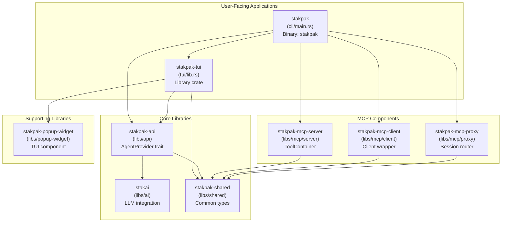
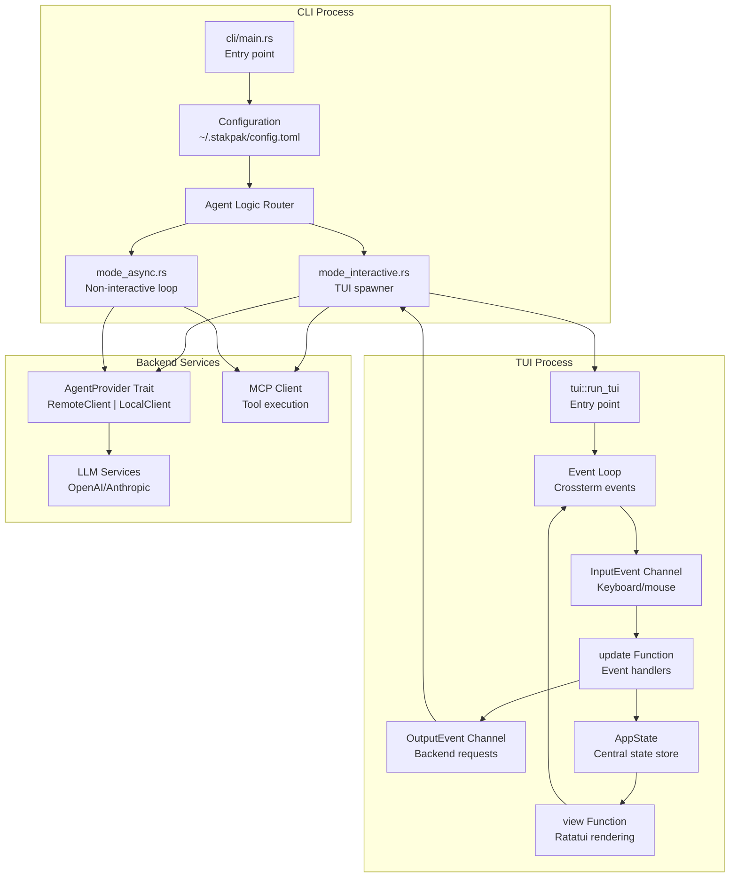
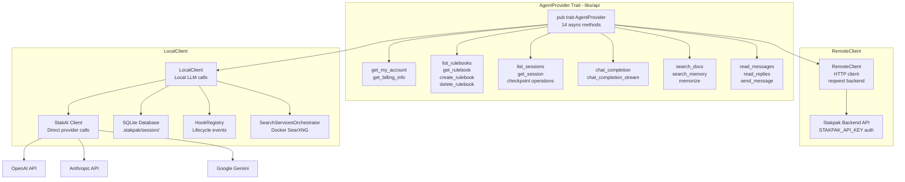
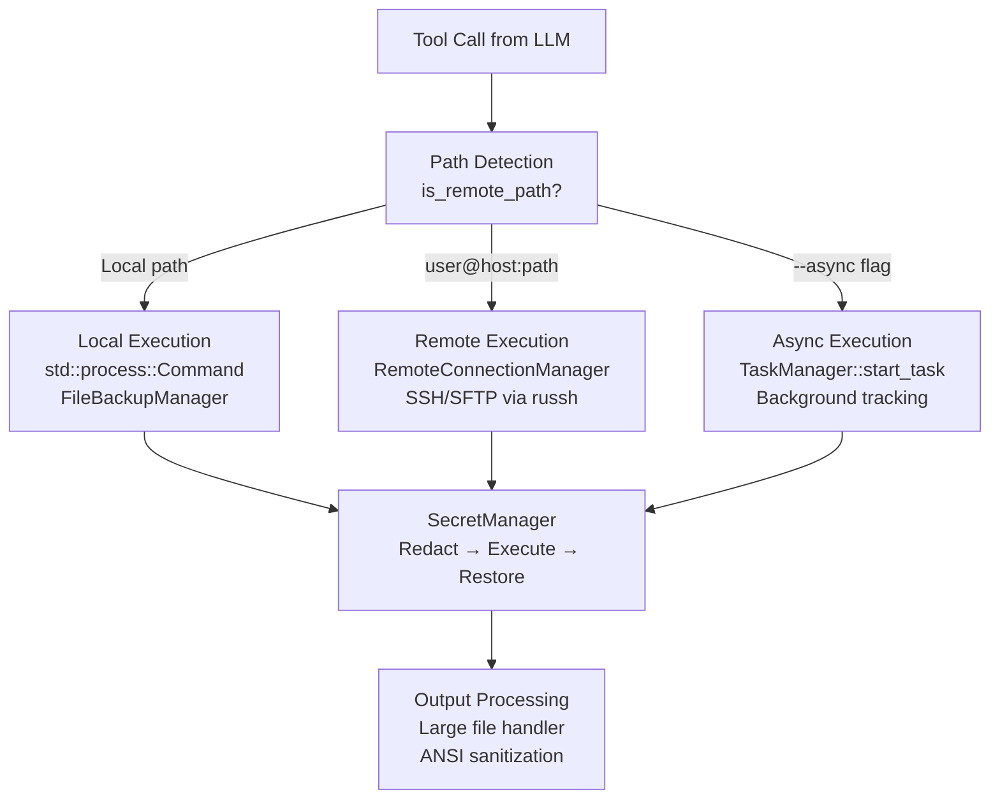
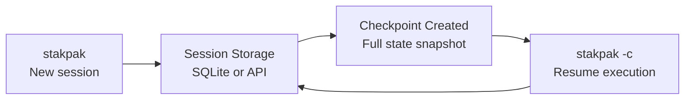

<!-- source: DeepWiki mcp.deepwiki.com · repo stakpak/agent · page 1 Overview · fetched 2026-10-27 -->

# Overview

<details>
<summary>Relevant source files</summary>

The following files were used as context for generating this wiki page:

- [Cargo.lock](Cargo.lock)
- [Cargo.toml](Cargo.toml)
- [README.md](README.md)
- [assets/stakpak-dark.png](assets/stakpak-dark.png)
- [assets/stakpak-light.png](assets/stakpak-light.png)
- [cli/Cargo.toml](cli/Cargo.toml)
- [tui/Cargo.toml](tui/Cargo.toml)

</details>


## Purpose and Scope

The stakpak agent is an AI-powered DevOps assistant designed with enterprise-grade security features. This system provides a secure, interactive terminal interface for DevOps tasks while maintaining strict controls over sensitive data through dynamic secret redaction, mutual TLS encryption, and privacy-first architecture.

This document covers the high-level architecture and core components of the stakpak system. For detailed information about specific subsystems, see: CLI Interface ([#2](#2)), Terminal User Interface ([#3](#3)), MCP System ([#4](#4)), Security and Privacy ([#6](#6)), and Deployment ([#7](#7)).

## System Architecture

The Stakpak Agent is implemented as a Rust workspace with 12 crates organized into three tiers: user-facing applications, core libraries, and MCP components.

### Workspace Structure and Dependencies

The workspace follows a dependency hierarchy where the CLI orchestrates all major components, while the TUI provides a focused interactive interface.



**Sources:** [Cargo.toml:1-94](), [cli/Cargo.toml:1-61](), [tui/Cargo.toml:1-51]()

### Runtime Architecture: CLI to TUI Communication

The CLI determines execution mode based on command-line flags. In async mode, it runs agent logic directly. In interactive mode, it spawns the TUI as a subprocess with bidirectional event channels.



**Sources:** [Cargo.toml:3-12](), [cli/Cargo.toml:11-17](), [tui/Cargo.toml:10-13]()

### AgentProvider Architecture

The `AgentProvider` trait abstracts backend interactions with 14 async methods. Two implementations enable different deployment models: `RemoteClient` for hosted services and `LocalClient` for local/offline operation.



**Sources:** [Cargo.toml:26-32](), [cli/Cargo.toml:12]()

## Core Components

### Command Line Interface (CLI)

The `stakpak` binary ([cli/main.rs]()) serves as the main entry point with argument parsing via `clap`. It routes execution to different modes based on subcommands:

| Subcommand | Module | Purpose |
|------------|--------|---------|
| (default) | `mode_interactive.rs` | Spawns TUI for interactive agent sessions |
| `--async` | `mode_async.rs` | Runs agent in batch mode without TUI |
| `mcp start` | `libs/mcp/server` | Starts MCP server with configurable tool modes |
| `mcp proxy` | `libs/mcp/proxy` | Starts MCP proxy with upstream server routing |
| `acp` | ACP protocol handler | Starts Agent Client Protocol server for editors |
| `config` | Configuration manager | Manages profiles and API keys |
| `rulebooks` | Rulebook CRUD | Manages organizational SOPs and policies |
| `account` | Account viewer | Displays current account and billing info |

The CLI manages configuration loading from `~/.stakpak/config.toml`, profile selection, and API key authentication.

**Sources:** [cli/Cargo.toml:1-61](), [Cargo.toml:1-12]()

### Terminal User Interface (TUI)

The `stakpak-tui` crate ([tui/lib.rs]()) implements a unidirectional data flow architecture using Ratatui. The main entry point is the `run_tui` function, which establishes:

- **Event Loop**: Processes `crossterm` terminal events and converts them to strongly-typed `InputEvent` enums (90+ variants)
- **State Management**: Central `AppState` struct with 6 subsystems (input, messages, tools, popups, shell, session)
- **Update Dispatcher**: Routes events to specialized handlers (input.rs, popup.rs, shell.rs, tool.rs, commands.rs)
- **View Function**: Renders UI from `AppState` using Ratatui widgets with caching for performance
- **Output Channel**: Emits `OutputEvent` enums for backend operations (tool calls, chat requests)

The TUI communicates with the CLI via bidirectional channels, maintaining session state and providing visual feedback for agent operations.

**Sources:** [tui/Cargo.toml:1-51](), [Cargo.toml:31]()

### Model Context Protocol (MCP) System

The MCP system provides dual functionality:

#### MCP Server (`stakpak-mcp-server`)
Exposes Stakpak's tools to external AI systems through the Model Context Protocol. The `ToolContainer` struct ([libs/mcp/server]()) implements 11 tools:

- **Local Tools**: `run_command`, `run_command_task`, `view`, `create`, `str_replace`, `remove`, `get_all_tasks`, `cancel_task`, `wait_for_tasks`, `generate_password`, `view_web_page`
- **Remote Operations**: `RemoteConnectionManager` handles SSH/SFTP for remote system access
- **Task Management**: `TaskManager` enables asynchronous execution with status tracking
- **Security**: `SecretManager` provides Gitleaks-based secret redaction, mTLS encryption, and privacy mode

Three tool modes are available: `local` (no API key required), `remote` (AI tools only), and `combined` (default).

#### MCP Client (`stakpak-mcp-client`)
Wraps the `rmcp` crate to consume tools from MCP servers. Handles tool discovery, invocation, filtering by `allowed_tools` configuration, and result processing.

#### MCP Proxy (`stakpak-mcp-proxy`)
Multiplexes connections to multiple upstream MCP servers using `mcp.toml` configuration. Manages sessions, routes requests to appropriate upstream servers, and provides centralized secret redaction.

**Sources:** [Cargo.toml:28-30](), [cli/Cargo.toml:13-15]()

### API Client and Shared Libraries

#### `stakpak-api`
Defines the `AgentProvider` trait with two implementations:
- **`RemoteClient`**: HTTP client using `reqwest` to communicate with Stakpak's hosted API
- **`LocalClient`**: Direct LLM integration via `stakai`, SQLite session storage, and Docker-based search orchestration

The trait provides 14 methods grouped into: account management, rulebook CRUD, session operations, chat completion, search/memory, and Slack integration.

#### `stakpak-shared`
Contains common types and utilities used across all crates:
- Data models: `AgentSession`, `ChatMessage`, `Tool`, `Block`, `Dependency`
- Security utilities: Secret management, privacy filtering, validation
- Configuration types: Profile definitions, authentication credentials

**Sources:** [Cargo.toml:26-27,32]()

## Key Features

### Security Architecture

| Feature | Implementation | Code Location |
|---------|---------------|---------------|
| **Mutual TLS (mTLS)** | End-to-end encrypted MCP connections using `rustls` and `rcgen` for certificate generation | [libs/mcp/server]() |
| **Secret Substitution** | Dynamic secret redaction/restoration using Gitleaks patterns. Secrets replaced with placeholders before LLM processing | [libs/mcp/server]() SecretManager |
| **Privacy Mode** | Redacts IP addresses, AWS account IDs, and other PII using configurable patterns | [libs/shared]() |
| **Password Generation** | Cryptographically secure passwords via `generate_password` tool with complexity rules | [libs/mcp/server]() ToolContainer |

### Tool Execution System

The MCP server implements sophisticated tool routing:



**Key capabilities:**
- **Task Management**: `TaskManager` tracks background processes with `start_task`, `cancel_task`, `wait_for_tasks`, and `get_all_tasks` APIs
- **Remote Operations**: `RemoteConnectionManager` pools SSH connections with password or key-based authentication
- **File Backups**: `FileBackupManager` automatically backs up modified files to `.stakpak_backup/` for recovery
- **Progress Streaming**: Long-running commands stream output updates for real-time feedback

**Sources:** [Cargo.toml:74-78](), [cli/Cargo.toml:39]()

### Configuration and Context Injection

Stakpak injects context into agent prompts through multiple sources:

| Context Source | Description | Storage |
|----------------|-------------|---------|
| **Rulebooks** | Markdown files with YAML frontmatter defining SOPs, playbooks, and policies | Remote API or local SQLite |
| **AGENTS.md** | Local file in current directory defining agent-specific instructions | Current working directory |
| **Session Memory** | Persistent knowledge from previous interactions via `memorize` and `search_memory` | SQLite database or remote API |
| **Subagents** | Specialized research agents with restricted tool access (enabled via `--enable-subagents`) | In-memory during session |
| **Local Context** | Automatic indexing of Terraform, Kubernetes, Docker, and GitHub Actions files | `.stakpak/` directory |

Configuration is managed via TOML profiles supporting:
- **BYOK (Bring Your Own Keys)**: Direct provider credentials for Anthropic, OpenAI, Gemini, AWS Bedrock
- **BYOL (Bring Your Own LLM)**: Custom OpenAI-compatible endpoints (Ollama, LM Studio)
- **Hybrid**: Mix of built-in and custom providers

**Sources:** [README.md:143-218]()

### Session Management

Sessions support checkpointing and resumption:



Each session maintains:
- Conversation history with full message context
- Tool call results and approval state
- Profile configuration and model selection
- Environment variables and working directory
- Pending operations and background tasks

**Sources:** [README.md:224-226]()

## Installation and Basic Usage

### Installation Methods

The stakpak agent supports multiple installation methods:

| Method | Command | Platforms |
|--------|---------|-----------|
| Homebrew | `brew tap stakpak/stakpak && brew install stakpak` | Linux, macOS |
| Binary Release | Download from GitHub Releases | Linux, macOS, Windows |
| Docker | `docker pull ghcr.io/stakpak/agent:latest` | All platforms |

### Authentication and Configuration

The system requires an API key for full functionality:

```bash
# Set environment variable
export STAKPAK_API_KEY=<your-key>

# Or save to configuration file
stakpak login --api-key $STAKPAK_API_KEY
```

### Execution Modes

The CLI supports multiple execution modes:

```bash
# Interactive TUI mode (default)
stakpak

# Resume from checkpoint
stakpak -c <checkpoint-id>

# MCP server mode with different tool configurations
stakpak mcp --tool-mode local    # Local tools only
stakpak mcp --tool-mode remote   # Remote AI tools only  
stakpak mcp --tool-mode combined # All tools (default)
```

**Sources:** [README.md:29-149](), [.github/workflows/build-and-release.yml:1-233]()

---

