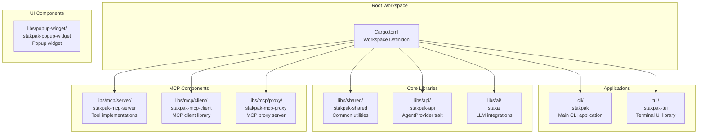
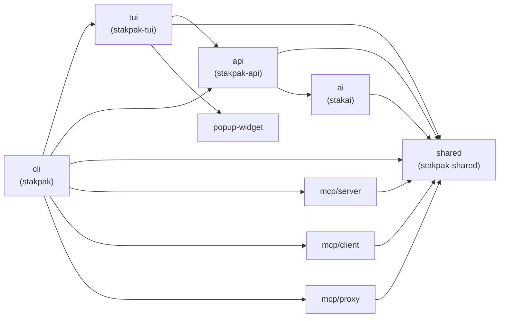
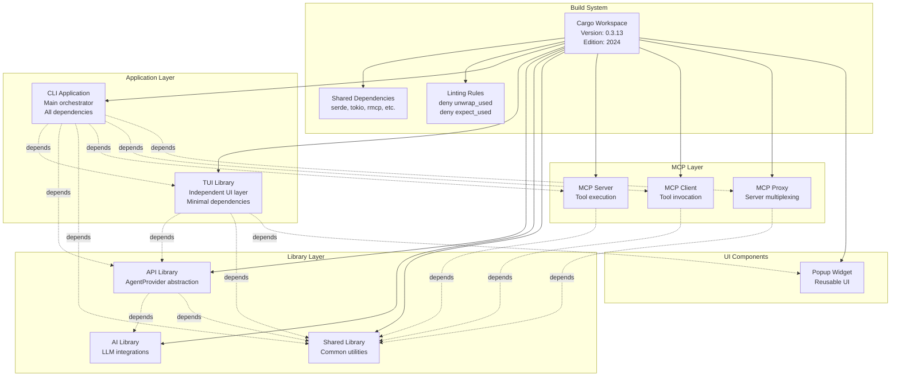

<!-- source: DeepWiki mcp.deepwiki.com · repo stakpak/agent · page 1.2 Workspace Structure and Packages · fetched 2026-10-27 -->

# Workspace Structure and Packages

<details>
<summary>Relevant source files</summary>

The following files were used as context for generating this wiki page:

- [Cargo.lock](Cargo.lock)
- [Cargo.toml](Cargo.toml)
- [cli/Cargo.toml](cli/Cargo.toml)
- [tui/Cargo.toml](tui/Cargo.toml)

</details>


## Purpose and Scope

This page documents the Cargo workspace structure of the Stakpak codebase, including all member crates, their interdependencies, and shared dependencies. For information about system architecture and how these components interact at runtime, see [System Architecture](#1.1). For build and deployment processes, see [Build System and Deployment](#7).

## Workspace Organization

The Stakpak repository is organized as a Cargo workspace with 8 member crates defined in [Cargo.toml:1-12](). The workspace uses Cargo's version 2 resolver and shares common package metadata and dependencies across all members.



**Workspace Members**

Sources: [Cargo.toml:1-12]()

## Package Catalog

The following table lists all packages in the workspace with their identifiers, locations, and primary purposes:

| Package Name | Crate Name | Location | Purpose |
|--------------|------------|----------|---------|
| **stakpak** | `stakpak` | `cli/` | Main CLI executable providing command-line interface and orchestration |
| **stakpak-tui** | `stakpak_tui` | `tui/` | Terminal user interface library with event loop and rendering system |
| **stakpak-shared** | `stakpak_shared` | `libs/shared/` | Common utilities, models, and types shared across all crates |
| **stakpak-api** | `stakpak_api` | `libs/api/` | AgentProvider trait and implementations (RemoteClient, LocalClient) |
| **stakai** | `stakai` | `libs/ai/` | AI/LLM integrations for multiple providers (OpenAI, Anthropic, etc.) |
| **stakpak-mcp-server** | `stakpak_mcp_server` | `libs/mcp/server/` | MCP server implementation with 11 local tools |
| **stakpak-mcp-client** | `stakpak_mcp_client` | `libs/mcp/client/` | MCP client for invoking tools from external MCP servers |
| **stakpak-mcp-proxy** | `stakpak_mcp_proxy` | `libs/mcp/proxy/` | MCP proxy server for multiplexing upstream MCP servers |
| **stakpak-popup-widget** | `popup_widget` | `libs/popup-widget/` | Reusable popup widget component for TUI |

Sources: [Cargo.toml:3-12](), [cli/Cargo.toml:2](), [tui/Cargo.toml:2]()

## Inter-Crate Dependencies

### Dependency Graph



**CLI Dependencies**

The `stakpak` CLI crate depends on all major components as it serves as the orchestration layer:

Sources: [cli/Cargo.toml:11-17]()

### Primary Dependencies by Package

**stakpak (CLI)**
- `stakpak-api` - Agent provider abstraction
- `stakpak-mcp-server` - Local tool execution
- `stakpak-mcp-client` - External tool invocation  
- `stakpak-mcp-proxy` - MCP proxy functionality
- `stakpak-tui` - Interactive terminal UI
- `stakpak-shared` - Common utilities

Sources: [cli/Cargo.toml:12-17]()

**stakpak-tui (TUI)**
- `stakpak-api` - Backend communication
- `stakpak-shared` - Shared models and utilities
- `popup-widget` - Popup UI components

Sources: [tui/Cargo.toml:11-13]()

**stakpak-api (API)**
- `stakai` - AI/LLM functionality (inferred from system diagrams)
- `stakpak-shared` - Common types

**MCP Components (server, client, proxy)**
- `stakpak-shared` - All MCP components depend on shared utilities

**stakai (AI)**
- `stakpak-shared` - Common types (inferred)

Sources: [Cargo.toml:26-33]()

## Shared Dependencies

The workspace defines common dependencies that are shared across multiple crates. These are specified in [Cargo.toml:25-88]() and ensure version consistency.

### Key Shared Dependencies

| Dependency | Version | Key Features | Used By |
|------------|---------|--------------|---------|
| `serde` | 1.0.215 | `derive` | All crates |
| `serde_json` | 1.0.133 | JSON serialization | All crates |
| `tokio` | 1.x | `full` | Async runtime for all crates |
| `tracing` | 0.1.41 | Logging | CLI, API, MCP components |
| `anyhow` | 1.0.98 | Error handling | All crates |
| `rmcp` | 0.11.0 | MCP protocol implementation | CLI, MCP components |
| `reqwest` | 0.12.15 | `json`, `stream`, `rustls-tls` | CLI, API |
| `ratatui` | 0.29.0 | `scrolling-regions`, `unstable-*` | TUI |
| `chrono` | 0.4.38 | `serde` | Multiple crates |
| `uuid` | 1.10.0 | `serde`, `v4` | Multiple crates |
| `crossterm` | 0.29 | Terminal control | CLI, TUI |
| `regex` | 1.11.1 | Pattern matching | Multiple crates |
| `rustls` | 0.23.29 | TLS support | CLI, MCP components |

Sources: [Cargo.toml:34-88]()

### RMCP Feature Configuration

The `rmcp` dependency is configured with extensive features for MCP protocol support:

```toml
rmcp = { version = "0.11.0", features = [
    "base64",
    "macros",
    "client",
    "server",
    "reqwest",
    "transport-io",
    "transport-child-process",
    "transport-streamable-http-client",
    "transport-streamable-http-client-reqwest",
    "transport-streamable-http-server",
    "transport-streamable-http-server-session",
    "transport-worker",
], default-features = false }
```

This configuration enables multiple transport mechanisms (stdio, child process, HTTP streaming) for both client and server roles.

Sources: [Cargo.toml:41-54]()

## Version Management

### Workspace-Level Versioning

All crates share a common version number managed at the workspace level. The current version is `0.3.13` as defined in [Cargo.toml:17]().

Individual crate `Cargo.toml` files reference the workspace version:

```toml
[package]
version = { workspace = true }
```

This ensures all published crates maintain version parity.

Sources: [Cargo.toml:16-22](), [cli/Cargo.toml:3](), [tui/Cargo.toml:3]()

### Metadata Sharing

Common package metadata is also defined at the workspace level and inherited by member crates:

- `edition = "2024"` - Using Rust 2024 edition
- `license = "Apache-2.0"`
- `repository = "https://github.com/stakpak/agent"`
- `homepage = "https://stakpak.io"`
- `description` - Shared description of Stakpak

Sources: [Cargo.toml:16-22]()

## Build Configuration

### Linting Rules

The workspace enforces strict linting rules through Clippy at [Cargo.toml:91-93]():

```toml
[workspace.lints.clippy]
unwrap_used = "deny"
expect_used = "deny"
```

These rules are inherited by individual crates and prohibit use of `.unwrap()` and `.expect()` methods, requiring explicit error handling throughout the codebase.

Sources: [Cargo.toml:91-93](), [cli/Cargo.toml:58-60](), [tui/Cargo.toml:41-43]()

### Resolver Version

The workspace uses Cargo's version 2 resolver ([Cargo.toml:2]()), which provides improved dependency resolution and feature unification behavior.

## Special Dependencies

### CLI-Specific Dependencies

The CLI crate includes additional dependencies for its broader functionality:

- **Configuration**: `config` (0.14.1) for configuration management
- **CLI Framework**: `clap` (4.5.23) with `derive` and `env` features
- **ACP Protocol**: `agent-client-protocol` (0.9.2) for code editor integration
- **JSON-RPC**: `jsonrpc-core`, `jsonrpc-derive` for RPC server
- **Archive Handling**: `tar`, `flate2`, `zip` for compression
- **Interactive Input**: `rpassword` for secure password input

Sources: [cli/Cargo.toml:20-52]()

### TUI-Specific Dependencies

The TUI crate includes specialized dependencies for terminal rendering:

- **Rendering**: `ratatui` (0.29.0) with advanced features
- **Text Processing**: `textwrap`, `unicode-segmentation`, `unicode-width`
- **Syntax Highlighting**: `syntect` (5.2.0)
- **Fuzzy Matching**: `nucleo-matcher` (0.3.1)
- **ANSI Processing**: `ansi-to-tui` (7.0.0)
- **VT100 Emulation**: `vt100` (0.15.2) for shell mode
- **Platform-Specific**: 
  - `portable-pty` (0.8) for Unix/Windows PTY support
  - `arboard` (3) for clipboard on non-Android platforms

Sources: [tui/Cargo.toml:14-50]()

## Package Publication

### Published Crates

The following crates are published to crates.io:

1. **stakpak** - Main CLI binary
2. **stakpak-tui** - TUI library (can be used independently)
3. **stakpak-api** - API abstraction layer
4. **stakai** - AI/LLM integration library
5. **stakpak-shared** - Shared utilities
6. **stakpak-mcp-server** - MCP server library
7. **stakpak-mcp-client** - MCP client library
8. **stakpak-mcp-proxy** - MCP proxy library

The `popup-widget` crate is published as `stakpak-popup-widget` ([Cargo.toml:33]()).

Sources: [Cargo.toml:26-33]()

## Workspace Structure Summary



**Architecture Summary**

The workspace follows a layered architecture:
1. **Application Layer**: CLI orchestrates all components; TUI provides interactive UI
2. **Library Layer**: Core business logic in API, AI, and Shared crates
3. **MCP Layer**: Tool execution infrastructure for local and remote operations
4. **UI Components**: Reusable widgets for terminal interfaces

The `stakpak-shared` crate serves as the foundation, depended upon by nearly all other crates for common types and utilities. The CLI acts as the integration point, pulling together all components to provide the complete Stakpak experience.

Sources: [Cargo.toml:1-94](), [cli/Cargo.toml:1-61](), [tui/Cargo.toml:1-51]()

---

