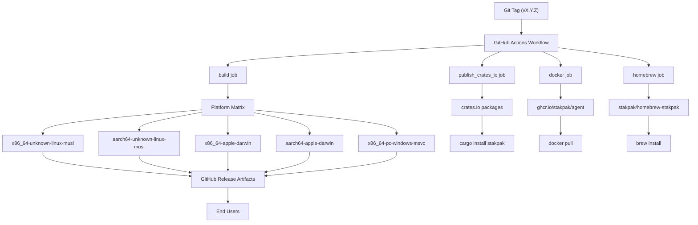
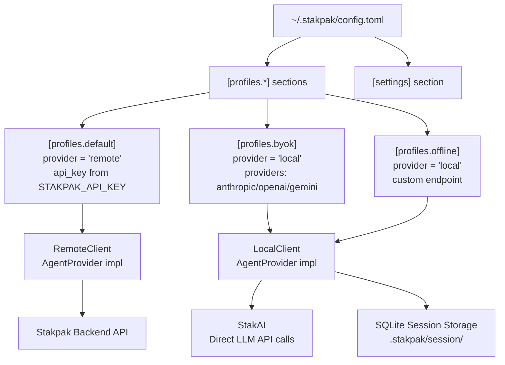
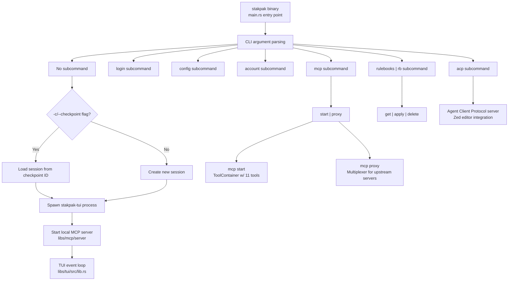
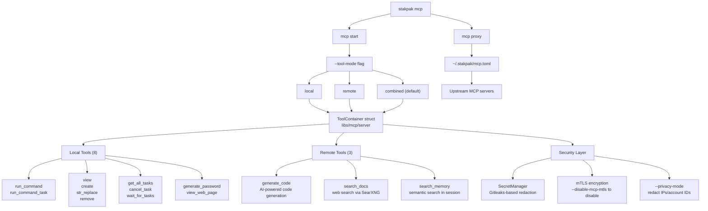

<!-- source: DeepWiki mcp.deepwiki.com · repo stakpak/agent · page 1.3 Installation and Getting Started · fetched 2026-10-27 -->

# Installation and Getting Started

<details>
<summary>Relevant source files</summary>

The following files were used as context for generating this wiki page:

- [.github/workflows/build-and-release.yml](.github/workflows/build-and-release.yml)
- [README.md](README.md)
- [assets/stakpak-dark.png](assets/stakpak-dark.png)
- [assets/stakpak-light.png](assets/stakpak-light.png)
- [cliff.toml](cliff.toml)
- [libs/popup-widget/Cargo.toml](libs/popup-widget/Cargo.toml)
- [libs/popup-widget/README.md](libs/popup-widget/README.md)
- [release.sh](release.sh)

</details>


This document covers the installation methods, authentication setup, and initial usage patterns for stakpak agent. It provides the essential steps to get the agent running in its various execution modes. For detailed information about system architecture, see [System Architecture](#1.1). For specific CLI commands and execution modes, see [CLI Interface](#2).

## Installation Methods

stakpak is distributed through three primary channels: Homebrew tap, GitHub Releases binary artifacts, and Docker images. The build and release process is automated via GitHub Actions workflow defined in [.github/workflows/build-and-release.yml]().

### Installation Distribution Flow



Sources: [.github/workflows/build-and-release.yml:47-112](), [.github/workflows/build-and-release.yml:138-217](), [.github/workflows/build-and-release.yml:219-273](), [.github/workflows/build-and-release.yml:329-392]()

### Installation Commands by Method

| Method | Platforms | Installation | Verification |
|--------|-----------|--------------|--------------|
| **Quick Install Script** | Linux, MacOS | `curl -sSL https://stakpak.dev/install.sh \| sh` | `stakpak --version` |
| **Homebrew** | Linux, MacOS | `brew tap stakpak/stakpak && brew install stakpak` | `stakpak --version` |
| **Cargo** | Cross-platform | `cargo install stakpak` | `stakpak --version` |
| **Binary Release** | All | Download from [GitHub Releases](https://github.com/stakpak/agent/releases) | `./stakpak --version` |
| **Docker** | All with Docker | `docker pull ghcr.io/stakpak/agent:latest` | `docker run ghcr.io/stakpak/agent:latest --version` |

The build matrix targets five platforms: `x86_64-unknown-linux-musl`, `aarch64-unknown-linux-musl`, `x86_64-apple-darwin`, `aarch64-apple-darwin`, and `x86_64-pc-windows-msvc`. Each build produces compressed archives (`.tar.gz` for Unix, `.zip` for Windows) uploaded as GitHub Release artifacts.

The Docker image is built from `Dockerfile` and includes common DevOps tools: `docker`, `kubectl`, `aws`, `gcloud`, `azure`, `terraform`, `helm`.

Sources: [README.md:49-107](), [.github/workflows/build-and-release.yml:51-66](), [.github/workflows/build-and-release.yml:236-244]()

## Configuration and Authentication

stakpak supports two operational modes: **remote** (Stakpak-hosted backend) and **local** (bring-your-own-keys or custom LLM endpoint). Configuration is stored in `~/.stakpak/config.toml` following TOML format with profile-based settings.

### Configuration Architecture



Sources: [README.md:110-217]()

### Configuration File Structure

The configuration file defines profiles with provider-specific settings. Two modes are supported:

#### Option A: Remote Provider (Stakpak API)

```toml
[profiles.default]
provider = "remote"
# API key sourced from STAKPAK_API_KEY env var or inline

[settings]
```

**Setup commands**:
```bash
# Interactive setup (opens browser for API key creation)
stakpak

# Or configure via command
stakpak login --api-key $STAKPAK_API_KEY

# Verify
stakpak account
```

#### Option B: Local Provider (BYOK)

```toml
[profiles.byok]
provider = "local"

# Model names auto-detected for built-in providers
smart_model = "claude-sonnet-4-5"
eco_model = "claude-haiku-4-5"

# Built-in providers - credentials via env vars or inline
[profiles.byok.providers.anthropic]
type = "anthropic"
api_key = "sk-ant-..."  # or ANTHROPIC_API_KEY env

[profiles.byok.providers.openai]
type = "openai"
api_key = "sk-..."  # or OPENAI_API_KEY env

[profiles.byok.providers.gemini]
type = "gemini"
api_key = "..."  # or GEMINI_API_KEY env

[settings]
```

**Setup commands**:
```bash
# Create config file manually or use:
mkdir -p ~/.stakpak
cat > ~/.stakpak/config.toml << 'EOF'
# ... paste config above ...
EOF

# Run with profile
stakpak --profile byok
```

#### Option C: Custom OpenAI-Compatible Endpoint

```toml
[profiles.offline]
provider = "local"

# Custom provider models use format: provider_key/model_name
smart_model = "offline/qwen/qwen3-coder-30b"
eco_model = "offline/qwen/qwen3-coder-30b"

[profiles.offline.providers.offline]
type = "custom"
api_endpoint = "http://localhost:11434/v1"
# api_key optional for local providers

[settings]
```

**Supported endpoints**: Ollama, LM Studio, vLLM, or any OpenAI-compatible API.

Sources: [README.md:141-217]()

### Environment Variables

| Variable | Purpose | Profiles |
|----------|---------|----------|
| `STAKPAK_API_KEY` | Stakpak backend authentication | Remote provider |
| `ANTHROPIC_API_KEY` | Anthropic Claude API key | Local provider |
| `OPENAI_API_KEY` | OpenAI API key | Local provider |
| `GEMINI_API_KEY` | Google Gemini API key | Local provider |
| `HOME` | Config directory base (`~/.stakpak/`) | All |

Environment variables take precedence over inline `api_key` values in config file.

Sources: [README.md:154-166]()

## Basic Usage and Startup Modes

The `stakpak` binary provides multiple subcommands and operational modes. The default mode spawns an interactive TUI, while subcommands provide specific functionality like MCP server hosting, configuration management, and account operations.

### CLI Command Structure



Sources: [README.md:219-327]()

### Common Usage Commands

| Command | Function | Configuration Required |
|---------|----------|------------------------|
| `stakpak` | Launch interactive TUI | Profile with provider |
| `stakpak -c <checkpoint-id>` | Resume session from checkpoint | Same as creation |
| `stakpak --profile <name>` | Use specific config profile | Named profile in config |
| `stakpak login --api-key <key>` | Save API key to config | None |
| `stakpak account` | Display account info | Remote provider API key |
| `stakpak config list` | List all profiles | Config file exists |
| `stakpak rb get` | List all rulebooks | Remote provider API key |
| `stakpak rb apply <file>` | Upload rulebook markdown | Remote provider API key |
| `stakpak mcp start` | Start MCP server (combined mode) | Profile with provider |
| `stakpak mcp start --tool-mode local` | Start MCP server (local tools only) | None |
| `stakpak mcp proxy` | Start MCP proxy server | `~/.stakpak/mcp.toml` config |
| `stakpak acp` | Start ACP server for Zed | Profile with provider |

### Interactive TUI Mode

The default execution mode starts the terminal user interface:

```bash
# Start new session
stakpak

# Resume from checkpoint
stakpak -c abc123

# With specific profile
stakpak --profile byok
```

The TUI spawns as a subprocess with bidirectional event channels (`InputEvent`/`OutputEvent`) for communication with the CLI parent process. See [TUI Architecture](#3) for detailed event flow.

Sources: [README.md:219-226]()

### Docker Deployment

Docker images support the same command structure with volume mounts for persistence and Docker socket access:

```bash
# Interactive TUI
docker run -it --entrypoint stakpak ghcr.io/stakpak/agent:latest

# With Docker socket for container operations
docker run -it \
  -v "/var/run/docker.sock":"/var/run/docker.sock" \
  -v "$(pwd)":"/agent/" \
  --entrypoint stakpak ghcr.io/stakpak/agent:latest

# With config persistence
docker run -it \
  -v "$HOME/.stakpak":"/root/.stakpak" \
  --entrypoint stakpak ghcr.io/stakpak/agent:latest
```

The image includes DevOps tools accessible to agent operations: `docker`, `kubectl`, `aws`, `gcloud`, `azure`, `terraform`, `helm`, `git`.

Sources: [README.md:228-237]()

## MCP Server Modes

The `stakpak mcp` subcommand provides two operational modes: `start` (tool server) and `proxy` (upstream multiplexer). The tool server exposes 11 tools through the `ToolContainer` struct defined in `libs/mcp/server`.

### MCP Server Architecture



Sources: [README.md:241-289]()

### Tool Mode Configuration

The `--tool-mode` flag controls which tools are exposed:

| Mode | Tools Count | Description | API Key Required |
|------|-------------|-------------|------------------|
| `local` | 8 local tools | File operations, command execution, task management, password generation | No |
| `remote` | 3 remote tools | AI code generation, documentation search, memory search | Yes |
| `combined` | 11 total tools | Both local and remote tool sets | Yes |

**Local tools** (no API key required):
- `run_command` - Execute shell commands synchronously
- `run_command_task` - Execute shell commands asynchronously with task tracking
- `view` - Read file contents
- `create` - Create new files
- `str_replace` - Find and replace in files
- `remove` - Delete files/directories
- `get_all_tasks` - List running background tasks
- `cancel_task` - Cancel background task by ID
- `wait_for_tasks` - Wait for tasks to complete
- `generate_password` - Generate cryptographically secure passwords
- `view_web_page` - Fetch and convert web pages to markdown

**Remote tools** (API key required):
- `generate_code` - AI-powered code generation using configured LLM
- `search_docs` - Search technical documentation via SearXNG Docker container
- `search_memory` - Semantic search across session memory and indexed files

Sources: [README.md:244-272]()

### MCP Server Startup Examples

```bash
# Local tools only (no API key)
stakpak mcp start --tool-mode local

# Remote tools only (AI features)
stakpak mcp start --tool-mode remote

# Combined mode (default)
stakpak mcp start

# Disable mTLS (NOT recommended)
stakpak mcp start --disable-mcp-mtls

# Enable privacy mode (redact sensitive data)
stakpak mcp start --privacy-mode

# Disable secret redaction in logs (NOT recommended)
stakpak mcp start --disable-secret-redaction
```

### MCP Proxy Mode

The proxy multiplexes connections to multiple upstream MCP servers configured in `~/.stakpak/mcp.toml`:

```bash
# Auto-discover config
stakpak mcp proxy

# Explicit config file
stakpak mcp proxy --config-file ~/.stakpak/mcp.toml

# With privacy mode
stakpak mcp proxy --privacy-mode
```

The proxy enables aggregation of multiple MCP servers (e.g., filesystem, git, cloud provider tools) through a single endpoint.

Sources: [README.md:274-289]()

### Security Features

All MCP modes include:

- **mTLS encryption** - Mutual TLS for transport security (default enabled)
- **Secret redaction** - Gitleaks integration scans outputs and redacts secrets before transmission
- **Privacy mode** - Additional redaction of IP addresses, AWS account IDs, and other PII via `--privacy-mode` flag
- **Tool filtering** - `allowed_tools` configuration restricts which tools are callable

See [Security and Privacy](#6) for implementation details of `SecretManager` and `Warden` guardrails.

Sources: [README.md:55-61](), [README.md:268-272]()

## Configuration Files and Environment

The agent uses a configuration file located at `~/.stakpak/config.toml` for persistent settings. This file is created automatically when using the `stakpak login` command and stores the API key and other configuration parameters.

### Environment Variables

| Variable | Purpose | Required |
|----------|---------|----------|
| `STAKPAK_API_KEY` | Authentication with stakpak service | For remote features |
| `HOME` | Location of config directory (`~/.stakpak/`) | Yes |

The agent checks for the API key first in the environment variable, then falls back to the configuration file if the environment variable is not set.

Sources: [README.md:76-86]()

---

