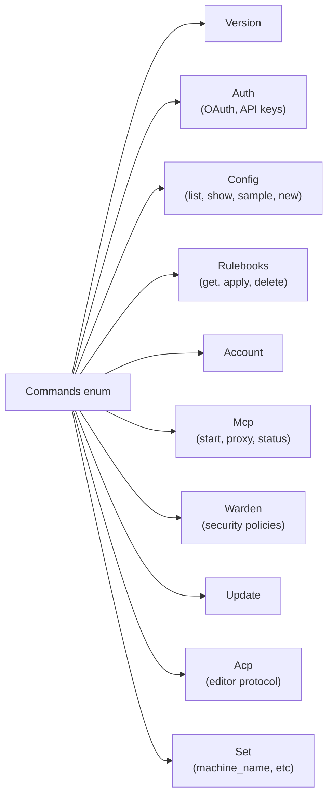
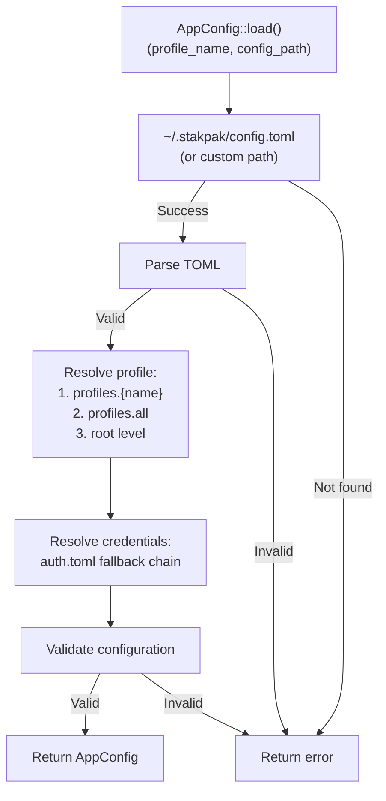
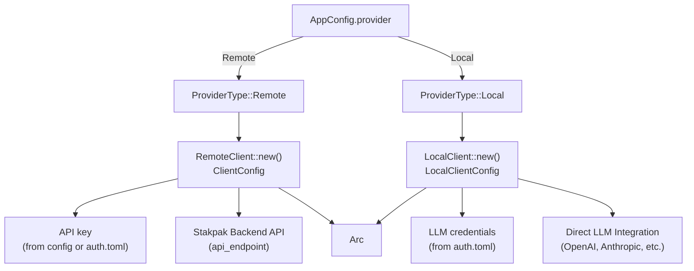
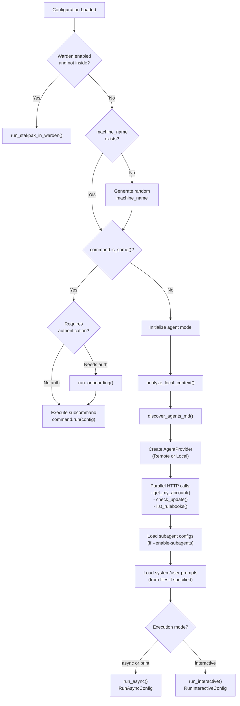
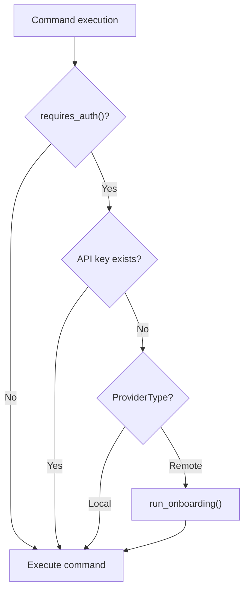
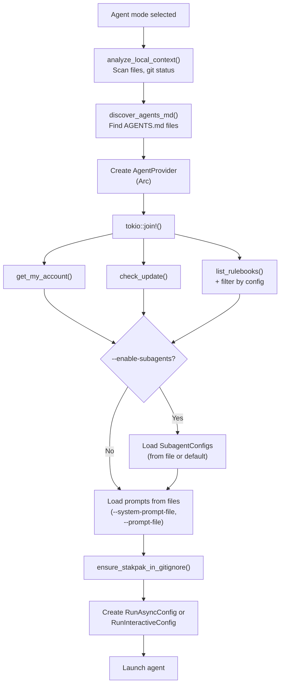

<!-- source: DeepWiki mcp.deepwiki.com · repo stakpak/agent · page 2.1 Main Entry Point and Configuration · fetched 2026-10-27 -->

# Main Entry Point and Configuration

<details>
<summary>Relevant source files</summary>

The following files were used as context for generating this wiki page:

- [cli/src/commands/agent/run/helpers.rs](cli/src/commands/agent/run/helpers.rs)
- [cli/src/commands/agent/run/mode_async.rs](cli/src/commands/agent/run/mode_async.rs)
- [cli/src/commands/agent/run/mode_interactive.rs](cli/src/commands/agent/run/mode_interactive.rs)
- [cli/src/commands/mod.rs](cli/src/commands/mod.rs)
- [cli/src/main.rs](cli/src/main.rs)

</details>


## Purpose and Scope

This document describes the CLI's main entry point (`main.rs`) and configuration system, which serves as the initialization layer for all Stakpak operations. It covers command-line argument parsing, configuration file loading, profile management, provider initialization, and the routing logic that determines execution mode. 

For details on how the agent executes after initialization, see [Agent Execution Modes](#2.2). For configuration of context injection (rulebooks, local files, etc.), see [Context Injection Pipeline](#2.3).

---

## Application Entry Point

The application starts in `main()` at [cli/src/main.rs:147-512](), which orchestrates the initialization sequence:

### Initialization Sequence Diagram

```mermaid
graph TB
    MAIN["main()"]
    CRYPTO["Install rustls CryptoProvider"]
    ARGS["Parse CLI arguments<br/>(Cli struct)"]
    UPDATE["Auto-update check<br/>(interactive mode only)"]
    WORKDIR["Set working directory<br/>(--workdir)"]
    LOGGING["Initialize tracing<br/>(--debug)"]
    PROFILE["Resolve profile name<br/>(CLI > env > default)"]
    LOAD["AppConfig::load()"]
    WARDEN_CHECK{"Warden enabled<br/>in profile?"}
    WARDEN["Re-execute in<br/>warden container"]
    MACHINE["Generate machine_name<br/>(if missing)"]
    ROUTE{"Route execution"}
    SUBCOMMAND["Execute subcommand"]
    AGENT["Initialize agent<br/>(interactive/async)"]
    
    MAIN --> CRYPTO
    CRYPTO --> ARGS
    ARGS --> UPDATE
    UPDATE --> WORKDIR
    WORKDIR --> LOGGING
    LOGGING --> PROFILE
    PROFILE --> LOAD
    LOAD --> WARDEN_CHECK
    WARDEN_CHECK -->|Yes| WARDEN
    WARDEN_CHECK -->|No| MACHINE
    MACHINE --> ROUTE
    ROUTE -->|command.is_some()| SUBCOMMAND
    ROUTE -->|None| AGENT
```

**Sources:** [cli/src/main.rs:147-217]()

### Key Initialization Steps

1. **Crypto Provider**: Installs `rustls` with AWS LC crypto backend [cli/src/main.rs:149]()
2. **Argument Parsing**: Parses CLI arguments into `Cli` struct using clap [cli/src/main.rs:158-162]()
3. **Auto-Update**: Checks for updates only in interactive mode [cli/src/main.rs:165-171]()
4. **Working Directory**: Changes to `--workdir` if specified [cli/src/main.rs:173-179]()
5. **Logging**: Initializes tracing subscriber if `--debug` flag is set [cli/src/main.rs:181-189]()
6. **Profile Resolution**: Determines profile name from CLI arg, `STAKPAK_PROFILE` env var, or defaults to "default" [cli/src/main.rs:192-195]()

---

## Command-Line Interface Structure

The CLI is defined using the `Cli` struct with clap attributes:

### Cli Struct Overview

| Field | Type | Description | Default |
|-------|------|-------------|---------|
| `print` | `bool` | Single-step execution mode | `false` |
| `r#async` | `bool` | Multi-step async execution | `false` |
| `max_steps` | `Option<usize>` | Maximum agent steps | `None` (50 for async) |
| `checkpoint_id` | `Option<String>` | Resume from checkpoint UUID | `None` |
| `workdir` | `Option<String>` | Working directory | Current dir |
| `verbose` | `bool` | Enable verbose output | `false` |
| `output_format` | `OutputFormat` | Output format (json/text) | `Text` |
| `debug` | `bool` | Enable debug logging | `false` |
| `disable_secret_redaction` | `bool` | Disable secret redaction | `false` |
| `privacy_mode` | `bool` | Enable privacy mode | `false` |
| `study_mode` | `bool` | Enable study assistant mode | `false` |
| `allowed_tools` | `Option<Vec<String>>` | Restrict available tools | `None` (all) |
| `system_prompt_file` | `Option<String>` | System prompt file path | `None` |
| `prompt_file` | `Option<String>` | Prompt file path | `None` |
| `profile` | `Option<String>` | Configuration profile | env/default |
| `model` | `Option<AgentModel>` | Agent model (smart/eco) | `Smart` |
| `config_path` | `Option<PathBuf>` | Custom config file path | `~/.stakpak/config.toml` |
| `prompt` | `Option<String>` | Direct prompt text | `None` |
| `command` | `Option<Commands>` | Subcommand to execute | `None` (agent) |

**Sources:** [cli/src/main.rs:41-142]()

### Commands Enum

The `Commands` enum defines all available subcommands:



**Sources:** [cli/src/commands/mod.rs:102-167]()

---

## Configuration System

### AppConfig Loading

Configuration is loaded through `AppConfig::load()` with profile support:



**Sources:** [cli/src/main.rs:197-229]()

### Configuration Structure

The `AppConfig` contains these key fields:

| Field | Type | Description |
|-------|------|-------------|
| `profile_name` | `String` | Active profile name |
| `config_path` | `String` | Path to config file |
| `api_key` | `Option<String>` | Stakpak API key (for remote) |
| `api_endpoint` | `String` | API endpoint URL |
| `provider` | `ProviderType` | Remote or Local |
| `machine_name` | `Option<String>` | Device identifier |
| `mcp_server_host` | `Option<String>` | MCP server address |
| `allowed_tools` | `Option<Vec<String>>` | Tool whitelist |
| `auto_approve` | `Option<Vec<String>>` | Auto-approve tool list |
| `rulebooks` | `Option<RulebookConfig>` | Rulebook filters |
| `warden` | `Option<WardenConfig>` | Security policies |
| `editor` | `Option<String>` | Preferred editor |
| `eco_model` | `Option<String>` | Economy model name |
| `smart_model` | `Option<String>` | Smart model name |
| `recovery_model` | `Option<String>` | Recovery model name |
| `anonymous_id` | `Option<String>` | Telemetry ID |
| `collect_telemetry` | `Option<bool>` | Telemetry opt-in |

**Sources:** [cli/src/config.rs]() (referenced in imports)

### Profile Hierarchy

Profiles support inheritance with the following precedence:

1. **Profile-specific settings** (`profiles.{name}`)
2. **Common settings** (`profiles.all`)
3. **Root-level defaults**

Example configuration structure:

```toml
# Root-level defaults (lowest priority)
api_endpoint = "https://apiv2.stakpak.dev"

[profiles.all]
# Applies to all profiles
allowed_tools = ["view", "search_docs"]

[profiles.default]
# Specific profile (highest priority)
api_key = "sk-..."
allowed_tools = ["view", "search_docs", "create", "str_replace"]
```

**Sources:** [cli/src/commands/mod.rs:499-612]()

---

## Provider Initialization

### ProviderType Selection

The configuration determines which `AgentProvider` implementation to use:



**Sources:** [cli/src/main.rs:267-296]()

### RemoteClient Initialization

For `ProviderType::Remote`:

```rust
RemoteClient::new(&ClientConfig {
    api_key: config.api_key.clone(),
    api_endpoint: config.api_endpoint.clone(),
})
```

**Sources:** [cli/src/main.rs:269-274](), [cli/src/commands/mode_interactive.rs:168-173]()

### LocalClient Initialization

For `ProviderType::Local`:

```rust
LocalClient::new(LocalClientConfig {
    stakpak_base_url: Some(config.api_endpoint.clone()),
    store_path: None,
    providers: config.get_llm_provider_config_async().await,
    eco_model: config.eco_model.clone(),
    recovery_model: config.recovery_model.clone(),
    smart_model: config.smart_model.clone(),
    hook_registry: None,
})
```

The `get_llm_provider_config_async()` method resolves LLM credentials from `auth.toml` and refreshes OAuth tokens in parallel to minimize startup delay.

**Sources:** [cli/src/main.rs:276-295](), [cli/src/commands/mode_interactive.rs:175-189]()

---

## Execution Routing

### Routing Decision Tree

After configuration loads, the application routes to one of three paths:



**Sources:** [cli/src/main.rs:200-508]()

### Warden Pre-Execution Check

Before any agent execution, the system checks if Warden (security container) is enabled:

```rust
let should_use_warden = config.warden.as_ref().map(|w| w.enabled).unwrap_or(false)
    && std::env::var("STAKPAK_SKIP_WARDEN").is_err()
    && cli.command.is_none(); // Only for main agent, not for subcommands
```

If enabled, it re-executes the entire stakpak command inside the Warden container and exits.

**Sources:** [cli/src/main.rs:200-216]()

### Machine Name Generation

If no machine name exists in the config, it generates a random human-readable name:

```rust
let random_name = names::Generator::with_naming(Name::Numbered)
    .next()
    .unwrap_or_else(|| "unknown-machine".to_string());
```

**Sources:** [cli/src/main.rs:218-229]()

---

## Authentication and Credential Resolution

### Authentication Check Flow



**Sources:** [cli/src/main.rs:232-256]()

### Credential Resolution Chain

The system uses a fallback chain for credentials:

1. **Config file**: Direct `api_key` field in profile
2. **auth.toml**: Provider-specific credentials in `~/.stakpak/auth.toml`
3. **Environment variables**: `STAKPAK_API_KEY`, provider-specific env vars

For Local provider, the `get_llm_provider_config()` and `get_llm_provider_config_async()` methods resolve credentials for each LLM provider (OpenAI, Anthropic, etc.) from `auth.toml`.

**Sources:** [cli/src/main.rs:279](), [cli/src/commands/mod.rs:178]()

---

## Agent Initialization Sequence

### Pre-Execution Setup

Before launching the agent (interactive or async mode):



**Sources:** [cli/src/main.rs:257-507]()

### Parallel Initialization Optimization

To minimize startup delay, three HTTP calls are executed in parallel using `tokio::join!()`:

```rust
let (api_result, update_result, rulebooks_result) = tokio::join!(
    client.get_my_account(),
    check_update(&current_version),
    async {
        client_for_rulebooks
            .list_rulebooks()
            .await
            .ok()
            .map(|rulebooks| {
                if let Some(rulebook_config) = &config_for_rulebooks.rulebooks {
                    rulebook_config.filter_rulebooks(rulebooks)
                } else {
                    rulebooks
                }
            })
    }
);
```

**Sources:** [cli/src/main.rs:304-320]()

---

## Configuration File Format

### Sample Configuration

The system can print a complete sample configuration using the `config sample` subcommand:

```toml
[profiles.all]
api_endpoint = "https://apiv2.stakpak.dev"
allowed_tools = ["view", "search_docs", "read_rulebook", "local_code_search"]
auto_approve = ["view", "search_docs", "read_rulebook"]

[profiles.all.rulebooks]
include = ["stakpak://yourdomain.com/common/**"]
exclude = ["stakpak://yourdomain.com/archive/**"]
include_tags = ["common", "shared"]
exclude_tags = ["archived", "obsolete"]

[profiles.default]
api_key = "your_api_key_here"
allowed_tools = ["view", "search_docs", "read_rulebook", "local_code_search", "create", "str_replace", "run_command"]

[profiles.default.rulebooks]
include = ["stakpak://yourdomain.com/*", "stakpak://**/*.md"]
exclude = ["stakpak://restricted.domain.com/**"]
include_tags = ["terraform", "kubernetes", "security"]
exclude_tags = ["deprecated", "experimental"]

[profiles.default.warden]
enabled = true
volumes = [
    "./:/agent:ro",
    "~/.aws:/home/agent/.aws:ro",
]

[settings]
machine_name = "my-development-machine"
auto_append_gitignore = true
editor = "nano"
```

**Sources:** [cli/src/commands/mod.rs:499-612]()

---

## Execution Mode Selection

### Mode Determination Logic

```rust
let use_async_mode = cli.r#async || cli.print;

match use_async_mode {
    true => run_async(config, RunAsyncConfig { ... }).await,
    false => run_interactive(config, RunInteractiveConfig { ... }).await,
}
```

| Mode | Trigger | Max Steps | UI |
|------|---------|-----------|-----|
| Interactive | Default (no flags) | N/A | Full TUI |
| Async | `--async` | 50 (configurable) | Terminal output |
| Print | `--print` | 1 | Terminal output |

**Sources:** [cli/src/main.rs:426-506]()

### RunAsyncConfig Structure

```rust
pub struct RunAsyncConfig {
    pub prompt: String,
    pub checkpoint_id: Option<String>,
    pub local_context: Option<LocalContext>,
    pub verbose: bool,
    pub redact_secrets: bool,
    pub privacy_mode: bool,
    pub rulebooks: Option<Vec<ListRuleBook>>,
    pub subagent_configs: Option<SubagentConfigs>,
    pub max_steps: Option<usize>,
    pub output_format: OutputFormat,
    pub allowed_tools: Option<Vec<String>>,
    pub enable_mtls: bool,
    pub system_prompt: Option<String>,
    pub enabled_tools: EnabledToolsConfig,
    pub model: AgentModel,
    pub agents_md: Option<AgentsMdInfo>,
}
```

**Sources:** [cli/src/commands/agent/run/mode_async.rs:28-45]()

### RunInteractiveConfig Structure

```rust
pub struct RunInteractiveConfig {
    pub checkpoint_id: Option<String>,
    pub local_context: Option<LocalContext>,
    pub redact_secrets: bool,
    pub privacy_mode: bool,
    pub rulebooks: Option<Vec<ListRuleBook>>,
    pub subagent_configs: Option<SubagentConfigs>,
    pub enable_mtls: bool,
    pub is_git_repo: bool,
    pub study_mode: bool,
    pub system_prompt: Option<String>,
    pub allowed_tools: Option<Vec<String>>,
    pub auto_approve: Option<Vec<String>>,
    pub enabled_tools: EnabledToolsConfig,
    pub model: AgentModel,
    pub agents_md: Option<AgentsMdInfo>,
}
```

**Sources:** [cli/src/commands/agent/run/mode_interactive.rs:51-67]()

---

## Summary Table: Initialization Flow

| Step | Function/Module | Key Operations | Error Handling |
|------|----------------|----------------|----------------|
| 1. Entry | `main()` | Parse args, set workdir | Exit on parse error |
| 2. Crypto | `CryptoProvider::install_default()` | Install rustls provider | Continue (best effort) |
| 3. Profile | Profile resolution | CLI > env > "default" | Use "default" |
| 4. Config Load | `AppConfig::load()` | Parse TOML, resolve profile | Print error, exit |
| 5. Warden Check | Warden config check | Re-execute if enabled | Continue on error |
| 6. Machine Name | Random name generation | Generate if missing | Save to config |
| 7. Auth Check | `requires_auth()` | Check API key presence | Run onboarding |
| 8. Provider | `RemoteClient` or `LocalClient` | Initialize client | Exit on error |
| 9. Context | `analyze_local_context()` | Scan files, git | Continue if fails |
| 10. Parallel Init | `tokio::join!()` | Account, update, rulebooks | Continue (partial) |
| 11. Mode Select | Flag inspection | Route to async/interactive | Default to interactive |
| 12. Agent Launch | `run_async()` or `run_interactive()` | Start agent loop | Print error, exit |

**Sources:** [cli/src/main.rs:147-512]()

---

