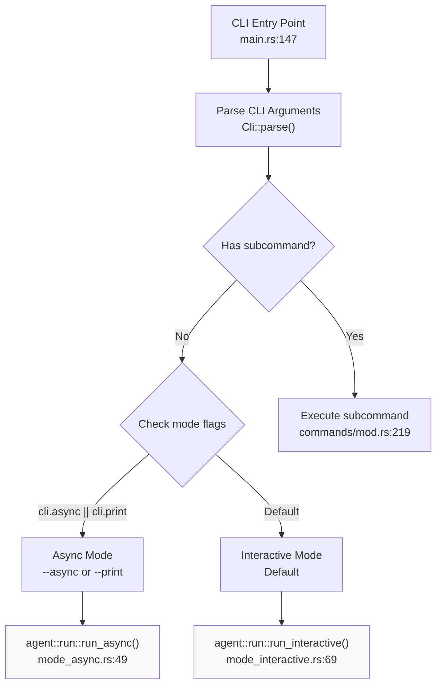
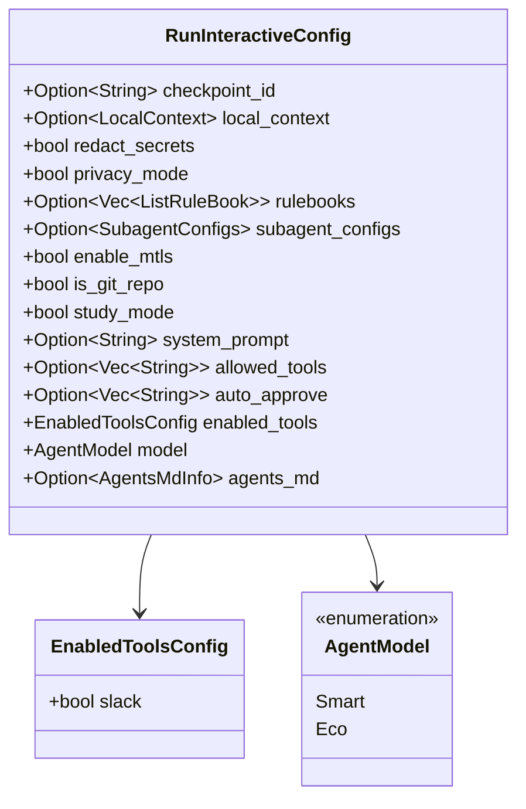
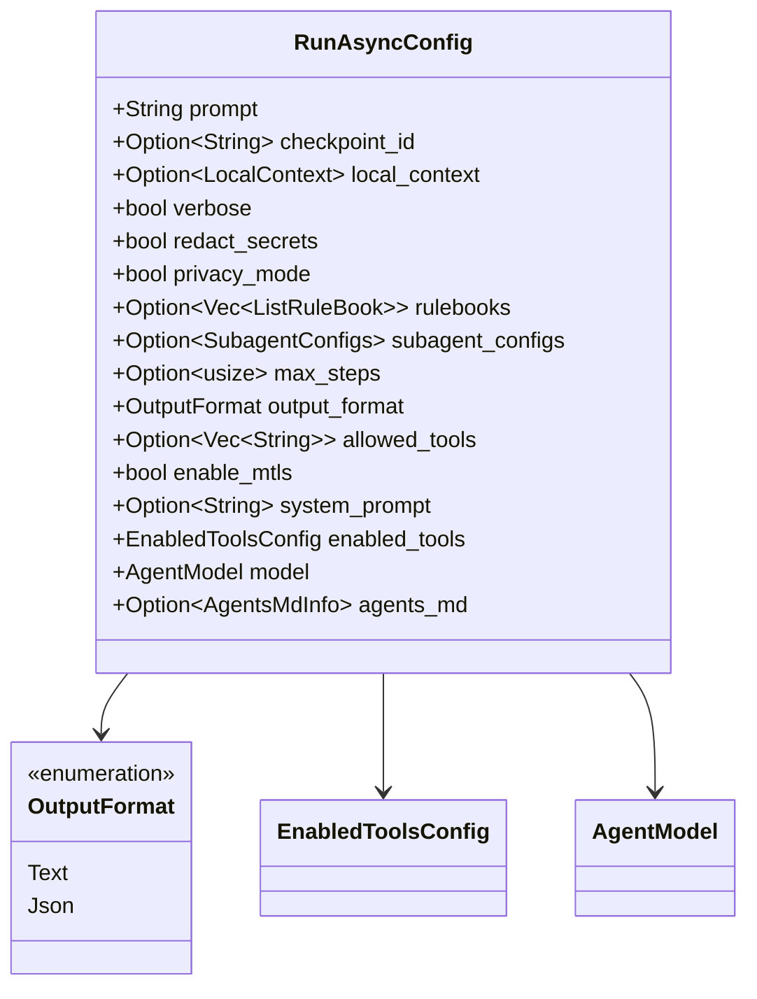
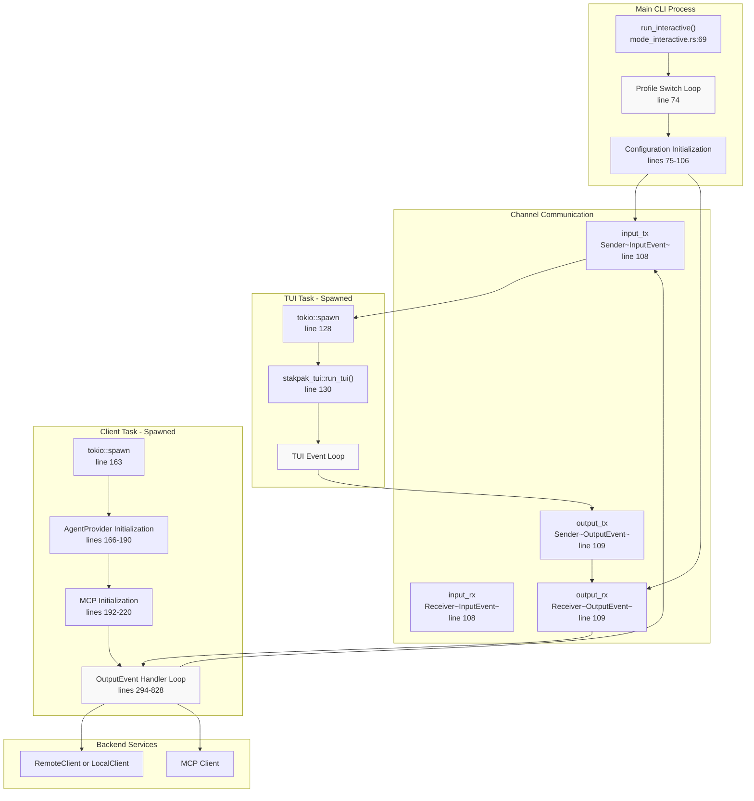
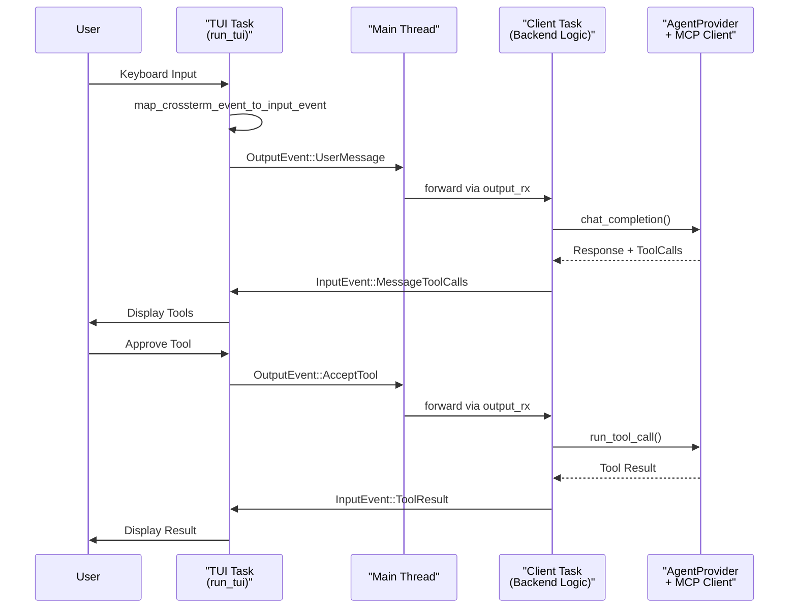
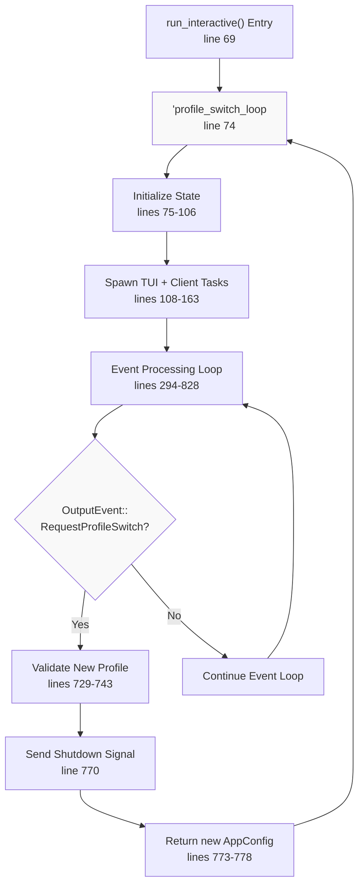
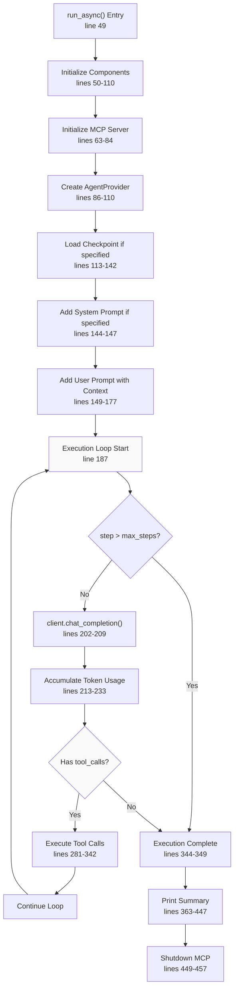
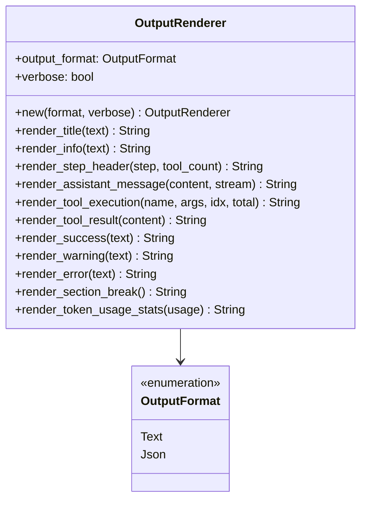
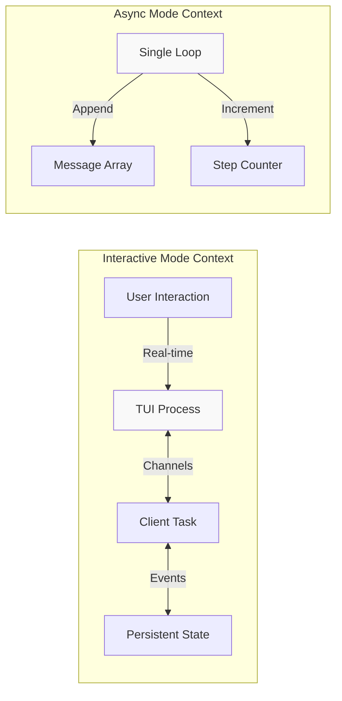
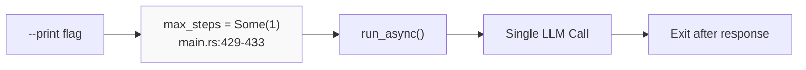

<!-- source: DeepWiki mcp.deepwiki.com · repo stakpak/agent · page 2.2 Agent Execution Modes · fetched 2026-10-27 -->

# Agent Execution Modes

<details>
<summary>Relevant source files</summary>

The following files were used as context for generating this wiki page:

- [cli/src/commands/agent/run/helpers.rs](cli/src/commands/agent/run/helpers.rs)
- [cli/src/commands/agent/run/mode_async.rs](cli/src/commands/agent/run/mode_async.rs)
- [cli/src/commands/agent/run/mode_interactive.rs](cli/src/commands/agent/run/mode_interactive.rs)
- [cli/src/commands/mod.rs](cli/src/commands/mod.rs)
- [cli/src/main.rs](cli/src/main.rs)

</details>


## Purpose and Scope

This document describes the two execution modes available in the Stakpak CLI: **Interactive Mode** (TUI-based) and **Async Mode** (batch execution). It explains how the CLI determines which mode to use, the architectural differences between them, their configuration structures, and when to use each mode.

For information about the TUI application itself and its internal architecture, see [Terminal User Interface (TUI)](#3). For details about the context injection pipeline that applies to both modes, see [Context Injection Pipeline](#2.3). For session management features available in both modes, see [Session and Profile Management](#2.4).

---

## Execution Mode Selection

The CLI determines which execution mode to use based on command-line flags provided by the user. The decision logic is implemented in [cli/src/main.rs:426-506]().

### Decision Flow



**Sources:** [cli/src/main.rs:41-142](), [cli/src/main.rs:426-506]()

### Mode Selection Flags

| Flag | Description | Resulting Mode | Max Steps Default |
|------|-------------|----------------|-------------------|
| None | Default behavior | Interactive (TUI) | N/A |
| `--async` / `-a` | Run until completion | Async | 50 |
| `--print` / `-p` | Single-step execution | Async | 1 |
| `--max-steps` / `-m` | Override step limit | Based on other flags | User-specified |

**Sources:** [cli/src/main.rs:45-55](), [cli/src/main.rs:426-433]()

---

## Configuration Structures

Both execution modes use dedicated configuration structures to encapsulate their parameters.

### RunInteractiveConfig

The `RunInteractiveConfig` structure contains all parameters required for interactive mode execution:



**Sources:** [cli/src/commands/agent/run/mode_interactive.rs:51-67]()

### RunAsyncConfig

The `RunAsyncConfig` structure contains parameters for async mode execution:



**Sources:** [cli/src/commands/agent/run/mode_async.rs:28-45]()

### Key Differences

The main differences between the configuration structures:

| Feature | Interactive | Async | Rationale |
|---------|-------------|-------|-----------|
| `prompt` | Not present | Required `String` | Interactive takes prompt from TUI input |
| `auto_approve` | Present | Not present | Interactive mode supports tool approval workflow |
| `is_git_repo` | Present | Not present | TUI displays git-specific UI elements |
| `study_mode` | Present | Not present | TUI feature for study assistance |
| `verbose` | Not present | Present | Async mode controls console verbosity |
| `output_format` | Not present | Present | Async mode supports JSON/Text output |
| `max_steps` | Not present | Present | Async mode has step limits |

**Sources:** [cli/src/commands/agent/run/mode_interactive.rs:51-67](), [cli/src/commands/agent/run/mode_async.rs:28-45]()

---

## Interactive Mode Architecture

Interactive mode spawns a TUI subprocess and communicates with it through bidirectional channels. It supports profile switching through an outer loop that restarts the entire session.

### Component Architecture



**Sources:** [cli/src/commands/agent/run/mode_interactive.rs:69-773]()

### Event Flow and Communication

Interactive mode uses two channel pairs for bidirectional communication:



**Sources:** [cli/src/commands/agent/run/mode_interactive.rs:108-157](), [cli/src/commands/agent/run/mode_interactive.rs:294-828]()

### Profile Switching Mechanism

Interactive mode implements profile switching through an outer loop that can restart the entire session:



**Sources:** [cli/src/commands/agent/run/mode_interactive.rs:74-779]()

### Key OutputEvent Handlers

The client task handles various `OutputEvent` types from the TUI:

| Event Type | Handler Lines | Description |
|------------|---------------|-------------|
| `SwitchModel` | 296-299 | Switch between Smart/Eco models |
| `UserMessage` | 300-386 | Process user input with context injection |
| `AcceptTool` | 387-471 | Execute approved tool call |
| `RejectTool` | 472-485 | Reject tool call and continue |
| `ListSessions` | 486-512 | Fetch session list |
| `NewSession` | 513-524 | Clear current session |
| `ResumeSession` | 526-608 | Resume from checkpoint |
| `SwitchToSession` | 609-668 | Switch to specific session |
| `SendToolResult` | 670-701 | Submit shell mode result |
| `Memorize` | 702-713 | Trigger memorization |
| `RequestProfileSwitch` | 714-779 | Handle profile switch |
| `RequestRulebookUpdate` | 780-796 | Update active rulebooks |

**Sources:** [cli/src/commands/agent/run/mode_interactive.rs:294-828]()

---

## Async Mode Architecture

Async mode executes in a single linear loop without spawning additional tasks. It runs until completion or reaches the maximum step limit.

### Execution Flow



**Sources:** [cli/src/commands/agent/run/mode_async.rs:49-460]()

### Step Execution Logic

Each step in async mode follows this pattern:

1. **Increment Step Counter** - [line 188]()
2. **Check Step Limit** - [lines 189-198]() - Exits if `step > max_steps`
3. **Call LLM** - [lines 201-209]() - `client.chat_completion()` with messages and tools
4. **Accumulate Usage** - [lines 212-233]() - Track token consumption
5. **Render Response** - [lines 248-267]() - Display assistant message
6. **Process Tool Calls** - [lines 270-342]() - Execute each tool sequentially with 60-minute timeout per tool
7. **Append Results** - [line 332]() - Add tool results to `chat_messages`

**Sources:** [cli/src/commands/agent/run/mode_async.rs:187-350]()

### Output Rendering

Async mode uses the `OutputRenderer` to format console output based on `OutputFormat`:



**Sources:** [cli/src/commands/agent/run/mode_async.rs:54-184](), [cli/src/commands/agent/run/renderer.rs]()

---

## Mode Comparison

### Architectural Differences

| Aspect | Interactive Mode | Async Mode |
|--------|------------------|------------|
| **Process Model** | Multi-task (TUI + Client tasks) | Single-task linear execution |
| **User Interaction** | Real-time via TUI | Batch, no interaction during execution |
| **Communication** | Channel-based (InputEvent/OutputEvent) | Direct function calls |
| **Profile Switching** | Supported via outer loop | Not supported |
| **Tool Approval** | Manual approval per tool | Automatic execution |
| **Session Management** | Full support (resume, switch, new) | Checkpoint resume only |
| **Output Format** | Rich TUI rendering | Text or JSON |
| **Step Limit** | No limit (user controls) | Configurable max_steps (default: 50) |
| **Context Injection** | On first message + profile switch | On first message only |

**Sources:** [cli/src/commands/agent/run/mode_interactive.rs:69-1233](), [cli/src/commands/agent/run/mode_async.rs:49-460]()

### Execution Context



**Sources:** [cli/src/commands/agent/run/mode_interactive.rs](), [cli/src/commands/agent/run/mode_async.rs]()

### Common Components

Both modes share several components:

1. **AgentProvider Initialization** - Both create either `RemoteClient` or `LocalClient` based on `ctx.provider`
   - Interactive: [lines 166-190]()
   - Async: [lines 86-110]()

2. **MCP Initialization** - Both use `initialize_mcp_server_and_tools()` with `McpInitConfig`
   - Interactive: [lines 192-220]()
   - Async: [lines 63-73]()

3. **Context Injection** - Both use helpers from `helpers.rs`:
   - `add_local_context()` - [lines 71-98]()
   - `add_rulebooks()` - [lines 100-130]()
   - `add_subagents()` - [lines 132-152]()
   - `add_agents_md()` - [lines 184-188]()

4. **Tool Execution** - Both use `run_tool_call()` from `tooling.rs`
   - Interactive: [lines 393-401]()
   - Async: [lines 295-296]()

5. **Checkpoint Loading** - Both use `get_checkpoint_messages()`
   - Interactive: [lines 249-285]()
   - Async: [lines 113-142]()

**Sources:** [cli/src/commands/agent/run/mode_interactive.rs](), [cli/src/commands/agent/run/mode_async.rs](), [cli/src/commands/agent/run/helpers.rs]()

---

## When to Use Each Mode

### Interactive Mode (Default)

**Use Cases:**
- Development and debugging workflows
- Exploratory tasks requiring human judgment
- Operations with destructive potential
- Learning and studying (with `--study-mode`)
- Working with unfamiliar codebases
- Multi-session management
- Profile switching during execution

**Advantages:**
- Full control over tool execution
- Visual feedback and progress tracking
- Ability to review tool calls before execution
- Session management (resume, switch, new)
- Profile switching without restarting
- Shell mode for interactive commands
- Rich markdown rendering

**Command:**
```bash
stakpak                              # Default interactive mode
stakpak --profile production         # With specific profile
stakpak --checkpoint abc123          # Resume from checkpoint
```

**Sources:** [cli/src/main.rs:476-505](), [cli/src/commands/agent/run/mode_interactive.rs:51-67]()

### Async Mode (Batch)

**Use Cases:**
- CI/CD pipelines
- Automated scripts
- Non-interactive environments
- Single-task execution with known parameters
- JSON output for programmatic processing
- Performance benchmarking

**Advantages:**
- No user interaction required
- Predictable execution (step limit)
- Structured output (JSON support)
- Lower resource usage (no TUI)
- Faster startup (no TUI initialization)
- Clean exit on completion

**Command:**
```bash
stakpak --async "implement user auth"      # Full execution
stakpak --print "explain this code"        # Single step
stakpak --async --max-steps 10             # Limited steps
stakpak --async --output json              # JSON output
stakpak --prompt-file task.txt --async     # From file
```

**Sources:** [cli/src/main.rs:441-473](), [cli/src/commands/agent/run/mode_async.rs:28-45]()

### Single-Step Mode (Print Flag)

The `--print` flag is a special case of async mode that forces `max_steps=1`:



**Use Cases:**
- Getting explanations without execution
- Code review and analysis
- Quick questions
- Testing prompts

**Command:**
```bash
stakpak --print "explain this function"
```

**Sources:** [cli/src/main.rs:429-433](), [cli/src/commands/agent/run/mode_async.rs:189-198]()

---

## Mode-Specific Features

### Interactive Mode Only

| Feature | Description | Reference |
|---------|-------------|-----------|
| Profile Switching | Switch profiles without exiting | [lines 714-779]() |
| Tool Approval | Manual approval with `auto_approve` list | [lines 387-471]() |
| Session Management | List, resume, switch sessions | [lines 486-668]() |
| Shell Mode | Interactive shell with VT100 emulation | [lines 670-701]() |
| Rulebook Switcher | Change active rulebooks mid-session | [lines 780-796]() |
| Command Palette | Quick action menu | TUI feature |
| Hint System | Context-aware help | TUI feature |
| Billing Display | Real-time balance (remote only) | [lines 228-230]() |

**Sources:** [cli/src/commands/agent/run/mode_interactive.rs]()

### Async Mode Only

| Feature | Description | Reference |
|---------|-------------|-----------|
| Step Limiting | `max_steps` safety limit | [lines 189-198]() |
| JSON Output | Structured output format | [lines 54-55]() |
| Verbose Mode | Detailed execution logs | [lines 32, 54]() |
| Prompt Files | Read prompt from file | [main.rs:407-423]() |
| Execution Summary | Token usage and timing stats | [lines 359-446]() |
| Timeout Per Tool | 60-minute limit per tool | [lines 299-316]() |

**Sources:** [cli/src/commands/agent/run/mode_async.rs:28-460](), [cli/src/main.rs:407-423]()

---

