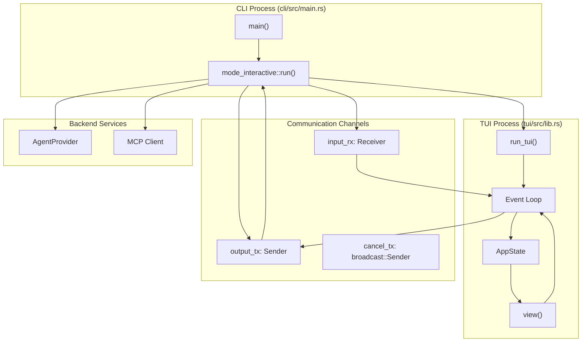
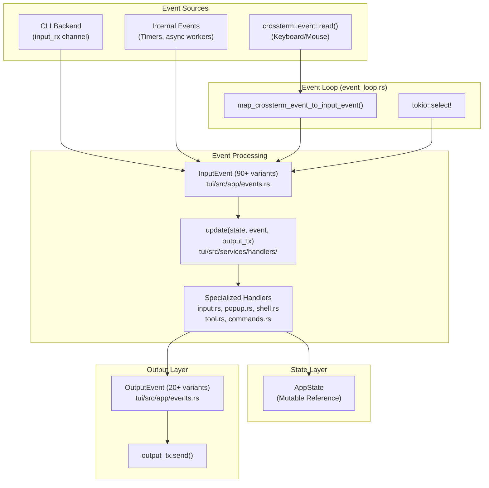
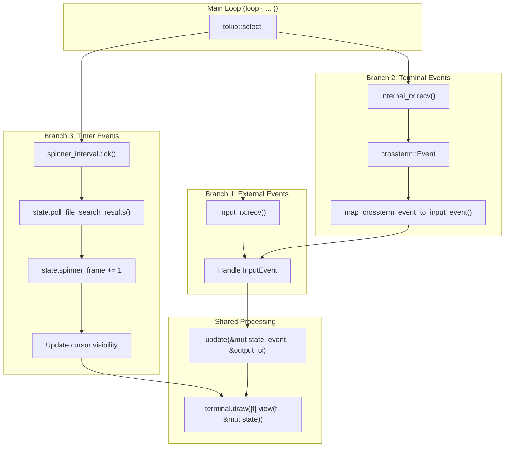
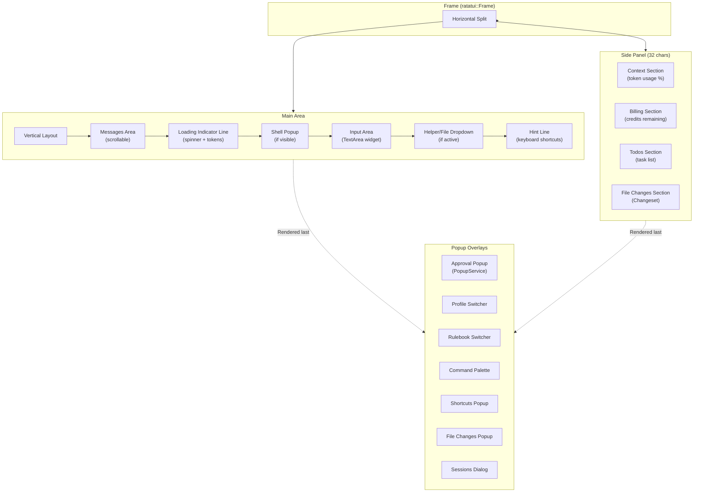

<!-- source: DeepWiki mcp.deepwiki.com · repo stakpak/agent · page 3 Terminal User Interface (TUI) · fetched 2026-10-27 -->

# Terminal User Interface (TUI)

<details>
<summary>Relevant source files</summary>

The following files were used as context for generating this wiki page:

- [README.md](README.md)
- [assets/stakpak-dark.png](assets/stakpak-dark.png)
- [assets/stakpak-light.png](assets/stakpak-light.png)
- [tui/src/app.rs](tui/src/app.rs)
- [tui/src/lib.rs](tui/src/lib.rs)
- [tui/src/services/update.rs](tui/src/services/update.rs)
- [tui/src/view.rs](tui/src/view.rs)

</details>


The Terminal User Interface (TUI) is the interactive frontend for Stakpak, providing a rich terminal-based interface for conversing with AI agents. Built with `ratatui` and `crossterm`, the TUI is spawned by the CLI in interactive mode and communicates with backend services through bidirectional event channels.

The TUI implements a unidirectional data flow architecture where terminal events are transformed into typed `InputEvent`s, processed through the `update()` dispatcher to modify `AppState`, and rendered via the `view()` function. This separation ensures predictable state transitions and simplifies debugging.

**Key Features:**
- Real-time message streaming with markdown and bash code block rendering
- Interactive approval dialogs for tool calls with bulk approval support
- Command palette and helper dropdown with file search (`@` trigger)
- Shell mode with VT100 terminal emulation for interactive commands
- Profile and rulebook switchers with live configuration updates
- Side panel with context window usage, billing info, file changes, and todos
- Automatic secret detection and long paste handling
- Mouse support (Unix) with scrolling and clickable UI elements

**Related Documentation:** See [CLI Interface](#2) for execution modes and [Agent Provider and API](#4) for backend integration.

## System Position and Communication

The TUI operates as a subprocess of the CLI when running in interactive mode, communicating through `tokio::mpsc` channels for bidirectional event passing.

**TUI Integration in System Architecture**



**Sources:** [tui/src/lib.rs:1-55](), [tui/src/event_loop.rs]()

## Entry Point and Initialization

The `run_tui()` function in [tui/src/lib.rs:11]() is the main entry point, initializing the TUI with configuration and establishing event channels.

| Parameter | Type | Purpose |
|-----------|------|---------|
| `messages` | `Vec<Message>` | Initial conversation history |
| `session_id` | `String` | Current session identifier |
| `input_rx` | `mpsc::Receiver<InputEvent>` | Receives events from CLI/backend |
| `output_tx` | `mpsc::Sender<OutputEvent>` | Sends events to CLI/backend |
| `options` | `AppStateOptions` | Configuration flags and API keys |

The function performs the following initialization sequence:

1. **Terminal Setup** - Creates `TerminalGuard` to manage raw mode, alternate screen, and bracketed paste [tui/src/lib.rs:26-30]()
2. **State Initialization** - Constructs `AppState` with all subsystems [tui/src/app.rs:264-460]()
3. **Channel Setup** - Spawns internal event channel for crossterm events [tui/src/lib.rs:32-40]()
4. **Message Population** - Loads initial messages into state [tui/src/lib.rs:42-48]()
5. **Event Loop Launch** - Starts the main event loop via `event_loop::run()` [tui/src/event_loop.rs]()

**Sources:** [tui/src/lib.rs:1-55](), [tui/src/app.rs:264-460]()

## State Management Architecture

The `AppState` struct [tui/src/app.rs:31-221]() is the single source of truth for all TUI state, organized into 10 logical subsystems with 220+ fields. This structure enables the unidirectional data flow pattern where all state changes flow through the `update()` function.

**AppState Structure and Subsystems**

```mermaid
graph TB
    subgraph AppState["AppState (tui/src/app.rs:31-221)"]
        direction TB
        
        Input["Input & TextArea State<br/>text_area: TextArea<br/>cursor_visible: bool<br/>helpers: Vec<HelperCommand><br/>file_search: FileSearch"]
        
        Messages["Messages & Scrolling State<br/>messages: Vec<Message><br/>scroll: usize<br/>message_lines_cache: Option"]
        
        Loading["Loading State<br/>loading: bool<br/>loading_type: LoadingType<br/>loading_manager: LoadingStateManager"]
        
        Shell["Shell Popup State<br/>shell_popup_visible: bool<br/>active_shell_command: Option<ShellCommand><br/>shell_screen: vt100::Parser"]
        
        Tools["Tool Call State<br/>streaming_tool_results: HashMap<br/>completed_tool_calls: HashSet<br/>session_tool_calls_queue: HashMap"]
        
        Dialogs["Dialog & Approval State<br/>approval_popup: PopupService<br/>show_profile_switcher: bool<br/>show_command_palette: bool"]
        
        Sessions["Sessions Dialog State<br/>sessions: Vec<SessionInfo><br/>show_sessions_dialog: bool<br/>session_selected: usize"]
        
        Config["Configuration State<br/>secret_manager: SecretManager<br/>auto_approve_manager: AutoApproveManager<br/>agent_model: AgentModel"]
        
        SidePanel["Side Panel State<br/>show_side_panel: bool<br/>changeset: Changeset<br/>todos: Vec<TodoItem><br/>billing_info: Option"]
        
        Misc["Misc State<br/>terminal_size: Size<br/>mouse_capture_enabled: bool<br/>pending_editor_open: Option"]
    end
    
    Input -.->|"update()"| Messages
    Messages -.->|"update()"| Loading
    Loading -.->|"update()"| Shell
    Shell -.->|"update()"| Tools
    Tools -.->|"update()"| Dialogs
    Dialogs -.->|"update()"| Sessions
    Sessions -.->|"update()"| Config
    Config -.->|"update()"| SidePanel
    SidePanel -.->|"update()"| Misc
    
    Misc -.->|"view()"| Input
```



**Key State Methods:**

| Method | Location | Purpose |
|--------|----------|---------|
| `AppState::new()` | [tui/src/app.rs:264-460]() | Initialize all subsystems with configuration |
| `poll_file_search_results()` | [tui/src/app.rs:563-597]() | Update file search from async worker |
| `run_shell_command()` | [tui/src/app.rs:502-560]() | Spawn shell command with VT100 emulation |
| `is_input_blocked()` | [tui/src/app.rs:498-500]() | Check if input is disabled (profile switch) |
| `auto_show_side_panel()` | [tui/src/app.rs:598-603]() | Automatically show side panel on first file change |

**State Caching Strategy:**

The TUI implements aggressive caching to avoid expensive recalculations on every frame:

- `message_lines_cache` - Cached wrapped message lines with checksum validation
- `collapsed_message_lines_cache` - Separate cache for collapsed messages view
- `processed_lines_cache` - Pre-processed lines for rendering

Cache invalidation occurs only when messages change or terminal width changes [tui/src/view.rs:252-292]().

**Sources:** [tui/src/app.rs:31-221](), [tui/src/app.rs:264-460](), [tui/src/app.rs:502-603]()

## Event System Architecture

The TUI uses two complementary event enums for bidirectional communication: `InputEvent` for incoming events and `OutputEvent` for outgoing requests to backend services.

**Event Flow and Processing**



**InputEvent Categories** (90+ total variants):

| Category | Key Variants | Handler Module |
|----------|-------------|----------------|
| **User Input** | `InputChanged`, `InputSubmitted`, `Paste`, `Char`, `Backspace` | [tui/src/services/handlers/input.rs]() |
| **Navigation** | `CursorLeft/Right`, `ScrollUp/Down`, `PageUp/Down`, `Tab` | [tui/src/services/handlers/input.rs]() |
| **Messages** | `AssistantMessage`, `AssistantMessageChunk`, `ToolResult` | [tui/src/services/handlers/input.rs]() |
| **Shell** | `ShellOutput`, `ShellError`, `ShellCompleted`, `ShellClear` | [tui/src/services/handlers/shell.rs]() |
| **Tool Calls** | `ToolCallsReceived`, `ApproveAllTools`, `RejectTool` | [tui/src/services/handlers/tool.rs]() |
| **Popups** | `ToggleProfileSwitcher`, `ToggleCommandPalette`, `ShowFileChanges` | [tui/src/services/handlers/popup.rs]() |
| **System** | `Loading`, `Resize`, `Quit`, `Error` | [tui/src/services/handlers/input.rs]() |

**OutputEvent Categories** (20+ total variants):

| Category | Key Variants | Purpose |
|----------|-------------|---------|
| **Messages** | `UserMessage`, `UserMessageWithAttachments` | Send user input to agent |
| **Tools** | `AcceptTool`, `RejectTool`, `SendToolResult` | Tool approval and results |
| **Sessions** | `ListSessions`, `SwitchToSession`, `Checkpoint` | Session management |
| **Profiles** | `SwitchProfile`, `ListProfiles` | Profile switching |
| **Rulebooks** | `ListRulebooks`, `UpdateSelectedRulebooks` | Rulebook management |
| **Memory** | `Memorize` | Store information in agent memory |
| **Files** | `GetBackupPath` | File backup operations |

**Sources:** [tui/src/app/events.rs](), [tui/src/services/handlers/](), [tui/src/event.rs:1-300]()

## Event Loop Implementation

The event loop in [tui/src/event_loop.rs]() uses `tokio::select!` to concurrently handle multiple event sources without blocking.

**Event Loop Structure**



**Event Source Priorities:**

The event loop processes events in this order within each iteration:

1. **External Events** (Highest Priority) - Messages from CLI backend, tool results
2. **Terminal Events** - Keyboard/mouse input from user
3. **Timer Events** (Lowest Priority) - UI updates every 100ms

**Terminal Event Thread:**

Crossterm events are captured in a separate spawned thread that blocks on `crossterm::event::read()` and sends events through an internal channel [tui/src/event_loop.rs]():

```
tokio::spawn(async move {
    loop {
        match crossterm::event::read() {
            Ok(evt) => internal_tx.send(evt).await,
            Err(e) => break,
        }
    }
});
```

This pattern keeps the main event loop non-blocking while handling blocking crossterm I/O.

**Sources:** [tui/src/event_loop.rs](), [tui/src/event.rs:1-300]()

## Rendering Pipeline

The `view()` function [tui/src/view.rs:21-238]() is called on every frame to render the TUI. It uses `ratatui` widgets to compose a complex layout with multiple regions.

**View Layout Structure**



**Rendering Functions by Component:**

| Component | Function | Location |
|-----------|----------|----------|
| Messages | `render_messages()` | [tui/src/view.rs:252-292]() |
| Input | `render_multiline_input()` | [tui/src/view.rs:388-420]() |
| Loading | `render_loading_indicator()` | [tui/src/view.rs:422-460]() |
| Shell Popup | `shell_popup::render_shell_popup()` | [tui/src/services/shell_popup.rs]() |
| Side Panel | `side_panel::render_side_panel()` | [tui/src/services/side_panel.rs]() |
| Dropdowns | `render_helper_dropdown()`, `render_file_search_dropdown()` | [tui/src/services/helper_dropdown.rs]() |
| Approval Popup | `PopupService::render()` | [tui/src/services/approval_popup.rs]() |

**Dynamic Layout Calculation:**

The layout adapts to content and active UI elements [tui/src/view.rs:47-112]():

1. Calculate input area height based on text wrapping
2. Determine dropdown height (0 if hidden, variable if showing)
3. Calculate shell popup height (0-80% of screen height)
4. Adjust constraints to hide input when shell popup is expanded

**Sources:** [tui/src/view.rs:21-460](), [tui/src/services/shell_popup.rs](), [tui/src/services/side_panel.rs]()

## Terminal Management

The TUI uses `TerminalGuard` for proper terminal state management and `crossterm` for cross-platform terminal control:

- **Raw Mode** - Enables character-by-character input processing
- **Alternate Screen** - Preserves the user's terminal content
- **Bracketed Paste** - Handles multi-line paste operations securely
- **Resource Cleanup** - Ensures terminal state restoration on exit

**Sources:** [tui/src/lib.rs:29-36](), [tui/src/lib.rs:196-204](), [tui/src/terminal.rs]()

---

