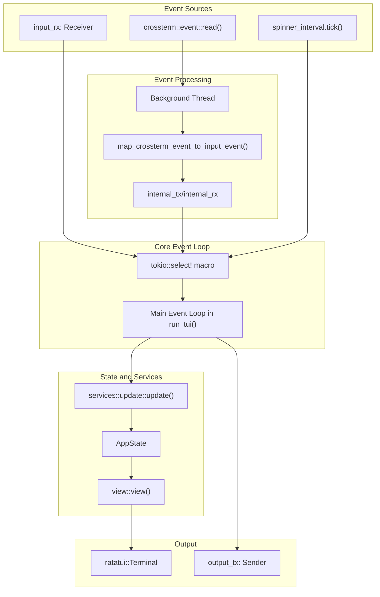
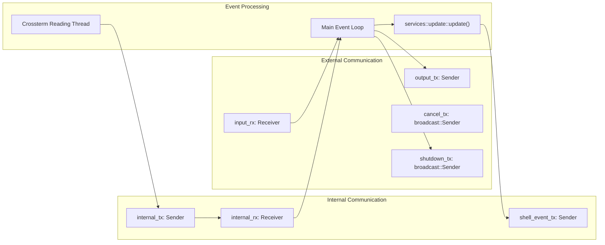
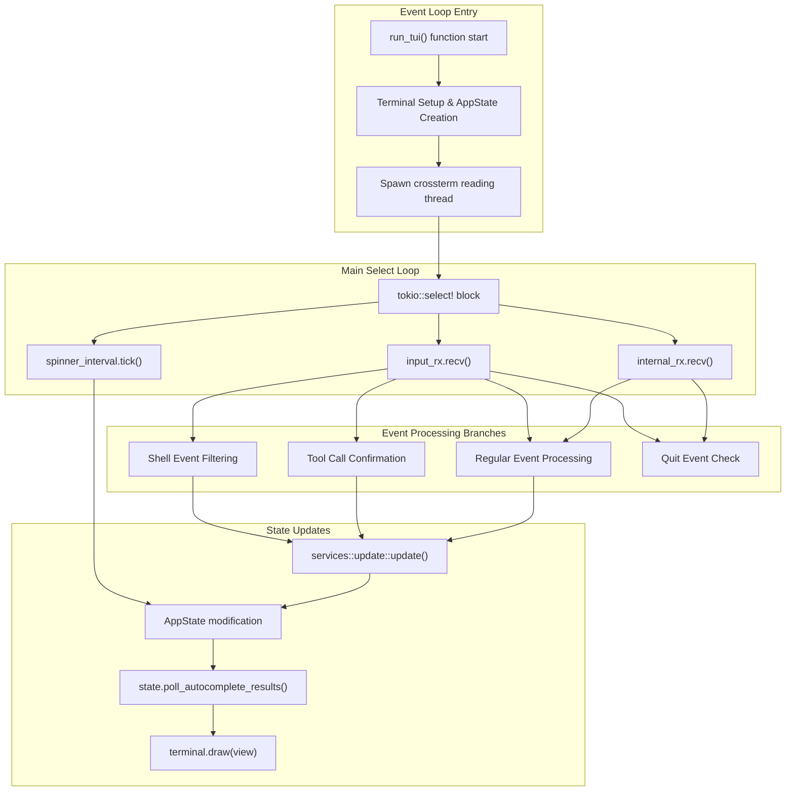
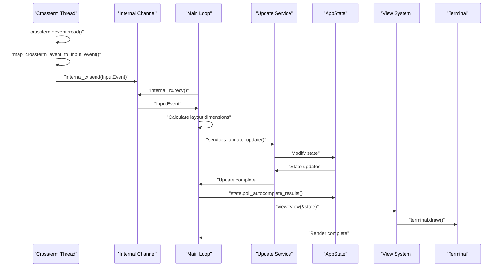
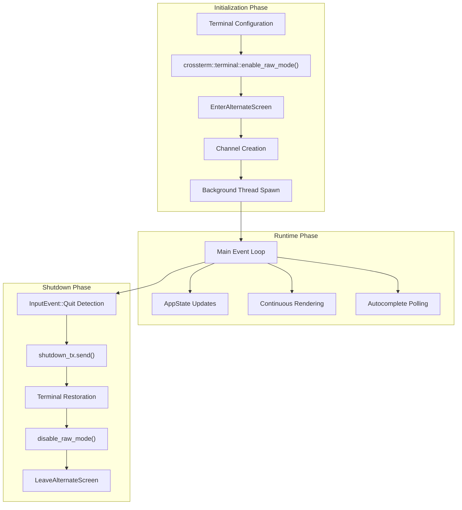

<!-- source: DeepWiki mcp.deepwiki.com · repo stakpak/agent · page 3.1 Core Architecture and Event Loop · fetched 2026-10-27 -->

# Core Architecture and Event Loop

Relevant source files

The following files were used as context for generating this wiki page:

- [tui/src/app.rs](tui/src/app.rs)
- [tui/src/lib.rs](tui/src/lib.rs)
- [tui/src/services/update.rs](tui/src/services/update.rs)
- [tui/src/view.rs](tui/src/view.rs)

This document covers the core architecture and event loop implementation of the TUI system. It focuses on the main async execution flow, channel-based communication, and task orchestration that drives the terminal user interface. For information about state management structures, see [State Management](#3.2). For details about event processing and user input handling, see [Event Handling and User Input](#3.3).

## Architecture Overview

The TUI system is built around an asynchronous event-driven architecture centered on the `run_tui` function. The architecture separates concerns into distinct layers: event capture, event processing, state management, and rendering.

**Event Loop Architecture**

Sources: [tui/src/lib.rs:20-205](), [tui/src/event.rs:1-97]()

## Channel Communication System

The TUI uses a multi-channel communication system to handle different types of events and maintain separation between synchronous and asynchronous operations.

**Channel Communication Flow**

| Channel | Type | Purpose |
|---------|------|---------|
| `input_rx` | `Receiver<InputEvent>` | Receives events from external agent system |
| `output_tx` | `Sender<OutputEvent>` | Sends events to external agent system |
| `internal_tx/internal_rx` | `mpsc::channel<InputEvent>` | Internal event communication |
| `shell_event_tx` | `Sender<InputEvent>` | Shell-specific event forwarding |
| `cancel_tx` | `broadcast::Sender<()>` | Tool call cancellation |
| `shutdown_tx` | `broadcast::Sender<()>` | System shutdown coordination |

Sources: [tui/src/lib.rs:53-68](), [tui/src/lib.rs:21-27]()

## Main Event Loop Structure

The core event loop is implemented using `tokio::select!` to handle multiple asynchronous event sources concurrently. The loop processes three main categories of events with different priorities and handling logic.

**Main Event Loop Structure**

Sources: [tui/src/lib.rs:76-194]()

## Event Processing Pipeline

The event processing follows a structured pipeline that transforms raw terminal events into application state changes and visual updates.

**Event Processing Sequence**

The pipeline handles special event types with different flows:

- **Shell Events**: Filtered and forwarded to `shell_event_tx` for shell integration
- **Tool Call Events**: Trigger confirmation dialogs before execution
- **Regular Input Events**: Standard processing through the update service
- **Timer Events**: Update spinner animation and poll autocomplete

Sources: [tui/src/lib.rs:88-106](), [tui/src/lib.rs:174-187]()

## Task Orchestration and Lifecycle

The TUI manages multiple concurrent tasks and coordinates their lifecycle through careful channel management and shutdown coordination.

**Task Lifecycle Management**

The system uses several mechanisms for coordinating task lifecycle:

- **Terminal Guard**: `TerminalGuard` RAII pattern ensures terminal cleanup
- **Quit Detection**: Double Ctrl+C handling with timer-based reset
- **Graceful Shutdown**: Broadcast channels coordinate shutdown across components
- **Resource Cleanup**: Proper terminal mode restoration and screen management

Sources: [tui/src/lib.rs:29-36](), [tui/src/lib.rs:196-204](), [tui/src/lib.rs:77-85]()

---

