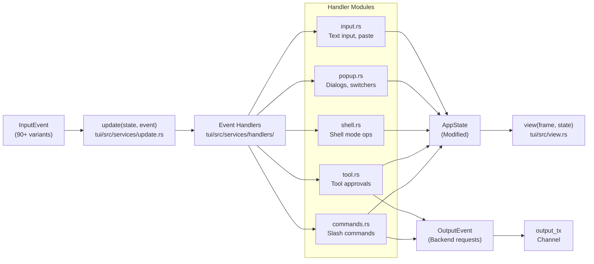
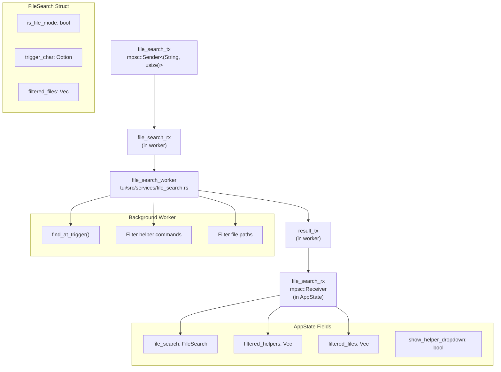
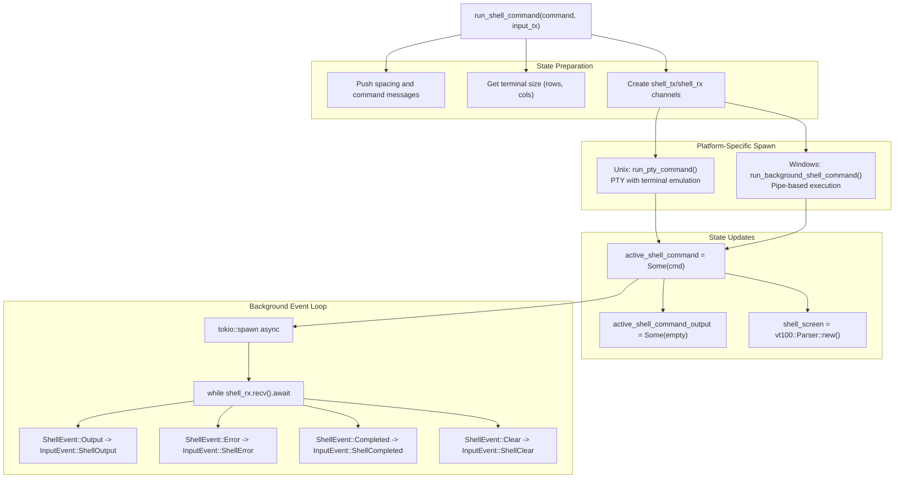

<!-- source: DeepWiki mcp.deepwiki.com · repo stakpak/agent · page 3.2 State Management · fetched 2026-10-27 -->

# State Management

<details>
<summary>Relevant source files</summary>

The following files were used as context for generating this wiki page:

- [tui/src/app.rs](tui/src/app.rs)
- [tui/src/lib.rs](tui/src/lib.rs)
- [tui/src/services/update.rs](tui/src/services/update.rs)
- [tui/src/view.rs](tui/src/view.rs)

</details>


This document details the state management architecture within the Terminal User Interface (TUI) system. The `AppState` struct serves as the single source of truth, implementing a centralized state container that manages all UI components, user interactions, and system integrations. State updates follow a unidirectional data flow pattern where `InputEvent`s trigger state modifications through the `update` function, and the `view` function renders the UI based on the current state.

For information about the event loop and task orchestration, see [Core Architecture and Event Loop](#3.1). For details on how events are processed and trigger state updates, see [Event Handling and User Input](#3.3).

## AppState Structure and Subsystems

The `AppState` struct defined in [tui/src/app.rs:31-221]() organizes state into 10 major subsystems, each clearly delineated by comments in the source. This organization provides a logical separation of concerns while maintaining all state in a single, accessible structure.

**Major State Subsystems Diagram**

```mermaid
graph TB
    AppState["AppState<br/>(Single Source of Truth)"]
    
    subgraph Input["Input & TextArea State"]
        TextAreaStruct["text_area: TextArea"]
        TextAreaStateStruct["text_area_state: TextAreaState"]
        cursor_visible["cursor_visible: bool"]
        helpers["helpers: Vec<HelperCommand>"]
        file_search["file_search: FileSearch"]
        attached_images["attached_images: Vec<AttachedImage>"]
    end
    
    subgraph Messages["Messages & Scrolling State"]
        messages["messages: Vec<Message>"]
        scroll["scroll: usize"]
        scroll_to_bottom["scroll_to_bottom: bool"]
        message_lines_cache["message_lines_cache: Option<MessageLinesCache>"]
        show_collapsed_messages["show_collapsed_messages: bool"]
    end
    
    subgraph Loading["Loading State"]
        loading["loading: bool"]
        loading_type["loading_type: LoadingType"]
        spinner_frame["spinner_frame: usize"]
        loading_manager["loading_manager: LoadingStateManager"]
    end
    
    subgraph Shell["Shell Popup State"]
        shell_popup_visible["shell_popup_visible: bool"]
        active_shell_command["active_shell_command: Option<ShellCommand>"]
        shell_screen["shell_screen: vt100::Parser"]
        waiting_for_shell_input["waiting_for_shell_input: bool"]
    end
    
    subgraph ToolCalls["Tool Call State"]
        pending_bash_message_id["pending_bash_message_id: Option<Uuid>"]
        streaming_tool_results["streaming_tool_results: HashMap<Uuid, String>"]
        session_tool_calls_queue["session_tool_calls_queue: HashMap<String, ToolCallStatus>"]
        latest_tool_call["latest_tool_call: Option<ToolCall>"]
    end
    
    subgraph Dialogs["Dialog & Approval State"]
        is_dialog_open["is_dialog_open: bool"]
        approval_popup["approval_popup: PopupService"]
        message_tool_calls["message_tool_calls: Option<Vec<ToolCall>>"]
        message_approved_tools["message_approved_tools: Vec<ToolCall>"]
    end
    
    subgraph Sessions["Sessions Dialog State"]
        sessions["sessions: Vec<SessionInfo>"]
        show_sessions_dialog["show_sessions_dialog: bool"]
        session_selected["session_selected: usize"]
    end
    
    subgraph Profiles["Profile Switcher State"]
        show_profile_switcher["show_profile_switcher: bool"]
        available_profiles["available_profiles: Vec<String>"]
        current_profile_name["current_profile_name: String"]
        profile_switching_in_progress["profile_switching_in_progress: bool"]
    end
    
    subgraph Rulebooks["Rulebook Switcher State"]
        show_rulebook_switcher["show_rulebook_switcher: bool"]
        available_rulebooks["available_rulebooks: Vec<ListRuleBook>"]
        selected_rulebooks["selected_rulebooks: HashSet<String>"]
    end
    
    subgraph SidePanel["Side Panel State"]
        show_side_panel["show_side_panel: bool"]
        side_panel_focus["side_panel_focus: SidePanelSection"]
        changeset["changeset: Changeset"]
        todos["todos: Vec<TodoItem>"]
        billing_info["billing_info: Option<BillingResponse>"]
    end
    
    AppState --> Input
    AppState --> Messages
    AppState --> Loading
    AppState --> Shell
    AppState --> ToolCalls
    AppState --> Dialogs
    AppState --> Sessions
    AppState --> Profiles
    AppState --> Rulebooks
    AppState --> SidePanel
```



Sources: [tui/src/app.rs:31-221]()

## State Initialization and Configuration

The `AppState::new()` method in [tui/src/app.rs:264-460]() initializes application state with configuration options provided through `AppStateOptions`. The initialization establishes background services, configures security settings, and sets default values for all state subsystems.

**Initialization Flow Diagram**

```mermaid
graph TD
    new["AppState::new(options)"]
    options["AppStateOptions<br/>Configuration struct"]
    
    subgraph "Configuration Fields"
        latest_version["latest_version: Option<String>"]
        redact_secrets["redact_secrets: bool"]
        privacy_mode["privacy_mode: bool"]
        auto_approve_tools["auto_approve_tools: Option<Vec<String>>"]
        allowed_tools["allowed_tools: Option<Vec<String>>"]
        agent_model["agent_model: AgentModel"]
        editor_command["editor_command: Option<String>"]
    end
    
    subgraph "Background Services"
        helpers["get_helper_commands()"]
        file_search_channels["init_file_search_channels()"]
        file_search_worker["file_search_worker spawn"]
        secret_mgr["SecretManager::new()"]
    end
    
    subgraph "Manager Initialization"
        auto_approve_mgr["AutoApproveManager::new()"]
        loading_mgr["LoadingStateManager::new()"]
        approval_popup_svc["PopupService::new()"]
    end
    
    subgraph "Default State Values"
        text_area_new["TextArea::new()"]
        messages_empty["messages: Vec::new()"]
        shell_parser["vt100::Parser::new()"]
        changeset_new["Changeset::new()"]
    end
    
    new --> options
    options --> latest_version
    options --> redact_secrets
    options --> auto_approve_tools
    options --> agent_model
    
    new --> helpers
    new --> file_search_channels
    file_search_channels --> file_search_worker
    new --> secret_mgr
    new --> auto_approve_mgr
    new --> loading_mgr
    new --> approval_popup_svc
    new --> text_area_new
    new --> messages_empty
    new --> shell_parser
    new --> changeset_new
```



### AppStateOptions Structure

The `AppStateOptions` struct in [tui/src/app.rs:223-235]() defines the configuration parameters passed during initialization:

| Field | Type | Purpose |
|-------|------|---------|
| `latest_version` | `Option<String>` | Latest Stakpak version for update notifications |
| `redact_secrets` | `bool` | Enable secret redaction in output |
| `privacy_mode` | `bool` | Enable privacy mode (redact IPs, account IDs) |
| `is_git_repo` | `bool` | Whether current directory is a git repository |
| `auto_approve_tools` | `Option<&Vec<String>>` | Tools to auto-approve without user confirmation |
| `allowed_tools` | `Option<&Vec<String>>` | Whitelist of allowed tools |
| `input_tx` | `Option<mpsc::Sender<InputEvent>>` | Channel for sending input events |
| `agent_model` | `AgentModel` | LLM model configuration |
| `editor_command` | `Option<String>` | External editor command (vim, nvim, nano) |
| `auth_display_info` | `(Option<String>, Option<String>, Option<String>)` | Auth provider display information |

### Background Service Initialization

The initialization spawns the `file_search_worker` in [tui/src/app.rs:244-262]() to handle asynchronous file and helper command searching. This worker processes search requests through channels and returns filtered results without blocking the main UI thread.

Sources: [tui/src/app.rs:223-235](), [tui/src/app.rs:244-262](), [tui/src/app.rs:264-460]()

## Unidirectional Data Flow Pattern

State modifications follow a strict unidirectional data flow where `InputEvent`s trigger state updates through the `update` function, state changes are reflected in `AppState`, and the `view` function renders the UI based on current state. Some state updates also generate `OutputEvent`s to communicate with the backend.

**State Update Flow Diagram**



### The Update Function

The `update` function re-exported from [tui/src/services/update.rs:6]() serves as the central dispatcher for all state modifications. It routes `InputEvent`s to specialized handler modules based on event type and current application state. The update logic is organized into handler modules within `tui/src/services/handlers/` for better maintainability.

### Event Types

The `InputEvent` enum defined in [tui/src/app.rs:1-7]() (via events submodule) contains 90+ variants organized into categories:

| Category | Examples | Handler Module |
|----------|----------|----------------|
| Text Input | `InputChar`, `InputBackspace`, `InputSubmit`, `Paste` | `input.rs` |
| Navigation | `CursorLeft`, `CursorRight`, `ScrollUp`, `ScrollDown` | `input.rs` |
| Popups | `ToggleProfileSwitcher`, `ToggleRulebookSwitcher`, `ToggleCommandPalette` | `popup.rs` |
| Shell | `ShellOutput`, `ShellCompleted`, `ShellWaitingForInput` | `shell.rs` |
| Tool Calls | `RunToolCall`, `ToolResult`, `StreamToolResult`, `ApproveToolCall` | `tool.rs` |
| Commands | Triggered by slash command execution | `commands.rs` |

The `OutputEvent` enum handles communication with the backend layer, requesting operations like sending messages, executing tool calls, or switching sessions.

Sources: [tui/src/services/update.rs:1-7](), [tui/src/app.rs:1-7](), [tui/src/view.rs:1-461]()

## Key State Subsystems

Each state subsystem serves a specific functional area of the application. The following sections detail the most important subsystems and their constituent fields.

### Input & TextArea State

The input subsystem uses the `TextArea` widget for multi-line text editing with cursor management and rendering state tracked separately in `TextAreaState`.

| Field | Type | Purpose |
|-------|------|---------|
| `text_area` | `TextArea` | Multi-line text input widget |
| `text_area_state` | `TextAreaState` | Rendering state for TextArea |
| `cursor_visible` | `bool` | Cursor blink visibility |
| `helpers` | `Vec<HelperCommand>` | Available slash commands |
| `show_helper_dropdown` | `bool` | Show command dropdown |
| `helper_selected` | `usize` | Selected dropdown index |
| `filtered_helpers` | `Vec<HelperCommand>` | Filtered command list |
| `filtered_files` | `Vec<String>` | Filtered file paths for @ completion |
| `file_search` | `FileSearch` | File search state and worker |
| `file_search_tx` | `Option<mpsc::Sender>` | Channel to send search requests |
| `file_search_rx` | `Option<mpsc::Receiver>` | Channel to receive search results |
| `attached_images` | `Vec<AttachedImage>` | Images attached to current message |
| `is_pasting` | `bool` | Paste operation in progress |
| `pasted_long_text` | `Option<String>` | Long text paste buffer |

Sources: [tui/src/app.rs:32-52]()

### Messages & Scrolling State

The message subsystem manages the conversation history with sophisticated caching for performance optimization.

| Field | Type | Purpose |
|-------|------|---------|
| `messages` | `Vec<Message>` | Conversation message history |
| `scroll` | `usize` | Current scroll position in lines |
| `scroll_to_bottom` | `bool` | Trigger to scroll to bottom |
| `stay_at_bottom` | `bool` | Auto-scroll with new content |
| `content_changed_while_scrolled_up` | `bool` | Content updated while user scrolled up |
| `message_lines_cache` | `Option<MessageLinesCache>` | Cached wrapped message lines with checksums |
| `collapsed_message_lines_cache` | `Option<MessageLinesCache>` | Cached collapsed view lines |
| `processed_lines_cache` | `Option<(Vec<Message>, usize, Vec<Line>)>` | Cache for processed message lines |
| `show_collapsed_messages` | `bool` | Display collapsed messages popup |
| `collapsed_messages_scroll` | `usize` | Scroll position in collapsed view |
| `has_user_messages` | `bool` | Whether conversation contains user messages |

Sources: [tui/src/app.rs:54-66]()

### Tool Call State

The tool call subsystem tracks tool execution, streaming results, and queued operations.

| Field | Type | Purpose |
|-------|------|---------|
| `pending_bash_message_id` | `Option<Uuid>` | ID of message awaiting bash output |
| `streaming_tool_results` | `HashMap<Uuid, String>` | Accumulating tool output streams |
| `streaming_tool_result_id` | `Option<Uuid>` | Currently streaming tool result ID |
| `completed_tool_calls` | `HashSet<Uuid>` | Set of completed tool call IDs |
| `is_streaming` | `bool` | LLM response streaming indicator |
| `latest_tool_call` | `Option<ToolCall>` | Most recent tool call |
| `session_tool_calls_queue` | `HashMap<String, ToolCallStatus>` | Queued tool calls by ID |
| `tool_call_execution_order` | `Vec<String>` | Order of tool call execution |
| `last_message_tool_calls` | `Vec<ToolCall>` | Tool calls from last message |

Sources: [tui/src/app.rs:100-134]()

### Shell Popup State

The shell popup subsystem manages interactive shell command execution with VT100 terminal emulation.

| Field | Type | Purpose |
|-------|------|---------|
| `shell_popup_visible` | `bool` | Shell popup visibility |
| `shell_popup_expanded` | `bool` | Shell popup expanded state |
| `shell_popup_scroll` | `usize` | Scroll position in shell output |
| `shell_cursor_visible` | `bool` | Shell cursor blink state |
| `active_shell_command` | `Option<ShellCommand>` | Currently executing command |
| `active_shell_command_output` | `Option<String>` | Accumulated command output |
| `waiting_for_shell_input` | `bool` | Waiting for user input (password) |
| `shell_screen` | `vt100::Parser` | VT100 terminal emulator |
| `shell_scroll` | `u16` | Terminal scroll position |
| `shell_history_lines` | `Vec<Line>` | Accumulated styled shell history |

Sources: [tui/src/app.rs:74-98]()

### Side Panel State

The side panel displays context, changeset, todos, and billing information with collapsible sections.

| Field | Type | Purpose |
|-------|------|---------|
| `show_side_panel` | `bool` | Side panel visibility |
| `side_panel_focus` | `SidePanelSection` | Currently focused section |
| `side_panel_section_collapsed` | `HashMap<SidePanelSection, bool>` | Collapse state per section |
| `side_panel_areas` | `HashMap<SidePanelSection, Rect>` | Screen areas for mouse clicks |
| `session_id` | `String` | Current session ID for backup paths |
| `changeset` | `Changeset` | File changes tracking |
| `todos` | `Vec<TodoItem>` | TODO items extracted from code |
| `billing_info` | `Option<BillingResponse>` | Account billing information |
| `side_panel_auto_shown` | `bool` | Whether panel was auto-shown |

Sources: [tui/src/app.rs:197-220]()

## File Search and Command Completion

The file search subsystem provides asynchronous file and command completion through dedicated channels and a background worker. The `FileSearch` struct maintains search state while the `file_search_worker` handles filtering operations.

**File Search Architecture Diagram**



### File Search Worker Initialization

The `init_file_search_channels()` method in [tui/src/app.rs:244-262]() creates bidirectional channels and spawns the background worker:

1. Creates `file_search_tx` to send search requests (query string, cursor position)
2. Creates `result_rx` to receive filtered results
3. Spawns `file_search_worker` from [tui/src/services/file_search.rs]() with helper commands
4. Worker continuously processes requests and sends `FileSearchResult` back

### Polling Results

The `poll_file_search_results()` method in [tui/src/app.rs:563-597]() non-blockingly checks for new results:

```
while let Ok(result) = rx.try_recv() {
    - Update filtered_files
    - Update filtered_helpers
    - Update show_helper_dropdown
    - Reset helper_selected if out of bounds
}
```

This pattern enables responsive completion suggestions without blocking the UI thread.

Sources: [tui/src/app.rs:244-262](), [tui/src/app.rs:563-597](), [tui/src/services/file_search.rs]()

## Shell Command State Lifecycle

Shell command execution maintains state through a lifecycle that manages command spawning, output streaming with VT100 emulation, and completion tracking. The `run_shell_command()` method in [tui/src/app.rs:502-560]() demonstrates this pattern.

**Shell Command Lifecycle Diagram**



### Shell State Fields

| Field | Purpose in Lifecycle |
|-------|---------------------|
| `active_shell_command` | Holds `ShellCommand` with process handle |
| `active_shell_command_output` | Accumulates output as it streams |
| `shell_screen` | VT100 parser tracks terminal state (cursor, colors, etc.) |
| `shell_history_lines` | Styled lines for rendering shell history |
| `waiting_for_shell_input` | Set when shell requests password/input |
| `shell_cursor_visible` | Controls cursor blinking in shell popup |

### Event Flow

The background task converts `ShellEvent`s from the command process into `InputEvent`s sent through `input_tx`. These events are then processed by the shell handler module to update state, providing real-time shell output display.

Sources: [tui/src/app.rs:502-560]()

## Security and Privacy State

The `secret_manager` field integrates security functionality directly into the application state, enabling secret detection and redaction throughout the TUI lifecycle. The `SecretManager` is configured during initialization with privacy and redaction settings.

| Security State Field | Type | Purpose |
|---------------------|------|---------|
| `secret_manager` | `SecretManager` | Handles secret detection and redaction |
| `ctrl_c_pressed_once` | `bool` | Tracks quit sequence state |
| `ctrl_c_timer` | `Option<std::time::Instant>` | Times quit confirmation window |

The security state is initialized in the `new()` method with configuration parameters for `redact_secrets` and `privacy_mode`, ensuring consistent security policy enforcement across all state operations.

Sources: [tui/src/app.rs:86](), [tui/src/app.rs:224]()

---

