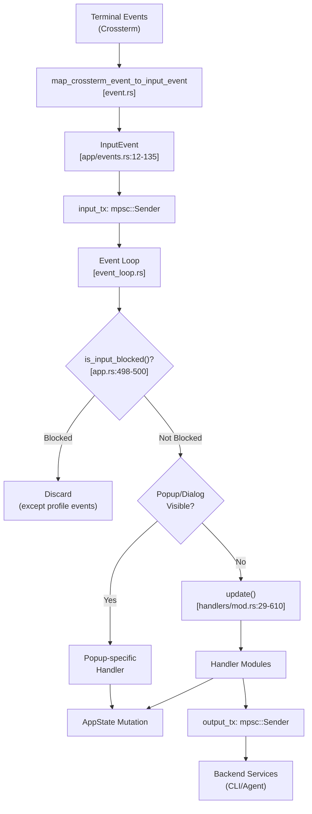
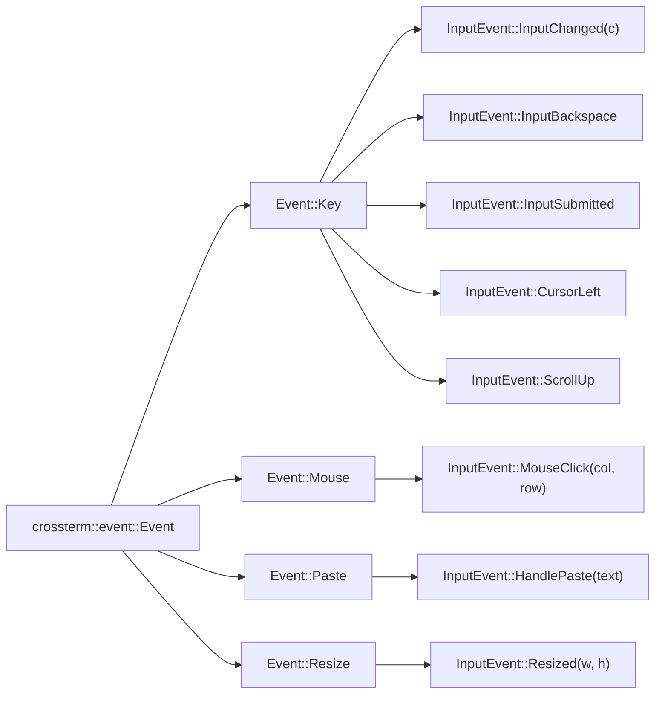
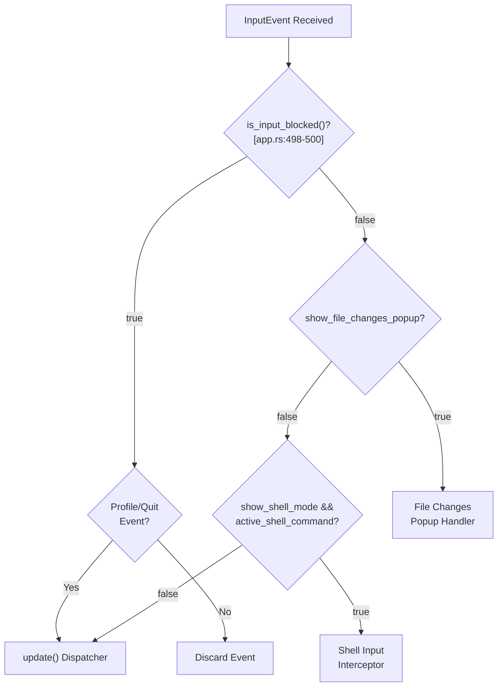
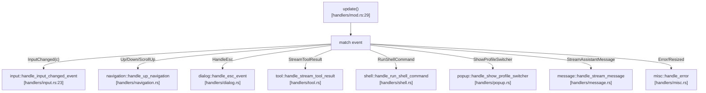
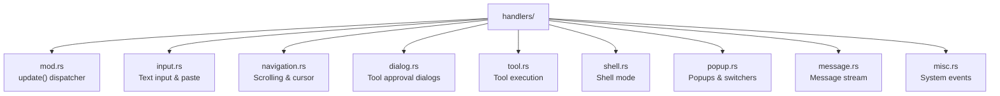
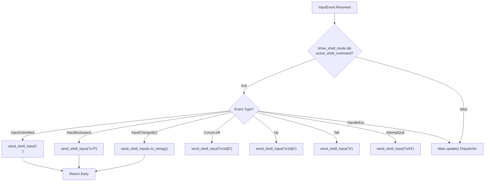
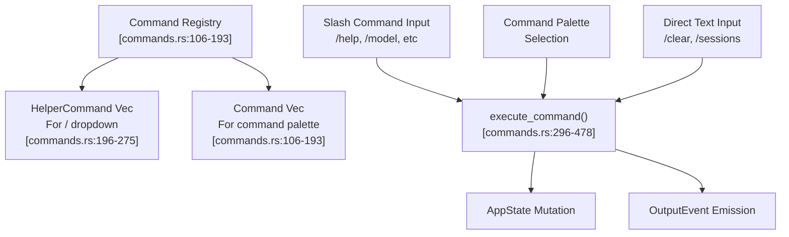
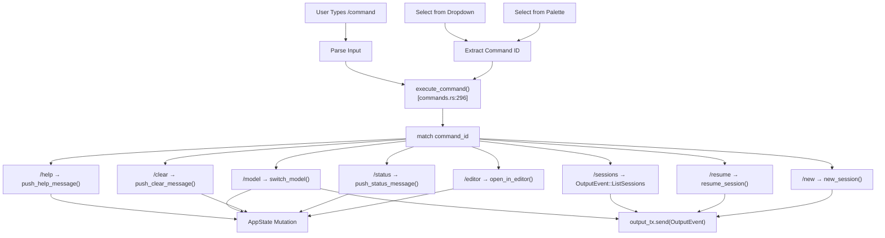

<!-- source: DeepWiki mcp.deepwiki.com · repo stakpak/agent · page 3.3 Event Handling and User Input · fetched 2026-10-27 -->

# Event Handling and User Input

<details>
<summary>Relevant source files</summary>

The following files were used as context for generating this wiki page:

- [tui/src/app.rs](tui/src/app.rs)
- [tui/src/app/events.rs](tui/src/app/events.rs)
- [tui/src/lib.rs](tui/src/lib.rs)
- [tui/src/services/commands.rs](tui/src/services/commands.rs)
- [tui/src/services/handlers/input.rs](tui/src/services/handlers/input.rs)
- [tui/src/services/handlers/mod.rs](tui/src/services/handlers/mod.rs)
- [tui/src/services/handlers/popup.rs](tui/src/services/handlers/popup.rs)
- [tui/src/services/update.rs](tui/src/services/update.rs)
- [tui/src/view.rs](tui/src/view.rs)

</details>


This page documents the event handling system in the TUI, which transforms terminal events (keyboard, mouse, paste) into strongly-typed application events, routes them to specialized handler modules, and updates the application state. The event system follows a unidirectional data flow pattern where all state changes occur through the central `update` function.

For information about the event loop that drives this system, see [Core Architecture and Event Loop](#3.1). For information about how state changes affect the UI, see [Rendering System](#3.4).

## Event System Architecture

The TUI's event system uses two primary event types defined in [tui/src/app/events.rs:1-158]():

- **`InputEvent`**: Events that trigger state changes (90+ variants)
- **`OutputEvent`**: Requests to backend services (13 variants)

### Event Flow Pattern



**Event Flow Sequence:**

1. Terminal captures raw input via Crossterm library
2. `map_crossterm_event_to_input_event` transforms to `InputEvent`
3. Event sent through `input_tx` channel
4. Event loop receives and checks if input is blocked
5. If not blocked, routes to `update()` dispatcher
6. `update()` routes to appropriate handler module
7. Handler mutates `AppState` and optionally emits `OutputEvent`

**Sources:** [tui/src/app/events.rs:1-158](), [tui/src/event.rs](), [tui/src/services/handlers/mod.rs:29-610]()

### InputEvent Enum Structure

The `InputEvent` enum contains 90+ variants organized into functional categories:

| Category | Example Variants | Purpose |
|----------|------------------|---------|
| Text Input | `InputChanged(char)`, `InputBackspace`, `HandlePaste(String)` | Character and text entry |
| Cursor Control | `CursorLeft`, `CursorRight`, `InputCursorStart`, `InputCursorEnd` | Text navigation |
| Submission | `InputSubmitted`, `InputSubmittedWith(String)` | Message submission |
| Navigation | `ScrollUp`, `ScrollDown`, `PageUp`, `PageDown`, `Up`, `Down` | UI navigation |
| Dialog | `ShowConfirmationDialog(ToolCall)`, `ToggleDialogFocus`, `HandleEsc` | Tool approval dialogs |
| Shell | `ShellMode`, `RunShellCommand(String)`, `ShellOutput(String)` | Interactive shell |
| Tool Execution | `RunToolCall(ToolCall)`, `ToolResult(ToolCallResult)`, `StreamToolResult(ToolCallResultProgress)` | Tool call handling |
| Popups | `ShowProfileSwitcher`, `ShowRulebookSwitcher`, `ShowCommandPalette` | Various popups |
| Profile Management | `ProfileSwitchRequested(String)`, `ProfileSwitchComplete(String)` | Profile switching |
| Messages | `StreamAssistantMessage(Uuid, String)`, `AddUserMessage(String)` | Message handling |
| System | `Quit`, `Resized(u16, u16)`, `Error(String)` | System events |

**Sources:** [tui/src/app/events.rs:12-135]()

### OutputEvent Enum

`OutputEvent` represents requests to backend services (CLI/Agent layer):

```rust
pub enum OutputEvent {
    UserMessage(String, Option<Vec<ToolCallResult>>, Vec<ContentPart>),
    AcceptTool(ToolCall),
    RejectTool(ToolCall, bool),
    ListSessions,
    SwitchToSession(String),
    NewSession,
    Memorize,
    SendToolResult(ToolCallResult, bool, Vec<ToolCall>),
    ResumeSession,
    RequestProfileSwitch(String),
    RequestRulebookUpdate(Vec<String>),
    RequestCurrentRulebooks,
    RequestTotalUsage,
    SwitchModel(AgentModel),
}
```

These events are sent via `output_tx` channel and processed by the CLI layer to interact with the `AgentProvider`.

**Sources:** [tui/src/app/events.rs:137-157]()

## Event Transformation Pipeline

### Crossterm to InputEvent Mapping

Raw terminal events are transformed into typed `InputEvent` variants by `map_crossterm_event_to_input_event` in [tui/src/event.rs]():



**Key Bindings Examples:**
- `Char('c')` → `InputEvent::InputChanged('c')`
- `Backspace` → `InputEvent::InputBackspace`
- `Enter` → `InputEvent::InputSubmitted`
- `Ctrl+'c'` → `InputEvent::AttemptQuit`
- `Ctrl+'p'` → `InputEvent::ShowProfileSwitcher`
- `Ctrl+'k'` → `InputEvent::ShowRulebookSwitcher`
- `Esc` → `InputEvent::HandleEsc`

**Sources:** [tui/src/event.rs](), [tui/src/lib.rs:18]()

### Input Blocking and Filtering

Before events reach the dispatcher, several filtering layers apply:



**Blocking Logic** [tui/src/services/handlers/mod.rs:40-59]():

When `profile_switching_in_progress` is `true`, all input is blocked except:
- `ProfilesLoaded`, `ProfileSwitchRequested`, `ProfileSwitchProgress`, `ProfileSwitchComplete`, `ProfileSwitchFailed`
- `RulebooksLoaded`, `CurrentRulebooksLoaded`
- `Quit`, `AttemptQuit`

This prevents user input corruption during profile transitions.

**Sources:** [tui/src/services/handlers/mod.rs:40-59](), [tui/src/app.rs:498-500]()

## Update Dispatcher

The `update()` function in [tui/src/services/handlers/mod.rs:29-610]() is the central event dispatcher. It receives an `InputEvent` and routes it to the appropriate handler module.

### Update Function Signature

```rust
pub fn update(
    state: &mut AppState,
    event: InputEvent,
    message_area_height: usize,
    message_area_width: usize,
    input_tx: &Sender<InputEvent>,
    output_tx: &Sender<OutputEvent>,
    cancel_tx: Option<tokio::sync::broadcast::Sender<()>>,
    shell_tx: &Sender<InputEvent>,
    terminal_size: Size,
)
```

**Parameters:**
- `state`: Mutable reference to application state
- `event`: The input event to process
- `message_area_height/width`: For scroll calculations
- `input_tx`: Channel to send new events (for cascading)
- `output_tx`: Channel to send backend requests
- `cancel_tx`: For canceling streaming operations
- `shell_tx`: Dedicated channel for shell events
- `terminal_size`: Current terminal dimensions

**Sources:** [tui/src/services/handlers/mod.rs:29-39]()

### Event Routing Pattern



**Routing Examples** [tui/src/services/handlers/mod.rs:237-607]():

```
InputEvent::InputChanged(c) → input::handle_input_changed_event()
InputEvent::InputBackspace → input::handle_input_backspace_event()
InputEvent::InputSubmitted → input::handle_input_submitted_event()
InputEvent::Up → navigation::handle_up_navigation()
InputEvent::HandleEsc → dialog::handle_esc_event()
InputEvent::RunShellCommand(cmd) → shell::handle_run_shell_command()
InputEvent::ShowProfileSwitcher → popup::handle_show_profile_switcher()
InputEvent::StreamToolResult(progress) → tool::handle_stream_tool_result()
```

**Sources:** [tui/src/services/handlers/mod.rs:237-607]()

## Handler Modules

Handler modules are organized by functionality in [tui/src/services/handlers/]():



**Sources:** [tui/src/services/handlers/mod.rs:1-14]()

### Input Handler Module

[tui/src/services/handlers/input.rs:1-1175]() handles text input, paste operations, and submission:

**Key Functions:**
- `handle_input_changed_event()` - Routes character input based on popup state
- `handle_input_changed()` - Processes character insertion
- `handle_input_backspace_event()` - Routes backspace based on popup state
- `handle_input_backspace()` - Processes character deletion
- `handle_input_submitted_event()` - Routes submission based on popup state
- `handle_input_submitted()` - Processes message submission
- `handle_paste()` - Processes clipboard paste (text/images)

**Special Features:**
- Secret redaction for pasted content [tui/src/services/handlers/input.rs:792-795]()
- Large paste placeholder generation (>5000 chars) [tui/src/services/handlers/input.rs:799-826]()
- Image path detection and attachment [tui/src/services/handlers/input.rs:845-892]()
- Path conversion for `@` file references [tui/src/services/handlers/input.rs:1011-1048]()

**Sources:** [tui/src/services/handlers/input.rs:1-1175]()

### Navigation Handler Module

[tui/src/services/handlers/navigation.rs]() handles scrolling and cursor movement:

**Functions:**
- `handle_up_navigation()` - Up arrow / scroll up
- `handle_down_navigation()` - Down arrow / scroll down
- `handle_page_up()` - Page up navigation
- `handle_page_down()` - Page down navigation
- `handle_dropdown_up()` - Helper dropdown navigation
- `handle_dropdown_down()` - Helper dropdown navigation
- `adjust_scroll()` - Maintains scroll position consistency

**Sources:** [tui/src/services/handlers/mod.rs:295-319]()

### Dialog Handler Module

[tui/src/services/handlers/dialog.rs]() manages tool approval dialogs:

**Key Functions:**
- `handle_show_confirmation_dialog()` - Shows tool approval dialog
- `handle_toggle_dialog_focus()` - Switches focus between message view and dialog
- `handle_esc_event()` - Handles escape key (cancel/reject)
- `handle_esc()` - Core escape logic with rejection options

**Sources:** [tui/src/services/handlers/mod.rs:320-341]()

### Tool Handler Module

[tui/src/services/handlers/tool.rs]() handles tool call execution and approval:

**Key Functions:**
- `handle_message_tool_calls()` - Processes batch tool call requests
- `handle_stream_tool_result()` - Processes streaming tool output
- `handle_retry_tool_call()` - Retries failed tool calls
- `handle_interactive_stall_detected()` - Handles interactive command stalls
- `handle_approval_popup_toggle_approval()` - Toggle tool approval status
- `execute_command_palette_selection()` - Execute command from palette

**Interactive Stall Detection:**
When a tool call detects an interactive stall (e.g., command waiting for input), it triggers shell mode automatically [tui/src/services/handlers/tool.rs]().

**Sources:** [tui/src/services/handlers/mod.rs:343-373]()

### Shell Handler Module

[tui/src/services/handlers/shell.rs]() manages interactive shell mode:

**Key Functions:**
- `handle_shell_mode()` - Toggles shell mode
- `handle_run_shell_command()` - Executes shell command
- `handle_run_shell_with_command()` - Spawns shell then executes command
- `handle_shell_output()` - Processes shell stdout
- `handle_shell_error()` - Processes shell stderr
- `handle_shell_completed()` - Handles shell completion
- `send_shell_input()` - Sends input to running shell

**Shell Mode Interception:**
When shell mode is active with a running command, input events are intercepted before reaching the main dispatcher [tui/src/services/handlers/mod.rs:113-234]():

```
InputChanged(c) → send_shell_input(c)
InputBackspace → send_shell_input("\x7f")
InputSubmitted → send_shell_input("\n")
CursorLeft → send_shell_input("\x1b[D")
```

**Sources:** [tui/src/services/handlers/mod.rs:375-409](), [tui/src/services/handlers/mod.rs:113-234]()

### Popup Handler Module

[tui/src/services/handlers/popup.rs:1-812]() manages various popup interfaces:

**Profile Switcher:**
- `handle_show_profile_switcher()` - Shows profile selection
- `handle_profile_switcher_select()` - Confirms profile switch
- `handle_profiles_loaded()` - Updates available profiles

**Rulebook Switcher:**
- `handle_show_rulebook_switcher()` - Shows rulebook selection
- `handle_rulebook_switcher_toggle()` - Toggles rulebook selection
- `handle_rulebook_switcher_confirm()` - Confirms rulebook changes

**Command Palette:**
- `handle_show_command_palette()` - Opens command palette
- `handle_command_palette_search_input_changed()` - Filters commands

**File Changes Popup:**
- `handle_show_file_changes_popup()` - Shows modified files
- `handle_file_changes_popup_revert()` - Reverts single file
- `handle_file_changes_popup_revert_all()` - Reverts all changes

**Sources:** [tui/src/services/handlers/popup.rs:1-812]()

### Message Handler Module

[tui/src/services/handlers/message.rs]() handles message streaming and display:

**Functions:**
- `handle_stream_message()` - Appends streaming text to message
- `handle_add_user_message()` - Adds user message to history
- `handle_stream_usage()` - Updates token usage stats
- `handle_total_usage()` - Updates total session usage

**Sources:** [tui/src/services/handlers/mod.rs:505-523]()

### Misc Handler Module

[tui/src/services/handlers/misc.rs]() handles system events:

**Functions:**
- `handle_error()` - Displays error messages
- `handle_resized()` - Updates terminal size
- `handle_toggle_cursor_visible()` - Cursor blinking
- `handle_toggle_auto_approve()` - Auto-approve settings
- `handle_attempt_quit()` - Double Ctrl+C quit logic
- `handle_ctrl_s()` - Save/shortcuts shortcut

**Sources:** [tui/src/services/handlers/mod.rs:525-607]()

## Special Input Modes

### Shell Mode Input Interception

When shell mode is active with a running command, all input is intercepted before reaching the main update dispatcher [tui/src/services/handlers/mod.rs:113-234]():



**Key Implementation:**
The shell interceptor sends VT100 escape sequences directly to the shell's stdin, bypassing normal text input processing. Only `HandleEsc` falls through to terminate the shell.

**Sources:** [tui/src/services/handlers/mod.rs:113-234]()

### Popup Input Interception

When the file changes popup is visible, all input is intercepted [tui/src/services/handlers/mod.rs:65-112]():

```
HandleEsc → handle_file_changes_popup_cancel()
FileChangesRevertAll → handle_file_changes_popup_revert_all()
FileChangesRevertFile → handle_file_changes_popup_revert()
Up/Down → handle_file_changes_popup_navigate()
InputChanged(c) → handle_file_changes_popup_search_input()
InputBackspace → handle_file_changes_popup_backspace()
```

**Other Popup Interceptions:**
- Approval popup visible → consume space bar for toggle [tui/src/services/handlers/input.rs:24-30]()
- Shortcuts popup visible → handle search input [tui/src/services/handlers/input.rs:31-35]()
- Rulebook switcher visible → handle search/toggle [tui/src/services/handlers/input.rs:36-45]()

**Sources:** [tui/src/services/handlers/mod.rs:65-112](), [tui/src/services/handlers/input.rs:23-46]()

### Input Blocking During Profile Switch

When `profile_switching_in_progress` is `true`, the `is_input_blocked()` method returns `true` [tui/src/app.rs:498-500]():

```rust
pub fn is_input_blocked(&self) -> bool {
    self.profile_switching_in_progress
}
```

The update dispatcher checks this and blocks all input except profile-related events [tui/src/services/handlers/mod.rs:40-59]():

```rust
if state.is_input_blocked() {
    match event {
        InputEvent::ProfilesLoaded(_, _)
        | InputEvent::ProfileSwitchRequested(_)
        | InputEvent::ProfileSwitchProgress(_)
        | InputEvent::ProfileSwitchComplete(_)
        | InputEvent::ProfileSwitchFailed(_)
        | InputEvent::RulebooksLoaded(_)
        | InputEvent::CurrentRulebooksLoaded(_)
        | InputEvent::Quit
        | InputEvent::AttemptQuit => {
            // Allow these events through
        }
        _ => {
            return; // Block everything else
        }
    }
}
```

This prevents race conditions during profile transitions.

**Sources:** [tui/src/app.rs:498-500](), [tui/src/services/handlers/mod.rs:40-59]()

## Command System

The TUI implements a unified command system where slash commands can be executed from multiple entry points.

### Command Registry

[tui/src/services/commands.rs:1-949]() defines all commands in a centralized registry:



**Command Categories:**
- Session management: `/new`, `/sessions`, `/resume`
- Information: `/status`, `/usage`, `/model`
- Utilities: `/clear`, `/help`, `/memorize`, `/summarize`
- Support: `/issue`, `/support`
- Configuration: `/profiles`, `/toggle_auto_approve`, `/mouse_capture`
- Editor: `/editor <path>`

**Sources:** [tui/src/services/commands.rs:106-275]()

### Command Execution Flow



**Execution Context:**

Commands receive a `CommandContext` struct [tui/src/services/commands.rs:97-101]():

```rust
pub struct CommandContext<'a> {
    pub state: &'a mut AppState,
    pub input_tx: &'a Sender<InputEvent>,
    pub output_tx: &'a Sender<OutputEvent>,
}
```

This provides access to state mutation, event emission, and backend requests.

**Sources:** [tui/src/services/commands.rs:97-478]()

### Command Palette Integration

The command palette displays commands from `get_all_commands()` [tui/src/services/commands.rs:106-193]():

**Command Structure:**
```rust
pub struct Command {
    pub name: String,        // Display name
    pub description: String, // Description
    pub shortcut: String,    // Keyboard shortcut
    pub action: CommandAction, // Action enum
}
```

**CommandAction Enum:**
```rust
pub enum CommandAction {
    OpenProfileSwitcher,
    OpenRulebookSwitcher,
    OpenSessions,
    OpenShortcuts,
    OpenShellMode,
    ResumeSession,
    ShowStatus,
    MemorizeConversation,
    // ... more actions
}
```

Some actions map to slash commands via `to_command_id()` [tui/src/services/commands.rs:65-83](), while others trigger events directly (e.g., `OpenProfileSwitcher` → `InputEvent::ShowProfileSwitcher`).

**Sources:** [tui/src/services/commands.rs:38-94](), [tui/src/services/commands.rs:106-193]()

---

