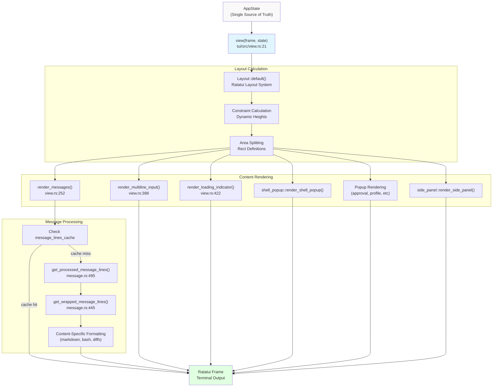
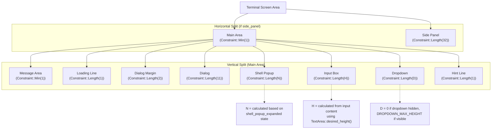
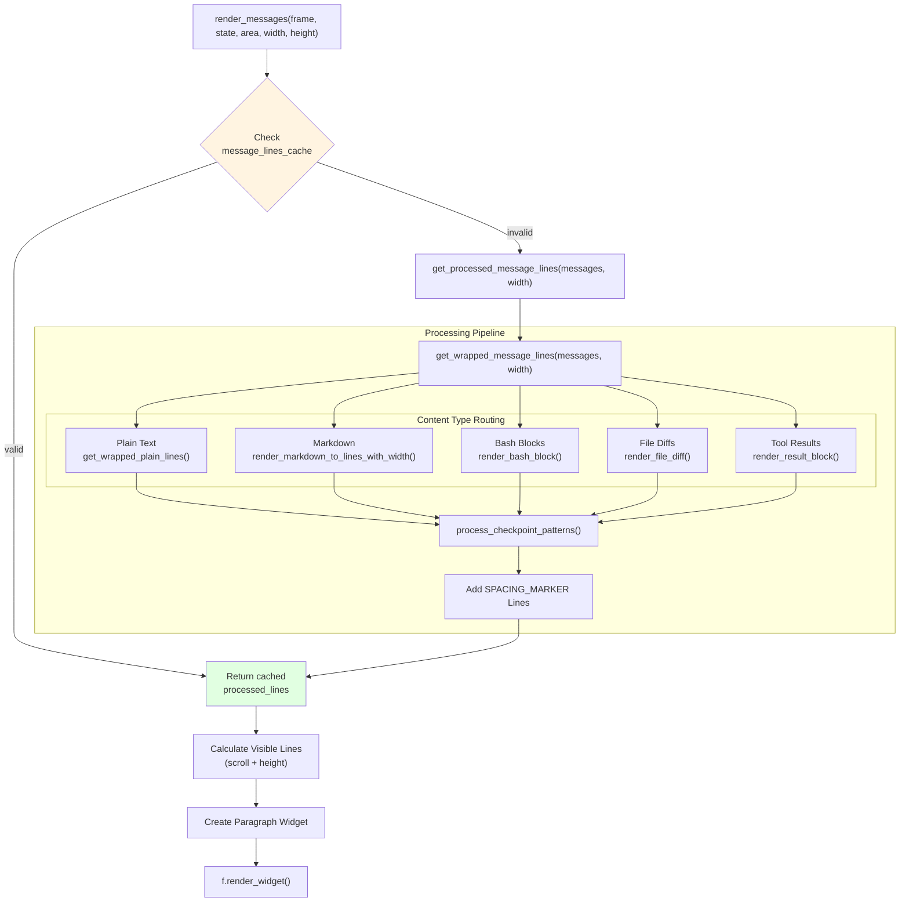
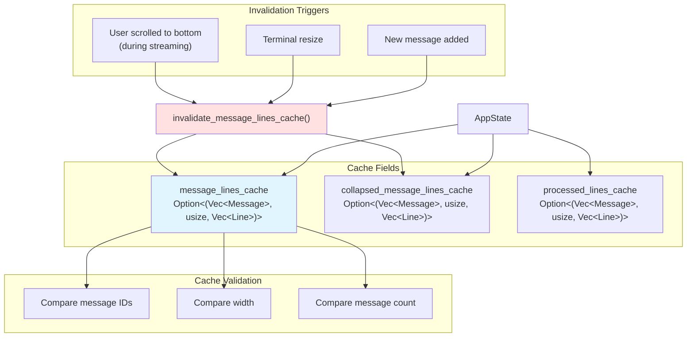
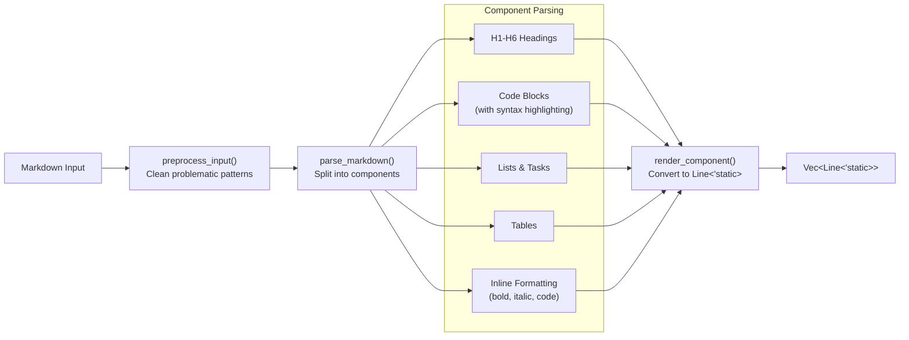
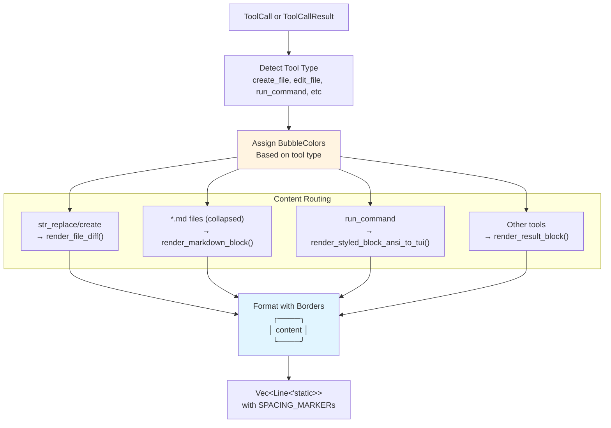
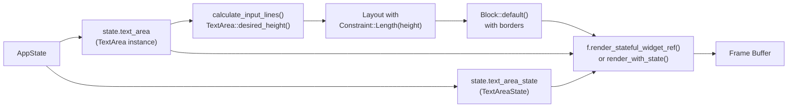
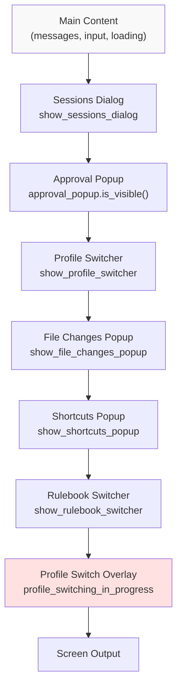
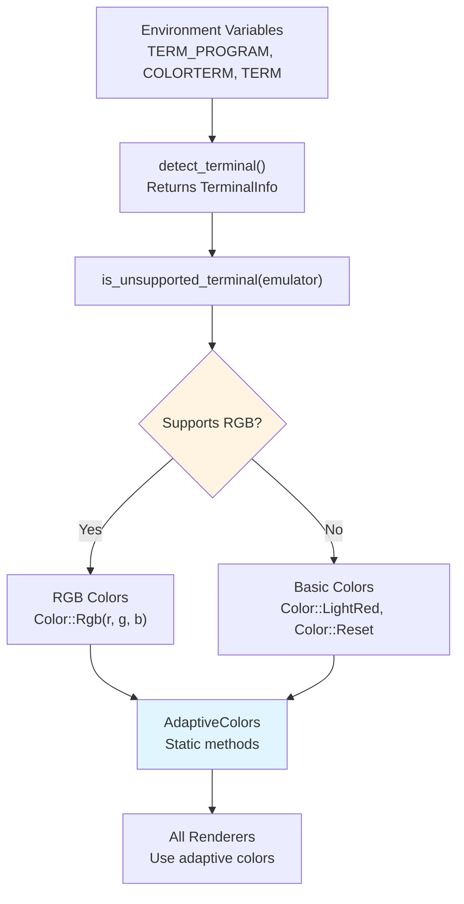

<!-- source: DeepWiki mcp.deepwiki.com · repo stakpak/agent · page 3.4 Rendering System · fetched 2026-10-27 -->

# Rendering System

<details>
<summary>Relevant source files</summary>

The following files were used as context for generating this wiki page:

- [tui/src/app.rs](tui/src/app.rs)
- [tui/src/lib.rs](tui/src/lib.rs)
- [tui/src/services/bash_block.rs](tui/src/services/bash_block.rs)
- [tui/src/services/detect_term.rs](tui/src/services/detect_term.rs)
- [tui/src/services/markdown_renderer.rs](tui/src/services/markdown_renderer.rs)
- [tui/src/services/message.rs](tui/src/services/message.rs)
- [tui/src/services/syntax_highlighter.rs](tui/src/services/syntax_highlighter.rs)
- [tui/src/services/update.rs](tui/src/services/update.rs)
- [tui/src/view.rs](tui/src/view.rs)

</details>


The Rendering System is responsible for transforming the TUI's `AppState` into visual output on the terminal screen. It handles layout calculation, message formatting, text wrapping, caching, and adaptive color rendering across different terminal emulators. This system is built on top of the `ratatui` library and implements a single-pass rendering pipeline that executes on every frame.

For information about state management and how data flows to the rendering system, see [State Management](#3.2). For details on event handling that triggers re-renders, see [Event Handling and User Input](#3.3).

## Overview and Architecture

The rendering system follows a unidirectional data flow pattern where the `view` function reads from `AppState` and produces terminal output without modifying state. The system is optimized for performance through aggressive caching and lazy evaluation of expensive operations like markdown parsing and line wrapping.

### Rendering Flow Diagram



Sources: [tui/src/view.rs:21-238](), [tui/src/services/message.rs:452-524]()

## The View Function

The `view` function in [tui/src/view.rs:21]() is the single entry point for rendering. It is called on every frame (typically 60 FPS) by the event loop and must complete quickly to maintain responsiveness.

### View Function Signature and Flow

```rust
pub fn view(f: &mut Frame, state: &mut AppState)
```

The function performs these operations in sequence:

1. **Calculate horizontal layout** (side panel vs main area)
2. **Calculate vertical layout** (messages, input, popups, hints)
3. **Render messages** with caching
4. **Render shell popup** if visible
5. **Render input area** unless hidden
6. **Render loading indicator**
7. **Render all popups** (rendered last to appear on top)

Sources: [tui/src/view.rs:21-238]()

### Layout Calculation Strategy

The layout system uses `ratatui`'s `Layout` with dynamic constraints that change based on state:



Sources: [tui/src/view.rs:22-112]()

### Key Layout Calculations

| Component | Height Calculation | Source |
|-----------|-------------------|--------|
| **Input Area** | `calculate_input_lines(state, width)` using `TextArea::desired_height()` | [view.rs:241-250]() |
| **Dropdown** | `DROPDOWN_MAX_HEIGHT` or compact calculation based on `filtered_helpers.len()` | [view.rs:55-76]() |
| **Shell Popup** | `shell_popup::calculate_popup_height(state, main_area.height)` | [view.rs:87]() |
| **Dialog** | Fixed height of 11 when `show_sessions_dialog` is true | [view.rs:83-84]() |
| **Message Area** | `Constraint::Min(1)` - takes all remaining space | [view.rs:98]() |

Sources: [tui/src/view.rs:48-112]()

## Message Rendering Pipeline

Message rendering is the most complex part of the system, handling multiple content types (markdown, tool calls, bash blocks, diffs) with aggressive caching to maintain 60 FPS performance.

### Message Processing Flow



Sources: [tui/src/view.rs:252-292](), [tui/src/services/message.rs:495-524]()

### Message Content Type Handling

The system routes different message types to specialized renderers:

| `MessageContent` Type | Renderer | Output Format |
|----------------------|----------|---------------|
| `Plain(text, style)` | `get_wrapped_plain_lines()` | Styled spans with wrapping |
| `AssistantMD(text, style)` | `render_markdown_to_lines_with_width()` | Parsed markdown with syntax highlighting |
| `RenderPendingBorderBlock(tool_call, is_auto)` | `render_bash_block()` or `render_file_diff()` | Bordered block with tool info |
| `RenderResultBorderBlock(result)` | `render_result_block()` | Bordered block with output |
| `RenderStreamingBorderBlock(...)` | `render_styled_block_ansi_to_tui()` | Live-updating block |
| `Styled(line)` | Direct pass-through | Pre-formatted line |
| `StyledBlock(lines)` | Direct pass-through | Pre-formatted lines |

Sources: [tui/src/services/message.rs:592-891]()

## Caching System

The rendering system implements a multi-level caching strategy to avoid expensive re-computation on every frame.

### Cache Structure



Sources: [tui/src/app.rs:60-62](), [tui/src/services/message.rs:527-537]()

### Cache Validation Logic

The `get_wrapped_message_lines_cached()` function validates caches by checking:

1. **Message count**: `cached_messages.len() == messages.len()`
2. **Terminal width**: `cached_width == width`
3. **Message identity**: `cached_messages[i].id == messages[i].id` for all messages

If validation fails, the cache is invalidated and lines are re-computed.

**Smart Invalidation**: During streaming, the cache is NOT invalidated if the user has scrolled up (`!state.stay_at_bottom && state.is_streaming`). This prevents jitter when new chunks arrive while the user is reading old messages.

Sources: [tui/src/services/message.rs:452-492](), [tui/src/services/message.rs:527-537]()

## Content Type Renderers

The system includes specialized renderers for different content types, each producing styled `Line<'static>` vectors.

### Markdown Renderer

The `MarkdownRenderer` in [tui/src/services/markdown_renderer.rs]() parses and renders markdown with:

- **Syntax highlighting** for code blocks using `syntect`
- **Adaptive color schemes** based on terminal capabilities
- **Performance limits**: max 100KB content, 500 lines, 2-second timeout
- **Component support**: headings, lists, tables, code blocks, links, callouts

**Parsing Flow**:



Sources: [tui/src/services/markdown_renderer.rs:247-317](), [tui/src/services/markdown_renderer.rs:958-1068]()

### Bash Block Renderer

Tool calls and command outputs are rendered using `render_bash_block()` and related functions:



**Color Mapping**:

| Tool Type | Border Color | Use Case |
|-----------|--------------|----------|
| `create_file` | Green | File creation |
| `edit_file` / `str_replace` | Yellow | File modification |
| `run_command` | Cyan | Command execution |
| `read_file` / `view` | Magenta | File reading |
| `delete_file` / `remove` | Red | File deletion |

Sources: [tui/src/services/bash_block.rs:500-551](), [tui/src/services/bash_block.rs:753-776]()

### ANSI Processing

Terminal output (from commands) is processed to handle ANSI escape codes and terminal control sequences:

1. **Preprocessing**: `preprocess_terminal_output()` handles carriage returns (`\r`), filters empty lines
2. **ANSI parsing**: `ansi_to_tui` crate converts ANSI codes to ratatui `Span` styles
3. **Wrapping**: `wrap_ansi_text()` wraps content while preserving ANSI formatting
4. **Display width**: `calculate_display_width()` accounts for Unicode width (emojis, etc.)

Sources: [tui/src/services/bash_block.rs:56-98](), [tui/src/services/bash_block.rs:143-209]()

## Input Area Rendering

The input area uses a custom `TextArea` widget that supports:

- Multi-line text editing with wrapping
- Cursor positioning and visibility
- Password masking (for shell input)
- Session-empty state detection (for placeholder text)

### TextArea Rendering Flow



**Password Masking**: When `state.waiting_for_shell_input` is true, the `TextArea::render_with_state()` method is called with a mask parameter to hide password characters.

Sources: [tui/src/view.rs:388-420](), [tui/src/view.rs:241-250]()

## Popup Rendering Order

Popups are rendered after all main content to ensure they appear on top. The rendering order (from bottom to top) is:



This ordering ensures that critical user interactions (like profile switching overlay) are always visible and cannot be obscured by other UI elements.

Sources: [tui/src/view.rs:205-237]()

## Terminal Adaptation

The rendering system adapts to different terminal capabilities using the `detect_term` module.

### Terminal Detection and Color Adaptation



**Unsupported Terminals**: The system maintains a list of terminals that don't support RGB colors (e.g., `Terminal.app`, `cmd.exe`, `PowerShell`). For these terminals, all colors fall back to basic ANSI colors.

**AdaptiveColors Methods**: The `AdaptiveColors` struct provides methods like `red()`, `green()`, `text()`, `dark_gray()`, etc., which return appropriate colors based on terminal capabilities.

Sources: [tui/src/services/detect_term.rs:21-277](), [tui/src/services/detect_term.rs:280-382]()

## Performance Characteristics

The rendering system is designed for 60 FPS performance with these optimizations:

| Optimization | Technique | Impact |
|--------------|-----------|--------|
| **Message Line Caching** | Store computed `Vec<Line<'static>>` by (messages, width) | Avoids markdown parsing and wrapping on every frame |
| **Smart Cache Invalidation** | Don't invalidate during streaming if user scrolled up | Prevents jitter during live updates |
| **Lazy Markdown Parsing** | Only parse when cache misses | Reduces CPU usage |
| **Pre-allocated Capacity** | `Vec::with_capacity()` for known sizes | Reduces allocations |
| **Timeout Protection** | 2-second limit on markdown parsing | Prevents UI freezing on large content |
| **Content Truncation** | Limit code blocks to 500 lines, markdown to 100KB | Caps worst-case rendering time |
| **Early Returns** | Check formatting needs before parsing | Skips unnecessary work |

The cached `Vec<Line<'static>>` uses owned data to avoid lifetime issues and enables zero-copy rendering when the cache is valid.

Sources: [tui/src/services/message.rs:452-524](), [tui/src/services/markdown_renderer.rs:247-317]()

## Rendering Component Summary

| Component | Renderer Function | Cached? | Layout Constraint |
|-----------|------------------|---------|-------------------|
| **Messages** | `render_messages()` | Yes (multi-level) | `Constraint::Min(1)` |
| **Loading Line** | `render_loading_indicator()` | No | `Constraint::Length(1)` |
| **Input Box** | `render_multiline_input()` | No | `Constraint::Length(H)` |
| **Dropdown** | `render_helper_dropdown()` / `render_file_search_dropdown()` | No | `Constraint::Length(D)` |
| **Hint Line** | `render_hint_or_shortcuts()` | No | `Constraint::Length(1)` |
| **Shell Popup** | `shell_popup::render_shell_popup()` | No | `Constraint::Length(N)` |
| **Side Panel** | `side_panel::render_side_panel()` | No | `Constraint::Length(32)` |
| **Popups** | Various popup renderers | No | Centered overlay |

Sources: [tui/src/view.rs:21-238]()

---

