<!-- source: DeepWiki mcp.deepwiki.com · repo stakpak/agent · page 3.5 Message System and Display · fetched 2026-10-27 -->

# Message System and Display

<details>
<summary>Relevant source files</summary>

The following files were used as context for generating this wiki page:

- [tui/src/services/bash_block.rs](tui/src/services/bash_block.rs)
- [tui/src/services/detect_term.rs](tui/src/services/detect_term.rs)
- [tui/src/services/markdown_renderer.rs](tui/src/services/markdown_renderer.rs)
- [tui/src/services/message.rs](tui/src/services/message.rs)
- [tui/src/services/syntax_highlighter.rs](tui/src/services/syntax_highlighter.rs)

</details>


This document describes the TUI's message rendering system, including message types, content processing, text formatting, and display logic. It covers how conversation messages, tool calls, results, markdown, and terminal output are transformed into styled terminal lines.

For information about the event handling and state management that drives message updates, see [Event Handling and User Input](#3.3). For the overall rendering pipeline and layout calculation, see [Rendering System](#3.4).

## Overview

The message system is responsible for converting high-level message content (user text, assistant responses, tool calls, results) into styled terminal lines that can be displayed by Ratatui. The system handles:

- Multiple content types (plain text, markdown, tool calls, results, file diffs)
- Text wrapping with proper Unicode and ANSI code handling
- Adaptive styling based on terminal capabilities
- Performance optimization through line caching
- Special formatting for shell history, code blocks, and tables

**Sources:** [tui/src/services/message.rs:1-50]()

## Message Architecture

### MessageContent Enum

The `MessageContent` enum defines all possible message types that can be displayed in the conversation:

```mermaid
graph TB
    MessageContent["MessageContent Enum"]
    
    MessageContent --> Plain["Plain(String, Style)<br/>Simple styled text"]
    MessageContent --> AssistantMD["AssistantMD(String, Style)<br/>Assistant markdown response"]
    MessageContent --> Styled["Styled(Line)<br/>Single styled line"]
    MessageContent --> StyledBlock["StyledBlock(Vec&lt;Line&gt;)<br/>Pre-rendered lines"]
    MessageContent --> Markdown["Markdown(String)<br/>Rendered markdown"]
    MessageContent --> PlainText["PlainText(String)<br/>Unformatted text"]
    MessageContent --> PendingBorder["RenderPendingBorderBlock<br/>Tool awaiting execution"]
    MessageContent --> PendingStall["RenderPendingBorderBlockWithStallWarning<br/>Tool with timeout warning"]
    MessageContent --> StreamingBorder["RenderStreamingBorderBlock<br/>Tool call in progress"]
    MessageContent --> ResultBorder["RenderResultBorderBlock<br/>Tool execution result"]
    MessageContent --> Collapsed["RenderCollapsedMessage<br/>Minimized tool display"]
    MessageContent --> EscapedText["RenderEscapedTextBlock<br/>Plain text content"]
    MessageContent --> BashBubble["BashBubble<br/>Shell command display"]
    MessageContent --> RefreshedTerminal["RenderRefreshedTerminal<br/>Terminal state snapshot"]
```

**Sources:** [tui/src/services/message.rs:27-52]()

### Message Struct

Each `Message` contains an ID, content variant, and optional collapse state:

| Field | Type | Purpose |
|-------|------|---------|
| `id` | `Uuid` | Unique identifier for cache invalidation |
| `content` | `MessageContent` | The actual content variant |
| `is_collapsed` | `Option<bool>` | Whether message is shown in collapsed view |

**Sources:** [tui/src/services/message.rs:115-120]()

## Message Processing Pipeline

### Entry Points and Caching

The message processing pipeline starts from two main entry points:

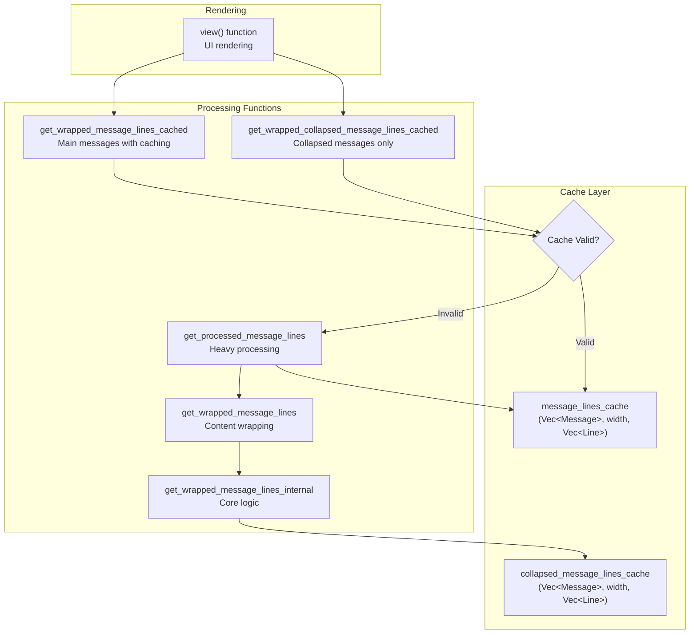

**Sources:** [tui/src/services/message.rs:452-492](), [tui/src/services/message.rs:539-590]()

### Cache Invalidation Strategy

The cache is invalidated selectively to prevent UI jitter during streaming:

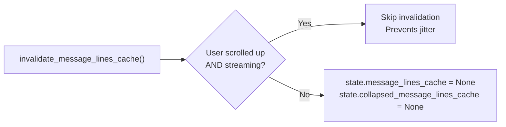

**Sources:** [tui/src/services/message.rs:528-537]()

### Content Type Routing

The `get_wrapped_message_lines_internal` function routes each message content type to its specialized renderer:

| MessageContent Variant | Rendering Function | Output |
|------------------------|-------------------|---------|
| `AssistantMD` | `render_markdown_to_lines_with_width` | Styled markdown lines |
| `Plain` | `get_wrapped_plain_lines` | Wrapped text with shell history detection |
| `Styled` | `get_wrapped_styled_lines` | Direct pass-through |
| `StyledBlock` | `get_wrapped_styled_block_lines` | Direct pass-through |
| `RenderPendingBorderBlock` | `render_bash_block` or `render_file_diff` | Bordered tool call |
| `RenderStreamingBorderBlock` | `render_styled_block` | Streaming tool output |
| `RenderResultBorderBlock` | `render_result_block` | Tool execution result |
| `RenderCollapsedMessage` | `render_file_diff_full` | Expanded diff view |
| `RenderEscapedTextBlock` | `format_text_content` | Plain formatted text |
| `Markdown` | `get_wrapped_markdown_lines` | Rendered markdown |
| `PlainText` | Direct span creation | Single line |
| `BashBubble` | `get_wrapped_bash_bubble_lines` | Shell command bubble |
| `RenderRefreshedTerminal` | `render_refreshed_terminal_bubble` | Terminal snapshot |

**Sources:** [tui/src/services/message.rs:592-906]()

## Content Rendering Systems

### Bordered Block Rendering

Tool calls and results are rendered with Unicode box-drawing characters. The rendering pipeline for bordered blocks:

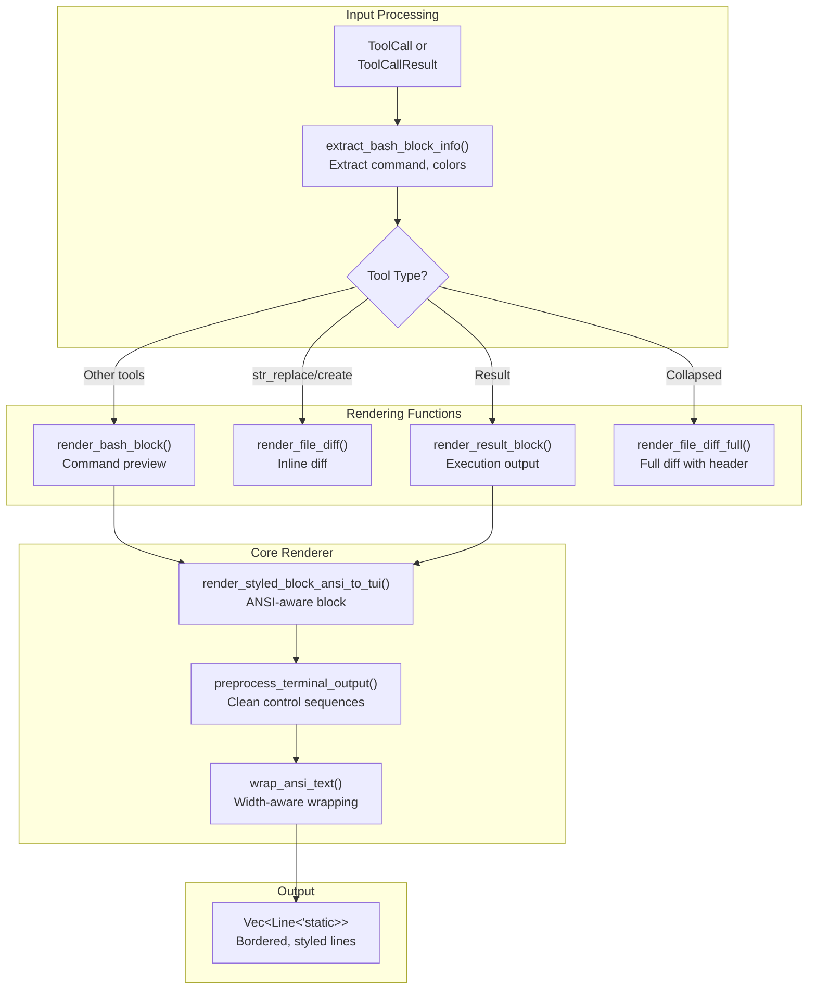

**Sources:** [tui/src/services/bash_block.rs:212-409](), [tui/src/services/bash_block.rs:753-776]()

### BubbleColors System

Each tool type has a distinct color scheme defined by `BubbleColors`:

```rust
// Example from extract_bash_block_info
match tool_name {
    "create_file" => BubbleColors {
        border_color: Color::Green,
        title_color: Color::Gray,
        content_color: Color::LightGreen,
    },
    "edit_file" => BubbleColors {
        border_color: Color::Yellow,
        ...
    },
    "run_command" => BubbleColors {
        border_color: Color::Cyan,
        ...
    },
    ...
}
```

**Sources:** [tui/src/services/bash_block.rs:500-551](), [tui/src/services/message.rs:18-24]()

### Border Block Structure

The structure of a rendered bordered block:

```
╭─ Title (truncated if needed) ───────────────╮
│  Indented content with proper wrapping     │
│  Multiple lines preserved                  │
│  ANSI colors maintained                    │
╰────────────────────────────────────────────╯
```

The title border calculation handles Unicode width correctly:

**Sources:** [tui/src/services/bash_block.rs:243-271]()

## Terminal Output Processing

### ANSI Code Handling

Terminal output often contains ANSI escape sequences. The processing pipeline:

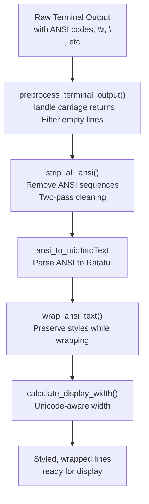

**Sources:** [tui/src/services/bash_block.rs:35-55](), [tui/src/services/bash_block.rs:57-98]()

### Carriage Return Processing

Carriage returns (`\r`) in terminal output simulate overwriting:

```rust
// From preprocess_terminal_output
for ch in text.chars() {
    match ch {
        '\r' => {
            // Carriage return - start overwriting the current line
            current_line.clear();
        }
        '\n' => {
            // Newline - finish the current line and start a new one
            lines.push(current_line.clone());
            current_line.clear();
        }
        '\t' => {
            current_line.push_str("    ");
        }
        _ => {
            current_line.push(ch);
        }
    }
}
```

**Sources:** [tui/src/services/bash_block.rs:57-98]()

### Unicode Width Calculation

Text wrapping must account for Unicode character widths (1 or 2 display columns):

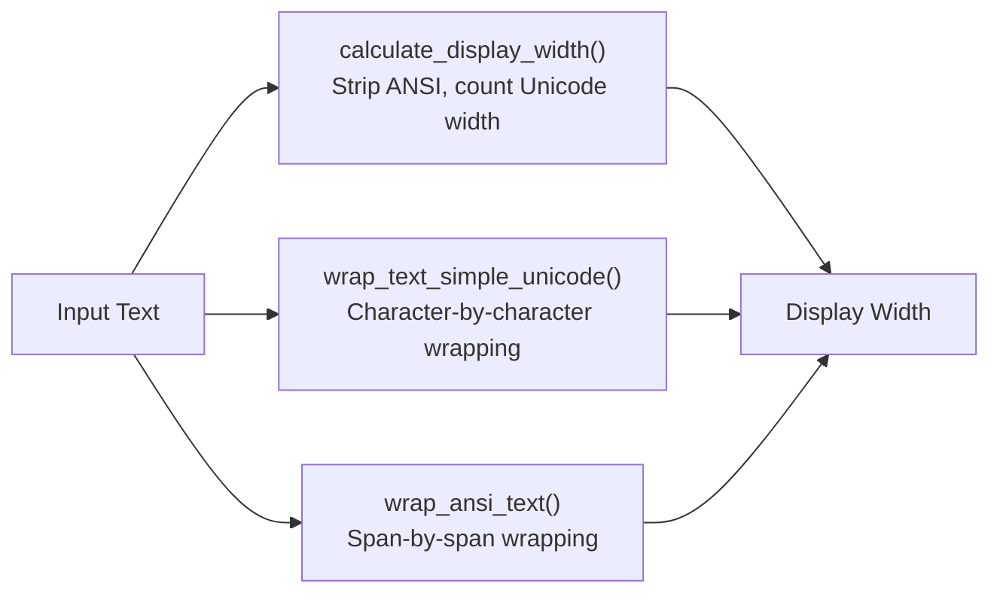

**Sources:** [tui/src/services/bash_block.rs:100-105](), [tui/src/services/bash_block.rs:108-140]()

## Markdown Rendering

### Parsing Pipeline

The `MarkdownRenderer` parses markdown into components, then renders them to styled lines:

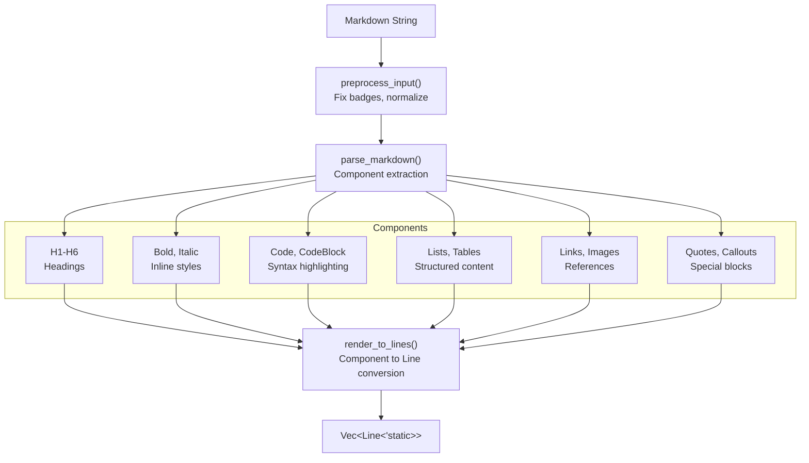

**Sources:** [tui/src/services/markdown_renderer.rs:227-317](), [tui/src/services/markdown_renderer.rs:1031-1053]()

### MarkdownComponent Types

The parser recognizes these component types:

| Component | Pattern | Example |
|-----------|---------|---------|
| `H1` - `H6` | `# text` | `## Section Title` |
| `Bold` | `**text**` | `**important**` |
| `Italic` | `*text*` | `*emphasis*` |
| `Code` | `` `code` `` | `` `variable` `` |
| `CodeBlock` | ` ```lang` | ` ```python` |
| `Link` | `[text](url)` | `[docs](https://...)` |
| `Image` | `` | `` |
| `ListItem` | `- text` or `1. text` | `- Item one` |
| `Quote` | `> text` | `> Note: ...` |
| `Table` | `\| col \| col \|` | Markdown tables |
| `TaskOpen` | `- [ ] text` | `- [ ] Todo` |
| `TaskComplete` | `- [x] text` | `- [x] Done` |
| `HorizontalSeparator` | `---` or `***` | `---` |

**Sources:** [tui/src/services/markdown_renderer.rs:12-60]()

### Syntax Highlighting

Code blocks with language tags are syntax-highlighted using `syntect`:

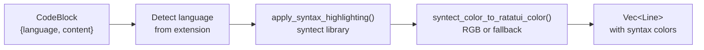

**Sources:** [tui/src/services/syntax_highlighter.rs:20-56]()

### MarkdownStyle Configuration

Markdown components are styled with `MarkdownStyle`, which adapts to terminal capabilities:

```rust
impl MarkdownStyle {
    pub fn adaptive() -> Self {
        if should_use_rgb_colors() {
            Self::dark_theme()  // RGB colors
        } else {
            Self::high_contrast_theme()  // Standard colors
        }
    }
}
```

**Sources:** [tui/src/services/markdown_renderer.rs:92-225]()

## File Diff Rendering

### Diff Extraction

File diffs for `str_replace` and `create` tool calls are rendered with visual indicators:

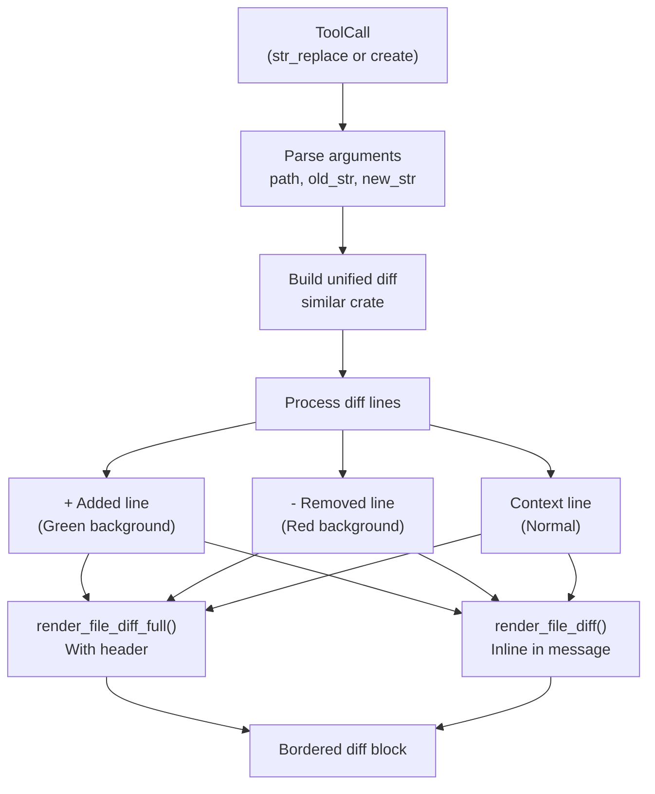

**Sources:** [tui/src/services/file_diff.rs]() (referenced in bash_block.rs), [tui/src/services/bash_block.rs:681-751]()

### Diff Line Styling

Diff lines are color-coded:

- **Green background** (`dark_green`): Added lines with `+` prefix
- **Red background** (`dark_red`): Removed lines with `-` prefix
- **Normal**: Context lines

**Sources:** [tui/src/services/bash_block.rs:681-715]()

## Adaptive Color System

### Terminal Detection

The system detects terminal capabilities and adjusts colors accordingly:

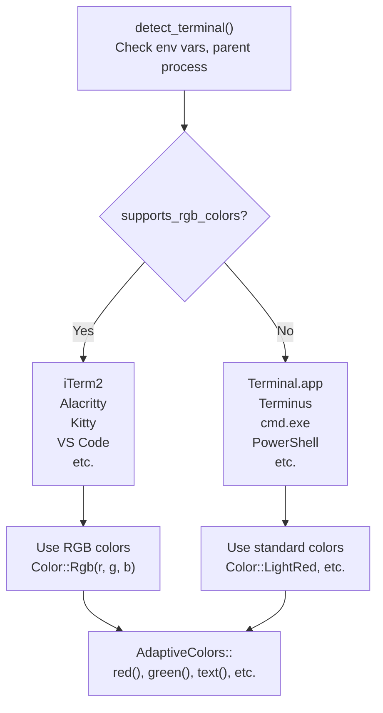

**Sources:** [tui/src/services/detect_term.rs:22-277]()

### AdaptiveColors Methods

The `AdaptiveColors` struct provides terminal-aware color constants:

| Method | RGB Value (if supported) | Fallback |
|--------|--------------------------|----------|
| `red()` | `Rgb(239, 100, 97)` | `LightRed` |
| `green()` | `Rgb(35, 218, 111)` | `LightGreen` |
| `text()` | `Rgb(180, 180, 180)` | `Reset` |
| `dark_gray()` | `Rgb(80, 80, 80)` | `DarkGray` |
| `dark_green()` | `Rgb(44, 51, 35)` | `Green` |
| `dark_red()` | `Rgb(51, 36, 35)` | `Red` |
| `code_bg()` | `Rgb(48, 48, 48)` | `Reset` |
| `code_block_bg()` | `Rgb(30, 30, 30)` | `Reset` |
| `list_bullet()` | `Rgb(180, 180, 180)` | `Gray` |

**Sources:** [tui/src/services/detect_term.rs:280-382]()

## Shell History Rendering

### Detection and Parsing

Plain text messages containing shell history are detected and rendered as bubbles:

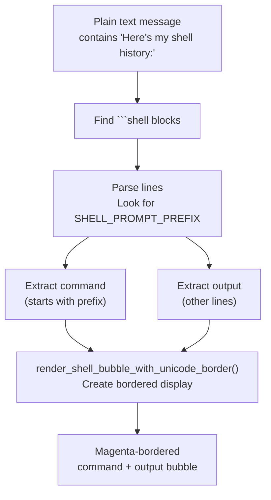

**Sources:** [tui/src/services/message.rs:672-722](), [tui/src/services/message.rs:342-426]()

## Result Block Rendering

### Compact vs Bordered Display

Result blocks have two rendering modes based on whether the tool is collapsed:

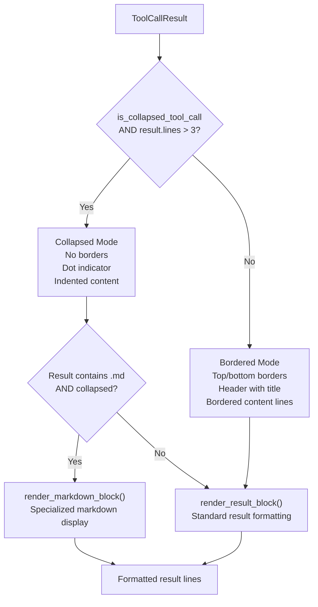

**Sources:** [tui/src/services/bash_block.rs:808-1092](), [tui/src/services/bash_block.rs:778-806]()

### Result Block Structure

A standard result block with borders:

```
╭──────────────────────────────────────────────╮
│ ● Title (command path = value)               │
│  Content line 1                              │
│  Content line 2                              │
│  ...                                         │
╰──────────────────────────────────────────────╯
```

A collapsed result block (no borders):

```
● Title (command path = value)
  Content line 1
  Content line 2
  ...
```

**Sources:** [tui/src/services/bash_block.rs:844-1036]()

## Performance Considerations

### Caching Strategy

The message system implements a two-level cache:

1. **Main cache** (`message_lines_cache`): All non-collapsed messages
2. **Collapsed cache** (`collapsed_message_lines_cache`): Only collapsed messages

Cache keys include:
- Message list (by ID)
- Terminal width
- Pre-rendered lines

**Sources:** [tui/src/services/message.rs:467-491](), [tui/src/services/message.rs:551-576]()

### Processing Limits

To prevent performance issues and hangs:

| Limit | Value | Purpose |
|-------|-------|---------|
| Max markdown size | 100KB | Prevent DoS from large content |
| Max markdown lines | 500 | Prevent infinite processing |
| Markdown timeout | 2 seconds | Keep UI responsive |
| Max code lines | 500 | Limit code block size |
| Max quote lines | 50 | Limit quote block size |
| Max table rows | 100 | Limit table size |
| Max output lines | 5000 | Prevent memory issues |

**Sources:** [tui/src/services/markdown_renderer.rs:260-262](), [tui/src/services/markdown_renderer.rs:271-276](), [tui/src/services/markdown_renderer.rs:516-526]()

### Line Wrapping Optimization

Text wrapping uses an efficient character-by-character approach with Unicode width calculation:

```rust
// From wrap_text_simple_unicode
for ch in stripped.chars() {
    let char_width = unicode_width::UnicodeWidthChar::width(ch).unwrap_or(1);
    
    if current_width + char_width > width && !current_line.is_empty() {
        lines.push(current_line.clone());
        current_line.clear();
        current_width = 0;
    }
    
    current_line.push(ch);
    current_width += char_width;
}
```

**Sources:** [tui/src/services/bash_block.rs:108-140]()

## Special Content Processing

### Markdown Delimiter Stripping

When resuming sessions, assistant messages may contain markdown code block delimiters that need to be stripped:

```rust
// From strip_markdown_delimiters
// Only process if this looks like a markdown code block
if !result.contains("```markdown") && !result.contains("```md") {
    return result; // Return unchanged
}

// Remove opening delimiter and any leading newline
// Remove closing delimiter and any trailing newline
```

**Sources:** [tui/src/services/message.rs:63-113]()

### Local Context and Rulebook Stripping

User messages may contain injected context that should not be displayed:

```rust
// Strip local_context blocks
while let Some(start) = cleaned.find("<local_context>") {
    if let Some(end) = cleaned[start..].find("</local_context>") {
        cleaned.replace_range(start..end_pos, "");
    }
}

// Strip rulebooks blocks
while let Some(start) = cleaned.find("<rulebooks>") {
    if let Some(end) = cleaned[start..].find("</rulebooks>") {
        cleaned.replace_range(start..end_pos, "");
    }
}
```

**Sources:** [tui/src/services/message.rs:652-670]()

### Checkpoint Pattern Processing

Checkpoint IDs in messages are detected and formatted specially:

```rust
// From get_processed_message_lines
if line_text.contains("<checkpoint_id>") {
    processed_lines.push(Line::from(""));
    let processed = process_checkpoint_patterns(&[(line.clone(), Style::default())], width);
    for (processed_line, _) in processed {
        processed_lines.push(processed_line);
    }
    processed_lines.push(Line::from(""));
}
```

**Sources:** [tui/src/services/message.rs:506-513]()

---

