<!-- source: DeepWiki mcp.deepwiki.com · repo stakpak/agent · page 3.6 Interactive Components · fetched 2026-10-27 -->

# Interactive Components

<details>
<summary>Relevant source files</summary>

The following files were used as context for generating this wiki page:

- [tui/src/app/events.rs](tui/src/app/events.rs)
- [tui/src/services/commands.rs](tui/src/services/commands.rs)
- [tui/src/services/handlers/input.rs](tui/src/services/handlers/input.rs)
- [tui/src/services/handlers/mod.rs](tui/src/services/handlers/mod.rs)
- [tui/src/services/handlers/popup.rs](tui/src/services/handlers/popup.rs)
- [tui/src/services/hint_helper.rs](tui/src/services/hint_helper.rs)

</details>


This document details the interactive popups, dialogs, and contextual assistance systems in the TUI. These components provide profile switching, rulebook management, command discovery, tool approval workflows, file change tracking, and contextual hints.

For core TUI architecture and event handling, see [Core Architecture and Event Loop](#3.1) and [Event Handling and User Input](#3.3). For shell integration, see [Shell Mode Integration](#3.7).

## Component Overview

The TUI implements several interactive components that overlay the main interface:

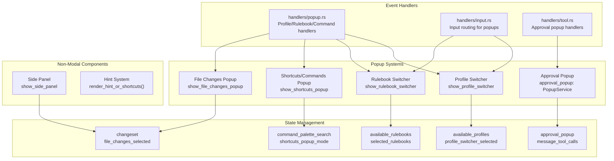

**Interactive Components Architecture**
The TUI's popup and interactive systems with their handlers and state management.

Sources: [tui/src/services/handlers/popup.rs:1-812](), [tui/src/app/events.rs:1-158](), [tui/src/services/hint_helper.rs:1-213]()
</thinking>

## Profile Switcher

The profile switcher allows users to switch between configured profiles (API keys, models, settings):

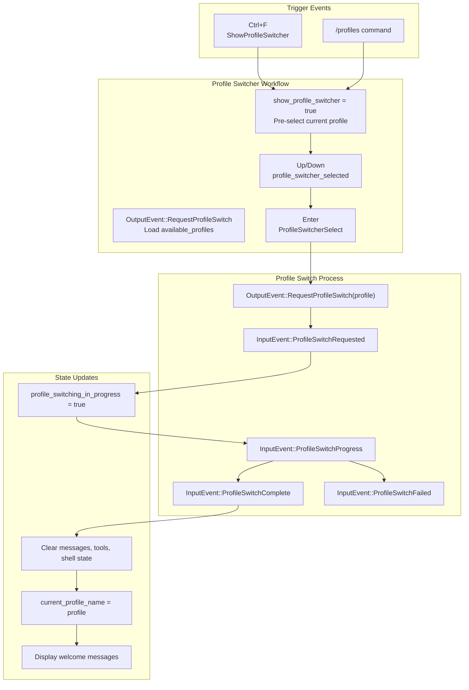

**Profile Switcher Workflow**
From trigger to completion, showing state blocking during switch.

| Handler Function | Purpose | Location |
|-----------------|---------|----------|
| `handle_show_profile_switcher` | Display profile list, pre-select current | [tui/src/services/handlers/popup.rs:45-66]() |
| `handle_profile_switcher_select` | Initiate profile switch | [tui/src/services/handlers/popup.rs:68-87]() |
| `handle_profile_switch_requested` | Block input, show progress | [tui/src/services/handlers/popup.rs:106-119]() |
| `handle_profile_switch_complete` | Clear state, update profile | [tui/src/services/handlers/popup.rs:128-192]() |
| `handle_profile_switch_failed` | Show error, unblock input | [tui/src/services/handlers/popup.rs:195-208]() |

**State Fields**:
- `show_profile_switcher: bool` - Popup visibility
- `available_profiles: Vec<String>` - Loaded profile names
- `profile_switcher_selected: usize` - Current selection index
- `profile_switching_in_progress: bool` - Blocks all input during switch
- `current_profile_name: String` - Active profile name

The profile switcher prevents interaction with other dialogs during the switch process by checking `profile_switching_in_progress` in event handlers [tui/src/services/handlers/popup.rs:48-51]().

Sources: [tui/src/services/handlers/popup.rs:43-208](), [tui/src/app/events.rs:92-97]()

## Rulebook Switcher

The rulebook switcher provides multi-select functionality for activating rulebooks (SOPs, policies, context):

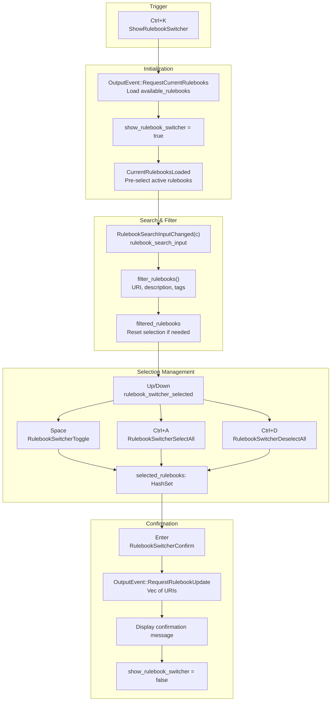

**Rulebook Switcher Workflow**
Multi-select interface with search filtering and bulk selection operations.

The `filter_rulebooks` function at [tui/src/services/handlers/popup.rs:17-41]() filters rulebooks by matching the search term against URI, description, or tags (case-insensitive).

| Handler Function | Purpose | Location |
|-----------------|---------|----------|
| `handle_show_rulebook_switcher` | Clear input, request current rulebooks | [tui/src/services/handlers/popup.rs:213-232]() |
| `handle_rulebook_switcher_toggle` | Toggle selection of current item | [tui/src/services/handlers/popup.rs:250-264]() |
| `handle_rulebook_switcher_confirm` | Send selected URIs to CLI | [tui/src/services/handlers/popup.rs:272-291]() |
| `handle_rulebook_search_input_changed` | Update search, re-filter | [tui/src/services/handlers/popup.rs:313-318]() |
| `filter_rulebooks` | Filter by URI/description/tags | [tui/src/services/handlers/popup.rs:17-41]() |

**State Fields**:
- `show_rulebook_switcher: bool` - Popup visibility
- `available_rulebooks: Vec<ListRuleBook>` - All rulebooks from API
- `filtered_rulebooks: Vec<ListRuleBook>` - Search-filtered list
- `selected_rulebooks: HashSet<String>` - Selected URIs
- `rulebook_search_input: String` - Search query
- `rulebook_switcher_selected: usize` - Navigation index

Sources: [tui/src/services/handlers/popup.rs:210-338](), [tui/src/app/events.rs:108-120]()

## Command Palette and Shortcuts Popup

The unified shortcuts popup operates in two modes: **Commands** (command palette) and **Shortcuts** (keyboard reference):

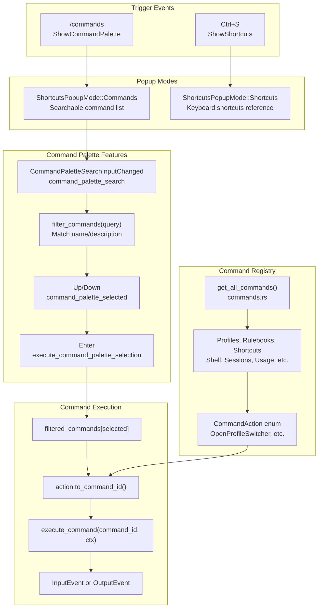

**Unified Shortcuts Popup Architecture**
Two-mode popup for command discovery and keyboard shortcut reference.

### Command Palette (Commands Mode)

The command palette at [tui/src/services/commands.rs:106-193]() provides a searchable list of all TUI commands:

| Command | Description | Shortcut | Action |
|---------|-------------|----------|--------|
| Profiles | Change active profile | Ctrl+F | `OpenProfileSwitcher` |
| Rulebooks | Select rulebooks | Ctrl+K | `OpenRulebookSwitcher` |
| Context | Show context utilization | Ctrl+G | `ShowUsage` |
| Shortcuts | Show keyboard shortcuts | Ctrl+S | `OpenShortcuts` |
| Shell Mode | Open interactive shell | $ | `OpenShellMode` |
| New Session | Start new session | /new | `NewSession` |
| Sessions | List sessions | /sessions | `OpenSessions` |
| Resume | Resume last session | /resume | `ResumeSession` |
| Usage | Show token usage | /usage | `ShowUsage` |
| Status | Show account info | /status | `ShowStatus` |
| Memorize | Save to memory | /memorize | `MemorizeConversation` |
| Submit Issue | GitHub issue | /issue | `SubmitIssue` |
| Get Help | Discord support | /support | `GetSupport` |
| Switch Model | Toggle smart/eco | /model | `SwitchModel` |

The `filter_commands` function at [tui/src/services/commands.rs:278-291]() performs case-insensitive matching against command names and descriptions.

### Command Execution Flow

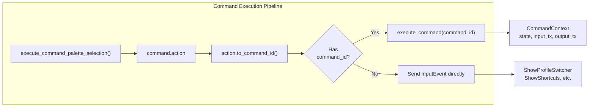

**Command Execution Path**
Commands are either executed via `execute_command()` or trigger direct events.

The `CommandAction::to_command_id()` method at [tui/src/services/commands.rs:65-83]() converts actions to slash command IDs. Actions without slash commands (like `OpenProfileSwitcher`) are handled by sending `InputEvent`s directly at [tui/src/services/handlers/tool.rs:371-405]().

Sources: [tui/src/services/commands.rs:1-949](), [tui/src/services/handlers/popup.rs:340-402](), [tui/src/services/handlers/tool.rs:361-410]()

## Approval Popup

The approval popup (`PopupService`) provides a sophisticated multi-tool approval interface with tabs and detailed tool information:

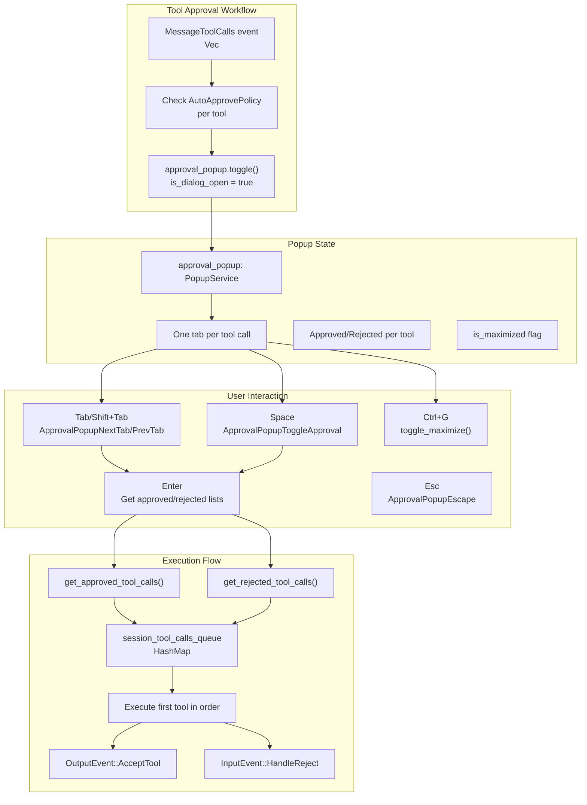

**Approval Popup Workflow**
Multi-tool approval with tab navigation and execution ordering.

### Approval State Management

The approval popup maintains execution state via several data structures:

| Field | Type | Purpose |
|-------|------|---------|
| `message_tool_calls` | `Option<Vec<ToolCall>>` | Current batch of tools to approve |
| `message_approved_tools` | `HashSet<ToolCall>` | Approved tools from popup |
| `message_rejected_tools` | `HashSet<ToolCall>` | Rejected tools from popup |
| `tool_call_execution_order` | `Vec<String>` | Order to execute tool IDs |
| `session_tool_calls_queue` | `HashMap<String, ToolCallStatus>` | Per-tool execution status |
| `approval_popup` | `PopupService` | Popup service instance |

When the user presses Enter in the approval popup, the handler at [tui/src/services/handlers/input.rs:86-149]() extracts approved/rejected lists and creates a `tools_status` vector maintaining the original order from `message_tool_calls`. The first tool is executed immediately while others are queued.

### Approval Popup API

| Method | Purpose | Usage |
|--------|---------|-------|
| `toggle()` | Show/hide popup | [tui/src/services/handlers/input.rs:398]() |
| `is_visible()` | Check visibility | [tui/src/services/handlers/input.rs:24]() |
| `toggle_approval_status()` | Space to toggle current tool | [tui/src/services/handlers/input.rs:26]() |
| `toggle_maximize()` | Expand/collapse popup | [tui/src/services/handlers/popup.rs:413]() |
| `get_approved_tool_calls()` | Get approved list | [tui/src/services/handlers/input.rs:89]() |
| `get_rejected_tool_calls()` | Get rejected list | [tui/src/services/handlers/input.rs:95]() |
| `escape()` | Cancel and hide | [tui/src/services/handlers/input.rs:148]() |

Sources: [tui/src/services/handlers/input.rs:86-149](), [tui/src/services/handlers/tool.rs:48-90](), [tui/src/app/events.rs:85-90]()

## File Changes Popup

The file changes popup displays all file modifications tracked by the changeset system with revert and editor integration:

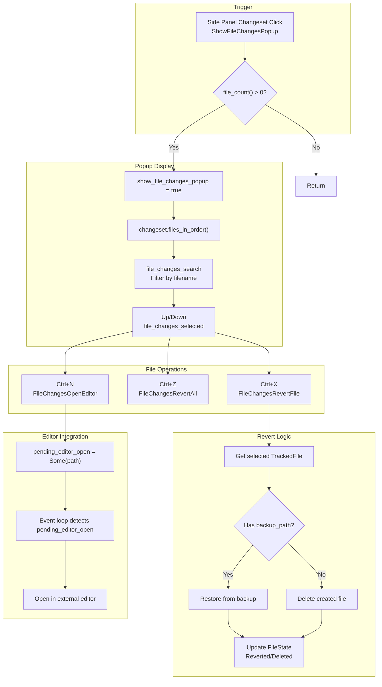

**File Changes Popup Architecture**
File modification tracking with revert and editor operations.

### File Change Tracking

The popup displays files from the `changeset` field, which tracks all file modifications during the session at [tui/src/services/changeset.rs]():

| File State | Description | Revert Behavior |
|------------|-------------|-----------------|
| `Created` | New file created by agent | Delete file |
| `Modified` | Existing file edited | Restore from backup |
| `Deleted` | File removed by agent | Restore from backup (if exists) |
| `Removed` | File removed without backup | Cannot revert |
| `Reverted` | Already reverted | Grayed out, skip |

### File Changes Handlers

| Handler Function | Keybinding | Purpose | Location |
|-----------------|------------|---------|----------|
| `handle_show_file_changes_popup` | Changeset click | Show popup if files exist | [tui/src/services/handlers/popup.rs:544-561]() |
| `handle_file_changes_popup_navigate` | ↑/↓ | Navigate file list | [tui/src/services/handlers/popup.rs:581-613]() |
| `handle_file_changes_popup_revert` | Ctrl+X | Revert selected file | [tui/src/services/handlers/popup.rs:615-671]() |
| `handle_file_changes_popup_revert_all` | Ctrl+Z | Revert all files | [tui/src/services/handlers/popup.rs:673-739]() |
| `handle_file_changes_popup_open_editor` | Ctrl+N | Open in editor | [tui/src/services/handlers/popup.rs:742-758]() |
| `handle_file_changes_popup_mouse_click` | Mouse | Click to open file | [tui/src/services/handlers/popup.rs:761-811]() |

The revert functions call `Changeset::revert_file()` which handles backup restoration and file deletion based on file state.

Sources: [tui/src/services/handlers/popup.rs:542-811](), [tui/src/app/events.rs:78-81]()

## Side Panel

The side panel provides a persistent display of session information and file changes:

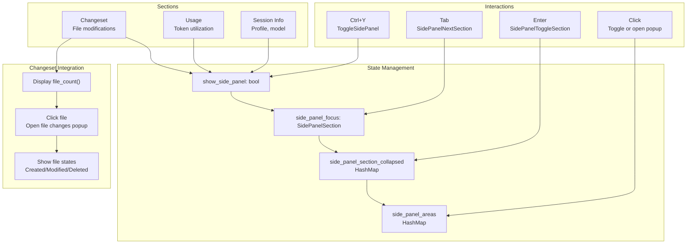

**Side Panel Architecture**
Multi-section panel with collapsible sections and mouse interaction.

### Side Panel Implementation

The side panel is toggled via `Ctrl+Y` which sends `InputEvent::ToggleSidePanel` at [tui/src/services/handlers/popup.rs:450-453](). The `SidePanelSection` enum defines available sections:

```rust
pub enum SidePanelSection {
    Changeset,
    Usage,
    // Future sections can be added here
}
```

The `side_panel_focus` field tracks which section is currently focused, and `side_panel_section_collapsed` stores collapse state per section. The rendering system stores clickable areas in `side_panel_areas` to enable mouse interaction.

**Mouse Click Handling**: When clicking the Changeset section at [tui/src/services/handlers/popup.rs:496-529](), the handler distinguishes between:
- **Header click** (row 0): Toggle collapse state
- **Content click** (other rows): Open file changes popup

Sources: [tui/src/services/handlers/popup.rs:448-540](), [tui/src/app/events.rs:130-134]()

## Hints System

The hint system provides contextual guidance based on application state with a priority-based display:

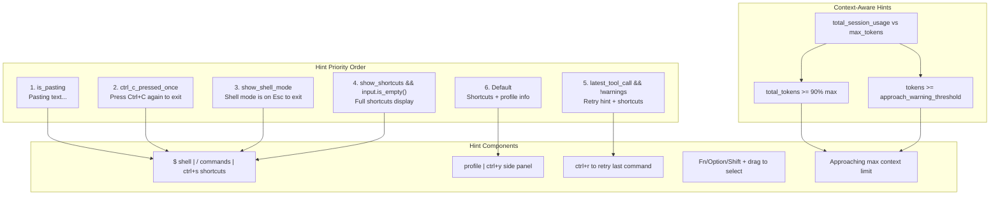

**Hint System Priority Flow**
Hints are displayed based on priority order, with context utilization warnings.

### Hint Display Logic

The `render_hint_or_shortcuts()` function at [tui/src/services/hint_helper.rs:13-212]() implements a waterfall of hint conditions:

| Priority | Condition | Hint Displayed | Purpose |
|----------|-----------|---------------|---------|
| 1 | `is_pasting` | "Pasting text..." | Feedback during paste |
| 2 | `ctrl_c_pressed_once` | "Press Ctrl+C again to exit Stakpak" | Quit confirmation |
| 3 | `show_shell_mode && !dialogs` | "Shell mode is on   Esc to exit" | Shell mode indicator |
| 4 | `show_shortcuts && input.is_empty()` | Full shortcuts layout | Keyboard shortcuts |
| 5 | `latest_tool_call && !warnings` | "ctrl+r to retry" + shortcuts | Retry hint |
| 6 | Default | Shortcuts + profile info | General usage |

### Context Utilization Hints

The hint system monitors token usage at [tui/src/services/hint_helper.rs:52-62]() and displays warnings when approaching context limits:

```rust
let context_info = state.llm_model.as_ref()
    .map(|model| model.context_info())
    .unwrap_or_default();
let max_tokens = context_info.max_tokens as u32;
let high_cost_warning = state.total_session_usage.total_tokens 
    >= (max_tokens as f64 * 0.9) as u32;
let approaching_max = (state.total_session_usage.total_tokens as f64 / max_tokens as f64)
    >= context_info.approach_warning_threshold;
```

When `high_cost_warning` or `approaching_max` is true, the retry hint is suppressed and context warnings may be displayed.

### Hint Alignment

The hints use left and right alignment for optimal space usage at [tui/src/services/hint_helper.rs:96-149]():
- **Left side**: `"$ shell | / commands | ctrl+s shortcuts"`
- **Right side**: `"profile <name> | ctrl+y side panel"`
- **Unix-only**: Second line with `"Fn/Option/Shift + drag to select"` for mouse selection

Sources: [tui/src/services/hint_helper.rs:1-213](), [tui/src/app/mod.rs]()

<old_str>
## Autocomplete System

The autocomplete system provides intelligent file and command completion triggered by Tab key or `@` symbol:

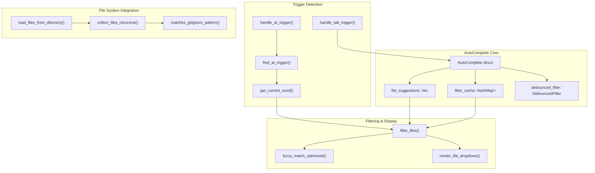

**Autocomplete System Architecture**
Shows the flow from trigger detection through file system scanning to filtered results display.

The autocomplete system implements several key features:

| Feature | Implementation | Purpose |
|---------|---------------|---------|
| Tab Completion | `handle_tab_trigger()` at [tui/src/services/auto_complete.rs:279-302]() | Complete current word with files |
| @ File References | `handle_at_trigger()` at [tui/src/services/auto_complete.rs:305-314]() | Insert file paths with @ prefix |
| Gitignore Support | `matches_gitignore_pattern()` integration | Respect .gitignore patterns |
| Debounced Filtering | `DebouncedFilter` at [tui/src/services/auto_complete.rs:354-382]() | Prevent excessive filtering |
| Fuzzy Matching | `fuzzy_match_optimized()` at [tui/src/services/auto_complete.rs:208-231]() | Match partial file names |

Sources: [tui/src/services/auto_complete.rs:11-36](), [tui/src/services/auto_complete.rs:234-276](), [tui/src/services/auto_complete.rs:279-352]()

## Dialog Systems

The TUI implements multiple dialog types for user interaction:

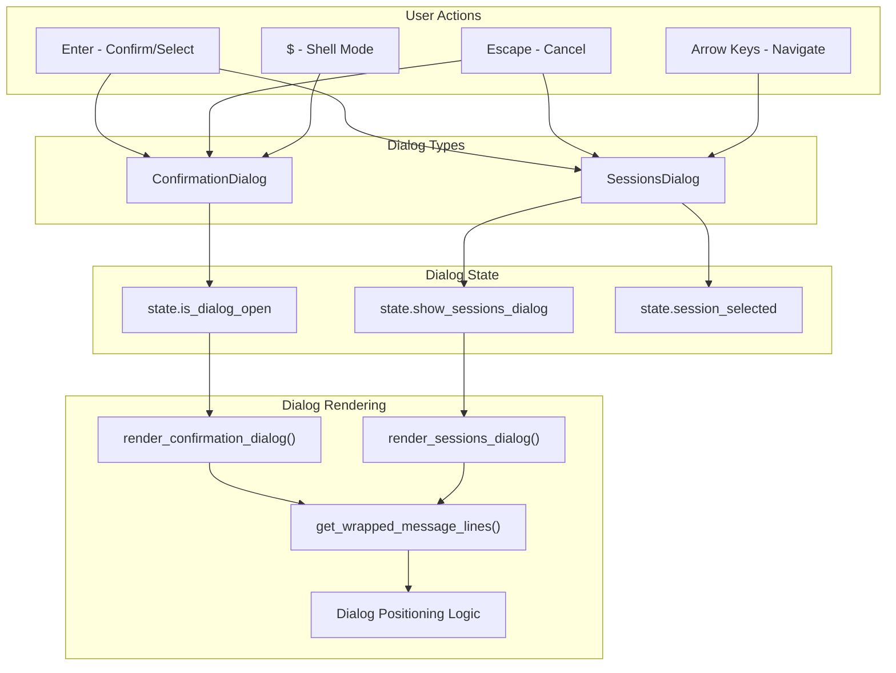

**Dialog System Architecture**
Shows dialog types, state management, and user interaction patterns.

### Confirmation Dialog

The confirmation dialog appears when the agent suggests executing potentially dangerous commands:

```rust
// Dialog message and options
"Press Enter to continue. '$' to run the command yourself or Esc to cancel and reprompt"
```

The dialog renders at [tui/src/services/confirmation_dialog.rs:11-49]() with dynamic positioning based on message content.

### Sessions Dialog

The sessions dialog allows users to select from available conversation sessions with formatted timestamps and titles at [tui/src/services/sessions_dialog.rs:11-92]().

Sources: [tui/src/services/confirmation_dialog.rs:1-50](), [tui/src/services/sessions_dialog.rs:1-93]()

## Shell Integration

The shell integration system enables background command execution while maintaining TUI responsiveness:

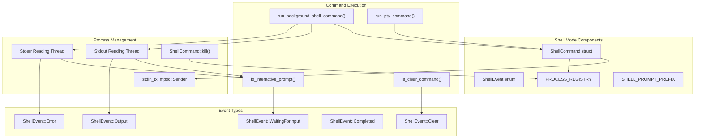

**Shell Integration Architecture**
Shows command execution flow, process management, and event handling for shell operations.

### Key Shell Features

| Feature | Implementation | Description |
|---------|---------------|-------------|
| Background Execution | `run_background_shell_command()` at [tui/src/services/shell_mode.rs:93-260]() | Non-blocking command execution |
| PTY Support | `run_pty_command()` at [tui/src/services/shell_mode.rs:263-428]() | Unix PTY for interactive commands |
| Process Tracking | `PROCESS_REGISTRY` at [tui/src/services/shell_mode.rs:11-18]() | Global process management |
| Interactive Detection | `is_interactive_prompt()` at [tui/src/services/shell_mode.rs:21-26]() | Detect password prompts |
| Clear Command | `is_clear_command()` at [tui/src/services/shell_mode.rs:48-51]() | Handle screen clearing |

The shell mode uses `SHELL_PROMPT_PREFIX` constant (`"$ "`) to visually distinguish shell input from regular chat input.

Sources: [tui/src/services/shell_mode.rs:28-260](), [tui/src/services/shell_mode.rs:263-428]()

## Hint and Helper System

The hint system provides contextual guidance and shortcuts based on current application state:

```mermaid
graph TB
    subgraph "Hint Conditions"
        InputNotEmpty["!state.input.is_empty()"]
        ShowShellMode["state.show_shell_mode"]
        IsDialogOpen["state.is_dialog_open"]
        IsPasting["state.is_pasting"]
        CtrlCPressed["state.ctrl_c_pressed_once"]
        ShowShortcuts["state.show_shortcuts"]
        LatestToolCall["state.latest_tool_call"]
    end
    
    subgraph "Hint Types"
        SendHint["Press Enter to send"]
        PastingHint["Pasting text..."]
        ExitHint["Press Ctrl+C again to exit"]
        ShellModeHint["Shell mode is on     '$' to undo"]
        ShortcutsHint["Full shortcuts display"]
        RetryHint["Ctrl+R to retry last command"]
        QuestionHint["? for shortcuts"]
    end
    
    subgraph "Helper Messages"
        StatusMessage["push_status_message()"]
        HelpMessage["push_help_message()"]
        ErrorMessage["push_error_message()"]
        ClearMessage["push_clear_message()"]
        MemorizeMessage["push_memorize_message()"]
    end
    
    InputNotEmpty --> SendHint
    IsPasting --> PastingHint
    CtrlCPressed --> ExitHint
    ShowShellMode --> ShellModeHint
    ShowShortcuts --> ShortcutsHint
    LatestToolCall --> RetryHint
    
    StatusMessage --> HelpMessage
    HelpMessage --> ErrorMessage
    ErrorMessage --> ClearMessage
    ClearMessage --> MemorizeMessage
```

**Hint and Helper System Flow**
Shows conditional hint display logic and helper message types.

### Hint Display Logic

The `render_hint_or_shortcuts()` function at [tui/src/services/hint_helper.rs:11-91]() implements a priority-based hint system:

1. **Input hints** - When user has typed content
2. **Pasting indicator** - During paste operations  
3. **Exit confirmation** - After first Ctrl+C press
4. **Shell mode indicator** - When in shell mode
5. **Keyboard shortcuts** - When shortcuts are enabled
6. **Retry hint** - When last tool call is available

Sources: [tui/src/services/hint_helper.rs:1-92](), [tui/src/services/helper_block.rs:91-199]()

## Input Rendering

The input rendering system handles multiline input with cursor positioning and shell mode indicators:

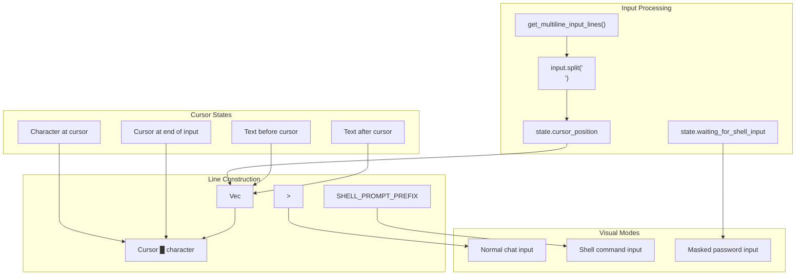

**Input Rendering Architecture**
Shows multiline input processing, cursor handling, and visual mode switching.

The input renderer at [tui/src/services/render_input.rs:6-129]() handles:

- **Multiline support** with proper line segmentation
- **Cursor visualization** using block character `█`
- **Shell mode indicators** with yellow `$` prefix
- **Password masking** when waiting for shell input
- **UTF-8 character handling** for proper cursor positioning

Sources: [tui/src/services/render_input.rs:1-130]()

## Dropdown Rendering

The dropdown system provides visual feedback for autocomplete and helper suggestions:

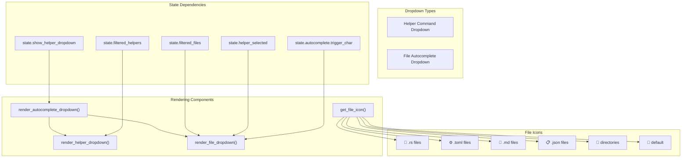

**Dropdown Rendering System**
Shows dropdown types, rendering logic, and file icon mapping for visual enhancement.

The dropdown renderer at [tui/src/services/helper_dropdown.rs:10-127]() provides:

- **File extension icons** using Unicode emojis
- **Trigger-specific styling** for Tab vs @ completion
- **Selection highlighting** with reversed colors
- **Dynamic sizing** based on content

Sources: [tui/src/services/helper_dropdown.rs:1-128]()

## Autocomplete System

The autocomplete system provides intelligent file and command completion triggered by Tab key or `@` symbol:


**Autocomplete System Architecture**
Shows the flow from trigger detection through file system scanning to filtered results display.

The autocomplete system implements several key features:

| Feature | Implementation | Purpose |
|---------|---------------|---------|
| Tab Completion | `handle_tab_trigger()` at [tui/src/services/auto_complete.rs:279-302]() | Complete current word with files |
| @ File References | `handle_at_trigger()` at [tui/src/services/auto_complete.rs:305-314]() | Insert file paths with @ prefix |
| Gitignore Support | `matches_gitignore_pattern()` integration | Respect .gitignore patterns |
| Debounced Filtering | `DebouncedFilter` at [tui/src/services/auto_complete.rs:354-382]() | Prevent excessive filtering |
| Fuzzy Matching | `fuzzy_match_optimized()` at [tui/src/services/auto_complete.rs:208-231]() | Match partial file names |

Sources: [tui/src/services/auto_complete.rs:11-36](), [tui/src/services/auto_complete.rs:234-276](), [tui/src/services/auto_complete.rs:279-352]()

## Dialog Systems

The TUI implements multiple dialog types for user interaction:


**Dialog System Architecture**
Shows dialog types, state management, and user interaction patterns.

### Confirmation Dialog

The confirmation dialog appears when the agent suggests executing potentially dangerous commands:

```rust
// Dialog message and options
"Press Enter to continue. '$' to run the command yourself or Esc to cancel and reprompt"
```

The dialog renders at [tui/src/services/confirmation_dialog.rs:11-49]() with dynamic positioning based on message content.

### Sessions Dialog

The sessions dialog allows users to select from available conversation sessions with formatted timestamps and titles at [tui/src/services/sessions_dialog.rs:11-92]().

Sources: [tui/src/services/confirmation_dialog.rs:1-50](), [tui/src/services/sessions_dialog.rs:1-93]()

## Shell Integration

The shell integration system enables background command execution while maintaining TUI responsiveness:


**Shell Integration Architecture**
Shows command execution flow, process management, and event handling for shell operations.

### Key Shell Features

| Feature | Implementation | Description |
|---------|---------------|-------------|
| Background Execution | `run_background_shell_command()` at [tui/src/services/shell_mode.rs:93-260]() | Non-blocking command execution |
| PTY Support | `run_pty_command()` at [tui/src/services/shell_mode.rs:263-428]() | Unix PTY for interactive commands |
| Process Tracking | `PROCESS_REGISTRY` at [tui/src/services/shell_mode.rs:11-18]() | Global process management |
| Interactive Detection | `is_interactive_prompt()` at [tui/src/services/shell_mode.rs:21-26]() | Detect password prompts |
| Clear Command | `is_clear_command()` at [tui/src/services/shell_mode.rs:48-51]() | Handle screen clearing |

The shell mode uses `SHELL_PROMPT_PREFIX` constant (`"$ "`) to visually distinguish shell input from regular chat input.

Sources: [tui/src/services/shell_mode.rs:28-260](), [tui/src/services/shell_mode.rs:263-428]()

## Hint and Helper System

The hint system provides contextual guidance and shortcuts based on current application state:


**Hint and Helper System Flow**
Shows conditional hint display logic and helper message types.

### Hint Display Logic

The `render_hint_or_shortcuts()` function at [tui/src/services/hint_helper.rs:11-91]() implements a priority-based hint system:

1. **Input hints** - When user has typed content
2. **Pasting indicator** - During paste operations  
3. **Exit confirmation** - After first Ctrl+C press
4. **Shell mode indicator** - When in shell mode
5. **Keyboard shortcuts** - When shortcuts are enabled
6. **Retry hint** - When last tool call is available

Sources: [tui/src/services/hint_helper.rs:1-92](), [tui/src/services/helper_block.rs:91-199]()

## Input Rendering

The input rendering system handles multiline input with cursor positioning and shell mode indicators:


**Input Rendering Architecture**
Shows multiline input processing, cursor handling, and visual mode switching.

The input renderer at [tui/src/services/render_input.rs:6-129]() handles:

- **Multiline support** with proper line segmentation
- **Cursor visualization** using block character `█`
- **Shell mode indicators** with yellow `$` prefix
- **Password masking** when waiting for shell input
- **UTF-8 character handling** for proper cursor positioning

Sources: [tui/src/services/render_input.rs:1-130]()

## Dropdown Rendering

The dropdown system provides visual feedback for autocomplete and helper suggestions:

```mermaid
graph TB
    subgraph "Dropdown Types"
        HelperDropdown["Helper Command Dropdown"]
        FileDropdown["File Autocomplete Dropdown"]
    end
    
    subgraph "Rendering Components"
        RenderAutocomplete["render_autocomplete_dropdown()"]
        RenderHelperDrop["render_helper_dropdown()"]
        RenderFileDrop["render_file_dropdown()"]
        GetFileIcon["get_file_icon()"]
    end
    
    subgraph "State Dependencies"
        ShowHelperDropdown["state.show_helper_dropdown"]
        FilteredFiles["state.filtered_files"]
        FilteredHelpers["state.filtered_helpers"]
        HelperSelected["state.helper_selected"]
        AutocompleteTrigger["state.autocomplete.trigger_char"]
    end
    
    subgraph "File Icons"
        RustIcon["🦀 .rs files"]
        TomlIcon["⚙️ .toml files"]
        MarkdownIcon["📝 .md files"]
        JsonIcon["📋 .json files"]
        FolderIcon["📁 directories"]
        DefaultIcon["📄 default"]
    end
    
    RenderAutocomplete --> RenderHelperDrop
    RenderAutocomplete --> RenderFileDrop
    
    ShowHelperDropdown --> RenderAutocomplete
    FilteredFiles --> RenderFileDrop
    FilteredHelpers --> RenderHelperDrop
    HelperSelected --> RenderFileDrop
    AutocompleteTrigger --> RenderFileDrop
    
    GetFileIcon --> RustIcon
    GetFileIcon --> TomlIcon
    GetFileIcon --> MarkdownIcon
    GetFileIcon --> JsonIcon
    GetFileIcon --> FolderIcon
    GetFileIcon --> DefaultIcon
```

**Dropdown Rendering System**
Shows dropdown types, rendering logic, and file icon mapping for visual enhancement.

The dropdown renderer at [tui/src/services/helper_dropdown.rs:10-127]() provides:

- **File extension icons** using Unicode emojis
- **Trigger-specific styling** for Tab vs @ completion
- **Selection highlighting** with reversed colors
- **Dynamic sizing** based on content

Sources: [tui/src/services/helper_dropdown.rs:1-128]()

---

