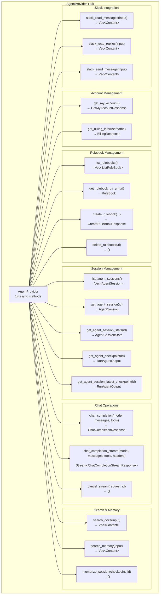
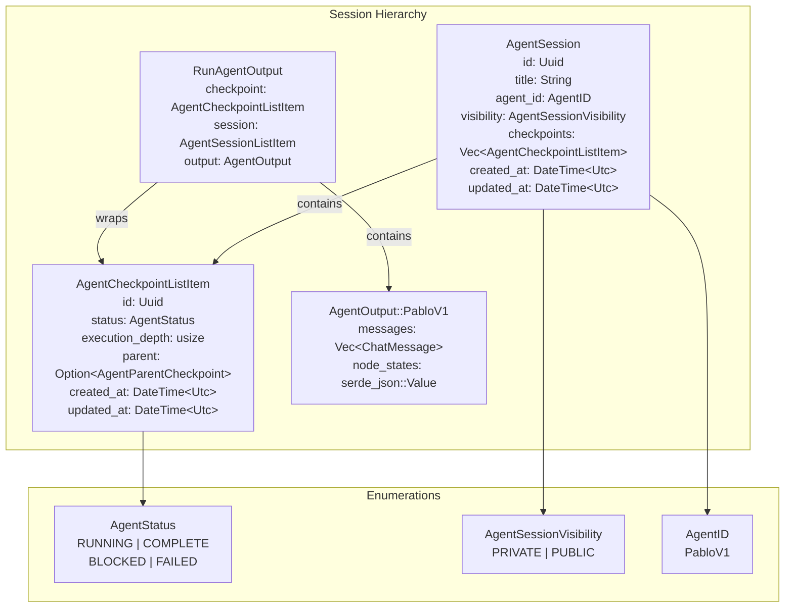
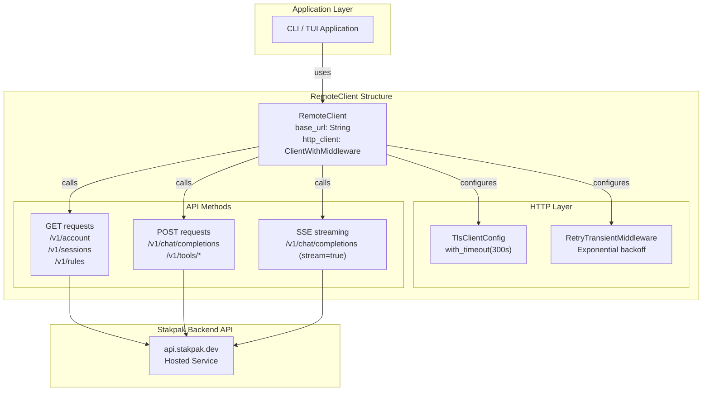
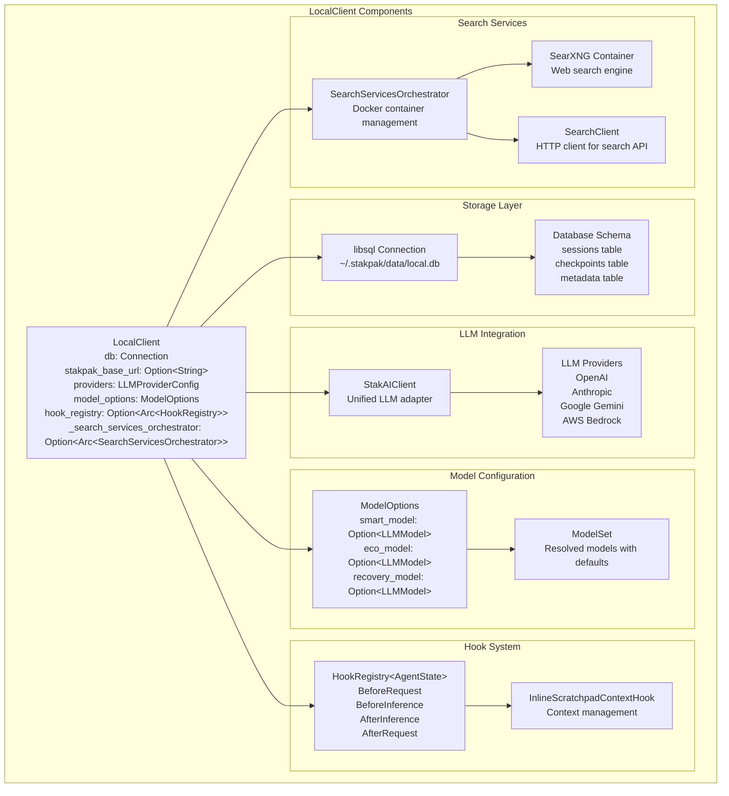
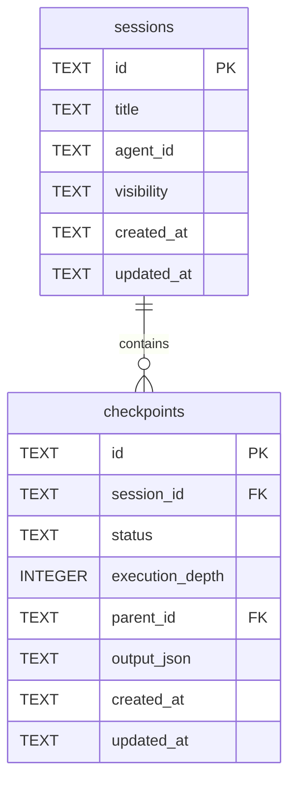
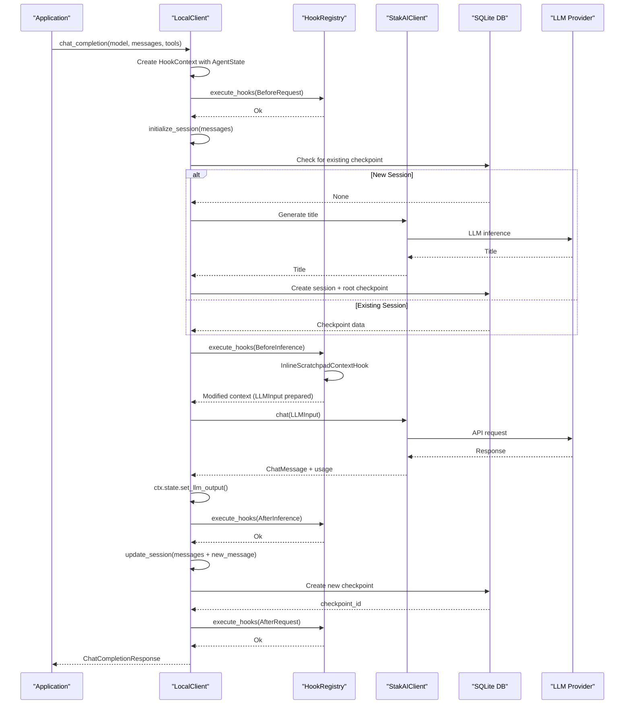
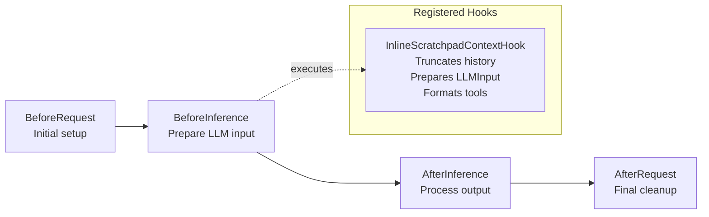
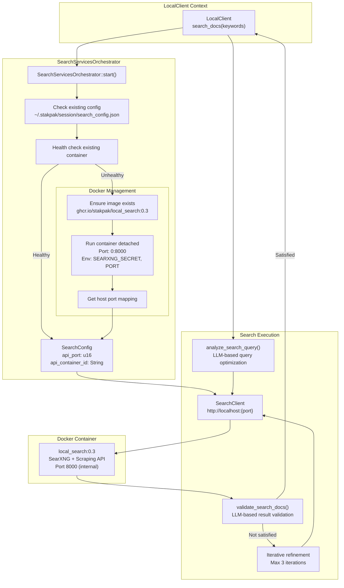

<!-- source: DeepWiki mcp.deepwiki.com · repo stakpak/agent · page 4 Agent Provider and API · fetched 2026-10-27 -->

# Agent Provider and API

<details>
<summary>Relevant source files</summary>

The following files were used as context for generating this wiki page:

- [libs/api/Cargo.toml](libs/api/Cargo.toml)
- [libs/api/src/lib.rs](libs/api/src/lib.rs)
- [libs/api/src/local/mod.rs](libs/api/src/local/mod.rs)
- [libs/api/src/models.rs](libs/api/src/models.rs)
- [libs/mcp/server/README_SECRETS.md](libs/mcp/server/README_SECRETS.md)
- [libs/shared/src/container.rs](libs/shared/src/container.rs)
- [libs/shared/src/models/integrations/mod.rs](libs/shared/src/models/integrations/mod.rs)
- [libs/shared/src/models/integrations/search_service.rs](libs/shared/src/models/integrations/search_service.rs)

</details>


This document describes the Agent Provider abstraction layer in the `stakpak-api` library, which provides a unified interface for interacting with AI agents through either remote hosted services or local LLM providers. This abstraction enables the CLI and TUI to work with different backend implementations without code changes.

For information about how the CLI uses the Agent Provider, see [CLI Interface](#2). For details about TUI integration with the provider, see [Terminal User Interface (TUI)](#3).

---

## Purpose and Architecture

The `AgentProvider` trait defines a contract for all agent interactions, including chat completions, session management, rulebook operations, and integrated services (search, memory, Slack). Two implementations provide different deployment models:

- **`RemoteClient`**: Communicates with Stakpak's hosted API service
- **`LocalClient`**: Executes agent logic locally using direct LLM integration

This abstraction allows applications to switch between cloud and local operation with a single configuration change, supporting both online collaboration and offline/air-gapped environments.

**Key Components:**
| Component | Purpose | Location |
|-----------|---------|----------|
| `AgentProvider` trait | Core abstraction with 14 async methods | `libs/api/src/lib.rs` |
| `RemoteClient` | HTTP client for hosted Stakpak API | `libs/api/src/remote/` |
| `LocalClient` | Local LLM integration with SQLite storage | `libs/api/src/local/mod.rs` |
| Data models | Session, checkpoint, message structures | `libs/api/src/models.rs` |

Sources: [libs/api/src/lib.rs:1-93](), [libs/api/src/local/mod.rs:42-50]()

---

## AgentProvider Trait Definition

The `AgentProvider` trait defines 14 async methods grouped into six functional categories. All implementations must provide these methods, ensuring consistent behavior across deployment modes.

### AgentProvider Method Categories



### Method Signatures

| Category | Method | Input Types | Return Type |
|----------|--------|-------------|-------------|
| **Account** | `get_my_account` | None | `GetMyAccountResponse` |
| | `get_billing_info` | `&str` (username) | `BillingResponse` |
| **Rulebooks** | `list_rulebooks` | None | `Vec<ListRuleBook>` |
| | `get_rulebook_by_uri` | `&str` (uri) | `RuleBook` |
| | `create_rulebook` | `&str, &str, &str, Vec<String>, Option<RuleBookVisibility>` | `CreateRuleBookResponse` |
| | `delete_rulebook` | `&str` (uri) | `()` |
| **Sessions** | `list_agent_sessions` | None | `Vec<AgentSession>` |
| | `get_agent_session` | `Uuid` (session_id) | `AgentSession` |
| | `get_agent_session_stats` | `Uuid` (session_id) | `AgentSessionStats` |
| | `get_agent_checkpoint` | `Uuid` (checkpoint_id) | `RunAgentOutput` |
| | `get_agent_session_latest_checkpoint` | `Uuid` (session_id) | `RunAgentOutput` |
| **Chat** | `chat_completion` | `AgentModel, Vec<ChatMessage>, Option<Vec<Tool>>` | `ChatCompletionResponse` |
| | `chat_completion_stream` | `AgentModel, Vec<ChatMessage>, Option<Vec<Tool>>, Option<HeaderMap>` | `(Pin<Box<Stream>>, Option<String>)` |
| | `cancel_stream` | `String` (request_id) | `()` |
| **Search/Memory** | `search_docs` | `&SearchDocsRequest` | `Vec<Content>` |
| | `search_memory` | `&SearchMemoryRequest` | `Vec<Content>` |
| | `memorize_session` | `Uuid` (checkpoint_id) | `()` |
| **Slack** | `slack_read_messages` | `&SlackReadMessagesRequest` | `Vec<Content>` |
| | `slack_read_replies` | `&SlackReadRepliesRequest` | `Vec<Content>` |
| | `slack_send_message` | `&SlackSendMessageRequest` | `Vec<Content>` |

Sources: [libs/api/src/lib.rs:16-92]()

---

## Core Data Models

The API uses strongly-typed models to represent sessions, checkpoints, messages, and configuration. These types are shared between both implementations.

### Session and Checkpoint Structures



### Key Model Types

**`AgentSession`** [libs/api/src/models.rs:66-74]()
- Represents a persistent conversation session
- Contains collection of checkpoint snapshots
- Tracks title, agent type, visibility, timestamps

**`AgentCheckpointListItem`** [libs/api/src/models.rs:112-119]()
- Immutable snapshot of agent state at a point in time
- Forms a tree structure via parent references
- Tracks execution depth for nested agent calls

**`RunAgentOutput`** [libs/api/src/models.rs:181-185]()
- Returned from checkpoint operations
- Bundles checkpoint metadata with agent output state
- Used as return type for checkpoint retrieval methods

**`AgentOutput`** [libs/api/src/models.rs:228-254]()
- Tagged enum for agent-specific output formats
- `PabloV1` variant contains messages and node states
- Provides methods to access/modify message history

**`AgentState`** [libs/api/src/models.rs:654-763]()
- Working state during agent execution
- Tracks input/output LLM interactions
- Used by hooks and local client for processing

Sources: [libs/api/src/models.rs:66-254](), [libs/api/src/models.rs:654-763]()

---

## RemoteClient Implementation

The `RemoteClient` provides a thin HTTP client wrapper over the Stakpak hosted API. It requires an API key for authentication and sends all requests to the remote service.

### RemoteClient Architecture



### Configuration

The `RemoteClient` requires:
- **Base URL**: Typically `https://api.stakpak.dev/v1`
- **API Key**: Passed via `X-API-Key` header
- **Timeout**: Default 300 seconds for long-running operations

### Request Flow

1. Client method called with parameters
2. Serialize request to JSON
3. Add authentication headers
4. Send HTTP request with retry middleware
5. Parse response or handle streaming
6. Deserialize to typed model
7. Return result or error

For streaming operations, the client returns a `Stream<ChatCompletionStreamResponse>` using Server-Sent Events (SSE) parsing.

Sources: [libs/api/src/lib.rs:1-93](), [libs/api/src/local/mod.rs:210-242]()

---

## LocalClient Implementation

The `LocalClient` provides a fully self-contained agent execution environment without requiring external API access. It integrates multiple components for LLM communication, session persistence, and service orchestration.

### LocalClient Structure and Components



### LocalClient Configuration

**`LocalClientConfig`** [libs/api/src/local/mod.rs:100-108]()
```rust
pub struct LocalClientConfig {
    pub stakpak_base_url: Option<String>,  // For rulebook API only
    pub store_path: Option<String>,         // SQLite DB path
    pub providers: LLMProviderConfig,       // LLM credentials
    pub smart_model: Option<String>,        // High-capability model
    pub eco_model: Option<String>,          // Cost-efficient model
    pub recovery_model: Option<String>,     // Fallback model
    pub hook_registry: Option<HookRegistry<AgentState>>,
}
```

### Initialization Sequence

1. **Database Setup** [libs/api/src/local/mod.rs:119-143]()
   - Resolve store path (default: `~/.stakpak/data/local.db`)
   - Create parent directories if needed
   - Open libsql connection
   - Initialize schema via `db::init_schema()`

2. **Model Configuration** [libs/api/src/local/mod.rs:145-149]()
   - Parse model strings to `LLMModel` enum
   - Store as `ModelOptions` with optional values
   - Defaults applied later: Claude 4.5 Sonnet (smart), Haiku (eco), GPT-5 (recovery)

3. **Hook Registration** [libs/api/src/local/mod.rs:152-177]()
   - Register `InlineScratchpadContextHook` for context management
   - Hook executes before inference to prepare LLM input
   - Options control history truncation and action logging

4. **Service Orchestration** [libs/api/src/local/mod.rs:185]()
   - Initialize `SearchServicesOrchestrator` (lazy Docker startup)
   - Search service starts on first `search_docs()` call

Sources: [libs/api/src/local/mod.rs:42-187]()

---

## Session Management in LocalClient

The `LocalClient` maintains session state in SQLite, enabling session resumption and checkpoint navigation.

### Database Schema



**Tables:**
- `sessions`: Top-level conversation containers
- `checkpoints`: Immutable state snapshots with parent references
- Both use TEXT for UUIDs and timestamps (ISO 8601 format)

### Session Lifecycle

**1. Initialize Session** [libs/api/src/local/mod.rs:735-788]()
```
Input: Vec<ChatMessage>
↓
Extract checkpoint_id from last assistant message
├─ If checkpoint_id exists:
│  └─ Load existing checkpoint from DB
└─ If new session:
   ├─ Generate session title via LLM
   ├─ Create AgentSession record
   ├─ Create root checkpoint (depth 0)
   └─ Return initial RunAgentOutput
```

**2. Execute Agent Turn** [libs/api/src/local/mod.rs:656-733]()
```
HookRegistry::execute(BeforeInference)
↓
Run LLM inference (chat or chat_stream)
↓
HookRegistry::execute(AfterInference)
↓
Return new ChatMessage
```

**3. Update Session** [libs/api/src/local/mod.rs:790-823]()
```
Input: Current checkpoint, new messages
↓
Create new checkpoint:
├─ Increment execution_depth
├─ Set parent reference
├─ Serialize updated AgentOutput
└─ Insert into checkpoints table
↓
Return new RunAgentOutput
```

Sources: [libs/api/src/local/mod.rs:656-823]()

---

## Chat Completion Methods

Both `chat_completion` and `chat_completion_stream` follow similar flows with different output handling.

### Non-Streaming Flow



### Streaming Flow Differences

**Channel-Based Architecture** [libs/api/src/local/mod.rs:410-463]()
1. Create `mpsc::channel<StreamMessage>` for deltas
2. Spawn background task for agent execution
3. Return stream immediately to caller
4. Background task sends deltas as they arrive
5. Final checkpoint ID streamed at completion

**StreamMessage Types** [libs/api/src/local/mod.rs:111-114]()
- `Delta(GenerationDelta)`: Token/content updates from LLM
- `Ctx(Box<HookContext<AgentState>>)`: State updates

Sources: [libs/api/src/local/mod.rs:320-503]()

---

## Hook System Integration

The `HookRegistry` provides lifecycle events for extending agent behavior. The `LocalClient` uses hooks to manage context and prepare LLM inputs.

### Lifecycle Events



**`InlineScratchpadContextHook`** [libs/api/src/local/mod.rs:153-163]()
- Registered for `BeforeInference` event
- Options:
  - `history_action_message_size_limit: Some(100)` - Max chars per action message
  - `history_action_message_keep_last_n: Some(1)` - Keep only last action message
  - `history_action_result_keep_last_n: Some(50)` - Keep last 50 results
- Converts `ChatMessage` to `LLMInput` format
- Applies model-specific formatting

Sources: [libs/api/src/local/mod.rs:4-6](), [libs/api/src/local/mod.rs:153-163]()

---

## Search Services Integration

The `LocalClient` provides web search capabilities through a Docker-based architecture using SearXNG.

### SearchServicesOrchestrator Architecture



### Search Flow

**Step 1: Service Startup** [libs/shared/src/models/integrations/search_service.rs:235-307]()
```
SearchServicesOrchestrator::start()
├─ Load config from ~/.stakpak/session/search_config.json
├─ If exists: health check at http://localhost:{port}/health
├─ If unhealthy or missing:
│  ├─ Check docker available
│  ├─ Ensure image exists locally (ghcr.io/stakpak/local_search:0.3)
│  ├─ Run container with:
│  │  ├─ Random host port mapping (0:8000)
│  │  ├─ Environment: SEARXNG_SECRET, PORT, SEARXNG_BASE_URL
│  │  └─ Extra host: host.docker.internal:host-gateway
│  ├─ Get actual host port
│  └─ Save config to session file
└─ Return SearchConfig
```

**Step 2: Query Analysis** [libs/api/src/local/mod.rs:877-953]()
```
analyze_search_query(query)
├─ Send query to LLM with system prompt
├─ LLM identifies required documentation types
├─ LLM reformulates query for search engines
└─ Parse XML response → AnalysisResult
```

**Step 3: Iterative Search** [libs/api/src/local/mod.rs:545-599]()
```
for iteration in 0..3:
    ├─ SearchClient::search_and_scrape(current_query)
    ├─ validate_search_docs(results, required_docs, previous_queries)
    │  ├─ LLM evaluates result relevance
    │  ├─ Identifies valid docs
    │  ├─ Suggests missing URLs
    │  └─ Generates new query if unsatisfied
    ├─ Accumulate valid docs
    ├─ If satisfied: break
    └─ If new_query: update current_query and continue
```

**Step 4: Result Processing** [libs/api/src/local/mod.rs:605-613]()
```
Convert ScrapedContent to Vec<Content>
Format: "URL: {url}\nContent: {content}"
```

### SearchClient HTTP API

| Endpoint | Method | Request | Response |
|----------|--------|---------|----------|
| `/search` | POST | `SearchRequest` | `Vec<SearchResult>` |
| `/scrape` | POST | `ScrapeRequest` | `Vec<ScrapedContent>` |
| `/search-and-scrape` | POST | `SearchAndScrapeRequest` | `Vec<ScrapedContent>` |
| `/health` | GET | None | Status 200 |

Sources: [libs/api/src/local/mod.rs:509-614](), [libs/shared/src/models/integrations/search_service.rs:119-229](), [libs/shared/src/models/integrations/search_service.rs:234-415]()

---

## Configuration Examples

### Remote Client Configuration

```rust
use stakpak_api::remote::RemoteClient;

let client = RemoteClient::new(
    "https://api.stakpak.dev".to_string(),
    "sk_your_api_key".to_string(),
).await?;
```

### Local Client Configuration

```rust
use stakpak_api::local::{LocalClient, LocalClientConfig};
use stakpak_shared::models::llm::LLMProviderConfig;

let mut providers = LLMProviderConfig::new();
providers.add_provider("openai", openai_api_key);
providers.add_provider("anthropic", anthropic_api_key);

let config = LocalClientConfig {
    stakpak_base_url: Some("https://api.stakpak.dev".to_string()),
    store_path: Some("~/.stakpak/data/local.db".to_string()),
    providers,
    smart_model: Some("claude-4.5-sonnet".to_string()),
    eco_model: Some("claude-4.5-haiku".to_string()),
    recovery_model: Some("gpt-5".to_string()),
    hook_registry: None,
};

let client = LocalClient::new(config).await?;
```

### Model Options Defaults

| Option | Default | Purpose |
|--------|---------|---------|
| `smart_model` | `Claude 4.5 Sonnet` | High-capability reasoning tasks |
| `eco_model` | `Claude 4.5 Haiku` | Cost-efficient operations (titles, validation) |
| `recovery_model` | `GPT-5` | Fallback when primary models fail |

Sources: [libs/api/src/local/mod.rs:78-98]()

---

## Error Handling

Both implementations return `Result<T, String>` for all operations. Common error scenarios:

**RemoteClient Errors:**
- Network timeouts (after 300s)
- Authentication failures (invalid API key)
- Rate limiting (429 status)
- API errors (4xx/5xx responses)

**LocalClient Errors:**
- Database errors (connection, schema, queries)
- LLM provider errors (API failures, quota exceeded)
- Docker errors (image missing, container startup failure)
- Hook execution errors (propagated from hook registry)

**ApiStreamError Variants** [libs/api/src/models.rs:16-26]()
- `AgentInputInvalid(String)`: Invalid request parameters
- `AgentStateInvalid`: Corrupted session state
- `AgentExecutionLimitExceeded`: Too many iterations
- `AgentInvalidResponseStream`: Malformed SSE stream
- `Unknown(String)`: Catch-all for unexpected errors

Sources: [libs/api/src/models.rs:15-63]()

---

