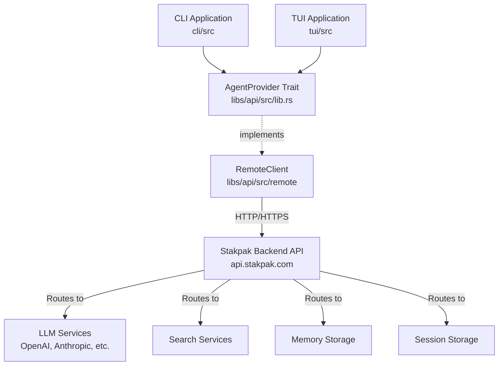
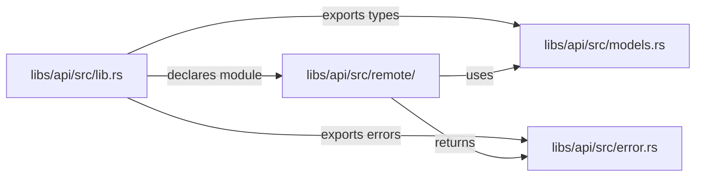
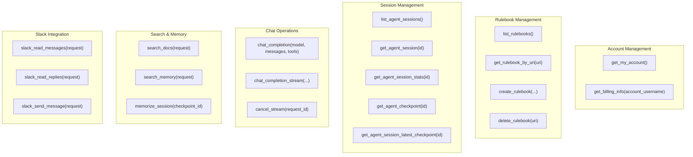
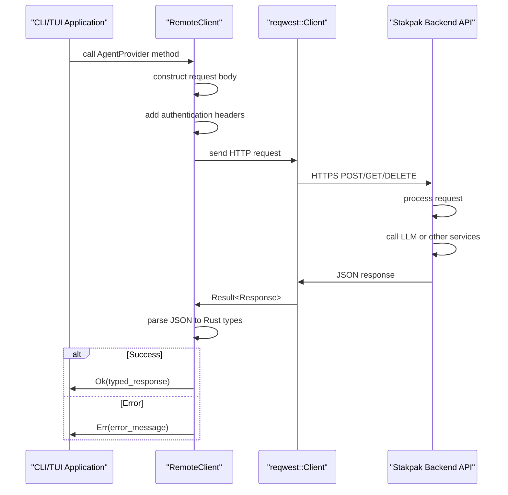
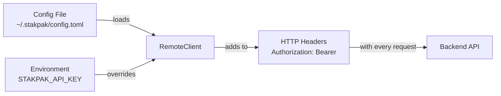
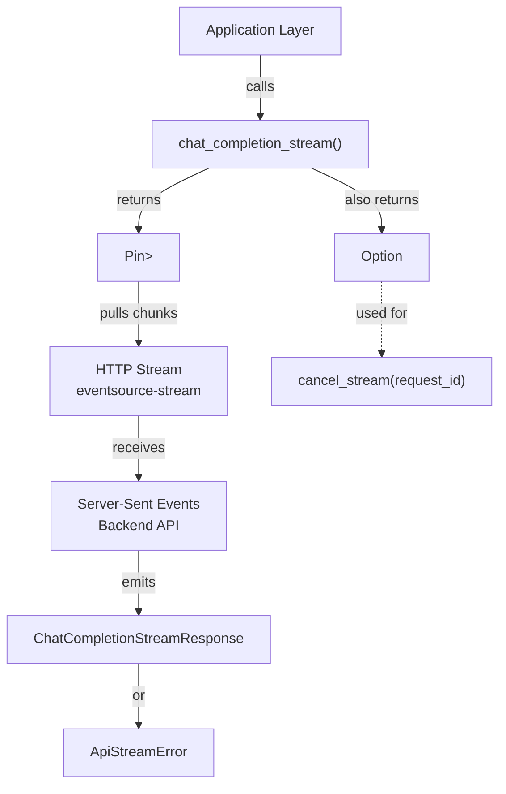
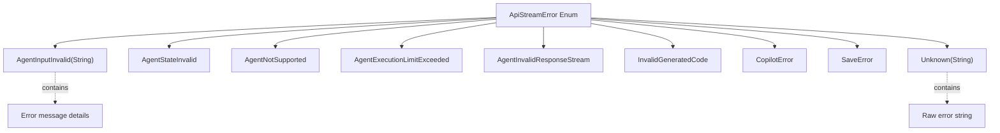
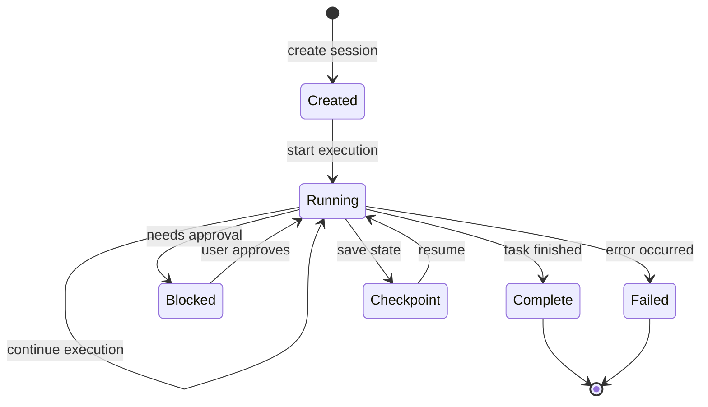
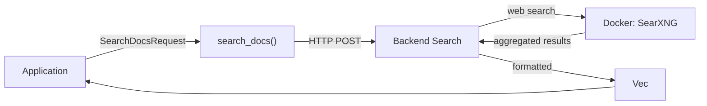
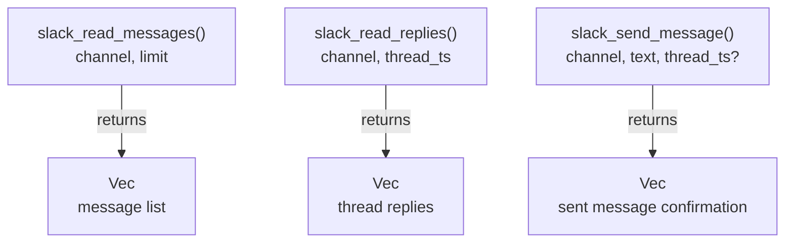

<!-- source: DeepWiki mcp.deepwiki.com · repo stakpak/agent · page 4.2 Remote Client Implementation · fetched 2026-10-27 -->

# Remote Client Implementation

<details>
<summary>Relevant source files</summary>

The following files were used as context for generating this wiki page:

- [README.md](README.md)
- [assets/stakpak-dark.png](assets/stakpak-dark.png)
- [assets/stakpak-light.png](assets/stakpak-light.png)
- [libs/api/Cargo.toml](libs/api/Cargo.toml)
- [libs/api/src/lib.rs](libs/api/src/lib.rs)
- [libs/api/src/models.rs](libs/api/src/models.rs)
- [libs/mcp/server/README_SECRETS.md](libs/mcp/server/README_SECRETS.md)

</details>


This document describes the `RemoteClient` implementation of the `AgentProvider` trait, which provides agent capabilities through HTTP communication with Stakpak's hosted backend API. For local LLM integration without a hosted backend, see [Local Client Implementation](#4.3). For the trait definition and abstraction, see [AgentProvider Trait](#4.1).

## Overview

`RemoteClient` is the HTTP-based implementation of the `AgentProvider` trait that connects to Stakpak's hosted backend services. It is the simpler of the two provider implementations, requiring only an API key for authentication rather than direct LLM credentials.

The `RemoteClient` is instantiated when:
- The profile's `provider` field is not set to `"local"` in configuration
- A `STAKPAK_API_KEY` environment variable is present
- The `stakpak login` command has stored an API key in `~/.stakpak/config.toml`

**RemoteClient Architecture Position**



Sources: [libs/api/src/lib.rs:1-93](), [README.md:110-140]()

## Configuration

The `RemoteClient` is configured through profile settings in `~/.stakpak/config.toml` or environment variables. The default configuration uses the remote provider automatically when an API key is available.

### Configuration Methods

| Method | Configuration Location | Notes |
|--------|----------------------|-------|
| Environment Variable | `STAKPAK_API_KEY` | Highest precedence |
| Config File | `~/.stakpak/config.toml` | Set via `stakpak login` |
| Interactive Flow | Browser-based auth | Creates API key automatically |

### Example Configuration

When using the default profile without explicit local provider configuration, the `RemoteClient` is selected automatically:

```toml
# Implicit remote configuration - API key only
[settings]
api_key = "sk-..."
```

No additional LLM provider credentials are needed as the backend handles all LLM communication.

Sources: [README.md:112-140]()

## Module Structure



Sources: [libs/api/src/lib.rs:11-14](), [libs/api/Cargo.toml:1-31]()

## AgentProvider Trait Implementation

The `RemoteClient` implements all 14 methods defined in the `AgentProvider` trait by translating them into HTTP API calls to the Stakpak backend.

**Method Categories and HTTP Endpoints**



Sources: [libs/api/src/lib.rs:17-92]()

## HTTP Communication Layer

The `RemoteClient` uses the `reqwest` HTTP client library to communicate with the backend API over HTTPS.

**Request/Response Flow**



Sources: [libs/api/Cargo.toml:17](), [libs/api/src/lib.rs:16-92]()

## Authentication Mechanism

The `RemoteClient` authenticates requests using an API key transmitted in HTTP headers.

**Authentication Flow**



The API key is:
- Loaded from `~/.stakpak/config.toml` at initialization
- Can be overridden by the `STAKPAK_API_KEY` environment variable
- Included as a Bearer token in the `Authorization` header for each request
- Validated by the backend before processing requests

Sources: [README.md:123-133]()

## Data Models

The `RemoteClient` uses typed data structures for all API communication, defined in the `models` module.

### Core Request Types

| Request Type | Purpose | Fields |
|--------------|---------|--------|
| `SearchDocsRequest` | Document search | `keywords`, `exclude_keywords`, `limit` |
| `SearchMemoryRequest` | Memory search | `keywords`, `start_time`, `end_time` |
| `SlackReadMessagesRequest` | Read Slack messages | `channel`, `limit` |
| `SlackReadRepliesRequest` | Read Slack thread | `channel`, `ts` |
| `SlackSendMessageRequest` | Send Slack message | `channel`, `mrkdwn_text`, `thread_ts` |
| `CreateRuleBookInput` | Create/update rulebook | `uri`, `description`, `content`, `tags`, `visibility` |

Sources: [libs/api/src/models.rs:622-652]()

### Core Response Types

| Response Type | Purpose | Key Fields |
|---------------|---------|------------|
| `GetMyAccountResponse` | Account information | `username`, `id`, `email`, `scope` |
| `AgentSession` | Session details | `id`, `title`, `checkpoints`, `visibility` |
| `RunAgentOutput` | Agent execution result | `checkpoint`, `session`, `output` |
| `RuleBook` | Rulebook document | `uri`, `description`, `content`, `tags` |
| `ChatCompletionResponse` | Synchronous chat | OpenAI-compatible format |
| `ChatCompletionStreamResponse` | Streaming chat chunk | SSE format |

Sources: [libs/api/src/models.rs:538-653]()

## Streaming Support

The `RemoteClient` provides streaming capabilities for real-time chat responses through Server-Sent Events (SSE).

**Streaming Architecture**



The streaming implementation:
- Returns a `Pin<Box<dyn Stream<Item = Result<ChatCompletionStreamResponse, ApiStreamError>>>>` 
- Provides an optional `request_id` string for stream cancellation
- Uses the `eventsource-stream` crate for SSE parsing
- Allows cancellation via the `cancel_stream()` method

Sources: [libs/api/src/lib.rs:55-70](), [libs/api/Cargo.toml:19]()

## Error Handling

The `RemoteClient` translates HTTP and API errors into strongly-typed error variants.

### ApiStreamError Variants



Error strings from the backend are pattern-matched and converted into typed variants:

- "Agent not supported" → `AgentNotSupported`
- "Agent state is not valid" → `AgentStateInvalid`
- "Agent thinking limit exceeded" → `AgentExecutionLimitExceeded`
- "Invalid response stream" → `AgentInvalidResponseStream`
- "Agent input is not valid: ..." → `AgentInputInvalid(message)`
- Other errors → `Unknown(error_string)`

Sources: [libs/api/src/models.rs:15-63]()

## Session and Checkpoint Management

The `RemoteClient` provides methods for managing persistent agent sessions stored in the backend.

**Session Lifecycle**



### Session Data Structures

| Type | Description | Status Values |
|------|-------------|---------------|
| `AgentSession` | Full session with checkpoints | N/A |
| `AgentCheckpointListItem` | Checkpoint metadata | `RUNNING`, `COMPLETE`, `BLOCKED`, `FAILED` |
| `RunAgentOutput` | Execution result | Contains checkpoint, session, and output |
| `AgentSessionStats` | Usage statistics | Tool calls, time saved, etc. |

The backend maintains the complete session history including:
- All messages exchanged with the LLM
- Tool calls and their results
- Execution state and node states
- Parent-child checkpoint relationships for execution depth tracking

Sources: [libs/api/src/models.rs:66-186]()

## Rulebook Operations

Rulebooks are markdown documents with YAML frontmatter that customize agent behavior. The `RemoteClient` provides full CRUD operations.

### Rulebook Structure

```yaml
---
uri: stakpak://org/document.md
description: Brief description
tags:
  - tag1
  - tag2
visibility: PUBLIC | PRIVATE
---

# Markdown Content
...
```

### API Methods

| Method | HTTP Operation | Parameters | Returns |
|--------|---------------|------------|---------|
| `list_rulebooks()` | GET | None | `Vec<ListRuleBook>` |
| `get_rulebook_by_uri(uri)` | GET | URI string | `RuleBook` |
| `create_rulebook(...)` | POST/PUT | URI, description, content, tags, visibility | `CreateRuleBookResponse` |
| `delete_rulebook(uri)` | DELETE | URI string | `()` |

The backend stores rulebooks with:
- Unique URI identifiers (e.g., `stakpak://organization/filename.md`)
- Content versioning (tracked via `updated_at` timestamp)
- Visibility control (public or private)
- Tag-based organization

Sources: [libs/api/src/lib.rs:25-36](), [libs/api/src/models.rs:494-596]()

## Chat Completion Methods

The `RemoteClient` provides both synchronous and streaming chat completion through the backend's LLM routing.

### Input Parameters

Both methods accept:
- `model`: `AgentModel` enum specifying which LLM to use
- `messages`: `Vec<ChatMessage>` with the conversation history
- `tools`: `Option<Vec<Tool>>` for function calling capabilities
- `headers` (stream only): Optional custom HTTP headers

### Synchronous Completion

```rust
async fn chat_completion(
    &self,
    model: AgentModel,
    messages: Vec<ChatMessage>,
    tools: Option<Vec<Tool>>,
) -> Result<ChatCompletionResponse, String>
```

Returns a complete response with:
- Generated message content
- Tool calls (if any)
- Token usage statistics
- Model and finish reason

### Streaming Completion

```rust
async fn chat_completion_stream(
    &self,
    model: AgentModel,
    messages: Vec<ChatMessage>,
    tools: Option<Vec<Tool>>,
    headers: Option<HeaderMap>,
) -> Result<(Stream, Option<String>), String>
```

Returns:
- A `Stream` of `ChatCompletionStreamResponse` chunks
- An optional `request_id` for cancellation

The backend handles:
- LLM selection and routing based on the `AgentModel`
- API key management for downstream LLM services
- Rate limiting and quota enforcement
- Response formatting to OpenAI-compatible schema

Sources: [libs/api/src/lib.rs:48-70](), [libs/api/src/models.rs:6-12]()

## Search and Memory Operations

The `RemoteClient` provides access to document search and session memory features hosted on the backend.

### Document Search



**SearchDocsRequest Parameters:**
- `keywords`: Main search terms
- `exclude_keywords`: Terms to filter out (optional)
- `limit`: Maximum number of results (optional)

### Memory Operations

The memory system allows agents to store and retrieve information from past sessions:

| Method | Purpose | Input | Output |
|--------|---------|-------|--------|
| `search_memory()` | Search past sessions | Keywords, time range | `Vec<Content>` |
| `memorize_session()` | Save session to memory | Checkpoint ID | `()` |

Memory search supports:
- Keyword-based retrieval
- Time-range filtering with `start_time` and `end_time`
- Semantic relevance ranking by the backend

Sources: [libs/api/src/lib.rs:72-77](), [libs/api/src/models.rs:622-633]()

## Slack Integration

The `RemoteClient` provides Slack integration methods when the backend has appropriate credentials configured.

### Slack Methods



### Request Parameters

**SlackReadMessagesRequest:**
- `channel`: Channel ID or name
- `limit`: Maximum messages to retrieve (optional)

**SlackReadRepliesRequest:**
- `channel`: Channel ID or name  
- `ts`: Thread timestamp identifier

**SlackSendMessageRequest:**
- `channel`: Target channel
- `mrkdwn_text`: Message content in Markdown
- `thread_ts`: Thread timestamp for replies (optional)

The backend handles:
- Slack OAuth tokens and workspace authentication
- API rate limiting compliance
- Message formatting and content type conversion
- Error handling for invalid channels or permissions

Sources: [libs/api/src/lib.rs:79-92](), [libs/api/src/models.rs:635-652]()

## Dependencies

The `RemoteClient` relies on the following key dependencies:

| Crate | Purpose | Usage |
|-------|---------|-------|
| `reqwest` | HTTP client | All API communication |
| `serde` / `serde_json` | Serialization | Request/response encoding |
| `futures-util` | Async streams | Chat streaming |
| `eventsource-stream` | SSE parsing | Streaming responses |
| `async-trait` | Trait async methods | AgentProvider implementation |
| `uuid` | Unique IDs | Session and checkpoint identification |
| `chrono` | Date/time | Timestamps in responses |
| `urlencoding` | URL encoding | Query parameters |

Sources: [libs/api/Cargo.toml:10-27]()

---

