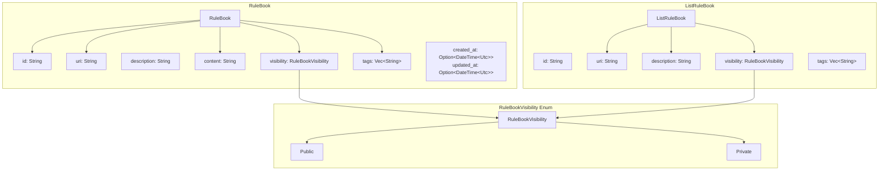
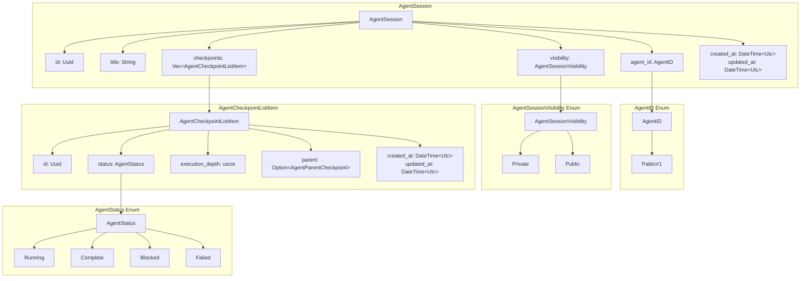
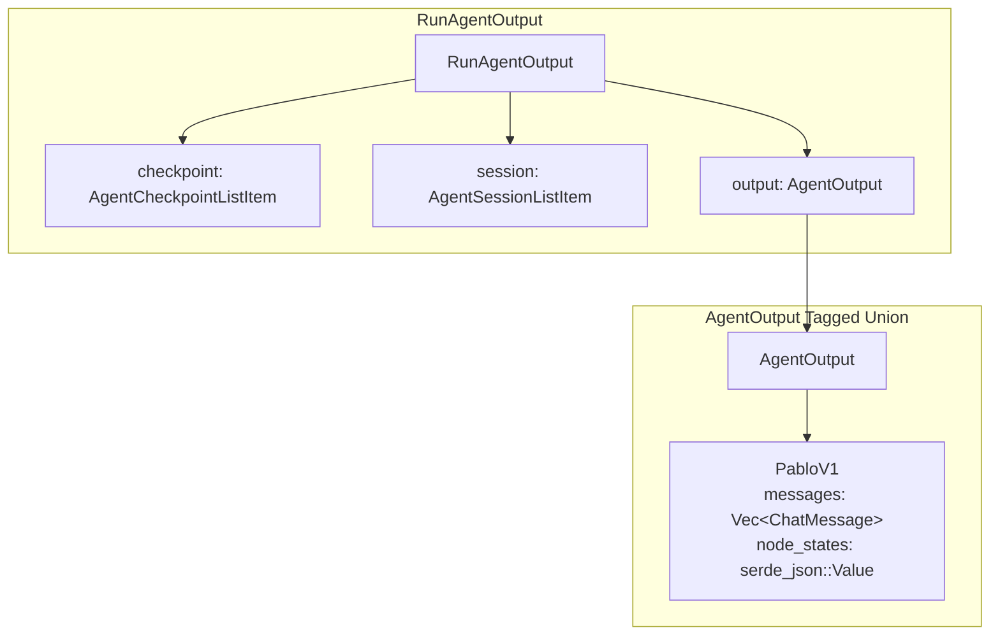
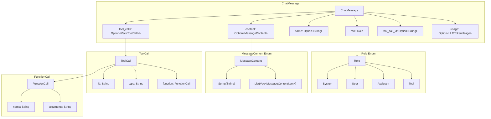
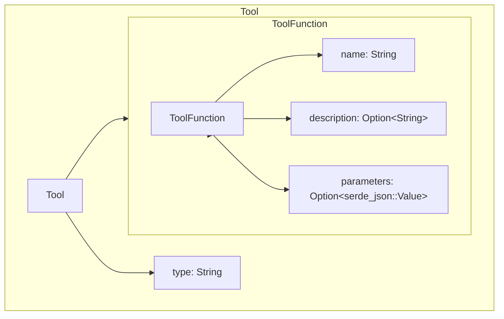
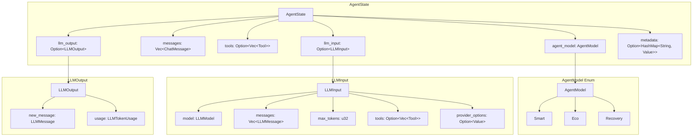
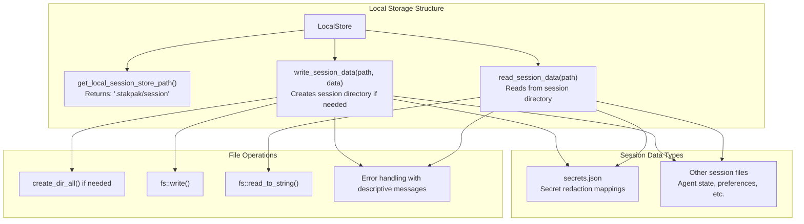

<!-- source: DeepWiki mcp.deepwiki.com · repo stakpak/agent · page 4.4 Data Models and Types · fetched 2026-10-27 -->

## Search and Integration Models

The search system provides web search and document scraping capabilities through Docker-based services.

**Search Data Structures**

```mermaid
graph TB
    subgraph "SearchClient"
        Client[SearchClient]
        ClientReqwest["client: ClientWithMiddleware"]
        ClientApiUrl["api_url: String"]
        
        Client --> ClientReqwest
        Client --> ClientApiUrl
    end
    
    subgraph "Search Types"
        SearchResult[SearchResult]
        ResultTitle["title: String"]
        ResultUrl["url: String"]
        ResultSnippet["snippet: Option&lt;String&gt;"]
        ResultEngine["engine: Option&lt;String&gt;"]
        ResultScore["score: Option&lt;f32&gt;"]
        
        SearchResult --> ResultTitle
        SearchResult --> ResultUrl
        SearchResult --> ResultSnippet
    end
    
    subgraph "Scraped Content"
        ScrapedContent[ScrapedContent]
        ScrapedUrl["url: String"]
        ScrapedTitle["title: Option&lt;String&gt;"]
        ScrapedContent2["content: Option&lt;String&gt;"]
        ScrapedMetadata["metadata: Option&lt;Value&gt;"]
        ScrapedError["error: Option&lt;String&gt;"]
        
        ScrapedContent --> ScrapedUrl
        ScrapedContent --> ScrapedTitle
        ScrapedContent --> ScrapedContent2
        ScrapedContent --> ScrapedError
    end
    
    subgraph "Search Requests"
        SearchRequest[SearchRequest]
        SearchQuery["query: String"]
        SearchLimit["limit: u32"]
        SearchLang["lang: String"]
        SearchEngines["engines: Option&lt;Vec&lt;String&gt;&gt;"]
        
        SearchRequest --> SearchQuery
        SearchRequest --> SearchLimit
    end
    
    subgraph "Analysis Types"
        AnalysisResult[AnalysisResult]
        AnalysisRequiredDocs["required_documentation: Vec&lt;String&gt;"]
        AnalysisReformulated["reformulated_query: String"]
        
        AnalysisResult --> AnalysisRequiredDocs
        AnalysisResult --> AnalysisReformulated
    end
    
    subgraph "Validation Types"
        ValidationResult[ValidationResult]
        ValidationSatisfied["is_satisfied: bool"]
        ValidationValidDocs["valid_docs: Vec&lt;ScrapedContent&gt;"]
        ValidationNeededUrls["needed_urls: Vec&lt;String&gt;"]
        ValidationNewQuery["new_query: Option&lt;String&gt;"]
        
        ValidationResult --> ValidationSatisfied
        ValidationResult --> ValidationValidDocs
    end
```



Sources: [libs/shared/src/models/integrations/search_service.rs:22-61](), [libs/shared/src/models/integrations/search_service.rs:119-229]()

### SearchServicesOrchestrator

The `SearchServicesOrchestrator` manages Docker containers for search functionality:

| Method | Purpose |
|--------|---------|
| `start()` | Start search services in Docker, returns `SearchConfig` |
| `stop()` | Stop and remove Docker containers |
| `check()` | Verify services are running |

**Search Configuration:**
```rust
pub struct SearchConfig {
    pub api_port: u16,
    pub api_container_id: String,
}
```

Sources: [libs/shared/src/models/integrations/search_service.rs:113-118](), [libs/shared/src/models/integrations/search_service.rs:232-415]()

### Search Workflow

The search system implements an iterative validation workflow:

1. **Query Analysis**: LLM analyzes search intent and reformulates query
2. **Search and Scrape**: Fetch results and scrape top URLs
3. **Validation**: LLM validates whether results satisfy requirements
4. **Iteration**: Refine query if needed, repeat up to 3 times

This workflow is implemented in `LocalClient::search_docs()` at [libs/api/src/local/mod.rs:509-614]().

## Request and Response Models

Various request types for integrations and external services.

### Search Requests

| Type | Fields | Purpose |
|------|--------|---------|
| `SearchDocsRequest` | `keywords`, `exclude_keywords`, `limit` | Web search request |
| `SearchMemoryRequest` | `keywords`, `start_time`, `end_time` | Memory search request |

Sources: [libs/api/src/models.rs:621-633]()

### Slack Integration Requests

| Type | Fields | Purpose |
|------|--------|---------|
| `SlackReadMessagesRequest` | `channel`, `limit` | Read channel messages |
| `SlackReadRepliesRequest` | `channel`, `ts` | Read thread replies |
| `SlackSendMessageRequest` | `channel`, `mrkdwn_text`, `thread_ts` | Send message |

Sources: [libs/api/src/models.rs:635-652]()

## Rulebook Models

Rulebooks contain reusable policies and standard operating procedures.



Sources: [libs/api/src/models.rs:494-596]()

### Rulebook Operations

| Type | Purpose |
|------|---------|
| `ListRuleBook` | Lightweight listing without content |
| `RuleBook` | Full rulebook with content |
| `CreateRuleBookInput` | Request to create new rulebook |
| `CreateRuleBookResponse` | Returns ID of created rulebook |

The `uri` field serves as a unique identifier in the format `owner/rulebook-name`.

Sources: [libs/api/src/models.rs:556-596]()

## Supporting Types

### Document Models

| Type | Fields | Purpose |
|------|--------|---------|
| `Document` | `content`, `uri`, `provisioner` | Full document with content |
| `SimpleDocument` | `uri`, `content` | Simplified document structure |

Sources: [libs/api/src/models.rs:257-267]()

### Account Models

| Type | Fields | Purpose |
|------|--------|---------|
| `GetMyAccountResponse` | `username`, `id`, `first_name`, `last_name`, `email`, `scope` | User account information |
| `APIKeyScope` | `type`, `name` | API key scope restrictions |

Sources: [libs/api/src/models.rs:525-554]()

### Session Statistics

The `AgentSessionStats` type provides analytics on tool usage and time savings:

```rust
pub struct AgentSessionStats {
    pub total_tool_calls: u32,
    pub successful_tool_calls: u32,
    pub failed_tool_calls: u32,
    pub aborted_tool_calls: u32,
    pub tools_usage: Vec<ToolUsageStats>,
    pub total_time_saved_seconds: Option<u32>,
    // ... other fields
}
```

Sources: [libs/api/src/models.rs:462-493]()

### Error Types

The `ApiStreamError` enum represents streaming errors:

| Variant | Description |
|---------|-------------|
| `AgentInputInvalid(String)` | Invalid input provided |
| `AgentStateInvalid` | Agent state is corrupted |
| `AgentExecutionLimitExceeded` | Too many execution steps |
| `CopilotError` | Backend overloaded |
| `Unknown(String)` | Other errors |

Sources: [libs/api/src/models.rs:15-63]()
# Data Models and Types

<details>
<summary>Relevant source files</summary>

The following files were used as context for generating this wiki page:

- [libs/api/Cargo.toml](libs/api/Cargo.toml)
- [libs/api/src/lib.rs](libs/api/src/lib.rs)
- [libs/api/src/local/mod.rs](libs/api/src/local/mod.rs)
- [libs/api/src/models.rs](libs/api/src/models.rs)
- [libs/mcp/server/README_SECRETS.md](libs/mcp/server/README_SECRETS.md)
- [libs/shared/src/container.rs](libs/shared/src/container.rs)
- [libs/shared/src/models/integrations/mod.rs](libs/shared/src/models/integrations/mod.rs)
- [libs/shared/src/models/integrations/search_service.rs](libs/shared/src/models/integrations/search_service.rs)

</details>


This document describes the core data structures used throughout the stakpak agent system. These types define the structure of information exchanged between components including the AgentProvider implementations, MCP tools, and the TUI.

For information about the AgentProvider abstraction, see [AgentProvider Trait](#4.1). For implementation details, see [Remote Client Implementation](#4.2) and [Local Client Implementation](#4.3).

## Overview of Data Model Categories

The stakpak system organizes data models into several categories:

| Category | Primary Types | Purpose |
|----------|--------------|---------|
| **Agent Sessions** | `AgentSession`, `AgentCheckpointListItem`, `RunAgentOutput` | Session management and checkpointing |
| **Messages** | `ChatMessage`, `MessageContent`, `Tool`, `ToolCall` | OpenAI-compatible chat interface |
| **Agent State** | `AgentState`, `LLMInput`, `LLMOutput` | Internal agent execution state |
| **Code Blocks** | `Block`, `Dependency`, `Point`, `Segment` | Infrastructure code representation |
| **Search** | `SearchResult`, `ScrapedContent`, `SearchClient` | Document search and scraping |
| **Integrations** | `SearchDocsRequest`, `SlackReadMessagesRequest` | External service integration |
| **Rulebooks** | `RuleBook`, `ListRuleBook` | Documentation and policies |

Sources: [libs/api/src/models.rs:1-764](), [libs/shared/src/models/integrations/search_service.rs:1-422]()

## Agent Session Models

Agent sessions represent persistent conversation contexts with checkpointing capabilities for resumable execution.

**AgentSession Structure**



Sources: [libs/api/src/models.rs:65-119]()

### Key Session Types

| Type | Fields | Purpose |
|------|--------|---------|
| `AgentSession` | `id`, `title`, `agent_id`, `visibility`, `checkpoints`, timestamps | Top-level session container |
| `AgentCheckpointListItem` | `id`, `status`, `execution_depth`, `parent`, timestamps | Individual checkpoint in execution tree |
| `AgentParentCheckpoint` | `id` | Reference to parent checkpoint for branching |
| `AgentStatus` | enum: Running, Complete, Blocked, Failed | Current checkpoint execution state |
| `AgentSessionVisibility` | enum: Private, Public | Session access control |

Sources: [libs/api/src/models.rs:65-166]()

### RunAgentOutput

The `RunAgentOutput` type represents the result of an agent execution, combining checkpoint metadata with the actual output:



Sources: [libs/api/src/models.rs:180-254]()

The `AgentOutput` enum is a tagged union that varies by agent type. For `PabloV1` (the current agent), it contains:
- `messages`: The conversation history as `Vec<ChatMessage>`
- `node_states`: Arbitrary state data as JSON

Sources: [libs/api/src/models.rs:228-254]()

## Message and Chat Models

The system uses OpenAI-compatible message types for chat interactions, defined in the `stakpak-shared` crate.

**ChatMessage Structure**



Sources: [libs/api/src/models.rs:8-9]() (imports from stakpak_shared)

### Tool Definition

The `Tool` struct defines available functions that the LLM can call:



Sources: [libs/api/src/models.rs:8-9]() (Tool imported from stakpak_shared)

### Usage Example

The message flow for a tool-calling conversation:

| Step | Role | Content | Tool Calls |
|------|------|---------|------------|
| 1 | User | "What files are in the current directory?" | None |
| 2 | Assistant | "" | `[{id: "call_1", function: {name: "run_command", arguments: '{"command": "ls"}'}}]` |
| 3 | Tool | "file1.txt\nfile2.py\nREADME.md" | None (tool_call_id: "call_1") |
| 4 | Assistant | "The directory contains: file1.txt, file2.py, and README.md" | None |

## Agent State Models

The `AgentState` struct represents the internal state during agent execution, used by hook systems and the LocalClient.

**AgentState and LLM Types**



Sources: [libs/api/src/models.rs:654-763]()

### AgentState Methods

The `AgentState` provides methods for state manipulation:

| Method | Purpose |
|--------|---------|
| `new(agent_model, messages, tools)` | Create new state |
| `set_messages(messages)` | Update message history |
| `set_tools(tools)` | Update available tools |
| `set_llm_input(input)` | Set input before inference |
| `set_llm_output(message, usage)` | Store inference result |
| `append_new_message(message)` | Add message to history |

Sources: [libs/api/src/models.rs:721-763]()

### LLM Model Types

The system supports multiple LLM providers through the `LLMModel` enum (defined in stakpak_shared):
- OpenAI models (GPT-4o, GPT-5, etc.)
- Anthropic models (Claude 4.5 Sonnet, Haiku)
- Google Gemini models
- AWS Bedrock models

The `AgentModel` enum maps to these via `ModelSet`:
- **Smart**: High-capability model (default: Claude 4.5 Sonnet)
- **Eco**: Cost-effective model (default: Claude 4.5 Haiku)
- **Recovery**: Fallback model (default: GPT-5)

Sources: [libs/api/src/local/mod.rs:52-98]()

## Code Block Models

The `Block` struct represents parsed infrastructure code segments with dependency tracking.

**Block Structure and Dependencies**



**Local Storage Implementation**

Sources: [libs/shared/src/local_store.rs:1-32]()

### Session File Management

The `LocalStore` provides simple file-based session management:

| Method | Purpose | Error Handling |
|--------|---------|---------------|
| `get_local_session_store_path()` | Returns `.stakpak/session` path | None - pure function |
| `write_session_data(path, data)` | Writes data to session file | Creates directory, descriptive errors |
| `read_session_data(path)` | Reads data from session file | File not found and I/O errors |

The session directory structure supports various types of session data, with `secrets.json` being the primary file for secret redaction mappings.

Sources: [libs/shared/src/local_store.rs:9-31]()

---

