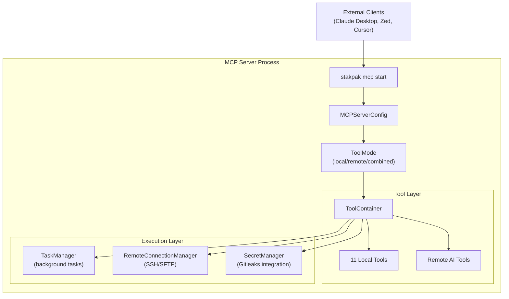
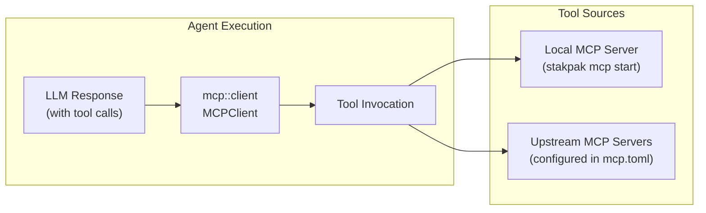
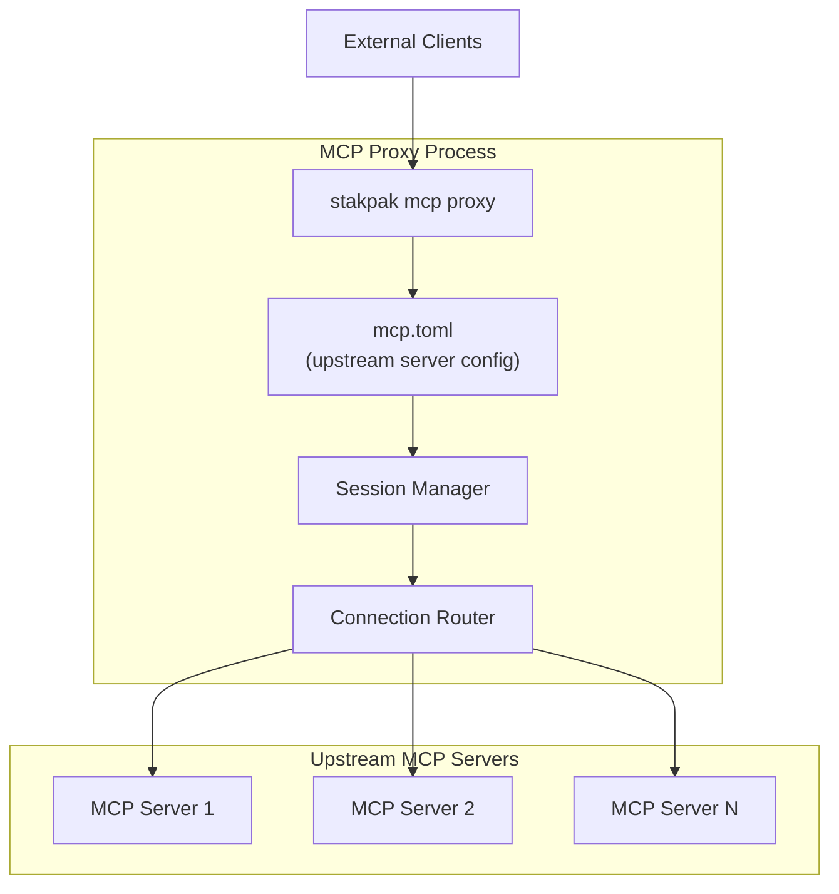
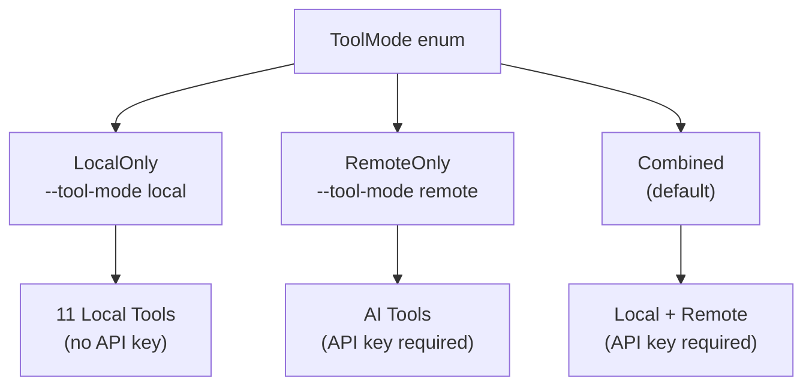
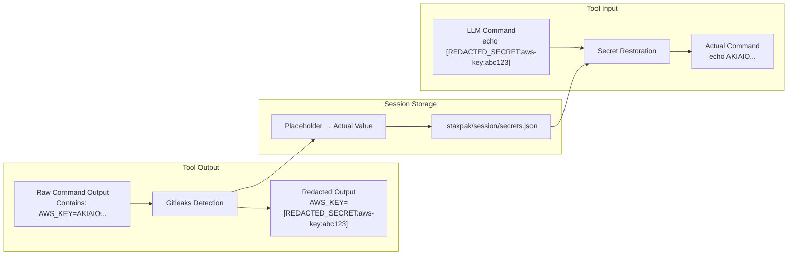
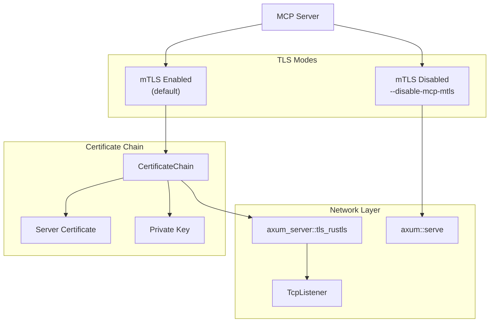
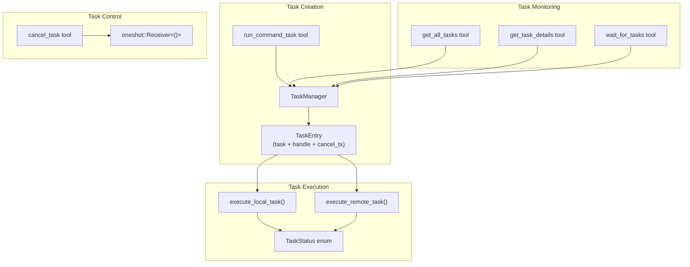
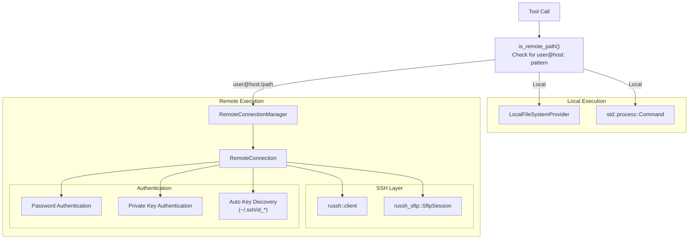
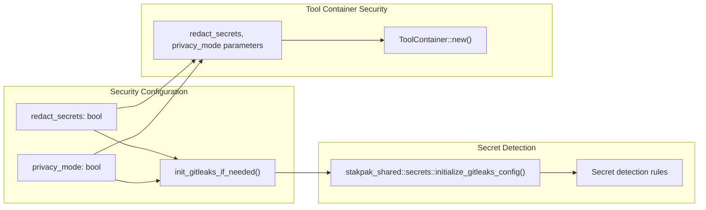

<!-- source: DeepWiki mcp.deepwiki.com · repo stakpak/agent · page 5 MCP (Model Context Protocol) System · fetched 2026-10-27 -->

# MCP (Model Context Protocol) System

Relevant source files

The following files were used as context for generating this wiki page:

- [README.md](README.md)
- [assets/stakpak-dark.png](assets/stakpak-dark.png)
- [assets/stakpak-light.png](assets/stakpak-light.png)
- [cli/src/utils/local_context.rs](cli/src/utils/local_context.rs)
- [libs/api/Cargo.toml](libs/api/Cargo.toml)
- [libs/api/src/lib.rs](libs/api/src/lib.rs)
- [libs/api/src/models.rs](libs/api/src/models.rs)
- [libs/mcp/server/README_SECRETS.md](libs/mcp/server/README_SECRETS.md)
- [libs/mcp/server/src/local_tools.rs](libs/mcp/server/src/local_tools.rs)
- [libs/shared/src/local_store.rs](libs/shared/src/local_store.rs)
- [libs/shared/src/remote_connection.rs](libs/shared/src/remote_connection.rs)
- [libs/shared/src/task_manager.rs](libs/shared/src/task_manager.rs)
- [libs/shared/src/utils.rs](libs/shared/src/utils.rs)

The MCP system enables Stakpak to integrate with external AI systems and code editors through a standardized protocol for tool execution. The system has three primary components: an **MCP Server** that exposes Stakpak's tools to external clients, an **MCP Client** that invokes tools during agent execution, and an **MCP Proxy** that multiplexes connections to multiple upstream MCP servers. This architecture allows Stakpak to function both as a tool provider (server) and a tool consumer (client/proxy).

The MCP system is central to Stakpak's security model, implementing mTLS encryption, dynamic secret redaction, and privacy-mode data filtering. It also provides the infrastructure for asynchronous task execution and remote operations over SSH/SFTP.

**Related Sections:**
- For CLI commands that launch MCP servers and proxies, see [CLI Interface](#2)
- For how the TUI displays and manages tool calls, see [Terminal User Interface (TUI)](#3)
- For the AgentProvider integration that uses the MCP client, see [Agent Provider and API](#4)
- For security features (secret management, Warden), see [Security and Privacy](#6)

**Subsections:**
- [5.1 MCP Architecture](#5.1) - Detailed architecture of server, client, and proxy components
- [5.2 Tool Container and Execution Flow](#5.2) - How tools are routed and executed
- [5.3 Local Tools Implementation](#5.3) - The 11 local tools and their implementations
- [5.4 Task Management System](#5.4) - Background task execution and monitoring
- [5.5 Remote Operations and SSH](#5.5) - SSH/SFTP for remote system operations

## MCP Components Overview

The MCP system consists of three distinct components that work together to provide comprehensive tool integration:

### MCP Server - Tool Provider

**Title:** MCP Server Component Architecture

The MCP Server (`stakpak mcp start`) exposes Stakpak's tools to external AI agents and code editors. It implements three operational modes:
- **Local Mode** (`--tool-mode local`): File operations, command execution, password generation (no API key required)
- **Remote Mode** (`--tool-mode remote`): AI-powered code generation, documentation search, memory operations (API key required)  
- **Combined Mode** (`--tool-mode combined`): All tools available (default, API key required)

Sources: [README.md:241-272](), [libs/mcp/server/src/lib.rs:19-27](), [libs/mcp/server/src/lib.rs:188-214]()

### MCP Client - Tool Consumer

The MCP Client enables Stakpak's agent to invoke tools during execution. It's used by both the CLI's async mode and the TUI's interactive mode to execute tool calls returned by the LLM.

**Title:** MCP Client Integration Flow

The client handles tool discovery, parameter validation, and result processing. It integrates with Stakpak's security model by enforcing `allowed_tools` filtering and secret redaction.

Sources: [Diagram 5 from context]()

### MCP Proxy - Connection Multiplexer

**Title:** MCP Proxy Architecture

The MCP Proxy (`stakpak mcp proxy`) acts as a reverse proxy that aggregates tools from multiple upstream MCP servers into a single endpoint. This allows external clients to access tools from different sources through one connection. Configuration is specified in `~/.stakpak/mcp.toml`.

Sources: [README.md:273-289](), [Diagram 4 from context]()

## Tool Categories and Capabilities

The MCP Server exposes 11 tools organized into several functional categories:

### File and Directory Operations

| Tool | Purpose | Local/Remote Support |
|------|---------|---------------------|
| `view` | Read file contents or list directory contents | Both (SSH/SFTP) |
| `create` | Create new files with specified content | Both (SSH/SFTP) |
| `str_replace` | Replace exact text matches in files | Both (SSH/SFTP) |
| `remove` | Delete files or directories | Both (SSH/SFTP) |

**Remote Path Format:** `user@host:/path` or `user@host#port:/path` for non-default SSH ports

Sources: [libs/mcp/server/src/local_tools.rs:83-100](), [libs/mcp/server/src/local_tools.rs:102-126](), [libs/mcp/server/src/local_tools.rs:128-144](), [libs/mcp/server/src/local_tools.rs:154-170]()

### Command Execution

| Tool | Purpose | Execution Model |
|------|---------|----------------|
| `run_command` | Execute shell commands synchronously | Blocks until complete |
| `run_command_task` | Execute shell commands asynchronously | Returns immediately with task ID |

Both tools support remote execution via SSH by specifying the `remote` parameter (`user@host` or `user@host:port`).

Sources: [libs/mcp/server/src/local_tools.rs:32-48](), [libs/mcp/server/src/local_tools.rs:198-245](), [libs/mcp/server/src/local_tools.rs:247-337]()

### Task Management

| Tool | Purpose |
|------|---------|
| `get_all_tasks` | List all background tasks with status |
| `get_task_details` | Get detailed output for a specific task |
| `cancel_task` | Terminate a running background task |
| `wait_for_tasks` | Block until specified tasks complete |

These tools enable monitoring and control of long-running operations like port forwarding, log tailing, or remote builds.

Sources: [libs/mcp/server/src/local_tools.rs:339-424](), [libs/mcp/server/src/local_tools.rs:426-459](), [libs/mcp/server/src/local_tools.rs:461-518](), [libs/mcp/server/src/local_tools.rs:520-591]()

### Utility Tools

| Tool | Purpose |
|------|---------|
| `generate_password` | Generate cryptographically secure passwords |
| `view_web_page` | Fetch and convert web pages to markdown |

Sources: [libs/mcp/server/src/local_tools.rs:147-152](), [libs/mcp/server/src/local_tools.rs:172-176]()

### Tool Mode Configuration

**Title:** Tool Mode and API Key Requirements

Sources: [libs/mcp/server/src/lib.rs:19-27](), [README.md:246-250]()

## Security and Privacy Features

The MCP system implements multiple security layers to protect sensitive data and prevent destructive operations:

### Secret Redaction with Gitleaks

**Title:** Secret Detection and Substitution Flow

The system uses Gitleaks to detect secrets in tool output (API keys, passwords, tokens) and replaces them with placeholders like `[REDACTED_SECRET:rule-id:hash]`. These placeholders can be used in subsequent commands and are automatically restored to actual values before execution. The mapping is stored in `.stakpak/session/secrets.json`.

**Controlled by:** `--disable-secret-redaction` flag (redaction enabled by default)

Sources: [libs/mcp/server/README_SECRETS.md:1-218](), [libs/mcp/server/src/local_tools.rs:192-196](), [README.md:269]()

### Privacy Mode

When enabled with `--privacy-mode`, the system redacts additional sensitive information:
- IP addresses
- AWS account IDs
- Other personally identifiable information

This is useful when sharing logs or screenshots of agent sessions.

Sources: [README.md:271](), [libs/mcp/server/src/lib.rs:19-27]()

### mTLS Encryption

**Title:** MCP Server TLS Configuration

By default, the MCP Server uses mutual TLS to encrypt all traffic between clients and the server. This provides end-to-end encryption and mutual authentication. TLS can be disabled for testing with `--disable-mcp-mtls`, but this is not recommended for production.

Sources: [README.md:57](), [README.md:264](), [libs/mcp/server/src/lib.rs:224-239]()

## Background Task Management

The MCP system includes a sophisticated task management layer for long-running operations:

**Title:** TaskManager Architecture

Tasks are tracked with unique IDs and support status monitoring, output streaming, cancellation, and timeout enforcement. Both local and remote (SSH) tasks are supported. See [Task Management System](#5.4) for implementation details.

Sources: [libs/shared/src/task_manager.rs:1-724](), [libs/mcp/server/src/local_tools.rs:247-337]()

## Remote Operations via SSH

The MCP system supports executing operations on remote systems through SSH/SFTP:

**Title:** Remote Operation Path Detection and Routing

### Remote Path Formats

- Standard: `user@host:/path/to/file`
- Custom port: `user@host#port:/path/to/file`
- SSH URL: `ssh://user@host/path/to/file`

### Authentication Methods

1. **Password**: Provided via `password` parameter
2. **Private Key**: Specified via `private_key_path` parameter
3. **Auto-Discovery**: Automatically searches `~/.ssh/` for common key files (`id_ed25519`, `id_rsa`, `id_ecdsa`, `id_dsa`)

The `RemoteConnectionManager` maintains a connection pool to avoid re-authenticating for each operation. See [Remote Operations and SSH](#5.5) for detailed implementation.

Sources: [libs/shared/src/remote_connection.rs:1-653](), [libs/mcp/server/src/local_tools.rs:183-190](), [libs/mcp/server/src/local_tools.rs:250-257]()

## Integration with Security Systems

The MCP server integrates closely with the stakpak security infrastructure, particularly for secret detection and privacy protection.

### Security Feature Integration

The security integration occurs at two levels:
- **Server Level**: Gitleaks configuration is initialized during server startup
- **Tool Level**: Security parameters are passed to the `ToolContainer` for per-operation filtering

Sources: [libs/mcp/server/src/lib.rs:81-94](), [libs/mcp/server/src/lib.rs:188-214]()

---

